# Schauspielergruppen: Ausbau

Redaktionell geprüft, mit dem App-Parser geprüft; noch nicht in der App installiert. Richtige Lösungen sind hier sichtbar.

## Peter Lorre · Bekanntheitsgruppe 3

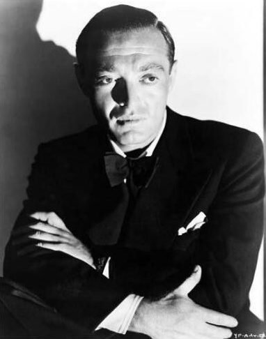

Bild: 1930er/1940er Jahre (genauer Zeitpunkt unbekannt); Urheber unbekannt. Public domain laut Wikimedia Commons. [Bildquelle](https://commons.wikimedia.org/wiki/File:Peter_Lorre_Portrait_Still.jpg), [TMDB](https://www.themoviedb.org/person/2094).

### L1 · leicht

Welche Rolle spielt Peter Lorre in Fritz Langs „M – Eine Stadt sucht einen Mörder“?

- Den leitenden Polizeiermittler

- **Richtig: Den gesuchten Kindermörder**

- Den blinden Straßenverkäufer

- Den Anführer der Unterwelt

Peter Lorre spielt den Kindermörder Hans Beckert.

Hans Beckert (Peter Lorre) versetzt mit seinen Kindermorden eine ganze Stadt in Angst. Fritz Lang zeigt dabei sowohl den Täter als auch eine Gesellschaft, deren Misstrauen immer weiter wächst. Schon eine gepfiffene Melodie kündigt Beckerts Nähe an, bevor man ihn sieht. Lorres Figur steht damit im Zentrum eines frühen Tonfilms, der Bedrohung nicht allein über sichtbare Gewalt erzeugt.

Merksatz: Lorre ist in „M“ der gesuchte Täter Hans Beckert.

Antwortzusätze:

- Den gesuchten Kindermörder: Peter Lorre verkörpert Hans Beckert, den gesuchten Kindermörder.

Gemeinsames Wissensziel: K-CLA-20-01 (CLA-L-039).

Quellen: [1](https://www.criterion.com/films/558-m).

### L2 · leicht

Welche Tätigkeit hat Peter Lorres Figur Ugarte in „Casablanca“?

- Er betreibt einen Nachtclub.

- Er leitet die örtliche Polizei.

- **Richtig: Er handelt mit Ausreisepapieren.**

- Er begleitet Sänger am Klavier.

Ugarte handelt mit Ausreisepapieren.

Ugarte (Peter Lorre) will gestohlene Transitbriefe verkaufen und danach selbst Casablanca verlassen. Vor seiner Verhaftung vertraut er die Dokumente Rick Blaine (Humphrey Bogart) an. Dadurch gelangen die begehrten Papiere in Ricks Hände. Lorres kurzer Auftritt setzt einen entscheidenden Teil der Handlung in Bewegung: Für Menschen auf der Flucht können diese Briefe den Weg aus der Stadt öffnen.

Merksatz: Ugarte bringt die Transitbriefe zu Rick.

Antwortzusätze:

- Er handelt mit Ausreisepapieren.: Ugarte ist der Händler, der Rick die Transitbriefe anvertraut.

Quellen: [1](https://catalog.afi.com/Film/27175-CASABLANCA).

### M1 · mittel

Wessen Begleiter ist Peter Lorre als Conseil in Disneys „20.000 Meilen unter dem Meer“?

- **Richtig: Des Wissenschaftlers Professor Aronnax**

- Des Kommandanten Kapitän Nemo

- Des Harpuniers Ned Land

- Des Kapitäns der Suchfregatte

Conseil begleitet Professor Aronnax.

Professor Aronnax (Paul Lukas), sein Begleiter Conseil (Peter Lorre) und der Harpunier Ned Land (Kirk Douglas) nehmen an der Suche nach einem vermeintlichen Seeungeheuer teil. Sie stoßen stattdessen auf Kapitän Nemo (James Mason) und die Nautilus. Lorre gehört hier zu einer Abenteuergruppe mit verschiedenen Blickwinkeln: wissenschaftlicher Neugier, vorsichtiger Begleitung und dem Tatendrang des Harpuniers.

Merksatz: Conseil gehört zu Aronnax; Ned Land ist der Harpunier.

Antwortzusätze:

- Des Wissenschaftlers Professor Aronnax: Conseil ist Professor Aronnax’ Begleiter.

Quellen: [1](https://d23.com/20000-leagues-under-the-sea-70-years-of-the-mightiest-motion-picture-of-them-all/).

### M2 · mittel

Wie setzt Joel Cairo (Peter Lorre) Sam Spade (Humphrey Bogart) in „Die Spur des Falken“ unter Druck, um dessen Büro zu durchsuchen?

- Er erpresst ihn mit kompromittierenden Fotos.

- Er kündigt eine Durchsuchung durch die Polizei an.

- Er nimmt Spades Sekretärin als Geisel.

- **Richtig: Er bedroht ihn mit einer Pistole.**

Joel Cairo bedroht Spade mit einer Pistole, um sein Büro zu durchsuchen.

Joel Cairo (Peter Lorre) sucht Sam Spade (Humphrey Bogart) wegen der schwarzen Falkenstatue auf und zieht eine Pistole. Spade entwaffnet ihn zunächst. Cairo bietet ihm daraufhin 5.000 Dollar für die Beschaffung der Statue; anschließend durchsucht er das Büro erneut mit vorgehaltener Waffe. Geschäftsvorschlag und Drohung liegen bei diesem Auftraggeber eng beieinander. Spade muss deshalb auch beim scheinbar vereinbarten Geschäft mit Gewalt rechnen.

Merksatz: Cairo verbindet sein Geldangebot mit einer Pistolenbedrohung.

Antwortzusätze:

- Er bedroht ihn mit einer Pistole.: Cairo hält Spade mit einer Pistole in Schach, während er das Büro durchsucht.

Quellen: [1](https://catalog.afi.com/Film/27025-THE-MALTESE-FALCON).

### S1 · schwer

Welcher Film brachte Peter Lorre 1934 seine erste englischsprachige Filmrolle?

- **Richtig: „Der Mann, der zuviel wusste“ von Alfred Hitchcock**

- „Die 39 Stufen“ von Alfred Hitchcock

- „Die Spur des Falken“ von John Huston

- „Casablanca“ von Michael Curtiz

Lorres erste englischsprachige Filmrolle war Abbott in Hitchcocks „Der Mann, der zuviel wusste“ von 1934.

In der britischen Originalfassung von „Der Mann, der zuviel wusste“ spielt Peter Lorre den Schurken Abbott. Ein Urlauberpaar gerät in eine politische Verschwörung; die Entführung seiner Tochter soll verhindern, dass es den Anschlagsplan verrät. Für Lorre bedeutete der Film den Einstieg in englischsprachige Rollen. Gemeint ist Hitchcocks Film von 1934, nicht dessen spätere Neufassung.

Merksatz: Hitchcocks britische Fassung von 1934 ist Lorres englischsprachiger Einstieg.

Antwortzusätze:

- „Der Mann, der zuviel wusste“ von Alfred Hitchcock: Criterion nennt den Film von 1934 Lorres erste englischsprachige Rolle.

Quellen: [1](https://www.criterion.com/films/27999-the-man-who-knew-too-much).

### S2 · schwer

Welchen Beruf hat Peter Lorres Dr. Einstein in „Arsen und Spitzenhäubchen“?

- Gerichtsmediziner

- **Richtig: Plastischer Chirurg**

- Anstaltspsychiater

- Apotheker

Dr. Einstein ist ein plastischer Chirurg aus dem kriminellen Milieu.

Dr. Einstein (Peter Lorre) kommt mit Jonathan Brewster (Raymond Massey) in das Haus der Familie. Der Chirurg hat Jonathans Gesicht so verändert, dass es Boris Karloff ähnelt. Während Mortimer Brewster (Cary Grant) bereits die tödlichen Gewohnheiten seiner Tanten zu bewältigen versucht, bringen die Neuankömmlinge einen weiteren Mordfall mit. Lorres Arzt gehört damit zur kriminellen Verwicklung der schwarzen Komödie.

Merksatz: Dr. Einstein verändert Gesichter für Verbrecher.

Antwortzusätze:

- Plastischer Chirurg: Einstein ist der plastische Chirurg, der Jonathan ein neues Gesicht gegeben hat.

Gemeinsames Wissensziel: K-KOM-202609-P02-S-081 (KOM-202609-P02-S-081).

Quellen: [1](https://catalog.afi.com/Film/27697-ARSENIC-AND-OLD-LACE).

### E1 · experte

Welche Aufgaben übernahm Peter Lorre beim deutschen Film „Der Verlorene“ von 1951?

- Hauptrolle und Filmmusik

- Hauptrolle und Kamera

- **Richtig: Regie, Mitarbeit am Szenario und Hauptrolle**

- Regie und Schnitt, ohne selbst mitzuspielen

Peter Lorre führte Regie, arbeitete am Szenario mit und spielte die Hauptrolle.

Peter Lorre führte Regie, schrieb mit am Szenario und spielte einen Wissenschaftler, der zum Mörder wird. Weil seine Forschung für das NS-Regime nützlich ist, bewahrt es ihn vor einer Strafe. Nach seiner Rückkehr nach Europa konnte Lorre mit diesem deutschen Film einen eigenen Stoff gestalten. Der Film fand jedoch kaum Publikum, und Lorre kehrte wieder in die USA zurück.

Merksatz: „Der Verlorene“ verbindet Lorres Regie, Schreibarbeit und Spiel.

Antwortzusätze:

- Regie, Mitarbeit am Szenario und Hauptrolle: Das MoMA nennt Regie, Mitarbeit am Szenario und die Hauptrolle.

Quellen: [1](https://www.moma.org/momaorg/shared/pdfs/docs/press_archives/2322/releases/MOMA_1958_0005_5.pdf), [2](https://www.filmportal.de/person/peter-lorre_167dd47a58b7400ab846ca10391437fb).

### E2 · experte

Welches Serienprofil hatte Peter Lorre als Mr. Moto in den späten 1930er Jahren?

- Er spielte einen britischen Anwalt in vier Gerichtsfilmen.

- Er spielte einen deutschen Arzt in sechs Horrorfilmen.

- Er spielte einen französischen Inspektor in fünf Komödien.

- **Richtig: Er spielte einen japanischen Ermittler in acht Kriminalfilmen.**

Lorre verkörperte den japanischen Ermittler Mr. Moto in acht Filmen.

Mit „Think Fast, Mr. Moto“ begann 1937 eine Reihe von acht Filmen mit Peter Lorre als Mr. Moto. Die Figur stammt von J. P. Marquand und verbindet geschäftliche Kontakte mit Ermittlungsarbeit. Im ersten Film deckt Moto einen Schmugglerring auf und bezeichnet sich schließlich als gelegentlichen Amateurdetektiv. Lorre konnte hier über mehrere Produktionen eine wiederkehrende Ermittlerfigur tragen, statt nur als Gegenspieler aufzutreten.

Merksatz: Mr. Moto ist Lorres wiederkehrender Ermittler in acht Filmen.

Antwortzusätze:

- Er spielte einen japanischen Ermittler in acht Kriminalfilmen.: Die acht Mr.-Moto-Filme stellen Lorre als wiederkehrenden japanischen Ermittler ins Zentrum.

Quellen: [1](https://catalog.afi.com/Catalog/moviedetails/1188), [2](https://mubi.com/en/us/films/think-fast-mr-moto).

## Charles Laughton · Bekanntheitsgruppe 3

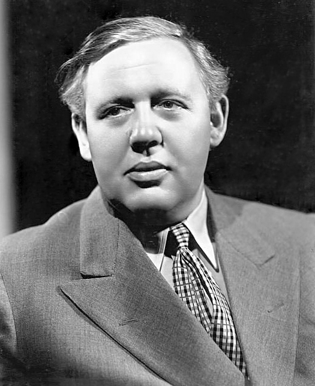

Bild: 1934; Clarence Sinclair Bull / MGM. Public domain laut Wikimedia Commons. [Bildquelle](https://commons.wikimedia.org/wiki/File:Charles_Laughton-publicity2.JPG), [TMDB](https://www.themoviedb.org/person/10921).

### L1 · leicht

Welche Figur spielt Charles Laughton in „Der Glöckner von Notre Dame“ von 1939?

- Frollo

- Gringoire

- Phoebus

- **Richtig: Quasimodo**

Charles Laughton spielt den Glöckner Quasimodo.

Quasimodo (Charles Laughton) lebt als Glöckner an Notre Dame. Als Esmeralda (Maureen O’Hara) zum Tod verurteilt wird, bringt er sie in die Kirche und beansprucht für sie Schutz. Frollo (Cedric Hardwicke) verfolgt die junge Frau weiter. Laughtons äußerlich stark verwandelte Figur wird damit zum Beschützer eines Menschen, den die vermeintlichen Hüter der Ordnung bedrohen.

Merksatz: Laughtons Quasimodo sucht für Esmeralda Schutz in Notre Dame.

Antwortzusätze:

- Quasimodo: Laughton verkörpert Quasimodo, den Glöckner.

Quellen: [1](https://catalog.afi.com/Film/5097-THE-HUNCHBACK-OF-NOTRE-DAME).

### L2 · leicht

Wen spielt Charles Laughton in „Meuterei auf der Bounty“ von 1935?

- **Richtig: Den Kapitän William Bligh**

- Den Meuterer Fletcher Christian

- Den jungen Offizier Roger Byam

- Den Inselhäuptling Hitihiti

Charles Laughton spielt Kapitän William Bligh.

Charles Laughton spielt Bligh als grausamen Kapitän, dessen Strafen und Versorgungspolitik die Mannschaft gegen ihn aufbringen. Fletcher Christian (Clark Gable) führt schließlich die Meuterei an und setzt ihn mit seinen Anhängern in einem offenen Boot aus. Diese Fassung von 1935 stellt Laughtons Autoritätsfigur ins Zentrum des Konflikts; sie ist von späteren Verfilmungen mit anderen Bligh-Darstellern zu unterscheiden.

Merksatz: Laughton ist Bligh in der Bounty-Fassung von 1935.

Antwortzusätze:

- Den Kapitän William Bligh: Laughton spielt Kapitän Bligh; Clark Gable ist Fletcher Christian.

Quellen: [1](https://catalog.afi.com/Film/7072-MUTINY-ON-THE-BOUNTY).

### M1 · mittel

Welche Aufgabe übernimmt Charles Laughton als Sir Wilfrid Robarts in „Zeugin der Anklage“?

- Er leitet als Richter den Mordprozess.

- **Richtig: Er verteidigt einen des Mordes beschuldigten Mann.**

- Er vertritt als Staatsanwalt die Anklage.

- Er untersucht als Gerichtsmediziner das Opfer.

Sir Wilfrid Robarts ist der Strafverteidiger des angeklagten Leonard Vole.

Sir Wilfrid Robarts (Charles Laughton) kehrt nach einem schweren Herzinfarkt in seinen Beruf zurück. Trotz ärztlicher Warnungen übernimmt er die Verteidigung von Leonard Vole (Tyrone Power), der unter Mordverdacht steht. Dessen Frau Christine (Marlene Dietrich) erweist sich als schwer durchschaubare Zeugin. Laughtons Verteidiger muss sowohl die Aussagen im Gerichtssaal als auch sein eigenes Vertrauen in die Beteiligten überprüfen.

Merksatz: Robarts verteidigt Leonard Vole und muss dessen Umfeld durchschauen.

Antwortzusätze:

- Er verteidigt einen des Mordes beschuldigten Mann.: Robarts übernimmt die Strafverteidigung von Leonard Vole.

Gemeinsames Wissensziel: K-CLA-11-01 (CLA-L-021).

Quellen: [1](https://catalog.afi.com/Film/52448-WITNESS-FOR-THE-PROSECUTION).

### M2 · mittel

Auf welcher Seite des römischen Machtgefüges steht Charles Laughtons Gracchus in „Spartacus“?

- Er ist Ausbilder in der Gladiatorenschule.

- Er ist Anführer der aufständischen Sklaven.

- **Richtig: Er ist ein politischer Gegenspieler des Crassus im Senat.**

- Er ist ein Seeräuber, der Fluchtschiffe anbietet.

Gracchus ist der politische Rivale des Crassus im römischen Senat.

Gracchus (Charles Laughton) bekämpft den Machtanspruch von Crassus (Laurence Olivier) mit politischen Manövern. Der Sklavenaufstand unter Spartacus (Kirk Douglas) berührt deshalb auch die Rivalität innerhalb Roms. Am Ende hilft Gracchus, Varinia (Jean Simmons) und ihrem Kind die Freiheit zu ermöglichen. Seine Figur gehört zum politischen Handlungsstrang des Films; dieser gestaltet die antike Geschichte ausdrücklich dramatisch um.

Merksatz: Gracchus führt den politischen Gegenkampf zu Crassus.

Antwortzusätze:

- Er ist ein politischer Gegenspieler des Crassus im Senat.: Gracchus ist Crassus’ politischer Rivale im Senat.

Quellen: [1](https://www.criterion.com/films/449-spartacus), [2](https://catalog.afi.com/Film/53291-SPARTACUS).

### S1 · schwer

Was versucht Charles Laughtons Dr. Moreau in „Island of Lost Souls“ mit seinen grausamen Experimenten zu erreichen?

- **Richtig: Tiere in menschenähnliche Wesen zu verwandeln**

- Menschen durch Einfrieren unsterblich zu machen

- Die Erinnerungen Verstorbener in Maschinen zu übertragen

- Unsichtbarkeit durch eine chemische Lösung herzustellen

Dr. Moreau versucht, Tiere durch grausame Eingriffe in menschenähnliche Wesen zu verwandeln.

Auf seiner abgelegenen Insel verwandelt Dr. Moreau (Charles Laughton) Tiere durch brutale medizinische Eingriffe in menschenähnliche Wesen. Der Gestrandete Edward Parker (Richard Arlen) entdeckt eine Welt, in der der Wissenschaftler zugleich experimentiert und herrscht. Die H.-G.-Wells-Verfilmung verbindet Körperhorror mit der Frage, was menschliches Verhalten ausmacht, wenn ausgerechnet der vermeintlich zivilisierte Forscher grausam handelt.

Merksatz: Moreau formt Tiere zu Menschenwesen und behandelt sie grausam.

Antwortzusätze:

- Tiere in menschenähnliche Wesen zu verwandeln: Moreau will Tiere zu menschenähnlichen Wesen umformen.

Quellen: [1](https://www.criterion.com/films/27861-island-of-lost-souls), [2](https://www.criterion.com/current/posts/2034-island-of-lost-souls-the-beast-flesh-creeping-back).

### S2 · schwer

Welche gefährliche Aufgabe erhält der Redakteur in „The Big Clock“ von Earl Janoth (Charles Laughton)?

- Er soll ein Geständnis für einen bereits verurteilten Täter schreiben.

- **Richtig: Er soll einen unbekannten Mann finden, dessen Spuren zu ihm selbst führen.**

- Er soll als falscher Arzt in einer psychiatrischen Klinik ermitteln.

- Er soll einen verschwundenen Verlagserben im Ausland suchen.

Janoth lässt George Stroud nach dem unbekannten Mann suchen, dessen Spuren zu Stroud selbst führen.

Verleger Earl Janoth (Charles Laughton) ermordet seine Geliebte und hat zuvor nur flüchtig einen Mann beim Verlassen ihrer Wohnung gesehen. Er beauftragt Redakteur George Stroud (Ray Milland), diesen Unbekannten zu finden. Stroud begreift, dass er selbst gesucht wird, und muss die Ermittlungen seiner Mitarbeiter lenken, ohne sich zu verraten. Janoths Verlagsapparat wird so zum Werkzeug einer Jagd im eigenen Haus.

Merksatz: Stroud leitet eine Suche, deren Ziel er selbst ist.

Antwortzusätze:

- Er soll einen unbekannten Mann finden, dessen Spuren zu ihm selbst führen.: Die Hinweise führen zu Stroud, der die Suche selbst leiten soll.

Quellen: [1](https://catalog.afi.com/Film/25465-THE-BIG-CLOCK).

### E1 · experte

Bei welchem Film mit Robert Mitchum als mörderischem Prediger führte Charles Laughton Regie?

- „Kap der Angst“

- „Goldenes Gift“

- **Richtig: „Die Nacht des Jägers“**

- „Angel Face“

Charles Laughton führte bei „Die Nacht des Jägers“ Regie.

In „Die Nacht des Jägers“ verfolgt Harry Powell (Robert Mitchum) eine Witwe und ihre Kinder, um an verborgenes Geld zu gelangen. Charles Laughton gestaltete den Film als Regisseur und arbeitete mit Kameramann Stanley Cortez. Nach dem damaligen Misserfolg bei Kritik und Publikum folgte kein weiterer eigener Regiefilm. Der später zum Klassiker gewordene Film bildet deshalb einen besonderen Seitenzweig seiner Schauspielkarriere.

Merksatz: „Die Nacht des Jägers“ zeigt Laughton hinter der Kamera.

Antwortzusätze:

- „Die Nacht des Jägers“: Laughton inszenierte „Die Nacht des Jägers“ mit Robert Mitchum.

Gemeinsames Wissensziel: K-FF-059-DIRECTOR (FF-059-DIRECTOR).

Quellen: [1](https://www.bfi.org.uk/features/behind-scenes-night-hunter).

### E2 · experte

An welchem Bühnenstück arbeitete Charles Laughton mit Bertolt Brecht an einer englischen Fassung und übernahm 1947 die Titelrolle?

- „Baal“

- „Der aufhaltsame Aufstieg des Arturo Ui“

- „Leben Eduards des Zweiten von England“

- **Richtig: „Leben des Galilei“**

Charles Laughton arbeitete mit Brecht an „Leben des Galilei“ und spielte Galilei.

Brecht und Charles Laughton entwickelten die englische Galilei-Fassung auch durch gemeinsames Vorspielen einzelner Sätze. Laughton war damit an der sprachlichen und darstellerischen Gestalt beteiligt, bevor er 1947 die Titelrolle übernahm. Nach den Atombombenabwürfen von 1945 rückte die Verantwortung des Wissenschaftlers stärker in den Mittelpunkt. Die Zusammenarbeit verbindet Laughtons Bühnenarbeit mit einer konkreten politischen und moralischen Neubearbeitung des Stücks.

Merksatz: Laughton erarbeitet und spielt Brechts englischen Galilei.

Antwortzusätze:

- „Leben des Galilei“: Die Zusammenarbeit galt „Leben des Galilei“; Laughton spielte die Titelrolle.

Quellen: [1](https://www.bpb.de/themen/deutschlandarchiv/325483/brecht-galilei-ideologiezertruemmerung/), [2](https://www.hansottotheater.de/digitale-programmhefte-2024_25/digitales_programmheft_galilei/).

## Gena Rowlands · Bekanntheitsgruppe 3

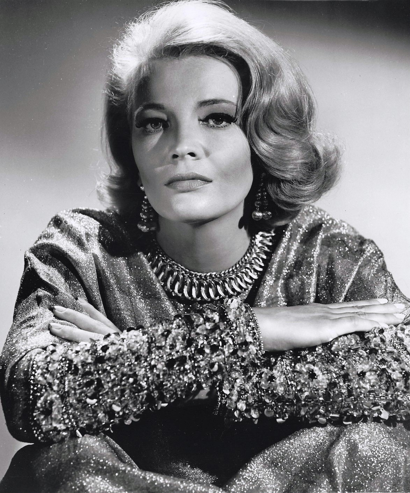

Bild: 1967; 20th Century Fox. Public domain laut Wikimedia Commons. [Bildquelle](https://commons.wikimedia.org/wiki/File:Gena_Rowlands_-_1967.JPG), [TMDB](https://www.themoviedb.org/person/4800).

### L1 · leicht

Mit welchem Regisseur entwickelte Gena Rowlands über Jahrzehnte Filme wie „Faces“ und „Eine Frau unter Einfluss“?

- **Richtig: John Cassavetes**

- Robert Altman

- Sidney Lumet

- Mike Nichols

John Cassavetes war ihr langjähriger künstlerischer Partner und Ehemann.

Rowlands und Cassavetes lernten sich an der American Academy of Dramatic Arts kennen und heirateten 1954. In ihren gemeinsamen Filmen stehen oft Beziehungen im Mittelpunkt, die zwischen Nähe, Verletzung und dem Wunsch nach Anerkennung schwanken. Rowlands spielte dabei sehr unterschiedliche Frauen: etwa Jeannie in „Faces“ und Mabel in „Eine Frau unter Einfluss“. Die Zusammenarbeit verband seine Regie und Drehbücher mit ihrer eigenständigen Gestaltung der Figuren.

Merksatz: Rowlands und Cassavetes: eine langjährige Zusammenarbeit im unabhängigen US-Kino.

Quellen: [1](https://www.criterion.com/films/510-a-woman-under-the-influence).

### L2 · leicht

Wen beschützt Gena Rowlands als Titelfigur in „Gloria“ (1980) vor der Mafia?

- Einen verfolgten Staatsanwalt

- **Richtig: Einen kleinen Jungen**

- Ihre jüngere Schwester

- Einen geflohenen Bankräuber

Gloria nimmt den Jungen Phil unter ihren Schutz.

Phils Vater hat als Buchhalter der Mafia Geld unterschlagen und mit dem FBI zusammengearbeitet. Als die Familie bedroht wird, versteckt sich Phil bei der Nachbarin Gloria. Nach der Ermordung seiner Angehörigen flieht sie mit ihm durch New York. Ein Geschäftsbuch, das der Vater seinem Sohn anvertraut hat, macht die Lage zusätzlich gefährlich. Rowlands spielt eine Frau, die den Gangstern selbstbewusst entgegentritt, obwohl sie zunächst keine Verantwortung für ein Kind übernehmen wollte.

Merksatz: Gloria schützt Phil vor den Mördern seiner Familie.

Quellen: [1](https://catalog.afi.com/Catalog/moviedetails/56421).

### M1 · mittel

Welche Beziehung steht im Zentrum von „Eine Frau unter Einfluss“ mit Gena Rowlands und Peter Falk?

- Eine Schauspielerin und ihr Theaterregisseur

- Eine Angeklagte und ihr Verteidiger

- **Richtig: Eine Ehefrau und ihr mit ihrer Krise überforderter Mann**

- Eine Tochter und ihr verschollener Vater

Rowlands und Falk spielen das Ehepaar Mabel und Nick Longhetti.

Mabel ist Hausfrau und Mutter dreier Kinder. Nick liebt sie, kann aber mit ihren emotionalen Schwierigkeiten kaum umgehen; auch Mabel versucht verzweifelt, seinen Erwartungen zu entsprechen. Cassavetes zeigt die Krise innerhalb alltäglicher Begegnungen mit der Familie. Die Darstellung reduziert die Ehe deshalb weder auf eine einfache Liebesgeschichte noch auf eine einzelne Diagnose: Zuneigung und Überforderung sind in den gemeinsamen Szenen gleichzeitig spürbar.

Merksatz: Mabel und Nick: gegenseitige Liebe schützt nicht vor Überforderung.

Antwortzusätze:

- Eine Schauspielerin und ihr Theaterregisseur: Die Theaterarbeit einer Schauspielerin steht in „Opening Night“ im Mittelpunkt.

Gemeinsames Wissensziel: K-F240-20261006-059-L1 (F240-20261006-059-L1).

Quellen: [1](https://www.criterion.com/films/510-a-woman-under-the-influence), [2](https://www.criterion.com/films/957-opening-night).

### M2 · mittel

Welches Erlebnis erschüttert die Schauspielerin Myrtle Gordon (Gena Rowlands) während der Theaterproben in „Opening Night“?

- Sie verliert bei einem Brand sämtliche Kostüme.

- Ihr Regisseur verlässt die Produktion.

- Eine Kollegin erhält heimlich ihre Rolle.

- **Richtig: Sie wird Zeugin des Unfalltodes einer jungen Verehrerin.**

Myrtle erlebt den Unfalltod eines jungen Fans mit.

Myrtle Gordon ist eine etablierte Bühnenschauspielerin. Der Tod der jungen Verehrerin trifft sie während der Vorbereitung einer neuen Rolle und verschärft ihre Auseinandersetzung mit dem eigenen Älterwerden. Proben, persönlicher Zusammenbruch und Vorstellungen greifen ineinander. John Cassavetes beobachtet damit nicht nur eine Krise hinter den Kulissen, sondern auch, wie eine Darstellerin um einen eigenen Zugang zu ihrer Rolle ringt.

Merksatz: Der Tod eines jungen Fans bringt Myrtles eigene Lebens- und Rollenkrise zum Vorschein.

Quellen: [1](https://www.criterion.com/films/957-opening-night).

### S1 · schwer

Welche Beziehung haben Sarah (Gena Rowlands) und Robert (John Cassavetes) in „Love Streams“?

- **Richtig: Sie sind Geschwister.**

- Sie sind ein geschiedenes Ehepaar.

- Sie sind Nachbarn ohne gemeinsame Vergangenheit.

- Sie sind Therapeutin und Patient.

Sarah Lawson und Robert Harmon sind Schwester und Bruder.

Sarah leidet unter der Trennung von ihrem Mann und ihrer Tochter, während Robert als Schriftsteller unverbindliche Begegnungen sucht. Erst spät macht der Film ausdrücklich klar, dass die beiden Geschwister sind. Ihre Vertrautheit gewinnt dadurch eine andere Bedeutung als eine mögliche Liebesgeschichte. Rowlands und Cassavetes waren im wirklichen Leben verheiratet; ihre Filmfiguren teilen hier dagegen eine Familiengeschichte und sehr unterschiedliche Schwierigkeiten mit dauerhaften Bindungen.

Merksatz: Das reale Ehepaar spielt in „Love Streams“ ein Geschwisterpaar.

Antwortzusätze:

- Sie sind ein geschiedenes Ehepaar.: Rowlands und Cassavetes waren außerhalb des Films verheiratet.

Quellen: [1](https://www.criterion.com/current/posts/3261-love-streams-a-fitful-flow), [2](https://www.criterion.com/films/28032-love-streams).

### S2 · schwer

Welchen Beruf übt Victoria Snelling (Gena Rowlands), Corkys Fahrgast in „Night on Earth“, aus?

- Sie ist Kriminalreporterin.

- **Richtig: Sie arbeitet im Filmcasting.**

- Sie ist Hotelmanagerin.

- Sie arbeitet als Konzertpianistin.

Victoria ist eine Castingagentin und sucht nach Darstellern.

In der Los-Angeles-Episode sitzt Rowlands als Victoria im Taxi der jungen Corky (Winona Ryder). Die Castingagentin sieht in ihrer Fahrerin eine mögliche Darstellerin. Jim Jarmusch verteilt den Film auf fünf nächtliche Taxibegegnungen in verschiedenen Städten; hier begegnen sich besonders deutlich Filmindustrie und alltägliche Arbeit. Rowlands’ Rolle verlagert die Suche nach einer passenden Besetzung aus einem Vorsprechraum in ein zufälliges Gespräch während einer Fahrt.

Merksatz: Victoria entdeckt beim Taxifahren eine mögliche Darstellerin.

Quellen: [1](https://www.criterion.com/films/227-night-on-earth).

### E1 · experte

Welche Verbindung hatte das Haus von Roberts Figur in „Love Streams“ zu Gena Rowlands und John Cassavetes?

- Es war ein eigens gebautes Studiodekor.

- Es gehörte ausschließlich dem Autor der Bühnenvorlage.

- **Richtig: Es war ihr eigenes Wohnhaus.**

- Es war das Wohnhaus von Peter Falk.

Roberts Haus war das tatsächliche Zuhause von Rowlands und Cassavetes.

Das Haus in den Hollywood Hills war bereits bei „Faces“ als Drehort verwendet worden. In „Love Streams“ wird es zu Roberts großzügigem, zugleich wenig geborgenem Lebensraum und zum Treffpunkt der Geschwister. Das Ehepaar nutzte den eigenen Wohnort auch, um Kosten seiner unabhängigen Produktionen zu senken. Privater Alltag und Filmarbeit lagen dadurch räumlich eng beieinander, obwohl die gespielten Beziehungen keine einfache Wiedergabe ihrer Ehe sind.

Merksatz: Das eigene Haus wurde zum Schauplatz fremder, erfundener Beziehungen.

Quellen: [1](https://www.criterion.com/current/posts/3261-love-streams-a-fitful-flow).

### E2 · experte

Wie war Gena Rowlands’ Oscar-Auszeichnung bei den Governors Awards 2015 eingeordnet?

- Als Wettbewerbspreis für eine Nebenrolle

- Als Jean Hersholt Humanitarian Award

- Als Wettbewerbspreis für eine Hauptrolle

- **Richtig: Als Ehrenoscar für ihre filmische Leistung**

Rowlands erhielt 2015 einen Honorary Award, also einen Ehrenoscar.

Die Academy zeichnete Rowlands bei den Governors Awards am 14. November 2015 mit einem Ehrenoscar aus. Bei derselben Veranstaltung erhielt Spike Lee ebenfalls einen Honorary Award; Debbie Reynolds wurde dagegen mit dem Jean Hersholt Humanitarian Award für ihr humanitäres Engagement geehrt. Die Unterscheidung ist wesentlich: Rowlands’ Auszeichnung würdigte ihre Leistung über eine einzelne Rolle und den Wettbewerb eines Filmjahres hinaus.

Merksatz: Governors Awards 2015: Rowlands erhielt den Ehrenoscar, Reynolds den Hersholt-Preis.

Antwortzusätze:

- Als Jean Hersholt Humanitarian Award: Der humanitäre Hersholt-Preis ging bei dieser Veranstaltung an Debbie Reynolds.

Quellen: [1](https://www.oscars.org/governors/ceremonies/2015), [2](https://www.oscars.org/news/spike-lee-debbie-reynolds-and-gena-rowlands-receive-academys-2015-governors-awards).

## Deborah Kerr · Bekanntheitsgruppe 3

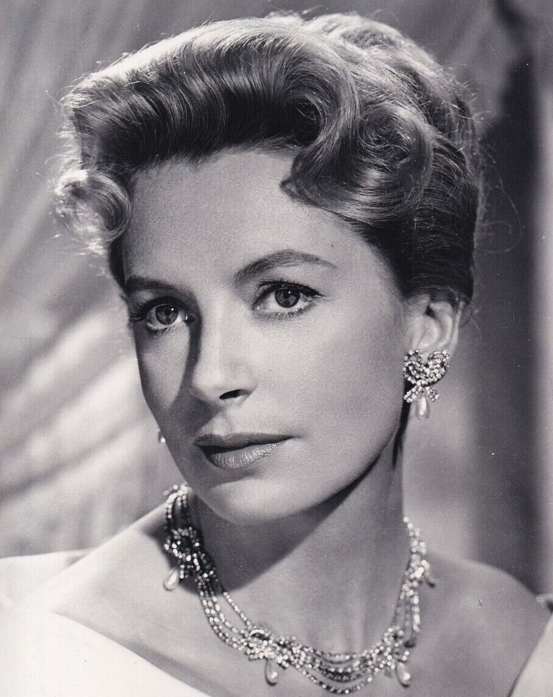

Bild: 1958; Urheber unbekannt. Public domain laut Wikimedia Commons. [Bildquelle](https://commons.wikimedia.org/wiki/File:Deborah_Kerr_press_photo_(cropped).jpg), [TMDB](https://www.themoviedb.org/person/20141).

### L1 · leicht

Mit welcher Aufgabe kommt Anna Leonowens (Deborah Kerr) in „Der König und ich“ an den Hof von Siam?

- **Richtig: Sie soll die Kinder des Königs unterrichten.**

- Sie soll einen Handelsvertrag aushandeln.

- Sie soll das königliche Krankenhaus leiten.

- Sie soll ein Hoforchester aufbauen.

Anna wird als Lehrerin für die Kinder des Königs eingestellt.

Anna reist als verwitwete Engländerin mit ihrem Sohn Louis nach Bangkok. Ihre Arbeit bringt sie mit König Mongkut (Yul Brynner) zusammen, dessen Autorität und Erwartungen sie wiederholt herausfordert. Das Musical gestaltet daraus Konflikte um Erziehung, Umgangsformen und persönliche Achtung. Es erzählt eine dramatisierte Geschichte; seine englische Perspektive auf Siam ist von einem verlässlichen historischen Bild des Landes zu unterscheiden.

Merksatz: Anna kommt als Lehrerin an den Hof von Siam.

Quellen: [1](https://catalog.afi.com/Film/51891-THE-KING-AND-I).

### L2 · leicht

In welchem Gebirge sollen die Nonnen um Clodagh (Deborah Kerr) in „Die schwarze Narzisse“ ein Kloster aufbauen?

- In den Alpen

- **Richtig: Im Himalaya**

- In den Anden

- In den Rocky Mountains

Die Nonnen errichten ihre Niederlassung im Himalaya.

Die Schwestern übernehmen einen abgelegenen Palast und wollen dort eine religiöse Niederlassung mit Schule und medizinischer Versorgung einrichten. Die ungewohnte Umgebung, Isolation und persönliche Spannungen untergraben ihre Disziplin. Kerr spielt die junge Oberin, Kathleen Byron die zunehmend aufgewühlte Schwester Ruth. Michael Powell und Emeric Pressburger verbinden den Konflikt zwischen geistlichem Anspruch und verdrängten Gefühlen mit einer auffallend sinnlichen Farb- und Raumgestaltung.

Merksatz: Clodagh soll im Himalaya ein Kloster führen – und gerät an persönliche Grenzen.

Quellen: [1](https://www.criterion.com/films/632-black-narcissus).

### M1 · mittel

Warum verpasst Terry McKay (Deborah Kerr) in „Die große Liebe meines Lebens“ das vereinbarte Treffen am Empire State Building?

- Ihr Schiff wird auf See aufgehalten.

- Sie entscheidet sich für eine Auslandsreise.

- **Richtig: Sie wird auf dem Weg von einem Auto angefahren.**

- Sie wird wegen eines Diebstahls festgenommen.

Terry erleidet auf dem Weg zum Treffpunkt einen Verkehrsunfall.

Terry und Nickie Ferrante (Cary Grant) lernen sich auf einer Atlantiküberfahrt kennen. Beide sind anderweitig gebunden und vereinbaren ein Wiedersehen nach sechs Monaten. Nickie wartet vergeblich, weil Terry bei einem Unfall schwer verletzt wird. Sie möchte ihm später nicht als hilfsbedürftig gegenübertreten und verschweigt den Grund ihres Fernbleibens. Dadurch hält Nickie ihre Abwesenheit zunächst für eine persönliche Zurückweisung.

Merksatz: Ein Unfall verhindert das Treffen; das Schweigen darüber verlängert die Trennung.

Quellen: [1](https://catalog.afi.com/Catalog/MovieDetails/52082).

### M2 · mittel

Mit wem beginnt Karen Holmes (Deborah Kerr), die Frau des Kompaniechefs, in „Verdammt in alle Ewigkeit“ eine Beziehung?

- Mit dem Soldaten Robert E. Lee Prewitt

- Mit dem Soldaten Angelo Maggio

- Mit dem Gefängnisaufseher Fatso Judson

- **Richtig: Mit Sergeant Milton Warden**

Karen beginnt eine Beziehung mit Sergeant Warden, gespielt von Burt Lancaster.

Karen ist in ihrer Ehe mit Captain Dana Holmes (Philip Ober) unglücklich. Warden organisiert den Alltag der Kompanie, während sein Vorgesetzter eigene Interessen verfolgt. Die heimliche Beziehung der beiden verknüpft die private Krise mit der militärischen Rangordnung. Karen hofft, Warden werde Offizier und ermögliche ihr eine gemeinsame Zukunft; seine Haltung zur Offizierslaufbahn macht diesen Ausweg schwieriger, als sie erwartet.

Merksatz: Karen und Warden: eine heimliche Beziehung innerhalb der militärischen Hierarchie.

Antwortzusätze:

- Mit dem Soldaten Robert E. Lee Prewitt: Prewitt wird von Montgomery Clift gespielt; seine Liebesbeziehung verbindet ihn mit Lorene (Donna Reed).

- Mit dem Soldaten Angelo Maggio: Angelo Maggio, gespielt von Frank Sinatra, ist Prewitts Freund.

- Mit dem Gefängnisaufseher Fatso Judson: Fatso Judson wird von Ernest Borgnine gespielt und ist Aufseher im Militärgefängnis.

Quellen: [1](https://catalog.afi.com/Film/50845-FROM-HERE-TO-ETERNITY).

### S1 · schwer

Auf welcher Erzählung von Henry James beruht „Schloss des Schreckens“ mit Deborah Kerr als Gouvernante Miss Giddens?

- **Richtig: The Turn of the Screw – Die Drehung der Schraube**

- The Aspern Papers – Die Aspern-Schriften

- Daisy Miller

- The Beast in the Jungle – Das Tier im Dschungel

„The Innocents“ greift Henry James’ „The Turn of the Screw“ auf.

Miss Giddens übernimmt die Betreuung zweier Kinder auf einem Landsitz und glaubt, dass unheimliche Mächte auf sie einwirken. Jack Claytons Film arbeitet mit Unsicherheit darüber, wie ihre Wahrnehmung zu verstehen ist. William Archibald und Truman Capote schrieben das Drehbuch; auch Archibalds Bühnenbearbeitung der James-Erzählung gehört zur Vorgeschichte. Kerr spielt die Gouvernante mit einer Überzeugung, die das Publikum nicht automatisch als Beweis für die Geistererscheinungen nehmen muss.

Merksatz: James’ „The Turn of the Screw“ führt zu Kerrs unheimlicher Gouvernante.

Quellen: [1](https://www.criterion.com/films/28569-the-innocents).

### S2 · schwer

Wie verteilen sich Deborah Kerrs Auftritte in „Leben und Sterben des Colonel Blimp“ auf die Figuren?

- Sie spielt dieselbe Frau vom Kind bis zur Greisin.

- **Richtig: Sie spielt drei verschiedene Frauen aus aufeinanderfolgenden Generationen.**

- Sie spielt zwei Zwillingsschwestern derselben Generation.

- Sie spielt eine Schauspielerin und deren erfundene Filmfigur.

Kerr spielt Edith Hunter, Barbara Wynne und „Johnny“ Cannon: drei verschiedene Frauen.

Der Film begleitet Clive Candy (Roger Livesey) durch vier Jahrzehnte. Kerr erscheint als engagierte Gouvernante, als Krankenschwester und als moderne Fahrerin der Armee. Ihre ähnlichen Gesichter verbinden Candys Erinnerungen an geliebte Menschen mit einer Welt, die sich weiterentwickelt. Es handelt sich um eigenständige Figuren; die Mehrfachbesetzung zeigt keine einzelne Frau, die über den ganzen Zeitraum altert.

Merksatz: Drei Frauen, drei Generationen – dieselbe Darstellerin Deborah Kerr.

Quellen: [1](https://www.criterion.com/films/359-the-life-and-death-of-colonel-blimp).

### E1 · experte

Wen führt das AFI als Gesangsdoppel für Deborah Kerr im englischen Original von „Der König und ich“?

- Betty Wand

- India Adams

- **Richtig: Marni Nixon**

- Shirley Jones

Marni Nixon lieferte Kerrs Gesangsdoppel für die Rolle der Anna.

Kerr verkörpert Anna Leonowens vor der Kamera, während Nixon den wesentlichen Anteil ihres Gesangs übernimmt. Das AFI führt diese Arbeit ausdrücklich als Gesangsdoppel auf. Der sichtbare Auftritt und die Gesangsaufnahme stammen damit von unterschiedlichen Künstlerinnen. Nixon wird im AFI auch als Kerrs Gesangsdoppel bei „Die große Liebe meines Lebens“ genannt; die Zusammenarbeit beschränkte sich also nicht auf das bekannte Rodgers-und-Hammerstein-Musical.

Merksatz: Kerr spielt Anna, Marni Nixon übernimmt den wesentlichen Gesang.

Quellen: [1](https://catalog.afi.com/Catalog/PersonDetails/107627), [2](https://catalog.afi.com/Film/51891-THE-KING-AND-I), [3](https://catalog.afi.com/Catalog/MovieDetails/52082).

### E2 · experte

Wo wollte Fred Zinnemann Außenaufnahmen für „Der endlose Horizont“ mit Deborah Kerr drehen, obwohl Warner Bros. günstigere US-Ersatzorte bevorzugte?

- In Südafrika

- In Neuseeland

- In Mexiko

- **Richtig: In Australien**

Zinnemann setzte Außenaufnahmen in Australien durch.

Warner Bros. wollte die australische Landschaft zunächst durch günstigere Drehorte in Arizona oder Kalifornien ersetzen. Zinnemann überzeugte das Studio, einen Teil der Außenaufnahmen in Australien zuzulassen; die Produktion wurde zugleich in London angesiedelt. Kerr und Robert Mitchum spielen ein Ehepaar, das mit seinem Sohn von Arbeit zu Arbeit zieht. Der Streit um reale Drehorte gehört zur Produktionsgeschichte, während der Wunsch der Frau nach einer Farm den Familienkonflikt innerhalb der Handlung bestimmt.

Merksatz: Australische Handlung, echte australische Außenaufnahmen – nach Verhandlungen mit dem Studio.

Quellen: [1](https://catalog.afi.com/Catalog/moviedetails/53300).

## Setsuko Hara · Bekanntheitsgruppe 4

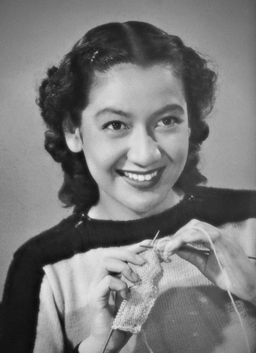

Bild: um 1951; Akiyama Shōtarō. Public domain laut Wikimedia Commons. [Bildquelle](https://commons.wikimedia.org/wiki/File:Setsuko_Hara_smiling_2.jpg), [TMDB](https://www.themoviedb.org/person/95504).

### L1 · leicht

Mit welchem Regisseur verbindet Setsuko Hara eine Reihe von Familiendramen, darunter „Später Frühling“ und „Die Reise nach Tokio“?

- **Richtig: Yasujirō Ozu**

- Akira Kurosawa

- Kenji Mizoguchi

- Mikio Naruse

Beide Filme gehören zu Setsuko Haras Zusammenarbeit mit Yasujirō Ozu.

Ozu besetzte Hara in sechs Filmen. Besonders bekannt wurden ihre Darstellungen von Frauen, deren eigene Wünsche mit Erwartungen innerhalb der Familie zusammentreffen. In „Später Frühling“ steht eine Tochter unter Heiratsdruck; in „Die Reise nach Tokio“ schenkt eine verwitwete Schwiegertochter den alten Eltern Aufmerksamkeit. Hara arbeitete daneben auch mit anderen bedeutenden Regisseuren, darunter Kurosawa und Naruse.

Merksatz: Hara und Ozu: Familienbindungen zwischen Fürsorge und eigenem Leben.

Antwortzusätze:

- Akira Kurosawa: Hara spielte auch für Kurosawa, etwa in „No Regrets for Our Youth“.

- Mikio Naruse: Auch Naruse arbeitete mit Hara, beispielsweise bei „Repast“.

Quellen: [1](https://www.criterionchannel.com/collections/FvcBzyks/starring-setsuko-hara), [2](https://www.criterion.com/films/298-late-spring), [3](https://www.criterion.com/films/284-tokyo-story).

### L2 · leicht

In welchem Verhältnis steht Noriko (Setsuko Hara) zu dem alten Ehepaar in „Die Reise nach Tokio“?

- Sie ist dessen jüngste Tochter.

- **Richtig: Sie ist dessen verwitwete Schwiegertochter.**

- Sie ist dessen Enkelin.

- Sie ist eine bezahlte Pflegerin.

Noriko ist die Witwe eines Sohnes des Ehepaars.

Shūkichi (Chishū Ryū) und Tomi (Chieko Higashiyama) besuchen ihre erwachsenen Kinder in Tokio. Diese haben wenig Zeit für sie. Ausgerechnet Noriko, deren Mann im Krieg gestorben ist, begegnet ihnen mit besonderer Herzlichkeit. Ihre Aufmerksamkeit steht dem Verhalten der leiblichen Kinder gegenüber. Die Verbindung zur Familie besteht für sie über den Tod ihres Mannes hinaus.

Merksatz: Norikos Fürsorge gilt den Eltern ihres verstorbenen Mannes.

Quellen: [1](https://www.bfi.org.uk/features/tokyo-story-anatomy-classic), [2](https://www.criterion.com/films/284-tokyo-story).

### M1 · mittel

Welche Sorge hält Noriko (Setsuko Hara) in „Später Frühling“ besonders davon ab, zu heiraten?

- Sie müsste eine erfolgreiche Bühnenkarriere aufgeben.

- Sie würde das Erbe ihrer Mutter verlieren.

- **Richtig: Ihr verwitweter Vater würde allein zurückbleiben.**

- Ihr Verlobter verlangt einen Umzug nach Europa.

Noriko möchte ihren verwitweten Vater nicht allein zurücklassen.

Noriko und ihr Vater Shūkichi Somiya (Chishū Ryū) leben in einer vertrauten Gemeinschaft. Die Forderung ihrer Tante, Noriko müsse bald heiraten, bedroht dieses eingespielte Zusammenleben. Der Vater gibt schließlich vor, selbst wieder heiraten zu wollen, damit seine Tochter ohne Schuldgefühl gehen kann. Die angestrebte gesellschaftliche Normalität verlangt hier den Verlust eines bereits als glücklich erlebten Alltags.

Merksatz: Norikos Heiratskonflikt beginnt mit der Bindung an ihren Vater.

Quellen: [1](https://www.bfi.org.uk/film/797ab4f5-e457-5b07-9ca6-63d347f7da5a/late-spring), [2](https://www.criterion.com/films/298-late-spring).

### M2 · mittel

Welche Heiratsentscheidung trifft Noriko (Setsuko Hara) in „Weizenherbst“ gegen die Erwartungen ihrer Familie?

- Sie heiratet heimlich ihren eigenen Vorgesetzten.

- Sie sagt einem wohlhabenden Kandidaten ihrer Familie zu.

- Sie entscheidet sich für einen Mann, den sie noch nie gesehen hat.

- **Richtig: Sie wählt einen verwitweten Jugendfreund mit einem Kind.**

Noriko entscheidet sich für ihren verwitweten Jugendfreund Kenkichi.

Die Familie möchte Norikos Zukunft über einen geeigneten Ehemann sichern. Noriko wählt jedoch Kenkichi Yabe (Hiroshi Nihonyanagi), einen vertrauten Mann aus ihrer Umgebung, der bereits ein Kind hat. Sie erfüllt damit zwar die Erwartung, zu heiraten, bestimmt den Partner aber selbst. Ihre Entscheidung erschüttert das bisherige Familiengefüge und verbindet persönliche Selbstständigkeit mit dem Abschied vom gemeinsamen Haushalt.

Merksatz: Noriko heiratet nach eigener Wahl und verändert damit die Familie.

Quellen: [1](https://www.criterion.com/films/875-early-summer), [2](https://www.criterion.com/current/posts/675-early-summer), [3](https://www.eastman.org/sites/default/files/GEM-2022_NPS-catalogue-wBlindDate_web.pdf).

### S1 · schwer

Welche Entwicklung durchläuft Yukie (Setsuko Hara) in Kurosawas „No Regrets for Our Youth“?

- **Richtig: Von einer privilegierten Professorentochter zu einer gesellschaftlich engagierten Frau**

- Von einer Fabrikarbeiterin zur überzeugten Unterstützerin der Militärführung

- Von einer verfolgten Aktivistin zur unpolitischen Hofdame

- Von einer Bäuerin zur Gründerin eines Rüstungskonzerns

Yukie verlässt ihre privilegierte Ausgangslage und entwickelt gesellschaftliches Engagement.

Akira Kurosawas erster Nachkriegsfilm begleitet Yukie über ein Jahrzehnt japanischer Geschichte. Die Professorentochter muss ihre bisherige Lebenshaltung überprüfen und lernt ein Leben außerhalb ihrer geschützten Herkunft kennen. Ihre Entwicklung führt zur Auseinandersetzung mit dem japanischen Kriegsstaat. Hara verkörpert damit eine aktive, sich verändernde Hauptfigur und nicht nur die Angehörige eines männlichen Helden.

Merksatz: Haras Yukie gewinnt Haltung, indem sie ihre geschützte Welt verlässt.

Quellen: [1](https://www.criterion.com/films/887-no-regrets-for-our-youth), [2](https://player.bfi.org.uk/subscription/film/watch-no-regrets-for-our-youth-1946-online).

### S2 · schwer

Was unternimmt Michiyo (Setsuko Hara) in Naruses „Repast“, um Abstand von ihrer unbefriedigenden Ehe zu gewinnen?

- Sie nimmt ohne ihren Mann eine Arbeit als Filmschauspielerin an.

- **Richtig: Sie kehrt zu ihrer Mutter zurück und sucht nach einer Arbeit.**

- Sie lässt ihren Mann wegen eines Diebstahls verhaften.

- Sie zieht gemeinsam mit der Nichte dauerhaft ins Ausland.

Michiyo geht zu ihrer Mutter und prüft durch Arbeitssuche ein selbstständiges Leben.

Nach fünf Ehejahren ist Michiyos Alltag in Osaka von Haushalt und Monotonie geprägt. Der Besuch der jungen Nichte Satoko (Yukiko Shimazaki) verschärft die Spannungen mit ihrem Mann Hatsunosuke (Ken Uehara). Bei ihrer Mutter versucht Michiyo, die Ehe aus anderer Entfernung zu betrachten und eine eigene Existenz aufzubauen. Am Ende kehrt sie mit ihrem Mann zurück; der vorübergehende Aufbruch bleibt ein wesentlicher Teil ihrer Entscheidung.

Merksatz: Michiyo sucht außerhalb des Ehehaushalts nach einer eigenen Möglichkeit.

Quellen: [1](https://www.3continents.com/en/film/le-repas/), [2](https://www.criterionchannel.com/videos/repast).

### E1 · experte

Wie verändert sich Setsuko Haras Position im Familienkonflikt zwischen „Später Frühling“ und dessen Neuvariation „Spätherbst“?

- Sie wechselt von der Tochter zur verwitweten Schwiegertochter.

- Sie wechselt von der Mutter zur unverheirateten Tochter.

- **Richtig: Sie wechselt von der Tochter zur verwitweten Mutter.**

- Sie spielt dieselbe Tochter unmittelbar vor und nach ihrer Hochzeit.

In „Später Frühling“ spielt Hara die Tochter, in „Spätherbst“ die verwitwete Mutter.

Ozu greift den Konflikt um Heirat und Trennung vom Elternhaus elf Jahre später erneut auf. Nun spielt Hara Akiko, deren Tochter Ayako (Yōko Tsukasa) bei ihr bleiben möchte. Die Schauspielerin steht damit auf der anderen Seite einer verwandten Familienkonstellation. Die Filme erzählen keine fortlaufende Biografie derselben Figur; die veränderte Besetzungsperspektive macht vielmehr zwei Generationenrollen miteinander vergleichbar.

Merksatz: Hara erlebt den verwandten Heiratskonflikt erst als Tochter, später als Mutter.

Quellen: [1](https://www.criterion.com/current/posts/634), [2](https://www.criterion.com/films/298-late-spring).

### E2 · experte

Zu welchem Familienmitglied entsteht eine besonders enge Beziehung, während Kikukos (Setsuko Hara) Ehe in „Sound of the Mountain“ zerfällt?

- Zum jüngeren Bruder ihres Mannes

- Zur geschiedenen Mutter ihres Mannes

- Zum Sohn aus der ersten Ehe ihres Mannes

- **Richtig: Zu ihrem Schwiegervater Shingo**

Kikuko findet eine enge Beziehung zu ihrem Schwiegervater Shingo (Sō Yamamura).

Kikuko lebt mit ihrem Mann und dessen Eltern zusammen. Während ihr Mann Shuichi (Ken Uehara) sie mit anderen Frauen betrügt, entwickelt sich zwischen ihr und seinem Vater eine tiefe, komplizierte Nähe. Mikio Naruses Film verlagert damit Aufmerksamkeit innerhalb derselben Familie. Die gemeinsame Wohnung hält die Ehe äußerlich zusammen, bietet Kikuko aber auch einen anderen Menschen, der ihre Einsamkeit wahrnimmt.

Merksatz: In Kikukos Ehekrise wird der Schwiegervater zur wichtigen Bezugsperson.

Quellen: [1](https://bampfa.org/event/sound-mountain), [2](https://www.tcm.com/articles/1303369/sound-of-the-mountain).

## Kinuyo Tanaka · Bekanntheitsgruppe 4

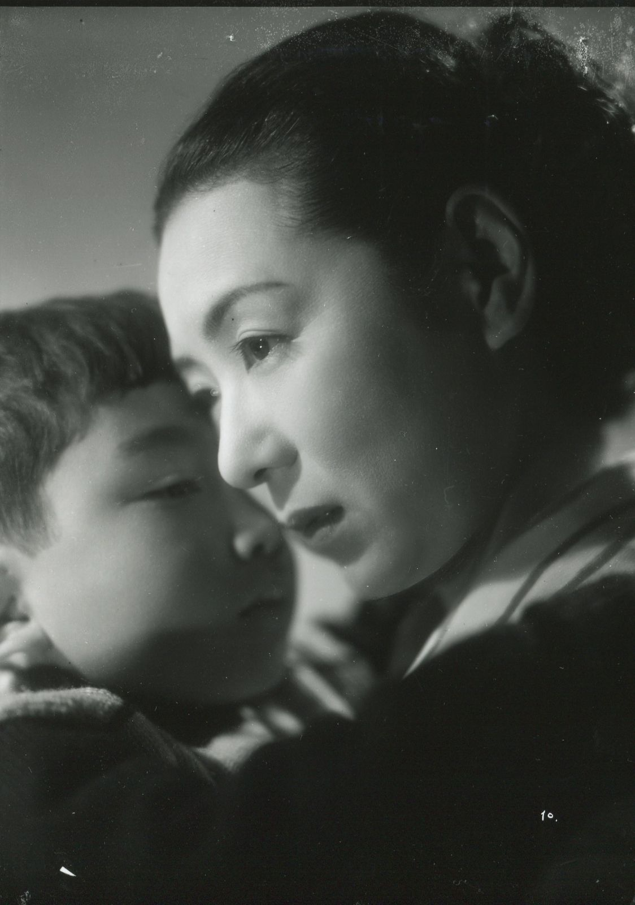

Bild: 1951; Shintōhō. Public domain laut Wikimedia Commons. [Bildquelle](https://commons.wikimedia.org/wiki/File:Kinuyo_Tanaka_in_Ginza_kesh%C5%8D,_1951.jpg), [TMDB](https://www.themoviedb.org/person/24551).

### L1 · leicht

Mit welchem Film begann die bereits etablierte Schauspielerin Kinuyo Tanaka ihre Laufbahn als Spielfilmregisseurin?

- **Richtig: Love Letter**

- The Moon Has Risen

- Forever a Woman

- Girls of the Night

„Love Letter“ war 1953 Tanakas erster Spielfilm als Regisseurin.

Der Kriegsheimkehrer Reikichi (Masayuki Mori) verdient Geld, indem er Liebesbriefe japanischer Frauen an amerikanische Soldaten übersetzt. Gleichzeitig sucht er seine frühere Liebe Michiko (Yoshiko Kuga). Tanakas Regiedebüt stellt persönliche Gefühle neben die sozialen Spannungen nach Krieg und Besatzung. Das Drehbuch schrieb Keisuke Kinoshita nach einem Roman von Fumio Niwa. Tanaka führte danach noch bei fünf weiteren Spielfilmen Regie.

Merksatz: Mit „Love Letter“ wechselte Tanaka 1953 auch hinter die Kamera.

Antwortzusätze:

- The Moon Has Risen: „The Moon Has Risen“ war ihr zweiter Regiefilm.

- Forever a Woman: „Forever a Woman“ folgte als dritter Regiefilm.

- Girls of the Night: „Girls of the Night“ entstand erst nach ihren ersten drei Regiearbeiten.

Quellen: [1](https://www.criterion.com/films/32821-love-letter), [2](https://www.criterion.com/boxsets/8685-eclipse-series-48-kinuyo-tanaka-directs), [3](https://www.criterion.com/current/posts/9140-kinuyo-tanaka-directs-married-to-cinema).

### L2 · leicht

Warum wird Oharu (Kinuyo Tanaka) am Anfang ihrer Lebensgeschichte in „Das Leben der Frau Oharu“ vom Hof verbannt?

- Sie weigert sich, als Spionin für einen fremden Fürsten zu arbeiten.

- **Richtig: Sie hat eine Liebesbeziehung mit einem Mann unter ihrem Stand.**

- Sie unterschlägt die Steuereinnahmen ihres Herrn.

- Sie versucht, den minderjährigen Thronerben zu entführen.

Oharus Liebe zu einem rangniederen Mann verletzt die Standesordnung.

Die ältere Oharu erinnert sich an ihre Jugend als Hofdame. Ihre Liebe zu Katsunosuke (Toshirō Mifune), einem einfachen Pagen, führt zu seiner Hinrichtung und zur Verbannung ihrer Familie. Der Film verfolgt anschließend ihren sozialen Abstieg durch wechselnde Abhängigkeiten. Tanaka spielt die Frau über unterschiedliche Lebensphasen hinweg; die anfängliche Bestrafung zeigt bereits, wie die Standesordnung ihr weiteres Leben begrenzt.

Merksatz: Oharus verbotene Liebe löst die erste Vertreibung aus.

Quellen: [1](https://www.criterion.com/current/posts/2827-the-life-of-oharu-not-reconciled), [2](https://www.criterion.com/films/27705-the-life-of-oharu).

### M1 · mittel

Welche der Frauenfiguren in „Ugetsu – Erzählungen unter dem Regenmond“ wird von Kinuyo Tanaka gespielt?

- Lady Wakasa, die geheimnisvolle Adlige

- Ohama, die Frau des angehenden Samurai Tobei

- **Richtig: Miyagi, die Frau des Töpfers Genjūrō**

- Ukon, die Begleiterin Lady Wakasas

Tanaka spielt Miyagi, die Frau des Töpfers Genjūrō.

Genjūrō (Masayuki Mori) verlässt im kriegsverwüsteten Land seine Frau Miyagi und gerät in den Bann Lady Wakasas (Machiko Kyō). Seine Suche nach Wohlstand und Verführung stehen dem gefährdeten Leben seiner Familie gegenüber. Tanakas Ehefrau und Kyōs geisterhafte Adlige sind zwei unterschiedliche Rollen. Diese Zuordnung ist wesentlich für den Gegensatz zwischen häuslicher Verantwortung und der verlockenden Gegenwelt.

Merksatz: Tanaka ist Miyagi; Machiko Kyō verkörpert Lady Wakasa.

Antwortzusätze:

- Lady Wakasa, die geheimnisvolle Adlige: Lady Wakasa wird von Machiko Kyō gespielt.

- Ohama, die Frau des angehenden Samurai Tobei: Ohama wird von Mitsuko Mito gespielt.

- Ukon, die Begleiterin Lady Wakasas: Ukon wird von Kikue Mori gespielt.

Quellen: [1](https://www.criterion.com/films/369-ugetsu), [2](https://www.bfi.org.uk/lists/machiko-kyo-5-essential-films).

### M2 · mittel

Was erschwert Kuniko (Chisako Hara) in Kinuyo Tanakas „Girls of the Night“ den Aufbau eines neuen Lebens nach dem Aufenthalt in einer Reformanstalt?

- Die Pflegeverpflichtung für ihre dauerhaft erkrankte Mutter

- Eine Schuldenbindung an ihren früheren Arbeitgeber

- Die fehlende Anerkennung ihrer Berufsausbildung

- **Richtig: Die fortwirkende Ausgrenzung wegen ihrer früheren Sexarbeit**

Kuniko wird weiterhin aufgrund ihrer Vergangenheit ausgegrenzt.

Nach dem gesetzlichen Verbot ihres bisherigen Gewerbes gelangt Kuniko in eine Einrichtung zur gesellschaftlichen Wiedereingliederung. Doch außerhalb der Anstalt haftet ihr die frühere Tätigkeit weiterhin an. Tanaka betrachtet deshalb auch die Umgebung, die den Frauen einen Neubeginn verspricht und ihn zugleich erschwert. Der Film entstand mit der Drehbuchautorin Sumie Tanaka nach einer Romanvorlage von Masako Yana.

Merksatz: Eine Entlassung beseitigt Kunikos gesellschaftliche Stigmatisierung nicht.

Quellen: [1](https://www.criterion.com/films/32822-girls-of-the-night).

### S1 · schwer

Welches Autorenduo schrieb das Drehbuch zu Kinuyo Tanakas Familienkomödie „The Moon Has Risen“?

- **Richtig: Yasujirō Ozu und Ryōsuke Saitō**

- Akira Kurosawa und Shinobu Hashimoto

- Kenji Mizoguchi und Yoshikata Yoda

- Mikio Naruse und Yōko Mizuki

Das Drehbuch stammt von Yasujirō Ozu und Ryōsuke Saitō; Regie führte Tanaka.

Ein verwitweter Vater (Chishū Ryū) lebt mit drei Töchtern, deren Liebesangelegenheiten die Familie beschäftigen. Die jüngste Tochter (Mie Kitahara) versucht, ihre zurückhaltende Schwester mit einem ebenso schüchternen Mann zusammenzubringen. Ozus Mitwirkung am Drehbuch und Ryūs Besetzung können an dessen eigene Filme erinnern. Für die Inszenierung und den komischen Ton dieser Regiearbeit ist jedoch Kinuyo Tanaka verantwortlich.

Merksatz: Ozu und Saitō schrieben; Tanaka inszenierte „The Moon Has Risen“.

Quellen: [1](https://www.criterion.com/films/32756-the-moon-has-risen), [2](https://www.criterion.com/current/posts/9140-kinuyo-tanaka-directs-married-to-cinema).

### S2 · schwer

Welche künstlerische Tätigkeit bildet den Mittelpunkt von Fumikos (Yumeji Tsukioka) Selbstbehauptung in Kinuyo Tanakas „Forever a Woman“?

- Sie fertigt großformatige Holzschnitte an.

- **Richtig: Sie schreibt Gedichte.**

- Sie komponiert Musik für das Kabuki-Theater.

- Sie arbeitet als Dokumentarfotografin.

Fumiko schreibt Gedichte; die Figur beruht auf der Dichterin Fumiko Nakajō.

Nach ihrer Scheidung erkrankt Fumiko an Brustkrebs. Ihr Schreiben und ihr Begehren bleiben Teil ihres Lebens, das der Film nicht auf die Krankheit beschränkt. Tanaka und die mit ihr nicht verwandte Drehbuchautorin Sumie Tanaka entwickelten den Stoff nach dem Leben der Dichterin Fumiko Nakajō. Tsukioka spielt im Film Fumiko Shimojo; biografisches Vorbild und Filmfigur tragen somit unterschiedliche Nachnamen.

Merksatz: Fumikos Gedichte geben ihrer Erfahrung eine eigene Stimme.

Quellen: [1](https://www.criterion.com/films/32757-forever-a-woman), [2](https://www.criterion.com/current/posts/7729-rediscovering-director-kinuyo-tanaka).

### E1 · experte

Bei welchem Film sammelte Kinuyo Tanaka als Assistentin Mikio Naruses praktische Erfahrung für ihre eigene Regiearbeit?

- Repast (1951)

- Floating Clouds (1955)

- **Richtig: Older Brother, Younger Sister (1953)**

- When a Woman Ascends the Stairs (1960)

Tanaka assistierte Naruse bei „Older Brother, Younger Sister“ von 1953.

Tanaka war längst eine etablierte Schauspielerin, als sie selbst Regie führen wollte. Naruse ermöglichte ihr, bei dieser Produktion die Arbeit hinter der Kamera kennenzulernen. Unterstützung erhielt sie außerdem von Kinoshita und Ozu, die Drehbücher für ihre ersten Regiefilme beitrugen. Die Mitarbeit als Assistentin erklärt einen konkreten Schritt zwischen ihrer bisherigen Erfahrung vor der Kamera und ihrer neuen Verantwortung für eine Inszenierung.

Merksatz: Naruses „Older Brother, Younger Sister“ war Tanakas praktische Regievorbereitung.

Quellen: [1](https://www.criterion.com/current/posts/7729-rediscovering-director-kinuyo-tanaka), [2](https://s3.amazonaws.com/criterion-production/janus_promo_packages/665-/Tanaka_press-notes_r7_original.pdf).

### E2 · experte

Welches politische Verbot verschärft in Kinuyo Tanakas historischem Liebesdrama „Ogin-sama“ den Konflikt um den Samurai Ukon (Tatsuya Nakadai)?

- Das Verbot privater Teezeremonien

- Das Verbot aller Ehen zwischen Samurai und Kaufmannsfamilien

- Das Verbot, als Samurai außerhalb der Hauptstadt zu leben

- **Richtig: Das Verbot seines christlichen Glaubens**

Ukon wird wegen seines christlichen Glaubens verfolgt.

Ogin (Ineko Arima), die Tochter eines Teemeisters, liebt den bereits verheirateten Samurai Ukon. Zu dieser persönlichen Bindung tritt die Verfolgung seines christlichen Glaubens durch die herrschende Macht. Tanakas letzter Regiefilm spielt im 16. Jahrhundert und verbindet ein Kostümdrama mit dem Konflikt zwischen eigener Hingabe und gesellschaftlichem Zwang. Die historische Umgebung unterscheidet ihn deutlich von ihren zeitgenössischen Nachkriegsstoffen.

Merksatz: Ukon gerät durch seinen christlichen Glauben in politische Gefahr.

Quellen: [1](https://www.criterion.com/films/31096-love-under-the-crucifix).

## Chishū Ryū · Bekanntheitsgruppe 4

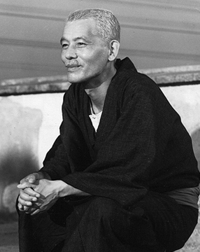

Bild: 1953; Shōchiku / Filmausschnitt. Public domain laut Wikimedia Commons. [Bildquelle](https://commons.wikimedia.org/wiki/File:Chishu_Ryu_in_Tokyo_Monogatari_1953_(crop).jpg), [TMDB](https://www.themoviedb.org/person/33135).

### L1 · leicht

Mit welchem Regisseur ist Chishū Ryūs Laufbahn durch zahlreiche japanische Familienfilme besonders eng verbunden?

- Kenji Mizoguchi

- **Richtig: Yasujirō Ozu**

- Nagisa Ōshima

- Shōhei Imamura

Chishū Ryū gehörte zu Yasujirō Ozus wichtigsten wiederkehrenden Darstellern.

Die Zusammenarbeit reicht von kleinen Auftritten in Ozus früher Laufbahn bis zu großen Vaterrollen. Ryū war Vertragsschauspieler des Studios Shōchiku; Ozu gab ihm den entscheidenden Raum als Hauptdarsteller. Der Professor in „Später Frühling“ und der alte Vater in „Die Reise nach Tokyo“ gehören zu dieser Verbindung. Wiederkehrende Gesichter schaffen dabei Vertrautheit, obwohl die Filme jeweils andere Familien erzählen.

Merksatz: Chishū Ryū ist das vertraute Vatergesicht in Ozus Familienkino.

Quellen: [1](https://www.criterion.com/current/posts/1512-there-was-a-father-duty-calls), [2](https://www.criterion.com/films/298-late-spring), [3](https://www.criterion.com/films/284-tokyo-story).

### L2 · leicht

Warum reisen Chishū Ryūs Figur Shūkichi und seine Frau in „Die Reise nach Tokyo“ in die Großstadt?

- **Richtig: Sie wollen ihre erwachsenen Kinder besuchen**

- Sie wollen ein neues Geschäft eröffnen

- Sie wollen endgültig in ein Pflegeheim ziehen

- Sie wollen eine Familienhochzeit feiern

Das ältere Ehepaar besucht seine erwachsenen Kinder und deren Familien.

Shūkichi (Chishū Ryū) und Tomi (Chieko Higashiyama) kommen aus Onomichi. Der Besuch bei ihren Kindern wird enttäuschend: Deren Alltag lässt wenig Platz für die Eltern. Ausgerechnet die verwitwete Schwiegertochter Noriko (Setsuko Hara) nimmt sich Zeit. Nach Tomis Tod kehren die Angehörigen rasch zu ihren Verpflichtungen zurück; Shūkichi bleibt schließlich allein. Der geplante Familienbesuch legt so eine längst gewachsene Entfernung offen.

Merksatz: Shūkichi und Tomi besuchen die Kinder; Nähe entsteht kaum.

Quellen: [1](https://www.criterion.com/current/posts/301-tokyo-story), [2](https://www.criterion.com/films/284-tokyo-story).

### M1 · mittel

Wie protestieren die Söhne von Keitarō (Chishū Ryū) in „Guten Morgen“ gegen die Weigerung ihrer Eltern, einen Fernseher zu kaufen?

- Sie verweigern jede Mahlzeit

- Sie verkaufen ihre Schulbücher

- **Richtig: Sie sprechen mit niemandem mehr**

- Sie ziehen dauerhaft zu den Nachbarn

Die Brüder treten in einen Schweigestreik.

Keitarō (Chishū Ryū) wirft seinen Söhnen vor, zu viel zu reden. Der ältere Sohn hält dagegen, dass Erwachsene ebenfalls ständig belanglose Dinge sagen. Der anschließende Schweigestreik trifft deshalb auch die alltäglichen Grüße. Nachbarn und Lehrer verstehen die Kinder plötzlich falsch. Ozu verbindet den Wunsch nach einem Fernseher mit der Frage, welche scheinbar überflüssigen Worte das Zusammenleben überhaupt ermöglichen.

Merksatz: Kein Fernseher: Die Brüder verweigern auch das „Guten Morgen“.

Antwortzusätze:

- Sie verweigern jede Mahlzeit: Ein Hungerstreik gehört zum verwandten Ozu-Stummfilm „Ich wurde geboren, aber …“; „Guten Morgen“ verlagert den Protest auf das Sprechen.

Quellen: [1](https://www.criterion.com/current/posts/4543-good-morning-structures-and-strictures-in-suburbia), [2](https://www.criterion.com/films/624-good-morning).

### M2 · mittel

Welche Behauptung setzt der Vater (Chishū Ryū) in „Später Frühling“ ein, damit seine Tochter Noriko sich zu einer Heirat entschließt?

- Er werde mit ihr ins Ausland ziehen

- Er habe seine Stelle bereits verloren

- Er werde das gemeinsame Haus verkaufen

- **Richtig: Er werde selbst wieder heiraten**

Er lässt Noriko glauben, dass er selbst erneut heiraten werde.

Noriko (Setsuko Hara) möchte das vertraute Leben mit ihrem verwitweten Vater Shūkichi (Chishū Ryū) erhalten. Er täuscht eine eigene Wiederheirat vor, damit sie ihn scheinbar versorgt zurücklassen kann. Nach ihrer Hochzeit bleibt er jedoch allein. Seine Behauptung soll die Ablösung erleichtern und kostet ihn gerade jene häusliche Nähe, die beide bisher getragen hat.

Merksatz: Der Vater erfindet eine neue Ehe und bleibt schließlich allein.

Quellen: [1](https://www.bfi.org.uk/film/797ab4f5-e457-5b07-9ca6-63d347f7da5a/late-spring), [2](https://www.criterion.com/current/posts/421-late-spring-home-with-ozu), [3](https://www.criterion.com/films/298-late-spring).

### S1 · schwer

Wie verändern sich Chishū Ryūs Verwandtschaftsrollen gegenüber Setsuko Haras Noriko-Figuren in „Später Frühling“, „Weizenherbst“ und „Die Reise nach Tokyo“ – in dieser Reihenfolge?

- **Richtig: Vater – älterer Bruder – Schwiegervater**

- Älterer Bruder – Vater – Schwiegervater

- Schwiegervater – älterer Bruder – Vater

- Vater – Schwiegervater – älterer Bruder

Ryū spielt nacheinander den Vater, den älteren Bruder und den Schwiegervater.

Die sogenannte Noriko-Trilogie führt keine zusammenhängende Familiengeschichte fort. Setsuko Hara spielt drei verschiedene Frauen mit demselben Vornamen, und Chishū Ryū erhält jeweils eine andere Beziehung zu ihnen. Der Wechsel vom Vater zum Bruder und anschließend zum Schwiegervater zeigt, wie Ozu dieselben Darsteller in neue familiäre Konstellationen setzte. Die vertraute Besetzung verbindet die Werke, ohne ihre Figuren gleichzusetzen.

Merksatz: Drei Norikos, drei Ryū-Beziehungen: Vater, Bruder, Schwiegervater.

Quellen: [1](https://www.bfi.org.uk/features/tokyo-story-anatomy-classic).

### S2 · schwer

Warum gibt Shūhei (Chishū Ryū) in „Es war einmal ein Vater“ seinen Lehrerberuf auf?

- Er soll die Schule an einen anderen Ort verlegen

- **Richtig: Ein Kind stirbt, während es seiner Aufsicht untersteht**

- Sein Sohn wird wegen seiner Lehrmethoden ausgeschlossen

- Er verliert einen öffentlichen Streit mit dem Schulleiter

Nach dem Tod eines ihm anvertrauten Kindes hält Shūhei sich als Lehrer für gescheitert.

Niemand sonst macht Shūhei Horikawa (Chishū Ryū) für den Tod des Kindes verantwortlich. Dennoch zieht er selbst die Konsequenz und kündigt. Für seinen eigenen Sohn soll die Ausbildung weitergehen: Der Vater arbeitet in Tokyo, während der Junge ein Internat besucht. Sein strenges Pflichtgefühl sichert Bildung und Lebensunterhalt, bringt Vater und Sohn aber immer wieder um die ersehnte gemeinsame Zeit.

Merksatz: Horikawa kündigt als Lehrer, hält aber an der Ausbildung des Sohnes fest.

Quellen: [1](https://www.criterion.com/current/posts/1512-there-was-a-father-duty-calls), [2](https://www.criterion.com/films/22839-there-was-a-father).

### E1 · experte

Welcher deutsche Filmemacher begegnet Chishū Ryū in „Tokyo-Ga“ auf seiner Suche nach Spuren von Ozus Kino?

- Werner Herzog

- Volker Schlöndorff

- **Richtig: Wim Wenders**

- Alexander Kluge

Wim Wenders sucht in „Tokyo-Ga“ die Verbindung zwischen Ozus Filmen und dem veränderten Tokyo.

Wenders besucht Tokyo lange nach Ozus Tod und verbindet Beobachtungen der Stadt mit Begegnungen früherer Mitarbeiter. Neben Chishū Ryū kommt der Kameramann Yūharu Atsuta vor. Ryū erscheint hier als Zeuge einer gemeinsamen Arbeitsgeschichte. Die Suche richtet sich darauf, was von Ozus vertrauten Alltagsbildern in der inzwischen stark veränderten Großstadt geblieben ist.

Merksatz: In Wenders’ „Tokyo-Ga“ erinnert Ryū an Ozus Arbeitswelt.

Antwortzusätze:

- Werner Herzog: Werner Herzog gehört zu den Mitwirkenden von „Tokyo-Ga“; die Regie und Erzählstimme stammen von Wim Wenders.

Quellen: [1](https://wimwendersstiftung.de/film/tokyo-ga/), [2](https://rijs.fas.harvard.edu/events/ozu-film-series-hfa-tokyo-ga).

### E2 · experte

Welche Lebensweise erläutert der alte Mann (Chishū Ryū) dem Besucher im Wassermühlendorf von Kurosawas „Träume“?

- Das Dorf erzeugt seinen gesamten Strom in einem Atomkraftwerk

- Das Dorf gewinnt Wohlstand durch den Verkauf seltener Bäume

- Das Dorf soll durch eine moderne Industriestadt ersetzt werden

- **Richtig: Das Dorf verzichtet auf Elektrizität und schont natürliche Ressourcen**

Der alte Mann beschreibt ein Dorf ohne Elektrizität, das seine natürlichen Lebensgrundlagen schont.

Der Besucher (Akira Terao) trifft im letzten Traum auf den von Chishū Ryū gespielten alten Mann. Dieser erklärt, dass die Bewohner ohne elektrischen Strom leben und zum Heizen nur von selbst gefallene Bäume verwenden. Nach den zuvor gezeigten Strahlenkatastrophen bietet das Dorf einen anderen Umgang mit Natur. Ryūs ruhiger Gesprächsauftritt trägt diese Vorstellung eines bewusst begrenzten materiellen Komforts.

Merksatz: Ryūs Wassermühlendorf lebt ohne Strom und verschwendet die Natur nicht.

Quellen: [1](https://www.criterion.com/current/posts/4299-akira-kurosawa-s-dreams-quiet-devastation), [2](https://www.criterion.com/films/28700).

## Jean-Pierre Léaud · Bekanntheitsgruppe 4

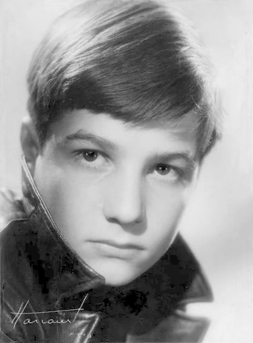

Bild: 1959; Studio Harcourt. Public domain laut Wikimedia Commons. [Bildquelle](https://commons.wikimedia.org/wiki/File:JeanPierreLeaud-StudioHarcourt-1959.png), [TMDB](https://www.themoviedb.org/person/1653).

### L1 · leicht

Welche wiederkehrende Figur spielt Jean-Pierre Léaud in „Sie küssten und sie schlugen ihn“ und später in „Gestohlene Küsse“?

- Michel Poiccard

- Jules Maigret

- **Richtig: Antoine Doinel**

- Ferdinand Griffon

Léaud verkörpert in beiden Filmen Antoine Doinel.

François Truffaut führte Antoine Doinel zunächst als schwierigen Jugendlichen ein und ließ ihn später durch Liebesbeziehungen, Ehe und Trennung gehen. Jean-Pierre Léaud blieb der Darsteller dieser Figur. So begleitet die Reihe zugleich das wirkliche Älterwerden ihres Schauspielers. Doinels Ausgangspunkt ist Truffauts eigene Jugend; die weiteren Filme entwickeln daraus eine zunehmend eigenständige, romantisch unbeholfene Lebensgeschichte.

Merksatz: Léaud wächst mit Truffauts Antoine Doinel vom Jugendlichen zum Erwachsenen.

Quellen: [1](https://www.criterion.com/boxsets/346-the-adventures-of-antoine-doinel), [2](https://www.criterion.com/films/151), [3](https://www.criterion.com/films/732-stolen-kisses).

### L2 · leicht

In welchen Beruf gerät Antoine Doinel (Jean-Pierre Léaud) nach seinem Abschied von der Armee in „Gestohlene Küsse“?

- **Richtig: Privatdetektiv**

- Zeitungsfotograf

- Postzusteller

- Musiklehrer

Antoine versucht sich als Privatdetektiv.

Nach der unehrenhaften Entlassung aus der Armee findet Antoine Doinel (Jean-Pierre Léaud) nur mühsam einen Platz im Arbeitsleben. In einer Detektei soll er andere Menschen beobachten, bleibt aber selbst von Liebeswünschen und Unsicherheit bestimmt. Seine beruflichen Missgeschicke gehören zur komischen Fortsetzung der Jugendgeschichte. Truffaut macht aus dem früheren Außenseiter einen jungen Erwachsenen, der auch im Alltag noch nach Orientierung sucht.

Merksatz: Antoine Doinel beobachtet als Detektiv andere und stolpert durch sein eigenes Leben.

Quellen: [1](https://www.criterion.com/films/732-stolen-kisses), [2](https://player.bfi.org.uk/subscription/film/watch-la-chinoise-1967-online).

### M1 · mittel

Welche Aufgabe hat Jean-Pierre Léauds Figur Alphonse bei den Dreharbeiten in „Die amerikanische Nacht“?

- Er komponiert die Filmmusik

- Er führt die Kamera

- Er betreut den Filmschnitt

- **Richtig: Er spielt eine der Hauptrollen**

Alphonse ist Schauspieler in der Filmproduktion innerhalb des Films.

„Die amerikanische Nacht“ begleitet die Herstellung eines Melodrams. Alphonse (Jean-Pierre Léaud) bringt mit seinen romantischen Krisen Unruhe in die Arbeit. François Truffaut spielt selbst den Regisseur Ferrand, der solche persönlichen Probleme und die praktischen Schwierigkeiten des Drehens zusammenhalten muss. Léaud verkörpert damit einen Schauspieler unter Schauspielern, während der Film zeigt, wie aus vielen widerspenstigen Einzelteilen eine gemeinsame Produktion entsteht.

Merksatz: Léaud spielt den Schauspieler; Truffaut spielt dessen Regisseur.

Antwortzusätze:

- Er komponiert die Filmmusik: Die tatsächliche Filmmusik stammt von Georges Delerue, der auch als Komponist innerhalb der Filmhandlung erwähnt wird.

Quellen: [1](https://www.criterion.com/films/28698-day-for-night), [2](https://www.criterion.com/current/posts/3659-day-for-night-are-movies-magic).

### M2 · mittel

Welche beiden Namen verbindet Godards „Masculin féminin“ mit Jean-Pierre Léaud zur berühmten Beschreibung seiner jungen Generation?

- Freud und Ford

- **Richtig: Marx und Coca-Cola**

- Darwin und Disney

- Nietzsche und Kodak

Der Film spricht von den „Kindern von Marx und Coca-Cola“.

Paul (Jean-Pierre Léaud) interessiert sich für Politik und liebt die junge Sängerin Madeleine (Chantal Goya). Gespräche über Beziehungen, Musik, Konsum und Vietnam begegnen einander im Paris der 1960er-Jahre. Die Verbindung von Marx und einer Getränkemarke fasst diesen gleichzeitigen Einfluss politischer Ideen und kommerzieller Popkultur zusammen. Godard lässt die Wünsche seiner Figuren nebeneinanderstehen, statt daraus ein einheitliches Generationsprogramm zu machen.

Merksatz: Léauds Paul lebt zwischen Marx, Coca-Cola und seiner Liebe zu Madeleine.

Quellen: [1](https://www.criterion.com/films/508-masculin-f-minin), [2](https://www.criterion.com/current/posts/384-masculin-feminin-the-young-man-for-all-times).

### S1 · schwer

Welche politische Richtung bestimmt die Pariser Wohngemeinschaft, zu der Jean-Pierre Léauds Figur in Godards „La Chinoise“ gehört?

- **Richtig: Maoismus**

- Sozialdemokratie

- Anarchismus

- Trotzkismus

Die Gruppe versteht sich als maoistisches Kollektiv.

In einer Pariser Wohnung führen die jungen Mitglieder politische Diskussionen und kleine szenische Vorführungen auf. Jean-Pierre Léaud gehört zur Besetzung neben Anne Wiazemsky und Juliet Berto. Kolonialismus, amerikanischer Einfluss und Vietnam beschäftigen das Kollektiv. Die Debatten münden in die Frage nach politischer Gewalt. Der Film von 1967 liegt vor dem Pariser Mai 1968 und zeigt Godards zunehmende Beschäftigung mit revolutionärer Praxis.

Merksatz: „La Chinoise“ macht die Pariser Wohnung zum maoistischen Debattenraum.

Quellen: [1](https://player.bfi.org.uk/subscription/film/watch-la-chinoise-1967-online), [2](https://www.bfi.org.uk/film/6cf0b7d0-53ee-50f9-8eb8-54488842906c/la-chinoise).

### S2 · schwer

Welchen Stummfilmstoff will René Vidal (Jean-Pierre Léaud) in Olivier Assayas’ „Irma Vep“ mit Maggie Cheung neu verfilmen?

- „Fantômas“

- „Judex“

- **Richtig: „Les Vampires“**

- „Die Spinnen“

Vidal plant eine Neuverfilmung von Feuillades Stummfilmserie „Les Vampires“.

Maggie Cheung spielt eine leicht veränderte Version ihrer selbst, die für Vidals Film nach Paris kommt. Der Regisseur (Jean-Pierre Léaud) möchte ihr die einst von Musidora gespielte Rolle anvertrauen. An einem chaotischen Set treffen französische Kinotradition und eine Darstellerin aus Hongkong aufeinander. Assayas betrachtet dabei auch die Schwierigkeiten, aus der Bewunderung eines alten Films eine lebendige neue Arbeit zu machen.

Merksatz: Léauds Vidal holt Maggie Cheung für neue „Vampires“ nach Paris.

Quellen: [1](https://www.criterion.com/current/posts/7369-irma-vep-film-in-flux), [2](https://www.criterion.com/films/29197-irma-vep).

### E1 · experte

Wie entstanden die scheinbar spontanen Gespräche von Jean-Pierre Léaud und seinen Partnerinnen in Jean Eustaches „Die Mama und die Hure“?

- Die Darsteller erfanden jeden Dialog beim Dreh

- **Richtig: Eustache schrieb den Wortlaut vollständig vor**

- Tonaufnahmen echter Gespräche wurden nachgesprochen

- Die Darsteller ergänzten ein stumm gedrehtes Bild nachträglich

Jedes Wort war von Eustache geschrieben; die Darsteller durften den Text nicht ändern.

Alexandre (Jean-Pierre Léaud) lebt mit Marie (Bernadette Lafont) und beginnt zugleich eine Beziehung zu Veronika (Françoise Lebrun). Ihre langen, teils schonungslosen Gespräche wirken wie unmittelbar festgehaltenes Leben. Eustache verlangte jedoch genaue Texttreue. Das Gefühl von Spontaneität entsteht im Spiel und in der ausgedehnten Zeit der Szenen. Hinter dem ungezwungenen Eindruck steht eine streng vorbereitete sprachliche Komposition.

Merksatz: Eustaches Alltagsnähe beruht auf geschriebenen Worten und Léauds Texttreue.

Quellen: [1](https://www.bfi.org.uk/features/where-begin-with-jean-eustache), [2](https://www.criterion.com/films/33280-the-mother-and-the-whore).

### E2 · experte

Welcher Ansatz prägt Jean-Pierre Léauds Königsrolle in Albert Serras „Der Tod von Ludwig XIV.“?

- Seine Herrschaft wird als Folge großer Schlachten nacherzählt

- Seine Jugend wird über eine Reihe höfischer Liebesabenteuer erzählt

- Seine Politik wird durch nachgestellte öffentliche Reden erklärt

- **Richtig: Sein körperlicher Verfall wird fast ganz im Krankenzimmer beobachtet**

Serra konzentriert sich auf den sterbenden Körper des Königs in seinem Schlafgemach.

Léauds Ludwig XIV. liegt beinahe bewegungslos im Bett, während Ärzte und Hofleute ihn umgeben. Die vertrauten Rituale des Hofes laufen weiter, obwohl der Körper des Herrschers zunehmend versagt. Serra zeigt keine Lebenschronik großer Taten. Lange Einstellungen und Léauds sparsame Bewegungen lassen stattdessen die verbleibende Zeit spürbar werden. Der königliche Rang schützt die Figur nicht vor dem körperlichen Sterben.

Merksatz: Der Sonnenkönig bleibt Symbol der Macht, während sein Körper versagt.

Quellen: [1](https://www.bfi.org.uk/sight-and-sound/reviews/death-louis-xiv-first-look), [2](https://www.festival-cannes.com/en/f/la-mort-de-louis-xiv/), [3](https://cdn.festival-cannes.com/media/uploads/2023/03/47094.pdf).

## Charlie Chaplin · Bekanntheitsgruppe 1

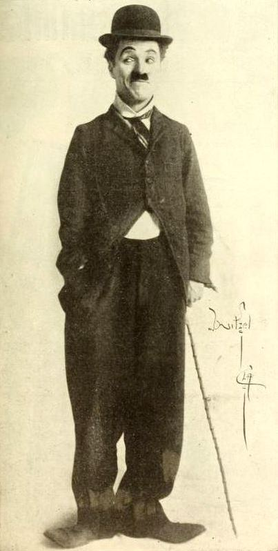

Bild: 1919; Witzel L.A.. Public domain laut Wikimedia Commons. [Bildquelle](https://commons.wikimedia.org/wiki/File:Charlie_Chaplin_-_May_1919_MPW.jpg), [TMDB](https://www.themoviedb.org/person/13848).

### L1 · leicht

Welche wiederkehrende Leinwandfigur ist besonders mit Charlie Chaplin verbunden?

- **Richtig: Der Tramp**

- Der Detektiv Sherlock Jr.

- Der Seemann Popeye

- Der Inspektor Clouseau

Chaplins berühmte Figur ist der Tramp.

Chaplins Tramp schlägt sich mit wenig Geld durch eine Welt, in der Arbeit, Essen und ein sicherer Schlafplatz keineswegs selbstverständlich sind. In „Moderne Zeiten“ wird er zum Fabrikarbeiter, den das Tempo der Maschinen überfordert. Die wiedererkennbare Figur kann dadurch in unterschiedliche soziale Situationen geraten, ohne ihren grundlegenden Wunsch nach Würde und menschlicher Nähe zu verlieren.

Merksatz: Chaplins Tramp ist ein Außenseiter mit Beharrlichkeit und Würde.

Antwortzusätze:

- Der Tramp: Chaplins berühmte Figur ist der Tramp.

Gemeinsames Wissensziel: K-CLA-16-01 (CLA-L-031).

Quellen: [1](https://www.charliechaplin.com/en/biography/articles/21-Chaplin-s-Life), [2](https://www.criterion.com/films/27526-modern-times).

### L2 · leicht

Welcher Kinderstar spielt an Charlie Chaplins Seite den Findling in „The Kid“?

- Mickey Rooney

- **Richtig: Jackie Coogan**

- Freddie Bartholomew

- Jackie Cooper

Jackie Coogan spielt den von Chaplins Tramp aufgenommenen Jungen.

Ein ausgesetztes Kind findet beim mittellosen Tramp ein Zuhause. Jackie Coogan spielt den Jungen mit einer Ausdruckskraft, die ihn zu einem frühen Kinderstar machte. Chaplin verbindet die komischen Unternehmungen des ungleichen Paars mit der Angst, voneinander getrennt zu werden. Ihre Beziehung trägt einen langen Erzählbogen und zeigt, wie aus gemeinsamem Alltag eine Familie entstehen kann.

Merksatz: Chaplin und Jackie Coogan bilden das ungleiche Paar in „The Kid“.

Antwortzusätze:

- Jackie Coogan: Jackie Coogan spielt den von Chaplins Tramp aufgenommenen Jungen.

Quellen: [1](https://www.charliechaplin.com/en/biography/articles/21-Chaplin-s-Life), [2](https://lcweb2.loc.gov/static/programs/national-film-preservation-board/documents/the_kid.pdf).

### M1 · mittel

Welche beiden Figuren verkörpert Charlie Chaplin in „Der große Diktator“?

- Einen General und einen Journalisten

- Einen Fabrikbesitzer und einen Arbeiter

- **Richtig: Den Diktator Hynkel und einen jüdischen Friseur**

- Einen König und dessen Hofnarren

Chaplin spielt Hynkel und einen jüdischen Friseur.

Der Friseur kehrt nach langer Abwesenheit in sein Geschäft zurück und erlebt die Verfolgung der jüdischen Bevölkerung. Sein Doppelgänger Hynkel verkörpert die Macht, von der diese Verfolgung ausgeht. Chaplin stellt Täter und bedrohten Bürger mit demselben Gesicht dar. Die spätere Verwechslung ermöglicht es dem Verfolgten, vor einem großen Publikum für Menschlichkeit und Frieden einzutreten.

Merksatz: Ein Gesicht steht für den Diktator und für einen seiner Verfolgten.

Antwortzusätze:

- Den Diktator Hynkel und einen jüdischen Friseur: Chaplin spielt Hynkel und einen jüdischen Friseur.

Gemeinsames Wissensziel: K-KOM-202609-P02-L-073 (KOM-202609-P02-L-073).

Quellen: [1](https://www.charliechaplin.com/en/films/7-The-Great-Dictator), [2](https://www.loc.gov/static/programs/national-film-preservation-board/documents/great_dictator.pdf).

### M2 · mittel

Wie lässt Charlie Chaplin den Tramp in „Moderne Zeiten“ singen, nachdem dessen Texthilfe verloren gegangen ist?

- Er übernimmt ein Lied aus dem Radio.

- Er lässt einen Kollegen hinter der Bühne singen.

- Er singt den Text seiner Arbeitsanweisung.

- **Richtig: Er verwendet eine erfundene Mischsprache.**

Der Tramp singt in einer erfundenen Mischsprache und macht sich mit Gesten verständlich.

Chaplin hatte den sprechenden Tramp lange vermieden, weil die Figur überall ohne Übersetzung verstanden werden konnte. Als er ihn in „Moderne Zeiten“ schließlich singen lässt, löst er das Problem mit einer komischen Kunstsprache. Der Auftritt vermittelt seine kleine Geschichte durch Stimme, Rhythmus und Körperspiel. So wird Ton Teil der Pantomime, statt die Figur an eine einzelne Sprache zu binden.

Merksatz: Die Stimme kommt hinzu, doch die Gesten tragen weiter die Geschichte.

Antwortzusätze:

- Er verwendet eine erfundene Mischsprache.: Der Tramp singt in einer erfundenen Mischsprache und macht sich mit Gesten verständlich.

Gemeinsames Wissensziel: K-CLA-16-05 (CLA-S-031).

Quellen: [1](https://www.charliechaplin.com/en/articles/6-Filming-Modern-Times).

### S1 · schwer

Wozu gründete Charlie Chaplin mit Mary Pickford, Douglas Fairbanks und D. W. Griffith United Artists?

- **Richtig: Um eigene Filme mit größerer Kontrolle selbst zu vertreiben**

- Um ausschließlich Wochenschauen herzustellen

- Um eine gemeinsame Schauspielschule zu betreiben

- Um den Stummfilm durch ein Tonpatent zu ersetzen

United Artists gab den Gründern Kontrolle über Produktion und Vertrieb ihrer eigenen Filme.

United Artists wurde als Verleihorganisation gegründet. Die beteiligten Künstler blieben für Finanzierung und Herstellung ihrer Filme verantwortlich und lieferten die fertigen Werke zum Vertrieb ab. Damit konnten sie Entscheidungen und Gewinne stärker in der eigenen Hand behalten. Für Chaplin passte dieses Modell zu seinem Wunsch, an Filmen so lange zu arbeiten, wie er es für nötig hielt.

Merksatz: United Artists sollte künstlerische Kontrolle mit eigenem Vertrieb verbinden.

Antwortzusätze:

- Um eigene Filme mit größerer Kontrolle selbst zu vertreiben: United Artists gab den Gründern Kontrolle über Produktion und Vertrieb ihrer eigenen Filme.

Quellen: [1](https://www.charliechaplin.com/en/biography/articles/21-Chaplin-s-Life).

### S2 · schwer

Für welche Leistung erhielt Charlie Chaplin bei der Oscarverleihung 1973 einen Wettbewerbspreis für „Rampenlicht“?

- Für den Schnitt

- **Richtig: Für die Originalmusik, gemeinsam mit Ray Rasch und Larry Russell**

- Für die Hauptrolle

- Für das Originaldrehbuch

Chaplin, Ray Rasch und Larry Russell wurden für die Filmmusik von „Rampenlicht“ ausgezeichnet.

„Rampenlicht“ erzählt von einem alternden Komiker und einer jungen Tänzerin. Chaplin entwarf dafür auch Musik; für die Ballettszenen musste sie bereits vor den Aufnahmen feststehen. Die Academy zeichnete die Partitur erst lange nach dem ursprünglichen Filmstart aus. Der gemeinsame Wettbewerbspreis für Chaplin, Ray Rasch und Larry Russell würdigt eine andere Seite seiner Arbeit als die berühmte Leinwandkomik.

Merksatz: Chaplins Wettbewerb-Oscar galt der Musik von „Rampenlicht“.

Antwortzusätze:

- Für die Originalmusik, gemeinsam mit Ray Rasch und Larry Russell: Chaplin, Ray Rasch und Larry Russell wurden für die Filmmusik von „Rampenlicht“ ausgezeichnet.

Quellen: [1](https://www.charliechaplin.com/en/articles/7-Filming-Limelight), [2](https://www.oscars.org/oscars/ceremonies/1973).

### E1 · experte

Wie überarbeitete Charlie Chaplin „Goldrausch“ für die Wiederveröffentlichung von 1942?

- Er ließ alle Rollen von neuen Darstellern nachspielen.

- Er ersetzte die Schauplätze durch Farbaufnahmen.

- **Richtig: Er ergänzte eigene Musik und gesprochenen Kommentar statt Zwischentiteln.**

- Er ließ den gesamten Film als Musical neu drehen.

Die Fassung von 1942 erhielt Musik und Chaplins gesprochenen Kommentar anstelle der Zwischentitel.

Chaplin behandelte die Wiederveröffentlichung als neue Gestaltung seines älteren Werks. Er komponierte eine Orchestermusik und sprach selbst den Kommentar, der die ursprünglichen Zwischentitel ersetzte. Außerdem straffte er den Schnitt. Der erhaltene Text des Kommentars im Chaplin-Archiv belegt diese Arbeit. Bei Vergleichen muss deshalb zwischen dem Stummfilm von 1925 und der späteren Tonfassung unterschieden werden.

Merksatz: 1925: Stummfilm; 1942: neue Musik und Chaplins Kommentar.

Antwortzusätze:

- Er ergänzte eigene Musik und gesprochenen Kommentar statt Zwischentiteln.: Die Fassung von 1942 erhielt Musik und Chaplins gesprochenen Kommentar anstelle der Zwischentitel.

Quellen: [1](https://www.charliechaplinarchive.org/en/collection/cerca/narration-used-in-revival-of-the-gold-rush), [2](https://charliechaplin.com/en/films/4-The-Circus/articles/5-Filming-The-Gold-Rush).

### E2 · experte

Welche Entscheidung traf Charlie Chaplin bei „Lichter der Großstadt“, obwohl sich der Tonfilm bereits etabliert hatte?

- Er drehte denselben Dialog in fünf Sprachen.

- Er ließ den Tramp von einem Radiosprecher synchronisieren.

- Er verzichtete auch auf eine aufgezeichnete Filmmusik.

- **Richtig: Er behielt die stumme Darstellung bei und ergänzte Musik und einzelne Geräusche.**

Chaplin verzichtete auf Dialogsprache, nutzte aber Musik und Geräusche.

Chaplin fürchtete, eine einzelne Sprachstimme könne die internationale Verständlichkeit des Tramps einschränken. „Lichter der Großstadt“ blieb deshalb im Wesentlichen eine pantomimische Erzählung. Die synchronisierte Musik und gezielt eingesetzte Geräusche zeigen zugleich, dass er die neue Technik nicht einfach ignorierte. Er wählte aus, was der Komik und der Figur diente, und komponierte die Partitur selbst.

Merksatz: Chaplin nutzt Ton, ohne den Tramp sprechen zu lassen.

Antwortzusätze:

- Er behielt die stumme Darstellung bei und ergänzte Musik und einzelne Geräusche.: Chaplin verzichtete auf Dialogsprache, nutzte aber Musik und Geräusche.

Quellen: [1](https://www.charliechaplin.com/en/articles/4-City-Lights).

## John Wayne · Bekanntheitsgruppe 1

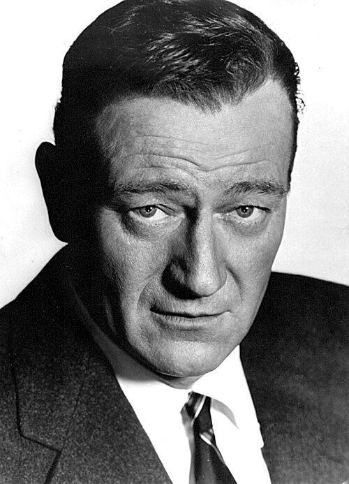

Bild: um 1965; Unknown photographer. Public domain laut Wikimedia Commons. [Bildquelle](https://commons.wikimedia.org/wiki/File:John_Wayne_-_still_portrait.jpg), [TMDB](https://www.themoviedb.org/person/4165).

### L1 · leicht

Wer engagiert Rooster Cogburn (John Wayne) in „Der Marshal“ für die Verfolgung von Tom Chaney?

- Der Bruder eines entführten Kindes

- Die Witwe eines Bankdirektors

- **Richtig: Die Tochter des ermordeten Mannes**

- Der Besitzer einer Viehherde

Mattie Ross, die Tochter des ermordeten Frank Ross, engagiert Cogburn.

Mattie Ross (Kim Darby) will Tom Chaney für den Mord an ihrem Vater zur Verantwortung ziehen. Sie sucht einen Mann mit Härte und Erfahrung und bezahlt den alternden US-Marshal Cogburn für die Verfolgung. Ein Texas Ranger verfolgt Chaney zugleich wegen einer anderen Tat. Mattie bleibt bei ihrem eigenen Ziel und schließt sich der gefährlichen Reise selbst an.

Merksatz: Mattie sucht den Mörder ihres Vaters und engagiert Cogburn.

Antwortzusätze:

- Die Tochter des ermordeten Mannes: Mattie Ross, die Tochter des ermordeten Frank Ross, engagiert Cogburn.

Quellen: [1](https://catalog.afi.com/Catalog/moviedetails/23723).

### L2 · leicht

Als welche Art von Figur tritt John Wayne als Ringo Kid in „Ringo“ (1939) auf?

- Als reisender Bankdirektor

- **Richtig: Als gesuchter Outlaw**

- Als amtierender Bürgermeister

- Als Prediger auf Missionsreise

Ringo ist ein gesuchter Outlaw, der zur Reisegesellschaft der Postkutsche stößt.

Eine Postkutsche bringt Menschen mit unterschiedlichem gesellschaftlichem Ansehen zusammen. Der Ringo Kid gehört als Outlaw zu den Außenseitern, ebenso wie Dallas (Claire Trevor). John Ford gab Wayne mit dieser Rolle einen entscheidenden Durchbruch jenseits seiner früheren kleineren Western. Die gemeinsame Gefahr zeigt, dass Anständigkeit und Mut nicht zuverlässig am offiziellen Ruf einer Person abzulesen sind.

Merksatz: Ringo ist ein Outlaw unter gesellschaftlich sehr verschiedenen Reisenden.

Antwortzusätze:

- Als gesuchter Outlaw: Ringo ist ein gesuchter Outlaw, der zur Reisegesellschaft der Postkutsche stößt.

Gemeinsames Wissensziel: K-F240-20261006-222-M1 (F240-20261006-222-M1).

Quellen: [1](https://www.criterion.com/films/980-stagecoach), [2](https://www.johnwayne.com/about/john-waynes-career/).

### M1 · mittel

Welches Erlebnis aus seiner Boxkarriere lässt Sean Thornton (John Wayne) in „Der Sieger“ vor einem neuen Kampf zurückschrecken?

- Er verlor seinen Weltmeistertitel durch Betrug.

- Er wurde während eines Kampfes dauerhaft blind.

- Er verletzte seinen eigenen Trainer schwer.

- **Richtig: Er tötete einen Gegner durch einen Schlag im Ring.**

Sean hat einen Gegner im Ring tödlich verletzt.

Sean Thornton kehrt aus Amerika in seinen irischen Geburtsort zurück. Er möchte ein ruhiges Leben beginnen, doch seine Weigerung zu kämpfen wird von seiner Umgebung anders verstanden, als er es beabsichtigt. Der tödliche Boxkampf erklärt diese Zurückhaltung. John Wayne steht hier nicht in einer amerikanischen Grenzlandschaft, sondern in einer Liebesgeschichte, deren Konflikte aus unterschiedlichen Vorstellungen von Ehre und Eigentum entstehen.

Merksatz: Thorntons Zurückhaltung hat ihren Ursprung in einem tödlichen Boxkampf.

Antwortzusätze:

- Er tötete einen Gegner durch einen Schlag im Ring.: Sean hat einen Gegner im Ring tödlich verletzt.

Quellen: [1](https://catalog.afi.com/Catalog/moviedetails/53543).

### M2 · mittel

Welche Wahrheit verbindet Tom Doniphon (John Wayne) mit dem Ruhm von Ransom Stoddard (James Stewart) in „Der Mann, der Liberty Valance erschoss“?

- **Richtig: Doniphon hat den tödlichen Schuss abgegeben.**

- Doniphon hat den Banditen erst später im Gefängnis erschossen.

- Doniphon hat Stoddards Gegner bestochen, die Stadt zu verlassen.

- Doniphon hat den gesamten Zeitungsbericht erfunden.

Doniphon erschoss Liberty Valance; öffentlich gilt Stoddard als der Schütze.

Der Rechtsanwalt Stoddard verdankt einen Teil seines Aufstiegs dem vermeintlichen Sieg über den Banditen Liberty Valance (Lee Marvin). Tatsächlich griff Doniphon aus dem Verborgenen ein. Wayne spielt den Mann, dessen Tat einem anderen die Zukunft eröffnet und ihn selbst zurücklässt. Als die Wahrheit Jahre später erzählt wird, steht die öffentliche Legende bereits fest: Der Film fragt nach dem Preis dieser Geschichtsschreibung.

Merksatz: Doniphons Tat ermöglicht Stoddards Legende.

Antwortzusätze:

- Doniphon hat den tödlichen Schuss abgegeben.: Doniphon erschoss Liberty Valance; öffentlich gilt Stoddard als der Schütze.

Gemeinsames Wissensziel: K-WES-19-05 (WES-S-037).

Quellen: [1](https://www.bfi.org.uk/lists/10-best-john-ford-films), [2](https://www.bfi.org.uk/film/32f9c607-d7fe-5409-bdba-0b74c4acbf1a/the-man-who-shot-liberty-valance).

### S1 · schwer

Welche Beziehung hat John Waynes Thomas Dunson zu Matt Garth (Montgomery Clift) in „Red River“?

- Matt ist sein Schwiegersohn.

- Matt ist sein leiblicher Sohn.

- Matt ist sein Neffe.

- **Richtig: Er hat Matt als Sohn aufgezogen.**

Dunson hat Matt nach dessen Verlust der Familie als Sohn aufgezogen.

Dunson nimmt den verwaisten Matt bei sich auf und baut mit ihm seine Ranch auf. Jahre später geraten sie während eines großen Viehtriebs gegeneinander, weil Dunsons Härte die Männer überfordert. Die Auflehnung ist deshalb zugleich ein Bruch zwischen Vaterfigur und erwachsen gewordenem Sohn. Wayne kann hier Autorität bedrohlich werden lassen, während Clifts Matt Verantwortung gerade durch Widerspruch übernimmt.

Merksatz: Der Konflikt des Viehtriebs ist auch ein Vater-Sohn-Konflikt.

Antwortzusätze:

- Er hat Matt als Sohn aufgezogen.: Dunson hat Matt nach dessen Verlust der Familie als Sohn aufgezogen.

Gemeinsames Wissensziel: K-F240-20261006-223-L2 (F240-20261006-223-L2).

Quellen: [1](https://www.criterion.com/current/posts/3176-red-river-the-longest-drive), [2](https://www.criterion.com/films/28046-red-river).

### S2 · schwer

Für welchen Film gewann John Wayne seinen Hauptdarsteller-Oscar bei der Verleihung 1970?

- „Der schwarze Falke“

- **Richtig: „Der Marshal“**

- „Red River“

- „Der letzte Scharfschütze“

Wayne gewann für „Der Marshal“ beziehungsweise „True Grit“.

Die Academy zeichnete Wayne für seinen Rooster Cogburn aus. Henry Hathaways Western erschien 1969; die Preisverleihung fand im folgenden Jahr statt. Der späte Erfolg galt einer Figur, die das vertraute Bild des durchsetzungsfähigen Westernhelden mit Alkohol, Alter und einem widerspenstigen Charakter verbindet. Die Auszeichnung ist ein Darstellerpreis und kein Regiepreis für Waynes eigene Produktionen.

Merksatz: Filmjahr 1969, Hauptdarsteller-Oscar 1970: „True Grit“.

Antwortzusätze:

- „Der Marshal“: Wayne gewann für „Der Marshal“ beziehungsweise „True Grit“.

Quellen: [1](https://www.oscars.org/oscars/ceremonies/1970), [2](https://www.johnwayne.com/journal/news/john-waynes-true-grit-oscar-and-film-artifacts-on-display-in-fort-worth/).

### E1 · experte

Warum übernahm John Wayne in seiner eigenen Produktion „Alamo“ zusätzlich die Rolle des Davy Crockett?

- **Richtig: Weil Geldgeber seine Mitwirkung vor der Kamera zur Bedingung machten**

- Weil eine neue Fassung nach dem Kinostart gedreht wurde

- Weil der ursprünglich verpflichtete Darsteller während der Dreharbeiten ausfiel

- Weil die Rolle ausschließlich aus Archivbildern bestehen sollte

Die Geldgeber verlangten, dass Wayne selbst als Star mitspielte.

Wayne hatte „Alamo“ lange als eigenes Regieprojekt verfolgt und setzte auch persönliches Geld dafür ein. Seine Hauptrolle war ein Teil der Finanzierung: Investoren wollten den bekannten Star im Film sehen. Er spielte deshalb Davy Crockett und verband Schauspiel, Regie und Produktion. Das Beispiel zeigt, wie sehr künstlerische Vorhaben selbst bei einem etablierten Hollywoodstar von wirtschaftlichen Bedingungen abhängen konnten.

Merksatz: Waynes Starauftritt half, sein Regieprojekt finanzierbar zu machen.

Antwortzusätze:

- Weil Geldgeber seine Mitwirkung vor der Kamera zur Bedingung machten: Die Geldgeber verlangten, dass Wayne selbst als Star mitspielte.

Quellen: [1](https://www.johnwayne.com/journal/duke/2019-1-7-calling-the-shots-duke-and-the-alamo/).

### E2 · experte

Welcher Film brachte John Wayne seine erste Hauptrolle und den Künstlernamen, unter dem er berühmt wurde?

- „Ringo“

- „Red River“

- **Richtig: „Der große Treck“**

- „Man nennt mich Hondo“

„Der große Treck“ beziehungsweise „The Big Trail“ war sein erster Film als Hauptdarsteller John Wayne.

Vor seiner großen Karriere arbeitete Marion Morrison als Requisiteur und Komparse. Raoul Walsh besetzte ihn in „The Big Trail“ als Breck Coleman und gab ihm damit seine erste Hauptrolle. Während dieser Produktion entstand der Künstlername John Wayne. Der spätere Star war also nicht erst mit „Ringo“ vor der Kamera erschienen; dieser Film markierte vielmehr eine weitere, entscheidende Stufe seiner Laufbahn.

Merksatz: „The Big Trail“ machte Marion Morrison zum Hauptdarsteller John Wayne.

Antwortzusätze:

- „Der große Treck“: „Der große Treck“ beziehungsweise „The Big Trail“ war sein erster Film als Hauptdarsteller John Wayne.

Quellen: [1](https://www.johnwayne.com/about/john-waynes-career/).

## Charles Bronson · Bekanntheitsgruppe 1

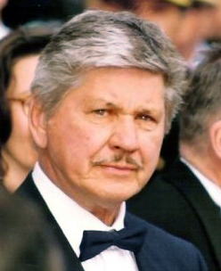

Bild: 1987; Georges Biard. CC BY-SA 3.0 laut Wikimedia Commons. [Bildquelle](https://commons.wikimedia.org/wiki/File:Charles_Bronson_Cannes.jpg), [TMDB](https://www.themoviedb.org/person/4960).

### L1 · leicht

Welches Instrument begleitet Charles Bronsons geheimnisvollen Revolverhelden in „Spiel mir das Lied vom Tod“?

- Ein Banjo

- Eine Geige

- **Richtig: Eine Mundharmonika**

- Eine Trompete

Bronsons namenloser Revolverheld spielt Mundharmonika.

Bereits am Bahnhof kündigt die Mundharmonika den fremden Mann an. Bronson spielt einen schweigsamen Revolverhelden, dessen Beziehung zu Frank (Henry Fonda) zunächst rätselhaft bleibt. Sergio Leone lässt das Instrument zu einem wiederkehrenden Zeichen werden. Erst die spätere Erinnerung erklärt, dass sein Klang mit einer früheren Gewalttat verbunden ist. Musik und Figur tragen somit gemeinsam die verzögerte Enthüllung seiner Vergangenheit.

Merksatz: Die Mundharmonika ist das hörbare Kennzeichen von Bronsons Fremdem.

Antwortzusätze:

- Eine Mundharmonika: Bronsons namenloser Revolverheld spielt Mundharmonika.

Quellen: [1](https://catalog.afi.com/Film/21519-ONCE-UPON-A-TIME-IN-THE-WEST).

### L2 · leicht

Welchen Beruf hat Charles Bronsons Paul Kersey zu Beginn von „Ein Mann sieht rot“?

- Polizist

- Rechtsanwalt

- Arzt

- **Richtig: Architekt**

Paul Kersey ist Architekt.

Kersey beginnt als ziviler Berufstätiger mit Familie. Nach einem brutalen Überfall, bei dem seine Frau stirbt und seine Tochter schwer traumatisiert wird, geht er nachts bewaffnet durch New York. Michael Winners Film macht aus diesem Wandel eine umstrittene Selbstjustizgeschichte. Der Architektenberuf ist dabei ein Gegenpol zum späteren Handeln: Ein Mann, der Lebensräume plant, wird zum gewalttätigen Akteur auf den Straßen.

Merksatz: Kersey kommt aus einem zivilen Beruf und wird zum Selbstjustiztäter.

Antwortzusätze:

- Architekt: Paul Kersey ist Architekt.

Gemeinsames Wissensziel: K-G100-20261008-ACTION-021-L1 (G100-20261008-ACTION-021-L1).

Quellen: [1](https://www.bfi.org.uk/news/michael-winner-1935-2013).

### M1 · mittel

Welche Angst gefährdet Danny (Charles Bronson) als Tunnelbauer in „Gesprengte Ketten“?

- **Richtig: Angst vor engen Räumen**

- Angst vor offenem Wasser

- Angst vor Vögeln

- Angst vor großen Menschenmengen

Danny leidet unter Klaustrophobie.

Danny ist für den Tunnelbau des Fluchtplans besonders wichtig, leidet aber unter Angst in engen Räumen. John Sturges besetzte Bronson damit als körperlich fähigen Mann mit einer verletzlichen Seite. Die Flucht verlangt nicht nur technische Vorbereitung und Mut gegenüber den Bewachern. Für Danny bedeutet sie zusätzlich, gegen eine eigene Angst anzukämpfen, während andere Gefangene auf seine Arbeit angewiesen sind.

Merksatz: Der Tunnelbauer fürchtet die Enge des Tunnels.

Antwortzusätze:

- Angst vor engen Räumen: Danny leidet unter Klaustrophobie.

Quellen: [1](https://www.criterion.com/current/posts/6941-the-great-escape-not-caught).

### M2 · mittel

Was erklärt Bernardo O’Reilly (Charles Bronson) den Jungen in „Die glorreichen Sieben“ über ihre Väter?

- Sie sollten ebenfalls bezahlte Revolverhelden werden.

- **Richtig: Die Verantwortung für eine Familie verlangt eigenen Mut.**

- Sie sollten das Dorf ohne ihre Kinder verlassen.

- Sie hätten den Banditen das Dorf freiwillig überlassen.

Bernardo verteidigt den Mut der Väter, die Verantwortung für ihre Familien tragen.

Die Jungen bewundern Bernardo als Revolverhelden und setzen ihre eigenen Väter herab. Er weist diese Vorstellung zurück: Ein Leben mit Verantwortung für Frau und Kinder verlange einen Mut, den er selbst nie aufgebracht habe. Bronson gibt dem Kämpfer damit eine Sehnsucht nach häuslichem Leben. Die Szene stellt das Heldenbild der Kinder neben eine weniger auffällige Form von Tapferkeit.

Merksatz: Bernardo erklärt Familienverantwortung zu einer Form des Muts.

Antwortzusätze:

- Die Verantwortung für eine Familie verlangt eigenen Mut.: Bernardo verteidigt den Mut der Väter, die Verantwortung für ihre Familien tragen.

Quellen: [1](https://catalog.afi.com/Film/53218-THE-MAGNIFICENT-SEVEN), [2](https://www.criterion.com/current/posts/6941-the-great-escape-not-caught).

### S1 · schwer

Womit verdient Chaney (Charles Bronson) in „Ein stahlharter Mann“ während der Weltwirtschaftskrise Geld?

- Mit Banküberfällen

- Mit Rodeovorführungen

- **Richtig: Mit bezahlten Faustkämpfen ohne Handschuhe**

- Mit der Verfolgung flüchtiger Gefangener

Chaney tritt in bezahlten Kämpfen mit bloßen Fäusten an.

Der umherziehende Chaney findet in der Wirtschaftskrise kaum Halt. Er überzeugt den Veranstalter Speed (James Coburn) von seiner Schlagkraft und steigt in dessen Kampfgeschäft ein. Walter Hills Regiedebüt betrachtet körperliche Stärke damit als etwas, das sich verkaufen lässt. Hinter der scheinbar einfachen Zusammenarbeit stehen Wetten, Abhängigkeiten und die Frage, wie lange Chaney sich von anderen vermarkten lassen will.

Merksatz: Chaneys Körper wird in der Krise zur Einnahmequelle.

Antwortzusätze:

- Mit bezahlten Faustkämpfen ohne Handschuhe: Chaney tritt in bezahlten Kämpfen mit bloßen Fäusten an.

Quellen: [1](https://catalog.afi.com/Film/55560-HARD-TIMES).

### S2 · schwer

Welche brisante Beziehung hat Steve McKenna (Jan-Michael Vincent), Arthur Bishops Schüler, zu Charles Bronsons Profikiller in „Kalter Hauch“?

- Er ist Bishops leiblicher Sohn.

- Er ist dessen ehemaliger Vorgesetzter.

- Er hat Bishop zuvor vor Gericht verteidigt.

- **Richtig: Bishop hat zuvor Steves Vater getötet.**

Bishop bildet den Sohn eines Mannes aus, den er selbst getötet hat.

Arthur Bishop tötet Harry McKenna (Keenan Wynn) und kommt danach dessen Sohn Steve näher. Schließlich bildet er ihn zum Auftragskiller aus. Die scheinbare Weitergabe professionellen Wissens entwickelt sich zu gegenseitigem Misstrauen: Beide legen Dossiers über den anderen an. Der Film von 1972 lässt die Beziehung zwischen Lehrer und Schüler so an der Logik eines Berufs zerbrechen, in dem Vertrauen gefährlich sein kann.

Merksatz: Bishops Schüler ist der Sohn eines früheren Opfers.

Antwortzusätze:

- Bishop hat zuvor Steves Vater getötet.: Bishop bildet den Sohn eines Mannes aus, den er selbst getötet hat.

Quellen: [1](https://catalog.afi.com/Catalog/moviedetails/54529).

### E1 · experte

In welchem Arbeitsmilieu sammelte Charles Bronson vor seiner Schauspielkarriere eigene Erfahrung?

- **Richtig: Im Kohlebergbau**

- In einer Operntruppe als Tenor

- In einem Architekturbüro

- Auf einer Pferderennbahn als Jockey

Bronson arbeitete als junger Mann in Kohlebergwerken in Pennsylvania.

Bronson wuchs in einer armen Bergarbeiterfamilie auf. Nach dem Tod des Vaters arbeitete auch er im Kohlebergbau, bevor er während des Zweiten Weltkriegs zur Luftwaffe ging. Sein Weg zur Schauspielerei führte später über Theaterarbeit und Unterricht am Pasadena Playhouse. Das öffentliche Bild des wortkargen Kraftmenschen verdeckt deshalb eine Laufbahn, die mit körperlicher Lohnarbeit begann und anschließend eine schauspielerische Ausbildung einschloss.

Merksatz: Vor Hollywood standen für Bronson Bergwerk, Militär und Schauspielunterricht.

Antwortzusätze:

- Im Kohlebergbau: Bronson arbeitete als junger Mann in Kohlebergwerken in Pennsylvania.

Quellen: [1](https://en.wikipedia.org/wiki/Charles_Bronson).

### E2 · experte

Welchen Karriereschritt markierte „Kalter Hauch“ für Charles Bronson Anfang der 1970er Jahre?

- Den Einstieg in überwiegend britische Studioproduktionen

- **Richtig: Die Rückkehr zu vorwiegend amerikanischen Dreharbeiten**

- Die Verlagerung von Filmrollen zu Fernsehserien

- Die Konzentration auf italienische Western statt US-Filme

Nach seinen Europaerfolgen drehte Bronson mit „Kalter Hauch“ wieder hauptsächlich in den USA.

Bronson war nach amerikanischen Ensemblefilmen besonders in europäischen Produktionen zum großen Star geworden. „Adieu l’ami“ mit Alain Delon und Sergio Leones Western gehören zu diesem Aufstieg. Laut AFI war „Kalter Hauch“ sein erster überwiegend in den USA gedrehter Film seit „Dieses Mädchen ist für alle“. Seine internationale Karriere wirkte damit auf seine Stellung in Hollywood zurück.

Merksatz: Der Europastar Bronson kehrt als Hauptdarsteller in eine US-Produktion zurück.

Antwortzusätze:

- Die Rückkehr zu vorwiegend amerikanischen Dreharbeiten: Nach seinen Europaerfolgen drehte Bronson mit „Kalter Hauch“ wieder hauptsächlich in den USA.

Quellen: [1](https://catalog.afi.com/Catalog/moviedetails/54529), [2](https://en.wikipedia.org/wiki/Charles_Bronson).

## Mel Gibson · Bekanntheitsgruppe 1

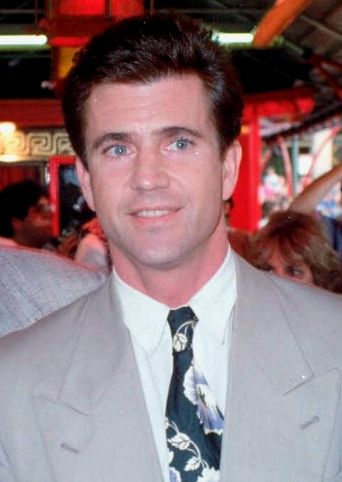

Bild: 1990; Mel_Gibson_1990.jpg : Alan Light derivative work: César ( talk ). CC BY 2.0 laut Wikimedia Commons. [Bildquelle](https://commons.wikimedia.org/wiki/File:Mel_Gibson_1990_(cropped).jpg), [TMDB](https://www.themoviedb.org/person/2461).

### L1 · leicht

Welcher Polizeibereich ist zu Beginn des ersten „Mad Max“ Mel Gibsons Max Rockatansky zugeordnet?

- Die Hafenpolizei

- Die Mordkommission einer Großstadt

- **Richtig: Die Straßenpatrouille**

- Der Personenschutz eines Präsidenten

Max arbeitet in der Straßenpatrouille der Main Force Patrol.

Der erste „Mad Max“ zeigt Max noch als Polizisten mit einer Familie. Verfolgungsjagden und der zerfallende Schutz durch staatliche Ordnung prägen seine Welt. George Miller verbindet dabei australische Autokultur mit einem Zukunftsszenario, das dem damaligen Alltag noch nahe ist. Die später vertraute Figur des einsamen Wanderers entsteht erst aus den Verlusten und Gewalterfahrungen dieses Beginns.

Merksatz: Max beginnt als Straßenpolizist, bevor er zum einsamen Wanderer wird.

Antwortzusätze:

- Die Straßenpatrouille: Max arbeitet in der Straßenpatrouille der Main Force Patrol.

Quellen: [1](https://www.nfsa.gov.au/collection/item/mad-max-1-interceptor-0), [2](https://en.wikipedia.org/wiki/Mad_Max_(film)).

### L2 · leicht

Welche historische Figur verkörpert Mel Gibson in „Braveheart“?

- Robert the Bruce

- König Edward I.

- Bonnie Prince Charlie

- **Richtig: William Wallace**

Mel Gibson spielt den schottischen Widerstandskämpfer William Wallace.

Gibson übernahm bei „Braveheart“ die Hauptrolle sowie Regie und Produzentenaufgaben. Sein Wallace führt den Kampf gegen die englische Herrschaft an. Der Film formt aus dem historischen Stoff ein großes Freiheits- und Opferdrama. Die Darstellung ist deshalb als dramatisierte Filmfigur zu verstehen, während die konkrete Leistung Gibsons vor und hinter der Kamera getrennt betrachtet werden kann.

Merksatz: Gibson ist Wallace und zugleich Regisseur und Mitproduzent.

Antwortzusätze:

- William Wallace: Mel Gibson spielt den schottischen Widerstandskämpfer William Wallace.

Quellen: [1](https://en.wikipedia.org/wiki/Mel_Gibson), [2](https://www.oscars.org/oscars/ceremonies/1996).

### M1 · mittel

Wer ist der erfahrene Polizeipartner von Martin Riggs (Mel Gibson) in „Lethal Weapon – Zwei stahlharte Profis“?

- **Richtig: Roger Murtaugh**

- John McClane

- Harry Callahan

- Axel Foley

Riggs wird mit Roger Murtaugh, gespielt von Danny Glover, zusammengebracht.

Riggs und Murtaugh verfolgen denselben Fall, bringen aber sehr unterschiedliche Lebenslagen mit. Riggs ist nach dem Tod seiner Frau selbstzerstörerisch, Murtaugh lebt mit seiner Familie und sieht seine Polizeiarbeit mit anderer Vorsicht. Richard Donner entwickelt daraus die Reibung des ungleichen Paars. Die wachsende Verbindung eröffnet Riggs zugleich einen Zugang zu menschlicher Nähe außerhalb seiner Trauer.

Merksatz: Riggs und Murtaugh sind das ungleiche Polizeipaar.

Antwortzusätze:

- Roger Murtaugh: Riggs wird mit Roger Murtaugh, gespielt von Danny Glover, zusammengebracht.

Gemeinsames Wissensziel: K-ACT-04-murtaugh-partner (ACT-L-008).

Quellen: [1](https://catalog.afi.com/Film/68361-LETHAL-WEAPON).

### M2 · mittel

Welche ungewöhnliche Fähigkeit erhält Nick Marshall (Mel Gibson) in „Was Frauen wollen“?

- Er sieht zukünftige Ereignisse.

- **Richtig: Er hört die Gedanken von Frauen.**

- Er kann vergangene Gespräche wiederholen.

- Er versteht jede gesprochene Sprache.

Nick kann hören, was Frauen denken.

Der Werbemann Nick Marshall hält sich zunächst für unwiderstehlich und kennt doch die Perspektive seiner Kolleginnen kaum. Die plötzlich hörbaren Gedanken verschaffen ihm Vorteile, stellen aber auch sein Selbstbild infrage. Gibson spielt die Komik zwischen selbstsicherem Auftreten und unerwarteten Reaktionen. Die Fähigkeit ist keine allgemeine Gedankenlesekraft für alle Menschen, sondern das auf Frauen bezogene Grundprinzip der Geschichte.

Merksatz: Nick hört Gedanken, die seinem bisherigen Selbstbild widersprechen.

Antwortzusätze:

- Er hört die Gedanken von Frauen.: Nick kann hören, was Frauen denken.

Gemeinsames Wissensziel: K-ROM-202610-P01-L-009 (ROM-202610-P01-L-009).

Quellen: [1](https://en.wikipedia.org/wiki/What_Women_Want).

### S1 · schwer

Welche gemeinsame Fähigkeit verbindet Frank (Mel Gibson) und Archy (Mark Lee) in „Gallipoli“, bevor sie Soldaten werden?

- Sie spielen professionell Klavier.

- Sie sind erfahrene Seefahrer.

- **Richtig: Sie sind schnelle Läufer.**

- Sie beherrschen Luftakrobatik.

Frank und Archy sind Läufer.

Peter Weir führt die jungen Männer zunächst als sportliche Konkurrenten zusammen. Ihr gemeinsamer Weg durch die australische Landschaft wird zu einer Freundschaft, bevor beide in den Krieg geraten. Die körperliche Ausdauer erhält dadurch eine doppelte Bedeutung: Sie trägt ihre jugendlichen Hoffnungen und wird später unter militärischen Bedingungen eingesetzt. Gibsons Frank verkörpert den skeptischeren Zugang zum patriotischen Abenteuer.

Merksatz: Aus zwei Läufern werden Freunde und Soldaten.

Antwortzusätze:

- Sie sind schnelle Läufer.: Frank und Archy sind Läufer.

Quellen: [1](https://aso.gov.au/titles/features/gallipoli/clip1/), [2](https://www.nfsa.gov.au/collection/item/gallipoli-its-not-our-bloody-war), [3](https://en.wikipedia.org/wiki/Gallipoli_(1981_film)).

### S2 · schwer

Für welche Aufgaben erhielt Mel Gibson bei den Oscars 1996 persönliche Auszeichnungen mit „Braveheart“?

- Hauptrolle und Schnitt

- Drehbuch und Filmmusik

- Regie und Hauptrolle

- **Richtig: Regie und als einer der Produzenten des besten Films**

Gibson gewann für Regie und gemeinsam mit Alan Ladd Jr. und Bruce Davey für den besten Film.

„Braveheart“ gewann fünf Oscars, doch nicht alle gehörten Mel Gibson persönlich. Sein Regiepreis war eine individuelle Auszeichnung. Den Preis für den besten Film teilte er als Produzent mit Alan Ladd Jr. und Bruce Davey. Die Unterscheidung verhindert, dass alle Preise einer Produktion ihrem bekanntesten Star zugerechnet werden; für Gibsons Hauptdarstellung gab es bei dieser Verleihung keinen Schauspielpreis.

Merksatz: Gibson gewann für Regie und im Produzententeam, nicht für die Hauptrolle.

Antwortzusätze:

- Regie und als einer der Produzenten des besten Films: Gibson gewann für Regie und gemeinsam mit Alan Ladd Jr. und Bruce Davey für den besten Film.

Gemeinsames Wissensziel: K-E20261007-A-020-M (E20261007-A-020-M).

Quellen: [1](https://www.oscars.org/oscars/ceremonies/1996).

### E1 · experte

Mit welchem Film gab Mel Gibson sein Spielfilm-Regiedebüt und spielte zugleich einen entstellten ehemaligen Lehrer?

- **Richtig: „Der Mann ohne Gesicht“**

- „Braveheart“

- „Maverick“

- „Hamlet“

„Der Mann ohne Gesicht“ war Gibsons Spielfilm-Regiedebüt.

Gibson spielt Justin McLeod, der nach einem schweren Unfall zurückgezogen lebt. Ein Junge sucht bei ihm Unterstützung für seine Ausbildung, und zwischen beiden entsteht Vertrauen, das durch Gerüchte im Umfeld bedroht wird. Gibson wählte für sein Regiedebüt damit ein Beziehungsdrama. Die Arbeit mit einem jungen Mitspieler und die Frage nach Vorurteilen stehen im Vordergrund, statt einer Folge großer Actionszenen.

Merksatz: Gibsons erste Spielfilmregie behandelt Vertrauen zwischen Lehrer und Schüler.

Antwortzusätze:

- „Der Mann ohne Gesicht“: „Der Mann ohne Gesicht“ war Gibsons Spielfilm-Regiedebüt.

Quellen: [1](https://watch.afi.com/movie/the-man-without-a-face-1993).

### E2 · experte

Wie bereiteten sich Mel Gibson und Danny Glover laut AFI auf ihre Polizeiarbeit in „Lethal Weapon“ vor?

- Sie absolvierten ein mehrjähriges Polizeistudium.

- **Richtig: Sie begleiteten LAPD-Beamte und trainierten Waffenhandhabung.**

- Sie probten mit ehemaligen FBI-Ermittlern in Washington.

- Sie beschränkten sich auf Trainingsfilme der Polizei.

Die Darsteller begleiteten LAPD-Beamte und erhielten körperliches und Waffentraining.

Stuntkoordinator Bobby Bass leitete die körperliche Vorbereitung. Hinzu kamen Unterricht in Waffenhandhabung und Sicherheit sowie die Begleitung wirklicher Polizeibeamter. Richard Donner konsultierte auch das Sheriff’s Department. Diese Recherche wurde anschließend für einen stark zugespitzten Actionfilm verwendet. Der Blick hinter die Produktion zeigt, dass die Glaubwürdigkeit des Polizeipaars auch durch Vorbereitung entstand und nicht allein aus spontaner Chemie der Stars.

Merksatz: Beobachtung echter Polizeiarbeit und Training gingen der Filmhandlung voraus.

Antwortzusätze:

- Sie begleiteten LAPD-Beamte und trainierten Waffenhandhabung.: Die Darsteller begleiteten LAPD-Beamte und erhielten körperliches und Waffentraining.

Quellen: [1](https://catalog.afi.com/Film/68361-LETHAL-WEAPON).

## Dwayne Johnson · Bekanntheitsgruppe 1

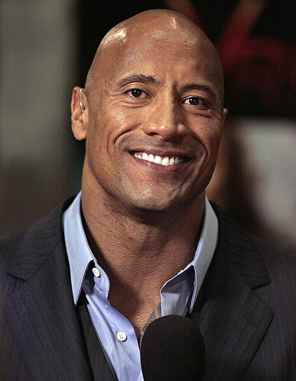

Bild: 2013; Eva Rinaldi. CC BY-SA 2.0 laut Wikimedia Commons. [Bildquelle](https://commons.wikimedia.org/wiki/File:Dwayne_Johnson_2,_2013.jpg), [TMDB](https://www.themoviedb.org/person/18918).

### L1 · leicht

Unter welchem Ringnamen wurde Dwayne Johnson vor seiner Filmkarriere als Wrestler bekannt?

- The Undertaker

- **Richtig: The Rock**

- Stone Cold

- Triple H

Johnson wurde als The Rock bekannt.

Johnsons Aufstieg führte vom professionellen Wrestling zum Kino. Bei der WWE gehörten die körperlichen Auftritte ebenso zur Figur The Rock wie Interviews, Sprüche und das Spiel mit den Reaktionen des Publikums. Der Ringname blieb auch bei frühen Filmauftritten präsent. Seine Bekanntheit als Darsteller entstand somit bereits vor den großen Actionrollen aus einer inszenierten öffentlichen Figur.

Merksatz: The Rock ist Johnsons Wrestling-Persona.

Antwortzusätze:

- The Rock: Johnson wurde als The Rock bekannt.

Quellen: [1](https://www.wwe.com/superstars/the-rock).

### L2 · leicht

Welche Figur spricht Dwayne Johnson in der englischen Originalfassung des animierten „Vaiana“?

- Den Hahn Heihei

- Den Häuptling Tui

- **Richtig: Den Halbgott Maui**

- Die Krabbe Tamatoa

Johnson ist die Originalstimme des Halbgottes Maui.

Vaiana verlässt ihre Insel, um ihrem bedrohten Volk zu helfen. Auf der Seereise braucht sie die Unterstützung Mauis, der selbst kein unkomplizierter Begleiter ist. Johnson gestaltet den Halbgott als Stimme eines animierten Körpers. Neben den komischen Reibungen zwischen den Reisenden gehört damit auch die Vermittlung von Selbstbewusstsein und Verletzlichkeit zur Rolle.

Merksatz: Johnsons Stimme gehört Maui, Vaianas widerspenstigem Reisegefährten.

Antwortzusätze:

- Den Halbgott Maui: Johnson ist die Originalstimme des Halbgottes Maui.

Quellen: [1](https://movies.disney.com/moana).

### M1 · mittel

Wessen Spielavatar ist Dr. Smolder Bravestone (Dwayne Johnson) in „Jumanji: Willkommen im Dschungel“?

- Der des Sportlers Fridge

- Der der beliebten Bethany

- Der der zurückhaltenden Martha

- **Richtig: Der des unsicheren Spencer**

Bravestone ist der Avatar von Spencer.

Vier Jugendliche geraten in ein Videospiel und erhalten die Körper ihrer gewählten Figuren. Spencer wird zum muskulösen Bravestone, obwohl er sich außerhalb des Spiels wenig zutraut. Johnson muss deshalb zwei Ebenen verbinden: den scheinbar unerschütterlichen Abenteuerhelden und den verunsicherten Jugendlichen, der diesen Körper erst benutzen lernt. Die Komik entsteht aus dem Abstand zwischen äußerer Stärke und innerer Selbstwahrnehmung.

Merksatz: Bravestones Muskeln verbergen Spencers Unsicherheit.

Antwortzusätze:

- Der des unsicheren Spencer: Bravestone ist der Avatar von Spencer.

Quellen: [1](https://www.sonypictures.com/movies/jumanjiwelcometothejungle), [2](https://en.wikipedia.org/wiki/Jumanji:_Welcome_to_the_Jungle).

### M2 · mittel

Mit welchem Auftrag tritt Luke Hobbs (Dwayne Johnson) in „Fast & Furious Five“ zunächst gegen Doms Gruppe an?

- **Richtig: Er soll die Flüchtigen festnehmen.**

- Er soll ihre Rennwagen kaufen.

- Er soll sie für einen Geheimauftrag anwerben.

- Er soll ihre Schulden bei Reyes eintreiben.

Hobbs soll Dom und die anderen Flüchtigen festnehmen.

Hobbs kommt als US-Bundesagent nach Rio de Janeiro. Dom und Brian stehen nach einem Zugüberfall unter Mordverdacht; damit verfolgt Hobbs sie zunächst als Vertreter des Gesetzes. Erst die gemeinsame Bedrohung durch Reyes verändert die Fronten. Johnson führt seine Serienfigur also als Gegenspieler der Hauptfiguren ein, bevor daraus eine zeitweilige Zusammenarbeit und später ein eigener Handlungszweig werden.

Merksatz: Hobbs beginnt als Verfolger der späteren Verbündeten.

Antwortzusätze:

- Er soll die Flüchtigen festnehmen.: Hobbs soll Dom und die anderen Flüchtigen festnehmen.

Quellen: [1](https://www.universalpicturesathome.com/movies/fast-five), [2](https://en.wikipedia.org/wiki/Fast_Five).

### S1 · schwer

In welchem Film trat Dwayne Johnsons Skorpionkönig bereits auf, bevor die Figur einen eigenen Kinofilm erhielt?

- „Die Mumie“

- **Richtig: „Die Mumie kehrt zurück“**

- „Van Helsing“

- „Prince of Persia: Der Sand der Zeit“

Der Skorpionkönig erscheint bereits in „Die Mumie kehrt zurück“.

Johnsons Auftritt gehört zunächst zur Abenteuerwelt um Rick O’Connell, gespielt von Brendan Fraser. Der anschließende Film „The Scorpion King“ stellt die Vorgeschichte der Figur in den Mittelpunkt und macht Johnson zum Hauptdarsteller eines eigenen Fantasyabenteuers. Die Karriereentwicklung führt damit von einer Figur innerhalb einer etablierten Reihe zu einem auf den neuen Star zugeschnittenen Film.

Merksatz: Aus dem Mumien-Nebenstrang wurde Johnsons eigener Hauptrollenfilm.

Antwortzusätze:

- „Die Mumie kehrt zurück“: Der Skorpionkönig erscheint bereits in „Die Mumie kehrt zurück“.

Quellen: [1](https://www.universalpicturesathome.com/movies/the-mummy-returns), [2](https://www.universalpicturesathome.com/movies/the-scorpion-king), [3](https://en.wikipedia.org/wiki/Dwayne_Johnson).

### S2 · schwer

Mit wem gründete Dwayne Johnson die Produktionsfirma Seven Bucks Productions?

- Mit Emily Blunt

- Mit Kevin Hart

- **Richtig: Mit Dany Garcia**

- Mit Jason Statham

Dany Garcia und Dwayne Johnson gründeten Seven Bucks Productions.

Die gemeinsame Firma arbeitet für Kino, Fernsehen und weitere Medien. Zu ihrem Programm gehören etwa „Ballers“, „Jumanji“ und „Jungle Cruise“, aber auch dokumentarische Projekte. Johnsons berufliche Rolle reicht dadurch über das Auftreten vor der Kamera hinaus. Die Unternehmensgeschichte nennt Garcia und Johnson als Gründer; Hiram Garcia übernahm eine weitere zentrale Leitungsfunktion für die Produktion.

Merksatz: Seven Bucks wurde von Dany Garcia und Dwayne Johnson gegründet.

Antwortzusätze:

- Mit Dany Garcia: Dany Garcia und Dwayne Johnson gründeten Seven Bucks Productions.

Quellen: [1](https://sevenbucks.com/our-story/).

### E1 · experte

Welchen beruflichen Wechsel hat Spencer Strasmore (Dwayne Johnson) zu Beginn der Serie „Ballers“ hinter sich?

- Vom Rennfahrer zum Teammechaniker

- Vom Polizisten zum Sicherheitsberater

- Vom Boxer zum Sportjournalisten

- **Richtig: Vom Footballprofi zum Finanzmanager für Spieler**

Spencer arbeitet nach seiner Footballkarriere als Finanzmanager für Spieler.

Spencer versucht in Miami, sportliche Kontakte in eine neue berufliche Existenz zu übersetzen. Seine Kunden sind aktive und ehemalige Footballspieler, deren Probleme über Geldanlagen hinausreichen. Die Serie verknüpft Freundschaft, Geschäftsinteressen und den unsicheren Übergang nach einer Sportkarriere. Johnson spielt somit einen Mann, dessen körperlicher Ruhm bereits Vergangenheit ist und dessen neue Autorität erst entstehen muss.

Merksatz: Spencer macht aus Kontakten im Football ein Finanzgeschäft.

Antwortzusätze:

- Vom Footballprofi zum Finanzmanager für Spieler: Spencer arbeitet nach seiner Footballkarriere als Finanzmanager für Spieler.

Quellen: [1](https://sevenbucks.com/project/ballers/).

### E2 · experte

Welche Vorlage steht hinter „Jungle Cruise“, bei dem Dwayne Johnson Hauptdarsteller und Mitproduzent ist?

- **Richtig: Eine Bootsfahrt in Disney-Freizeitparks**

- Eine autobiografische Expedition Johnsons

- Ein Computerspiel über U-Boot-Kämpfe

- Ein Broadway-Musical über Piraten

Der Film geht auf die Jungle-Cruise-Attraktion der Disney-Parks zurück.

Der Film erweitert die Bootsfahrt zu einer Abenteuergeschichte am Amazonas. Frank, gespielt von Johnson, führt die Forscherin Lily Houghton (Emily Blunt) auf der Suche nach einem Baum mit heilenden Kräften. Johnson steht außerdem im Produzententeam. Die Adaption zeigt, wie eine Freizeitparkattraktion zur Grundlage einer erzählten Filmwelt werden kann, deren Figuren und Konflikte über den ursprünglichen Fahrtablauf hinausgehen.

Merksatz: Aus einer Disney-Bootsfahrt wurde ein Abenteuerfilm.

Antwortzusätze:

- Eine Bootsfahrt in Disney-Freizeitparks: Der Film geht auf die Jungle-Cruise-Attraktion der Disney-Parks zurück.

Quellen: [1](https://movies.disney.com/jungle-cruise), [2](https://sevenbucks.com/project/jungle-cruise/), [3](https://news.disney.com/making-of-jungle-cruise).

## Vin Diesel · Bekanntheitsgruppe 1

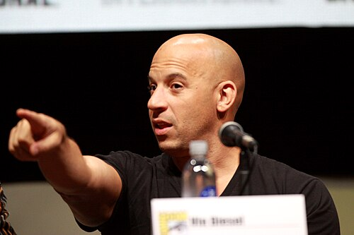

Bild: 2013; Gage Skidmore from Peoria, AZ, United States of America. CC BY-SA 2.0 laut Wikimedia Commons. [Bildquelle](https://commons.wikimedia.org/wiki/File:Vin_Diesel_2013.jpg), [TMDB](https://www.themoviedb.org/person/12835).

### L1 · leicht

Welche wiederkehrende Figur spielt Vin Diesel in der „Fast & Furious“-Reihe?

- Brian O’Conner

- Luke Hobbs

- **Richtig: Dominic Toretto**

- Deckard Shaw

Diesel spielt Dominic Toretto.

Dom gehört zum Kern der Reihe, die mit Straßenrennen und verdeckten Ermittlungen beginnt. Paul Walker spielt Brian O’Conner, dessen Verhältnis zu Dom zwischen Polizeiauftrag und persönlicher Loyalität steht. Spätere Filme erweitern die Geschichten zu internationalen Raubzügen und Missionen. Diesel blieb nicht nur als Darsteller der Figur beteiligt, sondern übernahm bei mehreren Folgen auch Produzentenaufgaben.

Merksatz: Diesel ist Dom; Paul Walker ist Brian.

Antwortzusätze:

- Dominic Toretto: Diesel spielt Dominic Toretto.

Quellen: [1](https://en.wikipedia.org/wiki/Vin_Diesel), [2](https://en.wikipedia.org/wiki/Fast_Five).

### L2 · leicht

Wem gibt Vin Diesel in der englischen Originalfassung von „Guardians of the Galaxy“ seine Stimme?

- Rocket

- **Richtig: Groot**

- Ronan

- Drax

Diesel spricht Groot.

Groot ist ein baumartiges Wesen und Rockets Gefährte. Obwohl sein gesprochener Wortschatz stark begrenzt ist, vermittelt die Stimme unterschiedliche Gefühle und Absichten. Regisseur James Gunn erklärte, dass er Diesel für die einzelnen Äußerungen jeweils den gemeinten Inhalt erläuterte. Die Wirkung der Figur hängt dadurch auch an Betonung und Rhythmus, nicht nur an ihrer digitalen Gestalt.

Merksatz: Groot sagt wenig, doch Diesels Stimme verändert die Bedeutung.

Antwortzusätze:

- Groot: Diesel spricht Groot.

Quellen: [1](https://en.wikipedia.org/wiki/Guardians_of_the_Galaxy_(film)).

### M1 · mittel

Welche besondere Fähigkeit besitzt Riddick (Vin Diesel) in „Pitch Black – Planet der Finsternis“?

- Er liest fremde Gedanken.

- Er kann unter Wasser atmen.

- Er beherrscht Teleportation.

- **Richtig: Er sieht bei sehr wenig Licht.**

Riddick kann bei sehr wenig Licht sehen.

Nach einem Raumschiffabsturz sitzen die Überlebenden auf einem fremden Planeten fest. Eine Finsternis setzt nachtaktive Raubtiere frei und verändert den Wert der Fähigkeiten innerhalb der Gruppe. Der gefangene Riddick wird durch sein Sehvermögen zum wichtigen Helfer. Sein Nutzen beseitigt jedoch nicht automatisch das Misstrauen gegenüber ihm: Schutz und Abhängigkeit verbinden sich mit der Frage, ob er sich für andere einsetzen wird.

Merksatz: In der Finsternis wird der Gefangene zum möglichen Retter.

Antwortzusätze:

- Er sieht bei sehr wenig Licht.: Riddick kann bei sehr wenig Licht sehen.

Gemeinsames Wissensziel: K-SF-202609-P02-L-034 (SF-202609-P02-L-034).

Quellen: [1](https://www.universalpicturesathome.com/movies/pitch-black), [2](https://en.wikipedia.org/wiki/Pitch_Black_(film)).

### M2 · mittel

Aus welcher Szene kommt Xander Cage (Vin Diesel), bevor ihn die NSA in „xXx“ für einen Einsatz gewinnt?

- **Richtig: Aus der Extremsport- und Stuntszene**

- Aus der klassischen Musik

- Aus der diplomatischen Laufbahn

- Aus der professionellen Schachszene

Xander Cage ist ein Extremsportler und risikofreudiger Stuntstar.

Die NSA setzt nicht auf einen unauffälligen Berufsagenten, sondern auf einen Mann, der durch spektakuläre Aktionen auffällt und sich über Regeln hinwegsetzt. Cage soll einen russischen Verbrecherring unterwandern. Der Film überträgt damit Eigenschaften des Extremsports auf den Agentenfilm: Risikobereitschaft und körperliche Improvisation werden zu Werkzeugen der Mission, während Samuel L. Jacksons Agent Gibbons ihn anleitet.

Merksatz: Cage bringt seine Extremsport-Erfahrung in den Agenteneinsatz mit.

Antwortzusätze:

- Aus der Extremsport- und Stuntszene: Xander Cage ist ein Extremsportler und risikofreudiger Stuntstar.

Quellen: [1](https://www.sonypictures.com/movies/xxx).

### S1 · schwer

Welches Vorbild wählt der von Vin Diesel gesprochene Riese im Finale von „Der Gigant aus dem All“, statt seine Bestimmung als Waffe hinzunehmen?

- Batman

- Captain America

- Spider-Man

- **Richtig: Superman**

Der Riese orientiert sich an Superman.

Hogarth hat dem außerirdischen Roboter erklärt, dass er selbst entscheiden kann, wer er sein möchte. Als eine Atomrakete die Stadt bedroht, fliegt der Riese ihr entgegen und schützt damit die Menschen. Das Superman-Vorbild verbindet die zuvor betrachteten Comics mit dieser Entscheidung. Die Stimme Diesels begleitet so den Wandel einer gefürchteten Maschine zu einem Wesen, das Verantwortung für andere übernimmt.

Merksatz: Der Riese entscheidet sich für Superman und gegen die Rolle als Waffe.

Antwortzusätze:

- Superman: Der Riese orientiert sich an Superman.

Quellen: [1](https://en.wikipedia.org/wiki/The_Iron_Giant).

### S2 · schwer

Wie machte Vin Diesel nach eigener Schilderung auf sich aufmerksam, bevor Steven Spielberg ihn für „Der Soldat James Ryan“ besetzte?

- Er ging mit einem Broadway-Musical auf Tournee.

- **Richtig: Er schrieb und inszenierte einen eigenen Kurzfilm.**

- Er begann als Stuntdouble bei Kriegsfilmen.

- Er wurde in einer Werbekampagne als Model entdeckt.

Diesel schrieb und inszenierte „Multi-Facial“ selbst; Spielberg wurde auf seine Arbeit aufmerksam.

Diesel beschrieb den Kurzfilm als Möglichkeit, sich mit begrenzten Mitteln selbst Arbeit zu schaffen. Ein zunächst geplantes längeres Projekt war nicht finanzierbar; deshalb drehte er den kürzeren Film. Nach dessen Präsentation in Cannes sah Spielberg ihn und besetzte Diesel in seinem Kriegsfilm. Der Weg nach Hollywood beruhte somit auch auf eigenem Schreiben und Inszenieren.

Merksatz: Ein selbst gedrehter Kurzfilm öffnete Diesel die Tür zu Spielberg.

Antwortzusätze:

- Er schrieb und inszenierte einen eigenen Kurzfilm.: Diesel schrieb und inszenierte „Multi-Facial“ selbst; Spielberg wurde auf seine Arbeit aufmerksam.

Quellen: [1](https://www.blackfilm.com/20040604/features/vindiesel.shtml), [2](https://www.blackfilm.com/20050225/features/vindiesel.shtml).

### E1 · experte

Wofür gründete Vin Diesel Tigon Studios im Zusammenhang mit der Riddick-Welt?

- **Richtig: Für Videospiele, die die Figurengeschichte erweitern**

- Für eine Konzerttour der Filmmusik

- Für den Bau eines Themenparks

- Für eine ausschließlich gedruckte Comicreihe

Tigon Studios entwickelte Videospiele und erweiterte darin Riddicks Geschichte.

Im Interview zu „Riddick: Chroniken eines Kriegers“ erklärte Diesel, dass ein Spiel zusätzliche Geschichte zeigen konnte. Dazu gehörten Riddicks Vergangenheit und sein Verhältnis zu Johns. Damit beschränkte er seine Beteiligung nicht auf einen einzelnen Film. Die Figur wurde über verschiedene Medien weiterentwickelt, und ein Spiel konnte Zusammenhänge behandeln, die im Kinofilm keinen entsprechenden Raum hatten.

Merksatz: Tigon verlängerte Riddicks Geschichte ins Videospiel.

Antwortzusätze:

- Für Videospiele, die die Figurengeschichte erweitern: Tigon Studios entwickelte Videospiele und erweiterte darin Riddicks Geschichte.

Quellen: [1](https://www.blackfilm.com/20040604/features/vindiesel.shtml).

### E2 · experte

Welches Kampfprinzip hob Vin Diesel bei seiner Vorbereitung auf „Riddick: Chroniken eines Kriegers“ hervor?

- Den völligen Verzicht auf Waffen

- Ausschließlich Bodenkampf ohne Schläge

- **Richtig: Den beidhändigen Kampf im Kali-Training**

- Nur historische europäische Fechtregeln

Diesel trainierte Kali mit einem Schwerpunkt auf beidhändigem Kämpfen.

Diesel reiste vor Drehbeginn an, um mit Kämpfern zu trainieren. Im damaligen Interview betonte er besonders das beidhändige Arbeiten des Kali. Die Vorbereitung zielte damit auf einen bestimmten Bewegungsstil für Riddick. Das ergänzt die digitale Welt des Science-Fiction-Films um eine körperlich erarbeitete Darstellungsleistung: Waffenführung und Koordination mussten zunächst eingeübt werden, bevor sie vor der Kamera eingesetzt werden konnten.

Merksatz: Riddicks Bewegungsstil wurde durch beidhändiges Kali-Training vorbereitet.

Antwortzusätze:

- Den beidhändigen Kampf im Kali-Training: Diesel trainierte Kali mit einem Schwerpunkt auf beidhändigem Kämpfen.

Quellen: [1](https://www.blackfilm.com/20040604/features/vindiesel.shtml).

## Jason Statham · Bekanntheitsgruppe 1

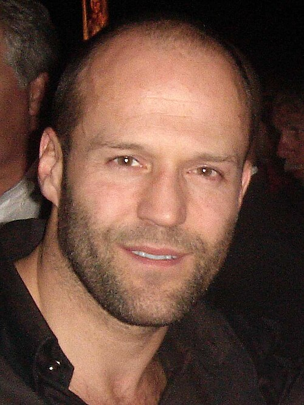

Bild: 2007; fadedcaralunagirl / Maura Ortega. CC BY 2.0 laut Wikimedia Commons. [Bildquelle](https://commons.wikimedia.org/wiki/File:Jason_Statham_2007.jpg), [TMDB](https://www.themoviedb.org/person/976).

### L1 · leicht

Wie heißt die von Jason Statham gespielte Hauptfigur der ersten drei „Transporter“-Filme?

- **Richtig: Frank Martin**

- John Wick

- Bryan Mills

- Robert McCall

Statham spielt Frank Martin.

Frank übernimmt gefährliche Transporte und versucht, sich mit strikten Regeln aus den Angelegenheiten seiner Auftraggeber herauszuhalten. Im ersten Film zerbricht diese Distanz, als er seine Fracht öffnet und eine entführte junge Frau entdeckt. Stathams Figur muss nun entscheiden, ob die Erfüllung eines Auftrags wichtiger ist als ihr Leben. Shu Qi spielt die junge Frau Lai.

Merksatz: Frank Martin gerät durch eine geöffnete Fracht persönlich in den Fall.

Antwortzusätze:

- Frank Martin: Statham spielt Frank Martin.

Gemeinsames Wissensziel: K-ACT-202610-P01-L-003 (ACT-202610-P01-L-003).

Quellen: [1](https://www.20thcenturystudios.com/movies/the-transporter), [2](https://en.wikipedia.org/wiki/Jason_Statham).

### L2 · leicht

Welches Geschäft betreibt Turkish (Jason Statham) mit Tommy (Stephen Graham) in „Snatch – Schweine und Diamanten“?

- Einen Juwelenverleih

- **Richtig: Die Organisation illegaler Boxkämpfe**

- Eine private Flugschule

- Den Verkauf seltener Gemälde

Turkish und Tommy organisieren illegale Boxkämpfe.

Das Duo muss sich mit dem Gangster und Veranstalter Brick Top (Alan Ford) arrangieren. Der von Brad Pitt gespielte Boxer Mickey O’Neil hält sich allerdings nicht zuverlässig an den vorgesehenen Kampfverlauf. Während eine andere Handlung einem gestohlenen Diamanten folgt, geraten Turkish und Tommy durch die Manipulation der Kämpfe in Gefahr. Statham steht hier als überforderter Organisator im komischen Gangsterensemble.

Merksatz: Turkish organisiert Kämpfe, deren Ausgang sich kaum kontrollieren lässt.

Antwortzusätze:

- Die Organisation illegaler Boxkämpfe: Turkish und Tommy organisieren illegale Boxkämpfe.

Quellen: [1](https://www.sonypictures.com/movies/snatch).

### M1 · mittel

Was muss Chev Chelios (Jason Statham) in „Crank“ nach einer Vergiftung ständig aufrechterhalten?

- Seinen Blutzuckerspiegel durch Süßigkeiten

- Eine besonders niedrige Körpertemperatur

- **Richtig: Einen hohen Adrenalinspiegel**

- Völlige körperliche Ruhe

Chev muss seinen Adrenalinspiegel hochhalten.

Das Gift zwingt den Auftragskiller, seinen Körper immer wieder in einen Ausnahmezustand zu versetzen. Ruhe würde ihn dem Tod näherbringen. Während er nach den Verantwortlichen sucht, werden riskante Aktionen damit zugleich zu Überlebensmaßnahmen. Der Film macht aus der sonst freiwilligen Rastlosigkeit einer Actionfigur einen körperlichen Zwang und treibt Stathams Spiel zwischen Entschlossenheit, Erschöpfung und absurden Notlösungen voran.

Merksatz: Chevs Körper braucht den Ausnahmezustand, um weiterzuleben.

Antwortzusätze:

- Einen hohen Adrenalinspiegel: Chev muss seinen Adrenalinspiegel hochhalten.

Gemeinsames Wissensziel: K-G100-20261008-ACTION-020-L2 (G100-20261008-ACTION-020-L2).

Quellen: [1](https://en.wikipedia.org/wiki/Crank_(film)).

### M2 · mittel

Wie reagiert Rick Ford (Jason Statham) in „Spy – Susan Cooper undercover“ zunächst auf Susans ersten Außeneinsatz?

- Er übernimmt offiziell Susans Ausbildung.

- Er zieht sich zugunsten ihrer Mission vollständig zurück.

- Er bittet sie zunächst um eine Zusammenarbeit.

- **Richtig: Er hält sie für ungeeignet und greift eigenmächtig ein.**

Ford unterschätzt Susan und greift eigenmächtig in ihre Mission ein.

Susan Cooper (Melissa McCarthy) kommt aus der CIA-Analyse und ist ihren Gegnern deshalb noch unbekannt. Ford hält ihre fehlende Einsatzerfahrung für ein Ausschlusskriterium. Seine demonstrative Selbstsicherheit macht ihn aber keineswegs zum zuverlässigeren Agenten: Susan muss ihn sogar vor einer Bombe warnen. Statham nutzt das vertraute Auftreten des unbesiegbaren Actionprofis hier für eine Figur, deren Behauptungen und Leistungen auseinanderfallen.

Merksatz: Fords großes Selbstvertrauen ist kein Beweis für bessere Arbeit.

Antwortzusätze:

- Er hält sie für ungeeignet und greift eigenmächtig ein.: Ford unterschätzt Susan und greift eigenmächtig in ihre Mission ein.

Quellen: [1](https://www.20thcenturystudios.com/movies/spy), [2](https://en.wikipedia.org/wiki/Spy_(2015_film)).

### S1 · schwer

Warum wird Jonas Taylor (Jason Statham) in „Meg“ aus seinem zurückgezogenen Leben wieder zu einer Tiefseemission geholt?

- **Richtig: Er soll Menschen aus einem festsitzenden Tauchboot retten.**

- Er soll einen versunkenen Goldtransport bergen.

- Er soll einen neuen Meeresgraben vermessen.

- Er soll als Tourist an einer Unterwasserführung teilnehmen.

Jonas wird für eine Rettung aus einem in der Tiefe eingeschlossenen Tauchboot gebraucht.

Eine frühere Rettungsaktion hat Jonas traumatisiert und seinen Ruf beschädigt, weil seine Warnung vor einem riesigen Tier nicht geglaubt wurde. Jahre später sitzt ein Forschungsteam in der Tiefe fest; zu ihm gehört auch seine Exfrau Lori (Jessica McNamee). Die neue Mission verbindet fachliches Können mit einer persönlichen Rückkehr. Erst aus der Rettung entwickelt sich der Kampf gegen die Bedrohung an der Oberfläche.

Merksatz: Jonas kehrt als Retter zurück, bevor er den Riesenhai bekämpft.

Antwortzusätze:

- Er soll Menschen aus einem festsitzenden Tauchboot retten.: Jonas wird für eine Rettung aus einem in der Tiefe eingeschlossenen Tauchboot gebraucht.

Quellen: [1](https://en.wikipedia.org/wiki/The_Meg).

### S2 · schwer

Was macht Arthur Bishops (Jason Statham) Ausbildung von Steve (Ben Foster) in „The Mechanic“ besonders belastet?

- Steve ist ein verdeckter Polizeibeamter.

- **Richtig: Bishop hat zuvor Steves Vater getötet.**

- Steve ist Bishops verschollener Sohn.

- Bishop hat Steve noch nie persönlich getroffen.

Bishop hat Steves Vater Harry getötet, bevor er dessen Sohn ausbildet.

Harry McKenna (Donald Sutherland) ist Bishops Freund und Mentor. Bishop tötet ihn aufgrund einer Behauptung seines Auftraggebers, die sich später als Täuschung erweist. Anschließend nimmt er Harrys Sohn als Schüler an. Die scheinbare Weitergabe beruflichen Wissens trägt damit bereits den Keim eines Rachekonflikts in sich. Statham übernimmt Arthur Bishop in einer Neuverfilmung des Bronson-Films von 1972.

Merksatz: Bishops Schüler ist der Sohn seines eigenen Opfers.

Antwortzusätze:

- Bishop hat zuvor Steves Vater getötet.: Bishop hat Steves Vater Harry getötet, bevor er dessen Sohn ausbildet.

Quellen: [1](https://en.wikipedia.org/wiki/The_Mechanic_(2011_film)).

### E1 · experte

In welcher Sportart trat Jason Statham für England bei den Commonwealth Games 1990 an?

- Im Rudern

- Im Gewichtheben

- **Richtig: Im Wasserspringen**

- Im Zehnkampf

Statham war Wettkampf-Wasserspringer.

Vor seiner Filmkarriere gehörte Statham über Jahre zum britischen Leistungssport. Bei den Commonwealth Games startete er für England im Wasserspringen. In einem späteren Interview beschrieb er Disziplin und Konzentration als wichtige Erfahrungen aus dieser Zeit. Die Sportbiografie ist deshalb mehr als ein überraschender Vorberuf: Sie zeigt einen frühen Teil seiner langjährigen körperlichen Ausbildung.

Merksatz: Stathams körperliche Laufbahn begann auch am Sprungbrett.

Antwortzusätze:

- Im Wasserspringen: Statham war Wettkampf-Wasserspringer.

Quellen: [1](https://en.wikipedia.org/wiki/Jason_Statham).

### E2 · experte

Welche Berufserfahrung passte zu Jason Stathams erster Filmrolle in Guy Ritchies „Bube, Dame, König, grAS“?

- Er hatte als Anwalt gearbeitet.

- Er hatte ein Boxstudio geleitet.

- Er hatte als Polizeidolmetscher gearbeitet.

- **Richtig: Er hatte Waren auf der Straße verkauft.**

Statham hatte als Straßenverkäufer gearbeitet.

Guy Ritchie suchte für sein Debüt einen gewitzten Kleinkriminellen. Stathams Erfahrungen beim Verkauf von Waren auf der Straße passten zum Auftreten der Figur Bacon. Seine Filmkarriere begann damit in einem Ensemble von Spielern und Gaunern, bevor die Solorollen als Actionheld folgten. Die Besetzung griff auf ein vorhandenes Milieuverständnis zurück, das nicht aus einer klassischen Schauspielausbildung stammte.

Merksatz: Der ehemalige Straßenverkäufer wurde bei Ritchie zum Filmgauner.

Antwortzusätze:

- Er hatte Waren auf der Straße verkauft.: Statham hatte als Straßenverkäufer gearbeitet.

Quellen: [1](https://en.wikipedia.org/wiki/Jason_Statham).

## Mark Wahlberg · Bekanntheitsgruppe 1

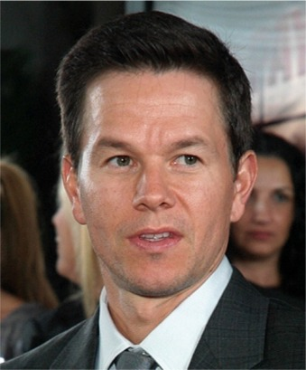

Bild: 2008; Glenn Francis. CC BY-SA 3.0 laut Wikimedia Commons. [Bildquelle](https://commons.wikimedia.org/wiki/File:Mark_Wahlberg_cropped_2008.jpg), [TMDB](https://www.themoviedb.org/person/13240).

### L1 · leicht

Welcher ungewöhnliche Freund begleitet John Bennett (Mark Wahlberg) in „Ted“ seit seiner Kindheit?

- **Richtig: Ein lebendig gewordener Teddybär**

- Ein unsichtbarer Hund

- Ein sprechender Spielzeugroboter

- Ein außerirdischer Mitschüler

Johns Teddybär ist durch einen Kindheitswunsch lebendig geworden.

John ist längst erwachsen, doch die enge Bindung an Ted bestimmt weiterhin seinen Alltag. Seine Beziehung zu Lori, gespielt von Mila Kunis, gerät dadurch unter Druck. Seth MacFarlane führt Regie und spricht den Bären im Original. Wahlberg spielt den Menschen, für den eine fantastische Kindheitsfreundschaft zu einer sehr konkreten Frage nach Verantwortung und Erwachsenwerden wird.

Merksatz: John muss seine Kindheitsfreundschaft mit seinem Erwachsenenleben vereinbaren.

Antwortzusätze:

- Ein lebendig gewordener Teddybär: Johns Teddybär ist durch einen Kindheitswunsch lebendig geworden.

Quellen: [1](https://www.universalpicturesathome.com/movies/ted).

### L2 · leicht

In welcher Filmbranche wird Eddie Adams alias Dirk Diggler (Mark Wahlberg) in „Boogie Nights“ zum Star?

- Im Westernfilm

- **Richtig: Im Pornofilm**

- Im Dokumentarfilm

- Im Zeichentrickfilm

Eddie wird als Dirk Diggler ein Pornodarsteller.

Jack Horner (Burt Reynolds) entdeckt Eddie in einem Nachtclub und nimmt ihn in seinen Kreis von Filmschaffenden auf. Der neue Name Dirk Diggler gehört zu einem Aufstieg, der beruflichen Erfolg mit dem Gefühl einer Ersatzfamilie verbindet. Paul Thomas Anderson erzählt anschließend auch die Brüche dieser Gemeinschaft. Ruhm, Drogen und Selbstüberschätzung verändern den anfangs verheißungsvollen Zusammenhalt.

Merksatz: Dirk Digglers Aufstieg führt in eine Filmfamilie und deren Krise.

Antwortzusätze:

- Im Pornofilm: Eddie wird als Dirk Diggler ein Pornodarsteller.

Quellen: [1](https://player.bfi.org.uk/rentals/film/watch-boogie-nights-1997-online).

### M1 · mittel

Auf welcher Seite arbeitet Sean Dignam (Mark Wahlberg) in „Departed – Unter Feinden“?

- Als Buchhalter von Frank Costello

- Als unabhängiger Privatdetektiv

- **Richtig: Als Polizeibeamter, der Costigans Undercover-Einsatz betreut**

- Als Anwalt der Gangsterorganisation

Dignam gehört zur Polizei und betreut Billy Costigans Undercover-Arbeit.

Billy Costigan (Leonardo DiCaprio) schleust sich in die Organisation von Frank Costello (Jack Nicholson) ein. Dignam und Captain Queenan (Martin Sheen) kennen seine wirkliche Aufgabe. Gleichzeitig arbeitet Colin Sullivan (Matt Damon) als Verräter innerhalb der Polizei. Dignams Stellung ist deshalb für das Verständnis der gegeneinander laufenden Infiltrationen wichtig: Sein ruppiges Auftreten allein sagt noch nichts über seine Loyalität aus.

Merksatz: Dignam schützt den echten Undercover-Mann auf Polizeiseite.

Antwortzusätze:

- Als Polizeibeamter, der Costigans Undercover-Einsatz betreut: Dignam gehört zur Polizei und betreut Billy Costigans Undercover-Arbeit.

Quellen: [1](https://en.wikipedia.org/wiki/The_Departed).

### M2 · mittel

Welchen realen Boxer verkörpert Mark Wahlberg in „The Fighter“?

- Jake LaMotta

- Muhammad Ali

- Chuck Wepner

- **Richtig: Micky Ward**

Wahlberg spielt Micky Ward.

Micky versucht, als Boxer aus dem Schatten seines älteren Halbbruders Dicky Eklund (Christian Bale) herauszutreten. Dicky ist zugleich Trainer und durch seine Drogensucht ein schwer berechenbarer Begleiter. Die Mutter Alice (Melissa Leo) mischt sich als Managerin ein. Der sportliche Aufstieg verlangt deshalb auch eine Neuordnung der familiären Abhängigkeiten, ohne dass Micky jede Bindung an seine Herkunft abbricht.

Merksatz: Micky Wards Karriere hängt auch an der Neuordnung seiner Familie.

Antwortzusätze:

- Micky Ward: Wahlberg spielt Micky Ward.

Gemeinsames Wissensziel: K-DRA-202610-P01-L-019 (DRA-202610-P01-L-019).

Quellen: [1](https://en.wikipedia.org/wiki/The_Fighter).

### S1 · schwer

Unter welchem Künstlernamen wurde Mark Wahlberg mit den Funky Bunch als Rapper bekannt?

- Ice Cube

- **Richtig: Marky Mark**

- MC Hammer

- Vanilla Ice

Wahlbergs damaliger Künstlername war Marky Mark.

Vor den bekannten Filmrollen trat Wahlberg als Frontmann von Marky Mark and the Funky Bunch auf. „Good Vibrations“ gehörte zu den erfolgreichen Aufnahmen der Gruppe. Seine spätere Schauspielkarriere entwickelte sich damit aus einer bereits vorhandenen öffentlichen Bekanntheit. Musikauftritt und Filmrolle sind unterschiedliche Arbeiten, doch beide Phasen gehören zu seiner beruflichen Entwicklung vom Popstar zum Darsteller und Produzenten.

Merksatz: Marky Mark war Wahlbergs Name vor den großen Filmrollen.

Antwortzusätze:

- Marky Mark: Wahlbergs damaliger Künstlername war Marky Mark.

Quellen: [1](https://en.wikipedia.org/wiki/Mark_Wahlberg).

### S2 · schwer

Welche reale Person spielt Mark Wahlberg in „Lone Survivor“?

- Den Marineoffizier Chris Kyle

- Den Piloten Sully Sullenberger

- **Richtig: Den Navy-SEAL-Soldaten Marcus Luttrell**

- Den Astronauten Jim Lovell

Wahlberg spielt Marcus Luttrell.

Peter Bergs Film verarbeitet Luttrells Bericht über einen Einsatz in Afghanistan. Das vierköpfige SEAL-Team gerät in einen Hinterhalt; der verletzte Luttrell erhält später Schutz durch den Dorfbewohner Mohammad Gulab (Ali Suliman). Die Figur steht damit zwischen militärischer Kameradschaft und Hilfe durch Menschen außerhalb der eigenen Einheit. Die konkrete Filmhandlung ist dabei eine dramatisierte Darstellung und kein unverändertes Protokoll des realen Einsatzes.

Merksatz: Luttrells Überleben hängt im Film auch an Gulabs Hilfe.

Antwortzusätze:

- Den Navy-SEAL-Soldaten Marcus Luttrell: Wahlberg spielt Marcus Luttrell.

Quellen: [1](https://www.universalpicturesathome.com/movies/lone-survivor), [2](https://en.wikipedia.org/wiki/Lone_Survivor).

### E1 · experte

Welche Aufgabe übernahm Mark Wahlberg bei der HBO-Serie „Entourage“?

- Er schrieb allein sämtliche Drehbücher.

- Er spielte dauerhaft die Hauptfigur Vince Chase.

- Er komponierte die gesamte Serienmusik.

- **Richtig: Er gehörte zu den Executive Producers.**

Wahlberg gehörte zu den Executive Producers von „Entourage“.

Die Serie begleitet den jungen Schauspieler Vince Chase, gespielt von Adrian Grenier, und seine Freunde im Hollywoodbetrieb. Ihre Grundlage ist eine fiktionalisierte Welt des Aufstiegs und der beruflichen Beziehungen. Doug Ellin entwickelte die Serie; Wahlberg wirkte auf Produzentenseite mit. Die Television Academy führt ihn in dieser Funktion bei den Emmy-Nominierungen der Serie, wodurch seine Arbeit hinter der Kamera konkret belegt ist.

Merksatz: Wahlberg produzierte die Hollywoodserie, Adrian Grenier spielte ihren Star.

Antwortzusätze:

- Er gehörte zu den Executive Producers.: Wahlberg gehörte zu den Executive Producers von „Entourage“.

Quellen: [1](https://www.televisionacademy.com/bios/mark-wahlberg), [2](https://ir.paramount.com/static-files/ff5ef90c-540b-48cd-814d-e4d163602b95).

### E2 · experte

In welcher Funktion erhielt Mark Wahlberg 2011 eine persönliche Oscar-Nominierung mit „The Fighter“?

- **Richtig: Produktion in der Kategorie Bester Film**

- Schauspiel in der Kategorie Hauptdarsteller

- Regie in der Kategorie Beste Regie

- Drehbuch in der Kategorie Originaldrehbuch

Wahlberg wurde mit David Hoberman und Todd Lieberman als Produzent für den besten Film nominiert.

Die Schauspiel-Oscars des Films gingen an Christian Bale und Melissa Leo. Wahlbergs eigene Nominierung gehörte dagegen zur Kategorie Bester Film, weil er zum Produzententeam zählte. Bereits für „Departed“ war er als Nebendarsteller nominiert worden. Diese beiden Nennungen betreffen unterschiedliche berufliche Leistungen; die Hauptrolle in „The Fighter“ brachte ihm keine zusätzliche Darstellernominierung ein.

Merksatz: Bei „The Fighter“ war Wahlberg als Produzent Oscar-nominiert.

Antwortzusätze:

- Produktion in der Kategorie Bester Film: Wahlberg wurde mit David Hoberman und Todd Lieberman als Produzent für den besten Film nominiert.

Quellen: [1](https://www.oscars.org/oscars/ceremonies/2011), [2](https://www.oscars.org/oscars/ceremonies/2007).

## Chuck Norris · Bekanntheitsgruppe 1

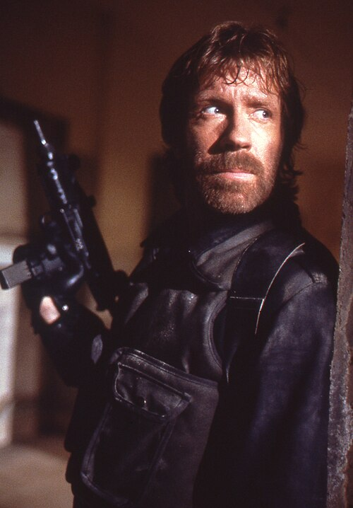

Bild: 1986; digitale Metadaten von 2012 getrennt; Yoni S.Hamenahem. CC BY-SA 3.0 laut Wikimedia Commons. [Bildquelle](https://commons.wikimedia.org/wiki/File:Chuck_Norris,_The_Delta_Force_1986.jpg), [TMDB](https://www.themoviedb.org/person/51576).

### L1 · leicht

In welcher langlebigen US-Krimiserie spielte Chuck Norris die Hauptrolle?

- **Richtig: Walker, Texas Ranger**

- Miami Vice

- Magnum

- Detektiv Rockford – Anruf genügt

Chuck Norris spielte die Hauptrolle in „Walker, Texas Ranger“.

Walker ist ein texanischer Gesetzeshüter, der bei der Verbrechensbekämpfung eigene Wege geht. Sony beschreibt seine Methoden als in der Tradition des amerikanischen Westens verwurzelt. Die Serie verband dieses moralische Heldenbild mit den Kampfkünsten, die Norris zuvor im Kino bekannt gemacht hatten.

Merksatz: „Walker, Texas Ranger“ ist Norris’ langjährige Krimiserie.

Quellen: [1](https://www.sonypictures.com/tv/walkertexasranger).

### L2 · leicht

In welchem Land begann Chuck Norris während seines Dienstes bei der US Air Force mit dem Training in Tang Soo Do?

- Japan

- **Richtig: Südkorea**

- Thailand

- China

Norris lernte Tang Soo Do während seiner Stationierung in Südkorea kennen.

Auf der Luftwaffenbasis Osan trainierte Norris zunächst Judo. Außerhalb des Stützpunkts entdeckte er eine Schule für die koreanische Kampfkunst Tang Soo Do. Dieser Ausbildungsweg liegt vor seiner Filmkarriere und erklärt, weshalb seine Leinwandkämpfe auf praktischer Kampfsporterfahrung beruhen.

Merksatz: Osan in Südkorea liegt vor Hollywood.

Quellen: [1](https://www.defense.gov/News/Feature-Stories/Story/Article/3705404/actor-chuck-norris-was-in-the-air-force-during-the-cold-war/).

### M1 · mittel

Welche Figur spielt Chuck Norris im berühmten Kolosseum-Duell von „Die Todeskralle schlägt wieder zu“?

- Den Restauranthelfer Tony

- Den Gangsterboss

- **Richtig: Den amerikanischen Kämpfer Colt**

- Den Restaurantbesitzer Wang

Chuck Norris verkörpert den Kämpfer Colt.

Colt trifft auf Tang Lung (Bruce Lee), der einem bedrohten Restaurant in Rom hilft. Der Schlusskampf konzentriert die Handlung auf zwei Gegner mit unterschiedlichen Stilen. Norris tritt hier als Gegenspieler auf, bevor er im amerikanischen Actionkino selbst zum regelmäßig siegreichen Helden wurde.

Merksatz: Colt ist Norris’ Gegnerrolle gegenüber Bruce Lees Tang Lung.

Gemeinsames Wissensziel: K-MAR-14-01 (MAR-L-027).

Quellen: [1](https://en.wikipedia.org/wiki/The_Way_of_the_Dragon), [2](https://apnews.com/article/b92804d43c6eee0d9e3fb31583d7f877).

### M2 · mittel

Was macht den Gegner von Sheriff Dan Stevens (Chuck Norris) in „Silent Rage“ außergewöhnlich gefährlich?

- Er kann Erinnerungen anderer Menschen löschen.

- Er kontrolliert die örtliche Polizei durch Hypnose.

- Er wird durch einen unsichtbaren Zwillingsbruder ersetzt.

- **Richtig: Ein Experiment lässt seine Verletzungen ungewöhnlich schnell heilen.**

Ein experimentelles Mittel verleiht dem Täter extreme Heilungsfähigkeit.

Der verletzte John Kirby (Brian Libby) wird von Forschern behandelt. Ihr nicht erprobtes Mittel heilt seinen Körper, macht den gewalttätigen Mann aber zugleich kaum aufzuhalten. Norris’ Sheriff trifft damit auf eine Bedrohung aus dem Science-Fiction-Horror, gegen die gewöhnliche Polizeigewalt wiederholt wirkungslos bleibt.

Merksatz: „Silent Rage“ verbindet Norris’ Polizeiaction mit einem regenerierenden Täter.

Quellen: [1](https://catalog.afi.com/Catalog/moviedetails/56872).

### S1 · schwer

Welche Besonderheit kennzeichnet die Veröffentlichung von Chuck Norris’ ersten beiden „Missing in Action“-Filmen?

- **Richtig: Der ursprünglich als zweiter geplante Film wurde zuerst veröffentlicht.**

- Beide Filme wurden gleichzeitig von derselben Regie gedreht.

- Der erste Film entstand als Neuschnitt des zweiten.

- Der zweite Film besteht ausschließlich aus Rückblenden des ersten.

Cannon kehrte die ursprünglich geplante Veröffentlichungsreihenfolge um.

Cannon hielt den ursprünglich als zweiten Film vorgesehenen Stoff für den stärkeren und brachte ihn zuerst ins Kino. Der anschließend veröffentlichte „Missing in Action 2“ erzählt eine Vorgeschichte von Norris’ Colonel Braddock. Die Ziffer 2 bezeichnet hier daher einen späteren Kinostart, keine spätere Phase im Leben des Helden.

Merksatz: Cannon machte aus dem ursprünglich ersten Film eine später veröffentlichte Vorgeschichte.

Quellen: [1](https://catalog.afi.com/Catalog/moviedetails/57148), [2](https://en.wikipedia.org/wiki/Missing_in_Action_2:_The_Beginning), [3](https://catalog.afi.com/Catalog/moviedetails/58216).

### S2 · schwer

Welche Aufgabe übernahm Aaron Norris bei „Silent Rage“, in dem sein Bruder Chuck Norris die Hauptrolle spielt?

- Die Komposition der Filmmusik

- **Richtig: Die Koordination der Stunts**

- Die Darstellung des wissenschaftlichen Leiters

- Den Entwurf der Laborbauten

Aaron Norris koordinierte die Stunts und war Associate Producer.

Aaron Norris arbeitete hinter der Kamera an den körperlichen Aktionen seines Bruders mit. Die AFI-Unterlagen führen ihn bei „Silent Rage“ als Stuntkoordinator und Associate Producer. Das Stuntteam hatte bereits bei einer früheren Norris-Produktion zusammengearbeitet; die Leinwandwirkung entstand somit auch aus einer eingespielten technischen Zusammenarbeit.

Merksatz: Hinter Chuck Norris’ Aktionen stand auch Aaron Norris’ Stuntarbeit.

Quellen: [1](https://catalog.afi.com/Catalog/moviedetails/56872).

### E1 · experte

Welches Ziel verfolgt das von Chuck Norris initiierte Schulprogramm Kickstart Kids über das Erlernen von Kampftechniken hinaus?

- Die Ausbildung professioneller Filmstuntleute

- Die Vorbereitung auf militärische Aufnahmeprüfungen

- **Richtig: Die Vermittlung von Selbstdisziplin, Respekt und Verantwortung**

- Die Auswahl einer olympischen Karate-Nationalmannschaft

Kickstart Kids verbindet Karate mit Persönlichkeitsbildung.

Die Organisation unterscheidet ihre Gründung 1990 vom Schulstart in vier Einrichtungen 1992. Im Unterricht werden Kampfkünste mit Gesprächen, Geschichten und Übungen zu Werten verbunden. Norris’ Erfahrung als Lehrer wird hier in ein Bildungsprogramm übertragen; der Wettkampfsieg ist nicht dessen alleiniger Maßstab.

Merksatz: Kickstart Kids nutzt Karate als Unterricht in Haltung und Verantwortung.

Quellen: [1](https://www.kickstartkids.org/why-ksk/).

### E2 · experte

Welches Entwicklungsprinzip beschreibt Chuck Norris’ eigenes, zeitweise „Chun Kuk Do“ genanntes Kampfsystem?

- Es beschränkt sich auf unveränderte Formen aus einer einzigen Schule.

- Es ersetzt körperliches Training durch theoretische Prüfungen.

- Es wurde ausschließlich für Filmchoreografien entwickelt.

- **Richtig: Es ergänzt eine Tang-Soo-Do-Grundlage durch geeignete Elemente anderer Systeme.**

Das System baut auf Tang Soo Do auf und nimmt ergänzende Techniken anderer Richtungen auf.

Die zuständige United Fighting Arts Federation beschreibt eine offene Weiterentwicklung: Norris ergänzte seine koreanische Grundlage während seiner Wettkampflaufbahn durch das Studium anderer Kampfkünste. Von 1990 bis 2015 trug die Richtung den Namen Chun Kuk Do; danach wurde wieder Chuck Norris System verwendet.

Merksatz: Norris’ System entstand durch Ergänzung einer koreanischen Grundlage.

Quellen: [1](https://www.ufaf.org/chuck-norris-system.asp).

## Louis de Funès · Bekanntheitsgruppe 1

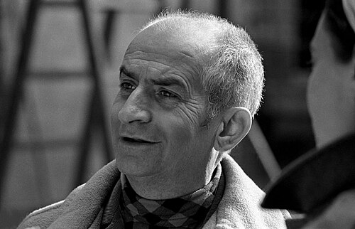

Bild: 1970; Marisa Rastellini (Mondadori Publishers). Public domain laut Wikimedia Commons. [Bildquelle](https://commons.wikimedia.org/wiki/File:Louis_de_Fun%C3%A8s_%E2%80%94_L%27Homme_orchestre_(1970).jpg), [TMDB](https://www.themoviedb.org/person/11187).

### L1 · leicht

Wie heißt der von Louis de Funès gespielte Gendarm der Saint-Tropez-Filmreihe?

- **Richtig: Ludovic Cruchot**

- Jérôme Gerber

- François Perrin

- Charles Duchemin

Louis de Funès spielt Ludovic Cruchot.

Cruchot tritt seinen Dienst an der Côte d’Azur mit großer Strenge an. Seine Dienstauffassung gerät dabei mit dem Ferienort und den Problemen seiner Tochter Nicole in Konflikt. Der Film von 1964 wurde zum Auftakt einer Reihe, in der dieselbe Figur unter wechselnden Umständen wiederkehrt.

Merksatz: Cruchot ist de Funès’ Gendarm; Gerber sein Vorgesetzter.

Quellen: [1](https://www.cinematheque.fr/film/48792.html).

### L2 · leicht

Welche Rolle übernimmt Louis de Funès in der „Fantomas“-Verfilmung von 1964?

- Den Journalisten Fandor

- **Richtig: Den Kommissar Juve**

- Den maskierten Verbrecher Fantomas

- Den Zeitungsverleger

De Funès spielt Kommissar Juve.

Jean Marais verkörpert sowohl den Verbrecher Fantomas als auch den Journalisten Fandor. De Funès steht ihnen als erregbarer Ermittler gegenüber. Die Verteilung verbindet eine Doppelrolle mit einer komischen Polizeifigur; der Titelheld wird also von einem anderen Schauspieler als Juve gespielt.

Merksatz: De Funès ist Juve, Marais ist Fantomas und Fandor.

Quellen: [1](https://www.cinematheque.fr/film/49173.html).

### M1 · mittel

Welchen Beruf hat die Figur von Louis de Funès in „Die große Sause“, bevor sie britischen Fliegern bei der Flucht helfen muss?

- Hotelier

- Chirurg

- **Richtig: Dirigent**

- Rechtsanwalt

De Funès spielt den Dirigenten Stanislas Lefort.

Im besetzten Paris geraten ein Dirigent und ein Anstreicher (Bourvil) in die Fluchtgeschichte abgeschossener britischer Flieger. Zwei zivile Figuren mit unterschiedlichen Temperamenten müssen zusammenarbeiten. Die Kriegskomödie nutzt gerade das Missverhältnis zwischen ihrem gewohnten Alltag und der gefährlichen Aufgabe.

Merksatz: Ein Dirigent und ein Anstreicher helfen abgestürzten Fliegern.

Quellen: [1](https://www.bfi.org.uk/lists/10-great-comedy-films-about-history), [2](https://en.wikipedia.org/wiki/La_Grande_Vadrouille).

### M2 · mittel

Warum gibt sich Victor Pivert (Louis de Funès) in „Die Abenteuer des Rabbi Jacob“ als Rabbiner aus?

- Um das Erbe eines verstorbenen Verwandten anzutreten.

- Um einen betrügerischen Kunstverkauf vorzubereiten.

- Um in einen exklusiven Geschäftsclub aufgenommen zu werden.

- **Richtig: Um seinen Verfolgern zu entkommen.**

Pivert benutzt die Verkleidung, um seinen Verfolgern zu entkommen.

Der Unternehmer Pivert wird in eine Verfolgung verwickelt und gibt sich als Rabbiner aus. Die Begegnungen unter dieser Verkleidung stellen sein vorheriges Bild anderer Menschen infrage. Die hektische Körperkomik ist dadurch mit einem Toleranzthema verbunden; Piverts Selbstgewissheit gehört selbst zu den Zielscheiben der Komödie.

Merksatz: Die Rabbinerverkleidung ist Piverts Ausweg aus der Verfolgung.

Quellen: [1](https://www.cinematheque.fr/seance/35368.html), [2](https://www.cinematheque.fr/media/2019-09-26-dossierpresse-de-funes.pdf).

### S1 · schwer

Womit verdiente Louis de Funès während des Krieges als Musiker seinen Lebensunterhalt?

- **Richtig: Als Pianist in Bars**

- Als Geiger in einem Opernorchester

- Als Posaunist in einer Militärkapelle

- Als Harfenist bei Radioaufnahmen

De Funès arbeitete als Barpianist.

Lange vor seinen großen Kinoerfolgen spielte de Funès in Bars Klavier und begeisterte sich für Jazz. Seine spätere Komik lebt von Tempo, Unterbrechungen und Beschleunigungen. Die Cinémathèque stellt diesen musikalischen Hintergrund in Zusammenhang mit dem Rhythmus seines Spiels, ohne ihn auf bloße Grimassen zu reduzieren.

Merksatz: Der spätere Filmkomiker hatte das Timing eines Barpianisten.

Quellen: [1](https://www.cinematheque.fr/exposition/louis-de-funes.html).

### S2 · schwer

Welche Vorerfahrung brachte Louis de Funès in die Verfilmung von „Oscar“ mit?

- Er hatte die Romanvorlage selbst geschrieben.

- **Richtig: Er hatte die Hauptrolle bereits auf der Bühne erprobt.**

- Er hatte dieselbe Geschichte als Zeichentrickfilm synchronisiert.

- Er hatte das Stück als Opernregisseur inszeniert.

De Funès kannte die Hauptrolle aus Aufführungen des Theaterstücks.

Claude Magniers Bühnenkomödie war vor dem Film erfolgreich gespielt worden. De Funès hatte den Fabrikanten dabei bereits verkörpert und Reaktionen des Publikums auf Stimme, Bewegung und Pointen kennengelernt. Die Verfilmung übernahm daher eine eingeübte Darstellung, deren Wirkung über längere Zeit vor Zuschauern entwickelt worden war.

Merksatz: „Oscar“ ging bei de Funès von den Brettern vor die Kamera.

Quellen: [1](https://www.cinematheque.fr/film/50189.html).

### E1 · experte

Mit wem teilte Louis de Funès bei „Louis, der Geizkragen“ den offiziellen Regiecredit?

- Gérard Oury

- Claude Zidi

- **Richtig: Jean Girault**

- Édouard Molinaro

Jean Girault und Louis de Funès führten gemeinsam Regie.

De Funès spielte Harpagon und inszenierte gemeinsam mit Girault die Molière-Adaption. Der Geizhals versucht, die Ehen seiner Kinder nach finanziellen Vorteilen zu bestimmen. Die klassische Theaterfigur war für de Funès ein lange gehegtes Projekt, bei dem er seine Darstellung auch hinter der Kamera mitgestalten konnte.

Merksatz: Harpagon vor der Kamera, gemeinsame Regie mit Girault dahinter.

Gemeinsames Wissensziel: K-FF-408-DIRECTOR (FF-408-DIRECTOR).

Quellen: [1](https://www.cinematheque.fr/film/48655.html), [2](https://museedefunes.fr/carriere/).

### E2 · experte

Wie ergänzt Louis de Funès in „Louis, der Geizkragen“ den weitgehend beibehaltenen Molière-Text?

- Durch eine neue Rahmenhandlung im heutigen Paris

- Durch zusätzliche Lieder zwischen den Szenen

- Durch einen Erzähler, der alle Vorgänge kommentiert

- **Richtig: Durch zusätzliche visuelle Gags und körperliche Komik**

De Funès setzt dem beibehaltenen Text zusätzliche Bild- und Körpergags zur Seite.

Harpagons Geiz wird nicht nur ausgesprochen, sondern in Bewegungen, Reaktionen und Umgang mit Dingen sichtbar. Die Cinémathèque beschreibt die Treue zum Text und die visuellen Einfälle als nebeneinander bestehende Mittel. De Funès’ komischer Stil erhält damit innerhalb einer klassischen Theateradaption einen eigenen Spielraum.

Merksatz: Molières Worte treffen auf de Funès’ Körperkomik.

Quellen: [1](https://www.cinematheque.fr/film/48655.html).

## Pierre Richard · Bekanntheitsgruppe 1

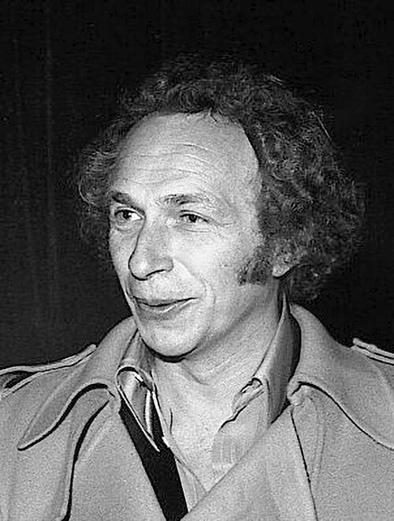

Bild: 1975; Hubert Marot. CC BY-SA 4.0 laut Wikimedia Commons. [Bildquelle](https://commons.wikimedia.org/wiki/File:Hubert_Marot,_Pierre_Richard_en_1975_(cropped).jpg), [TMDB](https://www.themoviedb.org/person/24501).

### L1 · leicht

Welchen Beruf hat François Perrin (Pierre Richard) in „Der große Blonde mit dem schwarzen Schuh“?

- **Richtig: Geiger**

- Journalist

- Apotheker

- Architekt

Perrin ist Geiger.

Der Musiker gerät ohne eigene Geheimdienstausbildung in einen Konflikt zwischen Agenten. Seine gewöhnlichen und oft ungeschickten Handlungen werden als raffinierte Tarnung fehlgedeutet. Richards Figur bleibt dadurch arglos, während die Beobachter immer kompliziertere Erklärungen für ihr Verhalten erfinden.

Merksatz: Ein Geiger wird für einen Meisterspion gehalten.

Gemeinsames Wissensziel: K-KOM-202609-P02-L-070 (KOM-202609-P02-L-070).

Quellen: [1](https://www.pierre-richard.fr/biographie-de-pierre-richard/), [2](https://www.cinematheque.fr/media/dossier-de-presse-pierre-richard3.pdf).

### L2 · leicht

Mit welchem Schauspieler bildet Pierre Richard das ungleiche Hauptdarstellerduo in „Ein Tolpatsch kommt selten allein“ und „Die Flüchtigen“?

- Jean-Paul Belmondo

- **Richtig: Gérard Depardieu**

- Alain Delon

- Michel Serrault

Richard bildet das Duo mit Gérard Depardieu.

Francis Veber führte die beiden sehr unterschiedlichen Darsteller mehrfach zusammen. Richards unsicherer, empfindsamer Figur steht dabei die kräftige Präsenz Depardieus gegenüber. Aus dem Gegensatz entstehen sowohl Konflikte als auch gegenseitige Abhängigkeit; in „Die Flüchtigen“ kippt sogar ein misslungener Banküberfall in eine gemeinsame Flucht.

Merksatz: Richard und Depardieu machen Gegensätze zum komischen Duo.

Quellen: [1](https://www.cinematheque.fr/cycle/pierre-richard-314.html), [2](https://www.cinematheque.fr/film/51539.html).

### M1 · mittel

Welche berufliche Ausgangslage macht François Perrin (Pierre Richard) in „Das Spielzeug“ von einem mächtigen Unternehmer abhängig?

- Er ist dessen hochbezahlter Rechtsanwalt.

- Er ist Eigentümer der konkurrierenden Zeitung.

- **Richtig: Er ist ein arbeitsloser Journalist.**

- Er ist ein pensionierter Polizeichef.

Perrin ist ein arbeitsloser Journalist.

Der Sohn eines reichen Unternehmers möchte Perrin als menschliches Spielzeug haben. Dass der Journalist eine neue Beschäftigung braucht, verschärft das Machtgefälle zwischen beiden Seiten. Die ungewöhnliche Forderung macht sichtbar, wie weit der Vater seinen Besitzanspruch auf andere Menschen ausdehnt.

Merksatz: Perrins Arbeitslosigkeit trifft auf den Kaufanspruch eines reichen Kindes.

Quellen: [1](https://www.cinematheque.fr/film/46285.html), [2](https://cineuropa.org/fr/film/401260/).

### M2 · mittel

Welche Aufgaben verband Pierre Richard bei seiner frühen Komödie „Le Distrait“?

- Nur Hauptrolle und Synchronisation

- Nur Produktion und Kamera

- Hauptrolle und Filmmusik, ohne Drehbucharbeit

- **Richtig: Hauptrolle, Drehbucharbeit und Regie**

Richard entwickelte den Stoff, führte Regie und spielte die Hauptrolle.

Yves Robert ermutigte Richard, seine eigene komische Figur fürs Kino zu entwickeln. Mit André Ruellan arbeitete er am Drehbuch über den zerstreuten Werber Pierre Malaquet. Die Verbindung mehrerer Aufgaben erlaubte ihm, das Verhalten der Figur und die Inszenierung ihrer Missgeschicke gemeinsam zu gestalten.

Merksatz: „Le Distrait“ war Richard als Darsteller, Autor und Regisseur.

Quellen: [1](https://www.pierre-richard.fr/biographie-de-pierre-richard/), [2](https://www.cinematheque.fr/media/prog-web.pdf).

### S1 · schwer

Welches Geschäft der Familie kritisiert Pierre Richards eigene Komödie „Ich weiß von nichts und sage alles“?

- **Richtig: Die Herstellung und den Verkauf von Waffen**

- Die Vergabe von Hotelsternen

- Den Handel mit gefälschten Gemälden

- Die Privatisierung von Wasserversorgung

Der Film richtet seine Satire auf das Rüstungsgeschäft.

Richard spielt den Sohn eines Waffenfabrikanten, der die Produkte seiner Familie ablehnt. Er schrieb und inszenierte die Komödie selbst. Seine unbeholfene Figur erhält damit eine gesellschaftliche Richtung: Sie stört ein Geschäft, dessen Erfolg auf dem Absatz tödlicher Waren beruht.

Merksatz: Richards Träumer gerät gegen das Rüstungsgeschäft seiner Familie.

Quellen: [1](https://www.pierre-richard.fr/filmographie/je-sais-rien-mais-je-dirai-tout/), [2](https://www.cinematheque.fr/media/prog-web.pdf).

### S2 · schwer

Warum begleitet François Perrin (Pierre Richard) in „Ein Tolpatsch kommt selten allein“ einen Privatdetektiv auf dessen Suche?

- Er besitzt geheime Karten des Entführungsverstecks.

- **Richtig: Sein eigenes Pech soll ihn auf die Spur einer ebenso vom Pech verfolgten Vermissten führen.**

- Er war früher der Partner der entführten Frau.

- Er soll sich als Zwillingsbruder des Detektivs ausgeben.

Perrins Pech soll die Suchenden zur ähnlich unglücklichen Vermissten führen.

Die Tochter eines Unternehmers verschwindet während eines Mexikourlaubs. Der Vater verbindet den Detektiv Campana (Gérard Depardieu) mit einem notorischen Pechvogel. Dessen Missgeschicke gelten ausgerechnet als mögliche Ermittlungsmethode. Die Helferlogik des Films kehrt damit eine vermeintliche Schwäche in eine nützliche Eigenschaft um.

Merksatz: Perrins Pech soll bei der Suche zum Wegweiser werden.

Quellen: [1](https://www.cinematheque.fr/film/51539.html).

### E1 · experte

Welcher amerikanische Komiker weckte nach Pierre Richards eigener Erinnerung seinen Wunsch, Schauspieler zu werden?

- Buster Keaton

- Jerry Lewis

- **Richtig: Danny Kaye**

- Bob Hope

Eine Begegnung mit Danny Kaye auf der Kinoleinwand gab Richard den beruflichen Anstoß.

Als junger Mann sah Richard einen Film mit Danny Kaye und erkannte darin den Beruf, den er ausüben wollte. Später entwickelte er seinen eigenen Stil aus Bewegung, Sprachtempo und körperlichem Ungleichgewicht. Die Inspiration durch einen anderen Komiker ging seiner Ausbildung und seinem selbstständigen Bühnenweg voraus.

Merksatz: Danny Kaye war ein früher Kinofunke für Richards Berufswunsch.

Quellen: [1](https://www.pierre-richard.fr/biographie-de-pierre-richard/).

### E2 · experte

Mit welchem später ebenfalls bekannten Filmschauspieler entwickelte Pierre Richard in Pariser Kabaretts eigene Sketche?

- Michel Bouquet

- Jean Rochefort

- Bernard Blier

- **Richtig: Victor Lanoux**

Richard trat im Kabarett mit Victor Lanoux auf.

Vor seinen Kinodurchbrüchen spielte Richard in kleinen Bühnenprogrammen und auch im Vorprogramm von Georges Brassens. Mit Lanoux entwickelte er Nummern, deren Wirkung sich unmittelbar an den Reaktionen des Publikums prüfen ließ. Der spätere Filmkomiker hatte seine körperliche und szenische Arbeit somit bereits in einem anderen Aufführungsraum erprobt.

Merksatz: Richards frühes Kabarettduo verband ihn mit Victor Lanoux.

Quellen: [1](https://www.pierre-richard.fr/biographie-de-pierre-richard/).

## Heinz Rühmann · Bekanntheitsgruppe 1

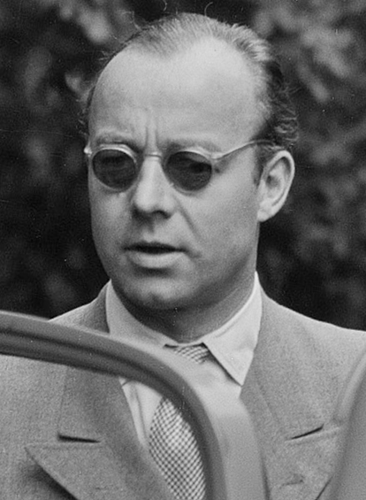

Bild: 1946; Deutsche Fotothek / Roger Rössing / Renate Rössing. CC BY-SA 3.0 de laut Wikimedia Commons. [Bildquelle](https://commons.wikimedia.org/wiki/File:Fotothek_df_roe-neg_0000039_002_Heinz_R%C3%BChmann_am_PKW_crop.jpg), [TMDB](https://www.themoviedb.org/person/12745).

### L1 · leicht

Als was gibt sich der erwachsene Schriftsteller Johannes Pfeiffer (Heinz Rühmann) in der „Feuerzangenbowle“ von 1944 aus?

- **Richtig: Als Gymnasiast**

- Als neuer Schuldirektor

- Als Schulrat

- Als Hausmeister

Pfeiffer schleicht sich als Schüler in ein Gymnasium ein.

Pfeiffer kennt die Schule nur aus dem Privatunterricht. Die Geschichten seiner Bekannten wecken deshalb den Wunsch, versäumte Schülerstreiche selbst zu erleben. Rühmann spielt einen Erwachsenen, der bewusst eine jüngere Identität annimmt; der Film erzählt keine Verjüngung oder tatsächliche Rückreise in seine Kindheit.

Merksatz: Pfeiffer holt als angeblicher Schüler Erlebnisse nach.

Quellen: [1](https://www.filmportal.de/film/die-feuerzangenbowle_8f1f6801f421480f861713b3bd4c0489), [2](https://de.wikipedia.org/wiki/Die_Feuerzangenbowle_(1944)).

### L2 · leicht

Mit welchen beiden Schauspielern bildet Heinz Rühmann das Freundestrio in „Die Drei von der Tankstelle“ von 1930?

- Hans Albers und Hans Moser

- **Richtig: Willy Fritsch und Oskar Karlweis**

- Gustaf Gründgens und Theo Lingen

- Paul Hörbiger und Hans Söhnker

Rühmann spielt neben Willy Fritsch und Oskar Karlweis.

Drei Freunde verlieren ihr Vermögen und eröffnen vom Verkaufserlös ihres Autos eine Tankstelle. Als alle dieselbe Frau kennenlernen, gerät ihre Verbundenheit unter Druck. Der frühe Tonfilm verbindet diese Handlung mit Gesang und Tanz; Rühmanns Durchbruch gehört damit auch zur Entwicklung der deutschen Tonfilmoperette.

Merksatz: Rühmann, Fritsch und Karlweis tragen die Tonfilm-Freundschaft.

Quellen: [1](https://www.filmportal.de/film/die-drei-von-der-tankstelle_2353e6342f1b4779bbeb2c2edfc1c0ac), [2](https://www.filmportal.de/en/node/39789/material/614304).

### M1 · mittel

Wodurch gewinnt der Schuster Wilhelm Voigt (Heinz Rühmann) in „Der Hauptmann von Köpenick“ von 1956 die Macht, Soldaten Befehle zu erteilen?

- Durch einen neu ausgestellten Offiziersausweis

- Durch die Ernennung des Bürgermeisters

- **Richtig: Durch eine gekaufte Hauptmannsuniform**

- Durch seine verwandtschaftliche Verbindung zum Kaiser

Die Uniform verschafft Voigt eine Autorität, die ihm als Zivilist verweigert wird.

Ohne die nötigen Papiere findet Voigt nach seiner Haft keinen Platz in der Gesellschaft. Er erwirbt einen alten Uniformrock und nutzt den Gehorsam gegenüber militärischen Rangzeichen. Der Widerspruch zwischen dem machtlosen Menschen und der wirksamen Kleidung legt den Autoritätsglauben der Umgebung offen.

Merksatz: Voigt bekommt mit dem Uniformrock eine geliehene Macht.

Quellen: [1](https://www.filmportal.de/film/der-hauptmann-von-koepenick_74f3905fd9074f39a6950a48c4406dcd).

### M2 · mittel

Welche gefährliche Ermittlungsmethode wählt Matthäi (Heinz Rühmann) im Kriminalfilm „Es geschah am hellichten Tag“ von 1958?

- Er lässt einen Polizisten als Mitgefangenen auftreten.

- Er veröffentlicht ein fingiertes Geständnis des Hausierers.

- Er inszeniert eine Geldübergabe an den gesuchten Täter.

- **Richtig: Er benutzt ein kleines Mädchen als Lockvogel.**

Matthäi setzt ein Mädchen als Köder für den gesuchten Kindermörder ein.

Matthäi zweifelt an der Schuld des zunächst verdächtigten Hausierers. Er ermittelt eigenständig weiter und richtet sich an einer Tankstelle ein, wo er eine Mutter mit ihrer Tochter beschäftigt. Seine Suche nach dem Täter bringt dadurch ein weiteres Kind in Gefahr. Rühmanns Ermittler wird nicht allein durch gute Absichten zu einer unproblematischen Heldenfigur.

Merksatz: Matthäis Täterjagd gefährdet das Kind, das ihn zum Täter führen soll.

Quellen: [1](https://www.filmportal.de/en/movie/es-geschah-am-hellichten-tag_ea43d4a728465006e03053d50b37753d).

### S1 · schwer

Warum versetzt der Bischof Pater Brown (Heinz Rühmann) in „Das schwarze Schaf“ zunächst in eine andere Gemeinde?

- **Richtig: Brown macht durch seine kriminalistischen Ermittlungen Schlagzeilen.**

- Brown hat heimlich eine neue Religionsgemeinschaft gegründet.

- Brown weigert sich, überhaupt Gottesdienste zu halten.

- Brown hat die Kirchenkasse an einen Bankier verkauft.

Der Bischof missbilligt Browns öffentlich bekannt gewordene Detektivarbeit.

Brown löst einen Mordfall und gelangt damit in die Zeitungen. Sein kirchlicher Vorgesetzter schickt ihn in einen Ort, an dem lange kein Verbrechen geschehen ist. Doch auch dort kommt es zu einem Mord. Browns Aufmerksamkeit für menschliches Verhalten lässt sich nicht einfach durch einen Wechsel der Gemeinde abschalten.

Merksatz: Der Bischof möchte Browns Kriminalistik durch Versetzung beenden.

Quellen: [1](https://www.filmportal.de/film/das-schwarze-schaf_ad9c2dfe70604a15a01b6185adca5e11).

### S2 · schwer

Welche neue berufliche Aufgabe übernahm Heinz Rühmann bei der Komödie „Lauter Lügen“ von 1938 erstmals im Kino?

- Die Leitung eines eigenen Filmverleihs

- **Richtig: Die Regie eines Spielfilms**

- Die Komposition der gesamten Filmmusik

- Die Kamera einer Großproduktion

„Lauter Lügen“ war Rühmanns Regiedebüt.

Rühmann war bereits ein bekannter Darsteller, als er diese Komödie inszenierte. Die weibliche Hauptrolle spielte Hertha Feiler. Der Film markiert daher eine Erweiterung seiner Arbeit hinter die Kamera; die Bekanntheit als Schauspieler allein beschreibt seine Aufgaben im damaligen Filmgeschäft nur unvollständig.

Merksatz: Mit „Lauter Lügen“ kam Rühmann zur eigenen Filmregie.

Quellen: [1](https://www.filmportal.de/person/heinz-ruehmann_099d6835b3754e6c9d26ec4d910238e5), [2](https://www.filmportal.de/film/lauter-luegen_50d4a91be5974e67855d15fa69766757).

### E1 · experte

Was war die 1947 von Heinz Rühmann und Alf Teichs gegründete Comedia?

- Ein Theaterverlag für Lustspiele

- Eine Schule für Nachwuchsschauspieler

- **Richtig: Eine Filmproduktionsfirma**

- Ein Zusammenschluss von Rundfunkorchestern

Comedia war Rühmanns und Teichs’ Filmproduktionsfirma.

Rühmann engagierte sich nach dem Krieg auch unternehmerisch. Trotz einzelner Erfolge musste Comedia 1952 Konkurs anmelden. Die Episode zeigt, dass seine Popularität als Darsteller keine dauerhafte wirtschaftliche Sicherheit für eine eigene Produktionsfirma garantierte. Zur Schauspielarbeit kam das Risiko, Projekte selbst zu finanzieren und zu verantworten.

Merksatz: Comedia verband den Schauspieler Rühmann mit eigenem Produktionsrisiko.

Quellen: [1](https://www.filmportal.de/person/heinz-ruehmann_099d6835b3754e6c9d26ec4d910238e5).

### E2 · experte

In welchem Stück Samuel Becketts spielte Heinz Rühmann 1954 unter der Regie Fritz Kortners den Landstreicher Estragon?

- Endspiel

- Das letzte Band

- Glückliche Tage

- **Richtig: Warten auf Godot**

Rühmann spielte Estragon in „Warten auf Godot“ an den Münchner Kammerspielen.

Neben Ernst Schröder als Wladimir stand Rühmann in Becketts Stück über zwei Wartende auf der Bühne. Fritz Kortner inszenierte die Aufführung. Der Theaterauftritt ergänzt das Bild des populären Filmkomikers um eine Zusammenarbeit mit dem modernen absurden Theater; Rühmanns Bühnenarbeit ging über die vertraute Kinokomödie hinaus.

Merksatz: Rühmanns Estragon gehört zu Becketts „Warten auf Godot“.

Quellen: [1](https://de.wikipedia.org/wiki/Warten_auf_Godot).

## Heinz Erhardt · Bekanntheitsgruppe 1

Bild: Historische Aufnahme; genaues Jahr nicht belegt; Auf TMDB nicht ausgewiesen. TMDB-Onlineporträt; keine freie Lizenz behauptet. [Bildquelle](https://www.themoviedb.org/person/47033), [TMDB](https://www.themoviedb.org/person/47033).

### L1 · leicht

Mit welchem Instrument begleitete Heinz Erhardt häufig seine komischen Bühnenauftritte?

- **Richtig: Klavier**

- Akkordeon

- Kontrabass

- Saxofon

Erhardt begleitete seine Auftritte am Klavier.

Musik war ein eigenständiger Teil seiner Ausbildung: Erhardt studierte Klavier und Komposition in Leipzig. Auf der Bühne verband er diese Fähigkeiten mit Gedichten, Liedern und Pointen. Der Komiker war damit zugleich Musiker, dessen Vortrag auch von Tempowechseln und musikalischen Übergängen lebte.

Merksatz: Erhardts Pointen hatten häufig eine Klavierbegleitung.

Quellen: [1](https://www.ndr.de/geschichte/koepfe/heinz-erhardt-der-unvergessene-wortspiel-virtuose%2Cheinzerhardtbiografie100.html), [2](https://www.fernsehmuseum-hamburg.de/programm/comedy/1960er-slapstickhumor-boulevard-und-verwechslungskomoedie/heinz-erhardt-sanftdoof-elemente-seiner-komik.html).

### L2 · leicht

Welche wiederkehrende Filmfigur verkörpert Heinz Erhardt in „Was ist denn bloß mit Willi los?“?

- Willi Scherzer

- **Richtig: Willi Winzig**

- Willi Hagemann

- Willi Schiller

Heinz Erhardt spielt Willi Winzig.

Die späten Willi-Komödien gehören zu Erhardts bekanntesten Leinwandauftritten. Die Filmreihe nutzt seine Mischung aus Verlegenheit, Sprachwitz und Beharrlichkeit. Die unterschiedlichen Willi-Filme variieren den komischen Typus; ihre Zugehörigkeit ersetzt keine genaue Prüfung der jeweiligen Figur und Handlung.

Merksatz: Heinz Erhardts Willi heißt hier Winzig.

Quellen: [1](https://www.filmportal.de/person/heinz-erhardt_f7428aeb4b164abeaaf229ee2670a910), [2](https://www.filmportal.de/film/was-ist-denn-bloss-mit-willi-los-gruess-sie-gott-frau-stirnima_ec2fc3b1746e4d0ea8dfd6082e64b77c).

### M1 · mittel

Welche beiden Herkunftsbezeichnungen fügt Heinz Erhardt zum Kunstwort „Schwotte“ zusammen?

- Schwede und Schotte

- Schweizer und Schotte

- **Richtig: Schwabe und Schotte**

- Schweriner und Schotte

„Schwotte“ verbindet Schwabe und Schotte.

Erhardt fügt zwei bekannte Wörter zu einer neuen Form zusammen. Der Hörer muss beide Bestandteile wiedererkennen, damit die Pointe funktioniert. Solche Neuschöpfungen stehen neben verdrehten Satzstellungen und Doppeldeutigkeiten: Gewohnte Sprache wird kurz aus ihrer erwarteten Ordnung gebracht und erhält dadurch einen zweiten Sinn.

Merksatz: Ein „Schwotte“ vereint Schwabe und Schotte.

Quellen: [1](https://www.filmportal.de/person/heinz-erhardt_f7428aeb4b164abeaaf229ee2670a910).

### M2 · mittel

Wie entschärft der von Heinz Erhardt gespielte Vater in einer charakteristischen Szene von „Witwer mit fünf Töchtern“ eine drohende Ohrfeige?

- Er befiehlt stattdessen eine militärische Strafübung.

- Er hält die Hand reglos vor das Gesicht der Tochter.

- Er fordert einen Nachbarn auf, die Strafe auszuführen.

- **Richtig: Er lässt die Bewegung in ein Streicheln übergehen.**

Aus der beabsichtigten Ohrfeige wird ein Streicheln.

Friedrich Scherzer (Heinz Erhardt) versucht, den Haushalt und seine Vaterrolle neben der Arbeit als Schlossverwalter zu bewältigen. Seine demonstrative Strenge hält der Zuneigung zu den Kindern nicht stand. Filmportal nennt gerade diese Bewegung als Beispiel dafür, wie Erhardts Figuren hinter der behaupteten Autorität menschliche Wärme zeigen.

Merksatz: Scherzers Strenge endet in einer zärtlichen Geste.

Quellen: [1](https://www.filmportal.de/person/heinz-erhardt_f7428aeb4b164abeaaf229ee2670a910), [2](https://www.filmportal.de/film/witwer-mit-5-toechtern_881fd7265a8f4b6f9b239909257d763d).

### S1 · schwer

In welchem Medium gestaltete Heinz Erhardt nach dem Krieg beim NWDR die Reihe „So was Dummes“?

- **Richtig: Hörfunk**

- Kino

- Fernseh-Liveübertragung

- Illustrierte

„So was Dummes“ war eine Rundfunksendung.

Nach seiner Entlassung aus britischer Gefangenschaft ging Erhardt nach Hamburg. Beim NWDR arbeitete er mit Will Meyen an der wöchentlichen Reihe und schrieb außerdem die Glosse der Woche. Sein Nachkriegserfolg entwickelte sich somit zunächst über die Stimme, bevor seine Filmhauptrollen hinzukamen.

Merksatz: Erhardts „So was Dummes“ kam aus dem Radio.

Quellen: [1](https://www.filmportal.de/person/heinz-erhardt_f7428aeb4b164abeaaf229ee2670a910), [2](https://www.ndr.de/geschichte/koepfe/heinz-erhardt-der-unvergessene-wortspiel-virtuose%2Cheinzerhardtbiografie100.html).

### S2 · schwer

Was gründete Heinz Erhardt 1960 in Hamburg unter dem Namen HEP?

- Eine Künstleragentur

- **Richtig: Eine Filmproduktionsfirma**

- Ein Theaterensemble

- Einen Musikverlag

HEP stand für die Heinz Erhardt-Produktion, seine eigene Filmfirma.

Erhardt gründete 1960 die Heinz Erhardt-Produktion in Hamburg. Neben Werbefilmen entstanden dort Projekte, in denen er weniger stark auf den üblichen Kino-Klamauk festgelegt war. Die Firma eröffnete ihm eine Möglichkeit, die Darstellung selbst mitzubestimmen, statt sich allein an Rollenangebote anderer Produzenten zu halten.

Merksatz: HEP verschaffte Erhardt eigenen Produktions- und Darstellungsspielraum.

Quellen: [1](https://www.filmportal.de/person/heinz-erhardt_f7428aeb4b164abeaaf229ee2670a910).

### E1 · experte

Was geschieht in Heinz Erhardts Satz „Wir sind gefallen, einem Irrtum zum Opfer“ mit der zunächst geweckten Bedeutung?

- Ein Personenname wird nachträglich zum Ländernamen.

- Ein Fragesatz wird nachträglich zum Befehl.

- **Richtig: Ein zunächst körperlich verstandenes Fallen wird zur Redewendung umgelenkt.**

- Ein Vergangenheitssatz wird nachträglich zur Zukunftsprognose.

Der Nachtrag lenkt das Fallen in die Wendung „einem Irrtum zum Opfer fallen“ um.

Die ungewöhnliche Wortstellung hält den Satz nach dem vermeintlich vollständigen Gedanken zunächst offen. Erst der Nachtrag verändert, wie das Vorherige verstanden werden soll. Erhardts Pause und Satzbau arbeiten dabei zusammen: Die Pointe entsteht aus einer Erwartung, die das Publikum selbst gebildet hat.

Merksatz: Der Nachtrag lässt Erhardts Satz in eine andere Bedeutung fallen.

Quellen: [1](https://www.filmportal.de/person/heinz-erhardt_f7428aeb4b164abeaaf229ee2670a910), [2](https://www.fernsehmuseum-hamburg.de/programm/comedy/1960er-slapstickhumor-boulevard-und-verwechslungskomoedie/heinz-erhardt-sanftdoof-elemente-seiner-komik.html).

### E2 · experte

Welche eigene Leistung von Heinz Erhardt liegt der Fernsehproduktion „Noch ’ne Oper“ zugrunde?

- Eine von ihm gedrehte Dokumentation über Wagner

- Seine Übersetzung einer französischen Tragödie

- Seine Choreografie einer klassischen Ballettsuite

- **Richtig: Seine selbst geschriebene und komponierte Opernsatire**

Die Produktion beruht auf Erhardts eigener Opernsatire und seiner Musik.

Zum 70. Geburtstag wurde seine musikalische Vorlage für das Fernsehen eingerichtet. Erhardt erscheint in der Rahmenhandlung als Dichter; zahlreiche Kollegen wirken als Gäste mit. Neben dem Darsteller werden so der Autor und Komponist sichtbar. Die Erstsendung erfolgte 1979 im ZDF; die Sendung ist keine Kinopremiere.

Merksatz: „Noch ’ne Oper“ würdigt Erhardt auch als Autor und Komponisten.

Quellen: [1](https://www.filmportal.de/film/noch-ne-oper-ein-musikalischer-spass_f4be2e343fdb41acaae776d46d0fe824), [2](https://de.wikipedia.org/wiki/Noch_%E2%80%99ne_Oper).

## Loriot · Bekanntheitsgruppe 1

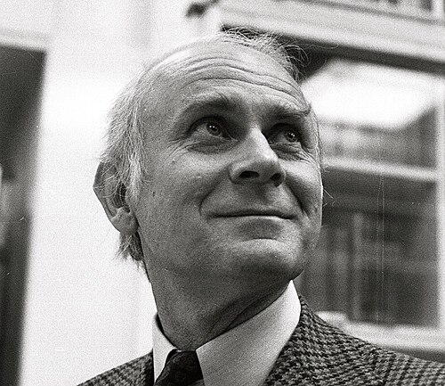

Bild: 1971; Pacific11. CC BY 2.0 laut Wikimedia Commons. [Bildquelle](https://commons.wikimedia.org/wiki/File:Loriot_1971_(1)_(cropped).jpg), [TMDB](https://www.themoviedb.org/person/36992).

### L1 · leicht

Mit welcher Schauspielerin bildete Loriot sein besonders bekanntes Sketch- und Filmduo?

- **Richtig: Evelyn Hamann**

- Ingrid Steeger

- Helga Feddersen

- Hannelore Hoger

Loriots prägende Spielpartnerin war Evelyn Hamann.

Hamann spielte in zahlreichen Fernsehszenen und in Loriots beiden Kinokomödien an seiner Seite. Die Wirkung entsteht häufig aus dem Zusammenspiel unterschiedlicher Reaktionen: Eine Figur hält an ihrer Vorstellung fest, während die andere deren Folgen zu bewältigen versucht. Kleine Pausen und genaue Betonungen tragen dabei ebenso viel wie auffällige Gesten.

Merksatz: Loriot und Evelyn Hamann machen Verständigungsprobleme zur Komödie.

Quellen: [1](https://www.filmportal.de/nachrichten/loriot-ist-tot), [2](https://www.filmportal.de/film/oedipussi_228f9ebf8ab84108b69c32f6f9aa6cec).

### L2 · leicht

Welche gezeichneten Figuren gehören zu Loriots unverwechselbarer Bildsprache?

- Die Ottifanten

- **Richtig: Die Knollennasenmännchen**

- Die Mainzelmännchen

- Die Schlümpfe

Loriot schuf die Knollennasenmännchen.

Vor seiner Bekanntheit im Fernsehen arbeitete Loriot als Cartoonist für Zeitschriften. Die auffälligen Nasen gaben seinen gezeichneten Menschen einen wiedererkennbaren Stil. Im Fernsehen verband er später eigene Zeichentrickfilme mit gespielten Szenen; das Zeichnen blieb eine Grundlage seiner komischen Beobachtung.

Merksatz: Loriots gezeichnete Menschen erkennt man an den Knollennasen.

Quellen: [1](https://www.filmportal.de/nachrichten/loriot-ist-tot), [2](https://www.loriot.de/index.php/loriot).

### M1 · mittel

Welche Figur verkörpert Loriot in seiner Kinokomödie „Ödipussi“?

- Den Pensionär Heinrich Lohse

- Den Psychologen Kurt Tietze

- **Richtig: Den Einrichtungshändler Paul Winkelmann**

- Den Kulturdezernenten Müller-Lüdenscheidt

Loriot spielt Paul Winkelmann.

Paul ist beruflich Chef eines Einrichtungsgeschäfts, lebt aber weiterhin in enger Abhängigkeit von seiner Mutter. Die Begegnung mit Margarethe Tietze (Evelyn Hamann) eröffnet eine vorsichtige Möglichkeit zur Selbstständigkeit. Die Erwachsenen müssen sich dabei gegen feste familiäre Gewohnheiten behaupten, statt einfach ungebunden eine neue Liebe beginnen zu können.

Merksatz: Paul Winkelmann ist Loriots spät selbstständig werdender Junggeselle.

Gemeinsames Wissensziel: K-KOM-22-01 (KOM-L-043).

Quellen: [1](https://www.filmportal.de/film/oedipussi_228f9ebf8ab84108b69c32f6f9aa6cec).

### M2 · mittel

Welche Fehlentscheidung führt Heinrich Lohse (Loriot) in „Pappa ante portas“ in den vorzeitigen Ruhestand?

- Er verkauft versehentlich das Firmengebäude.

- Er nimmt gleichzeitig zwei Direktorenstellen an.

- Er verschickt sämtliche Gehälter an einen fremden Betrieb.

- **Richtig: Er kauft Büromaterial in einer völlig übertriebenen Vorratsmenge.**

Lohse beschafft Büromaterial in einer unverhältnismäßig großen Menge.

Der Einkaufsdirektor begründet die riesige Bestellung mit wirtschaftlichen Vorteilen. Nach seiner Entlassung wendet er dieselbe Organisationslogik zu Hause an. Renate (Evelyn Hamann) erlebt seine ständige Gegenwart daher nicht als Entlastung: Der Arbeitsplatzkonflikt kehrt in den privaten Alltag zurück.

Merksatz: Lohses Vorratslogik verlässt die Firma und zieht zu Hause ein.

Gemeinsames Wissensziel: K-KOM-21-02 (KOM-L-042).

Quellen: [1](https://de.wikipedia.org/wiki/Pappa_ante_portas).

### S1 · schwer

Auf welches Wappentier verweist der Künstlername Loriot?

- **Richtig: Pirol**

- Kranich

- Wiedehopf

- Eisvogel

„Loriot“ ist die französische Bezeichnung für den Pirol.

Der Vogel findet sich im Wappen der Familie von Bülow. Vicco von Bülow griff ihn in französischer Bezeichnung als Künstlernamen auf. Damit steckt hinter dem Namen weder eine Filmfigur noch eine zufällige Silbenfolge, sondern ein persönlicher Bezug, der für seine öffentliche Arbeit neu verwendet wurde.

Merksatz: Loriot heißt Pirol und verweist auf das Familienwappen.

Quellen: [1](https://de.wikipedia.org/wiki/Loriot).

### S2 · schwer

Welche Ausbildung absolvierte Loriot, bevor er sich als Karikaturist etablierte?

- Ein Architekturstudium in Berlin

- **Richtig: Ein Studium an der Landeskunstschule Hamburg**

- Eine Ausbildung zum Opernsänger in München

- Ein Kamerastudium in Babelsberg

Loriot studierte an der Landeskunstschule Hamburg.

Sein eigener Lebenslauf nennt das Studium von 1947 bis 1949 und anschließend die Arbeit als Karikaturist. Die visuelle Ausbildung liegt damit vor dem Fernsehruhm. Zeichnungen, Bildkomposition und genaue Beobachtung von Körperhaltung gehören zu einem Arbeitsweg, der später auch in seinen gespielten Szenen weiterwirkt.

Merksatz: Loriots Weg zum Fernsehen führte zunächst durch die bildende Kunst.

Quellen: [1](https://www.loriot.de/index.php/loriot).

### E1 · experte

Was tat Loriot mit Richard Wagners Opernzyklus für „Der Ring an einem Abend“?

- Er ersetzte sämtliche Musik durch neue Schlager.

- Er schrieb einen fünften Teil als Fortsetzung.

- **Richtig: Er verband musikalische Auszüge mit eigenen erläuternden Zwischentexten.**

- Er übertrug alle Gesangspartien auf ein einziges gesprochenes Gedicht.

Loriot erschloss Wagners Zyklus durch Auszüge und verbindende Texte.

Der große Opernzyklus umfasst normalerweise vier Abende. Loriot entwickelte daraus eine konzertante Kurzfassung mit gesprochenen Übergängen. Sein Humor dient hier auch der Vermittlung einer komplizierten Handlung. Die Arbeit zeigt ihn als kundigen Musikliebhaber, der ein vorhandenes Werk für ein anderes Aufführungsformat öffnet.

Merksatz: Loriot führte durch den Ring, ohne Wagner durch eigene Musik zu ersetzen.

Quellen: [1](https://www.deutschlandfunkkultur.de/kult-am-silvester-abend-loriots-blick-auf-wagners-ring-100.html), [2](https://de.wikipedia.org/wiki/Der_Ring_an_einem_Abend).

### E2 · experte

Was machte Loriot in seiner „Husten-Symphonie“ mit den üblichen Störgeräuschen eines Konzertpublikums?

- Er ließ die Musiker während jedes Hustens den Saal verlassen.

- Er verbannte Hörer und führte das Stück vor leeren Rängen auf.

- Er ersetzte das Orchester durch eine Tonbandaufnahme.

- **Richtig: Er bezog Husten, Niesen und Bonbonpapiergeräusche in die Aufführung ein.**

Loriot machte die vermeintlichen Störungen zum Bestandteil des Konzerts.

Zum 100. Geburtstag der Berliner Philharmoniker trat er 1982 unter anderem als Generalmusikdirektor auf. Geräusche, die eine Aufführung gewöhnlich unterbrechen, wurden nun Teil der genau vorbereiteten Szene. Der komische Einfall setzte die Beherrschung des Konzertablaufs voraus; die Zusammenarbeit mit den Musikern wurde lange geprobt.

Merksatz: Loriot komponierte das störende Publikum in die Aufführung hinein.

Quellen: [1](https://www.berliner-philharmoniker.de/stories/loriot-und-die-berliner-philharmoniker/).

## Otto Waalkes · Bekanntheitsgruppe 1

Bild: 2005; Flominator. CC BY-SA 3.0 laut Wikimedia Commons. [Bildquelle](https://commons.wikimedia.org/wiki/File:Otto_Waalkes_4493.jpg), [TMDB](https://www.themoviedb.org/person/46029).

### L1 · leicht

Wie heißen die von Otto Waalkes gezeichneten Elefantenfiguren?

- **Richtig: Ottifanten**

- Mainzelmännchen

- Knollennasenmännchen

- Urmels

Waalkes’ Elefantenfiguren heißen Ottifanten.

Die Figuren gehören zu seinem zeichnerischen Werk und begleiteten früh auch seine Fernsehshows. Später setzte er sie in eigene Bearbeitungen bekannter Kunstwerke ein. Das wiedererkennbare Tier verbindet damit Bühne, Fernsehen, Buchillustration und Malerei innerhalb seines vielseitigen öffentlichen Werks.

Merksatz: Der Ottifant verbindet Ottos Komik mit seiner Zeichnerei.

Quellen: [1](https://www.albertina.at/ausstellungen/otto-meets-albertina/), [2](https://www.filmportal.de/en/person/otto-waalkes_ef764d2dc6ef2394e03053d50b371c7c).

### L2 · leicht

Welchem Tier gab Otto Waalkes für „Ronnys Popshow“ eine Stimme?

- Einem Papagei

- **Richtig: Einem Schimpansen**

- Einem Dackel

- Einem Pinguin

Otto lieh dem Schimpansen Ronny seine Stimme.

Die Videoshow verband Musikclips mit einem sprechenden Tier als Vermittler. Ottos Stimme übernahm dabei die komische Kommentierung, während sein eigener Körper nicht im Mittelpunkt des Bildes stand. Der Auftritt zeigt eine frühe Form seiner Arbeit als Sprecher neben den bekannten Bühnen- und Filmrollen.

Merksatz: Ronny ist der Schimpanse mit Ottos Stimme.

Quellen: [1](https://www.ndr.de/kultur/film/Otto-Waalkes-ein-Komiker-und-Kult-Ostfriese%2Cwaalkes111.html), [2](https://www.filmportal.de/en/person/otto-waalkes_ef764d2dc6ef2394e03053d50b371c7c).

### M1 · mittel

Wie entwickelte Otto Waalkes bei seinen frühen Musikauftritten den Schwerpunkt auf Komik?

- Er erhielt nach einem Bandkonzert ein festes Engagement im Kabarett.

- Er entwickelte komische Rollen zunächst für eine Hörspielproduktion.

- **Richtig: Die komischen Ansagen zwischen den Liedern fanden besonders viel Beifall.**

- Er wurde bei einem Gesangswettbewerb als Fernsehkomiker entdeckt.

Die komischen Zwischentexte wurden erfolgreicher als die ursprünglichen Musiknummern.

Otto trat zunächst als Musiker mit seiner Band und in kleinen Lokalen auf. Gerade die Scherze zwischen den Liedern kamen beim Publikum an. Daraus entwickelte sich ein Programm, das Parodien, Musik und Pointen verband. Der Wechsel zum Komiker wuchs aus einer bereits vorhandenen Auftrittspraxis.

Merksatz: Aus Ottos musikalischen Pausen wurde das Hauptprogramm.

Quellen: [1](https://www.filmportal.de/en/person/otto-waalkes_ef764d2dc6ef2394e03053d50b371c7c).

### M2 · mittel

Mit wem teilte Otto Waalkes bei „Otto – Der Film“ die Regie?

- Doris Dörrie

- Sönke Wortmann

- Sven Unterwaldt

- **Richtig: Xaver Schwarzenberger**

Otto Waalkes und Xaver Schwarzenberger führten gemeinsam Regie.

Der erste Otto-Kinofilm übertrug eine bereits aus Bühne, Schallplatte und Fernsehen bekannte Komik auf eine längere Filmhandlung. Schwarzenberger führte nicht nur mit Regie, sondern übernahm auch die Kamera. Hinter dem zentralen Darsteller stand somit eine Zusammenarbeit mit einem erfahrenen visuellen Gestalter.

Merksatz: Der erste Otto-Kinofilm verbindet Waalkes mit Schwarzenbergers Regie und Kamera.

Quellen: [1](https://www.filmportal.de/film/otto-der-film_c60bdf4f8fe94676ad579bbbc86f0344).

### S1 · schwer

Mit welchem Autorentrio arbeitete Otto Waalkes an vielen seiner Programme und auch am ersten Kinofilm?

- **Richtig: Robert Gernhardt, Bernd Eilert und Peter Knorr**

- Rudi Carrell, Dieter Pröttel und Karl Dall

- Dieter Hildebrandt, Werner Schneyder und Bruno Jonas

- Hape Kerkeling, Thomas Hermanns und Jürgen von der Lippe

Das Autorentrio bestand aus Gernhardt, Eilert und Knorr.

Die drei Autoren kamen aus dem Umfeld der Satirezeitschriften Pardon und Titanic. Ihre Texte trugen zum Erfolg der Fernsehshows und Bücher bei. Filmportal führt sie auch beim Drehbuch des ersten Otto-Films. Das unverwechselbare Auftreten des Komikers entstand somit in einer längerfristigen Zusammenarbeit.

Merksatz: Hinter Otto schrieben auch Gernhardt, Eilert und Knorr.

Quellen: [1](https://www.filmportal.de/en/person/otto-waalkes_ef764d2dc6ef2394e03053d50b371c7c), [2](https://www.filmportal.de/film/otto-der-film_c60bdf4f8fe94676ad579bbbc86f0344).

### S2 · schwer

Warum gründete Otto Waalkes zu Beginn seiner Plattenkarriere das eigene Label „Rüssl Räckords“?

- Weil seine Aufnahmen nur im Ausland angeboten wurden.

- **Richtig: Weil sein Auftrittsmitschnitt bei etablierten Plattenfirmen keinen Abnehmer fand.**

- Weil er die Rechte an einem geerbten Musikverlag nutzen musste.

- Weil ein Rundfunksender ihm die Veröffentlichung untersagte.

Die erfolglose Suche nach einer Plattenfirma führte zur eigenen Veröffentlichung.

Manager Hans Otto Mertens hatte eine Aufnahme zunächst erfolglos bei Plattenfirmen angeboten. Mit dem eigenen Unternehmen gelangte das Programm dennoch auf den Markt. Die erfolgreiche erste LP zeigt, wie ein Vertriebsproblem zu einem unternehmerischen Schritt führte; der Bühnenauftritt wurde dadurch auch zu Hause hörbar.

Merksatz: Rüssl Räckords brachte Ottos Bühnenprogramm auf eigene Platte.

Quellen: [1](https://www.ndr.de/kultur/film/Otto-Waalkes-ein-Komiker-und-Kult-Ostfriese%2Cwaalkes111.html).

### E1 · experte

Welches Fach studierte Otto Waalkes in Hamburg, bevor er mit seinen Comedyprogrammen bundesweit bekannt wurde?

- Architektur

- Bühnenbild

- **Richtig: Kunstpädagogik**

- Grafikdesign

Otto studierte Kunstpädagogik an der Hamburger Hochschule für bildende Künste.

Die bildende Kunst blieb neben der Bühnenarbeit ein eigener Teil seiner Laufbahn. Später setzte er Ottifanten in Bearbeitungen bekannter Kunstwerke ein. Die Albertina beschreibt diese Aneignungen als humorvolle Huldigung an die Vorbilder. Das Studium gehört damit zu einem beruflichen Weg, dessen zeichnerischer Anteil über bloßes Begleitmaterial zu den Shows hinausgeht.

Merksatz: Ottos Kunststudium steht hinter einer eigenen Laufbahn als Zeichner und Maler.

Quellen: [1](https://www.albertina.at/ausstellungen/otto-meets-albertina/), [2](https://www.ndr.de/kultur/film/Otto-Waalkes-ein-Komiker-und-Kult-Ostfriese%2Cwaalkes111.html).

### E2 · experte

Welche Aufgaben verband Otto Waalkes bei „7 Zwerge – Männer allein im Wald“, während Sven Unterwaldt Regie führte?

- Schauspiel, Kamera und Schnitt

- Schauspiel, Regie und Ausstattung

- Drehbuch, Regie und Filmmusik

- **Richtig: Schauspiel, Drehbucharbeit und Produktion**

Waalkes war Darsteller, Mitautor und Produzent.

Die Märchenkomödie führt mehrere bekannte Komiker als Zwergengruppe zusammen. Waalkes spielte Bubi und arbeitete zugleich am Drehbuch und an der Produktion mit. Der Regiecredit gehört Sven Unterwaldt. Ein prominentes „von und mit Otto“ darf daher nicht dazu verleiten, alle Aufgaben hinter der Kamera derselben Person zuzuschreiben.

Merksatz: Otto spielte und entwickelte „7 Zwerge“ mit; Unterwaldt inszenierte.

Quellen: [1](https://www.filmportal.de/film/7-zwerge-maenner-allein-im-wald_ba36faab58164e1698f4a774f665aeb6), [2](https://www.filmportal.de/en/person/otto-waalkes_ef764d2dc6ef2394e03053d50b371c7c).

## Til Schweiger · Bekanntheitsgruppe 1

Bild: 2009; Damien D. from Toronto, Canada. CC BY-SA 2.0 laut Wikimedia Commons. [Bildquelle](https://commons.wikimedia.org/wiki/File:Til_Schweiger_-2.jpg), [TMDB](https://www.themoviedb.org/person/1844).

### L1 · leicht

Welche Figur spielt Til Schweiger in „Manta, Manta“ von 1991?

- **Richtig: Bertie**

- Klausi

- Axel

- Gerd

Schweiger spielt den Manta-Fahrer Bertie.

Bertie lebt in einer Clique von Autofans und ist mit der Friseurin Uschi (Tina Ruland) zusammen. Ein Rennen gegen einen Mercedes-Fahrer und Konflikte in der Beziehung bringen seine gewohnte Welt durcheinander. Die Rolle gehörte zu Schweigers ersten großen Kinoauftritten nach seiner Bekanntheit im Fernsehen.

Merksatz: Bertie brachte Schweiger früh ins deutsche Kino.

Quellen: [1](https://www.filmportal.de/film/manta-manta_f1644a314946401ba80f810add96f0ad), [2](https://www.filmportal.de/person/til-schweiger_df30498616914c67b42dba975ecc4732).

### L2 · leicht

Wie heißt Til Schweigers Hamburger Ermittler in der Fernsehreihe „Tatort“?

- Thorsten Falke

- **Richtig: Nick Tschiller**

- Klaus Borowski

- Frank Thiel

Schweiger spielt Hauptkommissar Nick Tschiller.

Tschiller kommt aus dem Frankfurter Polizeidienst zum Hamburger LKA. Die offizielle Figurenbeschreibung verbindet seinen Umzug mit der Nähe zu seiner Tochter. Sein direkter Zugriff und seine Erfahrungen aus dem SEK prägen die actionbetonte Ausrichtung seiner Fälle; die Figur hat damit eine berufliche und eine familiäre Ausgangslage.

Merksatz: Til Schweigers Hamburger „Tatort“-Figur heißt Nick Tschiller.

Quellen: [1](https://www.daserste.de/unterhaltung/krimi/tatort/kommissare/team-hamburg-tschiller-guemer100.html).

### M1 · mittel

Was wollen Martin Brest (Til Schweiger) und Rudi Wurlitzer (Jan Josef Liefers) in „Knockin’ on Heaven’s Door“ unbedingt noch erleben?

- Einen gemeinsamen Auftritt als Rockband

- Eine Reise zum Nordpol

- **Richtig: Das Meer sehen**

- Ein Rennen auf dem Nürburgring

Die beiden Männer brechen zum Meer auf.

Im Krankenhaus erfahren beide, dass sie nicht mehr lange zu leben haben. Als Rudi erzählt, noch nie am Meer gewesen zu sein, wird daraus ein gemeinsamer Plan. Ein gestohlener Wagen ermöglicht den Aufbruch, enthält aber auch Gangstergeld. Die Reise verbindet deshalb den letzten Wunsch mit Verfolgung und schwarzem Humor.

Merksatz: Ein letzter Wunsch ans Meer setzt die gemeinsame Flucht in Gang.

Quellen: [1](https://www.filmportal.de/film/knockin-on-heavens-door_b51f5945a5a14deca49dffb7a6caafec).

### M2 · mittel

Welche Aufgaben bündelte Til Schweiger bei der Liebeskomödie „Keinohrhasen“?

- Hauptrolle, Kamera, Schnitt und Filmmusik

- Regie, Filmmusik, Kamera und Kostüme

- Drehbuch, Kamera, Schnitt und Ausstattung

- **Richtig: Hauptrolle, Regie, Drehbucharbeit und Produktion**

Schweiger spielte die Hauptrolle und arbeitete auch als Regisseur, Mitautor und Produzent.

Neben Nora Tschirner steht Schweiger als Ludo vor der Kamera. Gemeinsam mit Anika Decker schrieb er das Drehbuch; mit Thomas Zickler produzierte er den Film. Der Erfolg beruhte daher nicht allein auf einem engagierten Schauspieler, sondern auch auf einem Projekt, das er in mehreren verantwortlichen Funktionen mitgestaltete.

Merksatz: „Keinohrhasen“ bündelt Schweigers Arbeit vor und hinter der Kamera.

Quellen: [1](https://www.filmportal.de/person/til-schweiger_df30498616914c67b42dba975ecc4732), [2](https://de.wikipedia.org/wiki/Keinohrhasen).

### S1 · schwer

Wo absolvierte Til Schweiger seine Schauspielausbildung vor den ersten bekannten Fernsehrollen?

- **Richtig: An der Kölner Schule des Theaters „Der Keller“**

- Am Max-Reinhardt-Seminar in Wien

- An der Otto-Falckenberg-Schule in München

- An der Berliner Hochschule „Ernst Busch“

Schweiger wurde an der Schule des Kölner Theaters „Der Keller“ ausgebildet.

Nach anderen Studienversuchen entschied er sich 1986 für die Schauspielausbildung. Es folgte ein Engagement am Bonner Contra-Kreis-Theater. Seine Bekanntheit aus Fernsehen und Kino steht somit am Ende einer vorherigen Ausbildung und Bühnenpraxis; sie begann nicht unmittelbar mit einem Filmcasting.

Merksatz: Vor Lindenstraße und Kino kam die Kölner Theaterausbildung.

Quellen: [1](https://www.filmportal.de/person/til-schweiger_df30498616914c67b42dba975ecc4732).

### S2 · schwer

Wer wird bei Til Schweigers Regiedebüt „Der Eisbär“ zusätzlich ausdrücklich für die Co-Regie genannt?

- Thomas Jahn

- **Richtig: Granz Henman**

- Sönke Wortmann

- Detlev Buck

Granz Henman übernahm die Co-Regie und schrieb das Drehbuch.

Filmportal unterscheidet Schweigers Regiecredit von Henmans Co-Regie. Schweiger spielt außerdem den Profikiller Leo und produzierte den Film mit. Die genaue Zuordnung schützt davor, aus dem Ausdruck Regiedebüt eine Alleinverantwortung für Inszenierung und Text abzuleiten.

Merksatz: „Der Eisbär“ verbindet Schweigers Regie mit Henmans Co-Regie und Drehbuch.

Quellen: [1](https://www.filmportal.de/film/der-eisbaer_9d178e7eb95d4b1eb43b5831584d1472).

### E1 · experte

Welcher Schauspieler übernahm in Til Schweigers englischsprachiger Neubearbeitung „Head Full of Honey“ die Rolle, die in „Honig im Kopf“ Dieter Hallervorden spielt?

- Robert Duvall

- Donald Sutherland

- **Richtig: Nick Nolte**

- Dustin Hoffman

Nick Nolte spielt den Großvater in der englischsprachigen Neubearbeitung.

Schweiger inszenierte die Geschichte erneut mit anderer Besetzung. Hallervordens Amandus wird dabei zu Noltes Amadeus; Matt Dillon übernimmt die entsprechende Vaterrolle. Beide Filme erzählen die Reise eines an Demenz erkrankten Großvaters mit seiner Enkelin. Es handelt sich um eine neue Verfilmung, nicht um eine bloße Synchronfassung.

Merksatz: Hallervorden und Nolte gehören zu zwei Fassungen derselben Grundgeschichte.

Quellen: [1](https://www.filmportal.de/person/til-schweiger_df30498616914c67b42dba975ecc4732), [2](https://www.filmportal.de/film/head-full-of-honey_6dbe67ffc6624b4381491aa8b9671c81), [3](https://www.filmportal.de/film/honig-im-kopf_722b55689b5648bcac4e1206c37bcc3b).

### E2 · experte

Mit welcher Drehbuchautorin entwickelte Til Schweiger das Drehbuch zu „Honig im Kopf“?

- Doris Dörrie

- Annette Hess

- Anika Decker

- **Richtig: Hilly Martinek**

Das Drehbuch stammt von Hilly Martinek und Til Schweiger.

Martinek wird neben Schweiger als Autorin geführt. Die Zusammenarbeit gehört zur Entstehung der Familiengeschichte um Großvater, Sohn und Enkelin. Im späteren „Head Full of Honey“ wird ihr früheres Drehbuch als Vorlage genannt. Die gemeinsame Urheberschaft setzt sich damit auch in den Credits der Neubearbeitung fort.

Merksatz: „Honig im Kopf“ ist ein gemeinsames Drehbuch von Martinek und Schweiger.

Quellen: [1](https://www.filmportal.de/film/honig-im-kopf_722b55689b5648bcac4e1206c37bcc3b), [2](https://www.filmportal.de/film/head-full-of-honey_6dbe67ffc6624b4381491aa8b9671c81), [3](https://www.deutsche-filmakademie.de/mitglieder/2455/).

## Matthias Schweighöfer · Bekanntheitsgruppe 1

Bild: 2005; User H.J.M on de.wikipedia. CC BY-SA 3.0 laut Wikimedia Commons. [Bildquelle](https://commons.wikimedia.org/wiki/File:Matthias_Schweigh%C3%B6fer_2005_(cropped).jpg), [TMDB](https://www.themoviedb.org/person/16808).

### L1 · leicht

Welche besondere Fähigkeit bringt Dieter (Matthias Schweighöfer) in „Army of Thieves“ in seine neue Crew ein?

- **Richtig: Er knackt komplizierte Tresore**

- Er fälscht historische Gemälde

- Er steuert Rennboote

- Er programmiert Überwachungsdrohnen

Dieter ist ein begabter Tresorknacker.

Der unscheinbare Bankangestellte wird für eine Reihe europäischer Raubzüge angeworben. Sein Wissen über legendäre Safes macht ihn für die Gruppe wertvoll. Schweighöfer führte bei dieser Vorgeschichte zu „Army of the Dead“ zugleich Regie und spielte erneut Dieter.

Merksatz: Vom Bankschalter an den Tresor: Dieters Spezialität öffnet der Crew die Türen.

Quellen: [1](https://about.netflix.com/en/news/matthias-schweighoefer-takes-center-stage-in-army-of-thieves).

### L2 · leicht

Was bringt das Leben von Matthias Schweighöfers Hauptfigur in der Serie „You Are Wanted“ aus der Bahn?

- Eine verwechslungsbedingte Erbschaft

- Die Entdeckung eines Familiengeheimnisses

- Der Tod seines Sporttrainers

- **Richtig: Ein Hacker manipuliert seine digitale Identität**

Die Figur wird Opfer eines Hackerangriffs.

Die digitale Manipulation lässt einen bislang gewöhnlichen Familienvater plötzlich verdächtig erscheinen. Damit verschiebt sich Schweighöfers bekanntes Bild aus romantischen Komödien in einen Verschwörungsthriller. Die Geschichte fragt, wie sich jemand verteidigen kann, wenn elektronische Spuren gegen ihn sprechen.

Merksatz: Eine gehackte Identität macht den Familienvater zum Gejagten.

Quellen: [1](https://www.filmportal.de/person/matthias-schweighoefer_54a1c4fc640e44a794b4ed21fa5f3d90).

### M1 · mittel

Warum tritt Alexander (Matthias Schweighöfer) in „Rubbeldiekatz“ als Alexandra auf?

- Er will anonym eine Erbschaft antreten

- **Richtig: Er will bei einem Casting eine Frauenrolle erhalten**

- Er sucht Zugang zu einer politischen Versammlung

- Er will seine Schwester vor einer Prüfung vertreten

Der arbeitslose Schauspieler bewirbt sich als Frau um eine Filmrolle.

Die Verkleidung bringt Alexander den erhofften Auftrag in einer Hollywoodproduktion. Danach muss er die Täuschung auch außerhalb der Aufnahmen aufrechterhalten. Seine Gefühle für eine Kollegin erschweren das Spiel zusätzlich. Schweighöfer verkörpert dabei denselben Mann in einer angenommenen Identität, keine echten Zwillinge.

Merksatz: Alexandra ist Alexanders erfundene Casting-Identität.

Quellen: [1](https://www.filmportal.de/en/movie/rubbeldiekatz_9921a8e899710548e040007f01002d5f).

### M2 · mittel

Warum kann Paul (Matthias Schweighöfer) in „Schlussmacher“ seinen Trennungsauftrag für Toto nicht einfach abhaken?

- Toto verliert jede Erinnerung an das Gespräch

- Toto wird Pauls neuer Vorgesetzter

- **Richtig: Toto klammert sich nach der Nachricht an Paul**

- Toto verlangt eine gemeinsame Gerichtsverhandlung

Der verlassene Toto hängt sich an Pauls Fersen.

Paul überbringt beruflich Trennungsnachrichten und hält Gefühle auf Abstand. Toto (Milan Peschel) verarbeitet die Nachricht jedoch nicht allein, sondern folgt ihm auf seiner nächsten Dienstreise. Aus dem abgewickelten Auftrag wird eine unerwünschte Nähe, die Pauls kontrollierten Alltag aufbricht.

Merksatz: Paul überbringt eine Trennung und wird den Verlassenen nicht mehr los.

Quellen: [1](https://www.filmportal.de/film/schlussmacher_fa827e1970074fd68e3925a1aeff534d).

### S1 · schwer

Mit welchem Kinofilm wechselte Matthias Schweighöfer erstmals zugleich als Hauptdarsteller und Regisseur hinter die Kamera?

- Soloalbum

- **Richtig: What a Man**

- Rubbeldiekatz

- Friendship!

„What a Man“ war sein Kinoregie-Debüt.

Schweighöfer spielt einen verlassenen Lehrer, der von anderen lernen möchte, wie ein vermeintlich richtiger Mann aufzutreten habe. Zugleich übernahm er Regie, Drehbuchmitarbeit und Produktion. Die Suche der Figur nach einer eigenen Haltung steht so neben seinem beruflichen Schritt zu mehr gestalterischer Verantwortung.

Merksatz: „What a Man“ verbindet Hauptrolle und erstes eigenes Kinoregieprojekt.

Quellen: [1](https://www.filmportal.de/en/movie/what-a-man_879a8a5785bae150e040007f01001b86), [2](https://www.filmportal.de/node/253229/material/2114758).

### S2 · schwer

Welchen deutschen Jagdflieger des Ersten Weltkriegs verkörpert Matthias Schweighöfer in „Der Rote Baron“?

- Oswald Boelcke

- Ernst Udet

- Werner Voss

- **Richtig: Manfred von Richthofen**

Schweighöfer spielt Manfred von Richthofen.

Der Film zeigt Richthofen zunächst als Jagdflieger, der den Luftkampf als sportliche Herausforderung betrachtet. Erst seine Verwendung für die Kriegspropaganda und die Begegnung mit einer Krankenschwester verändern seinen Blick. Schweighöfer spielt dabei eine dramatisierte historische Figur; die Liebesgeschichte ist kein Beleg für Richthofens tatsächliche Biografie.

Merksatz: Schweighöfers Roter Baron heißt Manfred von Richthofen.

Quellen: [1](https://www.filmportal.de/person/matthias-schweighoefer_54a1c4fc640e44a794b4ed21fa5f3d90), [2](https://www.filmportal.de/film/der-rote-baron_b95566f5f9854075938f147f550e8649).

### E1 · experte

Welchen Physiker verkörpert Matthias Schweighöfer in Christopher Nolans „Oppenheimer“?

- Niels Bohr

- Enrico Fermi

- **Richtig: Werner Heisenberg**

- Ernest Lawrence

Schweighöfer verkörpert Werner Heisenberg.

Die Besetzung verbindet einen deutschen Darsteller mit einer historischen Figur der deutschen Kernforschung. Schweighöfer tritt hier in einem internationalen Ensemble auf, statt eine Komödie selbst zu tragen. Der Rollencredit ist von anderen Wissenschaftlern und ihren Darstellern im Film zu unterscheiden.

Merksatz: Schweighöfer steht in Nolans Ensemble für Werner Heisenberg.

Quellen: [1](https://www.filmportal.de/person/matthias-schweighoefer_54a1c4fc640e44a794b4ed21fa5f3d90).

### E2 · experte

Welche Produktionsfirma gründete Matthias Schweighöfer 2011 für eigene Filmprojekte?

- **Richtig: Pantaleon Films**

- Bavaria Film

- Constantin Film

- UFA Fiction

Er gründete Pantaleon Films.

Im Interview beschreibt Schweighöfer den Wunsch, stärker über die eigenen Geschichten zu entscheiden. Mit der Firma verband er Schauspiel und Regie mit wirtschaftlicher Verantwortung. „What a Man“ war das erste Kinoprojekt dieses Schritts; weitere populäre Komödien halfen beim Aufbau der Produktion.

Merksatz: Pantaleon gibt Schweighöfers eigenen Geschichten eine Produktionsbasis.

Quellen: [1](https://www.filmportal.de/node/253229/material/2114758).

## Götz George · Bekanntheitsgruppe 1

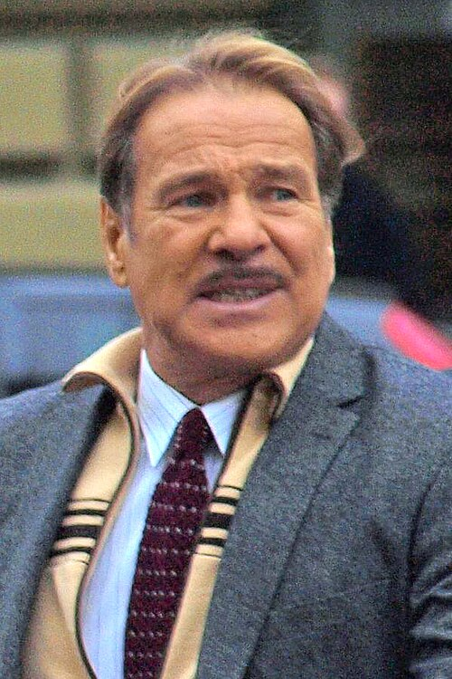

Bild: 2009; Florian Adler. CC BY-SA 3.0 laut Wikimedia Commons. [Bildquelle](https://commons.wikimedia.org/wiki/File:2009-15-11_M%C3%BCnchen_G%C3%B6tz_George_(cropped).jpg), [TMDB](https://www.themoviedb.org/person/26395).

### L1 · leicht

In welcher Stadt ermittelt Götz George als „Tatort“-Kommissar Horst Schimanski?

- Essen

- Dortmund

- **Richtig: Duisburg**

- Bochum

Schimanskis Revier ist Duisburg.

Mit „Duisburg-Ruhrort“ begann 1981 Georges prägende Ermittlerrolle. Schimanski trat derber und körperlicher auf als viele seiner Fernsehvorgänger. Die Ruhrgebietsstadt gehört deshalb ebenso zum Wiedererkennungswert der Figur wie ihre unkonventionelle Art.

Merksatz: Schimanski und George gehören zum Duisburger „Tatort“.

Quellen: [1](https://www.filmportal.de/person/goetz-george_bce5db108bd14348a0e3c14327579f39), [2](https://www1.wdr.de/kultur/goetz-george-10-todestag-100.html).

### L2 · leicht

Um welche angebliche Entdeckung wittert der Reporter Hermann Willié (Götz George) in „Schtonk!“ die große Sensation?

- **Richtig: Unbekannte Hitler-Tagebücher**

- Verschollene Goethe-Handschriften

- Geheime Adenauer-Tonbänder

- Verlorene Einstein-Notizbücher

Willié glaubt an die Sensation vermeintlicher Hitler-Tagebücher.

Ein Fälscher liefert immer neue Bücher, und der Reporter bewegt seine Redaktion zum Kauf. Aussicht auf Exklusivität verdrängt sorgfältige Prüfung. Helmut Dietls Satire verarbeitet den realen Tagebuchskandal von 1983, verwendet für die beteiligten Personen aber eigene Filmfiguren.

Merksatz: Williés Sensationsgier macht aus Fälschungen eine vermeintliche historische Entdeckung.

Quellen: [1](https://www.filmportal.de/film/schtonk_3c775c0b01e34dbaa65ed25fefbe23dc).

### M1 · mittel

An welchem Ort sitzen Götz George und drei weitere Figuren im Thriller „Abwärts“ fest?

- In einem Tauchboot

- In einem Nachtzugabteil

- In einem Bankschließfachraum

- **Richtig: In einem Hochhausfahrstuhl**

Vier Menschen sind in einem steckengebliebenen Fahrstuhl eingeschlossen.

Am Freitagabend bleibt der Aufzug eines Frankfurter Bürohochhauses stehen. Das Warten verschärft die Spannungen zwischen den Eingeschlossenen. Zugleich kommt heraus, dass einer von ihnen gestohlenes Geld mitführt. Die enge Kabine verbindet technische Gefahr mit Misstrauen zwischen Menschen.

Merksatz: Ein Hochhausfahrstuhl macht aus vier Fremden eine gefährliche Zwangsgemeinschaft.

Quellen: [1](https://www.filmportal.de/film/abwaerts_b2ed58b257784cfb9781e8abf1f998d2).

### M2 · mittel

Welchen historischen Serienmörder spielt Götz George in „Der Totmacher“?

- Peter Kürten

- **Richtig: Fritz Haarmann**

- Fritz Honka

- Karl Denke

George spielt den Hannoveraner Serienmörder Fritz Haarmann.

Der Film konzentriert sich auf Haarmanns Gespräche mit einem psychiatrischen Gutachter. George muss die Figur vor allem durch Sprache, Ausweichen und Selbstdarstellung erfahrbar machen. Die Leistung brachte ihm 1995 den Darstellerpreis in Venedig ein.

Merksatz: Georges Haarmann entsteht im Gespräch mit dem Gutachter.

Quellen: [1](https://www.filmportal.de/person/goetz-george_bce5db108bd14348a0e3c14327579f39), [2](https://www.filmportal.de/en/node/52889/material/704357).

### S1 · schwer

Welche sportliche Tätigkeit übt Götz Georges junge Figur Gustav in „Jacqueline“ aus?

- Radsport

- Fechten

- **Richtig: Boxen**

- Rudern

Gustav ist ein junger Boxer.

Der mittellose Gustav unterstützt die Titelheldin als guter Freund. Georges Spiel wurde zum frühen Durchbruch: Für „Jacqueline“ erhielt er einen Bundesfilmpreis als Nachwuchsdarsteller. Die Rolle liegt lange vor Schimanski und zeigt, dass seine Leinwandlaufbahn bereits im Nachkriegskino Anerkennung fand.

Merksatz: Mit dem Boxer Gustav gelang George der frühe Kinodurchbruch.

Quellen: [1](https://www.filmportal.de/film/jacqueline_f77a15a1071f4d378f3c92b79cfe4d13), [2](https://www.filmportal.de/person/goetz-george_bce5db108bd14348a0e3c14327579f39).

### S2 · schwer

Wen verkörpert Götz George in Joachim Langs biografischem Fernsehfilm „George“?

- **Richtig: Seinen Vater Heinrich George**

- Den Regisseur Fritz Lang

- Den Schriftsteller Alfred Döblin

- Den Schauspieler Emil Jannings

Götz George verkörpert seinen Vater Heinrich George.

Die Produktion verbindet Dokumentaraufnahmen und Spielszenen. Der Sohn nähert sich damit einem bedeutenden Schauspieler, dessen Arbeit auch durch seine Mitwirkung in NS-Propagandafilmen belastet ist. Familienbeziehung und historische Verantwortung treffen in derselben Darstellung aufeinander.

Merksatz: In „George“ spielt der Sohn den historisch umstrittenen Vater.

Quellen: [1](https://www.filmportal.de/film/george_8612ea499fc14d60a4d6f5fd5c3edbed).

### E1 · experte

In welchem Stück trat Götz George 1981 bei den Salzburger Festspielen auf?

- Woyzeck

- Maria Stuart

- Kabale und Liebe

- **Richtig: Dantons Tod**

George spielte bei den Salzburger Festspielen in „Dantons Tod“.

Seine Bühnenlaufbahn lief neben Kino und Fernsehen weiter. Den Auftritt in Büchners Revolutionsdrama bezeichnete George später als seine beste Bühnenrolle. Im selben Jahr begann seine Arbeit als Schimanski: Politische Tragödie und populärer Fernsehkrimi standen somit nebeneinander.

Merksatz: 1981 verband George Büchners Revolutionstheater mit dem Start von Schimanski.

Quellen: [1](https://www.filmportal.de/person/goetz-george_bce5db108bd14348a0e3c14327579f39).

### E2 · experte

Welche historische Textgrundlage bestimmt Götz Georges Gesprächsrolle in „Der Totmacher“?

- Private Briefe der Mordopfer

- **Richtig: Protokolle psychiatrischer Untersuchungen Haarmanns**

- Zeitungsinterviews nach dem Filmprozess

- Ein von Haarmann verfasster Roman

Der Film beruht auf den Protokollen psychiatrischer Untersuchungen.

Das historische Material hält die Befragung durch Ernst Schultze fest. Karmakar entwickelt daraus ein Kammerspiel, statt die Mordtaten als Kriminalhandlung nachzustellen. Für George wird die wechselnde Haltung des Sprechenden zum entscheidenden Handlungsträger: Das Erzählen selbst steht im Zentrum.

Merksatz: „Der Totmacher“ verfilmt Befragungsprotokolle als Kammerspiel.

Quellen: [1](https://www.filmportal.de/en/node/52889/material/704357).

## Marlene Dietrich · Bekanntheitsgruppe 1

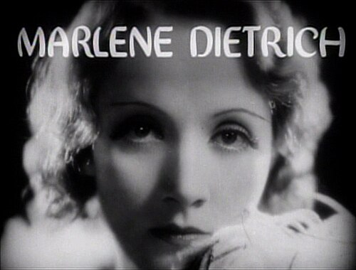

Bild: 1930; Trailer screenshot. Public domain laut Wikimedia Commons. [Bildquelle](https://commons.wikimedia.org/wiki/File:Marlene_Dietrich_in_Morocco_trailer_3.jpg), [TMDB](https://www.themoviedb.org/person/2896).

### L1 · leicht

Welche Nachtclubsängerin verkörpert Marlene Dietrich in „Der blaue Engel“?

- Jenny Hill

- **Richtig: Lola Lola**

- Amy Jolly

- Frenchy

Dietrich spielt Lola Lola.

Der Lehrer Rath (Emil Jannings) sucht in einem Nachtlokal nach seinen Schülern und verfällt der Sängerin. Er heiratet sie und verliert seinen Beruf. Auf den Tourneen der Truppe wird aus seiner erhofften Nähe eine immer demütigendere Abhängigkeit.

Merksatz: Lola Lola zieht den strengen Professor in die Welt des Nachtlokals.

Gemeinsames Wissensziel: K-CLA-21-01 (CLA-L-041).

Quellen: [1](https://www.filmportal.de/film/der-blaue-engel_2a14f3b84dac4a268d8ce385d0524686), [2](https://www.bfi.org.uk/lists/marlene-dietrich-10-essential-films).

### L2 · leicht

Welches Lied singt Marlene Dietrich als Lola Lola in „Der blaue Engel“?

- Lili Marleen

- Ich hab’ noch einen Koffer in Berlin

- Sag mir, wo die Blumen sind

- **Richtig: Ich bin von Kopf bis Fuß auf Liebe eingestellt**

Zum Film gehört „Ich bin von Kopf bis Fuß auf Liebe eingestellt“.

Der von Friedrich Hollaender komponierte Song wurde eng mit Dietrichs Stimme und Bühnenerscheinung verbunden. Er gehört zu den Auftritten der Sängerin Lola Lola, deren Anziehungskraft den Professor aus seinem bisherigen Leben führt. Das Lied blieb auch außerhalb der Filmhandlung bekannt.

Merksatz: Dietrichs Liebeslied gehört zu Lola Lolas Bühnenauftritt.

Quellen: [1](https://www.filmportal.de/film/der-blaue-engel_2a14f3b84dac4a268d8ce385d0524686), [2](https://www.potsdam.de/de/der-blaue-engel).

### M1 · mittel

In welchem auffälligen Bühnenkostüm tritt Marlene Dietrichs Sängerin in „Marokko“ auf und küsst eine Zuschauerin?

- **Richtig: In Frack und Zylinder**

- In einer Matrosenuniform

- In einem Brautkleid

- In einem Flamencokleid

Amy Jolly tritt in Frack und Zylinder auf.

Die Sängerin Amy Jolly (Marlene Dietrich) unterläuft mit dem eleganten Herrenanzug die erwartete Erscheinung einer Nachtclubkünstlerin. Ihre Verbindung zum Legionär Tom Brown (Gary Cooper) führt später weg von diesem kontrollierten Bühnenbild: Am Ende folgt sie ihm zu Fuß in die Wüste.

Merksatz: Frack und Zylinder machen Amy Jollys Auftritt unverwechselbar.

Quellen: [1](https://www.bfi.org.uk/lists/marlene-dietrich-10-essential-films), [2](https://www.criterion.com/films/28991-morocco).

### M2 · mittel

Welche Frau spielt Marlene Dietrich in „Zeugin der Anklage“ an der Seite des angeklagten Leonard Vole?

- Miss Plimsoll

- Diana

- **Richtig: Christine Vole**

- Emily French

Dietrich spielt Christine Vole.

Christine erscheint zunächst als mögliche Stütze der Verteidigung ihres Mannes Leonard (Tyrone Power). Ihre Aussagen verändern jedoch die Lage im Mordprozess. Dietrichs kontrolliertes Auftreten hält dabei offen, welchen Teil ihrer Beziehung und ihres Wissens Christine wirklich preisgibt.

Merksatz: Christine Vole steht zwischen Ehemann und Gericht.

Gemeinsames Wissensziel: K-CLA-11-03 (CLA-M-021).

Quellen: [1](https://catalog.afi.com/Film/52448-WITNESS-FORTHEPROSECUTION).

### S1 · schwer

Welche Staatsbürgerschaft nahm Marlene Dietrich 1939 an?

- Die britische

- **Richtig: Die amerikanische**

- Die französische

- Die schweizerische

Dietrich wurde 1939 amerikanische Staatsbürgerin.

Die Kinemathek datiert die Einbürgerung auf den 9. Juni 1939. Dietrichs Karriere hatte sich inzwischen nach Hollywood verlagert. Während des Zweiten Weltkriegs trat sie für alliierte Soldaten auf; ihre amerikanische Staatsbürgerschaft und ihr öffentliches Engagement gehören zu dieser biografischen Neuorientierung.

Merksatz: Dietrich wurde vor dem Krieg amerikanische Staatsbürgerin.

Quellen: [1](https://www.deutsche-kinemathek.de/de/online/sammlung-digital/marlene-dietrich-collection-berlin).

### S2 · schwer

Welche Vergangenheit hat Marlene Dietrichs Frau Bertholt in „Das Urteil von Nürnberg“?

- Sie war Sekretärin des amerikanischen Anklägers

- Sie führte ein Widerstandsnetz in Frankreich

- Sie ist die Tochter eines angeklagten Richters

- **Richtig: Sie ist die Witwe eines hingerichteten deutschen Generals**

Frau Bertholt ist die Witwe eines hingerichteten deutschen Generals.

Der amerikanische Richter Haywood (Spencer Tracy) begegnet ihr während des Nürnberger Juristenprozesses. Die höfliche Gastgeberin spricht aus einer deutschen Perspektive, die eigene Verluste betont. Das Gespräch steht neben der gerichtlichen Auseinandersetzung um Verantwortung und Verbrechen des nationalsozialistischen Justizsystems.

Merksatz: Frau Bertholts Gastfreundschaft trägt die Erinnerung an ihren hingerichteten Mann.

Quellen: [1](https://catalog.afi.com/Catalog/moviedetails/23848), [2](https://www.bfi.org.uk/lists/marlene-dietrich-10-essential-films).

### E1 · experte

Wie entstanden die deutsche und die englische Sprachfassung von „Der blaue Engel“ mit Marlene Dietrich?

- Die englische Fassung erhielt nur neue Zwischentitel

- Dietrich wurde im Deutschen von einer anderen Sängerin synchronisiert

- **Richtig: Die Szenen wurden für beide Sprachen getrennt aufgenommen**

- Die englische Fassung entstand als späteres Remake ohne Dietrich

Der Film wurde in deutscher und englischer Sprache separat gedreht.

In der frühen Tonfilmzeit ließen sich Sprachbarrieren noch nicht selbstverständlich durch nachträgliche Synchronisation lösen. Deshalb spielte das Ensemble die Szenen für zwei Fassungen. Dietrichs Auftritte gehören in beiden Fällen zur ursprünglichen Produktion; es handelt sich nicht um ein späteres englisches Remake.

Merksatz: Zwei Sprachfassungen bedeuteten zwei Aufnahmen der Szenen.

Quellen: [1](https://www.bfi.org.uk/lists/marlene-dietrich-10-essential-films).

### E2 · experte

Für welchen Einsatz wurde Marlene Dietrich 1947 mit der amerikanischen Medal of Freedom ausgezeichnet?

- **Richtig: Für ihre Unterstützung alliierter Soldaten im Zweiten Weltkrieg**

- Für die Rettung amerikanischer Stummfilme

- Für den Aufbau einer Filmhochschule in Berlin

- Für die Leitung einer Flüchtlingsbehörde nach dem Krieg

Die Auszeichnung würdigte ihren Einsatz für die alliierten Truppen.

Dietrich reiste während des Krieges zur Truppenbetreuung und trat 1944 und 1945 unter anderem in Nordafrika und Europa auf. Damit setzte sie ihre Bekanntheit und ihre Bühnenarbeit für die Soldaten ein. Die Deutsche Kinemathek verzeichnet die Verleihung am 18. November 1947.

Merksatz: Dietrichs Kriegsauftritte wurden mit der Medal of Freedom gewürdigt.

Quellen: [1](https://www.deutsche-kinemathek.de/de/online/sammlung-digital/marlene-dietrich-collection-berlin).

## Greta Garbo · Bekanntheitsgruppe 1

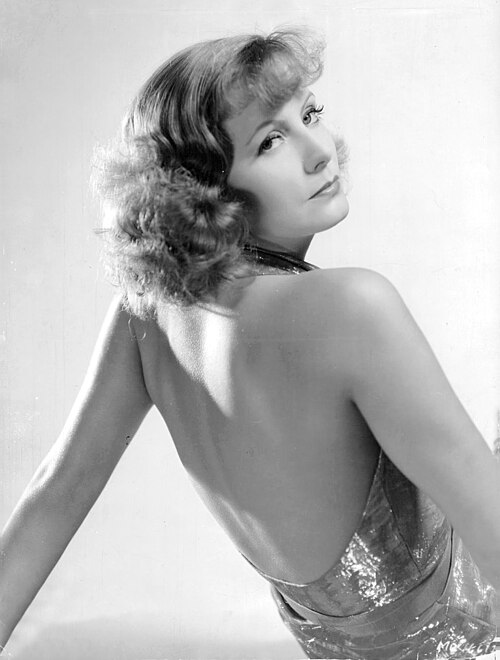

Bild: 1931; Unknown photographer. Public domain laut Wikimedia Commons. [Bildquelle](https://commons.wikimedia.org/wiki/File:Greta-Garbo-391767732483.jpg), [TMDB](https://www.themoviedb.org/person/19549).

### L1 · leicht

Mit welchem Auftrag kommt Greta Garbos sowjetische Gesandte in „Ninotschka“ nach Paris?

- Sie soll eine Botschaft eröffnen

- Sie soll einen Filmstar überwachen

- **Richtig: Sie soll beschlagnahmte Juwelen verkaufen**

- Sie soll ein Ballettensemble abholen

Ninotschka soll beschlagnahmte Juwelen verkaufen.

Die Abgesandte soll drei bereits angereiste Kollegen wieder auf einen sachlichen Kurs bringen. In Paris begegnet sie dem Grafen Léon (Melvyn Douglas), der mit der früheren Besitzerin der Juwelen verbunden ist. Ihr Auftrag führt so mitten in einen Konflikt zwischen politischer Pflicht, Eigentumsansprüchen und Anziehung.

Merksatz: Ein staatlicher Juwelenverkauf bringt Ninotschka nach Paris.

Gemeinsames Wissensziel: K-F240-20261006-171-L1 (F240-20261006-171-L1).

Quellen: [1](https://catalog.afi.com/Film/4333-NINOTCHKA).

### L2 · leicht

Welchen Beruf hat Greta Garbos Grusinskaya in „Menschen im Hotel“?

- **Richtig: Sie ist Balletttänzerin**

- Sie ist Ärztin

- Sie ist Journalistin

- Sie ist Hoteldirektorin

Grusinskaya ist eine berühmte Balletttänzerin.

Die Künstlerin wohnt während ihrer Auftritte im Berliner Grand Hotel und steckt in einer persönlichen Krise. Der Baron (John Barrymore) dringt zunächst mit Diebstahlsabsichten in ihr Zimmer ein. Aus der Begegnung entsteht eine Nähe, an die Grusinskaya neue Hoffnung knüpft.

Merksatz: Garbos Grusinskaya bringt die Welt des Balletts ins Grand Hotel.

Gemeinsames Wissensziel: K-E20261007-F-253-L2 (E20261007-F-253-L2).

Quellen: [1](https://catalog.afi.com/Film/7720-GRAND-HOTEL).

### M1 · mittel

Welche gesellschaftliche Stellung hat Marguerite (Greta Garbo) in „Die Kameliendame“, bevor sie sich in Armand verliebt?

- Sie ist eine verheiratete Adlige

- Sie ist eine Klosterschülerin

- Sie ist eine verarmte Fabrikarbeiterin

- **Richtig: Sie ist eine von reichen Männern unterhaltene Kurtisane**

Marguerite Gautier lebt als Kurtisane in Paris.

Armand (Robert Taylor) bietet ihr die Aussicht auf eine Liebe außerhalb der finanziellen Abhängigkeit von wohlhabenden Männern. Sein Vater (Lionel Barrymore) verlangt jedoch den Verzicht, weil die Verbindung den Ruf der Familie gefährde. Marguerites Krankheit verschärft den Konflikt zwischen eigenem Glück und gesellschaftlicher Rücksicht.

Merksatz: Marguerites Liebe stößt auf die Grenzen ihrer Stellung als Kurtisane.

Quellen: [1](https://catalog.afi.com/Film/8433-CAMILLE).

### M2 · mittel

Warum erkennt der spanische Gesandte Greta Garbos Königin in „Königin Christine“ bei ihrer ersten Begegnung im Gasthaus nicht?

- Sie gibt sich als einfache Dienerin aus

- **Richtig: Sie trägt Männerkleidung und wird für einen Herrn gehalten**

- Sie verbirgt ihr Gesicht hinter einer Maske

- Sie lässt eine Hofdame für sich sprechen

Christine reist in Männerkleidung und wird zunächst für einen Herrn gehalten.

Antonio (John Gilbert) begegnet ihr außerhalb des Hofes und kennt ihre königliche Stellung nicht. Die private Begegnung ermöglicht eine Liebesgeschichte, bevor politische Erwartungen wieder sichtbar werden. Der Film erzählt dabei eine romantische Fiktion um die schwedische Herrscherin, keine genaue historische Biografie.

Merksatz: Im Gasthaus begegnet Antonio zuerst einem vermeintlichen Herrn.

Quellen: [1](https://catalog.afi.com/Film/7290-QUEEN-CHRISTINA).

### S1 · schwer

Mit welchem Film war Greta Garbo erstmals in einer Sprechrolle auf der Leinwand zu hören?

- **Richtig: Anna Christie**

- Mata Hari

- Menschen im Hotel

- Königin Christine

„Anna Christie“ war Garbos erster Tonfilm.

Nach ihrer Stummfilmkarriere wurde der Einsatz ihrer Stimme zu einem eigenen Werbeereignis. Als Anna sucht sie den Vater wieder auf, den sie lange nicht gesehen hat. Der Film verschob die Aufmerksamkeit von Garbos sichtbarer Präsenz zusätzlich auf Aussprache, Klang und gesprochenen Dialog.

Merksatz: „Garbo talks“ gehörte zum Übergang mit „Anna Christie“.

Quellen: [1](https://catalog.afi.com/Film/648-ANNA-CHRISTIE).

### S2 · schwer

Was steckt hinter Greta Garbos beiden weiblichen Identitäten in „Die Frau mit den zwei Gesichtern“?

- Zwei getrennt aufgewachsene Schwestern begegnen sich

- Eine Doppelgängerin wird gegen ihren Willen engagiert

- Eine Agentin übernimmt die Identität einer Verstorbenen

- **Richtig: Karin erfindet eine Zwillingsschwester und spielt sie selbst**

Karin gibt sich zusätzlich als ihre erfundene Zwillingsschwester Katherine aus.

Die Skilehrerin Karin vermutet, dass ihr Mann Larry (Melvyn Douglas) sich wieder seiner früheren Freundin zuwendet. Sie begegnet ihm deshalb als angeblich ungebundene Schwester Katherine. Der Mann entdeckt die Täuschung, spielt das Spiel aber weiter. Die Komödie beruht somit auf gespielter Identität, nicht auf echten Zwillingen.

Merksatz: Katherine ist Karins erfundene Schwester.

Quellen: [1](https://catalog.afi.com/Film/27065-TWO-FACED-WOMAN).

### E1 · experte

Welcher schwedische Filmemacher wurde zum wichtigen frühen Mentor von Greta Garbo?

- Victor Sjöström

- Ingmar Bergman

- **Richtig: Mauritz Stiller**

- Carl Theodor Dreyer

Mauritz Stiller förderte Garbos frühe Filmkarriere.

Stiller besetzte sie in „Gösta Berling“ als Elisabeth, die sich in den ehemaligen Geistlichen Gösta (Lars Hanson) verliebt. Der Film machte ihr Talent international sichtbar. Diese frühe Zusammenarbeit gehört zu ihrer schwedischen Laufbahn, bevor Hollywood ihr Gesicht zu einem weltweiten Starbild formte.

Merksatz: Vor Hollywood stand Stillers Förderung in Schweden.

Quellen: [1](https://www.bfi.org.uk/lists/10-great-films-1924).

### E2 · experte

Welchen Einschnitt markiert „Die Frau mit den zwei Gesichtern“ in Greta Garbos Laufbahn?

- Es war ihr erster Film für ein amerikanisches Studio

- **Richtig: Es blieb ihr letzter veröffentlichter Spielfilm**

- Es war ihre einzige Arbeit ohne Hauptrolle

- Es leitete ihre dauerhafte Rückkehr zum schwedischen Film ein

Nach diesem Film kehrte Garbo nicht mehr in einem neuen Spielfilm zurück.

Der Rückzug erfolgte schon 1941, obwohl Garbo erst Mitte dreißig war. Das AFI verzeichnet spätere Pläne für eine Rückkehr, die nicht zu einem weiteren Film führten. Ihr öffentliches Bild blieb dadurch dauerhaft an eine vergleichsweise kurze, abgeschlossene Leinwandkarriere gebunden.

Merksatz: Garbos Filmkarriere endete mit der Komödie von 1941.

Quellen: [1](https://catalog.afi.com/Film/27065-TWO-FACED-WOMAN).

## Brigitte Bardot · Bekanntheitsgruppe 1

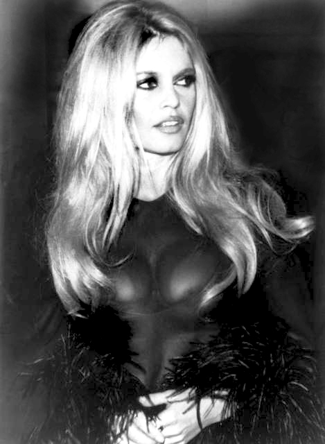

Bild: 1968; Michel Bernanau (grand père de Oolong06400 ref ). CC BY-SA 3.0 laut Wikimedia Commons. [Bildquelle](https://commons.wikimedia.org/wiki/File:Brigitte_Bardot.jpg), [TMDB](https://www.themoviedb.org/person/3783).

### L1 · leicht

Welcher Film machte Brigitte Bardot 1956 international zum Star?

- Viva Maria!

- Die Wahrheit

- **Richtig: Und immer lockt das Weib**

- Die Verachtung

Ihr internationaler Durchbruch kam mit „Und immer lockt das Weib“.

Roger Vadims Film stellte Bardot als Juliette in den Mittelpunkt. Ihr Auftreten und die Tanzszenen machten die Produktion weit über Frankreich hinaus bekannt. Die spätere Zusammenarbeit mit Godard und Malle folgte auf diesen Durchbruch; sie gehörte nicht zu ihren ersten Leinwandauftritten.

Merksatz: Der Durchbruch von 1956 verbindet Bardot mit Vadims Juliette.

Quellen: [1](https://www.elysee.fr/emmanuel-macron/2025/12/28/disparition-de-brigitte-bardot).

### L2 · leicht

Welcher Sache widmete sich Brigitte Bardot nach ihrem Rückzug vom Film besonders intensiv?

- **Richtig: Dem Schutz wildlebender Tiere und Haustiere**

- Der Ausbildung junger Balletttänzer

- Der Restaurierung historischer Filmtheater

- Dem Erhalt bedrohter Sprachen

Bardot widmete sich dem Tierschutz.

Die 1986 gegründete Fondation Brigitte Bardot unterstützt unter anderem Tiere in Not und setzt sich gegen Misshandlung und Aussetzung ein. Ihr Tätigkeitsfeld reicht von Frankreich bis zu internationalen Projekten. Das Engagement wurde nach dem Ende ihrer Filmkarriere zu einem dauerhaften Schwerpunkt ihres öffentlichen Lebens.

Merksatz: Auf die Filmkarriere folgte der Einsatz für Tiere.

Quellen: [1](https://www.fondationbrigittebardot.fr/presentation-de-la-fbb/).

### M1 · mittel

In welcher Beziehung steht Camille (Brigitte Bardot) in „Die Verachtung“ zu Paul Javal?

- Sie ist seine Filmproduzentin

- Sie ist seine Übersetzerin

- Sie ist seine Schwester

- **Richtig: Sie ist seine Ehefrau**

Camille ist mit Paul Javal verheiratet.

Paul (Michel Piccoli) soll das Drehbuch einer Filmproduktion überarbeiten. Zugleich zerbricht seine Beziehung zu Camille. Der Konflikt um künstlerische Entscheidungen und Geld verläuft damit neben einem privaten Vertrauensverlust; Bardots Figur gehört nicht einfach zur professionellen Hierarchie am Filmset.

Merksatz: Camilles Krise betrifft ihre Ehe mit Paul.

Quellen: [1](https://www.criterion.com/films/239-contempt).

### M2 · mittel

Mit welcher Schauspielerin bildet Brigitte Bardot in „Viva Maria!“ das zentrale Paar von Sängerinnen?

- Catherine Deneuve

- **Richtig: Jeanne Moreau**

- Anouk Aimée

- Annie Girardot

Bardots Partnerin ist Jeanne Moreau.

Zwei Sängerinnen einer reisenden Truppe geraten im frühen 20. Jahrhundert in Mittelamerika in eine Revolution. Ihre Bindung an einen Revolutionär führt sie dazu, dessen Sache auch nach seinem Tod fortzusetzen. Das Duo trägt deshalb sowohl die Musikkomödie als auch das politische Abenteuer.

Merksatz: Bardot und Moreau ziehen gemeinsam von der Bühne in die Revolution.

Quellen: [1](https://www.festival-cannes.com/en/f/viva-maria/).

### S1 · schwer

Welcher bekannte Regisseur spielt in „Die Verachtung“ mit Brigitte Bardot einen Filmemacher unter seinem eigenen Namen?

- Roberto Rossellini

- Federico Fellini

- **Richtig: Fritz Lang**

- Vittorio De Sica

Fritz Lang spielt sich selbst.

Der Film innerhalb des Films braucht einen europäischen Regisseur, der gegenüber einem amerikanischen Produzenten seine Vorstellung vom Kino behauptet. Lang übernimmt diese Figur unter dem eigenen Namen. Die tatsächliche Regie von „Die Verachtung“ liegt dagegen bei Jean-Luc Godard.

Merksatz: Lang erscheint als Lang; Godard inszeniert die Begegnung.

Quellen: [1](https://www.criterion.com/films/239-contempt).

### S2 · schwer

Welcher Vorwurf steht im Zentrum des Prozesses gegen Dominique (Brigitte Bardot) in „Die Wahrheit“?

- **Richtig: Sie soll ihren Geliebten getötet haben**

- Sie soll einen Banküberfall organisiert haben

- Sie soll Staatsgeheimnisse verkauft haben

- Sie soll ihre Arbeitgeberin vergiftet haben

Dominique ist angeklagt, ihren Geliebten getötet zu haben.

Rückblenden erschließen das Leben der jungen Frau zwischen provinzieller Herkunft und Pariser Bohème. Im Gerichtssaal wird dabei auch ihr Lebenswandel bewertet. Bardots Rolle führt vom öffentlichen Bild einer begehrten jungen Frau zu einer Angeklagten, deren Beziehungen und Entscheidungen vor anderen zerlegt werden.

Merksatz: Dominique steht wegen des Todes ihres Geliebten vor Gericht.

Quellen: [1](https://www.criterion.com/films/27913-la-v-rit).

### E1 · experte

Mit welchem Sänger nahm Brigitte Bardot das Duett „Bonnie and Clyde“ auf?

- Charles Aznavour

- Gilbert Bécaud

- Jacques Brel

- **Richtig: Serge Gainsbourg**

Das Duett entstand mit Serge Gainsbourg.

Das INA-Archiv führt den gemeinsamen Auftritt in seiner Dokumentation über Gainsbourg. Bardots Stimme gehört damit auch zur französischen Popgeschichte der 1960er-Jahre. Ihre musikalische Zusammenarbeit lässt sich von den Filmrollen unterscheiden, die ihr internationales Starbild begründet hatten.

Merksatz: Bardot und Gainsbourg bilden das musikalische Bonnie-und-Clyde-Paar.

Quellen: [1](https://catalogue.ina.fr/doc/TV-RADIO/DA_CPA94006914/serge-gainsbourg), [2](https://www.elysee.fr/emmanuel-macron/2025/12/28/disparition-de-brigitte-bardot).

### E2 · experte

Für welche französische Symbolfigur diente Brigitte Bardots Gesicht als Vorbild?

- Jeanne d’Arc

- **Richtig: Marianne**

- La Parisienne

- Die Freiheitsstatue

Bardot war eines der Vorbilder für Marianne.

Marianne verkörpert die französische Republik und ist besonders durch Büsten in Rathäusern sowie offizielle Darstellungen bekannt. Die Élysée-Seite nennt Bardot unter mehreren berühmten Frauen, deren Gesicht für die Figur verwendet wurde. Es handelt sich dabei um eine staatliche Allegorie, nicht um eine Filmrolle.

Merksatz: Bardots Gesicht wurde zum Gesicht der Republik: Marianne.

Quellen: [1](https://www.elysee.fr/en/french-presidency/marianne).

## Gina Lollobrigida · Bekanntheitsgruppe 1

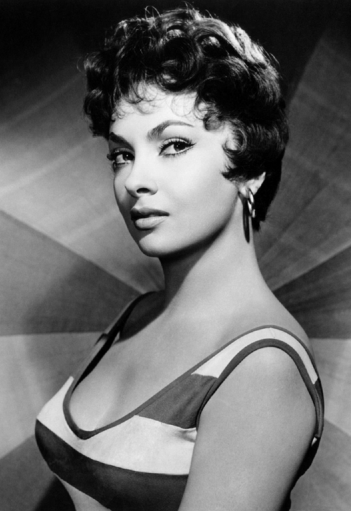

Bild: 1956; United Artists. Public domain laut Wikimedia Commons. [Bildquelle](https://commons.wikimedia.org/wiki/File:Gina_Lollobrigida_-_Publicity_still_(1956).png), [TMDB](https://www.themoviedb.org/person/19534).

### L1 · leicht

Welche Figur spielt Gina Lollobrigida in der Verfilmung „Der Glöckner von Notre Dame“ von 1956?

- **Richtig: Esmeralda**

- Fleur de Lys

- Aloyse

- Die Königin

Lollobrigida verkörpert Esmeralda.

Jean Delannoys französisch-italienische Verfilmung stellt ihr Anthony Quinn als Quasimodo zur Seite. Damit übernahm Lollobrigida eine berühmte literarische Figur in einer internationalen Produktion. Die Besetzung verbindet den italienischen Star mit einer französischen Romanvorlage und einem amerikanischen Hauptdarsteller.

Merksatz: Lollobrigidas Esmeralda begegnet Quinns Quasimodo.

Quellen: [1](https://www.cnc.fr/cinema/actualites/gina-lollobrigida-mort-dune-icone-internationale_1872955), [2](https://www.cinematheque.fr/film/48015.html).

### L2 · leicht

Für welches Ziel engagierte sich Gina Lollobrigida als Botschafterin der UN-Organisation FAO?

- Für die Bewahrung alter Stadtzentren

- **Richtig: Für die Bekämpfung des Hungers**

- Für die Förderung des olympischen Sports

- Für den Schutz archäologischer Fundstätten

Sie unterstützte den Kampf gegen Hunger.

Die FAO ernannte Lollobrigida 1999 zur Goodwill-Botschafterin. Sie beteiligte sich an Veranstaltungen und Spendensammlungen, die Ernährungssicherheit zum Thema machten. Ihre öffentliche Bekanntheit setzte sie damit für eine Aufgabe ein, die weit über die Filmbranche hinausging.

Merksatz: Lollobrigidas FAO-Engagement galt Menschen ohne ausreichende Nahrung.

Quellen: [1](https://www.fao.org/4/a1513e/a1513e00.pdf).

### M1 · mittel

Was will Lola (Gina Lollobrigida) in „Trapez“ von den Artisten Mike und Tino erreichen?

- Sie will ihren Zirkus kaufen

- Sie will sie als Zeugen vor Gericht gewinnen

- Sie will ihre Tournee durch Europa verhindern

- **Richtig: Sie will in ihre erfolgreiche Artistennummer aufgenommen werden**

Lola will Teil der gemeinsamen Nummer von Mike und Tino werden.

Mike (Burt Lancaster) trainiert Tino (Tony Curtis) für einen gefährlichen dreifachen Salto. Lola erkennt die Aussicht auf einen großen Erfolg und versucht, sich einen Platz in der Darbietung zu sichern. Ihre Beziehungen zu beiden Männern lassen beruflichen Ehrgeiz und Liebeskonflikt ineinandergreifen.

Merksatz: Lolas Ehrgeiz zielt auf einen Platz in der Nummer der beiden Männer.

Quellen: [1](https://catalog.afi.com/Film/52044-TRAPEZE).

### M2 · mittel

Warum bleiben die Annäherungsversuche des älteren Carabinieri-Marschalls bei Gina Lollobrigidas Figur in „Liebe, Brot und Phantasie“ erfolglos?

- Sie hat ein Schweigegelübde abgelegt

- Sie ist bereits mit dem Bürgermeister verheiratet

- **Richtig: Sie liebt einen jüngeren Carabiniere aus seiner Einheit**

- Sie will das Dorf als reisende Sängerin verlassen

Die Bersagliera liebt den jüngeren Carabiniere Stelluti.

Der neu versetzte Marschall Carotenuto (Vittorio De Sica) umwirbt die junge Dorfbewohnerin. Diese richtet ihre Zuneigung aber auf einen Untergebenen des Marschalls. Am Ende findet das junge Paar zusammen, während Carotenuto sich der Hebamme Annarella (Marisa Merlini) zuwendet.

Merksatz: Die Bersagliera entscheidet sich für den jungen Carabiniere.

Quellen: [1](https://www.raicultura.it/cinema/articoli/2021/06/Pane-amore-e-fantasia-1953-f01c4f93-06ad-45dd-a4ae-5d5bf628d13a.html).

### S1 · schwer

Was erschwerte Gina Lollobrigida nach ihrem ersten Hollywoodaufenthalt eine freie Wahl amerikanischer Filmangebote?

- **Richtig: Ein bindender Vertrag mit Howard Hughes’ RKO**

- Eine fehlende Ausbildung im Tonfilm

- Ein generelles Verbot italienischer Schauspielerinnen

- Eine dauerhafte Verpflichtung an ein Opernhaus

Ein restriktiver RKO-Vertrag begrenzte ihre Möglichkeiten.

Lollobrigida kehrte nach Italien zurück und arbeitete in europäischen Produktionen sowie in amerikanischen Filmen, die in Europa gedreht wurden. Dazu gehörten „Schach dem Teufel“ und „Trapez“. Der Vertragskonflikt erklärt somit einen konkreten Umweg ihrer internationalen Karriere.

Merksatz: Der RKO-Vertrag lenkte ihre internationale Arbeit zurück nach Europa.

Quellen: [1](https://www.bfi.org.uk/news/gina-lollobrigida-obituary).

### S2 · schwer

Was entdeckt Robert (Rock Hudson) in „Happy End im September“ mit Gina Lollobrigida, als er unerwartet früh in seiner italienischen Villa ankommt?

- Seine Freundin hat die Villa verkauft

- **Richtig: Die Villa wird während seiner Abwesenheit als Hotel vermietet**

- Eine Filmcrew hat das Haus dauerhaft beschlagnahmt

- Sein Verwalter hat ein Waisenhaus darin eröffnet

Seine Villa wird hinter seinem Rücken als Hotel genutzt.

Robert erwartet einen privaten Aufenthalt und trifft stattdessen auf eine Gruppe junger amerikanischer Gäste. Die überraschende Nutzung seines Hauses bringt auch seine Beziehung durcheinander. Lollobrigida gehört als seine Freundin zum erwachsenen Paar, dessen Pläne durch das geschäftige Treiben in der Villa gestört werden.

Merksatz: Der vorzeitige Besuch entlarvt die Villa als heimliches Hotel.

Quellen: [1](https://www.universalpicturesathome.com/movies/come-september).

### E1 · experte

Welche Aufgabe übernahm Gina Lollobrigida bei der Berlinale 1986?

- Sie leitete die Retrospektive

- Sie war Direktorin des Festivals

- Sie präsentierte den Eröffnungsfilm als Regisseurin

- **Richtig: Sie war Präsidentin der internationalen Jury**

Lollobrigida stand der internationalen Jury vor.

Der zeitgenössische Festivalbericht von Harlan Kennedy nennt sie ausdrücklich als Jurypräsidentin. Ihre Aufgabe lag damit in der Bewertung der Wettbewerbsfilme. Die Rolle unterscheidet sich sowohl von der Festivalleitung als auch von der Teilnahme als Darstellerin eines einzelnen Beitrags.

Merksatz: 1986 wechselte Lollobrigida bei der Berlinale auf die Seite der Jury.

Quellen: [1](https://www.americancinemapapers.com/files/BERLIN_1986.htm).

### E2 · experte

Welche beiden künstlerischen Tätigkeiten baute Gina Lollobrigida neben und nach der Schauspielerei besonders aus?

- Architektur und Ballett

- Opernregie und Kostümbild

- **Richtig: Fotografie und Bildhauerei**

- Animationsfilm und Choreografie

Sie arbeitete als Fotografin und Bildhauerin.

Die FAO stellt Lollobrigida ausdrücklich auch als Fotografin und Bildhauerin vor und erwähnt Ausstellungen ihrer Werke. Zum Welternährungstag 2006 stiftete sie eine eigene Skulptur. Ihre Kunst blieb damit kein bloßes privates Hobby, sondern trat öffentlich und auch in ihrem humanitären Engagement hervor.

Merksatz: Lollobrigida arbeitete mit Kamera und Skulptur weiter.

Quellen: [1](https://www.fao.org/4/a1513e/a1513e00.pdf).

## Uschi Glas · Bekanntheitsgruppe 1

Bild: Aufnahmejahr nicht belegt; Auf TMDB nicht ausgewiesen. TMDB-Onlineporträt; keine freie Lizenz behauptet. [Bildquelle](https://www.themoviedb.org/person/33709), [TMDB](https://www.themoviedb.org/person/33709).

### L1 · leicht

Mit welcher Münchner Komödie gelang Uschi Glas 1968 ihr großer Durchbruch?

- **Richtig: Zur Sache, Schätzchen**

- Die Herren mit der weißen Weste

- Morgens um sieben ist die Welt noch in Ordnung

- Die Feuerzangenbowle

Der Durchbruch gelang ihr mit „Zur Sache, Schätzchen“.

Glas spielt Barbara, die dem unbekümmerten Martin (Werner Enke) begegnet. Die Komödie begleitet junge Menschen, die sich gegenüber geregelter Arbeit und Autoritäten eigensinnig verhalten. Sie wurde zu einem Kassenerfolg und verband Glas mit dem Lebensgefühl einer neuen Generation deutscher Kinobesucher.

Merksatz: Glas wurde mit Barbara zum „Schätzchen“ des deutschen Kinos.

Quellen: [1](https://www.filmportal.de/film/zur-sache-schaetzchen_645059b6b93d4ea3b7c928e1bb63db6e), [2](https://radiokulturhaus.orf.at/artikel/715500/Aus-dem-Archiv-Uschi-Glas).

### L2 · leicht

Welchem berühmten Westernhelden begegnet Uschi Glas in ihrer ersten Hauptrolle als Apanatschi?

- Zorro

- Django

- **Richtig: Winnetou**

- Ringo

Ihre erste Hauptrolle gehört zu einem Winnetou-Film.

Apanatschi steht im Mittelpunkt einer Karl-May-Verfilmung, in der Winnetou (Pierre Brice) und Old Shatterhand (Lex Barker) zu ihren Helfern gehören. Glas übernahm die Rolle noch vor ihrem Komödiendurchbruch. Der Auftritt verbindet ihre Anfänge mit den damals populären deutschen Abenteuerproduktionen.

Merksatz: Apanatschi führt Glas in die Welt von Winnetou und Old Shatterhand.

Quellen: [1](https://www.rialtofilm.de/apana.htm), [2](https://www.filmportal.de/person/uschi-glas_8716e1bd80ca460ea293247ce5990482).

### M1 · mittel

Welche Rolle übernimmt Uschi Glas im Schulalltag von „Fack ju Göhte“?

- Eine engagierte Schulrätin

- **Richtig: Eine erschöpfte Lehrerin**

- Eine strenge Schuldirektorin

- Eine erfolgreiche Nachhilfeunternehmerin

Glas spielt eine ausgebrannte Lehrerin.

Die Figur steht für eine Schulwelt, in der Unterricht und Disziplin die Erwachsenen an ihre Grenzen bringen. Glas setzte bei diesem späteren Kinoauftritt auf eine selbstironische Darstellung. Der Auftritt gehört zu den älteren Lehrerfiguren der Komödie und ergänzt das Ensemble um ein vertrautes Gesicht des deutschen Films.

Merksatz: Glas erscheint als Lehrerin am Ende ihrer Kräfte.

Quellen: [1](https://hdbg.eu/zeitzeugen/detail/bayern-in-den-1960er-jahren/uschi-glas/1564).

### M2 · mittel

Welchen Betrieb führt Uschi Glas’ Titelheldin in „Anna Maria – Eine Frau geht ihren Weg“?

- Eine Privatklinik

- Ein Reisebüro

- Eine Textilfabrik

- **Richtig: Ein Kieswerk**

Anna Maria führt ein Kieswerk.

Die Serie stellt eine Unternehmerin ins Zentrum, die sich in einer von Männern geprägten Arbeitswelt behaupten muss. Die berufliche Verantwortung gehört zur Figur selbst und bildet den Hintergrund ihrer Konflikte. Glas spielte damit eine andere Hauptrolle als die Lehrerin ihrer späteren Serie „Sylvia“.

Merksatz: Anna Marias Weg führt durch die Verantwortung für ein Kieswerk.

Quellen: [1](https://www.filmportal.de/person/uschi-glas_8716e1bd80ca460ea293247ce5990482).

### S1 · schwer

Was organisiert der von Uschi Glas mitgegründete Verein brotZeit für Schulkinder?

- **Richtig: Ein kostenloses Frühstück vor dem Unterricht**

- Einen jährlichen Aufenthalt im Ferienlager

- Eine kostenlose Busfahrt zu Kulturveranstaltungen

- Eine eigene Bibliothek in jedem Klassenzimmer

brotZeit organisiert ein kostenloses Schulfrühstück.

Ausgangspunkt war eine Radiomeldung über Kinder, die hungrig zur Schule kommen. Glas entwickelte daraufhin 2009 mit Münchner Schulen ein Frühstücksangebot. Freiwillige helfen bei der praktischen Durchführung. Das Ziel ist ein gemeinsamer Tagesbeginn, bei dem fehlendes Essen dem Lernen nicht im Weg steht.

Merksatz: Vor dem Lernen steht bei brotZeit das Frühstück.

Quellen: [1](https://www.brotzeitfuerkinder.com/wer-ist-brotzeit/), [2](https://hdbg.eu/zeitzeugen/detail/bayern-in-den-1960er-jahren/uschi-glas/1564).

### S2 · schwer

Welcher Schauspieler war Uschi Glas’ Partner in „Unsere schönsten Jahre“ und „Zwei Münchner in Hamburg“?

- Fritz Wepper

- Peter Weck

- **Richtig: Elmar Wepper**

- Sascha Hehn

Ihr Partner in beiden Serien war Elmar Wepper.

In „Zwei Münchner in Hamburg“ spielen die beiden Julia und Ralf-Maria Sagerer. Schon die frühere Serie stellte ihre wechselhafte Paarbeziehung ins Zentrum. Die wiederholte Zusammenarbeit verband Glas und Wepper für viele Zuschauer mit der Mischung aus Familiengeschichte, Beziehungskomödie und vertrautem Fernsehensemble.

Merksatz: Glas und Elmar Wepper bildeten ein wiederkehrendes Fernsehpaar.

Quellen: [1](https://www.filmportal.de/person/uschi-glas_8716e1bd80ca460ea293247ce5990482), [2](https://www.zdf.de/video/serien/zwei-muenchner-in-hamburg-102/das-bisschen-haushalt---100).

### E1 · experte

Welcher Produzent gab Uschi Glas nach ihrer ersten kleinen Filmrolle einen mehrjährigen Vertrag samt Ausbildung?

- Artur Brauner

- **Richtig: Horst Wendlandt**

- Franz Seitz

- Peter Schamoni

Horst Wendlandt förderte ihre Anfänge.

Wendlandt war auf Glas bei einer Filmpremiere aufmerksam geworden. Nach ihrem Auftritt in „Der unheimliche Mönch“ bot er ihr einen Siebenjahresvertrag an, der Schauspiel-, Gesangs- und Tanzunterricht einschloss. Der Einstieg beruhte damit auch auf einer vertraglich organisierten Ausbildung im Umfeld seiner Produktionen.

Merksatz: Wendlandt verband ihre ersten Rollen mit einer Ausbildung.

Quellen: [1](https://www.filmportal.de/person/uschi-glas_8716e1bd80ca460ea293247ce5990482), [2](https://hdbg.eu/zeitzeugen/detail/bayern-in-den-1960er-jahren/uschi-glas/1564).

### E2 · experte

Mit welchem späteren Disco-Pionier arbeitete Uschi Glas bei ihren frühen Schlageraufnahmen zusammen?

- Frank Farian

- Ralph Siegel

- Christian Bruhn

- **Richtig: Giorgio Moroder**

Zu ihren Musikproduzenten gehörte Giorgio Moroder.

Der Bayerische Rundfunk nennt ihre Aufnahme „Wenn dein Herz brennt“ als eine frühe Produktion Moroders. Glas war in dieser Phase zugleich Kinostar und Schlagersängerin. Die Zusammenarbeit liegt vor den internationalen Discoerfolgen, mit denen Moroders Name später besonders eng verbunden wurde.

Merksatz: Glas’ Schlager führten sie ins Studio von Giorgio Moroder.

Quellen: [1](https://www.br.de/radio/bayern2/sendungen/nachtmix/playback/giorgio-moroder-playback100.html).

## Senta Berger · Bekanntheitsgruppe 1

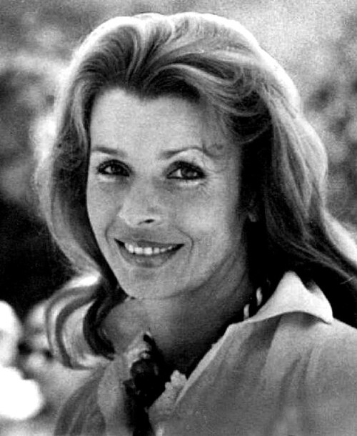

Bild: 1977; AP. Public domain laut Wikimedia Commons. [Bildquelle](https://commons.wikimedia.org/wiki/File:Senta_Berger_-_1977.jpg), [TMDB](https://www.themoviedb.org/person/12776).

### L1 · leicht

Mit welchem Beruf schlägt sich Senta Bergers Titelheldin in „Die schnelle Gerdi“ durch den Münchner Alltag?

- Als Reiseleiterin

- Als Busfahrerin

- **Richtig: Als Taxifahrerin**

- Als Paketbotin

Gerdi arbeitet als Taxifahrerin.

Die Serie stellt eine berufstätige Münchnerin und ihre alltäglichen Begegnungen ins Zentrum. Bergers Hauptfigur bewegt sich durch die Stadt und trifft Menschen aus unterschiedlichen Lebenswelten. Der Beruf schafft damit einen unmittelbaren Zugang zu den privaten und sozialen Geschichten der Reihe.

Merksatz: Gerdi erlebt München vom Steuer ihres Taxis aus.

Quellen: [1](https://www.filmportal.de/person/senta-berger_b5617b3c44b54c12b468cecb961520bd).

### L2 · leicht

Welche Fälle untersucht Senta Bergers Kriminalrätin Prohacek in „Unter Verdacht“ besonders?

- **Richtig: Korruption und Amtsmissbrauch in staatlichen Einrichtungen**

- Kunstfälschungen in privaten Galerien

- Entführungen deutscher Touristen im Ausland

- Versicherungsbetrug bei Verkehrsunfällen

Prohacek untersucht Korruption und Amtsmissbrauch.

Ihre Münchner Abteilung für Interne Angelegenheiten ermittelt auch gegen Angehörige der Polizei. Dadurch gerät das Team in Konflikt mit den eigenen Kollegen. Die Reihe macht Machtmissbrauch innerhalb staatlicher Strukturen zum Gegenstand und setzt Bergers Figur zwischen institutionellen Widerstand und die Pflicht zur Aufklärung.

Merksatz: Prohacek ermittelt dort, wo Amtsträger selbst unter Verdacht geraten.

Quellen: [1](https://www.zdf-studios.com/de/programmkatalog/international/drama/collections/crime-suspense/under-suspicion).

### M1 · mittel

Welche Entscheidung von Angelika (Senta Berger) setzt die Familienkomödie „Willkommen bei den Hartmanns“ in Gang?

- Sie will die Familie nach Italien umsiedeln

- Sie will das Familienhaus in eine Pension umwandeln

- Sie will ihren Mann aus der gemeinsamen Wohnung weisen

- **Richtig: Sie will einen Geflüchteten im Haus aufnehmen**

Angelika will den Geflüchteten Diallo aufnehmen.

Die pensionierte Lehrerin setzt ihren Wunsch gegen Vorbehalte innerhalb der Familie durch. Diallo (Eric Kabongo) zieht in das Haus und bringt die Familienmitglieder dazu, über ihre eigenen Vorstellungen und Konflikte zu streiten. Bergers Figur gibt mit ihrer Entscheidung den Anstoß zu diesem Zusammenleben.

Merksatz: Angelikas Einladung bringt Diallo zu den Hartmanns.

Quellen: [1](https://tv.apple.com/de/movie/willkommen-bei-den-hartmanns/umc.cmc.1u21p36x6gb8clgdi94qe7ug1).

### M2 · mittel

Welche Figur aus „Kir Royal“ verkörpert Senta Berger im Kinofilm „Zettl“ erneut?

- Gerdi Angerpointner

- **Richtig: Mona**

- Eva-Maria Prohacek

- Ruth Halbfaß

Berger kehrt als Society-Lady Mona zurück.

Helmut Dietls Berliner Mediensatire greift mit Mona eine Figur seiner früheren Münchner Fernsehserie auf. Berger spielt dadurch einen bekannten Gesellschaftstyp in einem veränderten Umfeld weiter. Die Verbindung liegt in der wiederkehrenden Figur, während „Zettl“ eine eigenständige Kinogeschichte erzählt.

Merksatz: Mona verbindet „Kir Royal“ mit „Zettl“.

Quellen: [1](https://www.filmportal.de/person/senta-berger_b5617b3c44b54c12b468cecb961520bd).

### S1 · schwer

Welche Produktionsfirma gründeten Senta Berger und Michael Verhoeven gemeinsam?

- Saxonia Media

- Bavaria Film

- **Richtig: Sentana Film**

- Regina Ziegler Filmproduktion

Sie gründeten Sentana Film.

Die gemeinsame Firma entstand 1965 und ermöglichte beiden, Filmprojekte auch als Produzenten zu tragen. Die Deutsche Filmakademie nennt darunter historische Dramen und spätere populäre Kinofilme. Bergers Arbeit umfasste damit nicht nur die Interpretation fertiger Rollen, sondern auch die Herstellung von Filmen.

Merksatz: Sentana verbindet Bergers Schauspielkarriere mit eigener Produktion.

Quellen: [1](https://www.deutsche-filmakademie.de/meldungen/senta-berger-erhaelt-den-ehrenpreis-fu%CC%88r-herausragende-verdienste-um-den-deutschen-film/).

### S2 · schwer

In welcher Funktion war Senta Berger an Michael Verhoevens „Die weiße Rose“ beteiligt?

- **Richtig: Als Produzentin**

- Als Kamerafrau

- Als Regisseurin

- Als Komponistin

Berger war an der Produktion beteiligt.

Das historische Drama erzählt vom Widerstand der Geschwister Scholl und ihrer Mitstreiter gegen den Nationalsozialismus. Berger erhielt 1983 für die Produktion den Bundesfilmpreis. Die Auszeichnung bezieht sich damit auf ihre Arbeit an der Herstellung des Films und nicht auf eine von ihr gespielte Hauptfigur.

Merksatz: Bei „Die weiße Rose“ lag Bergers Beitrag hinter der Kamera.

Quellen: [1](https://www.filmportal.de/person/senta-berger_b5617b3c44b54c12b468cecb961520bd), [2](https://www.deutsche-filmakademie.de/meldungen/senta-berger-erhaelt-den-ehrenpreis-fu%CC%88r-herausragende-verdienste-um-den-deutschen-film/).

### E1 · experte

Welche Figur spielte Senta Berger über mehrere Jahre im Salzburger „Jedermann“?

- Die Guten Werke

- Den Glauben

- Die Schuldknechtsfrau

- **Richtig: Die Buhlschaft**

Berger spielte die Buhlschaft.

Sie debütierte 1974 in der Rolle und kehrte mit einer einjährigen Unterbrechung bis 1982 zurück. Zu ihren Partnern als Jedermann gehörten Curd Jürgens und Maximilian Schell. Die Festspiele beschreiben außerdem, wie Berger die gewonnene Popularität für eigene Literatur- und Rezitationsabende nutzte.

Merksatz: Bergers Salzburger Bühnenrolle war die Buhlschaft.

Quellen: [1](https://www.salzburgerfestspiele.at/a/senta-berger).

### E2 · experte

Welche Institution leitete Senta Berger von 2003 bis 2010 gemeinsam mit Günter Rohrbach als erste Präsidentin?

- Die Berlinale

- **Richtig: Die Deutsche Filmakademie**

- Das Deutsche Filminstitut

- Die Bayerische Akademie der Schönen Künste

Sie war erste Präsidentin der Deutschen Filmakademie.

Berger gehörte 2003 zu den Gründungsmitgliedern der Akademie und übernahm anschließend mit Rohrbach ihre erste Präsidentschaft. Die Aufgabe führte ihre Erfahrung aus Schauspiel und Produktion in eine Institution der gesamten Filmbranche. 2021 ehrte dieselbe Akademie ihre Verdienste um den deutschen Film.

Merksatz: Berger half der Deutschen Filmakademie von ihrer Gründung an beim Aufbau.

Quellen: [1](https://www.deutsche-filmakademie.de/meldungen/senta-berger-erhaelt-den-ehrenpreis-fu%CC%88r-herausragende-verdienste-um-den-deutschen-film/).

## Orson Welles · Bekanntheitsgruppe 3

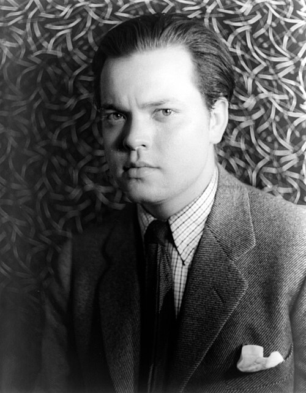

Bild: 1937; Carl Van Vechten. Public domain laut Wikimedia Commons. [Bildquelle](https://commons.wikimedia.org/wiki/File:Orson_Welles_1937.jpg), [TMDB](https://www.themoviedb.org/person/40).

### L1 · leicht

In welchem Geschäft baut Charles Foster Kane (Orson Welles) in „Citizen Kane“ seine öffentliche Macht auf?

- Im Eisenbahnbau

- **Richtig: Im Zeitungsgeschäft**

- Im Filmverleih

- Im internationalen Waffenhandel

Kane wird zum mächtigen Zeitungsverleger.

Kane besitzt zunächst ein großes Vermögen und wendet sich dann einer Zeitung zu. Der Anspruch, für die einfachen Leser einzutreten, verbindet sich zunehmend mit persönlichem Machtstreben. Welles spielt diese Figur über verschiedene Lebensalter und führte zugleich Regie. Der Film lässt andere Menschen rückblickend von Kane erzählen, sodass sein öffentlicher Erfolg neben den beschädigten privaten Beziehungen sichtbar wird.

Merksatz: Kanes Zeitungsmacht erklärt nicht sein privates Glück.

Antwortzusätze:

- Im Zeitungsgeschäft: Kane wird zum mächtigen Zeitungsverleger.

Gemeinsames Wissensziel: K-CLA-02-03 (CLA-M-003).

Quellen: [1](https://www.criterion.com/films/32250-citizen-kane).

### L2 · leicht

Womit verdient Harry Lime (Orson Welles) in „Der dritte Mann“ sein Geld auf dem Schwarzmarkt?

- **Richtig: Mit gestrecktem Penicillin**

- Mit gefälschten Pässen

- Mit gestohlenen Gemälden

- Mit geschmuggelten Diamanten

Lime handelt mit gestrecktem Penicillin.

Holly Martins (Joseph Cotten) kommt nach Wien und hält seinen alten Freund zunächst für ein Opfer. Die Nachforschungen legen jedoch ein Geschäft offen, dessen beschädigte Medikamente schwere Folgen für Kranke haben. Limes charmantes Auftreten steht damit gegen die Rücksichtslosigkeit seiner Taten. Für Holly wird die Freundschaft zu einer Entscheidung darüber, ob persönliche Loyalität die Opfer ausblenden darf.

Merksatz: Hinter Limes Charme steht ein tödliches Medikamentengeschäft.

Antwortzusätze:

- Mit gestrecktem Penicillin: Lime handelt mit gestrecktem Penicillin.

Gemeinsames Wissensziel: K-F240-20261006-205-M1 (F240-20261006-205-M1).

Quellen: [1](https://www.criterion.com/films/236-the-third-man), [2](https://en.wikipedia.org/wiki/The_Third_Man).

### M1 · mittel

Welche Methode macht Hank Quinlan (Orson Welles) in „Im Zeichen des Bösen“ zu einem korrupten Ermittler?

- Er tauscht Gefangene gegen Lösegeld aus.

- Er verkauft Tatortfotos an Zeitungen.

- **Richtig: Er fälscht Belastungsbeweise gegen Verdächtige.**

- Er gibt sich selbst als Zeuge fremder Taten aus.

Quinlan manipuliert Beweise, um seine Verdächtigen zu überführen.

Nach einer Bombenexplosion an der Grenze ermittelt Quinlan gemeinsam mit dem mexikanischen Beamten Vargas (Charlton Heston). Vargas entdeckt Unstimmigkeiten bei gefundenem Sprengstoff und beginnt, frühere Fälle zu prüfen. Quinlan hält seine Überzeugung von der Schuld eines Menschen für wichtiger als rechtsstaatliche Beweise. Welles verbindet in der Figur berufliche Erfahrung mit Machtmissbrauch und einer Verteidigung der eigenen Unfehlbarkeit.

Merksatz: Quinlan ersetzt Beweise durch seine Gewissheit.

Antwortzusätze:

- Er fälscht Belastungsbeweise gegen Verdächtige.: Quinlan manipuliert Beweise, um seine Verdächtigen zu überführen.

Gemeinsames Wissensziel: K-E20261007-F-244-L2 (E20261007-F-244-L2).

Quellen: [1](https://catalog.afi.com/Film/53683-TOUCH-OF-EVIL).

### M2 · mittel

Welchen Beruf hat Michael O’Hara (Orson Welles), bevor er in „Die Lady von Shanghai“ für die Bannisters arbeitet?

- Privatdetektiv

- Versicherungsvertreter

- Strafverteidiger

- **Richtig: Handelsmatrose**

Michael O’Hara ist ein Handelsmatrose.

Michael rettet Elsa Bannister (Rita Hayworth) in New York vor Angreifern. Ihr Mann Arthur (Everett Sloane) bietet ihm anschließend Arbeit auf seiner Yacht an. Während der Reise gerät Michael zwischen die Interessen des Ehepaars und von Arthurs Partner Grisby (Glenn Anders). Seine Hoffnung auf eine gemeinsame Zukunft mit Elsa macht ihn für einen Plan empfänglich, in dem eine bezahlte falsche Mordbeichte plötzlich gefährlich wird.

Merksatz: Eine Arbeit auf der Yacht zieht Michael in das Spiel der Bannisters.

Antwortzusätze:

- Handelsmatrose: Michael O’Hara ist ein Handelsmatrose.

Quellen: [1](https://catalog.afi.com/Film/25611-THE-LADY-FROM-SHANGHAI).

### S1 · schwer

Mit welchem Erzählmittel erzeugte Orson Welles’ Radiofassung von „Krieg der Welten“ den Eindruck eines aktuellen Geschehens?

- Mit ausschließlich vorgelesenen Tagebucheinträgen

- Mit einer durchgehend gesungenen Handlung

- **Richtig: Mit fingierten Nachrichtenmeldungen und Augenzeugenberichten**

- Mit einer Live-Debatte unter Astronomen

Das Hörspiel verwendete fingierte Nachrichten und Augenzeugenberichte.

Die Mercury-Theatre-Sendung von 1938 übertrug H. G. Wells’ Invasionsgeschichte in eine vertraute Radioform. Hinweise auf den fiktionalen Charakter waren vorhanden, trotzdem hielten manche Hörer die Meldungen für echt. Die Library of Congress unterscheidet diese Irrtümer von der später verbreiteten Vorstellung einer landesweiten Massenpanik. Die Inszenierung wirkte realistisch; das tatsächliche Ausmaß der Reaktion ist eine andere Frage.

Merksatz: Die erfundenen Meldungen klangen wie vertraute Radionachrichten.

Antwortzusätze:

- Mit fingierten Nachrichtenmeldungen und Augenzeugenberichten: Das Hörspiel verwendete fingierte Nachrichten und Augenzeugenberichte.

Quellen: [1](https://blogs.loc.gov/loc/2016/10/lcm-page-from-the-past-war-of-the-worlds/).

### S2 · schwer

Wie veränderte RKO Orson Welles’ „Der Glanz des Hauses Amberson“ vor dem Kinostart?

- **Richtig: Das Studio kürzte stark und ergänzte ein freundlicheres Ende.**

- Das Studio ließ alle Dialoge neu synchronisieren.

- Das Studio ersetzte sämtliche Hauptdarsteller.

- Das Studio machte aus dem Film eine Fernsehserie.

RKO entfernte viel Material und fügte ein optimistischeres Ende hinzu.

Welles erzählt den Niedergang einer reichen Familie, während technische und gesellschaftliche Veränderungen ihre frühere Stellung untergraben. RKO entfernte über vierzig Minuten und ersetzte den vorgesehenen Schluss. Das ausgeschiedene Material gilt als verloren. Die erhaltene Fassung zeigt deshalb zugleich Welles’ Gestaltung und einen einschneidenden Eingriff des Studios, der gerade die Schlusswirkung der Familiengeschichte verändert.

Merksatz: Die Amberson-Fassung trägt die Spuren eines starken Studioeingriffs.

Antwortzusätze:

- Das Studio kürzte stark und ergänzte ein freundlicheres Ende.: RKO entfernte viel Material und fügte ein optimistischeres Ende hinzu.

Quellen: [1](https://www.criterion.com/films/28711-the-magnificent-ambersons).

### E1 · experte

Wie begrenzt Orson Welles sein Wahrheitsversprechen zu Beginn von „F wie Fälschung“?

- Es gilt nur für Aussagen über Gemälde.

- Es gilt nur für seine eigenen Auftritte.

- Es gilt nur für Interviews ohne Zwischenschnitt.

- **Richtig: Es gilt nur für die erste Stunde.**

Welles verspricht Wahrheit ausdrücklich nur für die nächste Stunde.

Am Ende erzählt Welles eine Geschichte über Oja Kodar, Picasso und einen angeblichen Bildertausch. Erst danach legt er offen, dass diese Episode erfunden ist: Die versprochene Stunde war bereits abgelaufen. Die Täuschung beruht also auch darauf, dass das Publikum eine genau formulierte Zusicherung unbemerkt auf den ganzen Film ausdehnt. Seine Darbietung als vertrauenswürdiger Erzähler wird selbst zum Experiment.

Merksatz: Eine zeitliche Einschränkung macht den Erzählertrick möglich.

Antwortzusätze:

- Es gilt nur für die erste Stunde.: Welles verspricht Wahrheit ausdrücklich nur für die nächste Stunde.

Quellen: [1](https://en.wikipedia.org/wiki/F_for_Fake), [2](https://www.criterion.com/current/posts/364-f-for-fake-orson-welles-s-purloined-letter).

### E2 · experte

Wie gestaltet Orson Welles die Shakespeare-Vorlage für seinen Film „Falstaff“?

- Er verfilmt ausschließlich „Hamlet“.

- **Richtig: Er verbindet mehrere Stücke zu einer Geschichte um Falstaff.**

- Er ersetzt Shakespeare durch einen modernen Kriminalroman.

- Er übernimmt ein einzelnes Stück vollständig ohne Änderungen.

Welles verbindet Material aus mehreren Shakespeare-Stücken und rückt Falstaff ins Zentrum.

Falstaff ist in den Königsdramen meist eine Nebenfigur; Welles macht ihn zum tragikomischen Mittelpunkt. Material aus den beiden Heinrich-IV.-Stücken und weiteren Shakespeare-Werken wird dafür neu verbunden. Keith Baxter spielt den Prinzen Hal, dessen Weg zur Königswürde die Freundschaft verändert. Welles’ eigene Falstaff-Darstellung steht so im Zentrum einer Bearbeitung, die Textauswahl und Perspektive bewusst neu ordnet.

Merksatz: Aus mehreren Königsdramen entsteht Falstaffs eigene Tragikomödie.

Antwortzusätze:

- Er verbindet mehrere Stücke zu einer Geschichte um Falstaff.: Welles verbindet Material aus mehreren Shakespeare-Stücken und rückt Falstaff ins Zentrum.

Quellen: [1](https://www.criterion.com/films/28756-chimes-at-midnight).

## James Cagney · Bekanntheitsgruppe 3

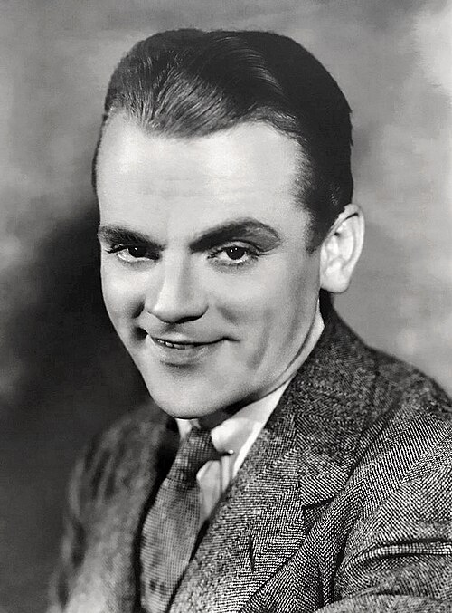

Bild: 1930er-Jahre; Elmer Fryer. Public domain laut Wikimedia Commons. [Bildquelle](https://commons.wikimedia.org/wiki/File:James_Cagney_by_Elmer_Fryer.jpg), [TMDB](https://www.themoviedb.org/person/5788).

### L1 · leicht

In welchem illegalen Geschäft steigt Tom Powers (James Cagney) in „Der öffentliche Feind“ während der Prohibition auf?

- Im Diamantenschmuggel

- Im Handel mit verbotenen Büchern

- **Richtig: Im Alkoholgeschäft**

- Im illegalen Kunstverleih

Tom steigt in das Geschäft mit illegalem Alkohol ein.

Tom und sein Freund Matt Doyle (Edward Woods) wachsen im armen Chicago auf. Während der Prohibition werden sie für eine Gang tätig, die Kneipen zur Abnahme ihres Biers zwingt. Der Aufstieg bringt Geld und Gewalt in ihr Leben, während Toms Bruder seinen Weg ablehnt. Cagneys Figur verbindet soziale Herkunft mit einem kriminellen Ehrgeiz, der schließlich auch die Familie erreicht.

Merksatz: Toms Aufstieg lebt vom verbotenen Alkoholhandel.

Antwortzusätze:

- Im Alkoholgeschäft: Tom steigt in das Geschäft mit illegalem Alkohol ein.

Quellen: [1](https://catalog.afi.com/Film/3860-THE-PUBLIC-ENEMY).

### L2 · leicht

Welchen amerikanischen Bühnenkünstler verkörpert James Cagney in „Yankee Doodle Dandy“?

- Irving Berlin

- Fred Astaire

- Al Jolson

- **Richtig: George M. Cohan**

Cagney spielt George M. Cohan.

Cohan schrieb Lieder und Theaterstücke und trat selbst auf. Der Film erzählt seinen Weg aus einer Vaudeville-Familie zum erfolgreichen Broadway-Künstler. Cagneys Gesang und Tanz stehen hier im Vordergrund einer patriotischen Biografie. Die Geschichte nimmt sich allerdings Freiheiten gegenüber Cohans wirklichem Leben; auch die dargestellte Liebesgeschichte ist stark bearbeitet. Die Rolle brachte Cagney seinen Schauspiel-Oscar.

Merksatz: Cagney zeigt als Cohan seine musikalische Seite.

Antwortzusätze:

- George M. Cohan: Cagney spielt George M. Cohan.

Quellen: [1](https://catalog.afi.com/Film/27569-YANKEE-DOODLE-DANDY), [2](https://www.afi.com/robert-detail/27569-YANKEEDOODLEDANDY/).

### M1 · mittel

Welche Nachricht löst Cody Jarretts (James Cagney) Zusammenbruch im Gefängnisspeisesaal von „Sprung in den Tod“ aus?

- **Richtig: Seine Mutter ist gestorben.**

- Seine Frau wurde freigesprochen.

- Seine Bande hat sich der Polizei gestellt.

- Sein Anwalt hat eine Begnadigung erreicht.

Cody erfährt vom Tod seiner Mutter.

Codys Mutter begleitet die Gang und stützt ihren Sohn auch bei seinen heftigen Kopfschmerzen. Ein eingeschleuster Ermittler versucht im Gefängnis, diese Vertrauensstellung teilweise zu übernehmen. Als Cody die Todesnachricht erhält, bricht seine Selbstkontrolle zusammen. Die enge Bindung ist deshalb keine beiläufige Familieninformation: Sie beeinflusst, wem er glaubt, und lenkt später auch seine Rache.

Merksatz: Mit dem Tod der Mutter verliert Cody seinen wichtigsten Halt.

Antwortzusätze:

- Seine Mutter ist gestorben.: Cody erfährt vom Tod seiner Mutter.

Quellen: [1](https://catalog.afi.com/Film/26173-WHITE-HEAT).

### M2 · mittel

Warum bittet Pater Jerry (Pat O’Brien) Rocky Sullivan (James Cagney) in „Chicago – Engel mit schmutzigen Gesichtern“, bei der Hinrichtung feige zu erscheinen?

- Damit die Presse die Hinrichtung nicht erwähnt

- **Richtig: Damit die Jungen ihn nicht weiter als Helden verehren**

- Damit sein Anwalt einen neuen Prozess verlangen kann

- Damit seine Gang ihn aus dem Gefängnis befreit

Die Jungen sollen ihr bewundertes Gangstervorbild verlieren.

Jerry und Rocky kennen sich seit ihrer Jugend, haben aber gegensätzliche Wege eingeschlagen. Als Priester versucht Jerry, gefährdete Jungen zu schützen, die Rockys Auftreten bewundern. Vor dessen Hinrichtung bittet er den Freund deshalb um ein letztes Opfer seines Rufs. Der Film zeigt Rockys Todesangst, lässt aber offen, wie weit sie gespielt ist. Entscheidend für Jerrys Bitte ist die Wirkung auf die Jungen.

Merksatz: Jerry will den Gangster als Vorbild entzaubern.

Antwortzusätze:

- Damit die Jungen ihn nicht weiter als Helden verehren: Die Jungen sollen ihr bewundertes Gangstervorbild verlieren.

Quellen: [1](https://catalog.afi.com/Film/4049-ANGELS-WITH-DIRTY-FACES).

### S1 · schwer

Wie prägt Martin Snyder (James Cagney) die Laufbahn von Ruth Etting (Doris Day) in „Nachtclub-Affären“?

- Er ist ihr zurückgezogener Gesangslehrer.

- Er veröffentlicht als Kritiker ihre ersten Rezensionen.

- **Richtig: Er fördert ihre Karriere und verlangt zugleich Kontrolle über ihr Leben.**

- Er leitet als Richter ihren ersten Vertragsprozess.

Snyder fördert Ruths Aufstieg, verbindet seine Hilfe aber mit Besitzansprüchen.

Snyder setzt seine Beziehungen ein, um Ruth Auftritte und später große Engagements zu verschaffen. Seine Unterstützung wird zunehmend zu einer Abhängigkeit, aus der sie sich lösen will. Ihre Nähe zum Pianisten Johnny Alderman (Cameron Mitchell) verschärft seine Eifersucht. Cagney spielt einen Förderer, dessen Geschäftssinn und persönliche Kränkung ineinandergreifen, sodass der berufliche Aufstieg der Sängerin zugleich einen Kampf um Selbstbestimmung auslöst.

Merksatz: Snyders Förderung wird zum Anspruch auf Ruths Leben.

Antwortzusätze:

- Er fördert ihre Karriere und verlangt zugleich Kontrolle über ihr Leben.: Snyder fördert Ruths Aufstieg, verbindet seine Hilfe aber mit Besitzansprüchen.

Quellen: [1](https://catalog.afi.com/Film/51571-LOVE-ME-OR-LEAVE-ME).

### S2 · schwer

Für welches Unternehmen versucht C. R. MacNamara (James Cagney) in „Eins, zwei, drei“ das Geschäft nach Osteuropa auszuweiten?

- Ford

- IBM

- Kodak

- **Richtig: Coca-Cola**

MacNamara arbeitet für Coca-Cola.

Der Manager in West-Berlin hofft auf eine Beförderung. Statt des großen Ostgeschäfts erhält er die Aufgabe, die Tochter seines Chefs zu betreuen. Ihre heimliche Ehe mit dem Kommunisten Otto Piffl (Horst Buchholz) bedroht seine Pläne. MacNamara versucht daraufhin, Otto in einen vorzeigbaren kapitalistischen Schwiegersohn umzubauen. Cagneys atemloses Spiel trägt eine Komödie, in der politische Überzeugungen zum Material geschäftlicher Improvisation werden.

Merksatz: MacNamaras Firmenkarriere gerät durch eine private Ost-West-Verbindung in Gefahr.

Antwortzusätze:

- Coca-Cola: MacNamara arbeitet für Coca-Cola.

Quellen: [1](https://catalog.afi.com/Catalog/moviedetails/22928).

### E1 · experte

Wie reagiert Chester Kent (James Cagney) in „Parade im Rampenlicht“ auf die Konkurrenz des Tonfilms zu seinen Bühnenshows?

- **Richtig: Er produziert kurze Live-Shows für das Kinovorprogramm.**

- Er verkauft ausschließlich stumme Filmkopien.

- Er gründet ein Studio für Hörspielaufnahmen.

- Er verlegt sein Geschäft vollständig auf Operntourneen.

Kent produziert Bühnen-Prologe, die vor Kinofilmen aufgeführt werden.

Die neue Technik zerstört Kents bisheriges Geschäft nicht einfach, sondern zwingt ihn zu einer anderen Organisation seiner Theaterarbeit. Er entwickelt kurze Programme für Kinos und muss dabei ständig neue Einfälle liefern. Der entscheidende Auftrag verlangt mehrere Shows in kürzester Zeit. Als ein Darsteller ausfällt, tritt Kent selbst auf; Cagneys Tanzleistung verbindet dadurch die Produzentenfigur mit dem sichtbaren Können des Stars.

Merksatz: Kent macht aus der Konkurrenz des Kinos ein neues Bühnengeschäft.

Antwortzusätze:

- Er produziert kurze Live-Shows für das Kinovorprogramm.: Kent produziert Bühnen-Prologe, die vor Kinofilmen aufgeführt werden.

Gemeinsames Wissensziel: K-G100-20261008-MUSIK-007-L1 (G100-20261008-MUSIK-007-L1).

Quellen: [1](https://catalog.afi.com/Film/3881-FOOTLIGHT-PARADE).

### E2 · experte

Welche Bühnenerfahrung brachte James Cagney bereits vor seinen bekannten Gangsterfilmen mit?

- Eine Laufbahn als Operntenor

- **Richtig: Arbeit als Tänzer und Komiker im Vaudeville**

- Jahrelange Auftritte als klassischer Ballettsolist

- Eine Karriere als Konzertpianist

Cagney hatte als Tänzer und Komiker im Vaudeville und am Broadway gearbeitet.

Cagney tourte lange auf Bühnen, bevor Hollywood ihn zum Gangsterstar machte. Gemeinsam mit seiner Frau Frances Vernon trat er auch mit komischen und musikalischen Nummern auf. Seine späteren Musicalrollen waren daher kein voraussetzungsloser Ausflug aus dem Kriminalfilm. Sie griffen auf eine berufliche Ausbildung durch Auftritte zurück, in der Rhythmus, Bewegung und das unmittelbare Timing vor Publikum wichtig waren.

Merksatz: Vor dem Leinwandgangster stand der Bühnentänzer Cagney.

Antwortzusätze:

- Arbeit als Tänzer und Komiker im Vaudeville: Cagney hatte als Tänzer und Komiker im Vaudeville und am Broadway gearbeitet.

Quellen: [1](https://en.wikipedia.org/wiki/James_Cagney).

## Edward G. Robinson · Bekanntheitsgruppe 3

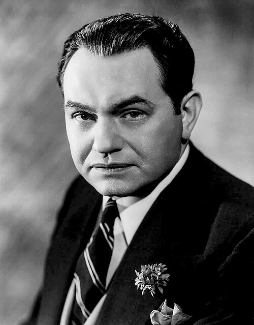

Bild: 1930er-Jahre; Elmer Fryer. Public domain laut Wikimedia Commons. [Bildquelle](https://commons.wikimedia.org/wiki/File:Edward_G._Robinson_by_Elmer_Fryer.jpg), [TMDB](https://www.themoviedb.org/person/13566).

### L1 · leicht

Welchen Figurentyp verkörpert Edward G. Robinson als Rico in „Der kleine Cäsar“?

- **Richtig: Einen Gangster mit Aufstiegsambitionen**

- Einen idealistischen Staatsanwalt

- Einen erfolglosen Opernsänger

- Einen pensionierten Polizeichef

Rico ist ein ehrgeiziger Gangster.

Rico will sich in der Unterwelt einen Namen machen und drängt auf eine führende Stellung. Sein Freund Joe Massara (Douglas Fairbanks Jr.) möchte dagegen Tänzer werden und das kriminelle Milieu verlassen. Die unterschiedlichen Ziele belasten die Freundschaft. Robinsons energischer Auftritt als Rico prägte einen Typ des frühen Tonfilmgangsters, dessen Machtstreben jede sichere Bindung gefährdet.

Merksatz: Rico will Macht; Joe möchte der Gang entkommen.

Antwortzusätze:

- Einen Gangster mit Aufstiegsambitionen: Rico ist ein ehrgeiziger Gangster.

Quellen: [1](https://catalog.afi.com/Film/1125-LITTLE-CAESAR).

### L2 · leicht

Welche Arbeit übernimmt Barton Keyes (Edward G. Robinson) in „Frau ohne Gewissen“?

- Er verkauft Gebrauchtwagen.

- **Richtig: Er untersucht Versicherungsansprüche.**

- Er betreibt eine Privatbank.

- Er verteidigt Angeklagte vor Gericht.

Keyes prüft Versicherungsansprüche und spürt Betrugsfälle auf.

Walter Neff (Fred MacMurray) verkauft Versicherungen, während Keyes verdächtige Schadensfälle untersucht. Neff glaubt, die Arbeitsweise seines Freundes und Vorgesetzten für einen perfekten Mordplan nutzen zu können. Gerade die Nähe zu Keyes macht die Täuschung aber persönlich belastet. Robinson spielt hier den scharfsinnigen Gegenpol zum Täter, dessen berufliches Können den Plan zunehmend bedroht.

Merksatz: Keyes erkennt Unstimmigkeiten hinter scheinbar plausiblen Schadensfällen.

Antwortzusätze:

- Er untersucht Versicherungsansprüche.: Keyes prüft Versicherungsansprüche und spürt Betrugsfälle auf.

Quellen: [1](https://catalog.afi.com/Film/2201-DOUBLE-INDEMNITY).

### M1 · mittel

Welche Enthüllung verändert am Ende von „Gefährliche Begegnung“ den Blick auf Richard Wanleys (Edward G. Robinson) Mordgeschichte?

- Er ist ein verdeckter Ermittler.

- Sein Freund hat alle Taten begangen.

- **Richtig: Die Ereignisse waren ein Traum.**

- Seine Frau hat ihn erpresst.

Die Mordgeschichte erweist sich als Traum des Professors.

Wanley bewundert das Porträt einer Frau und scheint anschließend das Modell Alice Reed (Joan Bennett) zu treffen. Aus der Begegnung entwickelt sich eine Geschichte von Tötung, Vertuschung und Erpressung. Erst das Erwachen im Club ordnet diese Ereignisse neu ein. Vertraute Gesichter tauchen in der Wirklichkeit wieder auf; der sonst ordentliche Professor hat seine Wunschvorstellung als bedrohliches Abenteuer durchlebt.

Merksatz: Wanleys Abenteuer kippt am Schluss in eine Traumdeutung.

Antwortzusätze:

- Die Ereignisse waren ein Traum.: Die Mordgeschichte erweist sich als Traum des Professors.

Quellen: [1](https://catalog.afi.com/Film/24256-THE-WOMAN-IN-THE-WINDOW).

### M2 · mittel

Was hält Johnny Rocco (Edward G. Robinson) und seine Gefangenen in „Gangster in Key Largo“ vorübergehend im Hotel fest?

- Eine zerstörte Eisenbahnbrücke

- Eine Quarantäne wegen einer Seuche

- Eine militärische Ausgangssperre

- **Richtig: Ein Hurrikan**

Ein Hurrikan schneidet das Hotel von der Außenwelt ab.

Rocco und seine Männer beherrschen das Hotel, in dem Kriegsveteran Frank McCloud (Humphrey Bogart) die Familie eines gefallenen Kameraden besucht. Der Sturm verdichtet die Bedrohung auf einen abgeschlossenen Raum. Rocco demonstriert Macht über Menschen, fürchtet aber selbst die Naturgewalt. Nach dem Unwetter ist sein Fluchtboot verschwunden, und er zwingt Frank zu einem neuen Transportplan.

Merksatz: Der Sturm schließt Täter und Gefangene gemeinsam ein.

Antwortzusätze:

- Ein Hurrikan: Ein Hurrikan schneidet das Hotel von der Außenwelt ab.

Quellen: [1](https://catalog.afi.com/Film/25605-KEY-LARGO).

### S1 · schwer

Welche Stellung nimmt Dathan (Edward G. Robinson) in „Die zehn Gebote“ gegenüber den versklavten Hebräern ein?

- **Richtig: Er arbeitet als hebräischer Aufseher für die Unterdrücker.**

- Er ist ein ägyptischer Prinz ohne Kontakt zu ihnen.

- Er ist Moses’ uneingeschränkt loyaler Heerführer.

- Er lebt als Einsiedler außerhalb Ägyptens.

Dathan ist ein Hebräer, der als Aufseher auf Seiten der Unterdrücker arbeitet.

Dathan hilft dabei, die versklavten Arbeiter zu kontrollieren, und verfolgt eigene Vorteile. Auch nach dem Auszug widersetzt er sich Moses (Charlton Heston). Als dessen Rückkehr vom Berg ausbleibt, drängt Dathan die Menschen zur Rückkehr nach Ägypten und zum Götzenkult. Robinson spielt so einen Gegner innerhalb der Gemeinschaft, der Unsicherheit ausnutzt und Freiheit gegen vermeintliche Versorgungssicherheit ausspielt.

Merksatz: Dathan bekämpft Moses aus den Reihen der Hebräer.

Antwortzusätze:

- Er arbeitet als hebräischer Aufseher für die Unterdrücker.: Dathan ist ein Hebräer, der als Aufseher auf Seiten der Unterdrücker arbeitet.

Quellen: [1](https://catalog.afi.com/Catalog/moviedetails/52028).

### S2 · schwer

Unter wessen Namen werden die Bilder von Christopher Cross (Edward G. Robinson) in „Straße der Versuchung“ erfolgreich verkauft?

- Unter dem Namen seiner Frau Adele

- **Richtig: Unter dem Namen Kitty March**

- Unter dem Namen Johnny Prince

- Unter seinem eigenen Namen

Kitty March wird als Schöpferin von Chris’ Bildern ausgegeben.

Chris arbeitet als Kassierer und malt in seiner Freizeit. Kitty (Joan Bennett) und ihr Freund Johnny (Dan Duryea) nutzen sein Vertrauen aus und bringen die Bilder auf den Markt. Der Erfolg entsteht unter Kittys Namen, während Chris weiterhin für einen unbeachteten Amateur gehalten wird. Die Täuschung betrifft deshalb nicht nur Geld und Liebe, sondern auch die Anerkennung seiner tatsächlichen schöpferischen Arbeit.

Merksatz: Chris malt, Kitty erhält den Künstlernamen auf den Bildern.

Antwortzusätze:

- Unter dem Namen Kitty March: Kitty March wird als Schöpferin von Chris’ Bildern ausgegeben.

Quellen: [1](https://catalog.afi.com/Film/24568-SCARLET-STREET).

### E1 · experte

Welche besondere Funktion erfüllt Sol Roth (Edward G. Robinson) für den Ermittler Thorn in „Soylent Green“?

- Er bewacht als Soldat die Lebensmittelverteilung.

- Er stellt als Chemiker neue Rationen her.

- **Richtig: Er recherchiert als sogenannter Book in schriftlichen Quellen.**

- Er leitet als Richter die Mordprozesse.

Sol ist ein Book, ein erfahrener Rechercheur für die Polizei.

Thorn (Charlton Heston) teilt seine Wohnung mit dem älteren Sol, dessen Wissen an eine frühere Welt anschließt. Bei der Mordermittlung arbeitet Sol mit anderen Rechercheuren und entdeckt eine erschütternde Wahrheit über die Nahrungsmittelproduktion. Seine Kenntnisse stehen gegen die verarmte Gegenwart der Stadt. Die Figur macht Erinnerung und sorgfältige Nachforschung zu einem Gegenpol der industriell verwalteten Versorgung.

Merksatz: Sol bewahrt Wissen, das die Gegenwart verheimlichen möchte.

Antwortzusätze:

- Er recherchiert als sogenannter Book in schriftlichen Quellen.: Sol ist ein Book, ein erfahrener Rechercheur für die Polizei.

Quellen: [1](https://en.wikipedia.org/wiki/Soylent_Green).

### E2 · experte

Welche Sammlung von Edward G. Robinson wurde 1953 mit einer Auswahl im Museum of Modern Art gezeigt?

- Seine historischen Rennwagen

- Seine Filmwaffen und Kostüme

- Seine seltenen Musikinstrumente

- **Richtig: Seine Gemäldesammlung**

Das MoMA zeigte Gemälde aus Robinsons privater Kunstsammlung.

Ein zeitgenössischer Museumsplan kündigt vierzig ausgewählte Werke aus Robinsons Sammlung an. Begleitende Galeriegespräche behandelten unter anderem französische Kunst des 19. Jahrhunderts. Der Schauspieler war damit auch als ernsthafter Sammler sichtbar. Diese Tätigkeit erweitert den Blick auf eine Person, die im Kino häufig auf die energischen Gangsterrollen reduziert wird, außerhalb der Leinwand aber intensiv mit bildender Kunst verbunden war.

Merksatz: Robinsons Kunstsammlung fand Eingang ins MoMA-Ausstellungsprogramm.

Antwortzusätze:

- Seine Gemäldesammlung: Das MoMA zeigte Gemälde aus Robinsons privater Kunstsammlung.

Quellen: [1](https://www.moma.org/docs/press_archives/1700/releases/MOMA_1953_0030_29.pdf), [2](https://en.wikipedia.org/wiki/Edward_G._Robinson).

## Spencer Tracy · Bekanntheitsgruppe 3

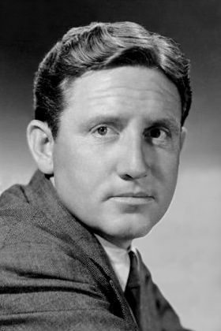

Bild: um 1935; Unknown author MGM studio publicity photographer. Public domain laut Wikimedia Commons. [Bildquelle](https://commons.wikimedia.org/wiki/File:Spencer_Tracy_(cropped_bw).jpg), [TMDB](https://www.themoviedb.org/person/12147).

### L1 · leicht

Welche Aufgabe verfolgt Pater Flanagan (Spencer Tracy) in „Teufelskerle“?

- Er bildet professionelle Boxer aus.

- Er führt eine Detektei für Vermisstenfälle.

- **Richtig: Er schafft ein Zuhause für gefährdete Jungen.**

- Er organisiert eine Weltreise für Schüler.

Flanagan baut ein Zuhause für verlassene und gefährdete Jungen auf.

Flanagan glaubt, dass die Jungen nicht auf ihre bisherigen Verfehlungen festgelegt werden dürfen. Für sein Heim muss er Geld und Vertrauen gewinnen. Whitey Marsh (Mickey Rooney) stellt die Gemeinschaft mit seinem rebellischen Verhalten auf die Probe. Tracy spielt den realen Gründer von Boys Town; der Film verbindet seine Überzeugung mit der konkreten Arbeit, einem jungen Menschen weitere Chancen zu eröffnen.

Merksatz: Flanagan will Chancen schaffen, statt Jungen aufzugeben.

Antwortzusätze:

- Er schafft ein Zuhause für gefährdete Jungen.: Flanagan baut ein Zuhause für verlassene und gefährdete Jungen auf.

Quellen: [1](https://catalog.afi.com/Film/3559-BOYS-TOWN).

### L2 · leicht

Was stellt Matt Draytons (Spencer Tracy) liberales Selbstbild in „Rat mal, wer zum Essen kommt“ auf die Probe?

- Seine Tochter will eine Schauspielschule besuchen.

- Seine Tochter lehnt ein Familienunternehmen ab.

- Seine Tochter möchte ins Ausland auswandern.

- **Richtig: Seine weiße Tochter will einen schwarzen Arzt heiraten.**

Die geplante Ehe seiner Tochter mit John Prentice fordert Matt Draytons Selbstbild heraus.

Joanna (Katharine Houghton) bringt den Arzt John Prentice (Sidney Poitier) aus dem Urlaub mit. Ihre Eltern vertreten Gleichberechtigung, reagieren aber auf die konkrete Verbindung zunächst anders, als ihre Grundsätze erwarten ließen. Tracy und Katharine Hepburn spielen das Elternpaar. Der Konflikt entwickelt sich aus der Frage, wie Überzeugungen standhalten, sobald die eigene Familie und befürchtete gesellschaftliche Widerstände betroffen sind.

Merksatz: Matts Grundsätze müssen sich in der eigenen Familie bewähren.

Antwortzusätze:

- Seine weiße Tochter will einen schwarzen Arzt heiraten.: Die geplante Ehe seiner Tochter mit John Prentice fordert Matt Draytons Selbstbild heraus.

Quellen: [1](https://en.wikipedia.org/wiki/Guess_Who%27s_Coming_to_Dinner), [2](https://www.afi.com/news/afi-movie-club-guess-whos-coming-to-dinner/).

### M1 · mittel

Welchen Grundsatz verteidigt Ankläger Adam Bonner (Spencer Tracy) im Gerichtsstreit von „Ehekrieg“ gegen Amandas Argumentation?

- **Richtig: Eifersucht rechtfertigt keinen versuchten Mord.**

- Ein Geständnis ersetzt grundsätzlich alle Zeugen.

- Eine verheiratete Frau darf keine Anwältin wählen.

- Ein Ehebruch muss vor einem Bundesgericht verhandelt werden.

Adam besteht darauf, dass Eifersucht einen versuchten Mord nicht entschuldigt.

Doris Attinger (Judy Holliday) hat auf ihren untreuen Mann geschossen. Amanda Bonner (Katharine Hepburn) kritisiert, dass Männer und Frauen bei Untreue und Eifersucht unterschiedlich beurteilt werden. Adam bestreitet dagegen, dass diese Ungleichheit die konkrete Gewalttat rechtfertigt. Weil die beiden Juristen verheiratet sind, gelangt der Konflikt zwischen Gleichberechtigung und strafrechtlicher Verantwortung auch in ihren privaten Alltag.

Merksatz: Adam trennt berechtigte Gleichheitsforderungen von der Rechtfertigung einer Gewalttat.

Antwortzusätze:

- Eifersucht rechtfertigt keinen versuchten Mord.: Adam besteht darauf, dass Eifersucht einen versuchten Mord nicht entschuldigt.

Quellen: [1](https://www.criterion.com/current/posts/786-adam-s-rib), [2](https://en.wikipedia.org/wiki/Adam%27s_Rib).

### M2 · mittel

Warum sucht John Macreedy (Spencer Tracy) in „Stadt in Angst“ den japanischstämmigen Farmer Komoko auf?

- Er soll dessen Land für eine Bahngesellschaft kaufen.

- **Richtig: Er will die Auszeichnung von Komokos gefallenen Sohn überbringen.**

- Er soll Komoko für einen Raubüberfall festnehmen.

- Er will mit ihm eine neue Farm gründen.

Macreedy möchte die Auszeichnung des Sohnes überbringen, der ihm im Krieg das Leben gerettet hat.

Macreedys Ankunft löst in Black Rock ungewöhnliche Feindseligkeit aus. Die Bewohner verbergen, dass Komoko Opfer rassistischer Gewalt wurde. Der Besucher sucht den Vater eines Kameraden, der in Italien bei seiner Rettung starb. Der Dank an den Sohn führt ihn dadurch zur verdrängten Schuld der Stadt. Tracys ruhiger Auftritt steht gegen eine Gemeinschaft, deren Zusammenhalt auf Einschüchterung und Schweigen beruht.

Merksatz: Macreedys Dank legt die verschwiegene Schuld der Stadt frei.

Antwortzusätze:

- Er will die Auszeichnung von Komokos gefallenen Sohn überbringen.: Macreedy möchte die Auszeichnung des Sohnes überbringen, der ihm im Krieg das Leben gerettet hat.

Quellen: [1](https://catalog.afi.com/Film/53482-BAD-DAYATBLACKROCK).

### S1 · schwer

Was verteidigt Henry Drummond (Spencer Tracy) in „Wer den Wind sät“ im Prozess gegen einen Lehrer?

- Das Recht auf privaten Waffenbesitz

- Die Abschaffung aller Schulprüfungen

- **Richtig: Die Freiheit, die Evolutionstheorie zu unterrichten**

- Das Verbot naturwissenschaftlicher Lehrbücher

Drummond verteidigt den Lehrer und die Freiheit, Evolution zu lehren.

Bert Cates (Dick York) steht vor Gericht, weil sein Unterricht einem religiös begründeten Gesetz widerspricht. Drummond trifft auf den populären Ankläger Brady (Fredric March). Die Auseinandersetzung behandelt nicht allein eine einzelne Schulstunde, sondern das Recht, Überlieferungen zu prüfen und selbst zu denken. Der Film ist eine dramatische Bearbeitung des Scopes-Prozesses; Namen und verschiedene Vorgänge wurden für das Stück und den Film verändert.

Merksatz: Drummond verteidigt Denken gegen ein gesetzlich verordnetes Lehrverbot.

Antwortzusätze:

- Die Freiheit, die Evolutionstheorie zu unterrichten: Drummond verteidigt den Lehrer und die Freiheit, Evolution zu lehren.

Quellen: [1](https://catalog.afi.com/Film/53192-INHERIT-THE-WIND).

### S2 · schwer

Welche Funktion übernimmt Dan Haywood (Spencer Tracy) in „Das Urteil von Nürnberg“?

- Er verteidigt einen der Angeklagten.

- Er sagt als ehemaliger Lagerhäftling aus.

- Er führt als Offizier die Anklage.

- **Richtig: Er leitet als Richter den Prozess.**

Haywood ist der vorsitzende Richter.

Verhandelt wird die Verantwortung deutscher Richter, die nationalsozialistisches Unrecht ermöglicht haben. Haywood muss juristische Schuld bewerten, während zugleich politische Interessen des beginnenden Kalten Krieges auf ein milderes Vorgehen drängen. Ernst Janning (Burt Lancaster) gesteht schließlich seine Mitverantwortung. Tracy gestaltet den Vorsitzenden als einen Mann, dessen ruhige Prüfung den moralischen Ernst des Verfahrens trägt.

Merksatz: Haywood urteilt über die Verantwortung von Richtern im Unrechtsstaat.

Antwortzusätze:

- Er leitet als Richter den Prozess.: Haywood ist der vorsitzende Richter.

Gemeinsames Wissensziel: K-E20261007-F-258-L2 (E20261007-F-258-L2).

Quellen: [1](https://catalog.afi.com/Film/23848-JUDGMENT-AT-NUREMBERG).

### E1 · experte

Für welche beiden Filme gewann Spencer Tracy bei zwei aufeinanderfolgenden Oscarverleihungen den Hauptdarstellerpreis?

- **Richtig: „Manuel“ und „Teufelskerle“**

- „Ehekrieg“ und „Stadt in Angst“

- „Wer den Wind sät“ und „Das Urteil von Nürnberg“

- „Der alte Mann und das Meer“ und „Rat mal, wer zum Essen kommt“

Tracy gewann für „Manuel“ und „Teufelskerle“, bei den Verleihungen 1938 und 1939.

In „Manuel“ spielt Tracy einen Fischer, der einen verwöhnten Jungen auf See betreut; in „Teufelskerle“ den Priester Flanagan, der gefährdeten Jungen ein Zuhause schafft. Die Oscars ehren zwei verschiedene Figuren, deren Autorität sich im Umgang mit jungen Menschen zeigt. Die Filmjahre 1937 und 1938 sind von den jeweils folgenden Verleihungsjahren zu unterscheiden.

Merksatz: Zwei aufeinanderfolgende Oscars: Fischer Manuel und Pater Flanagan.

Antwortzusätze:

- „Manuel“ und „Teufelskerle“: Tracy gewann für „Manuel“ und „Teufelskerle“, bei den Verleihungen 1938 und 1939.

Quellen: [1](https://www.oscars.org/oscars/ceremonies/1938), [2](https://www.oscars.org/oscars/ceremonies/1939), [3](https://en.wikipedia.org/wiki/Captains_Courageous_(1937_film)).

### E2 · experte

Wie ermöglichten Katharine Hepburn und Stanley Kramer Spencer Tracys Mitwirkung in „Rat mal, wer zum Essen kommt“, obwohl er nicht versichert werden konnte?

- Sie drehten seine Rolle ausschließlich mit Archivaufnahmen.

- **Richtig: Sie hinterlegten ihre eigenen Gagen als finanzielle Absicherung.**

- Sie verlegten die gesamte Produktion in eine Klinik.

- Sie ersetzten seine Dialoge durch einen Erzähler.

Hepburn und Kramer stellten ihre Gagen als Absicherung zur Verfügung.

Tracys schwere gesundheitliche Probleme gefährdeten die Produktion, weil eine Versicherung seinen möglichen Ausfall nicht übernehmen wollte. Hepburn und Kramer trugen deshalb selbst einen Teil des finanziellen Risikos. Tracy vollendete die Arbeit kurz vor seinem Tod; der Film wurde seine letzte und die neunte gemeinsame Leinwandarbeit mit Hepburn. Hinter der sichtbaren Familiengeschichte stand damit eine ungewöhnliche persönliche Produktionsentscheidung.

Merksatz: Eigene Gagen sicherten Tracys letzte Filmrolle ab.

Antwortzusätze:

- Sie hinterlegten ihre eigenen Gagen als finanzielle Absicherung.: Hepburn und Kramer stellten ihre Gagen als Absicherung zur Verfügung.

Quellen: [1](https://en.wikipedia.org/wiki/Guess_Who%27s_Coming_to_Dinner).

## Henry Fonda · Bekanntheitsgruppe 3

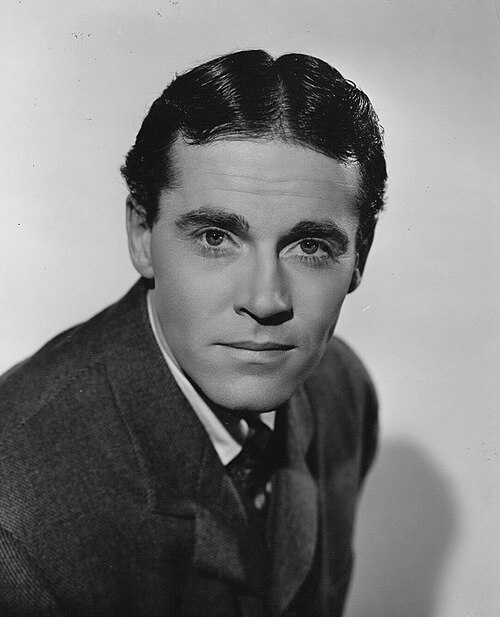

Bild: 1940; Unknown author. Public domain laut Wikimedia Commons. [Bildquelle](https://commons.wikimedia.org/wiki/File:Henry_Fonda,_1940.jpg), [TMDB](https://www.themoviedb.org/person/4958).

### L1 · leicht

Was verlangt der von Henry Fonda gespielte Geschworene zu Beginn der Beratung in „Die zwölf Geschworenen“?

- Er verlangt eine neue Vernehmung im Gerichtssaal.

- **Richtig: Er möchte vor einer Entscheidung über den Fall sprechen.**

- Er beantragt einen Austausch der Geschworenen.

- Er will zunächst die Urteilsberatung vertagen.

Er will die Beweise besprechen, bevor ein Schuldspruch gefällt wird.

Die anderen Geschworenen halten den Mordfall zunächst weitgehend für entschieden. Fonda spielt den Mann, der sich einer schnellen Verurteilung widersetzt, ohne schon die Unschuld des Angeklagten beweisen zu können. Im gemeinsamen Raum werden Aussagen und vermeintlich sichere Schlüsse geprüft. Die Diskussion legt dabei auch Vorurteile und persönliche Konflikte frei, die mit dem eigentlichen Fall nichts zu tun haben.

Merksatz: Fondas Geschworener verlangt Prüfung statt vorschneller Gewissheit.

Antwortzusätze:

- Er möchte vor einer Entscheidung über den Fall sprechen.: Er will die Beweise besprechen, bevor ein Schuldspruch gefällt wird.

Quellen: [1](https://www.criterion.com/films/27871-12-angry-men), [2](https://en.wikipedia.org/wiki/12_Angry_Men_(1957_film)).

### L2 · leicht

Welche Figur verkörpert Henry Fonda in „Spiel mir das Lied vom Tod“?

- **Richtig: Den skrupellosen Killer Frank**

- Den Banditen Cheyenne

- Den Eisenbahnunternehmer Morton

- Den wortkargen Mundharmonika-Spieler

Fonda spielt den Killer Frank.

Frank arbeitet für den Eisenbahnunternehmer Morton (Gabriele Ferzetti) und beseitigt Menschen, die dessen Plänen im Weg stehen. Sergio Leone besetzte die Rolle mit einem Darsteller, den das Publikum häufig als aufrechten Mann kannte. Der frühe Auftritt Franks macht diese Erwartung besonders wirksam. Fondas ruhige Präsenz erhält hier eine bedrohliche Bedeutung, statt wie in vielen früheren Rollen Vertrauen zu erzeugen.

Merksatz: Fondas vertraute Ruhe wird bei Frank zur Drohung.

Antwortzusätze:

- Den skrupellosen Killer Frank: Fonda spielt den Killer Frank.

Gemeinsames Wissensziel: K-WES-04-01 (WES-L-007).

Quellen: [1](https://en.wikipedia.org/wiki/Once_Upon_a_Time_in_the_West).

### M1 · mittel

Wohin zieht Tom Joads (Henry Fonda) Familie in „Früchte des Zorns“, nachdem sie ihre Farm verliert?

- Nach Florida

- Nach Alaska

- **Richtig: Nach Kalifornien**

- Nach New York

Die Joads suchen Arbeit in Kalifornien.

Tom kehrt nach einer Haftstrafe nach Hause zurück und findet die bisherige Existenz der Familie zerstört. Gemeinsam machen sich die Joads auf den Weg nach Westen. Die Aussicht auf Arbeit führt sie jedoch in eine Welt niedriger Löhne, unsicherer Lager und gegenseitiger Konkurrenz unter den Arbeitssuchenden. Tom muss erleben, dass die Not seiner Familie Teil eines größeren sozialen Konflikts ist.

Merksatz: Der Weg nach Kalifornien führt die Joads in neue Abhängigkeiten.

Antwortzusätze:

- Nach Kalifornien: Die Joads suchen Arbeit in Kalifornien.

Gemeinsames Wissensziel: K-DRA-202610-P01-L-018 (DRA-202610-P01-L-018).

Quellen: [1](https://en.wikipedia.org/wiki/The_Grapes_of_Wrath_(film)).

### M2 · mittel

Womit verdient Manny Balestrero (Henry Fonda) in Hitchcocks „Der falsche Mann“ seinen Lebensunterhalt?

- Als Versicherungsvertreter

- Als Taxifahrer

- Als Polizeifotograf

- **Richtig: Als Musiker im Nachtclub**

Manny arbeitet als Musiker im Stork Club.

Manny sucht wegen der Behandlungskosten seiner Frau ein Versicherungsbüro auf. Mitarbeiterinnen halten ihn für einen Mann, der das Büro überfallen hat. Aus der Verwechslung folgen Festnahme und ein Verfahren, das die Familie schwer belastet. Hitchcock orientiert sich an einem wirklichen Fall. Fondas zurückhaltende Darstellung begleitet einen unauffälligen Bürger, dessen vertrauter Alltag durch scheinbar glaubwürdige Zeugenaussagen zerbricht.

Merksatz: Der Nachtclubmusiker wird mit einem Räuber verwechselt.

Antwortzusätze:

- Als Musiker im Nachtclub: Manny arbeitet als Musiker im Stork Club.

Quellen: [1](https://catalog.afi.com/Catalog/moviedetails/52452).

### S1 · schwer

Welche Veränderung seines Dienstes wünscht sich Douglas Roberts (Henry Fonda) in „Keine Zeit für Heldentum“?

- Eine Versetzung als Militärarzt nach Washington

- Eine dauerhafte Beurlaubung nach Kriegsende

- **Richtig: Eine Versetzung vom Versorgungsschiff in den Kampfeinsatz**

- Die Übernahme des Schiffes als privates Handelsfahrzeug

Roberts will vom Versorgungsschiff auf ein kämpfendes Schiff versetzt werden.

Auf dem Versorgungsschiff erlebt Roberts Hitze, Langeweile und einen tyrannischen Kapitän. Er setzt sich für die Mannschaft ein, hält die eigene Aufgabe aber für unzureichend, während anderswo gekämpft wird. Der Kapitän blockiert seine Versetzung, weil er von Roberts’ Arbeit profitiert. Der Film prüft damit auch Roberts’ Vorstellung davon, welche Form des Dienstes als mutig und bedeutsam gelten soll.

Merksatz: Roberts sucht den Kampf, während die Mannschaft ihn gegen ihren Kapitän braucht.

Antwortzusätze:

- Eine Versetzung vom Versorgungsschiff in den Kampfeinsatz: Roberts will vom Versorgungsschiff auf ein kämpfendes Schiff versetzt werden.

Quellen: [1](https://catalog.afi.com/Film/51592-MISTER-ROBERTS).

### S2 · schwer

Mit welchem Film gewann Henry Fonda nach seinem Ehren-Oscar schließlich einen Oscar für die Hauptdarstellung?

- **Richtig: „Am goldenen See“**

- „Früchte des Zorns“

- „Spiel mir das Lied vom Tod“

- „Die zwölf Geschworenen“

Fonda gewann den Hauptdarsteller-Oscar für „Am goldenen See“.

Fonda spielt den alternden Norman Thayer, Katharine Hepburn dessen Frau Ethel. Ihre Filmtochter Chelsea wird von Jane Fonda verkörpert. Die Auszeichnung ehrte somit eine späte Darstellerleistung und ist vom zuvor verliehenen Ehren-Oscar für Fondas Gesamtarbeit zu unterscheiden. Bei derselben Verleihung gewann auch Hepburn für ihre Hauptrolle; der Film erhielt zusätzlich den Preis für das adaptierte Drehbuch.

Merksatz: Der Ehrenpreis würdigte die Laufbahn; der Schauspielpreis Norman Thayer.

Antwortzusätze:

- „Am goldenen See“: Fonda gewann den Hauptdarsteller-Oscar für „Am goldenen See“.

Quellen: [1](https://www.oscars.org/oscars/ceremonies/1981), [2](https://www.oscars.org/oscars/ceremonies/1982), [3](https://en.wikipedia.org/wiki/On_Golden_Pond_(1981_film)), [4](https://en.wikipedia.org/wiki/Henry_Fonda).

### E1 · experte

Welche zusätzliche Aufgabe übernahm Henry Fonda neben seiner Hauptrolle bei „Die zwölf Geschworenen“?

- Er übernahm den Schnitt der Kinofassung.

- Er schrieb allein das Drehbuch.

- Er komponierte die vollständige Filmmusik.

- **Richtig: Er produzierte den Film gemeinsam mit Reginald Rose.**

Fonda gehörte mit Reginald Rose zum Produzententeam.

Rose hatte den Stoff zunächst fürs Fernsehen geschrieben. Für die Kinofassung verband Fonda seine Hauptrolle mit einer Produzentenfunktion; Sidney Lumet führte Regie. Die überwiegend auf einen Raum konzentrierte Geschichte setzte damit auf Text, Ensemble und genaue Beobachtung. Fondas Beteiligung bestand nicht nur darin, die mahnende Stimme innerhalb der Jury zu spielen, sondern auch darin, das Projekt hinter der Kamera mitzutragen.

Merksatz: Fonda spielte den Zweifler und trug zugleich die Filmproduktion mit.

Antwortzusätze:

- Er produzierte den Film gemeinsam mit Reginald Rose.: Fonda gehörte mit Reginald Rose zum Produzententeam.

Quellen: [1](https://www.criterion.com/films/27871-12-angry-men).

### E2 · experte

Womit widerlegt Abraham Lincoln (Henry Fonda) in „Der junge Mr. Lincoln“ die Behauptung eines Zeugen, den Mord im Mondlicht gesehen zu haben?

- Mit einem Eisenbahnfahrplan

- **Richtig: Mit einem astronomischen Almanach**

- Mit dem Steuerregister des Ortes

- Mit einem alten Kirchenbuch

Ein Almanach zeigt, dass der Mond zu diesem Zeitpunkt bereits untergegangen war.

Lincoln verteidigt zwei Brüder gegen einen Mordvorwurf. Der entscheidende Zeuge behauptet, die Tat aus größerer Entfernung erkannt zu haben. Die Prüfung der Mondstellung entkräftet diese Gewissheit und führt zur Aufklärung. Der Film nimmt einen wirklichen Fall aus Lincolns späterer Anwaltstätigkeit auf, verlegt ihn aber in eine frühere Lebensphase. Fondas Figur gewinnt Autorität durch genaue Prüfung und den Schutz seiner Mandanten.

Merksatz: Lincoln prüft den behaupteten Blick gegen die tatsächliche Mondstellung.

Antwortzusätze:

- Mit einem astronomischen Almanach: Ein Almanach zeigt, dass der Mond zu diesem Zeitpunkt bereits untergegangen war.

Quellen: [1](https://www.criterion.com/current/posts/413-young-mr-lincoln-hero-in-waiting), [2](https://en.wikipedia.org/wiki/Young_Mr._Lincoln).

## Burt Lancaster · Bekanntheitsgruppe 3

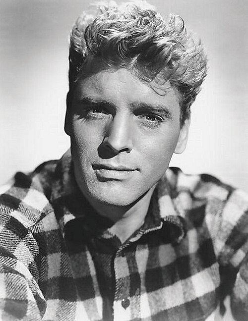

Bild: 1947; Whitey Schafer. Public domain laut Wikimedia Commons. [Bildquelle](https://commons.wikimedia.org/wiki/File:Burt_Lancaster_by_A._L._Whitey_Schafer.jpg), [TMDB](https://www.themoviedb.org/person/13784).

### L1 · leicht

Welche Stellung hat Milton Warden (Burt Lancaster) in „Verdammt in alle Ewigkeit“?

- Er ist ein ziviler Sportjournalist.

- Er ist ein Strafverteidiger der Armee.

- **Richtig: Er ist ein erfahrener Sergeant der US-Armee.**

- Er ist ein Hotelbesitzer auf Hawaii.

Warden ist ein Sergeant der US-Armee.

Warden übernimmt in seiner Einheit auf Hawaii viele praktische Führungsaufgaben. Sein Vorgesetzter Captain Holmes vernachlässigt seine Pflichten, während Warden eine Beziehung zu dessen Frau Karen (Deborah Kerr) beginnt. Karen wünscht sich eine gemeinsame Zukunft und einen Wechsel in die Offizierslaufbahn. Warden steht damit zwischen militärischem Rangsystem, seiner eigenen Haltung und einer Beziehung, deren Voraussetzungen er nicht erfüllen will.

Merksatz: Warden führt praktisch viel, will aber kein Offizier werden.

Antwortzusätze:

- Er ist ein erfahrener Sergeant der US-Armee.: Warden ist ein Sergeant der US-Armee.

Quellen: [1](https://catalog.afi.com/Film/50845-FROM-HERE-TO-ETERNITY).

### L2 · leicht

In welchem Bereich setzt Elmer Gantry (Burt Lancaster) sein Verkaufstalent ein, nachdem er Sharon Falconer kennenlernt?

- In einer staatlichen Wahlbehörde

- **Richtig: In religiösen Erweckungsveranstaltungen**

- Im internationalen Kunsthandel

- In einer medizinischen Universität

Gantry wird zum mitreißenden Prediger einer Erweckungsbewegung.

Der redegewandte Verkäufer schließt sich der Predigerin Sharon Falconer (Jean Simmons) an. Seine Fähigkeit, ein Publikum zu gewinnen, macht ihn für ihre Veranstaltungen wertvoll. Zugleich passen seine Vergangenheit und seine persönlichen Bedürfnisse nicht bruchlos zum moralischen Anspruch des Auftritts. Lancaster spielt eine Figur, bei der Glaube, Show und Geschäft kaum voneinander zu trennen sind.

Merksatz: Gantry überträgt das Verkaufen auf religiöse Überzeugung.

Antwortzusätze:

- In religiösen Erweckungsveranstaltungen: Gantry wird zum mitreißenden Prediger einer Erweckungsbewegung.

Quellen: [1](https://catalog.afi.com/Film/53136-ELMER-GANTRY).

### M1 · mittel

Welche Beziehung entsteht zwischen Mike Ribble (Burt Lancaster) und Tino Orsini (Tony Curtis) in „Trapez“?

- Er ist Tinos Geldgeber für einen eigenen Zirkus.

- Er ist Tinos Konkurrent um die Zirkusleitung.

- Er ist Tinos Impresario bei internationalen Gastspielen.

- **Richtig: Er ist Tinos Trainer und Partner am Trapez.**

Mike bildet Tino aus und arbeitet mit ihm am Trapez.

Mike war ein Star, wurde aber bei einem Sturz schwer verletzt. Tino will von seinem Können lernen und selbst einen besonders gefährlichen Sprung schaffen. Aus der Zusammenarbeit entwickelt sich ein Konflikt, als Lola (Gina Lollobrigida) zwischen die Männer tritt. Die Weitergabe von Erfahrung wird so mit Ehrgeiz, Vertrauen und der Angst verbunden, durch einen jüngeren Partner verdrängt zu werden.

Merksatz: Der verletzte Altstar gibt sein Können an Tino weiter.

Antwortzusätze:

- Er ist Tinos Trainer und Partner am Trapez.: Mike bildet Tino aus und arbeitet mit ihm am Trapez.

Quellen: [1](https://en.wikipedia.org/wiki/Trapeze_(film)).

### M2 · mittel

Warum will J. J. Hunsecker (Burt Lancaster) in „Dein Schicksal in meiner Hand“ den Jazzmusiker Steve Dallas beschädigen?

- **Richtig: Dallas ist mit Hunseckers Schwester zusammen.**

- Dallas erpresst ihn wegen eines Bankbetrugs.

- Dallas hat seine Zeitung gekauft.

- Dallas will seine politische Kandidatur verhindern.

Hunsecker will die Beziehung seiner Schwester zu Dallas zerstören.

Hunsecker besitzt als Klatschkolumnist großen Einfluss auf Karrieren. Den Presseagenten Sidney Falco (Tony Curtis) zwingt er, gegen den Freund seiner Schwester vorzugehen. Ein privater Besitzanspruch wird damit durch ein öffentliches Mediennetz ausgetragen. Lancaster spielt den scheinbar souveränen Mann, dessen Macht auf Abhängigkeiten beruht und der die Selbstständigkeit eines nahen Menschen nicht ertragen will.

Merksatz: Hunsecker benutzt öffentliche Macht für einen privaten Besitzanspruch.

Antwortzusätze:

- Dallas ist mit Hunseckers Schwester zusammen.: Hunsecker will die Beziehung seiner Schwester zu Dallas zerstören.

Quellen: [1](https://www.criterion.com/films/27542-sweet-smell-of-success).

### S1 · schwer

Zu welcher gesellschaftlichen Gruppe gehört Fürst Fabrizio (Burt Lancaster) in „Der Leopard“?

- Zum städtischen Industrieproletariat

- Zur aufstrebenden Handelsbourgeoisie

- Zum republikanischen Offizierskorps

- **Richtig: Zum alten sizilianischen Adel**

Fabrizio gehört zum alten Adel Siziliens.

Die Einigung Italiens verändert die Grundlagen der Macht seiner Schicht. Fabrizio erkennt, dass sich neue Interessen mit den alten Familien verbinden werden. Die Heirat seines Neffen Tancredi (Alain Delon) mit Angelica (Claudia Cardinale) macht diesen Übergang greifbar. Lancasters Figur beobachtet den Wandel mit Einsicht, ohne ihm selbst eine Zukunft entgegensetzen zu können.

Merksatz: Fabrizio versteht den Wandel, gehört aber zur schwindenden alten Ordnung.

Antwortzusätze:

- Zum alten sizilianischen Adel: Fabrizio gehört zum alten Adel Siziliens.

Gemeinsames Wissensziel: K-E20261007-F-262-L2 (E20261007-F-262-L2).

Quellen: [1](https://www.criterion.com/films/790-the-leopard).

### S2 · schwer

In welchem Gefängnis beginnt Robert Stroud (Burt Lancaster) in „Der Gefangene von Alcatraz“ seine Vogelforschung, bevor er nach Alcatraz kommt?

- Sing Sing

- **Richtig: Leavenworth**

- San Quentin

- Folsom

Stroud beginnt seine Arbeit mit Vögeln in Leavenworth.

Stroud entdeckt einen verletzten Vogel und entwickelt in der Haft Kenntnisse über Pflege und Krankheiten. Später schreibt er darüber und arbeitet mit Stella Johnson (Betty Field) an Heilmitteln. Bei der Verlegung nach Alcatraz darf er die Vögel nicht behalten. Der Filmtitel darf deshalb nicht so verstanden werden, als habe die gesamte Forschung auf der berühmten Gefängnisinsel stattgefunden.

Merksatz: Die Vögel gehören zu Leavenworth, bevor Stroud nach Alcatraz wechselt.

Antwortzusätze:

- Leavenworth: Stroud beginnt seine Arbeit mit Vögeln in Leavenworth.

Quellen: [1](https://catalog.afi.com/Film/22974-BIRDMAN-OF-ALCATRAZ).

### E1 · experte

Welche Verbindung hatte Burt Lancaster zum Film „Marty“, dessen Hauptrolle Ernest Borgnine spielte?

- **Richtig: Seine gemeinsame Produktionsfirma mit Harold Hecht stellte den Film her.**

- Er schrieb als alleiniger Autor das Drehbuch.

- Er komponierte als Gast die Filmmusik.

- Er montierte als Cutter die Kinofassung.

Lancaster und Harold Hecht produzierten „Marty“ über Hecht-Lancaster Productions.

Paddy Chayefskys Fernsehstoff wurde von Delbert Mann fürs Kino inszeniert. Lancaster übernahm die Hauptrolle nicht, setzte seine Bekanntheit aber auch im Trailer für den kleineren Film ein. Der Erfolg zeigte, dass seine Produktionsarbeit über Filme mit ihm selbst als Star hinausging. Für die Oscar-Auszeichnung als bester Film wurde Harold Hecht genannt; Lancaster gehört deshalb nicht automatisch zu deren persönlichen Empfängern.

Merksatz: Lancasters Firma ermöglichte „Marty“, Borgnine spielte die Hauptrolle.

Antwortzusätze:

- Seine gemeinsame Produktionsfirma mit Harold Hecht stellte den Film her.: Lancaster und Harold Hecht produzierten „Marty“ über Hecht-Lancaster Productions.

Quellen: [1](https://www.tcm.com/articles/behind-the-classics/960549/behind-the-classics-marty-1955), [2](https://www.oscars.org/oscars/ceremonies/1956).

### E2 · experte

Welche berufliche Erfahrung brachte Burt Lancaster bereits vor seiner Filmkarriere mit?

- Arbeit als Opernsänger

- Eine Laufbahn als Berufsboxer

- **Richtig: Arbeit als Zirkusakrobat**

- Eine Laufbahn als professioneller Rennfahrer

Lancaster arbeitete als Zirkusakrobat, unter anderem gemeinsam mit Nick Cravat.

Lancaster und sein langjähriger Partner Nick Cravat entwickelten in den 1930er Jahren ein gemeinsames Akrobatikprogramm. Eine Verletzung beendete diesen Abschnitt seiner Laufbahn. Die körperliche Ausbildung blieb für spätere Abenteuerrollen und „Trapez“ nützlich. Der Film verwendete dennoch für besonders gefährliche Nummern Spezialisten; die frühere Zirkusarbeit bedeutet nicht, dass Lancaster jede auf der Leinwand sichtbare Artistik selbst ausführte.

Merksatz: Vor dem Filmstar stand der Akrobat Lancaster.

Antwortzusätze:

- Arbeit als Zirkusakrobat: Lancaster arbeitete als Zirkusakrobat, unter anderem gemeinsam mit Nick Cravat.

Quellen: [1](https://en.wikipedia.org/wiki/Burt_Lancaster), [2](https://en.wikipedia.org/wiki/Trapeze_(film)).

## Kirk Douglas · Bekanntheitsgruppe 3

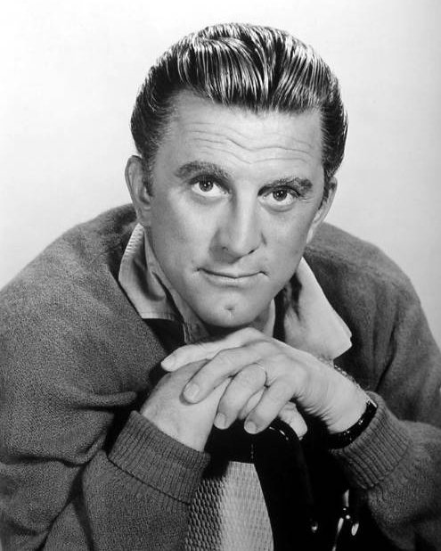

Bild: 1963; Unknown author. Public domain laut Wikimedia Commons. [Bildquelle](https://commons.wikimedia.org/wiki/File:Studio_publicity_Kirk_Douglas.jpg), [TMDB](https://www.themoviedb.org/person/2090).

### L1 · leicht

Welche Menschen führt die von Kirk Douglas gespielte Hauptfigur in „Spartacus“ gegen Rom in den Aufstand?

- Griechische Kaufleute

- Römische Senatoren

- Persische Berufssoldaten

- **Richtig: Versklavte Menschen**

Spartacus führt versklavte Menschen in den Aufstand.

Aus dem Ausbruch aus einer Gladiatorenschule entsteht eine Bewegung, die Roms Macht herausfordert. Douglas spielt einen Mann, der selbst als Eigentum behandelt wurde und Freiheit für seine Gefährten sucht. Der Film verbindet ihren Kampf mit den politischen Rivalitäten auf römischer Seite; Laurence Olivier verkörpert Crassus, Charles Laughton dessen Gegner Gracchus.

Merksatz: Ein Gladiator wird zum Anführer eines Sklavenaufstands.

Antwortzusätze:

- Versklavte Menschen: Spartacus führt versklavte Menschen in den Aufstand.

Quellen: [1](https://en.wikipedia.org/wiki/Spartacus_(film)).

### L2 · leicht

Welchen Maler verkörpert Kirk Douglas in „Lust for Life“?

- Paul Cézanne

- Claude Monet

- **Richtig: Vincent van Gogh**

- Henri Matisse

Douglas spielt Vincent van Gogh.

Die Künstlerbiografie zeigt den schwierigen Weg zur Malerei, die Unterstützung durch den Bruder Theo und die konfliktreiche Beziehung zu Paul Gauguin, gespielt von Anthony Quinn. Douglas übte für seine Arbeit vor der Kamera selbst das Malen. Der Film versucht damit, die körperliche Tätigkeit des Künstlers ebenso sichtbar zu machen wie seinen Kampf um eine eigene Ausdrucksweise.

Merksatz: Douglas’ Maler erhält Unterstützung von seinem Bruder Theo.

Antwortzusätze:

- Vincent van Gogh: Douglas spielt Vincent van Gogh.

Quellen: [1](https://en.wikipedia.org/wiki/Lust_for_Life_(1956_film)).

### M1 · mittel

Welche Aufgabe übernimmt Colonel Dax (Kirk Douglas) nach dem gescheiterten Angriff in „Wege zum Ruhm“?

- **Richtig: Er verteidigt angeklagte Soldaten vor dem Kriegsgericht.**

- Er leitet das Erschießungskommando.

- Er führt die Anklage gegen General Mireau.

- Er verhandelt einen Gefangenenaustausch.

Dax verteidigt drei Soldaten vor dem Kriegsgericht.

General Mireau verlangt nach einem aussichtslosen Angriff ein Exempel wegen angeblicher Feigheit. Aus den Kompanien werden drei Männer ausgewählt, deren Auswahl keineswegs einen fairen Nachweis individueller Schuld darstellt. Dax versucht, sie zu retten. Der Gegensatz zwischen seinem Einsatz und der Selbstrechtfertigung der Generäle macht militärische Ehre zu einer Frage der Verantwortung gegenüber den eigenen Leuten.

Merksatz: Dax steht vor Gericht auf der Seite seiner eigenen Soldaten.

Antwortzusätze:

- Er verteidigt angeklagte Soldaten vor dem Kriegsgericht.: Dax verteidigt drei Soldaten vor dem Kriegsgericht.

Quellen: [1](https://catalog.afi.com/Film/52321-PATHS-OF-GLORY).

### M2 · mittel

Wie beeinflusst Reporter Chuck Tatum (Kirk Douglas) in „Reporter des Satans“ die Rettung des verschütteten Leo Minosa?

- Er lässt die Presse vom Unglücksort entfernen.

- **Richtig: Er fördert eine langsamere Rettungsmethode für eine längere Sensation.**

- Er verzichtet auf Berichte bis zur Bergung.

- Er organisiert sofort einen zweiten Rettungstrupp.

Tatum verlängert die Rettung, um seine Geschichte auszuschlachten.

Gemeinsam mit dem Sheriff setzt Tatum eine Bohrung von oben durch, obwohl ein anderer Zugang schneller möglich wäre. Während sich der Unglücksort zum Jahrmarkt entwickelt, steigt der Wert seiner exklusiven Berichte. Douglas spielt einen Reporter, der beruflichen Ehrgeiz über das Leben seines vermeintlichen Schützlings stellt. Die Verzögerung ist deshalb der Kern seiner Schuld, nicht nur ein Begleitumstand der Berichterstattung.

Merksatz: Der Reporter macht aus der Rettungsdauer eine Einnahmequelle.

Antwortzusätze:

- Er fördert eine langsamere Rettungsmethode für eine längere Sensation.: Tatum verlängert die Rettung, um seine Geschichte auszuschlachten.

Quellen: [1](https://www.criterion.com/films/829-ace-in-the-hole), [2](https://en.wikipedia.org/wiki/Ace_in_the_Hole_(1951_film)).

### S1 · schwer

Warum bittet Jonathan Shields (Kirk Douglas) in „Stadt der Illusionen“ frühere Mitarbeiter trotz ihrer Verbitterung um eine erneute Zusammenarbeit?

- **Richtig: Ihre Beteiligung würde die Finanzierung seines neuen Films ermöglichen.**

- Nur sie besitzen die Rechte an seinem eigenen Lebenslauf.

- Er will ihnen die Leitung seines bereits verkauften Studios übergeben.

- Sie sollen gemeinsam gegen seinen Konkurrenten aussagen.

Die Namen der früheren Mitarbeiter würden die Finanzierung sichern.

Ein Regisseur, eine Schauspielerin und ein Autor erinnern sich daran, wie Shields ihre Karrieren förderte und sie zugleich verletzte. Nun braucht er ihre Beteiligung, weil er allein kein Geld für sein neues Projekt erhält. Die Rückblenden zeigen damit beides: seine Fähigkeit, Talente zur Wirkung zu bringen, und die persönlichen Kosten seiner Methoden. Gerade diese Ambivalenz prägt Douglas’ Produzentenfigur.

Merksatz: Shields braucht die Menschen, deren Vertrauen er verspielt hat.

Antwortzusätze:

- Ihre Beteiligung würde die Finanzierung seines neuen Films ermöglichen.: Die Namen der früheren Mitarbeiter würden die Finanzierung sichern.

Quellen: [1](https://catalog.afi.com/Film/50404), [2](https://en.wikipedia.org/wiki/The_Bad_and_the_Beautiful).

### S2 · schwer

Warum provoziert Jack Burns (Kirk Douglas) in „Einsam sind die Tapferen“ seine eigene Inhaftierung?

- Er will ein Beweisstück aus der Asservatenkammer stehlen.

- Er möchte für einen Bekannten dessen Strafe absitzen.

- **Richtig: Er will seinem Freund Paul Bondi zur Flucht verhelfen.**

- Er sucht Schutz vor einem ehemaligen Arbeitgeber.

Burns lässt sich einsperren, um Paul Bondi zu befreien.

Burns lebt als unabhängiger Cowboy ohne feste Anschrift. Im Gefängnis trifft er jedoch auf einen Freund, der die gemeinsame Flucht ablehnt: Bondi will seine Familie nicht durch ein Leben auf der Flucht gefährden. Burns entkommt allein. Die Episode zeigt, dass sein Freiheitsideal selbst einem nahestehenden Menschen keine Lösung bietet, dessen Verantwortung an andere gebunden ist.

Merksatz: Burns sucht den Weg ins Gefängnis, um eine Flucht zu ermöglichen.

Antwortzusätze:

- Er will seinem Freund Paul Bondi zur Flucht verhelfen.: Burns lässt sich einsperren, um Paul Bondi zu befreien.

Quellen: [1](https://en.wikipedia.org/wiki/Lonely_Are_the_Brave).

### E1 · experte

Welche von Kirk Douglas unterstützte Entscheidung bei „Spartacus“ war für den Umgang mit Hollywoods Schwarzen Listen bedeutsam?

- Das Drehbuch erschien ohne jede Autorenangabe.

- **Richtig: Dalton Trumbo erhielt unter seinem wirklichen Namen einen Drehbuchcredit.**

- Der Drehbuchcredit blieb allein bei einem vorgeschobenen Autor.

- Trumbo wurde ausschließlich als Berater im Abspann genannt.

Der zuvor boykottierte Dalton Trumbo erhielt einen Credit unter seinem eigenen Namen.

Trumbo gehörte zu den Autoren, die wegen der antikommunistischen Verfolgung lange nur verdeckt arbeiten konnten. Douglas unterstützte seine offene Nennung bei einer großen Studioproduktion. Der Schritt stieß auf Widerstand und Boykottaufrufe. Er war ein sichtbarer Beitrag zum Aufbrechen der Schwarzen Listen; deren Ende lässt sich jedoch nicht einer einzigen Person oder einem einzigen Film zuschreiben.

Merksatz: Ein wirklicher Autorenname wurde zum öffentlichen Signal gegen den Berufsboykott.

Antwortzusätze:

- Dalton Trumbo erhielt unter seinem wirklichen Namen einen Drehbuchcredit.: Der zuvor boykottierte Dalton Trumbo erhielt einen Credit unter seinem eigenen Namen.

Quellen: [1](https://www.criterion.com/current/posts/12-spartacus).

### E2 · experte

An wen gab Kirk Douglas nach seiner Bühnenfassung die Filmrechte an „Einer flog über das Kuckucksnest“ weiter?

- An Hauptdarsteller Jack Nicholson

- An Produzent Saul Zaentz

- An Regisseur Miloš Forman

- **Richtig: An seinen Sohn Michael Douglas**

Er gab die Rechte an seinen Sohn Michael Douglas weiter.

Kirk Douglas hatte den Stoff auf die Bühne gebracht und selbst McMurphy gespielt. Eine Verfilmung kam für ihn jedoch jahrelang nicht zustande. Michael Douglas übernahm später die Rechte und wurde Produzent des Films, in dem Jack Nicholson die Hauptrolle spielte. Der Wechsel zeigt, wie ein lange blockiertes Projekt durch einen Generationswechsel eine andere Besetzung und Produktionsgestalt erhalten konnte.

Merksatz: Kirk brachte den Stoff auf die Bühne; Michael brachte ihn als Produzent ins Kino.

Antwortzusätze:

- An seinen Sohn Michael Douglas: Er gab die Rechte an seinen Sohn Michael Douglas weiter.

Gemeinsames Wissensziel: K-SCHAUSPIELER-202610-P03-126-A-1 (SCHAUSPIELER-202610-P03-126-A-1).

Quellen: [1](https://en.wikipedia.org/wiki/Kirk_Douglas).

## Gary Cooper · Bekanntheitsgruppe 3

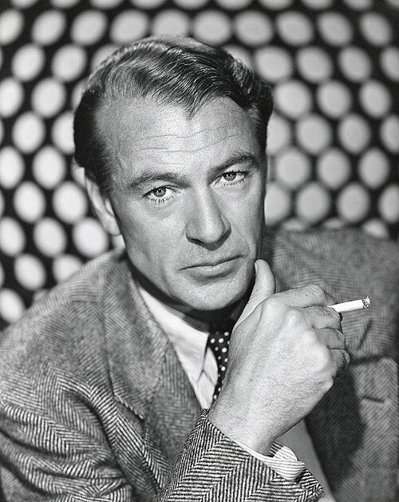

Bild: 1947; Whitey Schafer. Public domain laut Wikimedia Commons. [Bildquelle](https://commons.wikimedia.org/wiki/File:Gary_Cooper_by_A._L._Whitey_Schafer.jpg), [TMDB](https://www.themoviedb.org/person/4068).

### L1 · leicht

Welche Aufgabe hat Will Kane (Gary Cooper) zu Beginn von „Zwölf Uhr mittags“?

- Er leitet die Bank des Ortes.

- Er besitzt die Postkutschenlinie.

- **Richtig: Er versieht den Dienst als Marshal.**

- Er führt das örtliche Hotel.

Will Kane ist der Marshal des Ortes.

Kane hat gerade geheiratet und will seinen Dienst hinter sich lassen. Die angekündigte Rückkehr des Verbrechers Frank Miller verändert den geplanten Aufbruch. Statt mit Amy fortzufahren, kehrt er um und sucht Unterstützung. Coopers Gesetzeshüter wird dabei zunehmend auf sich selbst zurückgeworfen: Das Amt bedeutet für ihn eine Verantwortung, die seine Mitbürger nicht gleichermaßen übernehmen wollen.

Merksatz: Der ausscheidende Marshal kehrt wegen einer drohenden Gefahr um.

Antwortzusätze:

- Er versieht den Dienst als Marshal.: Will Kane ist der Marshal des Ortes.

Quellen: [1](https://catalog.afi.com/Film/53629-HIGH-NOON).

### L2 · leicht

Welches Instrument spielt Longfellow Deeds (Gary Cooper) in „Mr. Deeds geht in die Stadt“?

- **Richtig: Tuba**

- Violine

- Banjo

- Akkordeon

Deeds spielt Tuba.

Der Mann aus einem kleinen Ort in Vermont erbt ein Vermögen und gerät in New York zwischen Anwälte und sensationshungrige Zeitungen. Zu seinem bisherigen Leben gehören Gelegenheitsgedichte und das Tubaspielen. Diese unspektakulären Tätigkeiten bilden einen Gegenpol zu dem Bild des vermeintlichen Sonderlings, das die Großstadtpresse aus ihm macht. Der Film prüft dadurch auch, wer hier eigentlich den klareren Blick auf seine Umgebung besitzt.

Merksatz: Der Millionenerbe bringt seine Tuba aus dem Kleinstadtleben mit.

Antwortzusätze:

- Tuba: Deeds spielt Tuba.

Quellen: [1](https://en.wikipedia.org/wiki/Mr._Deeds_Goes_to_Town).

### M1 · mittel

Warum möchte Alvin York (Gary Cooper) in „Sergeant York“ zunächst nicht am Krieg teilnehmen?

- Er will die Versorgung seiner Familie nicht gefährden.

- **Richtig: Er hält Töten aus religiösen Gründen für falsch.**

- Er hat bei einem früheren Militärdienst schlechte Erfahrungen gemacht.

- Er misstraut den Kriegszielen der Regierung.

Sein religiöser Glaube steht dem Töten entgegen.

Nach seiner Bekehrung versucht York, sein Leben an der Bibel auszurichten. Als die USA in den Ersten Weltkrieg eintreten, beantragt er den Status eines Kriegsdienstverweigerers, der ihm verweigert wird. Seine militärischen Fähigkeiten beseitigen den Gewissenskonflikt nicht. Erst nach weiteren Gesprächen und einer Zeit des Nachdenkens entscheidet er sich anders. Der Film verbindet das spätere Heldentum daher mit einer vorausgehenden moralischen Auseinandersetzung.

Merksatz: Yorks Schießkunst und sein Glaube führen zunächst in verschiedene Richtungen.

Antwortzusätze:

- Er hält Töten aus religiösen Gründen für falsch.: Sein religiöser Glaube steht dem Töten entgegen.

Quellen: [1](https://catalog.afi.com/Film/27041-SERGEANT-YORK).

### M2 · mittel

Welchen Baseballspieler verkörpert Gary Cooper in „Der große Wurf“ (1942)?

- Babe Ruth

- Joe DiMaggio

- Jackie Robinson

- **Richtig: Lou Gehrig**

Gary Cooper spielt Lou Gehrig.

Der Film zeichnet Gehrigs Weg zu den New York Yankees nach und endet mit seiner berühmten Abschiedsrede. Mehrere frühere Mitspieler treten als sie selbst auf, darunter Babe Ruth. Im Mittelpunkt steht damit ein Sportler, dessen Laufbahn durch eine schwere Krankheit endet. Coopers Darstellung verbindet sportlichen Ruhm mit einer Haltung von Bescheidenheit und Tapferkeit außerhalb des Spielfelds.

Merksatz: Coopers Sportler verabschiedet sich im Yankee Stadium.

Antwortzusätze:

- Lou Gehrig: Gary Cooper spielt Lou Gehrig.

Quellen: [1](https://catalog.afi.com/Film/27411-THE-PRIDE-OF-THE-YANKEES).

### S1 · schwer

Welche öffentliche Rolle soll John Willoughby (Gary Cooper) in „Hier ist John Doe“ gegen Bezahlung übernehmen?

- **Richtig: Den Verfasser eines erfundenen Protestbriefs**

- Den wiedergefundenen Erben eines Zeitungsverlegers

- Den Augenzeugen eines fingierten Banküberfalls

- Den überlebenden Kameraden eines gefallenen Politikers

Er soll den Verfasser eines erfundenen Protestbriefs darstellen.

Journalistin Ann Mitchell (Barbara Stanwyck) hat einen Brief erfunden, dessen angeblicher Autor aus Protest gegen gesellschaftliche Zustände seinen Selbstmord ankündigt. Die Zeitung braucht nun einen Menschen, der dieser Figur ein Gesicht gibt. Willoughby nimmt die Rolle wegen seiner Geldnot an. Aus der Inszenierung entsteht jedoch eine Bewegung, deren Hoffnungen nicht mehr bloß als Werbeeffekt behandelt werden können.

Merksatz: Eine erfundene Stimme erhält durch Willoughby ein öffentliches Gesicht.

Antwortzusätze:

- Den Verfasser eines erfundenen Protestbriefs: Er soll den Verfasser eines erfundenen Protestbriefs darstellen.

Quellen: [1](https://catalog.afi.com/Catalog/moviedetails/27680).

### S2 · schwer

Welche Überzeugung der Familie Birdwell wird in „Lockende Versuchung“ mit Gary Cooper durch den Bürgerkrieg besonders auf die Probe gestellt?

- Der Glaube an die Unfehlbarkeit des Präsidenten

- Die Verpflichtung zum allgemeinen Militärdienst

- **Richtig: Die religiös begründete Ablehnung von Gewalt**

- Die Ablehnung jedes privaten Landbesitzes

Als Quäker lehnen die Birdwells Gewalt aus religiöser Überzeugung ab.

Jess Birdwell lebt mit seiner Familie nach Quäkergrundsätzen. Der Krieg macht aus einem vertrauten Gebot eine drängende Entscheidung: Wie soll man sich verhalten, wenn die eigene Umgebung bedroht wird? Im Unterschied zu einer bloßen Heldengeschichte beschäftigt sich der Film auch mit den Spannungen innerhalb der Familie. Coopers Vaterfigur muss ihre Regeln mit unterschiedlichen Ängsten, Wünschen und Verantwortlichkeiten zusammenbringen.

Merksatz: Der Krieg prüft den friedfertigen Glauben im Alltag einer Familie.

Antwortzusätze:

- Die religiös begründete Ablehnung von Gewalt: Als Quäker lehnen die Birdwells Gewalt aus religiöser Überzeugung ab.

Quellen: [1](https://catalog.afi.com/Film/51836-FRIENDLY-PERSUASION).

### E1 · experte

Weshalb lehnt Howard Roark (Gary Cooper) in „Ein Mann wie Sprengstoff“ den angebotenen Bankauftrag ab?

- Die Bank verlangt den Bau ausschließlich unter der Erde.

- **Richtig: Die Bank verlangt klassische Zusätze zu seinem modernen Entwurf.**

- Die Bank besteht auf einem anderen Grundstück als vereinbart.

- Die Bank untersagt den Einsatz von Stahl und Glas.

Roark verweigert klassische Verzierungen an seinem modernen Entwurf.

Obwohl Roark dringend Arbeit braucht, will er seine Architektur nicht an den Geschmack eines Baukomitees anpassen. Die verlangten Zusätze stehen für einen Kompromiss, den er als Verfälschung seiner Arbeit versteht. Der Film nach Ayn Rand macht aus der Auftragsfrage eine grundsätzliche Auseinandersetzung über schöpferische Unabhängigkeit. Coopers Figur wird dabei durch Entscheidungen charakterisiert, die ihre berufliche Existenz gefährden können.

Merksatz: Roark verzichtet auf den Auftrag, um die Gestalt seines Entwurfs zu erhalten.

Antwortzusätze:

- Die Bank verlangt klassische Zusätze zu seinem modernen Entwurf.: Roark verweigert klassische Verzierungen an seinem modernen Entwurf.

Quellen: [1](https://catalog.afi.com/Film/25929-THE-FOUNTAINHEAD).

### E2 · experte

Mit welcher Erfahrung des Drehbuchautors Carl Foreman wird Kanes (Gary Cooper) Vereinsamung in „Zwölf Uhr mittags“ häufig in Verbindung gebracht?

- Mit dem Verlust seines Elternhauses durch eine Naturkatastrophe

- Mit seinem Einsatz als Korrespondent im Spanischen Bürgerkrieg

- Mit dem Zusammenbruch einer von ihm geleiteten Theatergruppe

- **Richtig: Mit antikommunistischen Verhören und Hollywoods Schwarzen Listen**

Eine verbreitete Lesart verbindet Kanes Isolation mit Foremans Erfahrungen unter dem antikommunistischen Druck.

Foreman geriet ins Visier des Ausschusses für unamerikanische Aktivitäten und wurde in Hollywood ausgegrenzt. Dass Kanes Mitbürger ihre Unterstützung verweigern, lässt sich vor diesem Hintergrund lesen. Die Deutung ist verbreitet, aber kein unstrittiger Schlüssel aller Beteiligten: Regisseur Fred Zinnemann widersprach einer eindeutigen politischen Absicht. Der Produktionskontext eröffnet somit eine Lesart, ohne die Handlung auf eine einzige Bedeutung festzulegen.

Merksatz: Kanes fehlende Unterstützung wurde als Bild politischer Ausgrenzung gelesen.

Antwortzusätze:

- Mit antikommunistischen Verhören und Hollywoods Schwarzen Listen: Eine verbreitete Lesart verbindet Kanes Isolation mit Foremans Erfahrungen unter dem antikommunistischen Druck.

Quellen: [1](https://catalog.afi.com/Film/53629-HIGH-NOON).

## Errol Flynn · Bekanntheitsgruppe 3

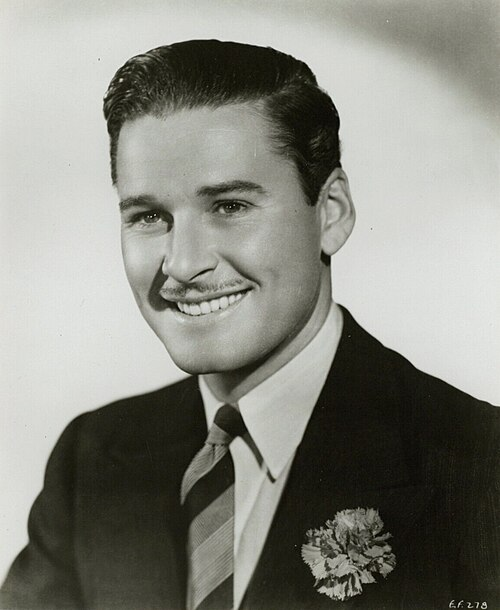

Bild: 1936; Unknown photographer. Public domain laut Wikimedia Commons. [Bildquelle](https://commons.wikimedia.org/wiki/File:Errol_Flynn_1936.jpg), [TMDB](https://www.themoviedb.org/person/8724).

### L1 · leicht

Welchen legendären Gesetzlosen spielt Errol Flynn im Abenteuerklassiker von 1938?

- **Richtig: Robin Hood**

- Zorro

- D’Artagnan

- Wilhelm Tell

Flynn spielt Robin Hood.

Sein Robin verbindet Fechtkunst, Witz und romantischen Charme. Der Widerstand gegen die Machthaber steht neben der Liebe zu Marian und der Treue zu König Richard. Die Figur wurde zu einem Muster des heiteren Abenteuerhelden, das weit über Flynns eigene Filmkarriere hinauswirkte.

Merksatz: Flynns bekanntester Gesetzloser lebt im Sherwood Forest.

Gemeinsames Wissensziel: K-ADV-202610-P01-L-015 (ADV-202610-P01-L-015).

Quellen: [1](https://www.tcm.com/articles/25787/the-adventures-of-robin-hood).

### L2 · leicht

Welche Schauspielerin bildet mit Errol Flynn das romantische Paar in „Unter Piratenflagge“ und „Robin Hood, König der Vagabunden“?

- Vivien Leigh

- **Richtig: Olivia de Havilland**

- Joan Fontaine

- Maureen O’Hara

Olivia de Havilland spielt an Flynns Seite.

De Havilland ist Arabella in der Piratengeschichte und Marian im Sherwood-Abenteuer. Beide Filme gehören zu einer längeren Folge gemeinsamer Auftritte. Der Erfolg beruht auch auf dem Zusammenspiel: Flynns impulsive Helden treffen auf eine Partnerin, die ihren Charme prüft und ihre Loyalität nicht einfach voraussetzt.

Merksatz: Flynn und de Havilland gehören zu den klassischen Abenteuerpaaren.

Gemeinsames Wissensziel: K-ADV-202610-P01-L-016 (ADV-202610-P01-L-016).

Quellen: [1](https://www.tcm.com/articles/161253/errol-flynn-profile-films-in-bold-type-will-air-on-8-7), [2](https://www.tcm.com/articles/25787/the-adventures-of-robin-hood).

### M1 · mittel

Welchen Beruf übt Errol Flynns Peter Blood aus, bevor er in „Unter Piratenflagge“ zum Piraten wird?

- Richter

- Schiffsbauer

- **Richtig: Arzt**

- Offizier

Peter Blood ist zunächst Arzt.

Blood gerät wegen der Behandlung eines verwundeten Rebellen in die Gewalt der Obrigkeit. Sein Weg zum Piraten beginnt damit als Folge politischer Verfolgung. Die medizinische Herkunft unterscheidet ihn von einem bloßen Abenteurer auf Beutezug und begründet die moralische Distanz zu rücksichtsloseren Seeräubern.

Merksatz: Bloods Abenteuer beginnt mit einem ärztlichen Hilfsdienst.

Gemeinsames Wissensziel: K-G100-20261008-ABENTEUER-001-L1 (G100-20261008-ABENTEUER-001-L1).

Quellen: [1](https://en.wikipedia.org/wiki/Captain_Blood_(1935_film)), [2](https://www.tcm.com/articles/161253/errol-flynn-profile-films-in-bold-type-will-air-on-8-7).

### M2 · mittel

Welchen Sportler verkörpert Errol Flynn in „Gentleman Jim“?

- Den Schwimmer Johnny Weissmüller

- Den Baseballspieler Babe Ruth

- Den Rennfahrer Barney Oldfield

- **Richtig: Den Boxer James J. Corbett**

Flynn spielt den Schwergewichtsboxer James J. Corbett.

Die Biografie nimmt sich bei Corbetts Lebenslauf erhebliche Freiheiten. Dennoch bereitete Flynn die Bewegungen im Ring sorgfältig vor. Der Film erweitert sein Abenteuerimage: An die Stelle des Degens tritt ein sportlicher Stil, der von schnellen Beinen und einer präzisen linken Führhand lebt.

Merksatz: In „Gentleman Jim“ kämpft Flynn mit Fäusten statt mit dem Degen.

Quellen: [1](https://www.tcm.com/articles/92455/gentleman-jim).

### S1 · schwer

Warum tragen Errol Flynns „Robin Hood“-Abenteuer von 1938 die Namen Michael Curtiz und William Keighley in der Regie?

- **Richtig: Curtiz übernahm das bereits von Keighley begonnene Projekt.**

- Beide drehten je eine vollständige Sprachfassung.

- Keighley inszenierte ausschließlich eine spätere Wiederveröffentlichung.

- Curtiz ergänzte erst nach Flynns Tod neue Szenen.

Curtiz löste Keighley während der Produktion ab.

Keighley hatte die Aufnahmen in Kalifornien begonnen. Das Studio war mit dem Ton seiner Inszenierung nicht zufrieden und übergab die Arbeit an Curtiz. Beiträge beider Regisseure blieben im fertigen Film erhalten. Der doppelte Credit erzählt daher von einem Wechsel im laufenden Projekt.

Merksatz: Zwei Regienamen verweisen hier auf eine übergebene Produktion.

Quellen: [1](https://www.tcm.com/articles/25787/the-adventures-of-robin-hood).

### S2 · schwer

Welchen ursprünglich vorgesehenen Hauptdarsteller ersetzte Errol Flynn bei „Unter Piratenflagge“?

- Leslie Howard

- **Richtig: Robert Donat**

- Ronald Colman

- Tyrone Power

Die Hauptrolle war zunächst für Robert Donat vorgesehen.

Als Donat das Projekt verließ, gab Warner Bros. dem noch wenig bekannten Flynn die Chance. Der Erfolg machte ihn zu einem führenden Star des Studios. Was später wie eine selbstverständliche Besetzung wirkt, entstand aus einer offenen Stelle und der Bereitschaft, ein großes Abenteuer einem Neuling anzuvertrauen.

Merksatz: Donats Absage öffnete Flynn den Weg zu Captain Blood.

Quellen: [1](https://www.tcm.com/articles/161253/errol-flynn-profile-films-in-bold-type-will-air-on-8-7), [2](https://www.tcm.com/articles/25787/the-adventures-of-robin-hood).

### E1 · experte

Was musste Errol Flynn für die Boxszenen in „Gentleman Jim“ besonders verändern?

- Er sollte fast ausschließlich aus dem Stand schlagen.

- Er sollte seine linke Hand möglichst vollständig schonen.

- **Richtig: Er musste die linke Führhand und schnelle Beinarbeit stärker einsetzen.**

- Er musste Corbett als schwerfälligen Nahkämpfer gestalten.

Das Training betonte linke Führhand und schnelle Beinarbeit.

Flynn neigte beim Boxen zunächst zur rechten Faust. Der frühere Champion Mushy Callahan arbeitete mit ihm daran, Corbetts beweglichen Stil nachzubilden. Die Figur verlangte damit ein bestimmtes technisches Bewegungsmuster. Allgemeine Fitness oder die Erfahrung aus Fechtszenen genügten für diese Aufgabe nicht.

Merksatz: Flynns Corbett entsteht aus Beinarbeit und linker Führhand.

Quellen: [1](https://www.tcm.com/articles/92455/gentleman-jim).

### E2 · experte

Welches Hollywoodstudio band Errol Flynn als Vertragsschauspieler an sich und baute ihn zum Abenteuerstar auf?

- Metro-Goldwyn-Mayer

- Paramount

- RKO

- **Richtig: Warner Bros.**

Flynn wurde vor allem als Vertragsstar von Warner Bros. aufgebaut.

Das Studiosystem verband langfristige Verträge mit wiederkehrenden Regisseuren, Partnern und Produktionsformen. Für Flynn entstand daraus eine Reihe aufwendiger Abenteuer. Sein scheinbar müheloses Auftreten war somit auch das Ergebnis einer Firma, die eine erkennbare Leinwandpersönlichkeit über mehrere Projekte hinweg entwickelte.

Merksatz: Warner Bros. formte Flynns klassische Abenteuerlaufbahn.

Quellen: [1](https://www.tcm.com/articles/161253/errol-flynn-profile-films-in-bold-type-will-air-on-8-7), [2](https://www.tcm.com/articles/021586/star-of-the-month-errol-flynn).

## Robert Mitchum · Bekanntheitsgruppe 3

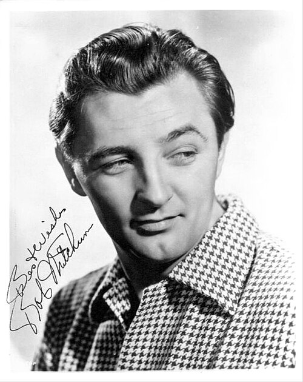

Bild: 1949; J. Fred Henry Publications. Public domain laut Wikimedia Commons. [Bildquelle](https://commons.wikimedia.org/wiki/File:Robert_Mitchum_1949.jpg), [TMDB](https://www.themoviedb.org/person/10158).

### L1 · leicht

Als was tritt Robert Mitchums Harry Powell in „Die Nacht des Jägers“ auf?

- **Richtig: Als Wanderprediger**

- Als Landarzt

- Als Polizeichef

- Als Zirkusdirektor

Powell gibt sich als Prediger aus.

Seine religiöse Rede schafft Vertrauen, obwohl er hinter Geld und Macht her ist. Mitchum nutzt die ruhige Stimme und das selbstgewisse Auftreten, um Bedrohung nicht auf lautes Toben zu beschränken. Gerade der Gegensatz zwischen öffentlicher Frömmigkeit und mörderischem Handeln prägt die Figur.

Merksatz: Powells Predigerrolle verbirgt einen Verfolger.

Quellen: [1](https://www.bfi.org.uk/lists/robert-mitchum-10-essential-films).

### L2 · leicht

Welchen Privatdetektiv spielt Robert Mitchum sowohl in „Fahr zur Hölle, Liebling“ als auch in „Tote schlafen besser“?

- Sam Spade

- **Richtig: Philip Marlowe**

- Mike Hammer

- Lew Archer

Mitchum verkörpert Raymond Chandlers Philip Marlowe.

Die beiden Filme übertragen unterschiedliche Chandler-Romane. Mitchums Alter und seine gelassene Müdigkeit geben dem Detektiv eine eigene Färbung. Die zweite Verfilmung verlegt ihn außerdem in das England der 1970er-Jahre; gleiche Hauptfigur bedeutet hier weder denselben Fall noch denselben historischen Schauplatz.

Merksatz: Zweimal Mitchum als Marlowe, in zwei unterschiedlichen Fällen.

Quellen: [1](https://www.bfi.org.uk/lists/robert-mitchum-10-essential-films), [2](https://en.wikipedia.org/wiki/The_Big_Sleep_(1978_film)).

### M1 · mittel

Welche Wörter stehen auf den Fingerknöcheln von Robert Mitchums Harry Powell in „Die Nacht des Jägers“?

- LIFE und DEATH

- HOPE und FEAR

- **Richtig: LOVE und HATE**

- GOOD und EVIL

Auf Powells Händen stehen LOVE und HATE.

Powell benutzt die Hände für eine kleine Erzählung vom Kampf zwischen Liebe und Hass. Der scheinbar lehrreiche Vortrag gehört zu seiner Selbstdarstellung. Die sichtbaren Gegensätze entlarven ihn nicht automatisch: Er kann auch moralische Worte in ein Mittel der Täuschung verwandeln.

Merksatz: Powells Hände predigen LOVE und HATE.

Gemeinsames Wissensziel: K-CLA-09-02 (CLA-L-018).

Quellen: [1](https://www.bfi.org.uk/lists/robert-mitchum-10-essential-films).

### M2 · mittel

Warum verfolgt Robert Mitchums Max Cady in „Ein Köder für die Bestie“ den Anwalt Sam Bowden?

- Bowden hat seine Firma übernommen.

- Bowden hat seine Frau geheiratet.

- Bowden hat ihn heimlich um sein Erbe gebracht.

- **Richtig: Bowden hatte als Tatzeuge gegen ihn ausgesagt.**

Cady rächt sich für Bowdens belastende Zeugenaussage.

Der Film von 1962 setzt Cady nach seiner Haftentlassung auf die Familie des Zeugen an. Seine Drohung reicht damit über einen Zweikampf hinaus. Mitchum gestaltet einen Gegner, der die Verletzlichkeit des privaten Umfelds systematisch ausnutzt. Die spätere Neubearbeitung verändert wichtige Einzelheiten dieser Ausgangslage.

Merksatz: Cadys Rache richtet sich gegen den Zeugen und dessen Familie.

Gemeinsames Wissensziel: K-E20261007-F-234-L1 (E20261007-F-234-L1).

Quellen: [1](https://www.bfi.org.uk/lists/robert-mitchum-10-essential-films), [2](https://en.wikipedia.org/wiki/Cape_Fear_(1962_film)).

### S1 · schwer

Welche zusätzliche praktische Aufgabe übernahm Robert Mitchum bei „Die Nacht des Jägers“ im Umgang mit den Kinderdarstellern?

- **Richtig: Er half, ihnen die gewünschten Spielsituationen zu vermitteln.**

- Er komponierte ihre gesungenen Filmlieder.

- Er übernahm ihren gesamten Unterricht am Drehort.

- Er ersetzte sie bei allen gefährlichen Bewegungen.

Mitchum half bei der Anleitung der beiden Kinder.

Charles Laughton führte erstmals bei einem eigenen Spielfilm Regie und fand den Zugang zur Erklärung seiner Absichten gegenüber den Kindern nicht immer leicht. Mitchum sprang dabei unterstützend ein. Das ergänzt seine Arbeit als bedrohlicher Verfolger um eine Zusammenarbeit hinter der sichtbaren Rolle, ohne den Regiecredit zu verändern.

Merksatz: Der Verfolger auf der Leinwand half den Kindern bei der Arbeit.

Quellen: [1](https://www.bfi.org.uk/lists/robert-mitchum-10-essential-films).

### S2 · schwer

Mit welcher Musikrichtung nahm Robert Mitchum neben seiner Schauspielkarriere ein eigenes Album auf?

- Bluegrass

- **Richtig: Calypso**

- Operette

- Bebop

Mitchum nahm ein Calypso-Album auf.

Sein musikalisches Interesse passt nicht auf den ersten Blick zum schweigsamen Leinwandimage. Er schrieb außerdem Texte und hatte mit einem Lied einen Platz in den US-Charts. Die oft lässig vorgetragene Gleichgültigkeit gegenüber dem Schauspielberuf verdeckt deshalb einen vielseitig arbeitenden Künstler.

Merksatz: Hinter Mitchums lakonischem Image stand auch ein Calypso-Sänger.

Quellen: [1](https://www.bfi.org.uk/lists/robert-mitchum-10-essential-films).

### E1 · experte

Welche Farbgestaltung prägt Robert Mitchums Western „Spur in den Bergen“?

- Warme Braun- und Goldtöne bestimmen die Innenräume.

- Kräftige Blau- und Grüntöne prägen die Landschaft.

- **Richtig: Die Farbpalette wird weitgehend auf eine fast monochrome Wirkung reduziert.**

- Starke Rot-Grün-Kontraste ordnen die wichtigsten Schauplätze.

Die Farbgestaltung ist bewusst stark zurückgenommen.

William Wellman und Kameramann William Clothier reduzierten die Farbreize in der verschneiten Landschaft und im Familienhaus. Das macht den Western auffallend karg. Mitchums Jagd auf einen Panther steht so in einem Bildraum, dessen Strenge auch den bedrückenden familiären Konflikt verstärkt.

Merksatz: Ein Farbwestern kann wie ein fast schwarzweißes Winterbild wirken.

Quellen: [1](https://www.bfi.org.uk/lists/robert-mitchum-10-essential-films).

### E2 · experte

Welche Berufserfahrung brachte George V. Higgins, der Romanautor hinter Robert Mitchums „Die Freunde von Eddie Coyle“, in den Stoff ein?

- Arbeit als Kriegsfotograf und Bildredakteur

- Arbeit als Architekt und Stadtplaner

- Arbeit als Bühnenmusiker und Musikproduzent

- **Richtig: Arbeit als Staatsanwalt und Strafverteidiger**

Higgins kannte das Strafrecht als Staatsanwalt und Verteidiger.

Der Film folgt Gesprächen, in denen Kriminelle und Polizei mit Informationen, Waffen und Gefälligkeiten handeln. Higgins’ juristische Erfahrung steht hinter seinem Interesse an diesen Milieus und ihrer Sprache. Mitchums Spiel fügt sich in ein Ensemble ein, dessen Verhandlungen die Handlung tragen, statt nur eine Starfigur hervorzuheben.

Merksatz: Bei Eddie Coyle handeln Figuren mit Worten um ihr Überleben.

Quellen: [1](https://www.criterion.com/current/posts/1147-the-friends-of-eddie-coyle-they-were-expendable).

## Richard Burton · Bekanntheitsgruppe 3

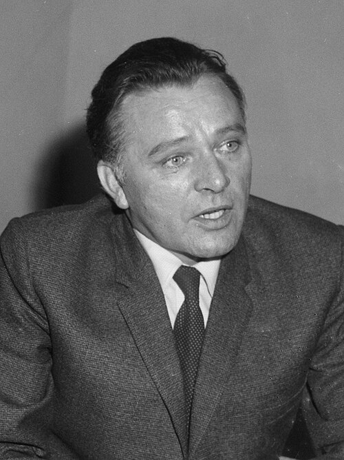

Bild: 1965; Joop van Bilsen for Anefo. CC0 laut Wikimedia Commons. [Bildquelle](https://commons.wikimedia.org/wiki/File:Richard_Burton_at_Schiphol_Airport.jpg), [TMDB](https://www.themoviedb.org/person/5341).

### L1 · leicht

Welche historische Figur spielt Richard Burton an Elizabeth Taylors Seite in „Cleopatra“?

- **Richtig: Marcus Antonius**

- Julius Caesar

- Octavian

- Pompeius

Burton verkörpert Marcus Antonius.

Antonius steht im Schatten Caesars und gerät zunehmend in den Bann Kleopatras. Burton gibt dem politischen Machtmenschen auch Unsicherheit und Abhängigkeit. Der aufwendige Historienfilm war damit zugleich eine Bühne für das Zusammenspiel zweier Stars, deren Beziehung die öffentliche Wahrnehmung der Produktion stark mitprägte.

Merksatz: Burtons Antonius verbindet Machtanspruch mit persönlicher Abhängigkeit.

Quellen: [1](https://www.bfi.org.uk/features/richard-burton-power-was-his-weakness), [2](https://www.biography.wales/article/s8-BURT-RIC-1925.html).

### L2 · leicht

Welchen Beruf hat George, den Richard Burton in „Wer hat Angst vor Virginia Woolf?“ spielt?

- Landarzt

- **Richtig: Geschichtsprofessor**

- Rechtsanwalt

- Zeitungsredakteur

George ist Geschichtsprofessor.

George arbeitet an der Universität, die der Vater seiner Frau Martha leitet. Sein beruflicher und familiärer Status sind deshalb eng verknüpft. Im nächtlichen Streit mit Martha und ihren Gästen wird das Gefühl gescheiterter Erwartungen immer wieder zum Angriffspunkt. Der Beruf gehört zur Machtverteilung des Ehekonflikts.

Merksatz: George lehrt Geschichte an der Universität seines Schwiegervaters.

Quellen: [1](https://www.bfi.org.uk/features/richard-burton-power-was-his-weakness).

### M1 · mittel

Welchen Eindruck soll Richard Burtons Alec Leamas in „Der Spion, der aus der Kälte kam“ bei seiner Anwerbung erwecken?

- Den eines begüterten Kunsthändlers

- Den eines loyalen Offiziers auf Dienstreise

- **Richtig: Den eines verbitterten, trinkenden ehemaligen Agenten**

- Den eines Reporters mit Zugang zur Regierung

Leamas soll wie ein enttäuschter und gescheiterter Ex-Agent wirken.

Sein scheinbarer Absturz soll ihn für die Gegenseite als käufliche Informationsquelle interessant machen. Das müde, misstrauische Auftreten unterscheidet diesen Spion deutlich von einem eleganten Abenteurer. Burton spielt zugleich eine Figur, die selbst nicht alle Absichten ihres eigenen Dienstes überblickt.

Merksatz: Leamas’ sichtbarer Verfall gehört zu seiner Tarnung.

Gemeinsames Wissensziel: K-G100-20261008-THRILLER-016-L1 (G100-20261008-THRILLER-016-L1).

Quellen: [1](https://www.bfi.org.uk/lists/10-great-spy-films), [2](https://en.wikipedia.org/wiki/The_Spy_Who_Came_in_from_the_Cold_(film)).

### M2 · mittel

Welche Funktion hat Richard Burtons O’Brien in der Orwell-Verfilmung „1984“ mit John Hurt?

- Er hilft Winston bei der Flucht ins Ausland.

- Er ist Winstons verfolgter Vater.

- Er führt einen unabhängigen Radiosender.

- **Richtig: Er verhört und bricht Winston im Dienst der Partei.**

O’Brien ist ein Funktionär und Verhörer des Regimes.

Winston setzt zunächst Hoffnung in einen Mann, der zur inneren Machtstruktur gehört. Burtons ruhiges, beherrschtes Auftreten wird schließlich zum Werkzeug der Unterwerfung. Gerade weil O’Brien seine Gewalt mit gedanklicher Präzision verbindet, entsteht eine andere Form von Bedrohung als durch einen bloß tobenden Tyrannen.

Merksatz: Burtons O’Brien macht geistige Kontrolle zur Form der Gewalt.

Quellen: [1](https://www.bfi.org.uk/features/nineteen-eighty-four-adaptations), [2](https://bfidatadigipres.github.io/muse%20of%20fire%3Cbr%3Erichard%20burton/2025/12/15/nineteen-eighty-four/).

### S1 · schwer

Warum nahm der als Richard Jenkins geborene Richard Burton den Nachnamen Burton an?

- **Richtig: Nach seinem Lehrer und Förderer Philip Burton**

- Nach dem Geburtsort seiner Mutter

- Nach der Hauptfigur seines ersten Kinofilms

- Nach einem Londoner Theaterdirektor namens Henry Burton

Er übernahm den Namen seines Lehrers Philip Burton.

Philip Burton förderte den Schüler in Port Talbot, arbeitete an seiner Stimme und wurde sein Vormund. Der Namenswechsel macht eine konkrete berufliche und persönliche Förderung sichtbar. Die Zusammenarbeit ging später weiter: Auch als Richard bereits auf großen Bühnen stand, blieb sein früherer Lehrer ein wichtiger Ratgeber.

Merksatz: Hinter dem Namen Burton steht ein prägender Lehrer.

Quellen: [1](https://www.biography.wales/article/s8-BURT-RIC-1925.html), [2](https://biography.wales/article/s12-BURT-HEN-1904.html).

### S2 · schwer

Wer inszenierte Richard Burtons „Hamlet“ 1964 auf der New Yorker Bühne?

- Laurence Olivier

- **Richtig: John Gielgud**

- Peter Brook

- Tyrone Guthrie

John Gielgud führte Regie.

Gielgud hatte den Prinzen selbst wiederholt gespielt und war für seine sprachliche Gestaltung berühmt. Burton arbeitete damit unter einem Regisseur, der die Rolle aus jahrzehntelanger eigener Erfahrung kannte. Die Produktion steht für einen Austausch zwischen zwei Schauspielergenerationen innerhalb der Shakespeare-Tradition.

Merksatz: Burtons New Yorker Hamlet entstand unter Gielguds Regie.

Quellen: [1](https://www.rsc.org.uk/hamlet/about-the-play/stage-history).

### E1 · experte

Welche Aufgabe übernahm Richard Burton in der BBC-Radiofassung von Dylan Thomas’ „Under Milk Wood“ von 1954?

- Die musikalische Leitung

- Die Rolle des Reverend Eli Jenkins

- **Richtig: Die erzählende First Voice**

- Die technische Aufnahmeleitung

Burton sprach die First Voice.

Die erste Stimme führt in die verborgenen Gedanken und Träume der Dorfbewohner. Philip Burton spielte dagegen Reverend Eli Jenkins. Der Erfolg zeigt, wie viel Richard allein mit Sprachrhythmus, Klang und Bildern in der Vorstellung des Publikums erreichen konnte. Die Stimme wurde unabhängig von seiner sichtbaren Starpräsenz zum zentralen Gestaltungsmittel.

Merksatz: Burtons First Voice öffnet die Gedankenwelt von Llareggub.

Quellen: [1](https://biography.wales/article/s12-BURT-HEN-1904.html), [2](https://www.oldvictheatre.com/news/under-milk-wood/).

### E2 · experte

Welchen beruflichen Spielraum gewährte Richard Burton sein Vertrag mit Twentieth Century Fox zu Beginn seiner Hollywoodlaufbahn?

- Er durfte ausschließlich für europäische Regisseure arbeiten.

- Er konnte jeden Film ohne Studiofreigabe selbst vertreiben.

- Er musste alle Bühnenengagements für die Vertragsdauer aufgeben.

- **Richtig: Er konnte Hollywoodfilme und Londoner Bühnenarbeit parallel verfolgen.**

Der Vertrag ließ Raum für Film und Theater.

Burton kam mit starken Shakespeare-Erfolgen zum Hollywoodstudio. Die Vereinbarung zwang ihn zunächst nicht, diese Bühnenlaufbahn vollständig gegen den Film einzutauschen. Seine Karriere entwickelte sich damit über zwei unterschiedliche Arbeitswelten: die direkte Wirkung des gesprochenen Textes im Theater und die technische Gestaltung einer aufgenommenen Rolle.

Merksatz: Burtons frühe Hollywoodbindung ließ die Bühne als zweites Arbeitsfeld offen.

Quellen: [1](https://www.biography.wales/article/s8-BURT-RIC-1925.html).

## Montgomery Clift · Bekanntheitsgruppe 3

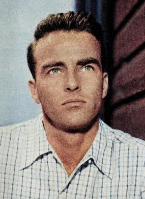

Bild: 1954; Photographer: Dirone [1]. Public domain laut Wikimedia Commons. [Bildquelle](https://commons.wikimedia.org/wiki/File:Montgomery_Clift_by_Dirone,_1954.jpg), [TMDB](https://www.themoviedb.org/person/12151).

### L1 · leicht

Welche Sportart soll Montgomery Clifts Soldat Prewitt in „Verdammt in alle Ewigkeit“ für seinen Vorgesetzten ausüben?

- **Richtig: Boxen**

- Baseball

- Ringen

- Fechten

Prewitt soll für die Einheit boxen.

Der talentierte Soldat verweigert den Einsatz im Ring. Aus der Weigerung entsteht ein Konflikt mit Vorgesetzten und Kameraden. Clifts Verletzlichkeit und Beharrlichkeit machen daraus eine Auseinandersetzung um den Anspruch eines Einzelnen auf eine eigene moralische Entscheidung innerhalb militärischer Hierarchie.

Merksatz: Prewitts Nein zum Boxen wird zum Konflikt mit der Armee.

Gemeinsames Wissensziel: K-E20261007-F-254-L2 (E20261007-F-254-L2).

Quellen: [1](https://www.bfi.org.uk/lists/montgomery-clift-10-essential-films).

### L2 · leicht

Welche Schauspielerin bildet mit Montgomery Clift das zentrale Liebespaar in „Ein Platz an der Sonne“?

- Audrey Hepburn

- **Richtig: Elizabeth Taylor**

- Grace Kelly

- Natalie Wood

Clift spielt an Elizabeth Taylors Seite.

George Eastman sieht in der jungen Frau aus wohlhabendem Umfeld auch den Zugang zu einem anderen Leben. Die romantische Nähe und sein Wunsch nach gesellschaftlichem Aufstieg lassen sich deshalb nicht sauber trennen. Clifts Spiel verbindet die Anziehungskraft des jungen Stars mit der Einsamkeit eines Menschen, der unbedingt dazugehören will.

Merksatz: Clift und Taylor tragen eine Liebe im Schatten des Aufstiegswunsches.

Quellen: [1](https://www.bfi.org.uk/lists/montgomery-clift-10-essential-films).

### M1 · mittel

Was hindert den von Montgomery Clift gespielten Priester in „Ich beichte“, sein Wissen über einen Mord einfach der Polizei mitzuteilen?

- Ein eidlicher Auftrag des Geheimdiensts

- Seine Tätigkeit als Anwalt des Verdächtigen

- **Richtig: Das Beichtgeheimnis**

- Ein gerichtlich verhängtes Redeverbot

Er hat das Geständnis während der Beichte gehört.

Pater Logan kennt dadurch den Täter, darf das Wissen nach seinem religiösen Verständnis aber nicht weitergeben. Die äußere Ermittlung trifft auf einen inneren Gewissenskonflikt. Clift bereitete die Rolle auch durch einen Aufenthalt in einem kanadischen Kloster vor; seine zurückhaltenden Reaktionen tragen viel von der Spannung.

Merksatz: Logans Wissen bleibt an das Beichtgeheimnis gebunden.

Quellen: [1](https://www.bfi.org.uk/lists/montgomery-clift-10-essential-films), [2](https://en.wikipedia.org/wiki/I_Confess_(film)).

### M2 · mittel

Welchen Auftrag hat Montgomery Clifts Behördenmitarbeiter in „Wilder Strom“?

- Er soll eine stillgelegte Eisenbahn wieder eröffnen.

- Er soll eine Familie wegen Spionage überwachen.

- Er soll den Verkauf einer Privatbank vermitteln.

- **Richtig: Er soll eine Familie zum Verlassen ihres Landes für ein Staudammprojekt bewegen.**

Chuck Glover soll die Räumung für ein Staudammprojekt erreichen.

Der Mitarbeiter der Tennessee Valley Authority vertritt einen Modernisierungsschritt, der die Lebenswelt einer Familie zerstört. Clift spielt hier keinen gehetzten Außenseiter, sondern einen vergleichsweise gefestigten staatlichen Vermittler. Seine Aufgabe verlangt, zwischen dem allgemeinen Nutzen des Projekts und dem Widerstand konkreter Menschen zu handeln.

Merksatz: Glover vermittelt zwischen Staudamm und gewachsenem Lebensraum.

Quellen: [1](https://www.bfi.org.uk/lists/montgomery-clift-10-essential-films).

### S1 · schwer

Wie bereitete Montgomery Clift seine Soldatenrolle in „Die Gezeichneten“ praktisch vor?

- **Richtig: Er lebte bei einer Einheit amerikanischer Pioniere und beobachtete deren Alltag.**

- Er trainierte monatelang als Fallschirmjäger für Kampfsprünge.

- Er verbrachte die Vorbereitung ausschließlich mit historischen Kostümproben.

- Er spielte die Rolle zunächst in einer langen Broadwayserie.

Clift suchte den Alltag einer Army-Pioniereinheit auf.

Die Beobachtungen flossen auch in seine Überarbeitung einzelner Szenen ein. Das Nachkriegsdrama wurde an zerstörten deutschen Schauplätzen aufgenommen; sein beiläufiges Verhalten fügt sich in diese konkrete Umgebung. Die Vorbereitung zielte auf glaubhafte Gewohnheiten einer Figur und nicht allein auf das korrekte Tragen einer Uniform.

Merksatz: Clifts Soldat entstand aus beobachtetem Alltag.

Quellen: [1](https://www.bfi.org.uk/lists/montgomery-clift-10-essential-films).

### S2 · schwer

Welches Instrument lernte Montgomery Clift für Prewitt in „Verdammt in alle Ewigkeit“?

- Saxofon

- **Richtig: Signalhorn**

- Klarinette

- Akkordeon

Für den militärischen Hornisten lernte er Signalhorn.

Clift nahm außerdem Boxunterricht und arbeitete intensiv mit dem Text und der Romanvorlage. Die musikalische Fertigkeit gehört zu einer umfassenden Vorbereitung, in der Körper, Handwerk und persönliche Haltung der Figur zusammenpassen sollten. Die Filmrolle erschöpft sich damit nicht in einem allgemeinen Bild des traurigen Soldaten.

Merksatz: Zu Prewitts Vorbereitung gehörten Boxen und Signalhorn.

Quellen: [1](https://www.bfi.org.uk/lists/montgomery-clift-10-essential-films).

### E1 · experte

Warum wurde Morris Townsend für Montgomery Clift in „Die Erbin“ gegenüber der Bühnenfassung weniger eindeutig schurkisch angelegt?

- Der Film sollte die Rolle zu einer komischen Nebenfigur machen.

- Die ursprüngliche Liebeshandlung sollte vollständig entfallen.

- **Richtig: Paramount wollte Clifts romantisches Starimage nutzen.**

- Die Zensur verlangte eine ausdrücklich versöhnliche Schlussheirat.

Paramount wollte von Clifts romantischem Starimage profitieren.

Clifts attraktives Starimage macht die Annäherung zunächst plausibel. Zugleich bleibt Townsend als möglicher Mitgiftjäger verdächtig. Die Filmfigur wurde gegenüber dem Bühnenstück weniger eindeutig schurkisch angelegt. Dadurch muss Catherine über einen Menschen entscheiden, dessen freundliche Oberfläche keine verlässliche Auskunft über seine Absichten gibt.

Merksatz: Clifts Starimage beeinflusste die Bearbeitung von Townsends Charakter.

Quellen: [1](https://www.bfi.org.uk/lists/montgomery-clift-10-essential-films).

### E2 · experte

Wie erarbeitete Montgomery Clift den erschütterten Zeugenauftritt in „Das Urteil von Nürnberg“?

- Er improvisierte den gesamten Auftritt ohne Kenntnis der Szene.

- Er übernahm den Vortrag unverändert von einer historischen Tonaufnahme.

- Er ließ seinen Text von einem Berufssprecher nachsynchronisieren.

- **Richtig: Er besprach die Figur intensiv mit Kramer und überarbeitete den Dialog.**

Clift arbeitete mit Stanley Kramer an der Figur und änderte den Dialog gezielt.

Rudolph Petersen berichtet vor Gericht von seiner Zwangssterilisation. Der kurze Auftritt macht juristische Gewalt an einem einzelnen Menschen sichtbar. Clifts scheinbar zusammenbrechender Vortrag entstand durch Vorbereitung und Textarbeit. Die Aussage wirkt wie der verzweifelte Versuch eines Zeugen, unter erneutem Druck verstanden zu werden, und ist kein unkontrollierter Zusammenbruch des Darstellers.

Merksatz: Petersens erschütterte Aussage beruht auf präziser Rollen- und Dialogarbeit.

Quellen: [1](https://www.bfi.org.uk/lists/montgomery-clift-10-essential-films).

## Laurence Olivier · Bekanntheitsgruppe 3

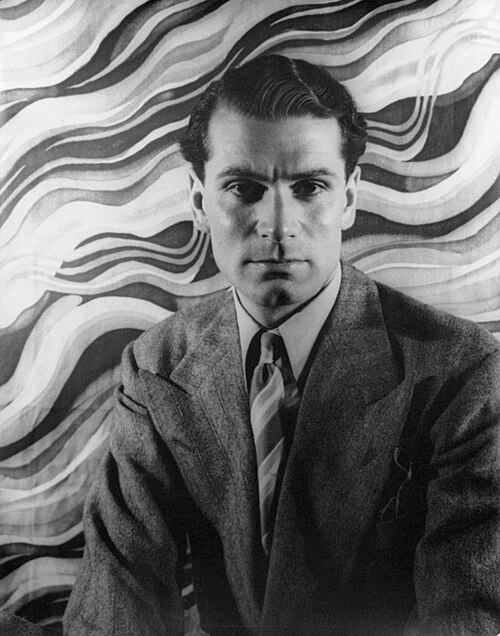

Bild: 1939; Carl Van Vechten. Public domain laut Wikimedia Commons. [Bildquelle](https://commons.wikimedia.org/wiki/File:Laurence_Olivier_Carl_Van_Vechten_portrait_3.jpg), [TMDB](https://www.themoviedb.org/person/3359).

### L1 · leicht

Welchen dänischen Prinzen verkörpert Laurence Olivier in seiner eigenen Shakespeare-Verfilmung von 1948?

- **Richtig: Hamlet**

- Fortinbras

- Laertes

- Horatio

Olivier spielt Hamlet und führt zugleich Regie.

Der Film konzentriert die umfangreiche Tragödie auf einen Prinzen, der den Mord am Vater rächen soll und mit sich selbst ringt. Olivier verbindet seine Bühnenkenntnis mit einer betont filmischen Darstellung. Die Kamera folgt ihm durch ein düsteres Schloss, statt lediglich eine Theateraufführung aus fester Zuschauerposition festzuhalten.

Merksatz: Oliviers Hamlet ist Darsteller- und Regiearbeit in einem.

Quellen: [1](https://www.bfi.org.uk/lists/laurence-olivier-10-essential-films).

### L2 · leicht

Welche berufliche Fertigkeit missbraucht Laurence Oliviers Szell in „Der Marathon-Mann“ bei der Folter?

- Schneiderei

- **Richtig: Zahnmedizin**

- Fotografie

- Uhrmacherei

Szell nutzt zahnmedizinische Kenntnisse.

Der gesuchte NS-Verbrecher zwingt den Studenten Babe in eine Situation, in der Fachwissen zur Gewaltausübung dient. Olivier macht die Bedrohung besonders durch die kontrollierte Sachlichkeit des Täters spürbar. Eine alltägliche Behandlungssituation wird dadurch in einen Ort völliger Abhängigkeit verwandelt.

Merksatz: Szells zahnmedizinisches Wissen wird zum Folterwerkzeug.

Gemeinsames Wissensziel: K-F240-20261006-210-L2 (F240-20261006-210-L2).

Quellen: [1](https://www.bfi.org.uk/lists/laurence-olivier-10-essential-films).

### M1 · mittel

Welche Rolle hat Laurence Oliviers Maxim de Winter für die namenlose Hauptfigur in „Rebecca“?

- Er ist ihr Vormund.

- Er ist ihr ehemaliger Arbeitgeber.

- **Richtig: Er ist ihr Ehemann.**

- Er ist ihr verschwundener Bruder.

Maxim ist ihr Ehemann.

Die junge Frau kommt als seine zweite Ehefrau nach Manderley. Dort wirkt die Erinnerung an Rebecca auf den Haushalt und auf Maxims Verhalten ein. Olivier spielt einen Mann, dessen Abgeschlossenheit die neue Ehe belastet: Sein Schweigen lässt die Frau nicht wissen, woran sie mit ihm und der Vergangenheit ist.

Merksatz: Maxim bringt seine zweite Frau in ein Haus voller Erinnerung.

Quellen: [1](https://www.bfi.org.uk/lists/laurence-olivier-10-essential-films), [2](https://en.wikipedia.org/wiki/Rebecca_(1940_film)).

### M2 · mittel

Welchem Unterhaltungsberuf geht Laurence Oliviers Archie Rice in „Der Komödiant“ nach?

- Er spielt komische Rollen beim Stummfilm.

- Er tritt als Zauberkünstler im Varieté auf.

- Er führt als Moderator durch Fernsehrevuen.

- **Richtig: Er unterhält das Publikum als Music-Hall-Künstler.**

Archie Rice ist ein abgehalfterter Music-Hall-Unterhalter.

Die Rolle aus John Osbornes Stück löste Olivier von seinem vorherrschenden Bild als großer Klassiker-Darsteller. Rice versucht, in einer schwindenden Unterhaltungswelt weiterzumachen, während auch sein Privatleben zerfällt. Der bewusste Wechsel zu einer erschöpften, gesellschaftlich bedrängten Figur gehörte zu Oliviers künstlerischer Erneuerung.

Merksatz: Archie Rice zeigt Olivier als erschöpften Unterhaltungskünstler.

Quellen: [1](https://www.bfi.org.uk/lists/laurence-olivier-10-essential-films).

### S1 · schwer

Wie erweitert Laurence Olivier in „Heinrich V.“ die zunächst gezeigte Theaterwelt filmisch?

- **Richtig: Die Handlung verlässt das rekonstruierte Globe und öffnet sich zu Landschaft und Schlachtfeld.**

- Die Handlung bleibt vollständig auf einer leeren Probebühne.

- Die Schlacht wird ausschließlich als Radiosendung hörbar.

- Das gesamte Spiel wechselt in eine moderne Großstadt.

Aus dem Globe-Theater führt der Film in eine räumlich erweiterte Welt.

Olivier beginnt mit einer Rekonstruktion der historischen Aufführungssituation. Später nutzt er Landschaften und Aufnahmen für die Schlacht von Agincourt. Der Übergang macht sichtbar, dass eine Shakespeare-Verfilmung sowohl ihre Bühnenherkunft zeigen als auch die Bewegungsfreiheit des Kinos entfalten kann.

Merksatz: Vom Globe führt „Heinrich V.“ hinaus nach Agincourt.

Quellen: [1](https://www.bfi.org.uk/lists/laurence-olivier-10-essential-films).

### S2 · schwer

Mit welchem Mittel macht Laurence Olivier in „Richard III.“ das Publikum unmittelbar zu Mitwissern der Intrigen?

- Er lässt die Intrigen durch einen neutralen Nachrichtensprecher zusammenfassen.

- **Richtig: Er richtet Richards Rede direkt an die Kamera.**

- Er erklärt Richards Plan ausschließlich mit Briefen im Bild.

- Er lässt die anderen Figuren sämtliche Pläne vorab aussprechen.

Richard spricht das Publikum direkt an.

Olivier überträgt die vertrauliche Ansprache des Bühnenschurken in das Verhältnis zur Filmkamera. Der Zuschauer erfährt Pläne, die den übrigen Figuren verborgen bleiben. So entsteht ein irritierendes Einverständnis mit dem Intriganten: Man kennt seine Absicht und erlebt zugleich, wie er andere täuscht.

Merksatz: Richards Blick zur Kamera macht aus Zuschauern Mitwisser.

Quellen: [1](https://www.bfi.org.uk/lists/laurence-olivier-10-essential-films).

### E1 · experte

Wer ergänzte Laurence Oliviers Stimme für die wiederhergestellte „Austern und Schnecken“-Szene aus „Spartacus“?

- John Gielgud

- Peter O’Toole

- **Richtig: Anthony Hopkins**

- Richard Burton

Anthony Hopkins sprach Oliviers fehlenden Dialog nach.

Die ursprünglich entfernte Szene wurde für die Wiederherstellung des Films ergänzt. Olivier war inzwischen gestorben, sodass seine Stimme nicht neu aufgenommen werden konnte. Hopkins’ Nachsprechen gehört deshalb zu einer Restaurierungsarbeit, die Bild, Dialog und ursprüngliche Darstellung wieder zusammenführen sollte.

Merksatz: Oliviers Crassus erhielt bei der Restaurierung Hopkins’ Stimme.

Quellen: [1](https://www.bfi.org.uk/lists/laurence-olivier-10-essential-films), [2](https://en.wikipedia.org/wiki/Spartacus_(film)).

### E2 · experte

Welche Aufgabe übernahm Laurence Olivier in der Dokumentarserie „Die Welt im Krieg“ („The World at War“)?

- Er führte die Regie aller Folgen.

- Er spielte Winston Churchill in nachgestellten Szenen.

- Er komponierte die Titelmusik.

- **Richtig: Er sprach den verbindenden Kommentar.**

Olivier war der Erzähler der Serie.

Seine Stimme führte durch Archivmaterial und Zeitzeugenberichte. Die schauspielerische Wirkung entstand hier über Tonfall, Rhythmus und sprachliche Zurückhaltung. Der Erzähler musste die historischen Bilder verständlich verbinden, ohne selbst als sichtbare Hauptfigur vor ihnen zu stehen.

Merksatz: Oliviers Stimme führt durch „The World at War“.

Quellen: [1](https://www.bfi.org.uk/lists/laurence-olivier-10-essential-films).

## Max von Sydow · Bekanntheitsgruppe 3

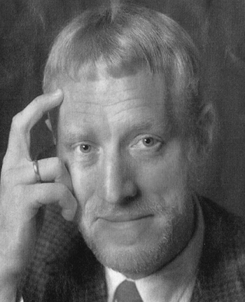

Bild: um 1968; Unknown. CC BY 4.0 laut Wikimedia Commons. [Bildquelle](https://commons.wikimedia.org/wiki/File:Max_von_Sydow_SPA1_(cropped).jpg), [TMDB](https://www.themoviedb.org/person/2201).

### L1 · leicht

Mit welchem Spiel fordert Max von Sydows Ritter in „Das siebente Siegel“ den Tod heraus?

- **Richtig: Schach**

- Würfeln

- Backgammon

- Kartenspielen

Antonius Block spielt mit dem Tod Schach.

Der heimkehrende Ritter versucht, Zeit zu gewinnen und eine Antwort auf seine Glaubenszweifel zu finden. Von Sydows ernste, kontrollierte Präsenz hält die Begegnung zwischen Mensch und Allegorie zusammen. Das berühmte Bild ist deshalb mehr als ein ungewöhnlicher Wettkampf: Es macht das Nachdenken über Sterblichkeit unmittelbar sichtbar.

Merksatz: Von Sydows Ritter gewinnt beim Schach Zeit gegen den Tod.

Gemeinsames Wissensziel: K-ART-05-01 (ART-L-009).

Quellen: [1](https://www.bfi.org.uk/lists/max-von-sydow-10-essential-films).

### L2 · leicht

Welchen Priester spielt Max von Sydow im ersten „Exorzist“-Film?

- Pater Karras

- **Richtig: Pater Merrin**

- Pater Dyer

- Pater Lamont

Von Sydow spielt Pater Lankester Merrin.

Merrin kommt als erfahrener Exorzist zur Hilfe, während der jüngere Karras mit persönlichen und religiösen Zweifeln ringt. Die beiden Figuren haben unterschiedliche Aufgaben. Von Sydows große Ruhe und sein gealtertes Erscheinungsbild lassen Merrin als jemanden wirken, der die Gefahr bereits kennt.

Merksatz: Von Sydow ist der erfahrene Pater Merrin.

Quellen: [1](https://www.bfi.org.uk/lists/max-von-sydow-10-essential-films).

### M1 · mittel

Mit welchem schwedischen Regisseur verband Max von Sydow eine prägende, langjährige Zusammenarbeit?

- Bo Widerberg

- Roy Andersson

- **Richtig: Ingmar Bergman**

- Lukas Moodysson

Die Zusammenarbeit mit Ingmar Bergman prägte seinen frühen Filmruhm.

Bergman setzte von Sydow für sehr unterschiedliche Figuren ein: Ihre gemeinsamen Arbeiten verhandeln Glauben, Kunst und die Folgen von Gewalt. Die ernste Erscheinung des Darstellers durfte dabei nicht nur Autorität ausstrahlen. Sie konnte ebenso Unsicherheit, Selbsttäuschung und moralischen Zusammenbruch sichtbar machen.

Merksatz: Von Sydows frühe Filmkunst ist eng mit Bergman verbunden.

Quellen: [1](https://www.bfi.org.uk/lists/max-von-sydow-10-essential-films).

### M2 · mittel

Welche familiäre Aufgabe hat Max von Sydows Lasse in „Pelle, der Eroberer“?

- Er sucht als älterer Bruder nach Pelle.

- Er erzieht Pelle als dessen angestellter Hauslehrer.

- Er ist Pelles dänischer Arbeitgeber.

- **Richtig: Er ist Pelles Vater und versucht, den Sohn als Einwanderer zu schützen.**

Lasse ist Pelles Vater.

Vater und Sohn kommen aus Schweden auf die dänische Insel Bornholm. Die Hoffnung auf ein besseres Leben trifft auf harte Arbeitsbedingungen und soziale Demütigung. Von Sydow zeigt einen Vater, dessen Würde nicht mit uneingeschränkter Stärke zusammenfällt; er möchte Schutz geben und stößt doch selbst an Grenzen.

Merksatz: Lasse versucht, Pelle in einer fremden Arbeitswelt Halt zu geben.

Quellen: [1](https://www.bfi.org.uk/lists/max-von-sydow-10-essential-films).

### S1 · schwer

Wer gestaltete die Altersmaske, mit der Max von Sydow in „Der Exorzist“ ungefähr drei Jahrzehnte älter wirkte?

- **Richtig: Dick Smith**

- John Chambers

- Stuart Freeborn

- Jack Pierce

Maskenbildner Dick Smith schuf das deutlich gealterte Erscheinungsbild.

Von Sydow war zur Zeit des Films erheblich jünger als Merrin. Die Maske vermittelt Lebenserfahrung, bevor er viel über seine Vergangenheit sagt. Zusammen mit Körperhaltung und ruhiger Stimme entsteht eine Figur, deren Alter als dramatische Information funktioniert und nicht dem tatsächlichen Lebensalter des Schauspielers entspricht.

Merksatz: Merrins Alter ist eine gemeinsam gestaltete Filmillusion.

Quellen: [1](https://www.bfi.org.uk/lists/max-von-sydow-10-essential-films).

### S2 · schwer

Welchen Weg verfolgt Jan Troells Zweiteiler mit Max von Sydow und Liv Ullmann, „Die Auswanderer“ und „Das neue Land“?

- Von Dänemark nach Argentinien

- **Richtig: Von Schweden nach Minnesota**

- Von Norwegen nach Australien

- Von Finnland nach Kanada

Die Geschichte führt aus Småland nach Minnesota.

Troell folgt Bauern und religiösen Außenseitern auf ihrem Weg aus Armut und Enge in eine neue Existenz. Die beiden Filme verbinden Aufbruch mit dem mühsamen Aufbau eines Lebens in Amerika. Von Sydow und Ullmann tragen eine lange Entwicklung, in der Hoffnung und Verlust zusammengehören.

Merksatz: Troells Auswanderer verlassen Schweden und bauen in Minnesota neu auf.

Quellen: [1](https://www.bfi.org.uk/lists/max-von-sydow-10-essential-films).

### E1 · experte

Wie gestaltet Max von Sydow den Vorführer Vogler in Bergmans „Das Gesicht“ über weite Strecken?

- Als ununterbrochen redenden Bühnenkomiker

- Als Erzähler außerhalb der sichtbaren Handlung

- **Richtig: Als scheinbar stummen Künstler, der unter skeptischer Beobachtung steht**

- Als Sänger, dessen Dialoge vollständig vertont sind

Vogler gibt sich lange als stumm aus.

Der Künstler wird von einem wissenschaftlichen Skeptiker als möglicher Scharlatan geprüft. Von Sydow muss die Spannung deshalb über Gesicht, Haltung und die Reaktionen anderer tragen. Das scheinbare Schweigen gehört zum Machtkampf um Illusion und Entlarvung und macht den Körper selbst zum Ort der Darstellung.

Merksatz: Voglers Schweigen steht im Zentrum einer Prüfung seiner Kunst.

Quellen: [1](https://www.bfi.org.uk/lists/max-von-sydow-10-essential-films).

### E2 · experte

Welche Veränderung vollzieht Max von Sydows Jan in Bergmans „Schande“ unter dem Druck des Krieges?

- Vom politischen Anführer zum weltabgewandten Mönch

- Vom gewalttätigen Offizier zum kompromisslosen Pazifisten

- Vom wohlhabenden Industriellen zum idealistischen Lehrer

- **Richtig: Vom konfliktscheuen Musiker zum Mann, der selbst tötet**

Der zunächst ängstliche Musiker wird selbst zum Täter.

Zu Beginn lebt das Paar abseits der Politik und hofft, sich heraushalten zu können. Der Krieg zerstört diese Distanz. Von Sydow zeigt den moralischen Abstieg nicht als Entfaltung einer von Anfang an offenkundigen Brutalität, sondern als erschreckende Veränderung eines scheinbar unkriegerischen Menschen.

Merksatz: Jans Rückzug vor der Gewalt verhindert seine eigene Verrohung nicht.

Quellen: [1](https://www.bfi.org.uk/lists/max-von-sydow-10-essential-films).

## Christopher Lee · Bekanntheitsgruppe 3

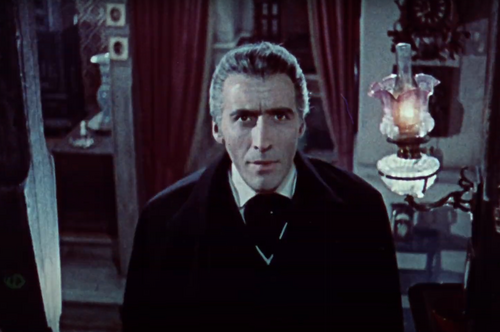

Bild: 1958; HD Retro Trailers. Public domain laut Wikimedia Commons. [Bildquelle](https://commons.wikimedia.org/wiki/File:Dracula_(1958)_trailer_-_Christopher_Lee.png), [TMDB](https://www.themoviedb.org/person/113).

### L1 · leicht

Welche klassische Horrorfigur machte Christopher Lee ab 1958 in den Hammer-Filmen besonders berühmt?

- **Richtig: Graf Dracula**

- Die Mumie Imhotep

- Dr. Jekyll

- Der Wolfsmensch

Lee wurde zu einem prägenden Darsteller des Grafen Dracula.

Sein großer Körper, die Stimme und die kontrollierte Bewegung verliehen dem Vampir eine neue Präsenz. Bedrohung und Anziehung konnten gleichzeitig wirken. Die Rolle eröffnete eine lange Horrorfilmphase, legte Lee aber auch auf Erwartungen fest, aus denen er später mit anderen Charakteren auszubrechen versuchte.

Merksatz: Lees Dracula verbindet aristokratische Haltung und körperliche Gefahr.

Quellen: [1](https://www.bfi.org.uk/sight-and-sound/news/christopher-lee-1922-2015-one-cinemas-world-class-villains), [2](https://www.bfi.org.uk/lists/peter-cushing-10-essential-films).

### L2 · leicht

Welchen Zauberer spielt Christopher Lee in Peter Jacksons „Herr der Ringe“-Filmen?

- Gandalf

- **Richtig: Saruman**

- Radagast

- Alatar

Lee spielt Saruman.

Der weiße Zauberer benutzt Wissen und Autorität, um andere zu beherrschen. Lees ruhiger Vortrag und seine mächtige Stimme geben dieser Verführungskraft eine konkrete Form. Die Besetzung knüpft an seine Erfahrung mit bedrohlichen Autoritätsfiguren an und bringt sie in eine große Fantasywelt ein.

Merksatz: Christopher Lees Zauberer heißt Saruman.

Quellen: [1](https://www.bfi.org.uk/sight-and-sound/news/christopher-lee-1922-2015-one-cinemas-world-class-villains), [2](https://www.bfi.org.uk/lists/christopher-lee-10-essential-films).

### M1 · mittel

Wie heißt Christopher Lees Gegenspieler von James Bond in „Der Mann mit dem goldenen Colt“?

- Ernst Stavro Blofeld

- Hugo Drax

- **Richtig: Francisco Scaramanga**

- Karl Stromberg

Lee spielt den Auftragsmörder Francisco Scaramanga.

Scaramanga ist Bond als Schütze und Genussmensch verwandt, steht aber auf der anderen Seite. Lee verleiht dem Killer höfliche Selbstsicherheit und einen spielerischen Umgang mit seiner tödlichen Fähigkeit. Die Gefahr entsteht gerade aus einem Gegner, der nicht wie ein bloß grobschlächtiger Handlanger auftritt.

Merksatz: Scaramanga ist Lees eleganter, tödlicher Anti-Bond.

Quellen: [1](https://www.bfi.org.uk/lists/christopher-lee-10-essential-films).

### M2 · mittel

Welchen Part spielt Christopher Lee in „Frankensteins Fluch“ von 1957?

- Victors wissenschaftlichen Lehrer

- Den Gefängnisgeistlichen

- Baron Victor Frankenstein

- **Richtig: Die von Frankenstein geschaffene Kreatur**

Lee verkörpert die Kreatur; Peter Cushing spielt ihren Schöpfer.

Lee gestaltet das Geschöpf als beschädigtes, fremdgesteuertes Wesen. Dessen Gewalttätigkeit steht neben einer körperlichen Hilflosigkeit, die eher Mitleid als souveräne Bosheit weckt. Die Unterscheidung vom ehrgeizigen Wissenschaftler ist entscheidend: Mensch und Kreatur erfüllen sehr verschiedene Funktionen in diesem Horrorfilm.

Merksatz: Lee ist die Kreatur, Cushing ihr Schöpfer.

Quellen: [1](https://www.bfi.org.uk/lists/christopher-lee-10-essential-films).

### S1 · schwer

Wen spielt Christopher Lee in Billy Wilders „Das Privatleben des Sherlock Holmes“?

- **Richtig: Mycroft, Sherlock Holmes’ Bruder**

- Professor Moriarty

- Inspektor Lestrade

- Dr. Watson

Lee spielt Mycroft Holmes.

Mycrofts kultivierter, spöttischer Humor bot Lee Raum jenseits seiner häufigen Gruselrollen. Die Arbeit mit Wilder war für ihn deshalb ein bedeutender Schritt aus seiner selbst so bezeichneten Friedhofsphase. Der Auftritt veränderte auch, welche Möglichkeiten andere Filmschaffende in seinem Spiel sahen.

Merksatz: Wilders Mycroft zeigte eine andere Seite von Lees Autorität.

Quellen: [1](https://www.bfi.org.uk/lists/christopher-lee-10-essential-films), [2](https://www.bfi.org.uk/sight-and-sound/news/christopher-lee-1922-2015-one-cinemas-world-class-villains).

### S2 · schwer

Bei welcher britischen Filmorganisation wurde Christopher Lee nach dem Krieg für die Nachwuchsschule „Company of Youth“ verpflichtet?

- Ealing Studios

- **Richtig: Rank Organisation**

- Hammer Film Productions

- London Films

Lee erhielt einen Vertrag bei der Rank Organisation.

Die sogenannte Charm School in Highbury sollte jungen Vertragsschauspielern den Einstieg ermöglichen. Lee begann dadurch mit Ausbildung, kleinen Auftritten und Filmrollen, lange bevor er bei Hammer zum Star wurde. Sein Durchbruch als Horrorfigur war also nicht zugleich sein erster Schritt in den Beruf.

Merksatz: Vor Hammer kam Lees Nachwuchsvertrag bei Rank.

Quellen: [1](https://www.bfi.org.uk/sight-and-sound/news/christopher-lee-1922-2015-one-cinemas-world-class-villains).

### E1 · experte

Was geschah mit Christopher Lees Saruman-Szenen in der ursprünglichen Kinofassung von „Die Rückkehr des Königs“?

- Sie wurden vollständig mit einem anderen Darsteller neu gedreht.

- Sie wurden als Rückblenden an den Filmanfang gesetzt.

- **Richtig: Sie entfielen und wurden erst in der erweiterten Fassung zugänglich.**

- Sie wurden ausschließlich als Zeichentricksequenz verwendet.

Saruman fehlt in der Kinofassung; die erweiterte Fassung enthält seinen Abschluss.

Lee drehte noch 2003 Material für den dritten Film. Die Entscheidung beim Schnitt veränderte dennoch, was das Kinopublikum von seiner Figur sah. Ein Schauspielauftritt entsteht damit nicht allein am Drehort: Auswahl und Fassung bestimmen, ob eine bereits gespielte Szene Teil der veröffentlichten Erzählung wird.

Merksatz: Saruman kehrt in der erweiterten Fassung zurück.

Quellen: [1](https://www.bfi.org.uk/lists/christopher-lee-10-essential-films).

### E2 · experte

In welcher Musikrichtung wirkte Christopher Lee an den „Charlemagne“-Konzeptalben mit?

- Swing

- Country

- Barockoper

- **Richtig: Heavy Metal**

Die Alben verbinden Lee mit Heavy Metal.

Lee setzte seine Stimme im hohen Alter auch für Musik über Karl den Großen ein. 2010 erschien das erste „Charlemagne“-Album. Damit bekam die bekannte Stimme außerhalb des Kinos ein neues Arbeitsfeld, das historische Erzählung und eine überraschende Musikrichtung zusammenführte.

Merksatz: Lees späte Musikkarriere führte bis zum Heavy Metal.

Quellen: [1](https://www.lemonde.fr/cinema/article/2012/12/24/de-dracula-au-heavy-metal-les-chansons-de-noel-de-christopher-lee_5981212_3476.html).

## Peter Cushing · Bekanntheitsgruppe 3

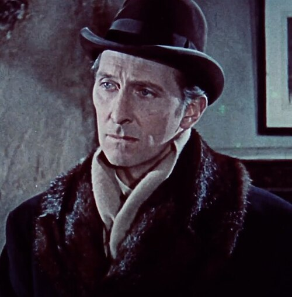

Bild: 1958; Screenshot from "Internet Archive" of the movie Dracula (1958). Public domain laut Wikimedia Commons. [Bildquelle](https://commons.wikimedia.org/wiki/File:Dracula_(1958)_trailer_-_Peter_Cushing_(cropped).jpg), [TMDB](https://www.themoviedb.org/person/5).

### L1 · leicht

Welche Figur spielt Peter Cushing im ersten „Star Wars“-Kinofilm von 1977?

- **Richtig: Großmoff Tarkin**

- Obi-Wan Kenobi

- Imperator Palpatine

- General Dodonna

Cushing verkörpert Großmoff Tarkin.

Tarkin gibt der Macht des Imperiums ein menschliches Gesicht. Seine höfliche Kälte und sichere Autorität machen deutlich, dass die Bedrohung nicht allein von Darth Vaders Maske ausgeht. Cushing bringt eine bereits aus früheren Rollen bekannte Fähigkeit zur präzisen Darstellung herrischer Figuren in die Weltraumgeschichte ein.

Merksatz: Tarkin ist Cushings menschliches Gesicht imperialer Macht.

Quellen: [1](https://www.bfi.org.uk/lists/peter-cushing-10-essential-films).

### L2 · leicht

Wen verkörpert Peter Cushing als Gegner von Christopher Lees Dracula in der Hammer-Verfilmung von 1958?

- Jonathan Harker

- **Richtig: Van Helsing**

- Arthur Holmwood

- Dr. Seward

Cushing spielt den Vampirjäger Van Helsing.

Hier steht er auf der rettenden Seite des Konflikts. Der gelehrte Gegner des Vampirs muss Wissen in entschlossenes Handeln umsetzen. Cushing verbindet dafür Intelligenz mit einer für seine Rollen auffallend beweglichen, abenteuerlichen Energie; der Schlusskampf verlangt mehr als das Vortragen einer richtigen Erklärung.

Merksatz: Cushings Van Helsing verbindet Wissen und Tatkraft.

Quellen: [1](https://www.bfi.org.uk/lists/peter-cushing-10-essential-films).

### M1 · mittel

Welche Stellung hat Peter Cushings Figur in „Frankensteins Fluch“?

- Sie ist die wiederbelebte Kreatur.

- Sie untersucht den Fall als Polizeibeamter.

- **Richtig: Sie ist der Wissenschaftler, der die Kreatur erschafft.**

- Sie ist der Lehrer, der alle Versuche verhindert.

Cushing spielt den ehrgeizigen Baron Frankenstein.

Seine Figur stellt die eigenen Experimente über das Leben anderer Menschen. Der Horror entsteht deshalb auch aus dem scheinbar vernünftigen Forscher, nicht nur aus dem sichtbaren Geschöpf. Cushings beherrschte Darstellung macht die Rücksichtslosigkeit gerade dort spürbar, wo der Baron sachlich und überlegen zu wirken versucht.

Merksatz: Bei Cushing sitzt das Entsetzen auch im Kopf des Forschers.

Quellen: [1](https://www.bfi.org.uk/lists/peter-cushing-10-essential-films).

### M2 · mittel

Welche Orwell-Figur spielte Peter Cushing 1954 in der BBC-Fernsehfassung von „1984“?

- O’Brien

- Emmanuel Goldstein

- Big Brother

- **Richtig: Winston Smith**

Cushing spielt Winston Smith.

Diese Fernsehproduktion entstand drei Jahrzehnte vor der Kinofassung mit John Hurt. Cushing zeigt den Versuch eines gewöhnlichen Menschen, in einer überwachten Welt Nähe und Eigenständigkeit zu bewahren. Die damalige Darstellung von Folter und Erniedrigung führte zu einer öffentlichen Kontroverse über das Fernsehprogramm.

Merksatz: Cushing war schon 1954 Winston Smith im BBC-Fernsehen.

Quellen: [1](https://www.bfi.org.uk/lists/peter-cushing-10-essential-films), [2](https://www.bfi.org.uk/features/nineteen-eighty-four-adaptations).

### S1 · schwer

Warum folgte auf Peter Cushings Sherlock-Holmes-Film „Der Hund von Baskerville“ keine damals geplante Hammer-Kinoreihe?

- **Richtig: Der Film blieb an der Kinokasse hinter den Erwartungen zurück.**

- Cushing war anschließend durch einen exklusiven Fernsehvertrag gebunden.

- Ein Streit um die Rechte verhinderte weitere Hammer-Verfilmungen.

- Das Studio entschied sich gegen Reihen und nur noch für Einzelfilme.

Der erhoffte Kinoerfolg blieb aus.

Hammer hatte mit dem Film eine Reihe beginnen wollen. Der Plan wurde nach dem enttäuschenden Ergebnis aufgegeben. Cushing kehrte später im BBC-Fernsehen zu Holmes zurück. Eine Rolle kann also zum festen Repertoire eines Darstellers werden, auch wenn die zunächst vorgesehene Produktionsserie nicht zustande kommt.

Merksatz: Hammer stoppte den Kino-Reihenplan; Cushing blieb Holmes dennoch verbunden.

Quellen: [1](https://www.bfi.org.uk/lists/peter-cushing-10-essential-films).

### S2 · schwer

Welche Rollen spielen Peter Cushing und sein früherer Watson André Morell in „Cash on Demand“?

- Richter und Verteidiger

- **Richtig: Bankmanager und Bankräuber**

- Gefängnisdirektor und Gefangener

- Versicherungsagent und Polizeiermittler

Cushing ist der Bankmanager, Morell der Räuber.

Die früheren Holmes-und-Watson-Darsteller begegnen sich nun als Gegner. Während die übrigen Bankangestellten den Überfall zunächst nicht bemerken, muss der Manager unter Druck funktionieren. Morells verbindlicher Charme und Cushings wachsende Angst tragen einen Film, der über weite Strecken von ihrem Zusammenspiel lebt.

Merksatz: Aus Holmes und Watson werden Manager und Räuber.

Quellen: [1](https://www.bfi.org.uk/lists/peter-cushing-10-essential-films).

### E1 · experte

Welche Aktion führte Peter Cushing im Finale von „Dracula“ selbst aus?

- Den vollständigen Kampf unter Wasser

- Den Sprung vom Schlossturm auf ein fahrendes Pferd

- **Richtig: Den Sprung zum Vorhang, um Sonnenlicht hereinzulassen**

- Den Sturz durch eine einstürzende Treppe

Cushing sprang selbst zum Vorhang, der das Sonnenlicht abhielt.

Van Helsings Sieg erfordert einen schnellen körperlichen Zugriff auf die Umgebung. Cushing übernahm bei dem Schlusskampf mehrere Stunts selbst. Die Szene ergänzt das Bild des intellektuellen Charakterschauspielers um präzise Bewegung und zeigt, wie Wissen und körperliche Ausführung in einer Rolle zusammenwirken.

Merksatz: Van Helsing gewinnt auch durch Cushings eigenen Sprung.

Quellen: [1](https://www.bfi.org.uk/lists/peter-cushing-10-essential-films).

### E2 · experte

Wie erhielt Tarkin in „Rogue One“ wieder Peter Cushings Gesicht, obwohl Cushing bereits verstorben war?

- Durch eine neu entdeckte vollständige Aufnahme von Cushing

- Durch eine unveränderte Szene aus dem Film von 1977

- Durch Maskenbild ohne digitale Bildbearbeitung

- **Richtig: Durch eine digitale Rekonstruktion über Guy Henrys neuem Spiel**

Guy Henry spielte die Rolle; digitale Effekte rekonstruierten Cushings Gesicht.

Industrial Light & Magic verband eine neue Darstellung mit dem rekonstruierten Erscheinungsbild. Henrys Bewegungen und Ausdruck lieferten dafür die Grundlage. Der sichtbare Tarkin gehört somit zu mehreren Arbeitsleistungen: der ursprünglichen Figurenprägung durch Cushing, dem neuen Schauspiel und der Gestaltung durch die Effektabteilung.

Merksatz: Der neue Tarkin verbindet Guy Henrys Spiel mit Cushings rekonstruiertem Aussehen.

Quellen: [1](https://www.motionpictures.org/2017/09/watch-vfx-magic-brought-peter-cushing-back-life-rogue-one/), [2](https://www.ilm.com/vfx/rogue-one/).

## Vincent Price · Bekanntheitsgruppe 3

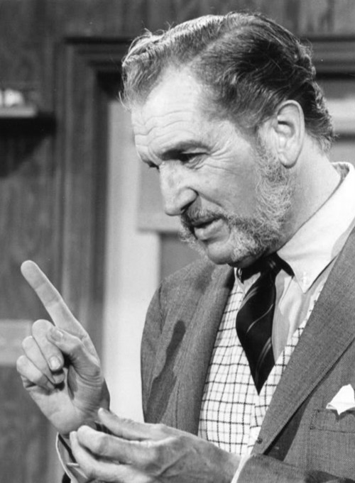

Bild: 1969; CBS Television. Public domain laut Wikimedia Commons. [Bildquelle](https://commons.wikimedia.org/wiki/File:Vincent_Price_in_The_Good_Guys_1969_(cropped).JPG), [TMDB](https://www.themoviedb.org/person/1905).

### L1 · leicht

Welchen Beruf hat Vincent Prices rachsüchtige Hauptfigur in „Das Kabinett des Professor Bondi“?

- Er ist Leichenbeschauer

- Er ist Puppenspieler

- **Richtig: Er ist Bildhauer eines Wachsfigurenkabinetts**

- Er ist Zauberkünstler

Price spielt einen auf Wachsfiguren spezialisierten Bildhauer.

Die Rolle machte Price in den 1950er-Jahren zu einem prägenden Gesicht des Horrorfilms. Das scheinbar elegante Ausstellungsmilieu verbindet Kunstfertigkeit mit tödlicher Bedrohung. Sein kultiviertes Auftreten wird dadurch zur Fassade einer Figur, die nach einer Katastrophe Rache sucht.

Merksatz: Prices Bondi verwandelt das Wachsfigurenkabinett in einen Ort des Schreckens.

Quellen: [1](https://www.vincentprice.com/about).

### L2 · leicht

Auf welcher berühmten Aufnahme von Michael Jackson ist Vincent Prices gesprochener Gruselbeitrag zu hören?

- **Richtig: Thriller**

- Bad

- Billie Jean

- Beat It

Price spricht den markanten Gruseltext in „Thriller“.

Seine Stimme trug den Horrorfilmklang in einen weltweit bekannten Popsong. Die Wirkung beruht auf dem Gegensatz zwischen dem Tanzrhythmus und Prices bedrohlich gesprochener Passage. Der Auftritt gehört zu seinen späten Arbeiten, bei denen schon der Klang seiner Stimme einen starken Wiedererkennungswert hatte.

Merksatz: Prices Horrorfilmstimme gehört zum Klang von „Thriller“.

Quellen: [1](https://www.vincentprice.com/about).

### M1 · mittel

Warum konnte der Erfinder (Vincent Price) in „Edward mit den Scherenhänden“ Edwards Hände nicht fertigstellen?

- Die Bewohner zerstörten seine Werkstatt

- Edward lief vorzeitig davon

- Ihm wurde das nötige Metall gestohlen

- **Richtig: Er starb, bevor er Edward die vorgesehenen Hände geben konnte**

Der Erfinder stirbt vor der Vollendung seiner Schöpfung.

Edward (Johnny Depp) erinnert sich an den Moment, in dem sein Schöpfer ihm menschliche Hände überreichen wollte. Dessen plötzlicher Tod lässt die künstlichen Scherenhände zurück. Die liebevolle Beziehung zum Erfinder erklärt, warum Edward zugleich geschaffen, unfertig und auf sich allein gestellt ist.

Merksatz: Der Tod des Erfinders lässt Edward mit Scherenhänden zurück.

Quellen: [1](https://catalog.afi.com/Film/58487-EDWARD-SCISSORHANDS), [2](https://www.20thcenturystudios.com/movies/edward-scissorhands).

### M2 · mittel

Warum verfolgt Richard Marshall (Ian Ogilvy) in „Der Hexenjäger“ Matthew Hopkins (Vincent Price)?

- Hopkins raubte die Soldkasse und ließ Richards Vater verhaften

- **Richtig: Hopkins ließ den Priester John Lowes töten und misshandelte Sara**

- Hopkins verbrannte Richards Haus und raubte seine Ernte

- Hopkins ermordete den Kommandanten und beschuldigte Richard

Richard will sich für die Gewalt an seiner Verlobten und dem Priester Lowes rächen.

Hopkins kommt in ein Dorf, dessen Bewohner den Priester Lowes (Rupert Davies) und Sara (Hilary Heath) der Hexerei beschuldigen. Nach dem Mord an Lowes und der Misshandlung Saras nimmt ihr Verlobter Richard die Verfolgung auf. Aus Hopkins’ Terror entsteht so eine persönliche Rachegeschichte.

Merksatz: Die Gewalt an Sara und dem Priester John Lowes macht Richard zu Hopkins’ Verfolger.

Quellen: [1](https://www.bfi.org.uk/features/witchfinder-general-michael-reeves-vincent-price), [2](https://www.bfi.org.uk/features/witchfinder-general-locations-vincent-price-folk-horror).

### S1 · schwer

Wessen Erzählungen verbinden Vincent Prices Zusammenarbeit mit Roger Corman in Filmen wie „Die Verfluchten“ und „Das Pendel des Todes“?

- H. P. Lovecrafts

- Bram Stokers

- **Richtig: Edgar Allan Poes**

- Mary Shelleys

Corman und Price arbeiteten an einem Zyklus nach Edgar Allan Poe.

Die Adaptionen machten Price zu einem wiederkehrenden Gesicht einer literarisch geprägten Horrorwelt. Verfall, Schuld und bedrohte Familien verbinden die Stoffe. Die Zusammenarbeit erstreckte sich über mehrere eigenständige Filme; sie bildet keine fortlaufende Geschichte derselben Figur.

Merksatz: Corman und Price führen in die unheimliche Welt Poes.

Quellen: [1](https://www.bfi.org.uk/lists/roger-corman-10-essential-films), [2](https://www.vincentprice.com/about).

### S2 · schwer

Welchen Schriftsteller verkörperte Vincent Price in seinem Bühnen-Soloprogramm „Diversions and Delights“?

- **Richtig: Oscar Wilde**

- Edgar Allan Poe

- Charles Dickens

- Mark Twain

Price trat als Oscar Wilde auf.

Die Library of Congress dokumentiert die Tournee mit dem Einpersonenstück von 1977 bis 1982. Price stellte seine Stimme und Bühnenpräsenz dabei in den Dienst eines Schriftstellerporträts. Die Arbeit zeigt eine fortgesetzte Theaterlaufbahn neben dem öffentlichen Bild als Horrorfilmstar.

Merksatz: In „Diversions and Delights“ wurde Price auf der Bühne zu Oscar Wilde.

Quellen: [1](https://findingaids.loc.gov/repositories/19/resources/2033).

### E1 · experte

Wie unterstützten Vincent Price und seine Frau Mary 1957 den Aufbau eines Museums am East Los Angeles College?

- Sie entwarfen einen neuen Ausstellungsbau

- Sie restaurierten bereits vorhandene Sammlungsbestände

- Sie finanzierten den Ankauf einer Gemäldesammlung

- **Richtig: Sie spendeten Werke aus ihrer privaten Kunstsammlung**

Ihre Kunstspende bildete den Grundstock der Museumssammlung.

Das heutige Vincent Price Art Museum nennt 90 Werke als ursprüngliche Schenkung des Ehepaars. Price gab in den folgenden Jahrzehnten weitere Kunstwerke hinzu. Der Bestand umfasste von Beginn an unterschiedliche Weltregionen und machte seine private Sammelleidenschaft für ein öffentliches Bildungsumfeld zugänglich.

Merksatz: Prices private Sammlung wurde zum öffentlichen Museumsbestand.

Quellen: [1](https://vincentpriceartmuseum.org/collections.html).

### E2 · experte

Welches Sachgebiet behandelten Vincent Price und seine Frau Mary in ihrem gemeinsamen Buch von 1965?

- Die Geschichte des Horrorfilms

- **Richtig: Internationale Küche und Rezepte**

- Die Restaurierung alter Gemälde

- Die Architektur europäischer Theater

Gemeinsam veröffentlichten sie ein Kochbuch.

„A Treasury of Great Recipes“ gehört zu Prices Arbeiten als begeisterter Feinschmecker. Die offizielle Nachlassseite nennt Mary ausdrücklich als Mitautorin. Das Projekt steht neben seinen Büchern über Kunst und zeigt, dass seine Interessen auch in eigenständigen Sachpublikationen sichtbar wurden.

Merksatz: Price schrieb mit Mary über gutes Essen.

Quellen: [1](https://www.vincentprice.com/about), [2](https://www.vincentprice.com/).

## Christopher Plummer · Bekanntheitsgruppe 3

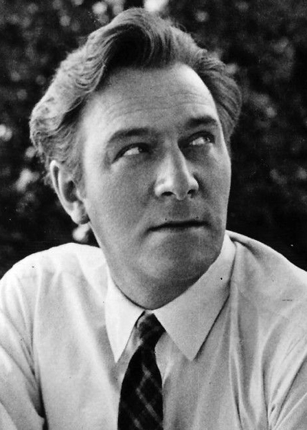

Bild: 1964; 20th Century Fox. Public domain laut Wikimedia Commons. [Bildquelle](https://commons.wikimedia.org/wiki/File:Christopher_Plummer_1964.jpg), [TMDB](https://www.themoviedb.org/person/290).

### L1 · leicht

Welche Figur spielt Christopher Plummer in „Meine Lieder – meine Träume“?

- Max Detweiler

- **Richtig: Captain von Trapp**

- Herr Zeller

- Franz

Plummer spielt Captain von Trapp.

Der verwitwete Vater führt sein Haus zunächst mit strenger Disziplin. Maria (Julie Andrews) bringt Musik und neue Nähe in das Familienleben. Plummers Figur verändert sich dadurch vom distanzierten Hausherrn zum Partner der Erzieherin; die politische Bedrohung zwingt die Familie schließlich zur Flucht.

Merksatz: Plummer ist der strenge Vater der Familie von Trapp.

Quellen: [1](https://www.rsc.org.uk/news/archive/christopher-plummer-1929-2021).

### L2 · leicht

Welcher Figur leiht Christopher Plummer in der englischen Originalfassung von „Oben“ seine Stimme?

- Carl Fredricksen

- Russell

- Dug

- **Richtig: Charles Muntz**

Er spricht den Abenteurer Charles Muntz.

Muntz war in Carls Kindheit ein bewunderter Entdecker. Die spätere Begegnung zeigt jedoch einen besessenen Mann, der seinen beschädigten Ruf um jeden Preis wiederherstellen will. Plummers Stimme verbindet den zunächst eindrucksvollen Gastgeber mit der wachsenden Bedrohung für die Reisenden.

Merksatz: Plummers Stimme gehört dem einst gefeierten Entdecker Muntz.

Quellen: [1](https://www.pixar.com/up), [2](https://d23.com/app/uploads/2012/08/azsupp_082712.pdf).

### M1 · mittel

Welche späte persönliche Veränderung erlebt Hal (Christopher Plummer) in „Beginners“ nach dem Tod seiner Frau?

- **Richtig: Er lebt erstmals offen als schwuler Mann**

- Er tritt in ein Kloster ein

- Er bricht jeden Kontakt zu seinem Sohn ab

- Er beginnt eine neue Karriere als Berufsmusiker

Hal lebt nach der langen Ehe offen schwul.

Sein Sohn Oliver (Ewan McGregor) erinnert sich nach Hals Tod an dessen neu gewonnene Offenheit. Die Erfahrungen des Vaters ermutigen ihn bei seiner eigenen Beziehung zu Anna (Mélanie Laurent). Regisseur Mike Mills beschreibt den Film als von seinem Vater angeregt, ohne Hal als bloße Kopie einer realen Person zu verstehen.

Merksatz: Hals später Neuanfang verändert auch den Blick seines Sohnes auf Liebe.

Quellen: [1](https://www.focusfeatures.com/beginners), [2](https://www.focusfeatures.com/article/beginners_director___s_statement).

### M2 · mittel

Womit hat Harlan Thrombey (Christopher Plummer) in „Knives Out“ sein Vermögen verdient?

- Mit einer Hotelkette

- Mit einer Privatbank

- **Richtig: Mit Kriminalromanen**

- Mit einem Pharmaunternehmen

Harlan ist ein erfolgreicher Kriminalschriftsteller.

Nach seinem fünfundachtzigsten Geburtstag wird Harlan tot auf seinem Anwesen gefunden. Der Ermittler Benoit Blanc (Daniel Craig) prüft die widersprüchlichen Interessen seiner Familie und seines Personals. Das Vermögen eines Autors von Rätselgeschichten wird damit zum Einsatz eines neuen Kriminalfalls.

Merksatz: Der Krimiautor Harlan wird selbst zum Mittelpunkt eines Rätsels.

Quellen: [1](https://app.powster.com/lionsgateus/knives-out/us/synopsis/).

### S1 · schwer

Welche ungewöhnliche Produktionsaufgabe übernahm Christopher Plummer bei „Alles Geld der Welt“ kurz vor dem Kinostart?

- **Richtig: Er drehte Kevin Spaceys bereits aufgenommene Rolle neu**

- Er vervollständigte das Drehbuch als Coautor

- Er übernahm die Regie der letzten Drehtage

- Er ersetzte die gesamte Erzählerstimme

Er spielte die Rolle des J. Paul Getty in kurzfristigen Neuaufnahmen.

Ridley Scott ließ die zuvor mit Kevin Spacey gedrehten Szenen neu aufnehmen. Plummer übernahm den Milliardär, der sich weigert, das Lösegeld für seinen entführten Enkel zu zahlen. Seine Mitwirkung war damit ein vollständiger neuer Schauspielauftritt und keine bloße nachträgliche Synchronisation.

Merksatz: Plummer spielte Getty in den kurzfristigen Neuaufnahmen.

Quellen: [1](https://www.vanityfair.com/hollywood/2017/11/christopher-plummer-kevin-spacey-all-the-money-in-the-world), [2](https://www.sonypictures.com/movies/allthemoneyintheworld).

### S2 · schwer

Welche Shakespeare-Figur spielte Christopher Plummer 1961 bei seinem britischen Debüt mit der Royal Shakespeare Company in „Viel Lärm um nichts“?

- Claudio

- Don Pedro

- **Richtig: Benedick**

- Don John

Er spielte Benedick.

Plummer kam vom Stratford-Festival in Ontario zur neu gegründeten Royal Shakespeare Company. In Michael Langhams Inszenierung stand ihm Geraldine McEwan als Beatrice gegenüber. Die RSC erinnerte später außerdem an seinen Richard III. in derselben Spielzeit; sein britischer Einstieg umfasste somit Komödie und Königsdrama.

Merksatz: Plummers britischer Einstieg führte ihn als Benedick zur RSC.

Quellen: [1](https://www.rsc.org.uk/news/archive/christopher-plummer-1929-2021).

### E1 · experte

In welcher Kategorie gewann Christopher Plummer 2012 für „Beginners“ seinen Oscar?

- Beste männliche Hauptrolle

- **Richtig: Beste männliche Nebenrolle**

- Bestes adaptiertes Drehbuch

- Beste Regie

Er gewann als bester Nebendarsteller.

Ausgezeichnet wurde seine Darstellung des Hal, dessen spätes Coming-out das Leben seines Sohnes mitprägt. Die Academy verzeichnet den Sieg zwischen seinen Nominierungen für „Ein russischer Sommer“ und „Alles Geld der Welt“. Die Ehrung würdigt somit eine konkrete Schauspielarbeit in seiner späten Karriere.

Merksatz: Plummers Oscar für Hal war ein Nebendarstellerpreis.

Quellen: [1](https://www.oscars.org/sites/oscars/files/90th-factsheet.pdf).

### E2 · experte

In welchen beiden Bühnenkategorien gewann Christopher Plummer Tonys für „Cyrano“ und „Barrymore“?

- Regie und Choreografie

- Drehbuch und Bühnenbild

- Nebendarsteller und Musicalregie

- **Richtig: Hauptdarsteller im Musical und im Schauspiel**

Er gewann als Hauptdarsteller sowohl im Musical als auch im Schauspiel.

Der Tony für „Cyrano“ kam 1974 in der Musicalkategorie, der für „Barrymore“ 1997 in der Schauspielkategorie hinzu. Die beiden Auszeichnungen zeigen die Spannweite seiner Bühnenarbeit über verschiedene Darstellungsformen. Seine Tochter Amanda gewann ebenfalls einen Tony, jedoch für eine andere Produktion.

Merksatz: Plummer wurde auf der Bühne für Musical und Schauspiel ausgezeichnet.

Quellen: [1](https://www.tonyawards.com/history/facts-and-trivia/).

## James Mason · Bekanntheitsgruppe 3

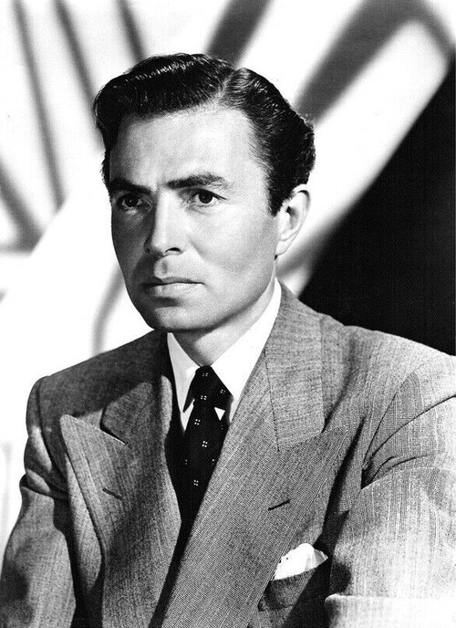

Bild: 1940er-Jahre; Unknown author. Public domain laut Wikimedia Commons. [Bildquelle](https://commons.wikimedia.org/wiki/File:James_Mason_Studio_Publicity.jpg), [TMDB](https://www.themoviedb.org/person/2091).

### L1 · leicht

Welchen Kapitän verkörpert James Mason in Disneys „20.000 Meilen unter dem Meer“?

- Ahab

- **Richtig: Nemo**

- Farragut

- Bligh

James Mason spielt Kapitän Nemo.

Nemo führt die Nautilus, das Unterseeboot, das zunächst für ein zerstörerisches Seeungeheuer gehalten wird. Er nimmt die Schiffbrüchigen um Professor Aronnax (Paul Lukas) auf, will seine technische Macht aber nur nach eigenen Vorstellungen einsetzen. Mason verbindet die Autorität des Kapitäns mit dessen Abkehr von der Gesellschaft.

Merksatz: Masons Nemo herrscht über die Nautilus.

Quellen: [1](https://d23.com/a-to-z/20000-leagues-under-the-sea-film/).

### L2 · leicht

Welche Figur spielt James Mason in Hitchcocks „Der unsichtbare Dritte“?

- Den Geheimdienstmann, der als Professor auftritt

- Den Werbefachmann Roger Thornhill

- Den UN-Diplomaten Lester Townsend

- **Richtig: Den Spion Phillip Vandamm**

Mason spielt Phillip Vandamm.

Vandamm hält Roger Thornhill (Cary Grant) für einen geheimen Gegenspieler. Der scheinbar kultivierte Mann lässt ihn verfolgen und will kompromittierendes Material außer Landes bringen. Masons ruhige Höflichkeit verdeckt so eine sehr konkrete Gewaltbereitschaft.

Merksatz: Vandamms Höflichkeit verbirgt den gefährlichen Gegenspieler.

Quellen: [1](https://catalog.afi.com/Film/52975-NORTH-BY-NORTHWEST).

### M1 · mittel

Welche Behandlung löst die gefährliche Veränderung von Ed (James Mason) in „Eine Handvoll Hoffnung“ aus?

- **Richtig: Eine Behandlung mit Cortison**

- Eine experimentelle Hypnose

- Eine Operation am Gehirn

- Eine absichtlich herbeigeführte Schlafkur

Ed verändert sich unter einer Behandlung mit Cortison.

Der Lehrer und Familienvater erhält das Medikament gegen eine schwere Erkrankung. Aus der Behandlung entwickelt sich eine Abhängigkeit, und sein Verhalten gegenüber Frau und Kind wird zunehmend herrisch und bedrohlich. Der Film verknüpft medizinische Hoffnung mit dem Zerfall eines zunächst gewöhnlich wirkenden Familienlebens.

Merksatz: Das rettende Medikament macht Ed zum bedrohlichen Hausherrn.

Quellen: [1](https://www.criterion.com/films/1929-bigger-than-life).

### M2 · mittel

Welches persönliche Problem gefährdet Norman Maines (James Mason) Karriere in „Ein neuer Stern am Himmel“ besonders?

- Seine heimlich verlorene Staatsbürgerschaft

- Seine Angst vor öffentlichen Auftritten

- **Richtig: Seine Alkoholabhängigkeit**

- Seine Weigerung, Tonfilme zu drehen

Normans Alkoholabhängigkeit bedroht Beruf und Beziehung.

Norman fördert die Sängerin Esther (Judy Garland), während sein eigener Ruhm nachlässt. Ihr Aufstieg und seine Rückfälle verlaufen immer stärker gegeneinander. Seine Ehe mit der nun erfolgreichen Vicki Lester verbindet deshalb Liebe mit dem schmerzhaften Bewusstsein, von ihr abhängig geworden zu sein.

Merksatz: Normans beruflicher Absturz ist eng mit seinem Trinken verbunden.

Quellen: [1](https://catalog.afi.com/Film/51362-A-STAR-IS-BORN).

### S1 · schwer

Warum irrt Johnny McQueen (James Mason) in „Ausgestoßen“ hilflos durch die Stadt?

- **Richtig: Er wurde bei einem Überfall schwer verwundet und von der Flucht getrennt**

- Er hat sein Gedächtnis bei einem Verkehrsunfall verloren

- Er soll einen verschwundenen Zeugen ohne Begleitung finden

- Er ist auf der Suche nach seinem entführten Kind

Johnny wurde bei einem Raubüberfall verwundet und zurückgelassen.

Der Anführer einer Untergrundorganisation kann sich nicht am Fluchtwagen halten. Verwundet und verfolgt sucht er Hilfe, begegnet aber auch Menschen, die ihn für eigene Zwecke benutzen wollen. Masons Figur verliert dabei ihre frühere Befehlsgewalt und wird zu einem Menschen, dessen Überleben von anderen abhängt.

Merksatz: Aus dem Anführer wird ein verwundeter Flüchtiger.

Quellen: [1](https://www.criterion.com/current/posts/3524-odd-man-out-death-and-the-city).

### S2 · schwer

Auf welcher Seite des Prozesses steht Ed Concannon (James Mason) in „The Verdict“?

- Er vertritt die geschädigte Patientin

- Er leitet als Richter die Verhandlung

- **Richtig: Er verteidigt das beklagte Krankenhaus**

- Er tritt als unabhängiger medizinischer Gutachter auf

Concannon vertritt die Gegenseite des klagenden Anwalts.

Frank Galvin (Paul Newman) verfolgt einen Fall schwerer ärztlicher Fehlbehandlung. Concannon verfügt für die Verteidigung über eine große Kanzlei und entsprechend starke Mittel. Die Rollenverteilung stellt Galvins persönlichen Neuanfang einem professionell organisierten juristischen Gegner gegenüber.

Merksatz: Concannon ist Galvins mächtiger Gegner im Gerichtssaal.

Quellen: [1](https://catalog.afi.com/Film/56898-THE-VERDICT).

### E1 · experte

Welche zusätzliche Aufgabe übernahm James Mason bei „Eine Handvoll Hoffnung“ neben der Hauptrolle?

- Er komponierte die Filmmusik

- **Richtig: Er produzierte den Film**

- Er führte die Kamera

- Er verantwortete den Schnitt

Mason war auch Produzent.

Seine Mitarbeit ging über die Darstellung des erkrankten Lehrers hinaus. Die BFI-Studie ordnet die Produktion als Beispiel dafür ein, wie Mason in Hollywood gestalterische Verantwortung gewann. Er nutzte den Status als Star, um an einem ungewöhnlichen, kritischen Familienfilm mitzuarbeiten.

Merksatz: Mason stand bei „Eine Handvoll Hoffnung“ auch als Produzent hinter dem Projekt.

Quellen: [1](https://www.criterion.com/films/1929-bigger-than-life), [2](https://www.bfi.org.uk/interviews/james-mason-sarah-thomas).

### E2 · experte

Welche Vertragsstrategie bewahrte James Mason in Hollywood besonders viel berufliche Unabhängigkeit?

- Er schloss einen langfristigen Exklusivvertrag mit festen Rollenzusagen

- Er beschränkte sich auf Filme seiner eigenen Produktionsfirma

- Er verband Filmauftritte mit einer festen Theaterbindung

- **Richtig: Er vermied langfristige Studiobindungen und verhandelte projektweise**

Mason vermied langfristige Studioverträge.

Die BFI-Studie beschreibt, wie er mit mehreren Studios über einzelne Filme und zusätzliche Schreib- oder Produktionsmöglichkeiten verhandelte. Seine Agentur unterstützte ihn dabei. Der berufliche Spielraum beruhte somit auf konkreten Vereinbarungen innerhalb des Studiosystems und nicht allein auf künstlerischem Ansehen.

Merksatz: Mason verhandelte Film für Film statt sich dauerhaft an ein Studio zu binden.

Quellen: [1](https://www.bfi.org.uk/interviews/james-mason-sarah-thomas).

## Alec Guinness · Bekanntheitsgruppe 3

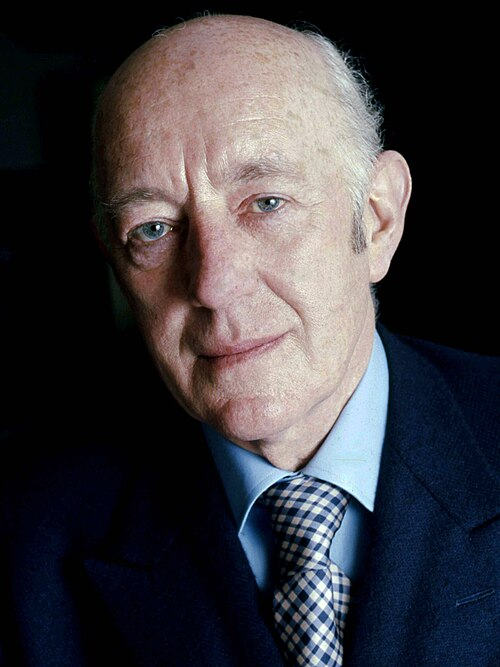

Bild: 1973; Allan warren. CC BY-SA 3.0 laut Wikimedia Commons. [Bildquelle](https://commons.wikimedia.org/wiki/File:Sir_Alec_Guinness_3_Allan_Warren_2_(cropped2).jpg), [TMDB](https://www.themoviedb.org/person/12248).

### L1 · leicht

Welchen Jedi-Meister spielt Alec Guinness im ersten veröffentlichten „Star Wars“-Film?

- Yoda

- Qui-Gon Jinn

- **Richtig: Obi-Wan Kenobi**

- Mace Windu

Guinness spielt Obi-Wan Kenobi.

Der ältere Jedi führt Luke Skywalker (Mark Hamill) in eine Welt ein, von der dieser bisher wenig weiß. Er gibt ihm das Lichtschwert seines Vaters und erste Anleitung im Umgang mit der Macht. Guinness’ Figur verbindet damit die Vorgeschichte des Ordens mit Lukes neuem Weg.

Merksatz: Guinness ist Lukes erster Jedi-Lehrer Obi-Wan.

Quellen: [1](https://www.starwars.com/news/always-two-obi-wan-kenobi-and-luke-skywalker).

### L2 · leicht

Welchen britischen Offizier verkörpert Alec Guinness in „Die Brücke am Kwai“?

- **Richtig: Oberst Nicholson**

- Major Shears

- Major Warden

- Hauptmann Reeves

Guinness spielt Oberst Nicholson.

Der britische Oberst gerät als Kriegsgefangener mit dem japanischen Lagerkommandanten Saito (Sessue Hayakawa) aneinander. Später setzt er seinen Stolz in die professionelle Ausführung des Brückenbaus. Die Figur verbindet militärische Prinzipien mit einer zunehmenden Verkennung dessen, wem das Bauwerk dient.

Merksatz: Nicholson macht den Brückenbau zu seiner eigenen Bewährungsprobe.

Gemeinsames Wissensziel: K-CLA-08-01 (CLA-L-015).

Quellen: [1](https://catalog.afi.com/Film/52118-THE-BRIDGE-ON-THE-RIVER-KWAI).

### M1 · mittel

Welche ungewöhnliche Besetzungsaufgabe übernimmt Alec Guinness in „Adel verpflichtet“?

- Er spielt den Erzähler und dessen jüngeres Selbst

- Er spielt jeden Diener des Familienanwesens

- Er spielt beide zerstrittenen Brüder der Hauptfigur

- **Richtig: Er spielt acht Mitglieder der adeligen Familie**

Guinness verkörpert acht Angehörige derselben Familie.

Louis Mazzini (Dennis Price) will nach der Ausgrenzung seiner Mutter den Herzogstitel erben. Die Verwandten, die ihm dabei im Weg stehen, erscheinen in verschiedenen Gestalten desselben Schauspielers. Dazu gehört auch Lady Agatha; die Vielgestaltigkeit verstärkt die schwarze Komik des Mordplans.

Merksatz: Eine ganze adelige Verwandtschaft trägt Guinness’ Gesicht.

Gemeinsames Wissensziel: K-F240-20261006-120-L2 (F240-20261006-120-L2).

Quellen: [1](https://www.criterion.com/films/357-kind-hearts-and-coronets).

### M2 · mittel

Was erfindet Sidney Stratton (Alec Guinness) in „Der Mann im weißen Anzug“?

- Einen besonders billigen Treibstoff

- **Richtig: Einen Stoff, der nicht verschmutzt und nicht verschleißt**

- Eine Maschine zum unsichtbaren Nähen

- Eine Farbe, die Kleidung unsichtbar macht

Stratton erfindet ein schmutz- und verschleißfestes Gewebe.

Die Erfindung erscheint zunächst als wissenschaftlicher Triumph. Sobald Unternehmer und Arbeiter erkennen, dass kaum noch neue Kleidung gekauft werden müsste, sehen beide ihre Existenz bedroht. Der Erfinder gerät deshalb ausgerechnet mit den Gruppen in Konflikt, die vom Erfolg einer Textilfabrik leben.

Merksatz: Strattons perfekter Stoff bedroht das Geschäft mit Kleidung.

Quellen: [1](https://player.bfi.org.uk/rentals/film/watch-the-man-in-the-white-suit-1951-online).

### S1 · schwer

Welchen britischen Geheimdienstmann spielte Alec Guinness in den Fernsehserien „Dame, König, As, Spion“ und „Agent in eigener Sache“?

- **Richtig: George Smiley**

- Alec Leamas

- Bernard Samson

- Harry Palmer

Guinness spielte George Smiley.

Die BBC-Verfilmungen führen die Figur aus John le Carrés Romanen durch eine Welt der Täuschung und langfristigen Gegnerschaft. In der ersten Serie sucht Smiley einen Maulwurf im eigenen Dienst, in der zweiten richtet sich sein Vorgehen gegen Karla. Guinness gestaltet die Ermittlungen vor allem durch Zuhören und genaue Beobachtung.

Merksatz: Guinness’ stiller Spion heißt George Smiley.

Quellen: [1](https://www.bfi.org.uk/lists/10-best-alec-guinness-performances).

### S2 · schwer

Welche zusätzliche Arbeit leistete Alec Guinness für „Des Pudels Kern“ neben seiner Hauptrolle als Maler Gulley Jimson?

- Er gestaltete sämtliche Kostüme

- Er komponierte die Filmmusik

- **Richtig: Er schrieb die Drehbuchadaption**

- Er führte allein Regie

Guinness schrieb das Drehbuch nach Joyce Carys Roman.

Ronald Neame führte Regie, während Guinness die literarische Vorlage für den Film bearbeitete und den eigensinnigen Künstler spielte. Die Suche Jimsons nach einer geeigneten Fläche für seine Bilder gehört zum komischen Blick auf schöpferischen Ehrgeiz. Guinness war hier also auch für die erzählerische Form verantwortlich.

Merksatz: Guinness spielte Jimson und bearbeitete dessen Geschichte fürs Kino.

Quellen: [1](https://www.criterion.com/films/695-the-horse-s-mouth).

### E1 · experte

Welcher Vorwurf trug dazu bei, dass „Oliver Twist“ mit Alec Guinness als Fagin erst verspätet und gekürzt in die USA kam?

- Der Film verunglimpfe die britische Marine

- **Richtig: Die Darstellung Fagins bediene antisemitische Stereotype**

- Der Film verschweige seinen literarischen Ursprung

- Die Kinderdarsteller seien durch Erwachsene ersetzt worden

Die Gestaltung Fagins wurde als antisemitisch kritisiert.

Besonders die stark vergrößerte Nase der Maske rief Protest hervor. Der Film startete in London 1948, in den USA aber erst 1951 mit gestrichenen Passagen. Die Kontroverse betrifft die Wirkung einer Darstellung im historischen Kontext nach dem Holocaust und lässt sich nicht auf die schauspielerische Verwandlung allein reduzieren.

Merksatz: Guinness’ Fagin wurde wegen antisemitischer Stereotype kontrovers aufgenommen.

Quellen: [1](https://www.criterion.com/current/posts/41-oliver-twist).

### E2 · experte

Welche Vorarbeit verband Alec Guinness schon vor David Leans Verfilmung mit „Große Erwartungen“?

- Er hatte den Roman ins Französische übersetzt

- Er hatte Dickens’ Biografie verfasst

- Er hatte die Musik zu einem Hörspiel komponiert

- **Richtig: Er hatte den Roman für die Bühne bearbeitet**

Guinness hatte Dickens’ Roman bereits für das Theater adaptiert.

Lean und Produzent Ronald Neame kannten und schätzten diese Bühnenfassung. Für den Film boten sie Guinness die Rolle des Herbert Pocket an, der Pip (John Mills) in London begegnet. Die Zusammenarbeit im Kino entstand damit aus einer konkreten vorherigen Theaterarbeit.

Merksatz: Die Bühnenadaption bereitete Guinness’ Einstieg in Leans Dickens-Film vor.

Quellen: [1](https://www.bfi.org.uk/lists/10-best-alec-guinness-performances).

## Peter Sellers · Bekanntheitsgruppe 3

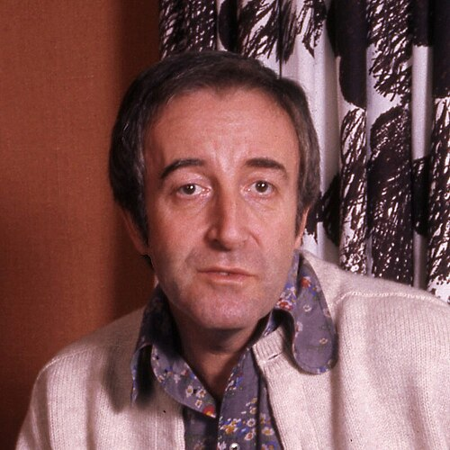

Bild: 1973; Allan warren. CC BY-SA 3.0 laut Wikimedia Commons. [Bildquelle](https://commons.wikimedia.org/wiki/File:Peter_Sellers_1973_by_Allan_Warren_1.jpg), [TMDB](https://www.themoviedb.org/person/12446).

### L1 · leicht

Welchen wiederkehrenden Ermittler spielt Peter Sellers in der ursprünglichen „Der rosarote Panther“-Filmreihe?

- Inspektor Dreyfus

- **Richtig: Inspektor Clouseau**

- Inspektor Maigret

- Inspektor Lestrade

Sellers spielt Inspektor Clouseau.

Die vermeintliche Autorität des französischen Polizisten steht ständig im Gegensatz zu seinen Missgeschicken. Sellers machte aus der Figur einen körperlich und sprachlich unverwechselbaren Komödienhelden. Die Zusammenarbeit mit Blake Edwards kehrte über mehrere Filme hinweg zu diesem Ermittler zurück.

Merksatz: Sellers’ berühmter Ermittler heißt Clouseau.

Gemeinsames Wissensziel: K-KOM-202609-P02-L-085 (KOM-202609-P02-L-085).

Quellen: [1](https://catalog.afi.com/Film/20382-THE-PINK-PANTHER).

### L2 · leicht

Wie viele unterschiedliche Figuren spielt Peter Sellers in „Dr. Seltsam“?

- Eine

- Zwei

- Vier

- **Richtig: Drei**

Sellers spielt drei Figuren.

Er verkörpert den britischen Offizier Mandrake, den amerikanischen Präsidenten Muffley und den Wissenschaftler Dr. Seltsam. Die Figuren sind keine Verkleidungen desselben Mannes, sondern eigenständige Personen. Ihre unterschiedlichen Stimmen und Haltungen bilden mehrere Perspektiven innerhalb der nuklearen Krisensatire.

Merksatz: Sellers steht in „Dr. Seltsam“ dreifach vor der Kamera.

Quellen: [1](https://catalog.afi.com/Film/23082-DR-STRANGELOVE-OR-HOW-I-LEARNED-TO-STOP-WORRYING-AND-LOVE-THE-BOMB).

### M1 · mittel

Warum wird Chance (Peter Sellers) in „Willkommen, Mr. Chance“ für einen besonders klugen politischen Gesprächspartner gehalten?

- **Richtig: Andere deuten seine schlichten Gartenbemerkungen als gesellschaftliche Weisheiten**

- Er hat sich heimlich auf jedes Gespräch vorbereitet

- Er übernimmt die Reden eines verstorbenen Präsidenten

- Er wird von einem Berater über einen Ohrhörer angeleitet

Seine Bemerkungen über den Garten werden als politische Einsichten missverstanden.

Chance hat lange abgeschieden als Gärtner gelebt und die Außenwelt vor allem aus dem Fernsehen kennengelernt. Ein wohlhabender Förderer (Melvyn Douglas) hält ihn für einen Mann mit besonderen Einsichten. Die Satire entsteht aus dem, was andere in seine einfachen Aussagen hineinlesen.

Merksatz: Chance spricht vom Garten; seine Zuhörer hören Politik.

Quellen: [1](https://www.criterion.com/films/29009-being-there).

### M2 · mittel

Welche Stellung hat Fred Kite (Peter Sellers) in der Arbeitsweltsatire „Junger Mann aus gutem Haus“?

- Er ist der Fabrikbesitzer

- Er ist ein staatlicher Arbeitsinspektor

- **Richtig: Er ist Gewerkschaftsfunktionär**

- Er ist der Betriebsarzt

Fred Kite vertritt die Gewerkschaft.

Der unerfahrene Stanley Windrush (Ian Carmichael) gerät zwischen Fabrikleitung und Arbeitnehmervertretung. Kite ist überzeugt von seinen politischen Vorstellungen, während die Geschäftsleute eigene Interessen verfolgen. Sellers gestaltet damit eine Figur, deren ernst gemeinte Haltung selbst Teil der Komik über Arbeitsbeziehungen wird.

Merksatz: Fred Kite vertritt die organisierte Arbeiterschaft.

Quellen: [1](https://www.bfiplayerclassics.com/videos/i-m-all-right-jack).

### S1 · schwer

Mit welcher britischen Radiosendung wurde Peter Sellers gemeinsam mit Spike Milligan und Harry Secombe bekannt?

- **Richtig: The Goon Show**

- Hancock’s Half Hour

- Round the Horne

- Beyond Our Ken

Er gehörte zum Ensemble von „The Goon Show“.

Die Radiokomödie gab seinen Stimmen und Figuren schon vor den großen Kinorollen ein breites Publikum. Ein BFI-Archivbeitrag verortet den Übergang zum Film ausdrücklich in dieser Phase. Die Arbeit mit Milligan und Secombe war damit ein eigenständiger Ausgangspunkt seiner Komik.

Merksatz: Vor Clouseau gehörte Sellers zu den Goons.

Quellen: [1](https://www.bfi.org.uk/sight-and-sound/features/archived-skip-peter-sellers-bestsellers-trio).

### S2 · schwer

Welches Ziel verfolgt der kleine Staat in „Die Maus, die brüllte“ mit Peter Sellers, als er den USA den Krieg erklärt?

- Er will amerikanische Gebiete dauerhaft besetzen

- Er will ein Bündnis gegen Großbritannien erzwingen

- **Richtig: Er will verlieren und anschließend amerikanische Aufbauhilfe erhalten**

- Er will den Weltmarkt für Atomwaffen übernehmen

Der Staat plant eine Niederlage, um danach Hilfsgelder zu bekommen.

Das Fürstentum Grand Fenwick gerät wirtschaftlich unter Druck. Seine Führung rechnet damit, dass die USA besiegte Gegner großzügig unterstützen. Die kleine Streitmacht richtet sich jedoch nicht nach diesem Plan: Ihr unerwarteter Erfolg bringt die politische Kalkulation durcheinander. Sellers spielt in der Satire mehrere zentrale Figuren.

Merksatz: Grand Fenwick will vom verlorenen Krieg profitieren.

Quellen: [1](https://catalog.afi.com/Film/52965-THE-MOUSE-THAT-ROARED).

### E1 · experte

Welche überraschend düstere Figur spielt Peter Sellers in „Der Marder von London“?

- Einen korrupten Polizeichef

- **Richtig: Einen skrupellosen Autodieb und Hehler**

- Einen erpresserischen Theaterkritiker

- Einen gewalttätigen Gefängnisdirektor

Sellers spielt den kriminellen Autohändler Lionel Meadows.

Der Film lässt seine Figur zunächst umgänglich erscheinen und dann plötzlich bedrohlich werden. Der Konflikt mit einem bestohlenen Mann gehört zu einem ernsthaften Kriminalstoff. Die Darstellung zeigt, wie Sellers seine genaue Stimm- und Körperarbeit auch für eine Rolle ohne die vertraute Komödienwirkung einsetzen konnte.

Merksatz: Lionel Meadows zeigt Sellers von seiner gefährlichen Seite.

Quellen: [1](https://www.bfi.org.uk/lists/peter-sellers-10-essential-films).

### E2 · experte

Wie konnte Peter Sellers nach seinem Tod noch in „Der rosarote Panther wird gejagt“ auftreten?

- Die gesamte Rolle wurde als Zeichentrickfigur ergänzt

- Seine Rolle wurde ausschließlich aus Fotografien montiert

- Ein anderer Schauspieler spielte ihn mit Maske

- **Richtig: Der Film verwendete zuvor ungenutztes Aufnahmematerial**

Der Film setzte vorhandene, zuvor ungenutzte Aufnahmen ein.

Sellers starb 1980, während der Film 1982 erschien. Blake Edwards griff für Clouseaus Auftritte auf Material früherer Dreharbeiten zurück. Die Veröffentlichung ist deshalb keine weitere vollständig neu gedrehte Sellers-Komödie, sondern eine nachträgliche Verwendung seiner bereits aufgenommenen Darstellung.

Merksatz: Der späte Clouseau-Film holte Sellers aus dem Filmarchiv zurück.

Quellen: [1](https://www.bfi.org.uk/lists/peter-sellers-10-essential-films).

## Jack Lemmon · Bekanntheitsgruppe 3

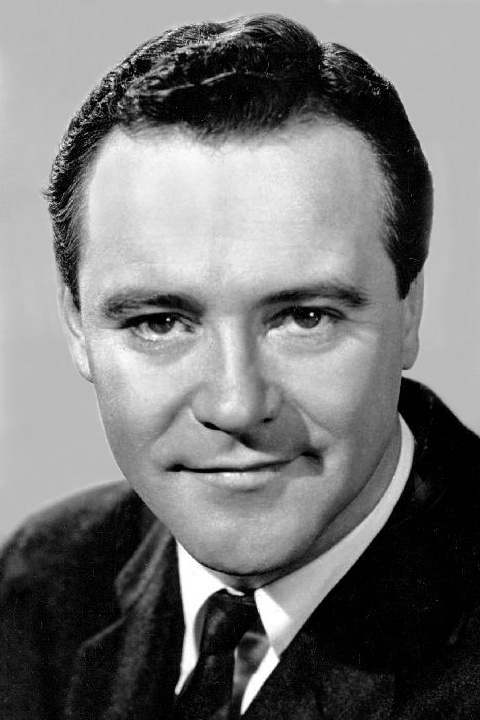

Bild: 1968; Unknown author wire photographer. Public domain laut Wikimedia Commons. [Bildquelle](https://commons.wikimedia.org/wiki/File:Jack_Lemmon_-_1968_(cropped).jpg), [TMDB](https://www.themoviedb.org/person/3151).

### L1 · leicht

Welchen Frauennamen verwendet Jerry (Jack Lemmon) in „Manche mögen’s heiß“?

- **Richtig: Daphne**

- Josephine

- Sugar

- Sweet Sue

Jerry nennt sich als Mitglied der Frauenkapelle Daphne.

Jerry und Joe (Tony Curtis) haben einen Mord beobachtet und suchen Schutz in einer reisenden Frauenkapelle. Aus der beruflichen Tarnung entsteht für Jerry eine unerwartete private Verwicklung, als ein wohlhabender Verehrer um Daphne wirbt. Die Figur bleibt derselbe Mann unter einer angenommenen Identität.

Merksatz: Jerry wird in der Frauenkapelle zu Daphne.

Gemeinsames Wissensziel: K-KOM-202609-P02-M-078 (KOM-202609-P02-M-078).

Quellen: [1](https://www.bfi.org.uk/lists/jack-lemmon-10-essential-films).

### L2 · leicht

Welche Angestelltenfigur spielt Jack Lemmon in „Das Apartment“?

- Jeff Sheldrake

- Walter Burns

- **Richtig: C. C. Baxter**

- Felix Ungar

Lemmon spielt C. C. Baxter.

Der kleine Angestellte überlässt seine Wohnung Vorgesetzten für heimliche Treffen. Die Aussicht auf beruflichen Aufstieg bringt ihn dabei mit seinen eigenen Gefühlen in Konflikt. Seine Beziehung zur Aufzugführerin Fran (Shirley MacLaine) macht die scheinbar nützliche Vereinbarung zunehmend unerträglich.

Merksatz: Lemmons Baxter bezahlt den Karrierewunsch mit dem Verlust seines Privatlebens.

Gemeinsames Wissensziel: K-KOM-202609-P02-L-079 (KOM-202609-P02-L-079).

Quellen: [1](https://www.bfi.org.uk/lists/jack-lemmon-10-essential-films).

### M1 · mittel

Welches Problem zerstört das gemeinsame Leben von Joe (Jack Lemmon) und Kirsten in „Die Tage des Weines und der Rosen“?

- Eine geheim gehaltene Spielsucht

- **Richtig: Ihre Alkoholabhängigkeit**

- Eine berufliche Spionageaffäre

- Ein Streit um eine Erbschaft

Das Paar gerät gemeinsam in die Alkoholabhängigkeit.

Joe führt Kirsten (Lee Remick) an das Trinken heran, bis beide die Kontrolle verlieren. Die Beziehung wird dadurch nicht nur belastet, sondern selbst Teil der Abhängigkeit. Lemmons Darstellung verbindet den anfänglich geselligen Mann mit einem zunehmend verzweifelten Versuch, wieder ein anderes Leben führen zu können.

Merksatz: Aus gemeinsamem Trinken wird eine zerstörerische Abhängigkeit.

Quellen: [1](https://www.bfi.org.uk/lists/jack-lemmon-10-essential-films).

### M2 · mittel

Was versucht Jack Godell (Jack Lemmon) in „Das China-Syndrom“ öffentlich zu machen?

- Die illegale Entsorgung eines Filmstudios

- Die geplante Privatisierung einer Schule

- Einen Betrug mit Börsenkursen

- **Richtig: Vertuschte Sicherheitsmängel in einem Atomkraftwerk**

Godell will gefährliche Mängel im Atomkraftwerk aufdecken.

Eine Fernsehreporterin (Jane Fonda) erlebt einen Zwischenfall im Kraftwerk. Während die Betreiber die Gefahr bestreiten, entdeckt Godell defekte Ausrüstung. Sein Versuch, die Öffentlichkeit zu informieren, bringt ihn gegen das Unternehmen auf, für das er arbeitet.

Merksatz: Godell stellt sich mit seinem Wissen gegen die Kraftwerksbetreiber.

Quellen: [1](https://www.sonypictures.com/movies/thechinasyndrome).

### S1 · schwer

Was soll Harry (Jack Lemmon) in „Der Glückspilz“ auf Drängen seines Schwagers vortäuschen?

- **Richtig: Eine schwere Verletzung für eine hohe Entschädigung**

- Eine heimliche zweite Ehe

- Eine erfundene Verwandtschaft zu einem Millionär

- Eine bestandene juristische Prüfung

Harry soll eine schwere Verletzung simulieren.

Nach einem Zusammenstoß bei einem Footballspiel sieht der Anwalt Willie Gingrich (Walter Matthau) die Chance auf eine hohe Schadenersatzzahlung. Harrys tatsächlicher Zustand steht dem Geschäft im Weg, weshalb Willie eine Täuschung organisiert. Die erste gemeinsame Filmkomödie von Lemmon und Matthau gründet damit auf einem moralisch fragwürdigen Angebot.

Merksatz: Willie macht aus Harrys Unfall einen Versicherungsplan.

Quellen: [1](https://catalog.afi.com/Catalog/moviedetails/20983).

### S2 · schwer

Wen sucht Ed Horman (Jack Lemmon) in „Vermisst“ nach einem Militärputsch in Chile?

- Seinen früheren Kriegskameraden

- Seinen verschwundenen Bruder

- **Richtig: Seinen verschwundenen Sohn**

- Seinen entführten Arbeitgeber

Ed sucht seinen Sohn Charles.

Zusammen mit Charles’ Frau (Sissy Spacek) wendet er sich an amerikanische Behörden. Die erhoffte Hilfe führt zunächst durch bürokratische Sackgassen und erschüttert sein Vertrauen in die eigene Regierung. Der Film dramatisiert den realen Fall des während des chilenischen Putsches 1973 verschwundenen Charles Horman.

Merksatz: Der Vater sucht Charles und verliert dabei politische Gewissheiten.

Quellen: [1](https://www.criterion.com/films/769-missing).

### E1 · experte

In welchen Kategorien gewann Jack Lemmon seine Oscars jeweils für „Keine Zeit für Heldentum“ und „Save the Tiger“?

- Hauptdarsteller und Hauptdarsteller

- **Richtig: Nebendarsteller und Hauptdarsteller**

- Hauptdarsteller und Nebendarsteller

- Nebendarsteller und Nebendarsteller

Lemmon gewann als Neben- und als Hauptdarsteller.

Für Fähnrich Pulver in „Keine Zeit für Heldentum“ erhielt er 1956 den Nebendarsteller-Oscar. 1974 folgte der Hauptdarstellerpreis für den wirtschaftlich bedrängten Unternehmer in „Save the Tiger“. Zwischen den beiden Leistungen liegen eine Marinekomödie und ein ernstes Gegenwartsdrama.

Merksatz: Pulver brachte den Nebenrollen-Oscar, Harry Stone den Hauptrollen-Oscar.

Quellen: [1](https://www.oscars.org/oscars/ceremonies/embed/1956), [2](https://www.oscars.org/oscars/ceremonies/1974).

### E2 · experte

Welche Vaterfigur spielte Jack Lemmon 1986 am Broadway in Eugene O’Neills „Eines langen Tages Reise in die Nacht“?

- Willy Loman

- Joe Keller

- Big Daddy Pollitt

- **Richtig: James Tyrone**

Lemmon spielte James Tyrone.

Die Broadway-Produktion versammelte die Familie Tyrone an einem Augusttag des Jahres 1912. Lemmon übernahm den Vater, während Kevin Spacey dessen älteren Sohn spielte. Die Theaterarbeit stellte den Filmstar in ein dichtes Familiendrama, das von Erinnerung, Krankheit und gegenseitigen Vorwürfen lebt.

Merksatz: Auf O’Neills Bühne wurde Lemmon zu James Tyrone.

Quellen: [1](https://www.ibdb.com/broadway-production/long-days-journey-into-night-4410).

## Walter Matthau · Bekanntheitsgruppe 3

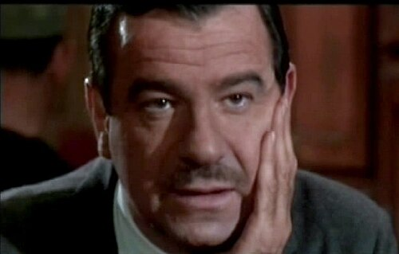

Bild: 1963; Film screenshot. Public domain laut Wikimedia Commons. [Bildquelle](https://commons.wikimedia.org/wiki/File:Walter_Matthau_in_Charade_1.jpg), [TMDB](https://www.themoviedb.org/person/6837).

### L1 · leicht

Welche Eigenschaft prägt Oscar Madison (Walter Matthau) in „Ein seltsames Paar“ im Gegensatz zu seinem Mitbewohner Felix?

- Er ist ausgesprochen ordentlich und pedantisch

- Er ist zurückgezogen und schweigsam

- **Richtig: Er ist locker und unordentlich**

- Er ist sportlich diszipliniert und streng

Oscar lebt nachlässig und unordentlich.

Nach dem Ende ihrer Ehen teilen Oscar und Felix (Jack Lemmon) eine Wohnung. Felix versucht, den Alltag nach seinen festen Vorstellungen von Ordnung zu regeln, während Oscar sich eingeengt fühlt. Aus zwei Freunden werden dadurch alltägliche Gegenspieler unter demselben Dach.

Merksatz: Oscar lässt liegen, was Felix sofort aufräumen möchte.

Quellen: [1](https://www.bfi.org.uk/lists/walter-matthau-10-essential-films).

### L2 · leicht

Welche Aufgabe übernimmt Walter Matthau als Morris Buttermaker in „Die Bären sind los“?

- **Richtig: Er trainiert eine Kinder-Baseballmannschaft**

- Er leitet ein Ferienlager für Musiker

- Er betreut eine Jugend-Fußballmannschaft

- Er organisiert eine Schülerzeitung

Buttermaker wird Trainer einer Kinder-Baseballmannschaft.

Der frühere Spieler bekommt eine wenig erfolgreiche Gruppe von Kindern anvertraut. Sein mürrischer, biertrinkender Alltag passt zunächst kaum zu den ehrgeizigen Erwartungen anderer Erwachsener. Die Komödie stellt den Spaß der Kinder und ihre Außenseiterstellung dem übertriebenen sportlichen Konkurrenzdenken gegenüber.

Merksatz: Matthaus Buttermaker führt die Außenseiter auf den Baseballplatz.

Quellen: [1](https://www.paramountpictures.com/movies/the-bad-news-bears-1976).

### M1 · mittel

Warum ist der Bankraub von Charley Varrick (Walter Matthau) in „Der große Coup“ gefährlicher als erwartet?

- Die Geldscheine enthalten einen versteckten Peilsender

- Ein Komplize hat vorab einen Deal mit der Polizei geschlossen

- Die Beute besteht ausschließlich aus Falschgeld

- **Richtig: Er hat versehentlich Geld der Mafia erbeutet**

Die Beute gehört zur Mafia.

Varrick rechnet mit einem überschaubaren Überfall und gerät stattdessen in die Interessen eines mächtigen Verbrechernetzes. Die überraschend hohe Summe verrät, dass die Bank mehr als gewöhnliche Kundengelder verwaltet. Er muss nun nicht nur der Polizei, sondern auch den Besitzern der Beute entkommen.

Merksatz: Varricks großer Gewinn ist Geld der falschen Leute.

Quellen: [1](https://catalog.afi.com/Film/54542-CHARLEY-VARRICK).

### M2 · mittel

Wobei soll die Assistentin Stephanie dem Zahnarzt Julian (Walter Matthau) in „Die Kaktusblüte“ helfen?

- Sie soll seine Praxis heimlich verkaufen

- **Richtig: Sie soll seine angebliche Ehefrau spielen**

- Sie soll für ihn eine medizinische Prüfung ablegen

- Sie soll einen verlorenen Patienten wiederfinden

Stephanie soll Julians erfundene Ehefrau verkörpern.

Julian hat seiner jungen Freundin Toni (Goldie Hawn) eine Ehe und Kinder vorgetäuscht. Als er die Beziehung ernsthaft weiterführen will, braucht seine Geschichte eine scheinbar glaubhafte Ehefrau. Stephanie (Ingrid Bergman), die ihn selbst liebt, soll die Täuschung retten und verändert dabei die Beziehungen aller Beteiligten.

Merksatz: Eine erfundene Ehe macht Stephanie zur gespielten Ehefrau.

Quellen: [1](https://catalog.afi.com/Film/23631-CACTUS-FLOWER).

### S1 · schwer

Welche Haltung vertritt Walter Matthaus Professor Groeteschele in „Angriffsziel Moskau“?

- **Richtig: Er betrachtet einen Atomkrieg als strategisch vertretbare Möglichkeit**

- Er fordert die vollständige Auflösung aller Armeen

- Er will nur über wirtschaftliche Sanktionen verhandeln

- Er lehnt jede politische Beratung grundsätzlich ab

Groeteschele vertritt eine aggressive nukleare Strategie.

Der Film führt einen versehentlich ausgelösten Luftangriff in eine existenzielle Krise. Groeteschele argumentiert dabei in Kategorien von Überlegenheit und überlebenden Bevölkerungen. Matthau spielt einen kalten Strategen, dessen Überzeugungen weit von den liebenswert mürrischen Komödienfiguren entfernt sind.

Merksatz: Groeteschele rechnet mit dem Atomkrieg, statt vor ihm zurückzuschrecken.

Quellen: [1](https://www.bfi.org.uk/lists/walter-matthau-10-essential-films), [2](https://catalog.afi.com/Catalog/moviedetails/22481).

### S2 · schwer

Was will Redakteur Walter Burns (Walter Matthau) in „Extrablatt“ gegenüber Hildy Johnson erreichen?

- Er will ihn als neuen Bürgermeister aufstellen

- Er will ihn in den Ruhestand schicken

- **Richtig: Er will ihn trotz dessen Heiratsplänen bei der Zeitung halten**

- Er will ihn als Zeugen der Anklage ausschließen

Burns will seinen besten Reporter nicht verlieren.

Hildy (Jack Lemmon) plant, das Zeitungsgeschäft für seine Hochzeit hinter sich zu lassen. Burns nutzt den Wirbel um einen zum Tode Verurteilten, um ihn wieder in die Arbeit hineinzuziehen. Die gemeinsame Jagd nach einer großen Geschichte wird damit zugleich zum Machtkampf zwischen Chef und Mitarbeiter.

Merksatz: Burns braucht Hildy für die Schlagzeile und verhindert seinen Abschied.

Quellen: [1](https://catalog.afi.com/Film/67639-THE-FRONT-PAGE).

### E1 · experte

Wer spielte Felix an Walter Matthaus Seite in der ursprünglichen Broadway-Produktion von „Ein seltsames Paar“, bevor Jack Lemmon die Filmrolle übernahm?

- Tony Randall

- **Richtig: Art Carney**

- Jack Klugman

- Henry Fonda

Matthaus ursprünglicher Bühnenpartner war Art Carney.

Matthau erinnerte sich im PBS-Interview ausdrücklich an Carney als Partner der Bühnenfassung. Er spielte Oscar bereits vor der Verfilmung und gewann dafür 1965 einen Tony. Der Kinofilm übernahm seine Figur, besetzte den Gegenpart aber mit Lemmon neu.

Merksatz: Auf der Bühne war Carney der Felix zu Matthaus Oscar.

Quellen: [1](https://www.pbs.org/wnet/americanmasters/archive/interview/matthau-walter/), [2](https://www.tonyawards.com/winners/year/1965/category/any/show/any/).

### E2 · experte

In welchem Theaterumfeld sammelte Walter Matthau als Jugendlicher erste prägende Eindrücke vom Schauspiel?

- In einem englischen Shakespeare-Ensemble

- Im Ballett der Metropolitan Opera

- In einer reisenden Zirkustruppe

- **Richtig: In den jiddischsprachigen Theatern der New Yorker Lower East Side**

Er lernte das Theater in den jiddischsprachigen Häusern seiner Nachbarschaft kennen.

Matthau erzählte im PBS-Interview, dass er dort Eis und Getränke verkaufte und die Darsteller beobachtete. Deren Bewegungen und Bühnenarbeit faszinierten ihn. Seine Erinnerung macht den frühen Zugang zum Schauspiel als Begegnung mit lebendiger Theaterpraxis greifbar.

Merksatz: Matthau schaute den Schauspielern der jiddischen Theater genau zu.

Quellen: [1](https://www.pbs.org/wnet/americanmasters/archive/interview/matthau-walter/).

## Anthony Quinn · Bekanntheitsgruppe 3

Bild: um 1955; Unknown author studio publicity photographer. Public domain laut Wikimedia Commons. [Bildquelle](https://commons.wikimedia.org/wiki/File:Anthony_Quinn_signed_(cropped).jpg), [TMDB](https://www.themoviedb.org/person/5401).

### L1 · leicht

Was tun Sorbas (Anthony Quinn) und Basil nach dem Scheitern ihres Unternehmens am Ende von „Alexis Sorbas“?

- **Richtig: Sie tanzen gemeinsam**

- Sie setzen sofort eine neue Seilbahn in Betrieb

- Sie liefern sich ein Duell

- Sie besteigen gemeinsam ein Schiff nach England

Sorbas bringt Basil zum Tanzen.

Basil (Alan Bates) hat in Griechenland ein Bergwerksprojekt begonnen, dessen entscheidende Seilbahn zusammenbricht. Statt im geschäftlichen Verlust zu verharren, bittet er Sorbas, ihm das Tanzen beizubringen. Der gemeinsame Tanz verbindet das Scheitern mit einer neuen Fähigkeit, das Leben anzunehmen.

Merksatz: Nach dem Zusammenbruch des Projekts bleibt der gemeinsame Tanz.

Quellen: [1](https://catalog.afi.com/Film/22430-ZORBA-THE-GREEK).

### L2 · leicht

Womit verdient Zampanò (Anthony Quinn) in „La Strada“ sein Geld?

- Mit dem Verkauf von Gemälden

- Mit dem Stimmen von Klavieren

- **Richtig: Mit Kraftkunststücken als reisender Schausteller**

- Mit der Arbeit als Landarzt

Zampanò tritt als reisender Kraftmensch auf.

Gelsomina (Giulietta Masina) begleitet ihn auf seinen Auftritten. Ihre offene, verletzliche Art trifft auf seine Härte und Rücksichtslosigkeit. Quinns körperliche Präsenz macht den Beruf des Schaustellers sichtbar und verstärkt zugleich das Machtgefälle zwischen den beiden Reisenden.

Merksatz: Zampanòs Kraftkunst steht neben seiner Härte gegenüber Gelsomina.

Quellen: [1](https://www.criterion.com/films/185-la-strada).

### M1 · mittel

Welchen Maler spielt Anthony Quinn in „Vincent van Gogh – Ein Leben in Leidenschaft“?

- Paul Cézanne

- **Richtig: Paul Gauguin**

- Claude Monet

- Georges Seurat

Quinn verkörpert Paul Gauguin.

Der Film stellt ihm Kirk Douglas als Vincent van Gogh gegenüber. Die Freundschaft und das konfliktreiche Zusammenleben der beiden Künstler gehören zur Geschichte von van Goghs Arbeit und psychischer Krise. Quinns Rolle ist damit ein Gegenüber des porträtierten Malers, nicht dessen Darstellung in einer anderen Lebensphase.

Merksatz: Quinn ist Gauguin, Douglas ist van Gogh.

Quellen: [1](https://catalog.afi.com/Film/51908-LUST-FOR-LIFE).

### M2 · mittel

Welche Stellung hat Andrea (Anthony Quinn) im Sabotageteam von „Die Kanonen von Navarone“?

- Er ist der britische Sprengstoffexperte

- Er ist ein amerikanischer Kriegsreporter

- Er ist ein deutscher Überläufer

- **Richtig: Er ist ein griechischer Widerstandskämpfer**

Andrea ist ein griechischer Widerstandskämpfer.

Die Gruppe soll schwere deutsche Geschütze auf einer besetzten griechischen Insel ausschalten. Andrea verbindet Kampferfahrung und Ortsnähe mit einem persönlichen Konflikt gegenüber Mallory (Gregory Peck). Die gemeinsame Mission verlangt Zusammenarbeit zwischen Menschen, deren Vergangenheit sie nicht automatisch zu Freunden macht.

Merksatz: Quinns Andrea bringt griechische Widerstandserfahrung in die Mission ein.

Quellen: [1](https://catalog.afi.com/Film/22407-the-gunsofnavarone), [2](https://www.sonypicturesmuseum.com/collection/film/650/guns-of-navarone-the.html).

### S1 · schwer

Wozu drängt sein Manager den ausgekämpften Boxer Mountain (Anthony Quinn) in „Die Faust im Gesicht“?

- **Richtig: Zu erniedrigenden Wrestlingauftritten**

- Zu einer Karriere als Radiokommentator

- Zu einem Universitätsstudium

- Zu einer politischen Kandidatur

Mountain soll als Wrestler auftreten.

Nachdem weitere Boxkämpfe für ihn zu gefährlich geworden sind, versucht Mountain ein anderes Arbeitsleben zu beginnen. Sein Manager Maish (Jackie Gleason) sabotiert diese Aussicht und braucht Geld für eigene Schulden. Der angebotene Auftritt nimmt dem ehemaligen Boxer Würde, obwohl er gerade einen Ausweg sucht.

Merksatz: Mountain soll nach dem Boxen seine Würde im Ring verkaufen.

Quellen: [1](https://catalog.afi.com/Film/23331-REQUIEM-FOR-A-HEAVYWEIGHT).

### S2 · schwer

Welchen Preis verlangt die zurückgekehrte Millionärin in „Der Besuch“ für ihre Geldspende an die Stadt – zulasten von Serge Miller (Anthony Quinn)?

- Serge soll sie erneut heiraten

- Serge soll zum Bürgermeister gewählt werden

- **Richtig: Die Bürger sollen Serge töten**

- Die Bürger sollen Serge sein Haus zurückgeben

Die Spende ist an Serges Tod geknüpft.

Karla Zachanassian (Ingrid Bergman) will sich an dem Mann rächen, der sie einst verführt und im Stich gelassen hat. Die finanziell bedrängte Stadt gerät durch ihr Angebot in einen moralischen Konflikt. Die Filmfassung verändert Dürrenmatts Vorlage jedoch: Karla rettet Serge im letzten Moment vor der Hinrichtung.

Merksatz: Karlas Geldangebot macht Serges Leben zur Handelsware.

Quellen: [1](https://www.filmportal.de/film/der-besuch_449e0c1ce0c5462d8be65b89a4c2e237).

### E1 · experte

Welche Aufgabe übernahm Anthony Quinn bei „König der Freibeuter“ mit Yul Brynner?

- Er komponierte die Filmmusik

- **Richtig: Er führte Regie**

- Er entwarf die Kostüme

- Er schrieb das Drehbuch

Quinn führte bei dem Piratenfilm Regie.

Die Produktion stand unter der Aufsicht von Cecil B. DeMille und erzählte erneut den Stoff seines früheren Films über Jean Lafitte. Quinn wechselte bei diesem Projekt von der Schauspielerei auf den Regiestuhl. Das AFI beschreibt auch seine spätere Unzufriedenheit mit der von DeMille umgeschnittenen Fassung.

Merksatz: Bei „König der Freibeuter“ arbeitete Quinn als Regisseur.

Quellen: [1](https://catalog.afi.com/Film/52491-THE-BUCCANEER).

### E2 · experte

Welche eigenen Kunstformen betrieb Anthony Quinn neben der Schauspielerei über viele Jahre?

- Ballett und Choreografie

- Opernkomposition und Orgelspiel

- Animationsfilm und Puppentheater

- **Richtig: Malerei und Bildhauerei**

Quinn arbeitete als Maler und Bildhauer.

Die von seiner Witwe gegründete Anthony Quinn Foundation betreut auch sein künstlerisches Erbe und fördert Kunstausbildung. Ihre Darstellung nennt ihn ausdrücklich als Maler, Bildhauer und Schriftsteller. Die Werke bildeten somit einen eigenen Schaffensbereich neben den Filmfiguren, für die er international berühmt wurde.

Merksatz: Quinn gestaltete nicht nur Figuren im Film, sondern auch Bilder und Skulpturen.

Quellen: [1](https://aqfoundation.org/board-of-directors).

## Marcello Mastroianni · Bekanntheitsgruppe 3

Bild: 1963; Federico Fellini. Public domain laut Wikimedia Commons. [Bildquelle](https://commons.wikimedia.org/wiki/File:Marcello_Mastroianni_in_8%C2%BD_(cropped).jpg), [TMDB](https://www.themoviedb.org/person/5676).

### L1 · leicht

Welchen Beruf hat Marcello Rubini (Marcello Mastroianni) in „La dolce vita“?

- Arzt

- Architekt

- **Richtig: Journalist**

- Rechtsanwalt

Marcello arbeitet als Journalist.

Er bewegt sich zwischen Prominenten, Partys und den Hoffnungen auf ein anderes Leben. Als Berichterstatter ist er Teil des Betriebs, den er beobachtet. Fellinis Film folgt keiner geradlinigen Aufstiegsgeschichte, sondern reiht Begegnungen zu einem Bild des modernen Rom aneinander. Mastroiannis Müdigkeit und Eleganz machen den Widerspruch zwischen beruflicher Nähe zum Glanz und innerer Distanz sichtbar.

Merksatz: Marcello beobachtet die römische Prominenz und gehört zugleich zu ihrem Betrieb.

Antwortzusätze:

- Journalist: Marcello arbeitet als Journalist.

Quellen: [1](https://www.bfi.org.uk/film/85387dcd-04ae-50fe-b860-89be5a907115/la-dolce-vita).

### L2 · leicht

In welchem Beruf steckt Guido Anselmi (Marcello Mastroianni) in „8½“ in einer Schaffenskrise?

- **Richtig: Filmregisseur**

- Bildhauer

- Komponist

- Romanautor

Guido ist Filmregisseur.

Sein neues Projekt ist bereits vorbereitet, doch Guido verliert den Zugriff darauf. Produzent, Darstellerinnen und private Beziehungen stellen Forderungen an ihn. Erinnerungen und Fantasien drängen in die Gegenwart. Mastroianni spielt daher zugleich einen beruflich Verantwortlichen und einen Mann, der sich vor Entscheidungen flüchtet. Fellini macht aus dieser Krise die Form des Films selbst.

Merksatz: Ein Regisseur weiß nicht mehr, welchen Film er eigentlich drehen will.

Antwortzusätze:

- Filmregisseur: Guido ist Filmregisseur.

Quellen: [1](https://en.wikipedia.org/wiki/8%C2%BD).

### M1 · mittel

Welche Tat plant Ferdinando Cefalù (Marcello Mastroianni) in „Scheidung auf Italienisch“, um seine Frau loszuwerden?

- Eine als Unfall getarnte Entführung

- Eine inszenierte Ausweisung aus Italien

- Eine fingierte Anzeige wegen Diebstahls

- **Richtig: Einen als Ehrenrettung behandelten Mord**

Er will seine Frau töten und die Tat als Wiederherstellung seiner Ehre behandeln lassen.

Ferdinando möchte seine junge Cousine heiraten, kann seine bestehende Ehe aber nicht durch Scheidung lösen. Deshalb versucht er, seine Frau zu einer Affäre zu treiben. Die Komödie legt den Widerspruch einer Moral offen, die eine Trennung verbietet und zugleich männliche Gewalt milder beurteilt. Mastroianni nutzt sein elegantes Image für eine Figur voller Selbstmitleid und mörderischer Berechnung.

Merksatz: Die verbotene Scheidung führt zum Plan eines angeblichen Ehrenmords.

Antwortzusätze:

- Einen als Ehrenrettung behandelten Mord: Er will seine Frau töten und die Tat als Wiederherstellung seiner Ehre behandeln lassen.

Quellen: [1](https://www.criterion.com/films/877-divorce-italian-style), [2](https://en.wikipedia.org/wiki/Divorce_Italian_Style).

### M2 · mittel

Welche Auskunft verweigert Filumena (Sophia Loren) Domenico (Marcello Mastroianni) in „Hochzeit auf Italienisch“ über ihre drei Kinder?

- Welches Kind seinen Beruf erlernt hat

- **Richtig: Welches Kind von ihm gezeugt wurde**

- Welches Kind ins Ausland gehen möchte

- Welches Kind bereits verheiratet ist

Filumena verrät nicht, welches ihrer drei Kinder Domenicos leibliches Kind ist.

Domenico versucht, aus Gewohnheiten und Ähnlichkeiten eine biologische Zugehörigkeit abzuleiten. Filumena beharrt dagegen darauf, dass ihre Kinder gleich behandelt werden. Die verweigerte Auskunft ist deshalb mehr als ein Rätsel um die Vaterschaft: Sie verhindert, dass ein Kind durch Domenicos Geld bevorzugt und die Brüder auseinandergebracht werden. Seine Entscheidung für die Familie muss ohne diesen Beweis auskommen.

Merksatz: Filumena schützt die Gleichheit der Kinder durch ihr Schweigen.

Antwortzusätze:

- Welches Kind von ihm gezeugt wurde: Filumena verrät nicht, welches ihrer drei Kinder Domenicos leibliches Kind ist.

Quellen: [1](https://en.wikipedia.org/wiki/Marriage_Italian_Style).

### S1 · schwer

Weshalb wurde Gabriele (Marcello Mastroianni) in „Ein besonderer Tag“ vom staatlichen Rundfunk entlassen und soll verbannt werden?

- Weil er Rundfunkgebühren unterschlagen hat

- **Richtig: Weil das faschistische Regime seine Homosexualität verfolgt**

- Weil er als Wehrpflichtiger desertiert ist

- Weil er einen Sender sabotiert hat

Gabriele wird wegen seiner Homosexualität verfolgt.

Während Rom Hitlers Besuch bei Mussolini feiert, bleiben Gabriele und die Hausfrau Antonietta im Wohnblock zurück. Der Rundfunk verbreitet unablässig die Propaganda des Festtags. Zwischen beiden entsteht eine Nähe, die Antoniettas bisherige Bewunderung für das Regime erschüttert. Mastroianni und Loren lösen sich hier von ihren glamourösen Leinwandbildern und zeigen Menschen, denen die herrschende Ordnung wenig Raum lässt.

Merksatz: Der gefeierte Staat hat Gabriele aus seinem Beruf und seiner Gesellschaft ausgeschlossen.

Antwortzusätze:

- Weil das faschistische Regime seine Homosexualität verfolgt: Gabriele wird wegen seiner Homosexualität verfolgt.

Quellen: [1](https://www.criterion.com/current/posts/3745-a-special-day-small-victories), [2](https://www.criterion.com/films/28659-a-special-day).

### S2 · schwer

Wie entstand die Stadtlandschaft, in der Mario (Marcello Mastroianni) in „Weiße Nächte“ Natalia begegnet?

- Als Montage bereits vorhandener Wochenschauaufnahmen

- Durch ausschließlich nachts gedrehte Dokumentaraufnahmen in Venedig

- **Richtig: Als im Studio gebaute, an Livorno angelehnte Kulisse**

- Durch versteckte Kamera an realen Petersburger Kanälen

Visconti ließ eine an Livorno angelehnte Stadtlandschaft im Studio bauen.

Visconti verlegte Dostojewskis Erzählung aus Petersburg in das zeitgenössische Italien. Die sichtbare Künstlichkeit der Kulisse und die Beleuchtung erzeugen eine Welt zwischen Alltag und Traum. Darin sucht Mastroiannis Mario Kontakt zu einer Frau, die auf einen anderen Mann wartet. Der Raum illustriert somit keine beliebige Stadt, sondern unterstützt den Gegensatz zwischen erfahrener Wirklichkeit und erhofftem Glück.

Merksatz: Die Traumstadt wurde gebaut, um Wirklichkeit und Sehnsucht ineinanderzuschieben.

Antwortzusätze:

- Als im Studio gebaute, an Livorno angelehnte Kulisse: Visconti ließ eine an Livorno angelehnte Stadtlandschaft im Studio bauen.

Quellen: [1](https://www.criterion.com/current/posts/374-le-notti-bianche).

### E1 · experte

In welchem Arbeitsumfeld prägte Luchino Visconti den jungen Marcello Mastroianni besonders, bevor dessen großer Filmerfolg einsetzte?

- In einer Schule für Stummfilmpantomime

- In einer reisenden Operettentruppe

- Im Hörspielensemble des staatlichen Rundfunks

- **Richtig: In Viscontis Theaterarbeit**

Visconti prägte Mastroianni in der Theaterarbeit.

Ende der 1940er Jahre arbeitete Mastroianni auf der Bühne unter Viscontis anspruchsvoller Anleitung. Später beschrieb er die Zusammenarbeit mit Fellini als spielerischer und weniger streng. Beide Erfahrungen gehören zu seiner Laufbahn: sorgfältige Vorbereitung und die Bereitschaft, sich in den Dienst eines Regisseurs zu stellen. Sein scheinbar müheloses Auftreten war deshalb keine bloße Verlängerung eines charmanten Privatmanns.

Merksatz: Hinter dem mühelosen Filmstar steht anspruchsvolle Theaterarbeit.

Antwortzusätze:

- In Viscontis Theaterarbeit: Visconti prägte Mastroianni in der Theaterarbeit.

Quellen: [1](https://www.bfi.org.uk/lists/marcello-mastroianni-10-essential-films).

### E2 · experte

Welche anfängliche Sorge hatte Theo Angelopoulos bei der Besetzung von Marcello Mastroianni für „Der Bienenzüchter“?

- **Richtig: Sein schönes Starimage passe nicht zu der Figur.**

- Er könne die langen Einstellungen körperlich nicht bewältigen.

- Er sei für eine griechische Rolle sprachlich ungeeignet.

- Sein lebhaftes Spiel könne den ruhigen Erzählrhythmus stören.

Angelopoulos hielt Mastroianni zunächst für zu schön für die Figur.

Der Regisseur kannte vor allem die Komödien und Fellini-Filme des Stars. Mastroiannis starke Reaktion auf das Drehbuch überzeugte ihn dennoch. Daraus entstand eine zurückhaltende, melancholische Altersdarstellung. Der Besetzungsweg zeigt, wie ein festes öffentliches Bild den Blick auf schauspielerische Möglichkeiten begrenzen kann und wie eine konkrete Zusammenarbeit diese Erwartung verändert.

Merksatz: Eine melancholische Altersrolle erweiterte das vertraute Bild des Stars.

Antwortzusätze:

- Sein schönes Starimage passe nicht zu der Figur.: Angelopoulos hielt Mastroianni zunächst für zu schön für die Figur.

Quellen: [1](https://www.bfi.org.uk/lists/marcello-mastroianni-10-essential-films).

## Jean-Louis Trintignant · Bekanntheitsgruppe 3

Bild: 1969; Cinema V. Public domain laut Wikimedia Commons. [Bildquelle](https://commons.wikimedia.org/wiki/File:Z_(1969)_-_Jean-Louis_Trintignant.jpg), [TMDB](https://www.themoviedb.org/person/1352).

### L1 · leicht

Welchen Beruf hatte Georges (Jean-Louis Trintignant) in „Liebe“ vor seinem Ruhestand?

- **Richtig: Musiklehrer**

- Buchhändler

- Bauingenieur

- Krankenpfleger

Georges war Musiklehrer.

Georges und Anne leben als kultiviertes älteres Paar in Paris. Nach Annes Erkrankung verwandelt sich ihr gemeinsamer Alltag in eine Situation zunehmender Pflege und Abhängigkeit. Musik verweist auf ein langes geteiltes Leben, dessen Selbstverständlichkeit verloren geht. Trintignant stellt Georges’ Verantwortung mit kleinen Handlungen und Reaktionen dar, während der Film weitgehend in der Wohnung des Paares bleibt.

Merksatz: Das Paar teilt eine musikalische Vergangenheit und einen zunehmend schwierigen Alltag.

Antwortzusätze:

- Musiklehrer: Georges war Musiklehrer.

Gemeinsames Wissensziel: K-E20261007-F-044-L1 (E20261007-F-044-L1).

Quellen: [1](https://www.sonyclassics.com/amour/amour_presskit.pdf), [2](https://en.wikipedia.org/wiki/Amour_(2012_film)).

### L2 · leicht

Welchen Beruf hat Jean-Louis Duroc (Jean-Louis Trintignant) in „Ein Mann und eine Frau“?

- Pressefotograf

- **Richtig: Rennfahrer**

- Tennistrainer

- Flugkapitän

Jean-Louis Duroc ist Rennfahrer.

Duroc und Anne Gauthier (Anouk Aimée) sind verwitwet und begegnen einander über ihre Kinder. Seine beruflichen Reisen und ihre Erinnerungen an den verstorbenen Mann beeinflussen die Annäherung. Die Liebesgeschichte verbindet so die Möglichkeit eines Neubeginns mit einer Vergangenheit, die nicht einfach verschwindet. Trintignants zurückhaltendes Spiel steht neben den wechselnden Bildern von Fahrten, Begegnungen und Erinnerungen.

Merksatz: Ein Rennfahrer sucht nach dem Verlust seiner Frau eine neue Nähe.

Antwortzusätze:

- Rennfahrer: Jean-Louis Duroc ist Rennfahrer.

Quellen: [1](https://en.wikipedia.org/wiki/A_Man_and_a_Woman).

### M1 · mittel

Gegen wen richtet sich der Auftrag, den Marcello Clerici (Jean-Louis Trintignant) in „Der große Irrtum“ während seiner Hochzeitsreise ausführen soll?

- Gegen einen rivalisierenden Geheimdienstoffizier

- Gegen den Vater seiner Ehefrau

- Gegen den Bankier seiner Familie

- **Richtig: Gegen seinen früheren Universitätsprofessor im Exil**

Der Auftrag richtet sich gegen seinen früheren Professor, einen Antifaschisten im Pariser Exil.

Clerici nutzt die Hochzeitsreise als Deckung für eine Mission der faschistischen Geheimpolizei. Professor Quadri steht für eine geistige Vergangenheit, von der Clerici sich zugunsten vermeintlicher Normalität lösen will. Trintignants Figur führt den Mord nicht selbst aus, lässt die Gewalt aber geschehen. Der Film macht Anpassung dadurch als aktives Versagen erkennbar, auch wenn sie sich hinter Passivität verbirgt.

Merksatz: Die Hochzeitsreise verbirgt den Verrat am früheren Lehrer.

Antwortzusätze:

- Gegen seinen früheren Universitätsprofessor im Exil: Der Auftrag richtet sich gegen seinen früheren Professor, einen Antifaschisten im Pariser Exil.

Quellen: [1](https://en.wikipedia.org/wiki/The_Conformist_(1970_film)).

### M2 · mittel

Wie reagiert der Untersuchungsrichter (Jean-Louis Trintignant) in „Z“ auf Hinweise zur Beteiligung hoher Offiziere am Mordanschlag?

- Er erklärt den Tod abschließend zum Verkehrsunfall.

- **Richtig: Er verfolgt die Spur bis zur Anklage der Offiziere.**

- Er beschränkt die Anklage auf die unmittelbaren Schläger.

- Er übergibt die Ermittlungen vollständig der Armee.

Der Untersuchungsrichter verfolgt die Verantwortlichkeit bis zu hohen Offizieren.

Die Behörden möchten den Anschlag als Unfall behandeln und die Verbindung zwischen den Tätern und dem Staatsapparat verdecken. Der Richter hält an der Auswertung von Zeugenaussagen und Belegen fest. Sein Erfolg bedeutet allerdings keinen dauerhaften Sieg der Justiz: Der Nachspann berichtet von der späteren Unterdrückung der Aufklärung. Trintignants sachliche Beharrlichkeit steht damit einer politisch organisierten Gewalt gegenüber.

Merksatz: Die Untersuchung endet nicht bei den Männern, die den Schlag ausgeführt haben.

Antwortzusätze:

- Er verfolgt die Spur bis zur Anklage der Offiziere.: Der Untersuchungsrichter verfolgt die Verantwortlichkeit bis zu hohen Offizieren.

Quellen: [1](https://en.wikipedia.org/wiki/Z_(1969_film)).

### S1 · schwer

Was tut der pensionierte Richter Joseph Kern (Jean-Louis Trintignant) heimlich in „Drei Farben: Rot“?

- Er liest die Gerichtsakten seines Nachfolgers.

- Er fotografiert Besucher eines Hotels.

- **Richtig: Er hört Telefongespräche seiner Nachbarn ab.**

- Er öffnet Briefe einer früheren Mandantin.

Kern hört die Telefongespräche seiner Nachbarn ab.

Valentine (Irène Jacob) begegnet Kern, nachdem sie seinen Hund angefahren hat. Seine Kenntnis fremder Leben beruht auf einem Übergriff, den sie nicht hinnehmen will. Aus diesem Konflikt entwickelt sich dennoch eine Beziehung. Der ehemalige Richter muss sich selbst einer moralischen Prüfung stellen: Wissen über andere Menschen ersetzt weder Anteilnahme noch das Recht, über ihr Leben zu verfügen.

Merksatz: Der frühere Richter beobachtet fremde Leben durch illegales Mithören.

Antwortzusätze:

- Er hört Telefongespräche seiner Nachbarn ab.: Kern hört die Telefongespräche seiner Nachbarn ab.

Quellen: [1](https://www.criterion.com/films/27733-three-colors-red), [2](https://en.wikipedia.org/wiki/Three_Colours:_Red).

### S2 · schwer

Was geschieht mit Silence (Jean-Louis Trintignant) am Ende der regulären Kinofassung von „Leichen pflastern seinen Weg“?

- Er verlässt Snow Hill mit Pauline im Zug.

- Er übernimmt nach einem Sieg das Sheriffamt.

- **Richtig: Er wird mit Pauline von Loco erschossen.**

- Er erhält gemeinsam mit den Verfolgten eine Amnestie.

Silence und Pauline werden getötet; die Kopfgeldjäger behalten die Oberhand.

Der verletzte Silence tritt den Kopfgeldjägern trotz seiner schlechten Aussichten entgegen. Corbucci verweigert dem Helden den rettenden Sieg und lässt anschließend auch die Gefangenen töten. Es existieren anders montierte oder zusätzlich gedrehte Schlussvarianten, doch sie ändern nicht den Ausgang der regulären Kinofassung. Trintignants Figur gehört damit zu einem Western, der den Trost einer wiederhergestellten Ordnung ausdrücklich zurückweist.

Merksatz: Dieser Western lässt seinen Beschützer scheitern und die Täter gewinnen.

Antwortzusätze:

- Er wird mit Pauline von Loco erschossen.: Silence und Pauline werden getötet; die Kopfgeldjäger behalten die Oberhand.

Quellen: [1](https://en.wikipedia.org/wiki/The_Great_Silence).

### E1 · experte

Auf welchen Denker beziehen sich Jean-Louis (Jean-Louis Trintignant) und Vidal in ihren Gesprächen über Glauben und Entscheidung in „Meine Nacht bei Maud“?

- **Richtig: Blaise Pascal**

- Immanuel Kant

- Jean-Jacques Rousseau

- Friedrich Nietzsche

Die Gespräche beziehen sich auf Blaise Pascal und seine Wette.

Jean-Louis ist ein katholischer Ingenieur, Vidal ein atheistischer Marxist. Ihre Gespräche verbinden Wahrscheinlichkeit, religiösen Glauben und Entscheidungen, deren Folgen nicht sicher vorhersehbar sind. Die spätere Begegnung mit Maud führt diese Fragen in eine private Situation. Trintignants Figur formuliert Grundsätze, die durch Anziehung, Zufall und Selbstrechtfertigung auf ihre Belastbarkeit geprüft werden.

Merksatz: Pascals Wette verbindet Glaubensentscheidung und unsicheren Ausgang.

Antwortzusätze:

- Blaise Pascal: Die Gespräche beziehen sich auf Blaise Pascal und seine Wette.

Quellen: [1](https://www.criterion.com/films/791), [2](https://en.wikipedia.org/wiki/My_Night_at_Maud%27s).

### E2 · experte

Wie führte Claude Lelouch bei der Wiederbegegnung von Jean-Louis Trintignant und Anouk Aimée in „Die schönsten Jahre eines Lebens“ die Dialogarbeit?

- Mit auswendig gelerntem Text nach vielen Vorproben

- Mit getrennten Aufnahmen der beiden Gesprächspartner

- Mit frei erfundenem Text während der Aufnahme

- **Richtig: Mit während des Spiels zugeflüstertem Text ohne Vorproben**

Lelouch flüsterte Text während der Aufnahme zu und verzichtete für die Wiederbegegnung auf Vorproben.

Der Regisseur wollte die Reaktion des lange vertrauten Filmpaars unmittelbar mit der Kamera erfassen. Die Szene folgte einem genauen Text, sollte aber die Frische einer neu erlebten Begegnung behalten. Die Methode verbindet daher Vorbereitung mit Überraschung. Trintignant und Aimée kehrten zu Figuren aus „Ein Mann und eine Frau“ zurück; frühere Filmbilder machten ihre gemeinsame Vergangenheit zusätzlich sichtbar.

Merksatz: Vorbereitete Worte sollten wie eine gerade entstehende Begegnung wirken.

Antwortzusätze:

- Mit während des Spiels zugeflüstertem Text ohne Vorproben: Lelouch flüsterte Text während der Aufnahme zu und verzichtete für die Wiederbegegnung auf Vorproben.

Quellen: [1](https://cdn.festival-cannes.com/media/uploads/2023/03/96004.pdf).

## Jean Gabin · Bekanntheitsgruppe 3

Bild: 1941; Unknown author. Public domain laut Wikimedia Commons. [Bildquelle](https://commons.wikimedia.org/wiki/File:Jean_Gabin,_1904-1976_(cropped).jpg), [TMDB](https://www.themoviedb.org/person/11544).

### L1 · leicht

In welcher Lage befindet sich Lieutenant Maréchal (Jean Gabin) in „Die große Illusion“?

- **Richtig: Als französischer Kriegsgefangener in Deutschland**

- Als ziviler Flüchtling in Großbritannien

- Als deutscher Diplomat in Frankreich

- Als britischer Besatzungsoffizier in Österreich

Maréchal ist ein französischer Kriegsgefangener in Deutschland.

Renoirs Film spielt im Ersten Weltkrieg und führt Männer verschiedener gesellschaftlicher Herkunft zusammen. Gabins Maréchal steht neben dem aristokratischen de Boeldieu, gespielt von Pierre Fresnay. Ihre gemeinsame Lage hebt die Unterschiede nicht einfach auf. Zwischen Bewachern und Gefangenen entstehen zugleich Verbindungen, die Nationalität und militärische Feindschaft komplizierter erscheinen lassen, als ein einfaches Freund-Feind-Schema vermuten ließe.

Merksatz: Gemeinsame Gefangenschaft verbindet Männer unterschiedlicher Herkunft.

Antwortzusätze:

- Als französischer Kriegsgefangener in Deutschland: Maréchal ist ein französischer Kriegsgefangener in Deutschland.

Quellen: [1](https://www.criterion.com/films/351-grand-illusion), [2](https://www.criterion.com/current/posts/15-grand-illusion).

### L2 · leicht

Wo findet Pépé (Jean Gabin) in „Pépé le Moko“ Schutz vor der Polizei?

- Im Hafenviertel von Marseille

- In einem Bergdorf auf Korsika

- In den Vororten von Paris

- **Richtig: In der Kasbah von Algier**

Pépé versteckt sich in der Kasbah von Algier.

Das enge Geflecht der Gassen bietet dem gesuchten Verbrecher Sicherheit. Derselbe Ort hält ihn jedoch auch fest: Außerhalb seines vertrauten Reviers kann die Polizei zugreifen. Eine Besucherin aus Paris verstärkt seine Sehnsucht nach dem früheren Leben. Gabins Figur lebt dadurch in einem Schutzraum, der zugleich Gefängnis ist, und ihre romantische Hoffnung gerät zum Risiko.

Merksatz: Die Kasbah schützt Pépé und hält ihn zugleich gefangen.

Antwortzusätze:

- In der Kasbah von Algier: Pépé versteckt sich in der Kasbah von Algier.

Quellen: [1](https://www.criterion.com/films/363-pepe-le-moko).

### M1 · mittel

Warum sucht Jean (Jean Gabin) in „Hafen im Nebel“ nach einer Möglichkeit, Frankreich zu verlassen?

- Er ist auf der Flucht vor einem Bankraubprozess.

- Er hat eine Stelle auf einer Auslandsbaustelle angenommen.

- **Richtig: Er ist aus der Armee desertiert.**

- Er soll einen entführten Verwandten zurückbringen.

Jean ist ein Deserteur der Armee.

Über seine Vergangenheit erfahren wir nur wenig; er hat in Indochina gedient und möchte nicht daran erinnert werden. Im Hafen von Le Havre begegnet er Nelly und hofft auf einen Ausweg. Gabins zurückgenommene Darstellung lässt die Figur erschöpft und zugleich zu Nähe fähig erscheinen. Die erhoffte Abreise und die neue Bindung stehen schließlich in einem tragischen Widerspruch.

Merksatz: Der Weg zum Hafen ist der Versuch, eine militärische Vergangenheit hinter sich zu lassen.

Antwortzusätze:

- Er ist aus der Armee desertiert.: Jean ist ein Deserteur der Armee.

Quellen: [1](https://www.criterion.com/current/posts/335-port-of-shadows).

### M2 · mittel

Welche Arbeit verrichtet Jacques Lantier (Jean Gabin) in „La bête humaine“?

- Er repariert Automobile in einer Werkstatt.

- **Richtig: Er führt eine Dampflokomotive.**

- Er verteilt Frachtaufträge im Hafen.

- Er prüft Fahrkarten im Fernverkehr.

Lantier arbeitet als Lokomotivführer.

Der Film beginnt mit der präzise abgestimmten Arbeit auf einer fahrenden Dampflokomotive. Gabins Figur wirkt in diesem Umfeld sicher und konzentriert. Seine privaten Beziehungen werden dagegen von Gewaltimpulsen und einer gefährlichen Dreiecksgeschichte bestimmt. Renoir verbindet die körperliche Gegenwart des Berufs mit einer psychischen Bedrohung; die Maschine bildet kein bloßes dekoratives Umfeld für ein Melodram.

Merksatz: Sichere Arbeit an der Lokomotive steht neben unbeherrschten persönlichen Impulsen.

Antwortzusätze:

- Er führt eine Dampflokomotive.: Lantier arbeitet als Lokomotivführer.

Quellen: [1](https://www.criterion.com/current/posts/411-la-bete-humaine-renoir-on-and-off-the-rails), [2](https://en.wikipedia.org/wiki/La_B%C3%AAte_Humaine_(film)).

### S1 · schwer

Was ist Max (Jean Gabin) in „Wenn es Nacht wird in Paris“ bereit herauszugeben, um Riton zu retten?

- **Richtig: Die Goldbeute des gemeinsamen Überfalls**

- Den Anteil seines Auftraggebers an einem Casino

- Eine Liste verdeckter Polizeikontakte

- Den Pass seiner Geliebten

Max ist bereit, die Goldbeute für den entführten Riton herzugeben.

Max hat den großen Coup bereits hinter sich und möchte sich zurückziehen. Weil Riton das Geheimnis der Beute ausgeplaudert hat, gerät der geplante Ruhestand in Gefahr. Max entscheidet sich für den Freund, obwohl dieser den Konflikt mitverursacht hat. Gabins gealterter Gangster unterscheidet sich dadurch vom jungen Aufsteiger: Sein Handeln wird von Loyalität, Müdigkeit und der Kenntnis verlorener Chancen bestimmt.

Merksatz: Der Freund zählt mehr als das Gold für den Ruhestand.

Antwortzusätze:

- Die Goldbeute des gemeinsamen Überfalls: Max ist bereit, die Goldbeute für den entführten Riton herzugeben.

Quellen: [1](https://www.criterion.com/films/941-touchez-pas-au-grisbi), [2](https://en.wikipedia.org/wiki/Touchez_pas_au_grisbi).

### S2 · schwer

Wie erzählt „Der Tag bricht an“ die Vorgeschichte von François (Jean Gabin), während die Polizei seine Wohnung belagert?

- In einem von François verfassten Abschiedsroman

- **Richtig: In Rückblenden aus der eingeschlossenen Gegenwart**

- Als Bericht eines Verteidigers nach dem Prozess

- Als gleichzeitig verfolgte Geschichte seines Bruders

Rückblenden erschließen die Vorgeschichte der Belagerung.

Der Film beginnt nach einem tödlichen Schuss. François bleibt in seinem Zimmer, während Erinnerungen zeigen, wie Beziehungen, Eifersucht und Manipulation zu dieser Lage führten. Das Publikum kennt die Sackgasse, bevor es ihren Weg versteht. Gabins Figur erhält dadurch eine doppelte Präsenz: den erschöpften Mann in der belagerten Wohnung und den Arbeiter, der zuvor noch auf Glück hoffte.

Merksatz: Zuerst sehen wir die Sackgasse, dann ihre Vorgeschichte.

Antwortzusätze:

- In Rückblenden aus der eingeschlossenen Gegenwart: Rückblenden erschließen die Vorgeschichte der Belagerung.

Quellen: [1](https://www.criterion.com/films/356-le-jour-se-leve), [2](https://en.wikipedia.org/wiki/Le_Jour_se_l%C3%A8ve).

### E1 · experte

Welches Bühnenmilieu gehörte zu Jean Gabins Laufbahn vor seinen großen Filmrollen?

- Das klassische Ballett der Pariser Oper

- Das Ensemble der Comédie-Française

- **Richtig: Pariser Music-Halls, darunter das Moulin Rouge**

- Italienische Wanderoperngesellschaften

Gabin trat in Pariser Music-Halls auf, auch im Moulin Rouge.

Seine Eltern waren bereits im Unterhaltungsgeschäft tätig. Nach einer frühen Arbeit als Bauarbeiter folgte Gabin ebenfalls dem Weg auf die Bühne. Das ergänzt das spätere Bild des schweigsamen, bodenständigen Filmhelden um eine musikalische und darstellerische Vorgeschichte. Seine Leinwandwirkung entstand nicht ohne Bühnenpraxis, auch wenn die berühmtesten Rollen oft auf reduzierte Gesten und knappe Worte setzen.

Merksatz: Dem schweigsamen Filmhelden ging ein Music-Hall-Darsteller voraus.

Antwortzusätze:

- Pariser Music-Halls, darunter das Moulin Rouge: Gabin trat in Pariser Music-Halls auf, auch im Moulin Rouge.

Quellen: [1](https://www.criterion.com/films/773-la-b-te-humaine).

### E2 · experte

Welche Entscheidung traf Jean Gabin während des Zweiten Weltkriegs nach seiner Zeit in Hollywood?

- Er übernahm dauerhaft die Leitung eines US-Theaters.

- Er trat in eine ausschließlich britische Filmpropagandaeinheit ein.

- Er wechselte als Rundfunksprecher nach Buenos Aires.

- **Richtig: Er schloss sich den Freien Französischen Streitkräften an.**

Gabin schloss sich de Gaulles Freien Französischen Streitkräften an.

Die Unterbrechung seiner französischen Filmkarriere führte nicht zu einem dauerhaften Leben als Hollywoodstar. Gabin nahm am Krieg auf alliierter Seite teil und diente später in der Division, die Paris befreite. Nach dem Krieg verlief seine Rückkehr auf die Leinwand zunächst mühsam. Erst der Erfolg als gealterter Gangster in „Touchez pas au grisbi“ leitete eine besonders erfolgreiche zweite Karrierephase ein.

Merksatz: Zwischen den französischen Filmkarrieren liegen Hollywood und aktiver Kriegsdienst.

Antwortzusätze:

- Er schloss sich den Freien Französischen Streitkräften an.: Gabin schloss sich de Gaulles Freien Französischen Streitkräften an.

Quellen: [1](https://en.wikipedia.org/wiki/Jean_Gabin), [2](https://www.criterion.com/films/773-la-b-te-humaine).

## Lino Ventura · Bekanntheitsgruppe 3

Bild: 1961; Unknown (Mondadori Publishers). Public domain laut Wikimedia Commons. [Bildquelle](https://commons.wikimedia.org/wiki/File:Lino_Ventura_%E2%80%94_Il_Re_di_Poggioreale.jpg), [TMDB](https://www.themoviedb.org/person/15397).

### L1 · leicht

Für welche Organisation arbeitet Philippe Gerbier (Lino Ventura) in „Armee im Schatten“?

- **Richtig: Für die französische Résistance**

- Für den diplomatischen Dienst Italiens

- Für die Vichy-Propagandastelle

- Für die deutsche Militärverwaltung

Gerbier gehört zur französischen Résistance.

Gerbier ist Bauingenieur und führt eine kleine Widerstandsgruppe im besetzten Frankreich. Verhaftung, Flucht und der Umgang mit möglichen Verrätern verlangen Entscheidungen, bei denen die eigene Sicherheit mit dem Leben anderer verbunden ist. Ventura spielt den Leiter mit großer Zurückhaltung. Der Film zeigt Widerstand als gefährliche, oft einsame Arbeit, deren Beteiligte den späteren Ausgang des Krieges noch nicht kennen.

Merksatz: Gerbier führt eine kleine Zelle des französischen Widerstands.

Antwortzusätze:

- Für die französische Résistance: Gerbier gehört zur französischen Résistance.

Quellen: [1](https://www.criterion.com/films/153-army-of-shadows), [2](https://www.criterion.com/current/posts/483-army-of-shadows-out-of-the-shadows).

### L2 · leicht

Welche persönliche Verantwortung übernimmt Fernand Naudin (Lino Ventura) in „Mein Onkel, der Gangster“ für seinen sterbenden Freund?

- Er soll dessen Eltern nach Italien bringen.

- Er soll dessen Sohn zum Polizisten ausbilden.

- **Richtig: Er soll für dessen Tochter Patricia sorgen.**

- Er soll dessen Bruder aus dem Gefängnis holen.

Fernand soll sich um Patricia, die Tochter seines Freundes, kümmern.

Der frühere Gangster wird aus seinem ruhigen Leben nach Paris zurückgerufen. Mit der Verantwortung für Patricia übernimmt er auch Geschäfte, deren bisherige Betreiber seine neue Stellung nicht akzeptieren. Die Komik entsteht aus dem Nebeneinander von Unterweltkonflikten und familiären Pflichten. Ventura muss sich daher zugleich gegen bewaffnete Rivalen und gegen die Pläne einer eigensinnigen jungen Frau behaupten.

Merksatz: Aus einer Freundschaftspflicht wird die Betreuung einer Tochter und einer Unterweltorganisation.

Antwortzusätze:

- Er soll für dessen Tochter Patricia sorgen.: Fernand soll sich um Patricia, die Tochter seines Freundes, kümmern.

Quellen: [1](https://en.wikipedia.org/wiki/Les_Tontons_flingueurs).

### M1 · mittel

Für wen trägt Abel Davos (Lino Ventura) in „Der Panther wird gehetzt“ nach der gescheiterten Rückkehr aus Italien besondere Verantwortung?

- Für seine zurückgelassene Ehefrau

- **Richtig: Für seine beiden Kinder**

- Für seinen verletzten Komplizen

- Für eine von ihm entführte Zeugin

Abel Davos muss für seine beiden Kinder sorgen.

Auf Davos wartet eine Todesstrafe. Die Kinder machen seine Flucht zugleich zu einer familiären Verantwortung, die sich nicht durch den nächsten Coup lösen lässt. Frühere Freunde halten Abstand; der junge Eric Stark (Jean-Paul Belmondo) hilft ihm. Ventura spielt dadurch einen Verbrecher, dessen Härte immer wieder mit der Sorge um Menschen zusammenstößt, die von seinen Entscheidungen abhängig sind.

Merksatz: Der Flüchtige bringt seine Kinder in eine Welt unsicherer Loyalitäten mit.

Antwortzusätze:

- Für seine beiden Kinder: Abel Davos muss für seine beiden Kinder sorgen.

Quellen: [1](https://www.criterion.com/films/591-classe-tous-risques), [2](https://en.wikipedia.org/wiki/Classe_Tous_Risques).

### M2 · mittel

Wonach suchen Roland (Lino Ventura), Manu (Alain Delon) und Laetitia (Joanna Shimkus) in „Die Abenteurer“ vor der afrikanischen Küste?

- Nach den Plänen für einen neuartigen Rennmotor

- Nach einem aus einem Gefängnis entflohenen Piloten

- Nach einer im Dschungel verschollenen Filmkamera

- **Richtig: Nach einem Schatz in einem versunkenen Flugzeug**

Die drei suchen einen Schatz in einem versunkenen Flugzeug.

Nach enttäuschten Vorhaben in Frankreich verbindet sie die Hoffnung auf einen anderen Weg. Die Reise führt sie bis vor die Küste des Kongo und bringt sie in große Gefahr. Robert Enrico betont die Freundschaft des Trios ebenso stark wie den Fund. Ihr Wunsch nach Freiheit und gemeinsamen Möglichkeiten stößt auf eine Welt, in der materielle Interessen die Unbeschwertheit bedrohen.

Merksatz: Das gemeinsame Abenteuer verspricht einen Ausweg und gefährdet die Freundschaft.

Antwortzusätze:

- Nach einem Schatz in einem versunkenen Flugzeug: Die drei suchen einen Schatz in einem versunkenen Flugzeug.

Quellen: [1](https://www.cinematheque.fr/film/48373.html).

### S1 · schwer

Was erschüttert in „Das Verhör“ die scheinbare Bestätigung, die Inspektor Gallien (Lino Ventura) durch Martinauds Geständnis erhalten hat?

- Die Ehefrau widerruft den Auftrag zur Ermittlung.

- Ein Brief entlastet alle Beteiligten schon vor der Befragung.

- **Richtig: Ein anderer Täter wird durch eine neu entdeckte Leiche ermittelt.**

- Der Verdächtige wird von einem ausländischen Gericht ausgeliefert.

Eine neu entdeckte Leiche führt zu einem anderen Täter und entlastet Martinaud.

Gallien verhört einen angesehenen Mann wegen schwerer Verbrechen an Kindern. Indizien und die belastende Aussage seiner Frau verdichten den Verdacht, bis Martinaud gesteht. Die spätere Entdeckung zeigt, dass das Geständnis keine verlässliche Wahrheit garantiert. Venturas Ermittler steht dadurch im Zentrum eines Films über den Druck einer Befragung und die schwer rückgängig zu machenden Folgen einer Verdächtigung.

Merksatz: Das Geständnis beendet den Zweifel nicht zuverlässig.

Antwortzusätze:

- Ein anderer Täter wird durch eine neu entdeckte Leiche ermittelt.: Eine neu entdeckte Leiche führt zu einem anderen Täter und entlastet Martinaud.

Quellen: [1](https://en.wikipedia.org/wiki/Garde_%C3%A0_vue).

### S2 · schwer

Was bedroht das Ansehen des Gangsters Gu (Lino Ventura) in „Der zweite Atem“ nach seiner Festnahme besonders?

- Die Behauptung, er habe als Fahrer nie selbst geschossen

- Die Behauptung, er habe seine frühere Geliebte bestohlen

- Die Behauptung, er habe seinen Anteil am Überfall verloren

- **Richtig: Die Behauptung, er habe einen Komplizen an die Polizei verraten**

Gu wird als Verräter eines Komplizen dargestellt.

Der geflohene Gangster lebt nach einem strengen Unterweltkodex. Durch eine polizeiliche Täuschung wird seine Äußerung gegen einen Mittäter verwendet; die Nachricht beschädigt seinen Ruf. Sein Versuch, die eigene Ehre wiederherzustellen, wird deshalb ebenso wichtig wie die Aussicht auf Freiheit. Ventura verkörpert einen Mann, dessen Selbstbild an Loyalität hängt und ihn gerade dadurch immer tiefer in die Katastrophe führt.

Merksatz: Für Gu bedroht der Verratsvorwurf die Grundlage seiner Identität.

Antwortzusätze:

- Die Behauptung, er habe einen Komplizen an die Polizei verraten: Gu wird als Verräter eines Komplizen dargestellt.

Quellen: [1](https://www.criterion.com/films/760-le-deuxieme-souffle), [2](https://en.wikipedia.org/wiki/Le_Deuxi%C3%A8me_Souffle_(1966_film)).

### E1 · experte

Weshalb beendete Lino Ventura seine aktive Laufbahn als Berufsringer, bevor er zum Film kam?

- **Richtig: Eine Knieverletzung zwang ihn zum Rückzug.**

- Er erhielt ein lebenslanges Startverbot wegen eines Regelverstoßes.

- Er musste für einen bereits unterschriebenen Filmvertrag aufhören.

- Er wechselte nach einem Olympia-Sieg vollständig zum Training.

Eine Knieverletzung beendete seine aktive Ringerlaufbahn.

Ventura brachte Erfahrung aus dem griechisch-römischen Ringen mit und arbeitete im professionellen Ring auch unter dem Namen Lino Borrini. Nach der Verletzung blieb er zeitweise als Organisator und Trainer im Sport tätig. Erst anschließend führte ihn eine Besetzung durch Jacques Becker neben Jean Gabin zum Film. Seine körperliche Präsenz hatte damit eine berufliche Vorgeschichte außerhalb einer Schauspielschule.

Merksatz: Dem Filmschauspieler ging ein verletzungsbedingt beendeter Ringberuf voraus.

Antwortzusätze:

- Eine Knieverletzung zwang ihn zum Rückzug.: Eine Knieverletzung beendete seine aktive Ringerlaufbahn.

Quellen: [1](https://en.wikipedia.org/wiki/Lino_Ventura).

### E2 · experte

Wie verändert der Film „Armee im Schatten“ den Schluss von Joseph Kessels Vorlage für Gerbier (Lino Ventura) und seine Mitstreiter?

- Er lässt die Gruppe gemeinsam ins befreite Paris zurückkehren.

- **Richtig: Er nimmt dem offeneren Buchschluss die Hoffnung auf überlebende Hauptfiguren.**

- Er lässt den Verräter durch die Gruppe begnadigen.

- Er ersetzt die Flucht durch einen öffentlichen Nachkriegsprozess.

Melvilles Film legt fest, dass die zentralen Widerstandskämpfer den Krieg nicht überleben.

Kessel schrieb seine Vorlage 1943 in London, als ein Ende des Krieges noch bevorstand. Melville blickte mehr als zwei Jahrzehnte später zurück und ergänzte die Gewissheit über das Schicksal der Figuren. Der Unterschied verändert die Wirkung von Venturas Gerbier: Seine Entscheidungen werden nicht durch ein späteres persönliches Glück aufgehoben. Der Widerstand erhält seine Bedeutung trotz des Todes seiner Beteiligten.

Merksatz: Ein Rückblick ersetzt die offene Hoffnung des während des Krieges geschriebenen Buchs.

Antwortzusätze:

- Er nimmt dem offeneren Buchschluss die Hoffnung auf überlebende Hauptfiguren.: Melvilles Film legt fest, dass die zentralen Widerstandskämpfer den Krieg nicht überleben.

Quellen: [1](https://www.criterion.com/current/posts/483-army-of-shadows-out-of-the-shadows).

## Harvey Keitel · Bekanntheitsgruppe 3

Bild: 2009; David Shankbone. CC BY 3.0 laut Wikimedia Commons. [Bildquelle](https://commons.wikimedia.org/wiki/File:Harvey_Keitel_at_the_Tribeca_Film_Festival.jpg), [TMDB](https://www.themoviedb.org/person/1037).

### L1 · leicht

Welchen Decknamen trägt Harvey Keitels Figur in „Reservoir Dogs“?

- Mr. Orange

- Mr. Pink

- Mr. Blonde

- **Richtig: Mr. White**

Keitel spielt Mr. White.

Die Beteiligten eines Diamantenraubs sollen einander nur unter Farbnamen kennen. Mr. White übernimmt nach dem gescheiterten Unternehmen Verantwortung für den verletzten Mr. Orange. Dabei stellt er persönliches Vertrauen über die Sicherheitsregeln der Gruppe. Keitels erfahren wirkender Gangster wird so gerade durch seine Fürsorge verwundbar, während die übrigen Männer nach einem Verräter suchen.

Merksatz: Mr. White vertraut dem Mann, um den er sich kümmert.

Antwortzusätze:

- Mr. White: Keitel spielt Mr. White.

Quellen: [1](https://www.tcm.com/articles/718920/reservoir-dogs), [2](https://en.wikipedia.org/wiki/Reservoir_Dogs).

### L2 · leicht

Welche Hilfe leistet Winston Wolfe (Harvey Keitel) Jules und Vincent in „Pulp Fiction“?

- Er verteidigt sie bei einer Gerichtsverhandlung.

- **Richtig: Er organisiert die Beseitigung von Leiche und Blutspuren.**

- Er vermittelt ihnen einen Auftrag in Europa.

- Er behandelt ihre Schussverletzungen in einer Privatklinik.

Wolfe organisiert die Beseitigung einer Leiche und der Blutspuren im Auto.

Nach einem versehentlich abgegebenen Schuss müssen Jules und Vincent rasch ein blutverschmiertes Auto verschwinden lassen. Wolfe führt sie mit knappen Anweisungen durch die Aufräumarbeiten und sorgt für die weitere Entsorgung. Keitels Ruhe hebt sich von ihrer Nervosität ab. Die Szene gewinnt ihre Komik aus einer professionell abgewickelten Routine innerhalb einer entsetzlichen Situation.

Merksatz: Wolfe verwandelt ein chaotisches Verbrechen in eine Liste praktischer Arbeitsschritte.

Antwortzusätze:

- Er organisiert die Beseitigung von Leiche und Blutspuren.: Wolfe organisiert die Beseitigung einer Leiche und der Blutspuren im Auto.

Quellen: [1](https://en.wikipedia.org/wiki/Pulp_Fiction).

### M1 · mittel

Was verlangt George Baines (Harvey Keitel) in „Das Piano“ zunächst von Ada im Handel um ihr Instrument?

- Musikunterricht für seine Verwandten

- Eine dauerhafte Anstellung als Haushälterin

- **Richtig: Körperliche Nähe während angeblicher Klavierstunden**

- Eine Grundstücksübertragung an seine Familie

Baines macht die Rückgabe von Klaviertasten zunächst von körperlicher Nähe abhängig.

Baines erhält das Klavier durch einen Handel mit Adas Ehemann. Ada gewinnt es in einzelnen Schritten zurück, während er die angeblichen Unterrichtsstunden für zunehmend intime Forderungen nutzt. Später gibt er das Instrument ohne weitere Gegenleistung zurück. Diese Veränderung ist wesentlich: Eine Beziehung kann erst entstehen, als er die Verfügung über das für Ada lebenswichtige Ausdrucksmittel aufgibt.

Merksatz: Der Besitz des Klaviers ermöglicht Baines zunächst einen erpresserischen Handel.

Antwortzusätze:

- Körperliche Nähe während angeblicher Klavierstunden: Baines macht die Rückgabe von Klaviertasten zunächst von körperlicher Nähe abhängig.

Gemeinsames Wissensziel: K-ART-21-05 (ART-S-041).

Quellen: [1](https://en.wikipedia.org/wiki/The_Piano).

### M2 · mittel

Wessen Schulden bringen Charlie (Harvey Keitel) in „Hexenkessel“ immer wieder in Schwierigkeiten?

- **Richtig: Die seines unberechenbaren Freundes Johnny Boy**

- Die seines Onkels bei einem Filmproduzenten

- Die seiner Mutter beim Vermieter

- Die eines unbekannten Kunden seines Geschäfts

Charlie versucht, mit den Schulden seines Freundes Johnny Boy umzugehen.

Charlie möchte im Milieu von Little Italy anerkannt werden und ringt zugleich mit religiös geprägten Schuldgefühlen. Johnny Boy (Robert De Niro) verletzt ständig die Regeln, auf denen Charlies eigene Zukunft beruhen soll. Ihm zu helfen ist deshalb mehr als ein Freundschaftsdienst: Charlie versucht, zwischen moralischer Verantwortung, persönlicher Bindung und den Erwartungen der Unterwelt einen gangbaren Weg zu finden.

Merksatz: Charlies Loyalität zu Johnny Boy gefährdet seinen eigenen Aufstieg.

Antwortzusätze:

- Die seines unberechenbaren Freundes Johnny Boy: Charlie versucht, mit den Schulden seines Freundes Johnny Boy umzugehen.

Quellen: [1](https://www.criterion.com/films/29024-mean-streets).

### S1 · schwer

Wie verfährt der Polizist (Harvey Keitel) in „Bad Lieutenant“ schließlich mit den Männern, die die Nonne vergewaltigt haben?

- Er bringt sie als Kronzeugen zum Staatsanwalt.

- Er übergibt sie persönlich der Nonne zur Bestrafung.

- **Richtig: Er setzt sie mit Geld in einen Bus und lässt sie entkommen.**

- Er zwingt sie, bei seinem Buchmacher ihre Schulden abzutragen.

Er lässt die Täter mit Geld per Bus die Stadt verlassen.

Der Polizist ist selbst in Drogenmissbrauch, Glücksspielschulden und Gewalt verstrickt. Die Vergebung der Nonne konfrontiert ihn mit einer Haltung, die er zunächst nicht begreifen kann. Sein späteres Handeln ist kein ordentlicher Abschluss einer Ermittlung, sondern Teil eines verzweifelten Versuchs der Erlösung. Keitel trägt diesen Widerspruch zwischen äußerster Erniedrigung und religiöser Hoffnung bis zum Schluss.

Merksatz: Der korrupte Ermittler beantwortet das Verbrechen schließlich mit einer verstörenden Geste der Vergebung.

Antwortzusätze:

- Er setzt sie mit Geld in einen Bus und lässt sie entkommen.: Er lässt die Täter mit Geld per Bus die Stadt verlassen.

Quellen: [1](https://en.wikipedia.org/wiki/Bad_Lieutenant), [2](https://www.bfi.org.uk/lists/abel-ferrara-10-essential-films).

### S2 · schwer

Welche Begegnung erzählt Auggie (Harvey Keitel) dem Schriftsteller Paul in seiner Weihnachtsgeschichte in „Smoke“?

- **Richtig: Einen Besuch bei einer blinden Frau, die ihn wie ihren Enkel aufnimmt**

- Eine Weihnachtsfeier mit seinem früheren Arbeitgeber

- Eine Zugfahrt mit einem lange vermissten Bruder

- Ein Wiedersehen mit seiner Tochter nach einem Konzert

Auggie erzählt von Weihnachten mit einer blinden Frau, die ihn wie ihren Enkel behandelt.

Auggie bietet Paul die Geschichte als Stoff für einen Zeitungsbeitrag an. Darin verbringt er Weihnachten mit einer fremden Großmutter und nimmt anschließend eine gestohlene Kamera mit. Paul ist bewegt, vermutet aber eine Erfindung. Der Film führt die Erzählung später in Schwarz-Weiß-Bildern vor. Keitels Auftritt macht so erfahrbar, wie eine Geschichte wahrhaftig wirken kann, obwohl ihre faktische Wahrheit offenbleibt.

Merksatz: Eine möglicherweise erfundene Weihnachtsgeschichte wird zum berührenden Film im Film.

Antwortzusätze:

- Einen Besuch bei einer blinden Frau, die ihn wie ihren Enkel aufnimmt: Auggie erzählt von Weihnachten mit einer blinden Frau, die ihn wie ihren Enkel behandelt.

Quellen: [1](https://en.wikipedia.org/wiki/Smoke_(film)).

### E1 · experte

Welche zusätzliche Funktion übernahm Harvey Keitel, nachdem er das Drehbuch zu „Reservoir Dogs“ gelesen hatte?

- Als Dialogregisseur leitete er die Proben des Ensembles.

- **Richtig: Als Mitproduzent half er bei Finanzierung und Besetzung.**

- Als Drehbuchberater überarbeitete er die Handlung vor Drehbeginn.

- Als ausführender Produzent organisierte er den späteren Filmverleih.

Keitel beteiligte sich als Mitproduzent und half bei Finanzierung und Besetzung.

Tarantino und Lawrence Bender hatten zunächst ein sehr kleines Projekt mit Freunden ins Auge gefasst. Keitels Beteiligung brachte ihnen Zugang zu mehr Geld und professionellen Darstellern; er unterstützte auch die Suche in New York. Seine Wirkung auf den Film begann daher vor der Darstellung des Mr. White. Ein etablierter Schauspieler verschaffte einem jungen Regisseur praktischen Spielraum für sein Debüt.

Merksatz: Keitels Zusage veränderte die Produktionsmöglichkeiten des Debütfilms.

Antwortzusätze:

- Als Mitproduzent half er bei Finanzierung und Besetzung.: Keitel beteiligte sich als Mitproduzent und half bei Finanzierung und Besetzung.

Quellen: [1](https://www.tcm.com/articles/718920/reservoir-dogs).

### E2 · experte

Wie entwickelte Harvey Keitel nach eigener Auskunft die Zuhälterfigur für „Taxi Driver“?

- Er begleitete Polizeistreifen und übernahm deren Beobachtungen.

- Er studierte dokumentarische Interviews ohne eigene Improvisationen.

- Er probte mit Jodie Foster eine ausführliche Vorgeschichte.

- **Richtig: Er entwickelte mit einem Milieukenner Improvisationen für Scorsese.**

Keitel entwickelte die Figur durch Gespräche und Improvisationen mit einem Kenner des Milieus.

Im Interview schilderte Keitel, dass die Rolle zunächst nur wenige Zeilen hatte. Er arbeitete mehrere Wochen an ihrem Hintergrund und zeigte Scorsese die Ergebnisse. Auch die Szene, in der die Figur mit Iris tanzt, ging auf seine Anregung zurück. Die Vorbereitung sollte einen ausbeuterischen Menschen als konkrete Person erfassen, deren Verhalten nicht allein durch eine Berufsbezeichnung erklärt ist.

Merksatz: Aus wenigen Drehbuchzeilen wurde durch Milieuarbeit eine ausgearbeitete Figur.

Antwortzusätze:

- Er entwickelte mit einem Milieukenner Improvisationen für Scorsese.: Keitel entwickelte die Figur durch Gespräche und Improvisationen mit einem Kenner des Milieus.

Quellen: [1](https://www.bfi.org.uk/sight-and-sound/features/harvey-keitel-working-with-martin-scorsese-quentin-tarantino-abel-ferrara).

## John Turturro · Bekanntheitsgruppe 3

Bild: 2007; David Shankbone. CC BY-SA 3.0 laut Wikimedia Commons. [Bildquelle](https://commons.wikimedia.org/wiki/File:John_Turturro_by_David_Shankbone_(cropped).jpg), [TMDB](https://www.themoviedb.org/person/1241).

### L1 · leicht

Wie heißt der von John Turturro gespielte extravagante Bowlingspieler in „The Big Lebowski“?

- Walter

- **Richtig: Jesus**

- Donny

- Jackie

Turturro spielt Jesus Quintana.

Jesus tritt als selbstbewusster Gegner des Teams um den Dude auf. Sein auffälliger Umgang mit der Bowlingkugel und sein Auftritt auf der Bahn machen aus wenigen Szenen eine scharf umrissene Nebenfigur. Die Coens lassen ihre Welt dadurch größer erscheinen als die eigentliche Entführungsgeschichte: Auch am Rand haben Figuren eigene Rituale, Drohgebärden und Vorstellungen von Größe.

Merksatz: Jesus Quintana beherrscht seinen Auftritt auf der Bowlingbahn.

Antwortzusätze:

- Jesus: Turturro spielt Jesus Quintana.

Quellen: [1](https://en.wikipedia.org/wiki/The_Big_Lebowski).

### L2 · leicht

In welchem Verhältnis steht Pino (John Turturro) in „Do the Right Thing“ zum Pizzeriabesitzer Sal?

- Er ist dessen neuer Geschäftspartner.

- Er ist dessen jüngerer Bruder.

- Er ist dessen früherer Vermieter.

- **Richtig: Er ist dessen älterer Sohn.**

Pino ist Sals älterer Sohn.

Pino verachtet die überwiegend schwarze Nachbarschaft, von deren Kundschaft der Familienbetrieb lebt. Sein Bruder Vito versteht sich dagegen mit Mookie. Der Konflikt verläuft somit auch innerhalb der italienisch-amerikanischen Familie. Turturros Figur zeigt, dass räumliche Nähe und tägliche Zusammenarbeit Vorurteile nicht automatisch abbauen; seine Aggression belastet sowohl den Betrieb als auch die Beziehungen untereinander.

Merksatz: Die Pizzeria ist Familienbetrieb und Schauplatz eines innerfamiliären Rassismuskonflikts.

Antwortzusätze:

- Er ist dessen älterer Sohn.: Pino ist Sals älterer Sohn.

Quellen: [1](https://en.wikipedia.org/wiki/Do_the_Right_Thing).

### M1 · mittel

Was für ein Drehbuch soll Barton (John Turturro) in „Barton Fink“ für sein Hollywoodstudio schreiben?

- Einen Western

- **Richtig: Einen Wrestlingfilm**

- Eine Seefahrtsgeschichte

- Ein historisches Liebesdrama

Barton soll einen Wrestlingfilm schreiben.

Der erfolgreiche Theaterautor versteht sich als Stimme des gewöhnlichen Menschen. Sein kommerzieller Studioauftrag bringt ihn jedoch in eine Schreibblockade. Im heruntergekommenen Hotel sucht er Rat und erlebt eine zunehmend bedrohliche Umgebung. Turturros Figur wird an der Kluft zwischen eigenem künstlerischem Anspruch und tatsächlicher Aufmerksamkeit für andere gemessen: Er redet viel über Menschen, hört ihnen aber oft nicht zu.

Merksatz: Der selbsternannte Arbeiterautor scheitert am Auftrag für einen Wrestlingfilm.

Antwortzusätze:

- Einen Wrestlingfilm: Barton soll einen Wrestlingfilm schreiben.

Quellen: [1](https://catalog.afi.com/Film/58764-BARTON-FINK), [2](https://www.cinematheque.fr/film/31780.html).

### M2 · mittel

Was gesteht Herb Stempel (John Turturro) dem Ermittler in „Quiz Show“ über seine Siegesserie?

- Er hat heimlich einen anderen Kandidaten ersetzt.

- Er hatte mit dem Publikum geheime Handzeichen verabredet.

- **Richtig: Er erhielt die richtigen Antworten von der Produktion.**

- Er besaß einen versteckten Funkempfänger.

Stempel bekam die richtigen Antworten von der Produktion.

Stempel will zunächst vor allem gegen seine Ablösung durch den attraktiveren Charles Van Doren vorgehen. Seine eigene Beteiligung an der Täuschung macht ihn zu einem unbequemen Zeugen. Der Film zeigt nicht einfach einen ehrlichen Teilnehmer gegen Betrüger, sondern Menschen, deren Geltungsbedürfnis von einem Fernsehgeschäft ausgenutzt wird. Das Geständnis legt die Inszenierung hinter einem angeblich offenen Wissenswettbewerb frei.

Merksatz: Der zurückgesetzte Gewinner war selbst Teil der Manipulation.

Antwortzusätze:

- Er erhielt die richtigen Antworten von der Produktion.: Stempel bekam die richtigen Antworten von der Produktion.

Quellen: [1](https://en.wikipedia.org/wiki/Quiz_Show_(film)).

### S1 · schwer

Womit setzt Bernie Bernbaum (John Turturro) Tom Reagan in „Miller’s Crossing“ unter Druck?

- **Richtig: Mit dem Beweis, dass Tom ihn entgegen seinem Auftrag am Leben gelassen hat**

- Mit einem Brief über Toms heimliche Ehe

- Mit einer Aufnahme von Toms Gespräch mit der Polizei

- Mit einem Wechsel, auf dem Tom Leos Namen gefälscht hat

Bernie kann verraten, dass Tom ihn entgegen seinem Auftrag verschont hat.

Im Wald fleht Bernie um sein Leben, und Tom lässt ihn gehen. Die Gnade erzeugt jedoch keine dauerhafte Dankbarkeit: Bernie nutzt Toms verletzliche Stellung für eine Erpressung. Das macht die Szene zu mehr als einem überraschenden Richtungswechsel. In der Welt der Gangsterpolitik kann selbst eine menschliche Entscheidung zum taktischen Nachteil werden, wenn sie als Schwäche verwertbar ist.

Merksatz: Der Verschonte macht Toms Gnade zum Druckmittel.

Antwortzusätze:

- Mit dem Beweis, dass Tom ihn entgegen seinem Auftrag am Leben gelassen hat: Bernie kann verraten, dass Tom ihn entgegen seinem Auftrag verschont hat.

Quellen: [1](https://www.criterion.com/films/29604-miller-s-crossing), [2](https://en.wikipedia.org/wiki/Miller%27s_Crossing).

### S2 · schwer

Was glaubt Delmar nach der Begegnung mit den singenden Frauen in „O Brother, Where Art Thou?“ über Pete (John Turturro)?

- Er sei als Musiker nach New Orleans gereist.

- Er habe die Gruppe an den Sheriff verraten.

- **Richtig: Er sei in eine Kröte verwandelt worden.**

- Er sei mit einem Geldversteck geflohen.

Delmar glaubt, Pete sei in eine Kröte verwandelt worden.

Neben Petes zurückgelassener Kleidung findet Delmar das Tier. Er deutet die Frauen deshalb als Sirenen und nimmt die Kröte mit. Später sehen die Flüchtigen Pete wieder als Gefangenen. Die Episode übersetzt ein Motiv der Odyssee in die abergläubische Wahrnehmung ihrer Figuren, ohne tatsächlich eine magische Verwandlung zeigen zu müssen. Turturros Abwesenheit wird so selbst zum Anlass einer komischen Erzählung.

Merksatz: Die Kleidung und eine Kröte genügen Delmar als vermeintlicher Verwandlungsbeweis.

Antwortzusätze:

- Er sei in eine Kröte verwandelt worden.: Delmar glaubt, Pete sei in eine Kröte verwandelt worden.

Gemeinsames Wissensziel: K-F240-20261006-151-M1 (F240-20261006-151-M1).

Quellen: [1](https://en.wikipedia.org/wiki/O_Brother,_Where_Art_Thou%3F).

### E1 · experte

Welche Kombination von Wettbewerbspreisen gewann „Barton Fink“ mit John Turturro 1991 in Cannes?

- Großer Preis, Jury-Preis und Darstellerpreis für Turturro

- Jury-Preis, Drehbuchpreis und Preis für das Ensemble

- Goldene Palme, Drehbuchpreis und Kamerapreis

- **Richtig: Goldene Palme, Regiepreis und Darstellerpreis für Turturro**

Der Film gewann die Goldene Palme, den Regiepreis und Turturro den Darstellerpreis.

Die Auszeichnungen verbanden den Hauptpreis des Festivals mit Anerkennung für Inszenierung und Schauspiel. Turturros Darstellung des blockierten Autors war damit Teil eines besonders umfassend gewürdigten Films. Der Erfolg im Wettbewerb sagt zugleich etwas anderes als ein späteres Kassenergebnis: Ein Festival kann eine anspruchsvolle, schwer einzuordnende Arbeit ins Zentrum der Aufmerksamkeit rücken, ohne dass sie dadurch automatisch ein Massenpublikum erreicht.

Merksatz: Film, Regie und Hauptdarstellung wurden im selben Wettbewerb ausgezeichnet.

Antwortzusätze:

- Goldene Palme, Regiepreis und Darstellerpreis für Turturro: Der Film gewann die Goldene Palme, den Regiepreis und Turturro den Darstellerpreis.

Gemeinsames Wissensziel: K-PRZ-202610-P01-S-028 (PRZ-202610-P01-S-028).

Quellen: [1](https://www.festival-cannes.com/f/barton-fink/), [2](https://en.wikipedia.org/wiki/Barton_Fink).

### E2 · experte

Welche Form wählt John Turturro als Regisseur für „Passione“, sein Porträt von Neapels Musikkultur?

- **Richtig: Eine musikalische Reise mit Auftritten verschiedener Künstler in der Stadt**

- Eine vollständige Bühnenaufzeichnung einer Oper

- Eine Biografie eines einzigen Opernkomponisten

- Einen Spielfilm über einen Gesangswettbewerb

„Passione“ ist eine musikalische Reise durch Neapel mit unterschiedlichen Künstlern.

Turturro erkundet eine Stadt, deren Musik von vielen kulturellen Einflüssen geprägt ist. Die einzelnen Darbietungen lassen Orte und Stimmen miteinander in Beziehung treten. So entsteht ein Porträt durch Musik, nicht bloß eine Erklärung ihrer Geschichte. Der bekannte Charakterdarsteller tritt damit selbst als gestaltender Filmemacher auf und entwickelt eine Form, die zu einem vielstimmigen kulturellen Gegenstand passt.

Merksatz: Viele musikalische Stimmen bilden das Porträt einer Stadt.

Antwortzusätze:

- Eine musikalische Reise mit Auftritten verschiedener Künstler in der Stadt: „Passione“ ist eine musikalische Reise durch Neapel mit unterschiedlichen Künstlern.

Quellen: [1](https://www.filmlinc.org/daily/more-passione-from-john-turturro/), [2](https://www.nziff.co.nz/2011/archive/passione/), [3](https://filmmakermagazine.com/25177-john-turturro-passione/).

## Philip Seymour Hoffman · Bekanntheitsgruppe 3

Bild: 2010; Justin Hoch photographing for Hudson Union Society. CC BY 2.0 laut Wikimedia Commons. [Bildquelle](https://commons.wikimedia.org/wiki/File:Philip_Seymour_Hoffman_Sept_2010.jpg), [TMDB](https://www.themoviedb.org/person/1233).

### L1 · leicht

Die Entstehung welchen Buches steht im Zentrum von „Capote“ mit Philip Seymour Hoffman?

- Frühstück bei Tiffany

- Wer die Nachtigall stört

- Der große Gatsby

- **Richtig: Kaltblütig**

Im Mittelpunkt steht die Entstehung von „Kaltblütig“.

Truman Capote recherchiert den Mord an einer Familie in Kansas und sucht Zugang zu den Tätern. Besonders die Beziehung zu Perry Smith bringt literarischen Ehrgeiz und persönliche Anteilnahme in einen Konflikt. Hoffman spielt einen Autor, der Nähe herstellen kann und sie zugleich für sein Werk benötigt. Der Film untersucht dadurch auch, was ein erfolgreicher Erzähler anderen Menschen und sich selbst abverlangt.

Merksatz: Der Autor braucht die Geschichte eines Verbrechens und die Nähe zu einem Täter.

Antwortzusätze:

- Kaltblütig: Im Mittelpunkt steht die Entstehung von „Kaltblütig“.

Quellen: [1](https://www.sonyclassics.com/capote/presskit.pdf).

### L2 · leicht

Welche offizielle Aufgabe übernimmt Plutarch Heavensbee (Philip Seymour Hoffman) in „Catching Fire“ beim Kapitol?

- **Richtig: Er wird oberster Spielemacher der Hungerspiele.**

- Er entwirft die Kleidung der Sieger.

- Er leitet die Leibwache des Präsidenten.

- Er moderiert die Interviews mit den Tributen.

Plutarch wird oberster Spielemacher.

Nach außen arbeitet Plutarch für die Inszenierung der Macht des Kapitols. Hinter dieser Funktion steht jedoch seine Beteiligung an einem Plan der Rebellen, Katniss zu retten. Die Figur muss daher zwei Ebenen gleichzeitig bedienen: ihre glaubwürdige Stellung im System und ein verborgenes Ziel gegen dessen Führung. Hoffman stellt diese Doppelrolle zunächst vor allem durch kontrollierte Gespräche dar.

Merksatz: Der offizielle Spielemacher arbeitet im Verborgenen gegen das Kapitol.

Antwortzusätze:

- Er wird oberster Spielemacher der Hungerspiele.: Plutarch wird oberster Spielemacher.

Quellen: [1](https://en.wikipedia.org/wiki/The_Hunger_Games:_Catching_Fire).

### M1 · mittel

Mit welcher Methode versucht Lancaster Dodd (Philip Seymour Hoffman) in „The Master“, Freddie zu verändern?

- Mit ausschließlich sportlichem Drill nach Marinevorschriften

- Mit einer Ausbildung zum professionellen Fotografen

- **Richtig: Mit intensiven Fragen und Übungen zur eigenen Vergangenheit**

- Mit einer stationären Behandlung durch Medikamente

Dodd benutzt intensive Befragungen und Übungen, die er als „Processing“ bezeichnet.

Der heimgekehrte Kriegsveteran Freddie Quell (Joaquin Phoenix) sucht Halt, bleibt aber unberechenbar. Dodd bietet ihm ein System, das auch Erfahrungen aus angeblich früheren Leben erklären soll. Die Sitzungen erzeugen Nähe, Abhängigkeit und Widerstand. Hoffmans Figur erscheint dabei als charismatischer Lehrer, dessen Anspruch auf umfassende Menschenkenntnis an seinem eigenen schwierigen Schüler geprüft wird.

Merksatz: Dodd verspricht Ordnung durch Befragung und Selbstbeobachtung.

Antwortzusätze:

- Mit intensiven Fragen und Übungen zur eigenen Vergangenheit: Dodd benutzt intensive Befragungen und Übungen, die er als „Processing“ bezeichnet.

Quellen: [1](https://www.bfi.org.uk/sight-and-sound/reviews/film-week-master).

### M2 · mittel

Welchen schwerwiegenden Verdacht erhebt Schwester Aloysius gegen Father Flynn (Philip Seymour Hoffman) in „Glaubensfrage“?

- Er habe Prüfungsnoten gegen Geld verändert.

- **Richtig: Er habe einen Schüler sexuell missbraucht.**

- Er habe Spenden seiner Gemeinde unterschlagen.

- Er habe einen Kollegen mit gefälschten Briefen vertrieben.

Sie verdächtigt Flynn des sexuellen Missbrauchs eines Schülers.

Aloysius deutet mehrere Beobachtungen als Zeichen eines Übergriffs. Flynn bestreitet die Anschuldigung und erklärt sein Verhalten als Schutz für den Schüler. Der Film liefert keinen abschließenden Beweis, der alle Zweifel aufhebt. Hoffmans Darstellung muss deshalb zwischen möglicher Fürsorge, institutioneller Macht und dem Verdacht stehen bleiben, statt die Figur eindeutig als unschuldig oder schuldig festzulegen.

Merksatz: Ein schwerer Verdacht trifft auf fehlende abschließende Gewissheit.

Antwortzusätze:

- Er habe einen Schüler sexuell missbraucht.: Sie verdächtigt Flynn des sexuellen Missbrauchs eines Schülers.

Quellen: [1](https://en.wikipedia.org/wiki/Doubt_(2008_film)).

### S1 · schwer

Was baut Theaterregisseur Caden Cotard (Philip Seymour Hoffman) für sein Projekt in „Synecdoche, New York“ auf?

- **Richtig: Eine immer umfassendere Nachbildung seines Lebens in einer riesigen Halle**

- Ein Museum mit unveränderlichen Wachsfiguren

- Eine reine Konzertbühne für wechselnde Orchester

- Ein Filmstudio für eine abgeschlossene historische Serie

Caden lässt sein Leben in einer wachsenden Theaterwelt nachbilden.

Die Produktion soll etwas vollkommen Wahres über menschliches Leben zeigen. Schauspieler übernehmen reale Menschen, später kommen weitere Ebenen der Darstellung hinzu. Das Projekt wächst, während Cadens eigenes Leben verstreicht. Hoffman spielt einen Künstler, dessen Wunsch nach vollständiger Erfassung immer weniger zwischen Arbeit und Existenz unterscheiden kann. Die riesige Nachbildung wird dadurch zum Bild eines grundsätzlich unerreichbaren Anspruchs.

Merksatz: Der Versuch, alles darzustellen, verschlingt das Leben des Darstellenden.

Antwortzusätze:

- Eine immer umfassendere Nachbildung seines Lebens in einer riesigen Halle: Caden lässt sein Leben in einer wachsenden Theaterwelt nachbilden.

Quellen: [1](https://en.wikipedia.org/wiki/Synecdoche,_New_York).

### S2 · schwer

Welches Vorhaben unterstützt CIA-Mitarbeiter Gust Avrakotos (Philip Seymour Hoffman) in „Der Krieg des Charlie Wilson“?

- Eine gemeinsame Weltraummission mit der Sowjetunion

- Die Evakuierung amerikanischer Diplomaten aus dem Iran

- **Richtig: Die Bewaffnung afghanischer Kämpfer gegen die sowjetische Besatzung**

- Den Aufbau einer Handelszone zwischen Kuba und den USA

Gust hilft, afghanische Kämpfer gegen die sowjetischen Truppen zu bewaffnen.

Charlie Wilson (Tom Hanks) beschafft politische Unterstützung und Geld; Gust organisiert die Umsetzung auf Geheimdienstseite. Ihr Bündnis verbindet parlamentarisches Taktieren mit praktischen Fragen verdeckter Hilfe. Der Film behandelt den Erfolg dabei nicht als Ende aller Verantwortung: Die spätere Zukunft Afghanistans bleibt ein Problem. Hoffmans trockene, oft scharfe Gesprächsführung macht Gust zum Gegenpol des gesellschaftlich gewandten Abgeordneten.

Merksatz: Wilson organisiert Geld und Zustimmung, Gust die verdeckte Umsetzung.

Antwortzusätze:

- Die Bewaffnung afghanischer Kämpfer gegen die sowjetische Besatzung: Gust hilft, afghanische Kämpfer gegen die sowjetischen Truppen zu bewaffnen.

Quellen: [1](https://en.wikipedia.org/wiki/Charlie_Wilson%27s_War_(film)).

### E1 · experte

Welche Aufgaben übernahm Philip Seymour Hoffman langfristig bei der New Yorker LAByrinth Theater Company?

- Er leitete Gastspielreisen und betreute die Bühnenfassungen.

- Er leitete Schauspielkurse und besetzte die Ensembleproduktionen.

- Er schrieb neue Stücke und leitete die Dramaturgie.

- **Richtig: Er führte Bühnenregie und übernahm die künstlerische Leitung.**

Hoffman führte Regie und war gemeinsam mit John Ortiz künstlerischer Leiter.

Die Theaterarbeit blieb neben dem Film ein dauerhafter Teil seiner Laufbahn. Bei LAByrinth inszenierte Hoffman unter anderem neue Stücke von Stephen Adly Guirgis. Er arbeitete dort nicht nur als prominenter Gast vor Publikum, sondern auch an der Entwicklung und Gestaltung von Produktionen. Diese kontinuierliche Ensemblearbeit ergänzt das Bild des Darstellers, der im Kino oft in markanten Einzelrollen wahrgenommen wird.

Merksatz: Hoffman gestaltete Theater auch hinter und neben der Bühne.

Antwortzusätze:

- Er führte Bühnenregie und übernahm die künstlerische Leitung.: Hoffman führte Regie und war gemeinsam mit John Ortiz künstlerischer Leiter.

Quellen: [1](https://labtheater.org/history), [2](https://en.wikipedia.org/wiki/Philip_Seymour_Hoffman).

### E2 · experte

Wie ordnet „Tödliche Entscheidung“ die Geschichte des Überfalls an, den Andy (Philip Seymour Hoffman) und sein Bruder planen?

- Als lückenlosen chronologischen Bericht eines einzigen Zeugen

- **Richtig: In Zeitsprüngen mit wechselnden Blickwinkeln auf die Ereignisse**

- Als nachträglich kommentierten Polizeifilm im Film

- Als reine Gerichtsverhandlung ohne Rückblicke

Der Film wechselt die zeitliche Reihenfolge und die Blickwinkel der Figuren.

Titelkarten benennen, wessen Perspektive folgt und wie weit die Szene vom Überfall entfernt liegt. Dadurch wird derselbe familiäre Konflikt schrittweise anders verständlich. Andys scheinbar berechneter Plan erscheint nicht isoliert, sondern neben den Nöten seines Bruders und den Folgen für die Eltern. Die Erzählordnung verteilt das Wissen des Publikums bewusst neu, während die Katastrophe bereits eingesetzt hat.

Merksatz: Zeitsprünge machen aus einem Überfall mehrere miteinander verbundene Familiengeschichten.

Antwortzusätze:

- In Zeitsprüngen mit wechselnden Blickwinkeln auf die Ereignisse: Der Film wechselt die zeitliche Reihenfolge und die Blickwinkel der Figuren.

Quellen: [1](https://catalog.afi.com/Film/55182-BEFORE-THE-DEVIL-KNOWS-YOU%27RE-DEAD).

## John Goodman · Bekanntheitsgruppe 3

Bild: 1989; Alan Light. CC BY 2.0 laut Wikimedia Commons. [Bildquelle](https://commons.wikimedia.org/wiki/File:John_Goodman_(211179535)_(cropped).jpg), [TMDB](https://www.themoviedb.org/person/1230).

### L1 · leicht

Auf welche eigene Kriegserfahrung kommt Walter Sobchak (John Goodman) in „The Big Lebowski“ immer wieder zurück?

- Auf den Golfkrieg

- Auf den Koreakrieg

- Auf den Zweiten Weltkrieg

- **Richtig: Auf den Vietnamkrieg**

Walter bezieht sich immer wieder auf den Vietnamkrieg.

Walter deutet auch alltägliche Konflikte aus der Perspektive seiner militärischen Vergangenheit. Auf der Bowlingbahn und beim angeblichen Entführungsfall geraten seine Gewissheiten mit der Gelassenheit des Dude aneinander. Goodman spielt ihn als Mann, der Regeln mit großer Lautstärke verteidigt und durch eigenes Handeln häufig neues Chaos erzeugt. Seine Kriegserinnerung ist damit zugleich Selbstbild und wiederkehrendes Gesprächsmuster.

Merksatz: Walter trägt Vietnam in fast jede Auseinandersetzung hinein.

Antwortzusätze:

- Auf den Vietnamkrieg: Walter bezieht sich immer wieder auf den Vietnamkrieg.

Gemeinsames Wissensziel: K-KOM-01-04 (KOM-M-002).

Quellen: [1](https://en.wikipedia.org/wiki/The_Big_Lebowski).

### L2 · leicht

Welcher Figur leiht John Goodman in der englischen Originalfassung von „Die Monster AG“ seine Stimme?

- **Richtig: Sulley**

- Randall Boggs

- Henry J. Waternoose

- Mike Wazowski

Goodman spricht James P. Sullivan, genannt Sulley.

Sulley ist ein erfolgreicher Schrecker, dessen Leben sich durch die Begegnung mit dem Menschenkind Boo verändert. Seine körperliche Größe und zunächst einschüchternde Erscheinung stehen zunehmend neben Fürsorge. Goodmans warme Stimme unterstützt diesen Wechsel. Billy Crystal spricht seinen Kollegen Mike; das ungleiche Duo trägt einen großen Teil der Komik und der emotionalen Wirkung des Films.

Merksatz: Goodmans Stimme gehört zum großen, behaarten Sulley.

Antwortzusätze:

- Sulley: Goodman spricht James P. Sullivan, genannt Sulley.

Quellen: [1](https://d23.com/a-to-z/monsters-inc/).

### M1 · mittel

Welchen Beruf nennt Charlie Meadows (John Goodman) bei seiner Begegnung mit dem Schriftsteller in „Barton Fink“?

- Reisender Schuhhändler

- **Richtig: Versicherungsvertreter**

- Vertreter für Schreibmaschinen

- Makler für Hotelimmobilien

Charlie stellt sich als Versicherungsvertreter vor.

Charlie wohnt im Hotelzimmer neben Barton und wirkt zunächst wie ein geselliger Mann mit alltäglichen Sorgen. Barton redet begeistert vom gewöhnlichen Menschen, ohne seinem Nachbarn wirklich zuzuhören. Dessen spätere Enthüllung verändert den freundlichen ersten Eindruck radikal. Goodmans Darstellung nutzt gerade die scheinbar beruhigende Nähe, um Bartons Vorstellung von Menschenkenntnis und die Sicherheit des Publikums zu unterlaufen.

Merksatz: Der freundliche Hotelnachbar erzählt von einem unscheinbaren Vertreterberuf.

Antwortzusätze:

- Versicherungsvertreter: Charlie stellt sich als Versicherungsvertreter vor.

Quellen: [1](https://catalog.afi.com/Film/58764-BARTON-FINK).

### M2 · mittel

Warum schneidet Fred (John Goodman) im Eignungstest von „Die Flintstones“ überraschend am besten ab?

- **Richtig: Barney hat seinen eigenen Test mit Freds vertauscht.**

- Der Auswertungsapparat zählt alle falschen Antworten als richtig.

- Wilma hat den Test für ihn ausgefüllt.

- Sein Chef hat ihm die Lösungen vorher gezeigt.

Barney vertauscht seinen sehr guten Test mit Freds schlechtem Ergebnis.

Barney möchte sich dafür bedanken, dass Fred ihm bei der Adoption eines Kindes geholfen hat. Die Beförderung führt jedoch in einen Betrugsplan des Vorgesetzten und beschädigt die Freundschaft. Goodmans Fred hält den Aufstieg zunächst für seinen eigenen Verdienst. Der Film macht aus dem vermeintlichen Glücksfall einen Konflikt über Dankbarkeit, soziale Stellung und die Versuchung, andere nach einem Karrieresprung geringer zu behandeln.

Merksatz: Barneys Dank verschafft Fred eine Stellung, für die er nicht ausgewählt worden wäre.

Antwortzusätze:

- Barney hat seinen eigenen Test mit Freds vertauscht.: Barney vertauscht seinen sehr guten Test mit Freds schlechtem Ergebnis.

Quellen: [1](https://en.wikipedia.org/wiki/The_Flintstones_(film)).

### S1 · schwer

Wobei hilft Maskenbildner John Chambers (John Goodman) dem CIA-Mitarbeiter Tony Mendez in „Argo“?

- Beim Präparieren von Filmgeräten als Versteck für die Flüchtenden

- Beim Verkleiden der Flüchtenden als iranische Behördenmitarbeiter

- Beim Einschleusen der Flüchtenden in eine laufende Hollywoodproduktion

- **Richtig: Beim Aufbau einer Scheinproduktion als Tarnung für die Ausreise**

Chambers hilft, eine glaubwürdige Scheinproduktion als Tarnung für die Ausreise aufzubauen.

Sechs Amerikaner sollen den Iran unter der Identität eines kanadischen Filmteams verlassen. Damit die Geschichte glaubhaft wirkt, braucht die angebliche Produktion mehr als ein Drehbuch: Sie muss auch außerhalb des Einsatzortes überprüfbar erscheinen. Der Film nutzt Chambers’ berufliche Erfahrung daher für eine Täuschung, die Menschen schützen soll. Das reale Vorbild arbeitete tatsächlich mit dem Geheimdienst zusammen.

Merksatz: Hollywoods Fähigkeit, eine Produktion glaubwürdig erscheinen zu lassen, wird zur Fluchthilfe.

Antwortzusätze:

- Beim Aufbau einer Scheinproduktion als Tarnung für die Ausreise: Chambers hilft, eine glaubwürdige Scheinproduktion als Tarnung für die Ausreise aufzubauen.

Quellen: [1](https://en.wikipedia.org/wiki/Argo_(2012_film)), [2](https://www.cia.gov/stories/story/argo-the-ingenious-exfiltration-of-the-canadian-six/).

### S2 · schwer

Womit begründet Howard (John Goodman) in „10 Cloverfield Lane“, dass Michelle den Bunker nicht verlassen dürfe?

- Der Boden um den Bunker sei vermint.

- Die Polizei habe den ganzen Ort abgeriegelt.

- **Richtig: Ein Angriff habe die Außenluft tödlich verseucht.**

- Ein Hochwasser habe sämtliche Ausgänge überflutet.

Howard behauptet, ein Angriff habe die Luft außerhalb des Bunkers tödlich verseucht.

Michelle erwacht nach einem Unfall in Howards unterirdischem Schutzraum. Seine behauptete Fürsorge ist mit strengen Regeln, Drohungen und einer unsicheren Geschichte über die Außenwelt verbunden. Der Film zwingt sie, Gefahr und Schutz immer wieder neu zu beurteilen. Goodman nutzt dabei das Schwanken zwischen scheinbar väterlicher Autorität und Kontrollbedürfnis: Selbst eine wirkliche Bedrohung würde nicht jede seiner Handlungen rechtfertigen.

Merksatz: Howard begründet seine Kontrolle mit einer angeblich tödlichen Außenwelt.

Antwortzusätze:

- Ein Angriff habe die Außenluft tödlich verseucht.: Howard behauptet, ein Angriff habe die Luft außerhalb des Bunkers tödlich verseucht.

Quellen: [1](https://en.wikipedia.org/wiki/10_Cloverfield_Lane).

### E1 · experte

Welche vertraute Wirkung John Goodmans nutzten die Coens bei der Konzeption von Charlie Meadows in „Barton Fink“ besonders?

- Die Wirkung eines eleganten, wortkargen Verführers

- **Richtig: Die Ausstrahlung eines warmen, freundlichen Menschen**

- Das Image des kühlen, unnahbaren Aristokraten

- Die Erscheinung eines asketischen Intellektuellen

Sie schrieben die Figur für Goodman auch wegen seiner warmen, freundlichen Ausstrahlung.

Diese Wirkung macht Charlies erste Besuche bei Barton beruhigend und plausibel. Umso stärker verändert sich der Blick auf ihn, sobald die verborgene Gewalt sichtbar wird. Die Besetzung arbeitet deshalb mit einer Erwartung an den Darsteller, nicht nur mit Eigenschaften der Filmfigur. Goodman kann Nähe herstellen und dieselbe Nähe später bedrohlich werden lassen.

Merksatz: Die vertraute Freundlichkeit des Darstellers ermöglicht die spätere Irritation.

Antwortzusätze:

- Die Ausstrahlung eines warmen, freundlichen Menschen: Sie schrieben die Figur für Goodman auch wegen seiner warmen, freundlichen Ausstrahlung.

Quellen: [1](https://en.wikipedia.org/wiki/Barton_Fink).

### E2 · experte

Welche Arbeitsweise wählten John Goodman und Billy Crystal für ihre Stimmen in „Die Monster AG“, um direkt aufeinander reagieren zu können?

- Sie nahmen ausschließlich nach fertig geschnittenen Dialogen getrennt auf.

- Sie tauschten vorübergehend die Stimmen ihrer Figuren.

- **Richtig: Sie sprachen gemeinsame Szenen zusammen im Aufnahmestudio ein.**

- Sie ließen zunächst andere Darsteller sämtliche Dialoge improvisieren.

Goodman und Crystal nahmen gemeinsame Szenen zusammen auf.

Bei Animationsfilmen entstehen Stimmen häufig in getrennten Sitzungen. Die gemeinsame Arbeit erlaubte hier unmittelbare Reaktionen, komisches Timing und Improvisationen zwischen den beiden Darstellern. Das ergänzt die zeichnerisch ungleichen Figuren um ein tatsächlich gespieltes Zusammenspiel. Goodmans Sulley und Crystals Mike wirken dadurch nicht nur als einzeln gestaltete Charaktere, sondern auch als eingespieltes Paar.

Merksatz: Die Stimmen des Duos konnten schon im Studio miteinander spielen.

Antwortzusätze:

- Sie sprachen gemeinsame Szenen zusammen im Aufnahmestudio ein.: Goodman und Crystal nahmen gemeinsame Szenen zusammen auf.

Quellen: [1](https://www.disneydigitalstudio.com/doc-kane-receives-cas-career-achievement-award/), [2](https://www.etonline.com/movies/133002_Monsters_Inc_Flashback_Billy_Crystal_John_Goodman_on_Childhood_Fears).

## Sam Rockwell · Bekanntheitsgruppe 3

Bild: 2009; David Shankbone. CC BY 3.0 laut Wikimedia Commons. [Bildquelle](https://commons.wikimedia.org/wiki/File:Sam_Rockwell_Moon_2009_Tribeca_portrait.jpg), [TMDB](https://www.themoviedb.org/person/6807).

### L1 · leicht

Welchen Gefangenen spielt Sam Rockwell in „The Green Mile“?

- John Coffey

- Arlen Bitterbuck

- Eduard Delacroix

- **Richtig: Wild Bill Wharton**

Rockwell spielt Wild Bill Wharton.

Whartons Auftreten bringt offene Aggression in den Todestrakt. Die Rolle unterscheidet sich deutlich von der großen, sanften Erscheinung John Coffeys. Rockwell macht den Gefangenen durch unberechenbare Bewegung und den Wechsel zwischen gespielter Harmlosigkeit und Gewalt zu einer ständigen Gefahr für die anderen.

Merksatz: Rockwell ist Wild Bill, nicht der wundersame John Coffey.

Quellen: [1](https://stephenking.com/works/movie/green-mile.html).

### L2 · leicht

Welchen Beruf hat Sam Rockwells Jason Dixon in „Three Billboards Outside Ebbing, Missouri“?

- **Richtig: Polizist**

- Werbeflächenverkäufer

- Privatdetektiv

- Gastwirt

Dixon arbeitet bei der örtlichen Polizei.

Dixon ist ein gewalttätiger, rassistischer Beamter und damit selbst Teil der Machtstruktur, gegen die sich Mildreds öffentliche Anklage richtet. Rockwell gestaltet seine spätere Veränderung aus dieser belasteten Ausgangslage heraus. Dass die Figur eigene Verletzungen hat, hebt die Verantwortung für ihre früheren Taten nicht auf.

Merksatz: Dixon gehört zur Polizei, deren Versagen öffentlich angeprangert wird.

Quellen: [1](https://en.wikipedia.org/wiki/Three_Billboards_Outside_Ebbing,_Missouri), [2](https://www.bafta.org/media-centre/press-releases/sam-rockwell-winners-acceptance-speech-supporting-actor-ee-british-academy/).

### M1 · mittel

Wem begegnet Sam Rockwells Sam Bell nach seinem Unfall in „Moon“ auf der Station?

- Einem Ermittler der Erdregierung

- Seinem unerwartet angereisten Bruder

- **Richtig: Einer jüngeren Version seiner selbst**

- Einem nur durch Funk gesteuerten Roboter

Er trifft auf eine jüngere Version seiner selbst.

Der zweite Sam beansprucht denselben Platz und denselben Arbeitsvertrag. Rockwell muss zwei Menschen mit gleichem Gesicht, aber unterschiedlicher Erschöpfung und Reizbarkeit darstellen. Aus der Begegnung wird eine Frage nach Erinnerung, Identität und dem Wert eines Arbeiters für das Unternehmen.

Merksatz: Zwei Sams bringen die Gewissheit über das eigene Leben ins Wanken.

Quellen: [1](https://www.sonyclassics.com/moon/moon_presskit.pdf).

### M2 · mittel

Welchen Beruf übt Chuck Barris, gespielt von Sam Rockwell in „Geständnisse – Confessions of a Dangerous Mind“, öffentlich aus?

- Er ist Anwalt von Geheimdienstmitarbeitern.

- **Richtig: Er entwickelt und moderiert Fernsehshows.**

- Er ist außenpolitischer Journalist.

- Er ist Leiter einer Detektivschule.

Barris ist Fernsehproduzent und Showmoderator.

Der Film verbindet die Fernsehkarriere mit Barris’ eigener Behauptung, daneben für die CIA getötet zu haben. Diese angebliche zweite Laufbahn wird nicht als gesicherte historische Tatsache behandelt. Rockwell bewegt sich zwischen den öffentlichen Unterhaltungsgesten und der überzeichneten Welt einer möglichen Selbsterfindung.

Merksatz: Barris’ gesicherte öffentliche Karriere lag im Fernsehen.

Quellen: [1](https://www.miramax.com/movie/confessions-of-a-dangerous-mind/), [2](https://www.afi.com/news/confessions-of-a-dangerous-mind-afi-movie-club/), [3](https://en.wikipedia.org/wiki/Confessions_of_a_Dangerous_Mind_(film)).

### S1 · schwer

Welche Bedeutung hatte Sam Rockwell schon bei der Entwicklung von Duncan Jones’ „Moon“?

- Rockwell sollte die Hauptrolle ursprünglich mit einem anderen Star teilen.

- **Richtig: Jones entwickelte den Stoff gezielt für Rockwell.**

- Rockwell entwickelte den Stoff zunächst als sein eigenes Regiedebüt.

- Jones hatte zunächst Rockwell als GERTYs Computerstimme vorgesehen.

Jones schrieb die Geschichte ausdrücklich mit Rockwell im Blick.

Bei einer früheren Begegnung hatte Rockwell sein Interesse an Science-Fiction bekundet. Jones nahm das als Anstoß für einen Stoff, der den Schauspieler fordern und zugleich mit einem kleinen Ensemble auskommen konnte. Die Besetzung war damit ein Ausgangspunkt der Entwicklung und nicht erst deren letzter Schritt.

Merksatz: „Moon“ wurde von Anfang an auf Rockwells Möglichkeiten zugeschnitten.

Quellen: [1](https://www.sonyclassics.com/moon/moon_presskit.pdf).

### S2 · schwer

Warum befürchtet Sam Rockwells Guy in „Galaxy Quest“, bei der Mission besonders schnell zu sterben?

- Seine Serienfigur hatte immer die riskantesten Außenmissionen geleitet.

- Seine Serienfigur war wegen wiederholter Befehlsverweigerung ausgestoßen worden.

- Seine frühere Serienrolle hatte ihn als unzuverlässigen Spion gezeigt.

- **Richtig: Seine frühere Serienrolle war ein namenloser, früh getöteter Begleiter.**

Guy überträgt das Schicksal seiner kurzlebigen Serienfigur auf die echte Gefahr.

Die übrigen Darsteller besitzen bekannte Rollen und Namen. Guy kennt dagegen vor allem die Konvention des entbehrlichen Nebencharakters. Rockwell macht daraus eine komische Angst, bei der das Wissen über Fernsehgeschichten zum Maßstab einer plötzlich realen Mission wird.

Merksatz: Guy fürchtet die Sterberegel des namenlosen Begleiters.

Gemeinsames Wissensziel: K-KOM-10-06 (KOM-S-020).

Quellen: [1](https://en.wikipedia.org/wiki/Galaxy_Quest).

### E1 · experte

Wer führte bei Sam Rockwells Bühnenarbeit „The Last Days of Judas Iscariot“ am Public Theater Regie?

- Joe Mantello

- Mike Nichols

- **Richtig: Philip Seymour Hoffman**

- Sam Mendes

Philip Seymour Hoffman inszenierte die Produktion.

Rockwell arbeitete mit der LAByrinth Theater Company an einer Erzählung, die Judas in einem Gerichtsverfahren neu betrachten lässt. Der Kontakt zu Hoffman gehört zu seiner Bühnenlaufbahn neben den Filmen. Er zeigt auch, wie bekannte Filmschauspieler in einem anderen Arbeitszusammenhang als Regisseur und Ensemblemitglied zusammenkommen.

Merksatz: Hoffman inszenierte Rockwell im Theaterensemble.

Quellen: [1](https://www.sonyclassics.com/moon/moon_presskit.pdf).

### E2 · experte

Welche zusätzliche Funktion nennt der Credit für Sam Rockwell neben der Darstellung Bob Fosses in „Fosse/Verdon“?

- **Richtig: Ausführender Produzent**

- Produktionsleiter

- Beratender Produzent

- Assoziierter Produzent

Rockwell spielte Bob Fosse und war Executive Producer.

Die Serie betrachtet die künstlerische und persönliche Verbindung des Choreografen mit Gwen Verdon, gespielt von Michelle Williams. Beide Hauptdarsteller gehörten auch zur ausführenden Produktion. Rockwells Beteiligung reichte damit über das Nachbilden von Fosse hinaus in die Verantwortung für ein Projekt über gemeinsames künstlerisches Arbeiten.

Merksatz: Rockwell war bei „Fosse/Verdon“ Darsteller und Executive Producer.

Quellen: [1](https://www.fxnetworks.com/shows/fosse-verdon/sam-rockwell-bob-fosse).

## Paul Giamatti · Bekanntheitsgruppe 3

Bild: 2010; Karon Liu at https://www.flickr.com/people/32153970@N07. CC BY 2.0 laut Wikimedia Commons. [Bildquelle](https://commons.wikimedia.org/wiki/File:Paul_Giamatti_2010_TIFF.jpg), [TMDB](https://www.themoviedb.org/person/13242).

### L1 · leicht

Welchen Beruf hat Paul Giamattis Paul Hunham in „The Holdovers“?

- Leiter eines Krankenhauses

- Rechtsanwalt für Familienrecht

- Redakteur einer Lokalzeitung

- **Richtig: Lehrer für antike Geschichte**

Hunham unterrichtet antike Geschichte an einem Internat.

Über die Weihnachtsferien muss der unbeliebte Lehrer Schüler betreuen, die nicht nach Hause fahren. Aus einer Pflichtaufgabe entsteht eine ungewohnte Nähe zu einem Jugendlichen und zur Köchin der Schule. Giamatti lässt hinter der verletzenden Strenge allmählich einen einsamen und verunsicherten Menschen erkennen.

Merksatz: Hunhams Fachwissen schützt ihn nicht vor persönlicher Einsamkeit.

Quellen: [1](https://www.focusfeatures.com/video/the-holdovers_in-focus), [2](https://www.focusfeatures.com/article/interview_ryan-warren-smith_the-holdovers).

### L2 · leicht

Welches Thema beschäftigt Paul Giamattis Miles besonders auf der Reise in „Sideways“?

- Klassische Automobile

- Segelsport

- **Richtig: Wein**

- Archäologie

Miles kennt und diskutiert vor allem Wein.

Seine Begeisterung gibt ihm eine Sprache für Geschmack, Geduld und Enttäuschung. Gleichzeitig fällt es ihm schwer, über das eigene Leben ähnlich offen zu sprechen. Giamatti verbindet Sachkenntnis mit Unsicherheit; die Weinreise ist deshalb auch eine Geschichte über Freundschaft, Selbstbild und misslungene Erwartungen.

Merksatz: Miles redet sicher über Wein und unsicher über sich selbst.

Quellen: [1](https://en.wikipedia.org/wiki/Sideways), [2](https://www.screendaily.com/features/paul-giamatti-on-playing-curmudgeons-and-reuniting-with-alexander-payne-for-the-holdovers/5188731.article).

### M1 · mittel

Welchen amerikanischen Präsidenten verkörperte Paul Giamatti in einer HBO-Miniserie mit Laura Linney?

- George Washington

- James Madison

- **Richtig: John Adams**

- Thomas Jefferson

Giamatti spielte John Adams.

Die sieben Teile verfolgen einen Gründervater über lange politische und persönliche Entwicklungen hinweg. Laura Linney spielt Abigail Adams. Eine solche Fernsehrolle verlangt, Beziehungen und Haltungen über viele Lebensphasen fortzuführen, statt eine einzelne historische Entscheidung als abgeschlossenes Porträt zu behandeln.

Merksatz: Giamattis Präsidentenporträt gilt John Adams.

Quellen: [1](https://www.hbo.com/series/a-z), [2](https://www.televisionacademy.com/shows/john-adams).

### M2 · mittel

Wen verkörpert Paul Giamatti in „American Splendor“?

- Den Fernsehmoderator David Letterman

- **Richtig: Den Comicautor Harvey Pekar**

- Den Musiker Charles Mingus

- Den Zeichner Robert Crumb

Giamatti spielt Harvey Pekar.

Pekar schrieb Geschichten aus seinem unspektakulären Alltag, die andere Künstler zeichneten. Die Filmfigur arbeitet im Krankenhaus und sucht zugleich nach einer Form, das eigene Leben festzuhalten. Giamattis ruppiger Vortrag und seine Körperhaltung schaffen ein Porträt, das sich demonstrativ vom glatten Bild eines erfolgreichen Kulturstars entfernt.

Merksatz: Pekar machte den eigenen Alltag zum Comicstoff.

Quellen: [1](https://catalog.afi.com/Catalog/moviedetails/54278).

### S1 · schwer

Welcher Regisseur arbeitete mit Paul Giamatti sowohl an „Sideways“ als auch an „The Holdovers“?

- Todd Solondz

- Noah Baumbach

- James L. Brooks

- **Richtig: Alexander Payne**

Beide Filme entstanden unter Alexander Paynes Regie.

Zwischen den Produktionen lagen beinahe zwei Jahrzehnte. Payne entwickelte die spätere Lehrerrolle gezielt für Giamatti. Beide Figuren können andere mit ihrer Schärfe abstoßen und bleiben dennoch verletzlich. Die erneute Zusammenarbeit baut auf einem bereits erprobten Umgang mit komischer Härte und menschlichem Mitgefühl auf.

Merksatz: Payne und Giamatti fanden nach „Sideways“ für „The Holdovers“ wieder zusammen.

Quellen: [1](https://www.screendaily.com/features/paul-giamatti-on-playing-curmudgeons-and-reuniting-with-alexander-payne-for-the-holdovers/5188731.article), [2](https://apnews.com/article/9e4fd54471c6b78e0ded21a7f04527e3).

### S2 · schwer

Welche Position hat Paul Giamattis Chuck Rhoades zu Beginn von „Billions“?

- **Richtig: Bundesstaatsanwalt**

- Chef einer Investmentbank

- Manager eines Hedgefonds

- Richter am Obersten Gerichtshof

Chuck Rhoades ist U.S. Attorney, ein Bundesstaatsanwalt.

Sein Gegenspieler Bobby Axelrod verfügt über Finanzmacht und ein eigenes Netz von Loyalitäten. Die Serie stellt dadurch wirtschaftliche und juristische Macht gegeneinander. Giamattis Figur vertritt das Gesetz, bleibt aber selbst von Ehrgeiz, persönlichen Bindungen und dem Wunsch nach Kontrolle geprägt.

Merksatz: Rhoades bekämpft den Hedgefonds aus der Staatsanwaltschaft heraus.

Quellen: [1](https://www.paramountplus.com/shows/billions/).

### E1 · experte

Wie steht Paul Giamattis Darstellung in „American Splendor“ zum echten Harvey Pekar?

- **Richtig: Giamattis Spielszenen stehen neben Auftritten und Interviews mit Pekar selbst.**

- Pekar erscheint nur als gezeichnete Comicfigur.

- Pekar ersetzt Giamatti vollständig in der zweiten Filmhälfte.

- Pekar ist ausschließlich als unsichtbarer Sprecher beteiligt.

Der Film verbindet Darstellung und Auftritte des wirklichen Pekar.

Teilweise treten die Schauspieler aus ihrem Spielszenenraum in ein benachbartes Dokumentarset. Der dargestellte Mensch kann so neben seiner eigenen Filmfigur sichtbar werden und das Geschehen kommentieren. Giamattis Leistung steht in einem bewussten Wechsel aus Erfindung, Beobachtung und autobiografischer Selbstbeschreibung.

Merksatz: In „American Splendor“ begegnen sich Person und Darstellung.

Quellen: [1](https://catalog.afi.com/Catalog/moviedetails/54278).

### E2 · experte

Wodurch entstand das auffällige Auge von Paul Giamattis Lehrer in „The Holdovers“?

- Durch willentliches Schielen ohne Hilfsmittel

- **Richtig: Durch eigens gestaltete Kontaktlinsen**

- Durch eine bewegliche Augenprothese

- Durch digitale Bearbeitung jeder Nahaufnahme

Spezielle Kontaktlinsen schufen den Augeneffekt.

Linsendesignerin Cristina Patterson entwickelte sie für die Figur. Der praktische Effekt ergänzt Giamattis Spiel und lässt Hunhams körperliche Unsicherheit sichtbar werden. Die Wirkung entstand durch die Zusammenarbeit von Darstellung und spezialisierten Filmhandwerkern, nicht aus einer entsprechenden Eigenschaft des Schauspielers.

Merksatz: Hunhams Auge ist ein gestalteter praktischer Effekt.

Quellen: [1](https://www.vanityfair.com/hollywood/the-designer-of-paul-giamattis-eye-in-the-holdovers-awards-insider).

## Stanley Tucci · Bekanntheitsgruppe 3

Bild: 2010; Nick Step. CC BY 2.0 laut Wikimedia Commons. [Bildquelle](https://commons.wikimedia.org/wiki/File:Stanley_Tucci_2010.jpg), [TMDB](https://www.themoviedb.org/person/2283).

### L1 · leicht

Welche Figur spielt Stanley Tucci als erfahrenen Mitarbeiter der Modezeitschrift in „Der Teufel trägt Prada“?

- Christian

- Doug

- Nate

- **Richtig: Nigel**

Tucci spielt Nigel.

Nigel führt Andy in die Regeln der Modewelt ein. Sein scharfer Witz steht neben einer Wärme, die im Redaktionsbetrieb selten ist. Tucci zeigt einen erfahrenen Mitarbeiter, der die Spielregeln kennt und dennoch darunter leiden kann, wenn Loyalität einem Karrieremanöver geopfert wird.

Merksatz: Nigel verbindet Modewissen und menschlichen Rückhalt.

Quellen: [1](https://www.bfi.org.uk/lists/stanley-tucci-10-essential-performances).

### L2 · leicht

Welche Aufgabe hat Stanley Tuccis Caesar Flickerman bei den „Hungerspielen“?

- **Richtig: Er moderiert die Fernsehinterviews.**

- Er behandelt die Verletzten der Arena.

- Er trainiert die Tribute im Kampf.

- Er leitet die Distriktpolizei.

Caesar Flickerman präsentiert die Interviews im Fernsehen.

Die Gesprächsshow verwandelt Jugendliche vor ihrem tödlichen Wettkampf in medial verwertbare Persönlichkeiten. Tucci spielt den Gastgeber mit freundlicher Routine und auffälliger Begeisterung. Das macht sichtbar, wie ein höflicher Unterhaltungston ein grausames politisches System begleiten und normal erscheinen lassen kann.

Merksatz: Caesars Freundlichkeit ist Teil der Inszenierung der Spiele.

Quellen: [1](https://en.wikipedia.org/wiki/The_Hunger_Games_(film)), [2](https://en.wikipedia.org/wiki/Stanley_Tucci).

### M1 · mittel

Wie teilen Stanley Tuccis Secondo und dessen Bruder Primo in „Big Night“ die Restaurantarbeit auf?

- Beide arbeiten ausschließlich als Köche.

- Secondo kocht; Primo kümmert sich um die Gäste.

- **Richtig: Secondo führt das Geschäft; Primo ist der Koch.**

- Secondo ist nur Geldgeber; Primo nur Lieferant.

Secondo ist der Manager, Primo der Koch.

Der Betrieb gerät wirtschaftlich unter Druck, während Primo auf seiner Vorstellung guten italienischen Essens besteht. Secondo versucht, zwischen dieser Haltung und den Erwartungen der Gäste zu vermitteln. Die unterschiedliche Arbeitsteilung schafft damit auch unterschiedliche Vorstellungen davon, wie das gemeinsame Unternehmen überleben kann.

Merksatz: Secondo denkt an das Geschäft, Primo an die Küche.

Quellen: [1](https://www.bfi.org.uk/lists/stanley-tucci-10-essential-performances).

### M2 · mittel

In welchem Verhältnis steht Stanley Tuccis Paul Child zu Meryl Streeps Julia in „Julie & Julia“?

- Er ist ihr Fernsehproduzent.

- Er ist ihr Verleger.

- **Richtig: Er ist ihr Ehemann.**

- Er ist ihr Kochlehrer.

Paul ist Julia Childs Ehemann.

Tucci gibt dem Partner einen eigenen Charme, ohne Julias Arbeit in den Hintergrund zu drängen. Seine Unterstützung ist ein tragender Teil ihrer Entwicklung. Die Rolle bietet einen deutlichen Gegenpol zu anderen Machtfiguren seiner Laufbahn: Hier besteht der Beitrag gerade darin, einem anderen Menschen Raum zu geben.

Merksatz: Paul Child hält Julia den Rücken frei.

Quellen: [1](https://www.bfi.org.uk/lists/stanley-tucci-10-essential-performances).

### S1 · schwer

Mit wem teilte Stanley Tucci bei „Big Night“ die Regie?

- John Sayles

- **Richtig: Campbell Scott**

- John Turturro

- Tony Shalhoub

Campbell Scott führte gemeinsam mit Tucci Regie.

Tucci schrieb außerdem am Drehbuch mit und spielte Secondo. Das Restaurantdrama war dadurch ein Projekt, in dem seine Darstellung, Textarbeit und Inszenierung zusammenkamen. Der Film zeigt einen frühen, eigenständigen Regieweg neben seiner langen Laufbahn als oft engagierter Nebendarsteller.

Merksatz: „Big Night“ verbindet Tuccis Spiel mit geteilter Regie.

Quellen: [1](https://www.bfi.org.uk/lists/stanley-tucci-10-essential-performances), [2](https://en.wikipedia.org/wiki/Big_Night).

### S2 · schwer

Welche historische Figur spielt Stanley Tucci in „Die Wannseekonferenz“ („Conspiracy“) an Kenneth Branaghs Seite?

- **Richtig: Adolf Eichmann**

- Heinrich Himmler

- Albert Speer

- Joseph Goebbels

Tucci spielt Adolf Eichmann; Branagh verkörpert Reinhard Heydrich.

Tucci gestaltet die Organisation des Mordens als bürokratischen Arbeitsablauf. Die beherrschte Geschäftigkeit seiner Figur gehört zur erschreckenden Wirkung des Fernsehfilms. Die Inszenierung benötigt dafür keine dauernden Gewaltausbrüche: Besprechung, Ordnung und routinierte Sprache machen die Mitwirkung an einem verbrecherischen System sichtbar.

Merksatz: Tuccis Eichmann organisiert das Verbrechen mit bürokratischer Routine.

Quellen: [1](https://www.bfi.org.uk/lists/stanley-tucci-10-essential-performances).

### E1 · experte

Welchem Künstler widmete Stanley Tucci als Regisseur den Film „Final Portrait“?

- Henry Moore

- Francis Bacon

- Pablo Picasso

- **Richtig: Alberto Giacometti**

Der Film beschäftigt sich mit Alberto Giacometti.

Tucci inszeniert den Künstler und einen langwierigen Porträtprozess. Die Arbeit an einem scheinbar überschaubaren Bild wird zum Zugang zu Zweifeln und wiederholten Anfängen. Das Projekt gehört zu einer Regielaufbahn, die Tucci über Jahre neben seinen deutlich zahlreicheren Schauspielauftritten aufgebaut hat.

Merksatz: Tuccis „Final Portrait“ betrachtet Giacomettis künstlerische Arbeit.

Quellen: [1](https://www.bfi.org.uk/lists/stanley-tucci-10-essential-performances), [2](https://en.wikipedia.org/wiki/Final_Portrait).

### E2 · experte

Wie gestaltet Stanley Tuccis „Big Night“ die Annäherung der Brüder am Schluss?

- Durch einen erklärenden Kommentar über ihrem Abschied

- **Richtig: Durch eine ausgedehnte Einstellung beim gemeinsamen Eierfrühstück**

- Durch eine lange Aussprache vor den Restaurantgästen

- Durch eine rasche Montage ihrer früheren Streitgespräche

Eine lange Frühstückseinstellung lässt die Brüder wieder zueinanderfinden.

Nach der aufwendigen Nacht genügt eine schlichte Zubereitung von Eiern. Tucci und Tony Shalhoub brauchen für die Nähe keine große Erklärung. Die Dauer der Einstellung gibt den kleinen Handlungen Gewicht und verbindet Tuccis Arbeit als Darsteller mit einer bewussten Entscheidung für das Beobachten.

Merksatz: Nach dem großen Fest trägt ein kleines Frühstück die Versöhnung.

Quellen: [1](https://www.bfi.org.uk/lists/stanley-tucci-10-essential-performances).

## Ben Kingsley · Bekanntheitsgruppe 3

Bild: 1983; Towpilot. CC BY-SA 3.0 laut Wikimedia Commons. [Bildquelle](https://commons.wikimedia.org/wiki/File:Ben_Kingsley.jpg), [TMDB](https://www.themoviedb.org/person/2282).

### L1 · leicht

Welche historische Person brachte Ben Kingsley 1983 den Oscar für die Hauptdarstellung?

- Muhammad Ali Jinnah

- Jawaharlal Nehru

- **Richtig: Mahatma Gandhi**

- Nelson Mandela

Kingsley wurde für die Darstellung Mahatma Gandhis ausgezeichnet.

Richard Attenboroughs Film folgt dem Weg vom Anwalt zum prägenden Vertreter des gewaltlosen Unabhängigkeitskampfs. Kingsley gestaltet die Figur über große Unterschiede im Alter und in ihrer öffentlichen Wirkung hinweg. Der Oscar würdigte diese konkrete Darstellerleistung, nicht die bloße Ähnlichkeit mit einer historischen Persönlichkeit.

Merksatz: Kingsleys Durchbruch als Filmstar ist mit Gandhi verbunden.

Gemeinsames Wissensziel: K-E20261007-A-015-L (E20261007-A-015-L).

Quellen: [1](https://www.sonypictures.com/movies/gandhi), [2](https://www.tcm.com/articles/159707/gandhi).

### L2 · leicht

Wen spielt Ben Kingsley in „Schindlers Liste“ als engen Mitarbeiter Oskar Schindlers?

- Amon Göth

- Poldek Pfefferberg

- **Richtig: Itzhak Stern**

- Marcel Goldberg

Kingsley spielt Itzhak Stern.

Stern unterstützt Schindler bei der Organisation des Unternehmens und der Rettung jüdischer Arbeitskräfte. Kingsleys kontrollierte Darstellung verleiht ihm eine andere Autorität als der öffentlichen Selbstinszenierung seines Chefs. Die Zusammenarbeit verbindet praktisches Wissen, Sorge um Menschen und die Risiken eines Handelns unter nationalsozialistischer Herrschaft.

Merksatz: Kingsleys Stern verbindet Schindlers Unternehmen mit der Rettungsarbeit.

Quellen: [1](https://en.wikipedia.org/wiki/Schindler%27s_List).

### M1 · mittel

Was will Ben Kingsleys Don Logan in „Sexy Beast“ von dem in Spanien lebenden Gal?

- **Richtig: Er will ihn für einen letzten großen Raub nach London zurückholen.**

- Er will ihm eine neue Villa verkaufen.

- Er will ihn als Zeugen vor Gericht bringen.

- Er will ihn zum Leiter eines legalen Hotels machen.

Logan will Gal für einen weiteren Raub gewinnen.

Gals Rückzug in ein bequemes Leben wird durch einen Mann gestört, der Ablehnung kaum gelten lässt. Kingsleys gespannte Körperlichkeit und seine Angriffe geben dem Gespräch den Charakter einer Belagerung. Der Darsteller, den viele mit Gandhis Gelassenheit verbanden, erscheint hier als konzentrierte Drohung.

Merksatz: Don Logan lässt Gals Ruhestand nicht gelten.

Quellen: [1](https://www.searchlightpictures.com/sexybeast).

### M2 · mittel

Was steckt in „Iron Man 3“ hinter Ben Kingsleys Auftritt als vermeintlicher Mandarin?

- Er ist ein britischer Agent, der Stark schützen soll.

- Er ist ein entmachteter Anführer der Zehn Ringe.

- Er ist ein ehemaliger Soldat mit selbst entwickelten Kräften.

- **Richtig: Er ist der engagierte Schauspieler Trevor Slattery.**

Der sichtbare Mandarin ist eine von Trevor Slattery gespielte Rolle.

Die Enthüllung lässt Kingsley zwischen bedrohlicher öffentlicher Inszenierung und einem ganz anderen Privatverhalten wechseln. Seine Figur ist selbst Darsteller innerhalb der Handlung. Der Film benutzt damit die Autorität des bekannten Schauspielers, um das Publikum zunächst einer sorgfältig hergestellten Fassade glauben zu lassen.

Merksatz: Kingsley spielt einen Schauspieler, der einen Terrorführer spielt.

Quellen: [1](https://en.wikipedia.org/wiki/Iron_Man_3).

### S1 · schwer

Mit welcher Theaterkompanie war Ben Kingsleys frühe Bühnenlaufbahn eng verbunden?

- Comédie-Française

- Abbey Theatre

- Berliner Ensemble

- **Richtig: Royal Shakespeare Company**

Kingsley arbeitete prägend bei der Royal Shakespeare Company.

Lange vor dem großen Filmruhm spielte er Shakespeare und zeitgenössische Stücke. Dabei arbeitete er mit Regisseuren wie Peter Brook und Buzz Goodbody. Diese Theaterpraxis bildet einen Hintergrund für den Wechsel zwischen sprachlicher Präzision, kontrollierter Bewegung und sehr unterschiedlichen Rollen, der seine spätere Filmkarriere auszeichnet.

Merksatz: Vor dem Filmstar stand der RSC-Schauspieler.

Quellen: [1](https://replay.bfi.org.uk/video/135/d09c3075-aecd-5261-8a4a-59ceeb4521ce), [2](https://www.rsc.org.uk/news/death-of-peter-brook).

### S2 · schwer

Welchen Filmpionier verkörpert Ben Kingsley in Martin Scorseses „Hugo Cabret“?

- Charles Pathé

- **Richtig: Georges Méliès**

- Émile Cohl

- Louis Lumière

Kingsley spielt Georges Méliès.

Der zunächst abweisende Spielzeughändler wird als früher Meister der Kinoillusion erkennbar. Seine Vergangenheit verknüpft die Geschichte des Jungen mit der Erinnerung an verschollene oder vergessene Filme. Kingsley muss dabei die Distanz eines enttäuschten alten Mannes und die wiedergewonnene Freude an seiner Kunst verbinden.

Merksatz: Kingsleys Spielzeughändler ist der Filmpionier Méliès.

Quellen: [1](https://catalog.afi.com/Film/68291-HUGO), [2](https://en.wikipedia.org/wiki/Hugo_(film)).

### E1 · experte

Wer inszenierte Ben Kingsleys bedeutenden „Hamlet“ 1975 im RSC-Studiotheater The Other Place?

- Joan Littlewood

- **Richtig: Buzz Goodbody**

- Jane Howell

- Jill Freud

Buzz Goodbody führte Regie.

Die Inszenierung in Alltagskleidung und engem Raum konzentrierte das Stück auf glaubhafte Menschen und Beziehungen. Goodbody wollte mit dem kleinen Theater neue Arbeitsweisen und andere Zuschauer erreichen. Kingsleys Titelrolle gehört deshalb nicht nur zu einer persönlichen Rollenliste, sondern auch zu einem wichtigen Experiment der britischen Theaterkultur.

Merksatz: Kingsleys Hamlet stand im Zentrum von Goodbodys engem, modernem Theaterraum.

Quellen: [1](https://www.rsc.org.uk/your-visit/the-other-place/who-was-buzz-goodbody), [2](https://www.rsc.org.uk/hamlet/past-productions).

### E2 · experte

Welches Handwerk erlernte Ben Kingsley für seine Darstellung in „Gandhi“?

- **Richtig: Das Spinnen am Spinnrad**

- Traditionellen Holzschnitt

- Das Schmieden einfacher Werkzeuge

- Das Flechten von Fischernetzen

Kingsley lernte, am Spinnrad zu arbeiten.

Die Vorbereitung bezog sich nicht nur auf Aussprache und äußere Ähnlichkeit. Das wiederholte Handeln brachte ihn einer Gewohnheit der historischen Figur näher. Zusammen mit der Beobachtung von Bildern und anderen körperlichen Übungen entstand eine Darstellung, die ihre Glaubwürdigkeit auch aus alltäglichen Bewegungsabläufen gewinnt.

Merksatz: Kingsleys Gandhi entstand auch durch das erlernte Spinnen.

Quellen: [1](https://www.tcm.com/articles/159707/gandhi).

## Javier Bardem · Bekanntheitsgruppe 3

Bild: 2011; David Torcivia at https://www.flickr.com/photos/viatorci/. CC BY-SA 3.0 laut Wikimedia Commons. [Bildquelle](https://commons.wikimedia.org/wiki/File:Javier_Bardem_2011_AA.jpg), [TMDB](https://www.themoviedb.org/person/3810).

### L1 · leicht

Welche Figur spielt Javier Bardem in „No Country for Old Men“?

- Carson Wells

- Ed Tom Bell

- Llewelyn Moss

- **Richtig: Anton Chigurh**

Bardem spielt den Verfolger Anton Chigurh.

Chigurh verfolgt eine Spur geraubten Geldes und begegnet seinen Opfern mit beunruhigender Ruhe. Bardems kontrolliertes Sprechen und seine äußerlich wenig bewegte Darstellung machen die Gewaltausbrüche umso unberechenbarer.

Merksatz: Bardems Chigurh ist der bedrohlich ruhige Verfolger.

Quellen: [1](https://www.miramax.com/movie/no-country-for-old-men/), [2](https://en.wikipedia.org/wiki/No_Country_for_Old_Men).

### L2 · leicht

Welchen Gegner James Bonds verkörpert Javier Bardem in „Skyfall“?

- Dominic Greene

- Ernst Stavro Blofeld

- **Richtig: Raoul Silva**

- Le Chiffre

Bardem spielt Raoul Silva.

Silva hat selbst für den britischen Geheimdienst gearbeitet. Sein Angriff richtet sich deshalb auch gegen eine Institution, deren Arbeitsweise und Schwachstellen er von innen kennt. Bardems Auftritt verbindet persönliche Kränkung mit kalkulierter Inszenierung.

Merksatz: Silva ist Bardems ehemaliger Geheimagent in Skyfall.

Quellen: [1](https://en.wikipedia.org/wiki/Skyfall).

### M1 · mittel

Womit lässt Javier Bardems Anton Chigurh in „No Country for Old Men“ den Tankstellenbesitzer um sein Leben spielen?

- Mit einer geratenen Zahl

- **Richtig: Mit einem Münzwurf**

- Mit einem Würfelwurf

- Mit einer gezogenen Spielkarte

Chigurh verlangt die Entscheidung eines Münzwurfs.

Die scheinbar beiläufige Unterhaltung kippt in eine tödliche Drohung. Chigurh stellt die eigene Gewalt als Ergebnis einer Regel dar, obwohl er die Situation selbst geschaffen hat. Gerade das Missverhältnis zwischen höflichem Ton und tatsächlicher Macht macht die Szene bedrohlich.

Merksatz: Der Münzwurf verwandelt Zufall in Chigurhs Drohritual.

Gemeinsames Wissensziel: K-F240-20261006-204-L2 (F240-20261006-204-L2).

Quellen: [1](https://www.miramax.com/movie/no-country-for-old-men/), [2](https://en.wikipedia.org/wiki/No_Country_for_Old_Men).

### M2 · mittel

Wofür kämpft Javier Bardems Ramón Sampedro in „Das Meer in mir“?

- **Richtig: Für das Recht, sein Leben selbstbestimmt zu beenden**

- Für die Rückkehr in seinen früheren Seemannsberuf

- Für die Veröffentlichung verbotener Gedichte

- Für die Anerkennung als politischer Flüchtling

Sampedro kämpft um das Recht auf einen selbstbestimmten Tod.

Nach einem Tauchunfall ist die historische Figur vom Hals abwärts gelähmt. Der Film stellt ihren Wunsch neben die unterschiedlichen Reaktionen von Angehörigen, Freunden und einer Anwältin. Bardems eingeschränkte körperliche Beweglichkeit lenkt die Aufmerksamkeit auf Stimme, Gesicht und Beziehungen.

Merksatz: Bardems Sampedro ringt um Selbstbestimmung am Lebensende.

Quellen: [1](https://en.wikipedia.org/wiki/The_Sea_Inside).

### S1 · schwer

Welchen kubanischen Schriftsteller stellt Javier Bardem in Julian Schnabels „Before Night Falls“ dar?

- Alejo Carpentier

- **Richtig: Reinaldo Arenas**

- Nicolás Guillén

- José Martí

Bardem verkörpert Reinaldo Arenas.

Schnabel erzählt von einem Schriftsteller, dessen künstlerisches und persönliches Leben unter politischer Verfolgung steht. Die Darstellung führt über Kuba hinaus ins Exil. Bardems internationale Karriere gewann mit diesem Porträt eines Künstlers erheblich an Aufmerksamkeit.

Merksatz: Bardems Schriftstellerporträt gilt Reinaldo Arenas.

Quellen: [1](https://www.julianschnabel.com/films/before-night-falls).

### S2 · schwer

Wen spielt Javier Bardem an Nicole Kidmans Seite in „Being the Ricardos“?

- Milton Berle

- Jack Benny

- Sid Caesar

- **Richtig: Desi Arnaz**

Bardem spielt Desi Arnaz, Kidman Lucille Ball.

Der Film konzentriert sich auf eine Produktionswoche der Fernsehkomödie I Love Lucy. Das Paar muss dabei öffentliche Erwartungen, berufliche Verantwortung und private Spannungen zugleich bewältigen. Die Darsteller spielen Menschen, deren Ehe auch Teil eines gemeinsamen Unterhaltungsunternehmens war.

Merksatz: Bardem und Kidman spielen Arnaz und Ball.

Quellen: [1](https://en.wikipedia.org/wiki/Being_the_Ricardos).

### E1 · experte

Welche Drehweise half Javier Bardem in „Biutiful“, Uxbals fortschreitende Veränderung zu gestalten?

- Die Szenen wurden nach ihrer Dialoglänge gruppiert

- Die Schlussszenen wurden vor allen anderen gedreht

- **Richtig: Die Szenen wurden möglichst in Handlungsreihenfolge gedreht**

- Die Szenen wurden nach der Zahl der Darsteller sortiert

Der weitgehend chronologische Dreh unterstützte die Entwicklung der Figur.

Bardem beschreibt im Presseheft die Arbeit an einem Mann, dessen körperlicher Zustand und emotionales Verhältnis zur Welt sich verändern. Die Reihenfolge erlaubte ihm, diese Entwicklung beim Spielen schrittweise zu durchlaufen. Für Iñárritu gehörte dazu auch eine sich verändernde Gestaltung von Kamera, Räumen und Kostüm.

Merksatz: Uxbals Entwicklung wurde auch durch die Drehreihenfolge unterstützt.

Quellen: [1](https://ikirufilms.com/wp-content/uploads/2015/05/Dossier_Biutiful_Esp.pdf).

### E2 · experte

Welche Filmberufe übten Javier Bardems Mutter Pilar und sein Onkel Juan Antonio aus?

- **Richtig: Pilar war Schauspielerin, Juan Antonio war Regisseur**

- Pilar führte Kamera, Juan Antonio baute Filmkulissen

- Pilar schnitt Filme, Juan Antonio schrieb Filmmusik

- Pilar schrieb Drehbücher, Juan Antonio leitete Filmverleihe

Pilar Bardem war Schauspielerin, Juan Antonio Bardem Regisseur.

Bardem wuchs mit unmittelbaren Verbindungen zur spanischen Filmwelt auf. Die beiden Verwandten stehen für unterschiedliche Seiten derselben Branche: Arbeit vor der Kamera und Verantwortung für die Inszenierung. Das Presseheft zu Biutiful nennt diesen beruflichen Hintergrund ausdrücklich.

Merksatz: Bardems Filmfamilie verbindet Schauspiel und Regie.

Quellen: [1](https://ikirufilms.com/wp-content/uploads/2015/05/Dossier_Biutiful_Esp.pdf).

## Adam Driver · Bekanntheitsgruppe 3

Bild: 2017; Dick Thomas Johnson from Tokyo, Japan. CC BY 2.0 laut Wikimedia Commons. [Bildquelle](https://commons.wikimedia.org/wiki/File:Star_Wars-_The_Last_Jedi_Japan_Premiere_Red_Carpet-_Adam_Driver_(27163437599)_(cropped).jpg), [TMDB](https://www.themoviedb.org/person/1023139).

### L1 · leicht

Welche Figur spielt Adam Driver in der mit „Das Erwachen der Macht“ beginnenden Star-Wars-Trilogie?

- Finn

- **Richtig: Kylo Ren**

- Poe Dameron

- General Hux

Driver verkörpert Kylo Ren.

Die Figur gehört zur Ersten Ordnung und versucht, sich an Darth Vaders Vermächtnis zu orientieren. Hinter der demonstrativen Härte stehen jedoch ungelöste Bindungen und Konflikte. Driver spielt damit einen Gegner, dessen Selbstbild immer wieder ins Wanken gerät.

Merksatz: Adam Drivers Star-Wars-Figur heißt Kylo Ren.

Quellen: [1](https://en.wikipedia.org/wiki/Star_Wars:_The_Force_Awakens).

### L2 · leicht

Welchen Beruf hat Adam Drivers Hauptfigur in Jim Jarmuschs „Paterson“?

- **Richtig: Busfahrer**

- Buchhändler

- Nachtwächter

- Briefträger

Paterson arbeitet als Busfahrer.

Sein Arbeitsalltag und das Schreiben von Gedichten bestehen nebeneinander. Jarmusch findet den Stoff für Poesie gerade in wiederkehrenden Wegen, Gesprächen und Beobachtungen. Drivers zurückhaltende Darstellung gibt diesen kleinen Vorgängen Raum.

Merksatz: Der dichtende Paterson verdient sein Geld am Bussteuer.

Gemeinsames Wissensziel: K-ART-16-01 (ART-L-031).

Quellen: [1](https://www.bfi.org.uk/sight-and-sound/reviews/film-week-paterson-jim-jarmuschs-retro-idyll).

### M1 · mittel

Welchen künstlerischen Beruf übt Adam Drivers Charlie in „Marriage Story“ aus?

- Opernsänger

- Filmkomponist

- Bühnenbildner

- **Richtig: Theaterregisseur**

Charlie ist Theaterregisseur in New York.

Seine Frau Nicole arbeitet als Schauspielerin. Ihre Trennung betrifft deshalb auch einen gemeinsamen beruflichen Lebensentwurf. Der Umzug nach Los Angeles und die Frage, wo ihr Sohn leben soll, verschärfen Konflikte, die zuvor im gemeinsamen Theateralltag verborgen bleiben konnten.

Merksatz: Charlies Regiearbeit gehört zum Konflikt der Ehe.

Quellen: [1](https://www.criterion.com/films/30554-marriage-story).

### M2 · mittel

Welche Aufgabe übernimmt Adam Drivers Flip Zimmerman in „BlacKkKlansman“ für Ron Stallworth?

- **Richtig: Er tritt bei persönlichen Treffen mit dem Ku-Klux-Klan an seine Stelle**

- Er übernimmt dessen Telefonate mit der Presse

- Er vertritt ihn vor dem Disziplinargericht

- Er organisiert dessen Versetzung nach Washington

Flip übernimmt den persönlichen Teil der verdeckten Ermittlung.

Ron Stallworth kann als Schwarzer Polizist telefonisch Kontakt zum Klan herstellen, aber nicht als angeblich weißer Interessent erscheinen. Flip und Ron teilen sich daher eine erfundene Identität. Die Zusammenarbeit macht die Ermittlung möglich und setzt beide auf unterschiedliche Weise einer rassistischen Organisation aus.

Merksatz: Zwei Polizisten teilen sich eine Tarnidentität.

Quellen: [1](https://www.focusfeatures.com/blackkklansman), [2](https://www.focusfeatures.com/article/academy-award-nominees_blackkklansman).

### S1 · schwer

An welcher New Yorker Hochschule absolvierte Adam Driver seine Schauspielausbildung?

- New School

- **Richtig: Juilliard School**

- Columbia University

- Pace University

Driver studierte Schauspiel an der Juilliard School.

Die Ausbildung gehört zu seinem Weg vom Militärdienst zur professionellen Bühnen- und Filmarbeit. Juilliards Rückblick auf die Amtszeit Joseph W. Polisis nennt Driver als Absolventen und beschreibt auch die Verbindung zu späteren Theaterprojekten für Militärangehörige.

Merksatz: Drivers professionelle Schauspielausbildung führte über Juilliard.

Quellen: [1](https://www.juilliard.edu/polisi-years-timeline-34-years).

### S2 · schwer

In welcher Teilstreitkraft diente Adam Driver vor seiner Schauspielkarriere?

- US Air Force

- US Navy

- US Coast Guard

- **Richtig: US Marine Corps**

Driver diente im US Marine Corps.

Der frühere Militärdienst wurde für ihn später auch zu einer Verbindung zwischen zwei sehr verschiedenen Arbeitswelten. In seinem TED-Auftritt berichtet er darüber und über Theateraufführungen für Angehörige des Militärs. Dabei interessiert ihn, wie gemeinsames Erleben Verständigung ermöglichen kann.

Merksatz: Vor der Bühne stand für Driver der Dienst bei den Marines.

Quellen: [1](https://www.ted.com/speakers/adam_driver).

### E1 · experte

Welches Anliegen verfolgte Adam Driver mit der mitgegründeten Organisation Arts in the Armed Forces?

- Theatertexte von Militärangehörigen in einem Verlag zu veröffentlichen

- Neue Kulturzentren auf Militärstützpunkten zu errichten

- **Richtig: Zeitgenössisches Theater kostenlos zu Militärangehörigen zu bringen**

- Stipendien für Militärangehörige an Schauspielschulen zu vergeben

Die Organisation brachte kostenlos Theater zu Angehörigen des Militärs.

Driver und Joanne Tucker verbanden damit Bühnenarbeit und Erfahrungen aus dem Militär. Aufführungen und Gespräche sollten Menschen mit unterschiedlichen Lebenswelten miteinander in Kontakt bringen. Der Schwerpunkt lag auf der Wirkung von Sprache und gemeinsamem Theatererleben; die Organisation beendete ihre Arbeit 2023.

Merksatz: AITAF verband Drivers Schauspielarbeit mit seinem militärischen Hintergrund.

Quellen: [1](https://www.ted.com/speakers/adam_driver), [2](https://www.juilliard.edu/polisi-years-timeline-34-years), [3](https://en.wikipedia.org/wiki/Arts_in_the_Armed_Forces).

### E2 · experte

Wer schrieb den Großteil der Gedichte, die Adam Drivers Figur in „Paterson“ verfasst?

- Billy Collins

- Charles Simic

- **Richtig: Ron Padgett**

- John Ashbery

Die meisten Gedichte stammen von Ron Padgett.

Die im Film gezeigte Autorschaft gehört zur Figur Paterson. Hinter den Texten steht jedoch ein eigenständiger Dichter, dessen Sprache Jarmusch in den Film aufnahm. Schauspiel, Regie und literarischer Text wirken so gemeinsam an der glaubhaften Darstellung eines dichtenden Alltagsmenschen.

Merksatz: Paterson schreibt im Film; Padgett lieferte die meisten Texte.

Quellen: [1](https://time.com/4605637/jim-jarmusch-paterson-interview/).

## Michael Fassbender · Bekanntheitsgruppe 3

Bild: 2011; Tony Shek. CC BY-SA 2.0 laut Wikimedia Commons. [Bildquelle](https://commons.wikimedia.org/wiki/File:Michael_Fassbender_TIFF,_2011.jpg), [TMDB](https://www.themoviedb.org/person/17288).

### L1 · leicht

Welchen Mutanten spielt Michael Fassbender in „X-Men: Erste Entscheidung“?

- Wolverine

- Beast

- **Richtig: Magneto**

- Professor X

Fassbender spielt den jungen Magneto, Erik Lehnsherr.

Die Vorgeschichte zeigt ihn zunächst als Verbündeten Charles Xaviers. Ihre unterschiedlichen Vorstellungen über das Verhältnis von Mutanten und Menschen führen schließlich zum Bruch. Fassbender gestaltet damit eine jüngere Entwicklungsphase der zuvor von Ian McKellen gespielten Figur.

Merksatz: Fassbender ist der junge Magneto.

Quellen: [1](https://en.wikipedia.org/wiki/X-Men:_First_Class).

### L2 · leicht

Was ist Michael Fassbenders Figur David in „Prometheus“?

- Ein menschlicher Schiffsarzt

- **Richtig: Ein künstlicher Android**

- Ein außerirdischer Botschafter

- Ein geklonter Expeditionsleiter

David ist ein Android.

Er begleitet die Expedition und nimmt Aufgaben wahr, die ihn zunächst wie einen hilfreichen Mitarbeiter erscheinen lassen. Gerade seine menschenähnliche Erscheinung macht die Frage nach seinen Motiven und seinem Verhältnis zur Besatzung reizvoll. Fassbenders ruhige Darstellung unterstützt diese Unsicherheit.

Merksatz: Davids menschliches Auftreten gehört zu einem künstlichen Wesen.

Quellen: [1](https://www.20thcenturystudios.com/movies/prometheus), [2](https://en.wikipedia.org/wiki/Prometheus_(2012_film)).

### M1 · mittel

Welchen Mitgründer von Apple porträtiert Michael Fassbender in Danny Boyles Film von 2015?

- John Sculley

- **Richtig: Steve Jobs**

- Steve Wozniak

- Ronald Wayne

Fassbender spielt Steve Jobs.

Der Film konzentriert sich auf konfliktreiche Begegnungen vor öffentlichen Produktvorstellungen. Fassbender suchte dabei eine Darstellung von Jobs' Verhalten und Energie, ohne die Rolle auf äußerliche Ähnlichkeit zu reduzieren.

Merksatz: Fassbender verkörpert Jobs in Boyles dialogreichem Porträt.

Quellen: [1](https://time.com/4012107/steve-jobs-movie-aaron-sorkin-interview/), [2](https://en.wikipedia.org/wiki/Steve_Jobs_(film)).

### M2 · mittel

Welche historische Person verkörpert Michael Fassbender in Steve McQueens „Hunger“?

- Gerry Adams

- Martin McGuinness

- Bernadette Devlin

- **Richtig: Bobby Sands**

Fassbender spielt den hungerstreikenden Häftling Bobby Sands.

Der Film behandelt die Proteste republikanischer Gefangener in Nordirland 1981. Dabei wechselt er zwischen körperlicher Erfahrung des Gefängnisses, politischer Auseinandersetzung und dem Verfall des hungernden Sands. Die Rolle verlangt daher sehr unterschiedliche Formen von Präsenz.

Merksatz: Fassbenders Sands macht politischen Protest körperlich sichtbar.

Quellen: [1](https://www.bfi.org.uk/film/f07d0f26-867d-51c1-ab7b-2b14681bf967/hunger), [2](https://www.criterion.com/current/posts/1375-hunger-on-the-threshold).

### S1 · schwer

Welcher Regisseur arbeitete mit Michael Fassbender sowohl an „Hunger“ als auch an „Shame“?

- **Richtig: Steve McQueen**

- Ken Loach

- Lynne Ramsay

- Andrea Arnold

Beide Filme inszenierte Steve McQueen.

Nach dem politischen Gefängnisfilm entstand die Geschichte eines New Yorkers, dessen Sexualverhalten sein Leben beherrscht. Wieder steht Fassbenders Körper im Zentrum, aber in einer völlig anderen sozialen Umgebung. Die Zusammenarbeit verbindet zwei Filme über Menschen, deren Leben von einer extremen inneren oder äußeren Bindung bestimmt wird.

Merksatz: McQueen führte Fassbender von Hunger zu Shame.

Quellen: [1](https://player.bfi.org.uk/rentals/film/watch-shame-2012-online).

### S2 · schwer

Für welchen Autohersteller fuhr Michael Fassbender bei seinem ersten 24-Stunden-Rennen von Le Mans 2022?

- **Richtig: Porsche**

- Chevrolet

- Aston Martin

- Ferrari

Er fuhr einen Porsche 911 RSR für Proton Competition.

Der Einsatz folgte auf mehrere Jahre systematischer Rennvorbereitung. Fassbender teilte das Auto mit Matt Campbell und Zacharie Robichon. Seine Motorsportarbeit war damit mehr als eine kurze prominente Gastfahrt: Sie umfasste Training, Rennserien und die Anforderungen eines Langstreckenteams.

Merksatz: Fassbenders Le-Mans-Debüt führte über Porsche und Proton Competition.

Quellen: [1](https://newsroom.porsche.com/en_US/2022/motorsport/porsche-fia-wec-world-endurance-championship-round-3-24-hour-race-le-mans-france-michael-fassbender-28640.html).

### E1 · experte

Wie ist die zentrale Aussprache zwischen Michael Fassbender und Liam Cunningham in „Hunger“ überwiegend gefilmt?

- Als Folge von Rückblenden mit gesprochenem Kommentar

- Als rascher Wechsel kurzer Nahaufnahmen

- **Richtig: Als lange, ununterbrochene gemeinsame Einstellung**

- Als bewegte Verfolgungsaufnahme durch mehrere Räume

Ein großer Teil des Gesprächs bleibt in einer einzigen Einstellung.

Sands und der Priester diskutieren über die Moral des geplanten Hungerstreiks. Die lange gemeinsame Aufnahme lässt die Argumente und Reaktionen ohne entlastende Schnittfolge aufeinanderprallen. Die Darsteller müssen dabei Spannung, Tempo und Aufmerksamkeit über einen ungewöhnlich ausgedehnten Verlauf tragen.

Merksatz: Die lange Einstellung macht aus der Debatte eine anhaltende Begegnung.

Quellen: [1](https://www.criterion.com/current/posts/1375-hunger-on-the-threshold), [2](https://theasc.com/post/johns-bailiwick/matthais-stork-chaos-cinemaclassical-cinema-part-three/).

### E2 · experte

Welche Struktur bestimmt den Film „Steve Jobs“ mit Michael Fassbender?

- Ein Tagesablauf während der Entwicklung des ersten iPhones

- Eine Folge von Interviews mit Jobs' früheren Mitarbeitern

- Vier Kapitel über die einzelnen Apple-Gründer

- **Richtig: Drei Abschnitte hinter den Kulissen wichtiger Produktvorstellungen**

Die Handlung bündelt sich vor drei Produktvorstellungen.

Vor dem Gang auf die Bühne begegnet Jobs Menschen aus seinem beruflichen und privaten Leben. Wiederkehrende Konflikte erhalten in den zeitlich getrennten Abschnitten eine neue Bedeutung. Die Form verdichtet ein langes Leben zu wenigen Situationen unter hohem Druck.

Merksatz: Drei Auftritte strukturieren Jobs' Porträt hinter der Bühne.

Quellen: [1](https://time.com/4012107/steve-jobs-movie-aaron-sorkin-interview/), [2](https://en.wikipedia.org/wiki/Steve_Jobs_(film)).

## Jane Fonda · Bekanntheitsgruppe 3

Bild: 1975; Bert Verhoeff / Anefo. CC0 laut Wikimedia Commons. [Bildquelle](https://commons.wikimedia.org/wiki/File:Jane_Fonda_1975.jpg), [TMDB](https://www.themoviedb.org/person/6352).

### L1 · leicht

Welcher bekannte Schauspieler war Jane Fondas Vater?

- James Stewart

- Gary Cooper

- **Richtig: Henry Fonda**

- Gregory Peck

Ihr Vater war Henry Fonda.

Jane Fonda kam aus einer Familie, die bereits mit der Filmbranche verbunden war. Sie entwickelte jedoch eine eigene Karriere mit Komödien, gesellschaftlichen Dramen und politisch geprägten Projekten. Die familiäre Verbindung erklärt den Ausgangspunkt, nicht die Vielfalt ihrer späteren Arbeit.

Merksatz: Jane und Henry Fonda gehören zwei Schauspielgenerationen an.

Quellen: [1](https://www.afi.com/laa/jane-fonda/).

### L2 · leicht

Welche Figur spielt Jane Fonda in der Serie „Grace and Frankie“?

- Brianna Hanson

- **Richtig: Grace Hanson**

- Mallory Hanson

- Frankie Bergstein

Fonda spielt Grace Hanson; Lily Tomlin spielt Frankie.

Die beiden Frauen müssen nach den Trennungen von ihren Ehemännern einen gemeinsamen Alltag aufbauen. Unterschiedliche Gewohnheiten und Temperamente tragen den Humor der Serie. Fonda und Tomlin konnten dabei auf eine lange gemeinsame Arbeitsgeschichte zurückgreifen.

Merksatz: Fonda ist Grace, Tomlin ist Frankie.

Quellen: [1](https://www.netflix.com/tudum/articles/grace-and-frankie-jane-fonda-lily-tomlin-skip-intro-interview).

### M1 · mittel

Welche berufliche Zukunft sucht Jane Fondas Bree Daniels in „Klute“ neben ihrer Arbeit als Sexarbeiterin?

- Eine Laufbahn als Ärztin

- **Richtig: Eine Laufbahn als Schauspielerin und Model**

- Eine Laufbahn als Restaurantbesitzerin

- Eine Laufbahn als Anwältin

Bree versucht, als Schauspielerin und Model Fuß zu fassen.

Schon die frühen Vorsprechen zeigen, wie sie auch in anderen Arbeitswelten beobachtet und bewertet wird. Der Thriller interessiert sich damit für mehr als die Suche nach einem Täter. Er verfolgt eine Frau, die ihre eigenen Möglichkeiten und Abhängigkeiten zu verstehen versucht.

Merksatz: Bree sucht Anerkennung auch vor Bühne und Kamera.

Gemeinsames Wissensziel: K-F240-20261006-211-L2 (F240-20261006-211-L2).

Quellen: [1](https://www.criterion.com/current/posts/6492-klute-trying-to-see-her).

### M2 · mittel

Mit welchen beiden Darstellerinnen wehrt sich Jane Fonda in „Warum eigentlich … bringen wir den Chef nicht um?“ gegen einen sexistischen Vorgesetzten?

- **Richtig: Lily Tomlin und Dolly Parton**

- Diane Keaton und Goldie Hawn

- Sally Field und Shirley MacLaine

- Bette Midler und Cher

Das Trio besteht aus Fonda, Tomlin und Parton.

Drei schlecht behandelte Büroangestellte wenden sich gemeinsam gegen ihren Chef. Die Komödie verbindet die Rachefantasie mit praktischen Verbesserungen am Arbeitsplatz, darunter gerechtere Bezahlung und Kinderbetreuung. Das gemeinsame Handeln ist deshalb ebenso wichtig wie die einzelnen komischen Auftritte.

Merksatz: Fonda, Tomlin und Parton bilden das rebellierende Bürotrio.

Quellen: [1](https://silver.afi.com/movies/detail/0100003481/).

### S1 · schwer

Welche Beziehung entwickelt Jane Fondas Sally in „Coming Home“, während ihr Mann im Vietnamkrieg ist?

- Eine Liebe zu einem desertierten französischen Offizier

- Eine Liebe zu einem vietnamesischen Austauschstudenten

- **Richtig: Eine Liebe zu einem querschnittgelähmten Kriegsveteranen**

- Eine Liebe zu einem amerikanischen Kriegsreporter

Sally verliebt sich in den querschnittgelähmten Veteranen Luke.

Ihre Arbeit in einem Krankenhaus führt sie zu einer Erfahrung des Krieges, die vom militärischen Selbstbild ihres Mannes abweicht. Der Film verbindet das private Dreieck mit den Folgen des Krieges und der gesellschaftlichen Wahrnehmung von Behinderung. Fonda hatte das Projekt selbst angestoßen.

Merksatz: Sallys Begegnung mit Luke verändert ihren Blick auf den Krieg.

Quellen: [1](https://www.afi.com/news/coming-home-1978-afi-catalog-spotlight/), [2](https://catalog.afi.com/Film/56261-COMING-HOME).

### S2 · schwer

In welcher beruflichen Funktion entdeckt Jane Fondas Figur in „Das China-Syndrom“ Hinweise auf einen gefährlichen Reaktorvorfall?

- Als Anwältin der Betreiberfirma

- Als Ingenieurin des Kraftwerks

- Als Ärztin des Werkskrankenhauses

- **Richtig: Als Fernsehreporterin**

Fonda spielt die Fernsehreporterin Kimberly Wells.

Eine Reportage führt sie und ihren Kameramann in ein Kernkraftwerk. Aus einer beobachteten Störung wird eine Auseinandersetzung darüber, welche Informationen öffentlich werden können. Fondas Rolle verbindet den technischen Gefahrenstoff mit Fragen nach journalistischer Verantwortung.

Merksatz: Kimberly Wells sieht den Reaktorvorfall mit dem Blick einer Reporterin.

Quellen: [1](https://www.afi.com/laa/jane-fonda/), [2](https://catalog.afi.com/Film/56125-THE-CHINA-SYNDROME).

### E1 · experte

Welches persönliche Schauspielprojekt wollte Jane Fonda mit dem Erwerb der Rechte an „Am goldenen See“ ermöglichen?

- Einen Dokumentarfilm über die frühen Filmrollen ihres Vaters

- Eine Verfilmung der Lebenserinnerungen ihres Vaters

- Eine gemeinsame Theaterproduktion mit ihrem Vater auf Tournee

- **Richtig: Einen gemeinsamen Filmauftritt mit ihrem Vater Henry**

Sie wollte erstmals gemeinsam mit ihrem Vater in einem Film spielen.

Fonda erwarb die Rechte gemeinsam mit Bruce Gilbert. Das Projekt brachte sie als erwachsene Tochter neben Henry Fonda vor die Kamera; Katharine Hepburn spielte die Mutter. Damit setzte sie als Initiatorin eine konkrete Besetzungsidee um, statt nur auf ein Rollenangebot zu warten.

Merksatz: Der Rechteerwerb machte Jane und Henry Fondas gemeinsamen Film möglich.

Quellen: [1](https://www.afi.com/news/afi-movie-club-on-golden-pond/), [2](https://catalog.afi.com/Film/56669-ON-GOLDEN-POND).

### E2 · experte

Wie bereitete Jane Fonda sich durch eigene Recherchen auf Bree Daniels in „Klute“ vor?

- **Richtig: Sie verbrachte Nächte mit Frauen aus dem New Yorker Sexgewerbe**

- Sie arbeitete im Büro einer Kriminalpolizei mit

- Sie begleitete eine Fernsehredaktion bei Nachtreportagen

- Sie beobachtete mehrere Wochen lang eine Gerichtsverhandlung

Sie suchte unmittelbaren Kontakt zu Frauen aus dem Sexgewerbe.

Fonda berichtete von acht Nächten in diesem Umfeld. Danach zweifelte sie so sehr an ihrer Eignung, dass sie Pakula eine andere Darstellerin vorschlug. Er hielt an ihr fest. Später beeinflusste sie auch Einzelheiten von Brees Wohnung und die Entscheidung, die Therapieszenen mit einer Frau als Psychiaterin zu gestalten.

Merksatz: Recherche führte bei Fonda zunächst zu Zweifel, dann zu einer ausgearbeiteten Figur.

Quellen: [1](https://www.criterion.com/current/posts/6492-klute-trying-to-see-her).

## Sally Field · Bekanntheitsgruppe 3

Bild: 1990; Alan Light, (cropped by User:Machocarioca ). CC BY 2.0 laut Wikimedia Commons. [Bildquelle](https://commons.wikimedia.org/wiki/File:Sally_Field_1990_cropped.jpg), [TMDB](https://www.themoviedb.org/person/35).

### L1 · leicht

In welcher Branche kämpft Sally Fields Titelfigur in „Norma Rae“ für eine Gewerkschaft?

- In einer Automobilfabrik

- In einem Kohlebergwerk

- **Richtig: In einer Textilfabrik**

- In einer Konservenfabrik

Norma Rae arbeitet in einer Textilfabrik.

Lärm, gesundheitliche Schäden und willkürliche Behandlung prägen den Alltag an den Webmaschinen. Der Organisator Reuben Warshovsky (Ron Leibman) hilft Norma beim Aufbau einer Gewerkschaft. Ihr Engagement bringt sie in Konflikt mit der Fabrikleitung und verändert auch das Zusammenleben mit ihrer Familie.

Merksatz: Norma Raes Gewerkschaftskampf beginnt zwischen Webmaschinen.

Quellen: [1](https://catalog.afi.com/Film/56122-NORMA-RAE).

### L2 · leicht

In welchem Verhältnis steht Sally Fields Figur zum erwachsenen Titelhelden (Tom Hanks) in „Forrest Gump“?

- Sie ist seine Lehrerin

- Sie ist seine Arbeitgeberin

- Sie ist seine Schwiegermutter

- **Richtig: Sie ist seine Mutter**

Field spielt Forrests Mutter.

Mrs. Gump begleitet bereits Forrests Kindheit und gehört zu den Konstanten seiner wechselvollen Lebensgeschichte. Später erlebt er unter anderem den Vietnamkrieg und baut ein Garnelengeschäft auf. Neben den zahlreichen Begegnungen mit historischen Persönlichkeiten bleibt so auch eine klare familiäre Beziehung Teil des Films.

Merksatz: Sally Field ist Mrs. Gump, Tom Hanks ihr erwachsener Sohn.

Quellen: [1](https://www.paramountpictures.com/movies/forrest-gump).

### M1 · mittel

Womit will die verwitwete Edna Spalding (Sally Field) in „Ein Platz im Herzen“ ihre verschuldete Farm retten?

- **Richtig: Mit Baumwollanbau und einer rechtzeitigen Ernte**

- Mit der Zucht von Rennpferden

- Mit dem Verkauf von Bohrrechten

- Mit dem Aufbau einer Obstkonservenfabrik

Edna setzt auf eine Baumwollernte.

Nach dem Tod ihres Mannes drohen Edna der Verlust der Farm und die Trennung von ihren Kindern. Moze (Danny Glover) bringt die nötigen Kenntnisse für den Anbau mit; der blinde Untermieter Mr. Will (John Malkovich) wird ebenfalls Teil des Haushalts. Für die Schulden zählt schließlich, die Ernte früh genug einzubringen.

Merksatz: Ednas Hoffnung hängt an der Baumwollernte.

Quellen: [1](https://catalog.afi.com/Film/57166-PLACES-IN-THE-HEART).

### M2 · mittel

Wie versucht M’Lynn (Sally Field) in „Magnolien aus Stahl“, ihrer schwer erkrankten Tochter Shelby (Julia Roberts) zu helfen?

- Sie sucht nach einer passenden Knochenmarkspenderin

- Sie organisiert eine Operation am Herzen

- Sie vermittelt eine experimentelle Behandlung im Ausland

- **Richtig: Sie spendet Shelby eine Niere**

M’Lynn spendet ihrer Tochter eine Niere.

Shelby hat trotz ärztlicher Warnung ein Kind bekommen. Danach versagen ihre Nieren, und sie benötigt Dialyse. Die Mutter entscheidet sich für die Organspende. Obwohl die Transplantation zunächst gelingt, führt eine spätere Infektion zu Shelbys Tod; M’Lynns Trauer wird zum erschütternden Mittelpunkt der Freundinnengeschichte.

Merksatz: M’Lynn hilft Shelby mit einer Nierenspende.

Quellen: [1](https://catalog.afi.com/Film/58302-STEEL-MAGNOLIAS).

### S1 · schwer

Welche beiden Serien prägten Sally Fields frühes Image als Sitcomdarstellerin?

- The Patty Duke Show und Family Affair

- That Girl und Bewitched

- **Richtig: Gidget und The Flying Nun**

- I Dream of Jeannie und Petticoat Junction

Field spielte in „Gidget“ und „The Flying Nun“.

In „Gidget“ stand die jugendliche Hauptfigur im Zentrum; anschließend verkörperte Field Schwester Bertrille in „The Flying Nun“. In ihrem Interview für die Television Academy beschreibt sie auch den Wunsch, sich von solchen Komödienrollen zu lösen. Die frühen Erfolge bedeuteten deshalb zugleich eine berufliche Festlegung.

Merksatz: Gidget und Schwester Bertrille standen am Anfang von Fields Fernsehlaufbahn.

Quellen: [1](https://goldenglobes.com/person/sally-field/), [2](https://interviews.televisionacademy.com/interviews/sally-field).

### S2 · schwer

Welche reale Gewerkschaftsaktivistin gab den Anstoß zu Sally Fields Film „Norma Rae“, bevor die Handlung stärker fiktionalisiert wurde?

- Dolores Huerta

- **Richtig: Crystal Lee Sutton**

- Mother Jones

- Karen Silkwood

Ausgangspunkt war die Textilarbeiterin Crystal Lee Sutton.

Die Produzentinnen stießen zunächst auf einen Zeitschriftenbericht über Suttons Gewerkschaftsarbeit. Bei den Verhandlungen erhielten sie nicht die benötigten Freigaben der Beteiligten. Die Drehbuchfiguren wurden daraufhin verändert und als Mischung mehrerer Vorbilder angelegt. Deshalb ist „Norma Rae“ keine vollständig getreue Lebensbeschreibung einer einzigen Frau.

Merksatz: Crystal Lee Sutton war der Ausgangspunkt, Norma Rae wurde eine fiktionale Figur.

Quellen: [1](https://catalog.afi.com/Film/56122-NORMA-RAE).

### E1 · experte

Bei welchem Lehrer vertiefte Sally Field am Actors Studio ihre Schauspielausbildung?

- Stella Adler

- **Richtig: Lee Strasberg**

- Uta Hagen

- Sanford Meisner

Field studierte bei Lee Strasberg.

Die Television Academy hält Fields eigene Erinnerungen an diese Ausbildungsphase fest. Sie arbeitete daran, über ihr Sitcomimage hinauszukommen, und suchte anspruchsvollere Figuren. Das Studium gehörte somit zu einer bewussten Neuorientierung ihrer Laufbahn und lag zwischen frühem Fernsehruf und späterer Anerkennung im Drama.

Merksatz: Lee Strasberg am Actors Studio begleitete Fields künstlerische Neuorientierung.

Quellen: [1](https://interviews.televisionacademy.com/interviews/sally-field).

### E2 · experte

Welche Aufgabe übernahm Sally Field bei „Beautiful“ mit Minnie Driver hinter der Kamera?

- **Richtig: Sie führte Regie**

- Sie übernahm den Filmschnitt

- Sie schrieb das Drehbuch

- Sie produzierte den Film

Sally Field führte bei „Beautiful“ Regie.

Die Komödie mit Minnie Driver als Mona Hibbard gehört zu Fields Arbeiten als Regisseurin. Jon Bernstein schrieb das Drehbuch; John Bertolli und B. J. Rack sind als Produzenten genannt, Debra Neil-Fisher für den Schnitt. Fields eigene Produktionsfirma Fogwood war beteiligt, sie selbst ist hier aber als Regisseurin geführt.

Merksatz: Bei „Beautiful“ leitete Sally Field die Inszenierung.

Quellen: [1](https://catalog.afi.com/Film/61045-BEAUTIFUL), [2](https://www.imdb.com/title/tt0210567/fullcredits/).

## Liza Minnelli · Bekanntheitsgruppe 3

Bild: 1973; Creative Management Associates (CMA). Public domain laut Wikimedia Commons. [Bildquelle](https://commons.wikimedia.org/wiki/File:Liza_Minnelli_Publicity_1973.jpg), [TMDB](https://www.themoviedb.org/person/66776).

### L1 · leicht

Für welche Figur in „Cabaret“ gewann Liza Minnelli den Oscar als Hauptdarstellerin?

- Satine

- Roxie Hart

- Velma Kelly

- **Richtig: Sally Bowles**

Minnelli wurde für Sally Bowles ausgezeichnet.

Sally tritt im Berliner Kit Kat Klub auf, während außerhalb des Nachtlokals die nationalsozialistische Bedrohung zunimmt. Bob Fosses Film verbindet ihre Bühnenauftritte mit einer unsicheren Liebesgeschichte. Bei der Oscarverleihung 1973 wurden neben Minnelli auch Fosse und Joel Grey ausgezeichnet.

Merksatz: Liza Minnellis Oscarfigur ist Sally Bowles im Kit Kat Klub.

Gemeinsames Wissensziel: K-PRZ-202610-P01-M-006 (PRZ-202610-P01-M-006).

Quellen: [1](https://www.bfi.org.uk/lists/10-great-films-set-berlin).

### L2 · leicht

Bei welcher Handlung begegnet der Millionenerbe Arthur (Dudley Moore) Linda Marolla (Liza Minnelli) erstmals in „Arthur – Kein Kind von Traurigkeit“?

- **Richtig: Beim Ladendiebstahl in einem Kaufhaus**

- Beim Einbruch in seine Wohnung

- Beim Fahren mit einem gestohlenen Taxi

- Beim Verkauf gefälschter Lose

Arthur beobachtet Linda beim Ladendiebstahl.

Er hilft ihr aus der Situation, und aus der Begegnung entsteht eine Liebe gegen die Erwartungen seiner reichen Familie. Arthur soll aus wirtschaftlichen Gründen Susan Johnson (Jill Eikenberry) heiraten. Linda gehört dagegen zu einem Lebensumfeld, das sein umsorgtes Dasein gründlich durcheinanderbringt.

Merksatz: Arthurs Begegnung mit Linda beginnt im Kaufhaus beim Diebstahl.

Quellen: [1](https://catalog.afi.com/Film/56543-ARTHUR).

### M1 · mittel

Welche musikalischen Tätigkeiten verbinden Francine (Liza Minnelli) und Jimmy (Robert De Niro) in „New York, New York“?

- Sie spielt Geige, er dirigiert

- Sie spielt Trompete, er spielt Schlagzeug

- **Richtig: Sie singt, er spielt Saxophon**

- Sie spielt Klavier, er singt

Francine ist Sängerin, Jimmy Saxophonist.

Bei einem Vorspiel rettet Francines Gesang die Situation, und der Clubbesitzer engagiert beide als Duo. Ihr Zusammenspiel führt zu einer Liebesbeziehung, die durch Ehrgeiz und Jimmys schwieriges Verhalten belastet wird. Der gemeinsame musikalische Anfang garantiert ihnen also keine gemeinsame Zukunft.

Merksatz: Francines Gesang trifft auf Jimmys Saxophon.

Quellen: [1](https://catalog.afi.com/Film/53904-NEW-YORK-NEW-YORK).

### M2 · mittel

Was belastet Pookies (Liza Minnelli) Beziehung zum Studenten Jerry (Wendell Burton) in „Pookie“ besonders?

- Sie erhält von seinem Vater Geld für die Beziehung

- Sie will ihn zum Abbruch seiner Sportkarriere zwingen

- Sie verheimlicht eine bestehende Ehe mit seinem Bruder

- **Richtig: Sie klammert sich an ihn, während er mehr Anschluss an andere findet**

Pookie verlangt eine Nähe, die Jerry zunehmend überfordert.

Die beiden lernen sich auf dem Weg zu unterschiedlichen Colleges kennen. Pookie sucht Jerry immer wieder auf und macht ihn zum Mittelpunkt ihres Lebens. Jerry entwickelt dagegen eigene Kontakte. Der Film zeigt, wie aus gemeinsamem Außenseitertum eine ungleiche Bindung werden kann.

Merksatz: Pookie sucht ausschließliche Nähe, Jerry findet Anschluss außerhalb der Beziehung.

Quellen: [1](https://catalog.afi.com/Film/22960-THE-STERILE-CUCKOO).

### S1 · schwer

In welcher Broadwayrolle sprang Liza Minnelli 1975 für die erkrankte Gwen Verdon ein?

- Fanny Brice in Funny Girl

- **Richtig: Roxie Hart in Chicago**

- Charity Hope Valentine in Sweet Charity

- Sally Bowles in Cabaret

Minnelli übernahm Roxie Hart in „Chicago“.

Der kurzfristige Einsatz führte sie erneut zu einem Werk von John Kander und Fred Ebb. Diese Zusammenarbeit hatte schon ihr Broadwaydebüt „Flora the Red Menace“ geprägt. In „Chicago“ vertrat sie eine andere Hauptdarstellerin innerhalb einer laufenden Produktion; es handelte sich nicht um die Filmbesetzung des Musicals.

Merksatz: Minnelli vertrat Gwen Verdon als Roxie Hart auf der Bühne.

Quellen: [1](https://www.laphil.com/people/liza-minnelli).

### S2 · schwer

Wer übernahm bei Liza Minnellis Fernsehspecial „Liza with a Z“ sowohl Regie als auch Choreografie?

- Jerome Robbins

- **Richtig: Bob Fosse**

- Stanley Donen

- Michael Bennett

Bob Fosse inszenierte und choreografierte das Special.

Das 1972 ausgestrahlte Konzert machte Minnellis Bühnenenergie für ein Fernsehpublikum sichtbar. Fosse gestaltete Bewegungen und Bildregie gemeinsam. Jahrzehnte später wurde die Sendung restauriert und erneut aufgeführt; Minnelli hatte die Rechte an dem Programm behalten.

Merksatz: Bei „Liza with a Z“ stammen Regie und Choreografie von Fosse.

Quellen: [1](https://www.televisionacademy.com/features/news/events/evening-liza-z).

### E1 · experte

Mit welchem Musical gab Liza Minnelli 1965 ihr Broadwaydebüt und gewann gleich einen Tony als Hauptdarstellerin?

- **Richtig: Flora the Red Menace**

- Cabaret

- The Act

- Chicago

Ihr Broadwaydebüt war „Flora the Red Menace“.

Minnelli war erst 19 Jahre alt, als sie für die Titelrolle ausgezeichnet wurde. Die Musik stammte von John Kander, die Liedtexte von Fred Ebb. Damit entstand schon zu Beginn ihrer Broadwaylaufbahn eine Zusammenarbeit, die auch ihre späteren Bühnen- und Konzertprogramme prägte.

Merksatz: Minnellis erster Broadway-Tony gehört zu „Flora the Red Menace“.

Quellen: [1](https://www.masterworksbroadway.com/artist/liza-minnelli), [2](https://www.televisionacademy.com/bios/liza-minnelli).

### E2 · experte

Welcher Modeschöpfer prägte Liza Minnellis Bühnenerscheinung und das rote Paillettenkleid in „Liza with a Z“?

- Orry-Kelly

- Travis Banton

- **Richtig: Halston**

- Adrian

Halston entwarf den markanten Look.

Das kurze rote Kleid mit Neckholder gehört zu den bekannten Bildern des Fernsehkonzerts. Minnelli machte Halstons Entwürfe durch ihre Auftritte sichtbar und wurde zugleich zu einer wichtigen Trägerin seines Stils. Die Verbindung betrifft damit Kostüm, Bewegung und die öffentliche Erscheinung einer Bühnenkünstlerin.

Merksatz: Minnellis rotes Konzertkleid gehört zu ihrer Verbindung mit Halston.

Quellen: [1](https://www.televisionacademy.com/features/news/online-originals/liza-k).

## Debbie Reynolds · Bekanntheitsgruppe 3

Bild: 1954; RKO Pictures. Public domain laut Wikimedia Commons. [Bildquelle](https://commons.wikimedia.org/wiki/File:DebbieReynolds.SusanSleptHere.1954.jpg), [TMDB](https://www.themoviedb.org/person/8857).

### L1 · leicht

Was übernimmt Kathy Selden (Debbie Reynolds) für den Stummfilmstar Lina Lamont (Jean Hagen) in „Singin’ in the Rain“?

- Die riskanten Tanzsprünge

- **Richtig: Die Stimme im neuen Tonfilm**

- Die Kostümproben

- Die öffentlichen Autogrammstunden

Kathy soll Lina ihre Stimme leihen.

Linas Stimme passt nicht zum eleganten Bild, das sie auf der Leinwand verkörpert. Für den Übergang zum Tonfilm braucht das Studio deshalb eine hörbare Darstellerin hinter dem sichtbaren Star. Kathy hilft, muss aber darum kämpfen, dass ihre eigene Leistung anerkannt wird.

Merksatz: Kathy gibt Lina die Stimme, die der Tonfilm verlangt.

Gemeinsames Wissensziel: K-CLA-05-04 (CLA-M-010).

Quellen: [1](https://catalog.afi.com/Film/50652-SINGIN-IN-THE-RAIN).

### L2 · leicht

Welchen Schiffsuntergang überlebt Debbie Reynolds’ Titelfigur in „Goldgräber-Molly“?

- **Richtig: Den der Titanic**

- Den der Andrea Doria

- Den der Lusitania

- Den der Britannic

Molly Brown überlebt den Untergang der Titanic.

Das Musical gestaltet das Leben von Margaret Tobin Brown als Aufstiegsgeschichte von Armut zu Reichtum und gesellschaftlicher Anerkennung. Der Überlebenswille verbindet die verschiedenen Lebensabschnitte der Filmfigur. Es handelt sich um eine freie Musicalfassung einer historischen Biografie.

Merksatz: Goldgräber-Molly gehört zu den Überlebenden der Titanic.

Quellen: [1](https://www.bfi.org.uk/news/debbie-reynolds-dies-age-84), [2](https://catalog.afi.com/Film/23244-THE-UNSINKABLE-MOLLY-BROWN).

### M1 · mittel

Wie lernt Tammy (Debbie Reynolds) Peter Brent (Leslie Nielsen) in „Tammy“ kennen?

- **Richtig: Sie und ihr Großvater retten ihn nach einem Flugzeugabsturz**

- Sie bringt ihn nach einer Schlägerei zu seinen Eltern

- Sie hilft ihm nach einem Pferderennen im Krankenhaus

- Sie befreit ihn nach einem Bootsunfall aus einem Fischernetz

Tammy pflegt den abgestürzten Piloten Peter.

Tammy lebt mit ihrem Großvater John Dinwitty (Walter Brennan) abgeschieden am Fluss. Die beiden finden Peter bewusstlos und bringen ihn nach Hause. Als der Großvater später wegen Schwarzbrennerei ins Gefängnis kommt, sucht Tammy ihrerseits Schutz bei Peters Familie. Aus der Rettung entsteht so eine Verbindung zwischen zwei Lebenswelten.

Merksatz: Ein Flugzeugabsturz bringt Peter in Tammys abgeschiedene Welt.

Quellen: [1](https://catalog.afi.com/Film/52389-TAMMY-AND-THE-BACHELOR).

### M2 · mittel

Warum zieht John Henderson (Albert Brooks) in „Mother“ wieder bei seiner Mutter Beatrice (Debbie Reynolds) ein?

- Er soll nach einem Unfall ihre Pflege übernehmen

- Er versteckt sich vor den Gläubigern seines Bruders

- **Richtig: Er will nach zwei Scheidungen die Ursache seiner Beziehungsprobleme verstehen**

- Er muss das Elternhaus vor einem Verkauf bewahren

John sucht den Ursprung seiner Beziehungsprobleme.

Der erfolglose Schriftsteller betrachtet das Zusammenleben wie ein persönliches Experiment. Beatrices freundlicher Ton und ihre kritischen Bemerkungen passen dabei selten zusammen. John muss feststellen, dass seine Mutter eigene Wünsche und Enttäuschungen besitzt, die in seinem bisherigen Bild von ihr kaum vorkamen.

Merksatz: John zieht heim, um seine Beziehungen zu Frauen zu verstehen.

Quellen: [1](https://www.criterion.com/films/29661-mother).

### S1 · schwer

Wovor will Charlotte (englische Originalstimme: Debbie Reynolds) das Schwein Wilbur in „Zuckermanns Farm“ retten?

- Vor dem Verkauf an einen Wanderzirkus

- Vor dem Einsatz als Versuchstier

- Vor der Vertreibung aus dem Stall

- **Richtig: Vor dem Schlachten**

Charlotte will verhindern, dass Wilbur geschlachtet wird.

Das junge Schwein erfährt von den anderen Hoftieren, dass es gemästet wird, um später zu Fleisch verarbeitet zu werden. Charlotte verspricht ihm Hilfe. Reynolds’ ruhige Stimme verleiht der Spinne eine Zuversicht, die Wilburs Angst auffängt; ihre ungewöhnlichen Botschaften im Netz verändern den Blick der Menschen auf ihn.

Merksatz: Charlotte macht Wilbur so besonders, dass er leben darf.

Quellen: [1](https://catalog.afi.com/Film/54911-CHARLOTTE%27S-WEB).

### S2 · schwer

Für welches Anliegen engagierte sich Debbie Reynolds jahrzehntelang bei der Organisation The Thalians?

- Für den Tierschutz in Filmstudios

- Für kostenlose Instrumente an Schulen

- **Richtig: Für die Aufklärung und Behandlung psychischer Erkrankungen**

- Für den Schutz historischer Broadwaytheater

The Thalians unterstützen psychische Gesundheit.

Reynolds gehörte zu den Gründungsmitgliedern und leitete die Organisation über viele Jahre. Die Spendenerlöse halfen unter anderem dem Mental Health Center von Cedars-Sinai und später UCLA’s Operation Mend für verletzte Kriegsveteranen. Die Academy ehrte sie 2015 mit dem Jean Hersholt Humanitarian Award.

Merksatz: Reynolds verband die Thalians mit langjähriger Hilfe für psychisch Erkrankte.

Quellen: [1](https://www.oscars.org/governors-awards/2015/debbie-reynolds).

### E1 · experte

In welchem Broadwaymusical debütierten 1973 sowohl Debbie Reynolds als Hauptdarstellerin als auch ihre Tochter Carrie Fisher im Ensemble?

- Funny Girl

- Hello, Dolly!

- The Boy Friend

- **Richtig: Irene**

Beide standen in „Irene“ erstmals am Broadway auf der Bühne.

Reynolds spielte Irene O’Dare in der Wiederaufnahme des älteren Musicals. Fisher gehörte als Debütantin zum Ensemble. Die Produktion eröffnete das neue Minskoff Theatre und lief bis 1974. Das gemeinsame Engagement verbindet zwei sehr unterschiedliche spätere Filmkarrieren mit derselben Broadwayproduktion.

Merksatz: Mutter und Tochter gaben in „Irene“ ihr Broadwaydebüt.

Quellen: [1](https://www.ibdb.com/broadway-production/irene-3182).

### E2 · experte

Welche Art von Filmkulturerbe bewahrte Debbie Reynolds in einer umfangreichen privaten Sammlung?

- Originalnegative und Tonmischbänder

- **Richtig: Historische Kostüme und Requisiten**

- Technische Patente früher Tonkameras

- Drehbuchrechte unverfilmter Romane

Sie sammelte historische Filmkostüme und Requisiten.

Reynolds kaufte zahlreiche Stücke, als MGM seine Bestände versteigerte, und bemühte sich lange um ein Museum für die Sammlung. Ein Teil musste später verkauft werden. Ihr Sohn Todd Fisher bewahrte weitere Objekte; die Academy würdigte Reynolds schließlich auch als Sammlerin und Konservatorin.

Merksatz: Reynolds sicherte Kostüme und Requisiten als greifbare Filmgeschichte.

Quellen: [1](https://www.debbiereynolds.com/academy-museum), [2](https://www.debbiereynolds.com/debbie-reynolds-biography/).

## Natalie Wood · Bekanntheitsgruppe 3

Bild: 1963; Warner Bros.. Public domain laut Wikimedia Commons. [Bildquelle](https://commons.wikimedia.org/wiki/File:Natalie_Wood_publicity_1963.jpg), [TMDB](https://www.themoviedb.org/person/2769).

### L1 · leicht

In welchem Verhältnis steht Maria (Natalie Wood) zu Bernardo (George Chakiris), dem Anführer der Sharks, in „West Side Story“?

- Sie ist seine frühere Verlobte

- Sie ist seine Schwägerin

- **Richtig: Sie ist seine Schwester**

- Sie ist seine Cousine

Maria ist Bernardos jüngere Schwester.

Bernardo möchte, dass Maria seinen Freund Chino heiratet. Beim Tanzabend verliebt sie sich jedoch in Tony (Richard Beymer), der mit den rivalisierenden Jets verbunden ist. Die Geschwisterbeziehung bindet Marias Liebesgeschichte unmittelbar an den Konflikt der beiden Gruppen.

Merksatz: Maria liebt Tony und ist zugleich die Schwester des Sharks-Anführers.

Gemeinsames Wissensziel: K-MUS-202609-P01-M-016 (MUS-202609-P01-M-016).

Quellen: [1](https://catalog.afi.com/Film/23857-WEST-SIDE-STORY).

### L2 · leicht

Was wünscht sich Susan (Natalie Wood) von Kris Kringle (Edmund Gwenn) in „Das Wunder von Manhattan“?

- Ein Wiedersehen mit ihrem verschwundenen Vater

- **Richtig: Ein richtiges Haus statt der Stadtwohnung**

- Eine Reise in die Heimat ihrer Mutter

- Ein eigenes Pony auf einer Farm

Susan wünscht sich ein richtiges Haus.

Ihre Mutter Doris (Maureen O’Hara) erzieht Susan zu nüchternem Denken und lehnt Weihnachtsmannmärchen ab. Susan zeigt Kris ein Bild ihres Traumhauses. Als sie später genau dieses Haus entdeckt, bekommt die Frage nach seinem Weihnachtsmannsein für sie eine ganz persönliche Bedeutung.

Merksatz: Susans Weihnachtswunsch ist ein Haus.

Quellen: [1](https://catalog.afi.com/Film/25270-MIRACLE-ON-34TH-STREET).

### M1 · mittel

Was vermisst Judy (Natalie Wood) bei ihrem Vater in „… denn sie wissen nicht, was sie tun“ besonders?

- **Richtig: Seine Zuneigung, seit er sie nicht mehr als kleines Kind sieht**

- Seine Zustimmung zu ihrem Wunsch nach einem Auslandsjahr

- Seine finanzielle Unterstützung für ihr Studium

- Seine Bereitschaft, nach der Scheidung bei der Familie zu bleiben

Judy erlebt die Zurückweisung ihrer Zuneigung durch den Vater.

Bereits auf der Polizeiwache erzählt Judy von der Kälte zu Hause. Ihr Vater reagiert abweisend, wenn sie ihn küsst, weil er ihre Entwicklung zur jungen Frau nicht akzeptiert. Bei Jim (James Dean) und Plato (Sal Mineo) findet sie andere Jugendliche, denen ihre Familien ebenfalls wenig Halt geben.

Merksatz: Judy sucht die väterliche Nähe, die ihr plötzlich verweigert wird.

Quellen: [1](https://catalog.afi.com/Film/51633-REBEL-WITHOUT-A-CAUSE).

### M2 · mittel

Was erkennen Deanie (Natalie Wood) und Bud (Warren Beatty) bei ihrem späten Wiedersehen in „Fieber im Blut“?

- Dass ihre Eltern die Hochzeit nun unterstützen

- Dass Bud heimlich auf ihre Rückkehr gewartet hat

- Dass sie gemeinsam den Familienbetrieb retten können

- **Richtig: Dass sie die frühere Beziehung hinter sich lassen müssen**

Die frühere Liebe lässt sich nicht wiederherstellen.

Deanie hat nach dem Ende der Beziehung einen Zusammenbruch und eine lange Behandlung erlebt. Bud musste ebenfalls schwere Verluste hinnehmen und lebt inzwischen mit Frau und Kind auf einer Farm. Das Wiedersehen bedeutet für Deanie keine Rückkehr zum alten Glück, sondern die Möglichkeit, eine andere Zukunft anzunehmen.

Merksatz: Deanie und Bud begegnen sich wieder, aber ihre gemeinsame Vergangenheit ist vorbei.

Quellen: [1](https://catalog.afi.com/Film/19329-SPLENDOR-IN-THE-GRASS).

### S1 · schwer

Welche Laufbahn schlägt Louise (Natalie Wood) in „Gypsy – Königin der Nacht“ ein, nachdem der Familienauftritt im Varieté scheitert?

- Sie wird Opernsängerin

- **Richtig: Sie wird ein Burlesque-Star**

- Sie wird Ballettsolistin

- Sie wird Stummfilmkomikerin

Louise wird als Gypsy Rose Lee im Burlesque berühmt.

Ihre Mutter Rose (Rosalind Russell) hat zunächst Schwester June zum Kinderstar machen wollen. Nach Junes Weggang steht Louise im Mittelpunkt, doch die alten Auftritte finden kaum noch Publikum. In einem Burlesquetheater ersetzt Louise eine ausgefallene Stripperin und entwickelt eine eigene, erfolgreiche Bühnenpersönlichkeit.

Merksatz: Louise findet als Gypsy Rose Lee ihren eigenen Bühnenweg.

Quellen: [1](https://catalog.afi.com/Film/22805-GYPSY).

### S2 · schwer

Wozu dient das Gerät, an dessen Gestaltung Karen Brace (Natalie Wood) in „Projekt Brainstorm“ arbeitet?

- Es ermöglicht die Steuerung von Maschinen allein durch Sprache

- Es wandelt Träume in schriftliche Berichte um

- **Richtig: Es überträgt aufgezeichnete Sinnesempfindungen auf andere Menschen**

- Es macht vergangene Ereignisse als Hologramme im Raum sichtbar

Das Gerät macht fremde Sinnesempfindungen nacherlebbar.

Karen verkleinert die zunächst sperrige Kopfausrüstung. Die Technik überträgt nicht bloß Bilder und Töne, sondern auch körperliche Erfahrungen. Sie hilft Karen und Michael Brace (Christopher Walken), einander emotional wieder näherzukommen, wird jedoch zugleich für militärische Manipulation missbraucht.

Merksatz: Brainstorm zeichnet Erleben auf und lässt andere daran teilhaben.

Quellen: [1](https://catalog.afi.com/Catalog/moviedetails/57864).

### E1 · experte

Wer übernahm überwiegend Natalie Woods englischen Gesang als Maria in „West Side Story“?

- Anita Ellis

- Annette Warren

- Betty Noyes

- **Richtig: Marni Nixon**

Marni Nixon sang überwiegend für Maria.

Die Filmfassung trennt bei dieser Rolle sichtbare Darstellung und Gesangsstimme. Wood verkörpert Maria vor der Kamera, Nixon trägt den überwiegenden Teil ihrer Gesangspartien bei. Das AFI dokumentiert diese stimmliche Mitarbeit ebenso wie die Gesangsdoubles weiterer Hauptrollen.

Merksatz: Maria hat Natalie Woods Gesicht und überwiegend Marni Nixons Gesangsstimme.

Gemeinsames Wissensziel: K-MUS-202609-P01-S-015 (MUS-202609-P01-S-015).

Quellen: [1](https://catalog.afi.com/Film/23857-WEST-SIDE-STORY).

### E2 · experte

Wie konnte „Projekt Brainstorm“ nach Natalie Woods Tod während der Produktion fertiggestellt werden?

- **Richtig: Vorhandene Szenen blieben; das Drehbuch wurde für ergänzende Aufnahmen angepasst**

- Fehlende Karen-Szenen wurden durch einen neuen Erzählkommentar ersetzt

- Die fehlenden Karen-Szenen wurden unverändert mit einem Double nachgedreht

- Karens Figur wurde auf zwei neu besetzte Rollen aufgeteilt

Die Produktion verwendete ihre vorhandenen Szenen und passte das Drehbuch an.

Regisseur Douglas Trumbull setzte sich gegen einen Abbruch ein. Wood hatte den größten Teil ihrer wichtigen Szenen bereits gedreht. Nach Verhandlungen mit den Versicherern wurden 1982 weitere Aufnahmen finanziert; Beziehungen und Aufgaben einzelner Figuren wurden geändert. Der Film kam 1983 heraus.

Merksatz: Brainstorm wurde mit Woods bereits gedrehten Szenen und gezielten Änderungen vollendet.

Quellen: [1](https://catalog.afi.com/Catalog/moviedetails/57864).

## Ava Gardner · Bekanntheitsgruppe 3

Bild: 1947; New York Daily News/Sunday News. Public domain laut Wikimedia Commons. [Bildquelle](https://commons.wikimedia.org/wiki/File:Ava_Gardner_1947.JPG), [TMDB](https://www.themoviedb.org/person/25787).

### L1 · leicht

Welche Rolle spielt Kitty Collins (Ava Gardner) im Leben des ehemaligen Boxers „Swede“ (Burt Lancaster) in „Rächer der Unterwelt“?

- Sie hilft ihm als Anwältin beim beruflichen Neustart

- **Richtig: Sie verführt ihn und verwickelt ihn in einen kriminellen Plan**

- Sie untersucht als Versicherungsermittlerin seine Vergangenheit

- Sie beschützt ihn als ältere Schwester vor Gangstern

Kitty verführt den Swede und benutzt ihn.

Gardners Auftritt machte sie nach Jahren kleiner Rollen zum Star. Der Film erzählt den Untergang des ehemaligen Boxers überwiegend in Rückblenden. Kitty gehört zu den Menschen, deren Absichten er falsch einschätzt; ihre Verführung ist Teil der Verstrickung, die schließlich in seinen Tod führt.

Merksatz: Kittys Anziehung wird für den Swede zur Falle.

Quellen: [1](https://www.bfi.org.uk/lists/ava-gardner-10-essential-films).

### L2 · leicht

Welcher Darsteller spielt in „Mogambo“ den Großwildjäger, in den sich Ava Gardners Eloise und Grace Kellys Linda verlieben?

- Gregory Peck

- Stewart Granger

- Burt Lancaster

- **Richtig: Clark Gable**

Clark Gable spielt Victor Marswell.

Eloise bleibt nach einer missglückten Einladung in Afrika zurück und verliebt sich in den Jäger. Mit der Ankunft des verheirateten Paares Nordley gerät die Beziehung durcheinander. Der Film griff einen bereits mit Gable verfilmten Stoff auf, verlegte die Handlung aber in eine andere Umgebung.

Merksatz: Gardner und Kelly konkurrieren in „Mogambo“ um Clark Gables Jäger.

Quellen: [1](https://catalog.afi.com/Film/50947-MOGAMBO).

### M1 · mittel

Was macht Maria Vargas (Ava Gardner), bevor Hollywood sie in „Die barfüßige Gräfin“ entdeckt?

- **Richtig: Sie tanzt in einem Madrider Nachtlokal**

- Sie singt in einem Pariser Opernchor

- Sie arbeitet als Stuntreiterin in Rom

- Sie entwirft Filmkostüme in London

Maria ist Tänzerin in einem Nachtlokal in Madrid.

Regisseur Harry Dawes (Humphrey Bogart) begleitet ihren Aufstieg zur Leinwandberühmtheit. Maria wird von mächtigen Männern umworben, die über ihr Leben verfügen wollen. Der Weg vom Nachtlokal zum Filmruhm beseitigt deshalb nicht den Konflikt zwischen äußerem Erfolg und persönlicher Selbstbestimmung.

Merksatz: Maria Vargas wird vom Madrider Nachtlokal nach Hollywood geholt.

Quellen: [1](https://catalog.afi.com/Film/51127-THE-BAREFOOT-CONTESSA).

### M2 · mittel

Welche Bedrohung überschattet Moiras (Ava Gardner) Liebe zu Captain Dwight Towers (Gregory Peck) in „Das letzte Ufer“?

- **Richtig: Radioaktiver Fallout nach einem Atomkrieg**

- Ein ausbrechender Bürgerkrieg in Australien

- Eine weltweite, unheilbare Viruskrankheit

- Ein bevorstehender Einschlag eines Asteroiden

Die letzten Überlebenden warten auf tödlichen radioaktiven Fallout.

Moira lebt in Australien, wohin die Folgen des Atomkriegs zunächst noch nicht vorgedrungen sind. Die Beziehung zu dem amerikanischen Marineoffizier entsteht im Wissen um die begrenzte verbleibende Zeit. Stanley Kramers Film verbindet die private Liebesgeschichte mit einer Warnung vor der vollständigen Vernichtung.

Merksatz: Moira und Dwight lieben sich im Schatten des atomaren Endes.

Quellen: [1](https://www.bfi.org.uk/lists/ava-gardner-10-essential-films).

### S1 · schwer

Warum müssen Julie LaVerne (Ava Gardner) und ihr Mann in „Show Boat“ die Theatertruppe verlassen?

- Sie weigern sich, während einer Epidemie weiterzuspielen

- **Richtig: Ihre Ehe wird wegen Julies schwarzer Abstammung rassistisch verfolgt**

- Sie haben Einnahmen der Truppe unterschlagen

- Sie haben einen Auftritt an ein Konkurrenztheater verkauft

Julies Abstammung macht ihre Ehe zum Ziel rassistischer Verfolgung.

Ein zurückgewiesener Verehrer legt dem Sheriff Geburtsunterlagen vor. Damit bedroht er Julie und ihren weißen Ehemann Steve (Robert Sterling) mit den damaligen Verboten sogenannter Mischehen. Obwohl Steve zunächst eine Verhaftung verhindert, kann das Paar nicht bei der Truppe bleiben. Magnolia (Kathryn Grayson) übernimmt Julies Bühnenplatz.

Merksatz: Nicht fehlendes Talent, sondern Rassismus vertreibt Julie aus der Truppe.

Quellen: [1](https://catalog.afi.com/Film/53541-SHOW-BOAT).

### S2 · schwer

Warum will Victoria Jones (Ava Gardner) am Ende von „Knotenpunkt Bhowani“ nicht mit Colonel Savage (Stewart Granger) nach England gehen?

- Sie muss als Zeugin eines Prozesses im Land bleiben

- Sie hat sich bereits dauerhaft an Ranjit gebunden

- **Richtig: Sie sieht ihre Zukunft und Zugehörigkeit in Indien**

- Sie hat einen leitenden Posten bei der Eisenbahn zugesagt bekommen

Victoria will ihren Platz in Indien finden.

Die Tochter eines englischen Vaters und einer indischen Mutter sucht in der Umbruchszeit nach einer eigenen Zugehörigkeit. Auch ihre Beziehungen sind mit diesem Konflikt verbunden. Savage kann eine gemeinsame Zukunft erst ermöglichen, indem er anbietet, die Armee zu verlassen und zu ihr nach Indien zurückzukehren.

Merksatz: Victoria entscheidet sich für Indien; Savage muss ihr entgegenkommen.

Quellen: [1](https://catalog.afi.com/Film/51758-BHOWANI-JUNCTION).

### E1 · experte

Wer wurde in der Filmfassung von „Show Boat“ von 1951 als Ava Gardners Gesangsdoubel eingesetzt?

- Betty Noyes

- Marni Nixon

- **Richtig: Annette Warren**

- Martha Mears

Annette Warren übernahm Gardners Gesangsdoubling.

Gardner spielt Julie LaVerne sichtbar auf der Leinwand, während Warrens Stimme zu ihren musikalischen Auftritten beiträgt. Das AFI führt Warren ausdrücklich als Gesangsdoubel auf. Die Trennung von Schauspiel und Singstimme gehört zur aufwendigen musikalischen Herstellung dieser MGM-Verfilmung.

Merksatz: Gardners Julie erhält ihre Gesangsstimme von Annette Warren.

Quellen: [1](https://catalog.afi.com/Film/53541-SHOW-BOAT).

### E2 · experte

Was setzte Ava Gardners Weg zu einem MGM-Vertrag in Gang?

- Ein gewonnener Wettbewerb an einer Schauspielschule

- Eine beobachtete Probe ihres Tourneetheaters

- Ein Vorsingen für ein Broadwaymusical

- **Richtig: Porträtfotos aus dem Atelier ihres Schwagers Larry Tarr**

Larry Tarrs Porträts führten zum MGM-Kontakt.

Tarr fotografierte Gardner bei einem Besuch ihrer Schwester in New York und stellte ein Bild im Schaufenster aus. Nach einer unverbindlichen ersten Kontaktaufnahme reichten die Geschwister die Fotos gezielt bei MGM ein. Ein echter Talentsucher arrangierte daraufhin Probeaufnahmen, aus denen der Studiovertrag entstand.

Merksatz: Ein Atelierporträt öffnete Gardner den Weg zur Filmkamera.

Quellen: [1](https://www.johnstoncountync.org/ava-gardner/avas-life/), [2](https://www.avagardner.com/timeline).

## Rita Hayworth · Bekanntheitsgruppe 3

Bild: 1947; Columbia Pictures , photograph by Ned Scott. Public domain laut Wikimedia Commons. [Bildquelle](https://commons.wikimedia.org/wiki/File:Rita_Hayworth-publicity.JPG), [TMDB](https://www.themoviedb.org/person/33741).

### L1 · leicht

Welches Kleidungsstück streift Rita Hayworth als Gilda bei ihrem berühmten Auftritt zu „Put the Blame on Mame“ langsam ab?

- Einen Seidenschal

- Einen Federhut

- Einen Pelzmantel

- **Richtig: Einen langen Handschuh**

Gilda streift einen langen Handschuh ab.

Die kleine Geste gehört zu einem Auftritt, mit dem Gilda ihren Mann Johnny Farrell (Glenn Ford) provoziert. Die Kamera zeigt auch dessen eifersüchtige Reaktion. Der Tanz ist dadurch nicht bloß eine herausgelöste Glanznummer, sondern Teil ihres gegenseitigen Machtkampfs.

Merksatz: Gildas Handschuh macht eine kleine Bewegung zum großen Auftritt.

Quellen: [1](https://www.criterion.com/current/posts/7260-dancing-in-the-dark).

### L2 · leicht

Mit welchem Tänzer spielte Rita Hayworth in „Reich wirst du nie“ und „Du warst nie berückender“?

- **Richtig: Fred Astaire**

- Gene Kelly

- Dan Dailey

- Donald O’Connor

Ihr Partner war Fred Astaire.

Die beiden Filme entstanden unmittelbar nacheinander in den frühen 1940er-Jahren. Hayworth hatte bereits als Jugendliche professionell getanzt; mit Astaire konnte sie diese Ausbildung in großen Filmnummern zeigen. Für ihren ersten gemeinsamen Film probten sie nach Astaires Erinnerung mehr als sieben Wochen.

Merksatz: Hayworth und Astaire bilden das Tanzpaar in beiden Columbia-Musicals.

Quellen: [1](https://catalog.afi.com/Film/26995-YOU%27LL-NEVER-GET-RICH), [2](https://www.bfi.org.uk/film/0dfccbaf-f5ca-5c7b-96e6-a05a72f7aedb/you-were-never-lovelier).

### M1 · mittel

Welche Verwandtschaft verbindet Rita Hayworths beide Figuren in „Es tanzt die Göttin“?

- Sie sind Schwestern

- Sie sind Mutter und Tochter

- **Richtig: Sie sind Großmutter und Enkelin**

- Sie sind Tante und Nichte

Hayworth spielt Rusty Parker und deren Großmutter Maribelle Hicks.

Rusty ist Tänzerin in Brooklyn und wird für eine Zeitschrift als Titelmodell entdeckt. Verleger John Coudair (Otto Kruger) erkennt in ihr die Ähnlichkeit mit seiner früheren Liebe Maribelle. Die Doppelrolle verknüpft Rustys beruflichen Aufstieg mit der Erinnerung an eine andere Generation von Bühnenkünstlerinnen.

Merksatz: Rusty und Maribelle sind Enkelin und Großmutter.

Quellen: [1](https://www.bfi.org.uk/lists/rita-hayworth-10-essential-films).

### M2 · mittel

Wie änderte Rita Hayworth für Elsa Bannister in „Die Lady von Shanghai“ ihr vertrautes Leinwandbild?

- Sie erschien mit einem roten Pagenschnitt

- Sie erschien mit langem schwarzem Lockenhaar

- **Richtig: Sie trug einen kurzen blonden Haarschnitt**

- Sie trug einen strengen silbergrauen Zopf

Hayworth spielte Elsa mit kurz geschnittenem blondem Haar.

Orson Welles besetzte sie als Frau eines wohlhabenden Anwalts, die den Seemann Michael O’Hara (Welles) in ein gefährliches Spiel hineinzieht. Der neue Haarschnitt wich deutlich von ihrem zuvor etablierten Erscheinungsbild ab. Er gehört zur besonderen Gestaltung dieser schwer durchschaubaren Figur.

Merksatz: Elsa Bannister erscheint mit Hayworths kurzem blonden Haar.

Quellen: [1](https://www.bfi.org.uk/lists/rita-hayworth-10-essential-films).

### S1 · schwer

Welche Bedingung stellt Vera (Rita Hayworth) für die Finanzierung von Joeys (Frank Sinatra) Club in „Pal Joey“?

- Joey muss den Club außerhalb San Franciscos eröffnen

- Joey muss seine eigene Bühnenarbeit aufgeben

- Joey muss den Club an seinen früheren Arbeitgeber verkaufen

- **Richtig: Joey muss Linda (Kim Novak) entlassen**

Vera verlangt, dass Joey Linda entlässt.

Die wohlhabende Witwe ermöglicht Joeys Traum vom eigenen Nachtlokal, will aber zugleich seine Beziehung zu der jungen Tänzerin kontrollieren. Ihre finanzielle Hilfe ist damit an persönliche Macht gebunden. Joey muss entscheiden, wie viel Abhängigkeit er für seinen beruflichen Erfolg akzeptiert.

Merksatz: Veras Clubgeld hat einen Preis: Linda soll gehen.

Quellen: [1](https://catalog.afi.com/Film/52317-PAL-JOEY).

### S2 · schwer

Wen sucht Anne Shankland (Rita Hayworth) in „Getrennt von Tisch und Bett“ im englischen Küstenhotel auf?

- **Richtig: Ihren früheren Ehemann John Malcolm (Burt Lancaster)**

- Den Sohn, den sie zur Adoption freigegeben hat

- Den Bruder, der sie um ihr Erbe gebracht hat

- Ihren ehemaligen Agenten, der ihre Karriere beenden will

Anne sucht ihren früheren Mann John Malcolm.

John lebt im Hotel und ist heimlich mit der Besitzerin Pat Cooper (Wendy Hiller) verlobt. Annes Auftauchen reißt die Verletzungen ihrer früheren Ehe wieder auf. In der Gemeinschaft einsamer Hotelgäste ist ihre Begegnung eine weitere Suche nach Nähe, die an vergangenem Misstrauen zu scheitern droht.

Merksatz: Anne kommt ins Hotel, um John Malcolm wiederzusehen.

Quellen: [1](https://catalog.afi.com/Film/52724-SEPARATE-TABLES).

### E1 · experte

Welche Sängerin übernahm den überwiegenden Teil von Rita Hayworths Gesang in „Gilda“?

- Annette Warren

- **Richtig: Anita Ellis**

- Marni Nixon

- Martha Mears

Anita Ellis sang überwiegend für Hayworth.

Die berühmte Bühnenwirkung verbindet Hayworths Tanz und Darstellung mit Ellis’ Gesang. Dabei gilt die Zuordnung nicht pauschal für jede musikalische Stelle: Das AFI hält fest, dass Hayworth die von akustischer Gitarre begleitete Fassung von „Put the Blame on Mame“ selbst sang.

Merksatz: Gildas große Gesangsauftritte sind überwiegend mit Anita Ellis verbunden.

Quellen: [1](https://catalog.afi.com/Catalog/moviedetails/24801), [2](https://www.criterion.com/current/posts/7260-dancing-in-the-dark).

### E2 · experte

Wie war Rita Hayworth an „Liebesnächte in Sevilla“ über ihre Hauptrolle hinaus beteiligt?

- Sie entwarf die Kostüme der Hauptdarsteller

- **Richtig: Ihre eigene Firma Beckworth produzierte den Film**

- Sie schrieb das Drehbuch gemeinsam mit Helen Deutsch

- Sie führte gemeinsam mit Charles Vidor Regie

Der Film entstand mit ihrer Firma Beckworth.

Hayworth trat damit auch als Eigentümerin einer Produktionsfirma hinter dem Projekt auf. Zudem brachte die Verfilmung eine Zusammenarbeit mit ihrem Vater Eduardo Cansino als Mitwirkendem an der Choreografie. Ihre familiäre Tanzausbildung und ihr beruflicher Einfluss liefen bei diesem Film zusammen.

Merksatz: Beckworth machte Hayworth bei „Liebesnächte in Sevilla“ zur Beteiligten hinter der Kamera.

Quellen: [1](https://catalog.afi.com/Film/25622-THE-LOVES-OF-CARMEN).

## Joan Crawford · Bekanntheitsgruppe 3

Bild: 1945; Trailer screenshot. Public domain laut Wikimedia Commons. [Bildquelle](https://commons.wikimedia.org/wiki/File:Joan_Crawford_in_Mildred_Pierce_trailer.jpg), [TMDB](https://www.themoviedb.org/person/31550).

### L1 · leicht

Welches Unternehmen baut Joan Crawfords Titelfigur in „Solange ein Herz schlägt“ auf, um ihren Kindern ein besseres Leben zu bieten?

- Ein Filmstudio

- Eine Hotelgesellschaft

- Eine Kaufhauskette

- **Richtig: Eine Restaurantkette**

Mildred Pierce baut eine Restaurantkette auf.

Nach der Trennung von ihrem Mann beginnt Mildred als Kellnerin und verdient zusätzlich mit gebackenen Kuchen Geld. Ihr Aufstieg dient besonders dem Wunsch, Tochter Veda (Ann Blyth) jeden gesellschaftlichen Vorteil zu verschaffen. Vedas Verachtung für die Herkunft der Familie macht aus dem Erfolg jedoch keine glückliche Mutter-Tochter-Beziehung.

Merksatz: Mildreds Restaurantaufstieg soll Veda ein besseres Leben verschaffen.

Quellen: [1](https://www.criterion.com/films/29025-mildred-pierce).

### L2 · leicht

Welches Geschäft führt Vienna (Joan Crawford) in „Johnny Guitar – Gejagt, gehaßt, gefürchtet“?

- Eine Poststation

- **Richtig: Einen Saloon**

- Eine Bankfiliale

- Eine Pferdeauktion

Vienna betreibt einen Saloon.

Sie hat den Standort mit Blick auf den erwarteten Eisenbahnbau gewählt. Ihre wirtschaftliche Selbstständigkeit und ihre Verbindung zu Männern außerhalb der örtlichen Ordnung machen sie zum Ziel einer feindseligen Gruppe. Der Saloon ist deshalb sowohl Geschäftsprojekt als auch Schauplatz des Machtkampfs.

Merksatz: Viennas Saloon steht für ihren Anspruch auf wirtschaftliche Unabhängigkeit.

Gemeinsames Wissensziel: K-G100-20261008-WESTERN-001-L1 (G100-20261008-WESTERN-001-L1).

Quellen: [1](https://www.bfi.org.uk/sight-and-sound/features/westward-women-distaff-furies-psychological-west).

### M1 · mittel

Welcher Plan von Blanche (Joan Crawford) verschärft Janes (Bette Davis) Terror in „Was geschah wirklich mit Baby Jane?“?

- Blanche will das Erbe ausschließlich der Nachbarin vermachen

- **Richtig: Blanche will das Haus verkaufen und Jane möglicherweise in einem Heim unterbringen**

- Blanche will eine Enthüllungsbiografie über Jane veröffentlichen

- Blanche will mit Janes früherem Agenten eine neue Tournee beginnen

Blanche plant den Hausverkauf und möglicherweise Janes Unterbringung.

Die Schwestern leben seit Jahren abgeschieden zusammen. Blanche ist auf Hilfe angewiesen, während Jane ihre Pflege mit Demütigungen und Gewalt verbindet. Als Jane von den Plänen erfährt, fürchtet sie den Verlust dieser gemeinsamen Lebensordnung und hält Blanche immer brutaler gefangen.

Merksatz: Blanches Auszugsplan bedroht Janes Kontrolle über das gemeinsame Leben.

Quellen: [1](https://catalog.afi.com/Film/23131-WHAT-EVER-HAPPENED-TO-BABY-JANE).

### M2 · mittel

Wie erfährt Myra (Joan Crawford) in „Maskierte Herzen“, dass ihr Mann Lester (Jack Palance) sie ermorden will?

- **Richtig: Ihr versehentlich laufendes Diktiergerät zeichnet das Gespräch mit seiner Geliebten auf**

- Sie wird von einem Privatdetektiv über ein gekauftes Gift informiert

- Sie hört das Geständnis eines bereits festgenommenen Komplizen

- Sie liest einen abgefangenen Brief seines Anwalts

Ein unbeabsichtigt aufgezeichnetes Gespräch verrät den Mordplan.

Myra hat das Gerät für Änderungen an ihrem Testament benutzt. Später bleiben Lester und Irene Nevis (Gloria Grahame) im selben Arbeitszimmer unbeobachtet und besprechen ihren Plan. Beim Abhören wird Myra klar, dass ihre Ehe auf Täuschung beruht. Sie muss handeln, obwohl die Aufnahme anschließend zerbricht.

Merksatz: Myra hört auf dem Diktiergerät, was Lester vor ihr verbirgt.

Quellen: [1](https://catalog.afi.com/Film/50678-SUDDEN-FEAR).

### S1 · schwer

Welche Angst der jungen Zirkusartistin (Joan Crawford) prägt die Handlung von „Der Unbekannte“?

- Sie fürchtet jeden Aufenthalt in großer Höhe

- Sie erträgt keinen Blick in einen Spiegel

- **Richtig: Sie erträgt die Berührung durch Männerhände nicht**

- Sie fürchtet Auftritte vor einer schweigenden Menge

Die Artistin fürchtet die Berührung durch Männerhände.

Der scheinbar armlose Messerwerfer Alonzo (Lon Chaney) erscheint ihr deshalb zunächst als ungefährlich. Tatsächlich verbirgt er seine Arme, um sich der Polizei zu entziehen. Seine Besessenheit von der jungen Frau führt schließlich dazu, dass er sie wirklich amputieren lässt – nur um festzustellen, dass sie einen anderen liebt.

Merksatz: Ihre Angst vor Männerhänden treibt Alonzos zerstörerischen Plan an.

Quellen: [1](https://www.criterion.com/films/31173-the-unknown), [2](https://catalog.afi.com/Film/12955-THE-UNKNOWN).

### S2 · schwer

Welche Position nutzt Crystal Allen (Joan Crawford) in „Die Frauen“ für ihren gesellschaftlichen Aufstieg?

- Sie ist Privatpflegerin einer Gesellschaftsdame

- Sie ist Sekretärin einer Scheidungsanwältin

- Sie ist Hauslehrerin bei einer reichen Witwe

- **Richtig: Sie ist Parfümverkäuferin und Geliebte eines reichen Ehemanns**

Crystal arbeitet an einer Parfümtheke und hat eine Affäre mit einem reichen Mann.

Ihr Verhältnis mit Stephen Haines bedroht dessen Ehe mit Mary (Norma Shearer). Die Komödie zeigt das Geschehen ausschließlich mit Frauen vor der Kamera; die Männer bleiben Gegenstand ihrer Gespräche und Entscheidungen. Crawford kämpfte bewusst um die bissige Nebenrolle statt um die sympathische Hauptfigur.

Merksatz: Crystal steigt vom Parfümverkauf in den Ehekonflikt der reichen Gesellschaft ein.

Quellen: [1](https://catalog.afi.com/Film/5135-THE-WOMEN), [2](https://www.bfi.org.uk/features/5-things-know-about-joan-crawford).

### E1 · experte

Welche Vergütungsentscheidung traf Joan Crawford für ihre Arbeit an „Maskierte Herzen“?

- Sie vereinbarte ausschließlich eine feste Wochenbezahlung

- Sie vereinbarte eine Festgage mit Zuschlägen für zusätzliche Drehtage

- **Richtig: Sie wählte eine Beteiligung am Film statt einer festen Gage**

- Sie akzeptierte einen mehrjährigen Studiovertrag mit Grundgehalt

Crawford arbeitete auf Beteiligungsbasis.

Das AFI beschreibt, dass sowohl Crawford als auch Regisseur David Miller finanziell am Erfolg beteiligt waren. Für Crawford waren außerdem Einfluss auf Drehbuch und Besetzung wichtig. Der Thriller war damit auch ein Projekt, bei dem sie ihre Erfahrung und ihren Namen mit unternehmerischem Risiko verband.

Merksatz: Crawford verband „Maskierte Herzen“ mit Beteiligung statt Festgage.

Quellen: [1](https://catalog.afi.com/Film/50678-SUDDEN-FEAR).

### E2 · experte

Welcher Kostümbildner prägte Joan Crawfords Leinwandstil mit betonten Schultern und schmaler Taille?

- **Richtig: Adrian**

- Travis Banton

- Jean Louis

- Orry-Kelly

Adrian prägte diesen Stil.

Der MGM-Designer entwickelte für Crawford kraftvolle Silhouetten, deren Wirkung weit über die Leinwand hinausging. Das Metropolitan Museum beschreibt die Kostüme als wichtigen Einfluss auf amerikanische Frauenmode. Die Zusammenarbeit zeigt, wie sich Starimage und Kleidergestaltung gegenseitig verstärken konnten.

Merksatz: Crawfords breite Schultern und schmale Taille gehören zu Adrians Stil.

Quellen: [1](https://www.metmuseum.org/exhibitions/listings/2002/adrian).

## Olivia de Havilland · Bekanntheitsgruppe 3

Bild: 1948; Unknown author. Public domain laut Wikimedia Commons. [Bildquelle](https://commons.wikimedia.org/wiki/File:Olivia_de_Havilland,_1948_(cropped).jpg), [TMDB](https://www.themoviedb.org/person/8725).

### L1 · leicht

Welche Figur spielt Olivia de Havilland in „Vom Winde verweht“?

- **Richtig: Melanie Hamilton Wilkes**

- Belle Watling

- Mammy

- Scarlett O’Hara

Sie spielt Melanie, die Ehefrau von Ashley Wilkes.

Melanies zurückhaltendes Auftreten verdeckt ihre Entschlossenheit. Als Scarlett (Vivien Leigh) einen plündernden Soldaten erschießt, kommt die von der Geburt geschwächte Melanie mit einem Schwert zu Hilfe. De Havillands Figur steht damit für eine Form von Mut, die ohne Scarletts demonstrative Stärke auskommt.

Merksatz: Olivia de Havilland verkörpert Melanies stille Entschlossenheit.

Quellen: [1](https://www.bfi.org.uk/sight-and-sound/features/silk-steel-life-olivia-de-havilland).

### L2 · leicht

Welche Figur spielt Olivia de Havilland an Errol Flynns Seite in „Robin Hood, König der Vagabunden“?

- Lady Guinevere

- **Richtig: Maid Marian**

- Lady Isabella

- Lady Rowena

De Havilland spielt Maid Marian.

Marian gehört zunächst zur höfischen Welt, in der Robin als Gesetzloser gilt. Ihre Begegnungen mit ihm verändern diesen Blick. Die Verbindung mit Flynn wurde zu einem wiederkehrenden Bestandteil ihrer frühen Karriere, doch de Havilland suchte später zunehmend Rollen mit eigener dramatischer Entwicklung.

Merksatz: De Havilland ist Maid Marian an Flynns Robin Hoods Seite.

Gemeinsames Wissensziel: K-ADV-202610-P01-L-016 (ADV-202610-P01-L-016).

Quellen: [1](https://catalog.afi.com/Film/3983-THE-ADVENTURES-OF-ROBIN-HOOD).

### M1 · mittel

Welche Schuldvorstellung arbeitet Virginia (Olivia de Havilland) in „Die Schlangengrube“ mit Dr. Kik (Leo Genn) auf?

- Sie glaubt, ihr Kind absichtlich verlassen zu haben

- Sie glaubt, den Tod ihrer Schwester verursacht zu haben

- **Richtig: Sie gibt sich die Schuld am Tod ihres Vaters**

- Sie hält sich für die Urheberin eines Fabrikunglücks

Virginia fühlt sich für den Tod ihres Vaters verantwortlich.

In den Gesprächen erinnert sie sich an einen kindlichen Wutausbruch und die anschließende Erkrankung des Vaters. Der Film verbindet diese unbegründete Schuld mit späteren Verlusten und ihrer Ehe. Zugleich zeigt er, wie wechselnde Stationen und überforderte Mitarbeiter ihre Lage in der psychiatrischen Anstalt verschärfen.

Merksatz: Virginias Schuldgefühl reicht bis in ihre Kindheit zurück.

Quellen: [1](https://catalog.afi.com/Film/25735-THE-SNAKE-PIT).

### M2 · mittel

Wie reagiert Catherine (Olivia de Havilland) am Ende von „Die Erbin“ auf Morris’ (Montgomery Clift) erneuten Besuch?

- Sie nimmt ihn als Verwalter ihres Vermögens auf

- Sie lässt ihn von ihrem Anwalt auszahlen

- Sie flieht mit ihm aus dem Elternhaus

- **Richtig: Sie lässt ihn vor der verschlossenen Tür stehen**

Catherine verweigert Morris den Eintritt.

Nach den Demütigungen durch Vater und Verehrer ist Catherine nicht mehr bereit, sich mit dessen Liebesversprechen zufriedenzugeben. Während Morris gegen die Tür hämmert, steigt sie allein die Treppe hinauf. Das Schlussbild zeigt ihren gewonnenen Einfluss über Haus und Leben, aber auch den Preis dieser Verhärtung.

Merksatz: Catherine steigt die Treppe hinauf; Morris bleibt draußen.

Quellen: [1](https://www.criterion.com/current/posts/6337-the-heiress-a-cruel-inheritance).

### S1 · schwer

Womit hilft Dr. Elliott (Lew Ayres), die von Olivia de Havilland gespielten Zwillinge in „Der schwarze Spiegel“ im Mordfall auseinanderzuhalten?

- Mit Untersuchungen ihrer Blutgruppen

- Mit Vergleichen ihrer Fingerabdrücke am Tatort

- Mit einer Rekonstruktion ihrer unterschiedlichen Reisewege

- **Richtig: Mit Persönlichkeits- und Reaktionstests**

Er untersucht die unterschiedlichen Persönlichkeiten der Schwestern.

Zeugen können Terry und Ruth wegen ihres gleichen Aussehens nicht sicher unterscheiden. Elliott setzt unter anderem Tintenklecks- und Wortassoziationstests ein. Der Film macht ihre gegensätzlichen Reaktionen zum Ermittlungsansatz und gibt de Havilland die Aufgabe, beide Frauen mit feinen Unterschieden darzustellen.

Merksatz: Gleiches Aussehen, verschiedene Reaktionen: Das ist Elliotts Ansatz.

Quellen: [1](https://catalog.afi.com/Film/24748-THE-DARK-MIRROR).

### S2 · schwer

Was erkennt Griggsy (John Lund) am Ende von „Mutterherz“ über Jody Norris (Olivia de Havilland)?

- Sie ist die erste Frau seines Adoptivvaters

- **Richtig: Sie ist seine leibliche Mutter**

- Sie ist die Schwester seines gefallenen Vaters

- Sie hat seine Adoption heimlich finanziert, ohne verwandt zu sein

Jody ist seine leibliche Mutter.

Jodys Versuch, ihren unehelich geborenen Sohn unauffällig bei sich aufzunehmen, ist Jahre zuvor gescheitert. Er wuchs in einer anderen Familie auf und wies sie als Kind zurück. In London begegnen sie sich erneut; Hinweise von Lord Desham (Roland Culver) und Griggsys Braut führen schließlich zur Erkenntnis.

Merksatz: Griggsy nennt Jody endlich Mutter.

Quellen: [1](https://catalog.afi.com/Film/25022-TO-EACH-HIS-OWN).

### E1 · experte

Wogegen setzte sich Olivia de Havilland in ihrem erfolgreichen Rechtsstreit mit Warner Bros. zur Wehr?

- Gegen den Ausschluss von Gewinnbeteiligungen

- Gegen unfreiwillige Ausleihen an andere Studios

- **Richtig: Gegen Vertragsverlängerungen über sieben Jahre durch angehängte Suspendierungszeiten**

- Gegen ein Theaterverbot nach Vertragsende

Warner wollte die Vertragslaufzeit um Suspendierungszeiten verlängern.

Wenn de Havilland Rollen abgelehnt hatte, hatte das Studio sie suspendiert und diese Ausfallzeiten später an den Vertrag anhängen wollen. Sie klagte gegen die Verlängerung. Ihr Erfolg begrenzte eine zentrale Methode, mit der Studios Vertragsschauspieler trotz abgelaufener Kalenderjahre weiter binden konnten.

Merksatz: De Havillands Sieg durchbrach die Verlängerung durch Suspendierungen.

Quellen: [1](https://www.sagaftra.org/sag-aftra-mourns-passing-sag-founding-member-olivia-de-havilland), [2](https://www.bfi.org.uk/sight-and-sound/features/silk-steel-life-olivia-de-havilland).

### E2 · experte

Welche Figur spielte Olivia de Havilland in Max Reinhardts Bühnenfassung und anschließend im Film „Ein Sommernachtstraum“?

- **Richtig: Hermia**

- Titania

- Helena

- Hippolyta

Sie spielte Hermia auf Bühne und Leinwand.

Reinhardt sah de Havilland zunächst in einer kleineren Theaterproduktion. Für seine Hollywood-Bowl-Inszenierung wurde sie als Ersatzdarstellerin engagiert und sprang für die verhinderte Gloria Stuart ein. Danach erhielt sie dieselbe Rolle in der Verfilmung, die Reinhardt gemeinsam mit William Dieterle inszenierte.

Merksatz: Hermia führte de Havilland von der Theaterbühne in Reinhardts Film.

Quellen: [1](https://catalog.afi.com/Catalog/moviedetails/5919).

## Joan Fontaine · Bekanntheitsgruppe 3

Bild: 1940er-Jahre; Whitey Schafer. Public domain laut Wikimedia Commons. [Bildquelle](https://commons.wikimedia.org/wiki/File:Joan_Fontaine_by_A._L._Whitey_Schafer.jpg), [TMDB](https://www.themoviedb.org/person/3360).

### L1 · leicht

Welche Figur spielt Joan Fontaine in „Rebecca“?

- Maxims erste Frau

- Maxims Schwägerin

- **Richtig: Maxims zweite Frau**

- Maxims Haushälterin

Fontaine spielt die zweite Mrs. de Winter.

Die junge Frau heiratet den verwitweten Maxim de Winter (Laurence Olivier) und zieht nach Manderley. Dort begegnet ihr überall das idealisierte Bild ihrer Vorgängerin. Besonders die Haushälterin Mrs. Danvers (Judith Anderson) lässt sie ihre vermeintliche Unterlegenheit spüren. Dass Fontaines Figur keinen Vornamen erhält, passt zu einer Geschichte, in der sie zunächst fast nur durch den Vergleich mit einer anderen Frau bestimmt wird.

Merksatz: Die neue Mrs. de Winter lebt im Schatten ihrer Vorgängerin.

Antwortzusätze:

- Maxims zweite Frau: Fontaine spielt die zweite Mrs. de Winter.

Gemeinsames Wissensziel: K-CLA-15-01 (CLA-L-029).

Quellen: [1](https://www.criterion.com/current/posts/4897-rebecca-welcome-to-the-haunted-house).

### L2 · leicht

Was fürchtet Lina (Joan Fontaine) in Hitchcocks „Verdacht“ zunehmend von ihrem Mann Johnnie (Cary Grant)?

- Dass er sie in eine Anstalt einweisen könnte

- Dass er sie wegen einer anderen Frau verlassen könnte

- Dass er sie für seine Unterschlagung verantwortlich machen könnte

- **Richtig: Dass er sie ermorden könnte**

Lina fürchtet, Johnnie könne sie ermorden.

Johnnies Charme lässt die Ehe zunächst wie eine Befreiung erscheinen. Seine Lügen und sein Umgang mit Geld verändern jedoch Linas Wahrnehmung. Hitchcock bindet die Spannung an ihre Unsicherheit: Eine vertraute Person kann plötzlich als mögliche Gefahr erscheinen. Fontaine muss deshalb Liebe und Angst gleichzeitig spielen, während das Publikum mit ihr versucht, aus beobachteten Zeichen Gewissheit zu gewinnen.

Merksatz: Charme und Angst gehören für Lina bald zu derselben Person.

Antwortzusätze:

- Dass er sie ermorden könnte: Lina fürchtet, Johnnie könne sie ermorden.

Quellen: [1](https://www.bfi.org.uk/film/fd5d73a8-b1ac-5d1c-b878-1a6bc5fbc346/suspicion).

### M1 · mittel

Welche Enthüllung stoppt die Hochzeit von Jane (Joan Fontaine) und Rochester (Orson Welles) in „Jane Eyre“?

- Jane hat eine andere Ehe versprochen.

- **Richtig: Rochester ist bereits verheiratet.**

- Rochester ist Janes gesetzlicher Vormund.

- Jane hat eine fremde Identität angenommen.

Rochester ist bereits mit Bertha verheiratet.

Jane hat als Gouvernante in Thornfield eine Stellung und eine Liebe gefunden. Bei der Trauung erklärt Berthas Bruder, dass Rochester bereits verheiratet ist. Die verborgene Frau im Haus gibt den früheren nächtlichen Vorfällen einen neuen Zusammenhang. Jane verlässt Rochester trotz ihrer Gefühle. Erst nach dem Brand von Thornfield und Berthas Tod wird eine gemeinsame Zukunft möglich.

Merksatz: Eine bestehende Ehe macht Janes erhoffte Hochzeit unmöglich.

Antwortzusätze:

- Rochester ist bereits verheiratet.: Rochester ist bereits mit Bertha verheiratet.

Quellen: [1](https://catalog.afi.com/Film/712-JANE-EYRE).

### M2 · mittel

Was trifft Lisa (Joan Fontaine) beim späteren Wiedersehen mit Stefan (Louis Jourdan) in „Brief einer Unbekannten“ besonders?

- Er hält sie für die Frau seines Bruders.

- Er verwechselt sie mit seiner verstorbenen Ehefrau.

- **Richtig: Er erinnert sich nicht an ihre frühere Beziehung.**

- Er erkennt sie nur als ehemalige Bedienstete.

Stefan erinnert sich nicht an die frühere Beziehung.

Für Lisa ist die Begegnung mit dem Pianisten zum Mittelpunkt ihres Lebens geworden. Für Stefan war sie eine Episode, deren Bedeutung ihm entgangen ist. Erst ihr Brief zwingt ihn, die gemeinsame Vergangenheit aus ihrer Sicht zu lesen. Der Film erzählt diese zeitlich ungleiche Bindung in einer langen Rückblende: Was für einen Menschen alles bedeutet, kann im Gedächtnis des anderen beinahe fehlen.

Merksatz: Lisas Lebensgeschichte fehlt in Stefans Erinnerung.

Antwortzusätze:

- Er erinnert sich nicht an ihre frühere Beziehung.: Stefan erinnert sich nicht an die frühere Beziehung.

Quellen: [1](https://www.criterion.com/current/posts/835-letter-from-an-unknown-woman).

### S1 · schwer

Welche Veränderung regt Tessa (Joan Fontaine) in Lewis Dodds Musik in „The Constant Nymph“ an?

- Den Verzicht auf Melodien zugunsten von Rhythmus

- Die Anpassung an die Modetänze des Publikums

- Die Übernahme einer kirchlichen Liturgie

- **Richtig: Die Rückkehr von Gefühl in seine Komposition**

Tessa ermutigt Lewis, wieder Gefühl in seine Musik zu legen.

Lewis Dodd (Charles Boyer) hat eine Melodie aus Tessas Kindheit in ein neues Werk aufgenommen. Sie findet das Ergebnis enttäuschend und hilft ihm, den emotionalen Kern wiederzugewinnen. Die Arbeit macht zugleich sichtbar, wie tief beide einander verbunden sind. Seine Ehefrau Florence (Alexis Smith) erkennt in Tessa eine Rivalin; die erfolgreiche Uraufführung kommt für die herzkranke junge Frau zu spät.

Merksatz: Tessa versteht den Gefühlskern, den Lewis in seiner Musik verloren hat.

Antwortzusätze:

- Die Rückkehr von Gefühl in seine Komposition: Tessa ermutigt Lewis, wieder Gefühl in seine Musik zu legen.

Quellen: [1](https://catalog.afi.com/Film/364-THE-CONSTANT-NYMPH).

### S2 · schwer

Welche Stellung hat Lady Rowena (Joan Fontaine) gegenüber Cedric (Finlay Currie) in „Ivanhoe – Der schwarze Ritter“?

- **Richtig: Sie ist sein Mündel.**

- Sie ist seine leibliche Tochter.

- Sie ist seine verwitwete Schwester.

- Sie ist seine zweite Ehefrau.

Rowena ist Cedrics Mündel.

Rowena lebt in Cedrics sächsischem Haushalt und liebt dessen Sohn Ivanhoe (Robert Taylor). Der politische Streit um König Richard trennt Ivanhoe von seinem Vater, aber nicht von ihr. Neben dieser standesgemäß möglichen Verbindung steht Rebeccas (Elizabeth Taylor) Liebe zu dem Ritter. Der Film stellt damit zwei Frauen gegenüber, deren Gefühle unter sehr unterschiedlichen gesellschaftlichen Bedingungen stehen.

Merksatz: Rowena gehört als Mündel zu Cedrics Haushalt.

Antwortzusätze:

- Sie ist sein Mündel.: Rowena ist Cedrics Mündel.

Quellen: [1](https://en.wikipedia.org/wiki/Ivanhoe_(1952_film)).

### E1 · experte

Wie war Joan Fontaine über ihre Hauptrolle hinaus an der Entstehung von „Brief einer Unbekannten“ beteiligt?

- **Richtig: Sie gründete mit William Dozier die Produktionsfirma Rampart.**

- Sie erwarb den Stoff und produzierte ihn für ihren bisherigen Studiopartner.

- Sie kaufte die Vertriebsrechte und organisierte den Filmverleih.

- Sie finanzierte als alleinige Geldgeberin die gesamten Dreharbeiten.

Fontaine und ihr damaliger Mann William Dozier gründeten Rampart Productions.

Fontaine gründete die unabhängige Firma mit ihrem damaligen Mann William Dozier. „Brief einer Unbekannten“ entstand in diesem Rahmen unter der Regie von Max Ophüls, produziert von John Houseman. Ihre Beteiligung reichte damit über das Schauspiel hinaus: Sie half, eine Produktionsmöglichkeit außerhalb eines dauerhaften Studiovertrags zu schaffen.

Merksatz: Fontaine schuf mit Rampart auch einen Produktionsrahmen.

Antwortzusätze:

- Sie gründete mit William Dozier die Produktionsfirma Rampart.: Fontaine und ihr damaliger Mann William Dozier gründeten Rampart Productions.

Quellen: [1](https://en.wikipedia.org/wiki/Joan_Fontaine).

### E2 · experte

Was verlangte die amerikanische Zensurstelle zunächst für Lisas (Joan Fontaine) Schlussbrief in „Brief einer Unbekannten“?

- Sie sollte ihren Ehemann um Verzeihung bitten.

- **Richtig: Sie sollte die Beziehung reumütig verurteilen statt Liebe bekennen.**

- Sie sollte Stefan eine gemeinsame Zukunft versprechen.

- Sie sollte ihm die Verantwortung für den Tod ihres Kindes zuweisen.

Die Zensurstelle wollte ein reumütiges Urteil über die Beziehung statt Lisas fortbestehender Liebe.

Die Prüfer hielten den ursprünglichen Brief für eine romantische Verklärung einer unerlaubten Beziehung. Vorgeschlagen wurden Selbsterniedrigung und eine ausdrückliche moralische Verurteilung. William Dozier legte dagegen Einspruch ein; schließlich erhielt der Film mit den ursprünglichen Zeilen die Freigabe. Der Streit betraf somit direkt, ob Lisas eigene Erfahrung oder eine nachgereichte moralische Vorschrift das Ende bestimmen sollte.

Merksatz: Lisas Liebesbekenntnis überstand den Zensurstreit.

Antwortzusätze:

- Sie sollte die Beziehung reumütig verurteilen statt Liebe bekennen.: Die Zensurstelle wollte ein reumütiges Urteil über die Beziehung statt Lisas fortbestehender Liebe.

Quellen: [1](https://catalog.afi.com/Film/25618-LETTER-FROM-AN-UNKNOWN-WOMAN).

## Angela Lansbury · Bekanntheitsgruppe 3

Bild: 1989; Alan Light. CC BY 2.0 laut Wikimedia Commons. [Bildquelle](https://commons.wikimedia.org/wiki/File:Angela_Lansbury.jpg), [TMDB](https://www.themoviedb.org/person/14730).

### L1 · leicht

Womit verdient Jessica Fletcher (Angela Lansbury) in „Mord ist ihr Hobby“ ihren Lebensunterhalt?

- Mit der Tätigkeit als Staatsanwältin

- Mit der Arbeit als Gerichtsmedizinerin

- Mit der Leitung einer Privatdetektei

- **Richtig: Mit dem Schreiben von Kriminalromanen**

Jessica Fletcher ist Kriminalschriftstellerin.

Jessica löst Verbrechen als Amateurdetektivin und tritt dabei nicht im Auftrag einer Polizeibehörde auf. Angela Lansburys Rolle verbindet beruflichen Erfolg mit Unabhängigkeit und einem ausgeprägten Interesse an Menschen. Die Serie machte sie über viele Jahre einem Fernsehpublikum vertraut, das ihre früheren Film- oder Musicalrollen oft erst später kennenlernte.

Merksatz: Die Krimiautorin ermittelt auch außerhalb ihrer Bücher.

Antwortzusätze:

- Mit dem Schreiben von Kriminalromanen: Jessica Fletcher ist Kriminalschriftstellerin.

Quellen: [1](https://interviews.televisionacademy.com/news/murder-she-wrote-silver-anniversary), [2](https://www.televisionacademy.com/features/news/hall-fame/angela-lansbury-hall-fame-tribute).

### L2 · leicht

Welchem verzauberten Gegenstand gibt Angela Lansbury in der englischen Originalfassung von „Die Schöne und das Biest“ ihre Stimme?

- Einem Kleiderschrank

- Einem Kerzenleuchter

- Einer Standuhr

- **Richtig: Einer Teekanne**

Lansbury spricht die Teekanne Mrs. Potts.

Mrs. Potts gehört zu den Bediensteten, die durch den Fluch in Haushaltsgegenstände verwandelt wurden. Ihre mütterliche Wärme prägt sowohl die Dialoge als auch das gesungene Titellied. Die Gegenstände wurden für Disneys Verfilmung als eigene Figuren ausgearbeitet; sie stammen nicht in dieser Form aus dem überlieferten Märchen. Lansburys Stimme gibt der künstlichen Gestalt einen vertrauten menschlichen Charakter.

Merksatz: Mrs. Potts ist die warmherzige Teekanne.

Antwortzusätze:

- Einer Teekanne: Lansbury spricht die Teekanne Mrs. Potts.

Quellen: [1](https://d23.com/a-to-z/beauty-and-the-beast-film/).

### M1 · mittel

Wozu will Eglantine Price (Angela Lansbury) ihre Zauberkünste in „Die tollkühne Hexe in ihrem fliegenden Bett“ schließlich einsetzen?

- Zur dauerhaften Verwandlung der Kinder in Tiere

- Zur Rückholung ihres verschollenen Ehemanns

- **Richtig: Zur Verteidigung Englands gegen deutsche Angreifer**

- Zum Wiederaufbau des zerstörten London

Miss Price will England gegen die deutschen Angreifer verteidigen.

Im Herbst 1940 nimmt sie drei aus London evakuierte Kinder auf. Gemeinsam mit dem angeblichen Zauberlehrer Emelius Browne (David Tomlinson) sucht sie nach einem entscheidenden Spruch. Am Ende erweckt sie Museumsrüstungen zu einer Armee, die deutsche Kommandos vertreibt. Die fantastische Reise erhält so einen konkreten Bezug zum Krieg, vor dem die Kinder geflohen sind.

Merksatz: Die Zauberei wird zur Verteidigung der bedrohten Heimat.

Antwortzusätze:

- Zur Verteidigung Englands gegen deutsche Angreifer: Miss Price will England gegen die deutschen Angreifer verteidigen.

Quellen: [1](https://d23.com/a-to-z/bedknobs-and-broomsticks-film/).

### M2 · mittel

Welche verborgene Funktion hat die Mutter (Angela Lansbury) für Raymond Shaw (Laurence Harvey) in „Botschafter der Angst“?

- Sie überwacht ihn als Mitarbeiterin des Militärgerichts.

- **Richtig: Sie vermittelt seine Befehle im kommunistischen Komplott.**

- Sie behandelt ihn als ausgebildete Psychotherapeutin.

- Sie schützt ihn als Informantin des FBI.

Seine Mutter ist seine amerikanische Befehlsgeberin im Komplott.

Raymond wurde im Koreakrieg einer Gehirnwäsche unterzogen und soll nun als Attentäter eingesetzt werden. Seine Mutter nutzt den öffentlich geehrten Heimkehrer zugleich für die politische Karriere ihres Mannes. Lansbury macht familiäre Herrschaft und politische Manipulation zu zwei Seiten derselben Figur. Gerade die vermeintlich vertraute Mutter ist daher kein Schutzraum für den missbrauchten Sohn.

Merksatz: Die Mutter beherrscht ihren Sohn privat und als Befehlsgeberin.

Antwortzusätze:

- Sie vermittelt seine Befehle im kommunistischen Komplott.: Seine Mutter ist seine amerikanische Befehlsgeberin im Komplott.

Gemeinsames Wissensziel: K-E20261007-F-249-M2 (E20261007-F-249-M2).

Quellen: [1](https://catalog.afi.com/Film/22239-THE-MANCHURIAN-CANDIDATE).

### S1 · schwer

Wie verstärkt Nancy (Angela Lansbury) in „Das Haus der Lady Alquist“ die Unsicherheit ihrer Arbeitgeberin Paula (Ingrid Bergman)?

- **Richtig: Sie begegnet ihr respektlos, während Gregory Nancy verteidigt.**

- Sie bedrängt sie als vermeintliche Tochter der Ermordeten.

- Sie bestätigt ihr die nächtlichen Schritte im Haus.

- Sie behauptet, Paula habe sie früher schon bestohlen.

Nancy begegnet Paula respektlos; Gregory erklärt Paulas Misstrauen für irrational.

Gregory Anton (Charles Boyer) isoliert seine Frau und lässt sie an ihren Wahrnehmungen zweifeln. Die junge Hausangestellte verschärft das Machtgefälle im Haushalt: Selbst eine gewöhnliche Nachfrage nach Paulas Ausgang lässt diese zurückweichen. Gregory nutzt Paulas Unbehagen gegenüber Nancy wiederum gegen sie. Die Nebenrolle trägt damit zur Bedrohung bei, ohne dass Nancy den gesamten Mord- und Juwelenplan kennen muss.

Merksatz: Die Haushaltsordnung stärkt Gregory und schwächt Paula.

Antwortzusätze:

- Sie begegnet ihr respektlos, während Gregory Nancy verteidigt.: Nancy begegnet Paula respektlos; Gregory erklärt Paulas Misstrauen für irrational.

Quellen: [1](https://catalog.afi.com/Film/1552-GASLIGHT).

### S2 · schwer

Welche geplante Verbindung lehnt Prinzessin Gwendolyn (Angela Lansbury) in „Der Hofnarr“ ab?

- Die heimliche Ehe mit dem wirklichen Hofnarren Giacomo

- Die Verbindung mit dem Anführer des Schwarzen Fuchses

- **Richtig: Die politisch arrangierte Ehe mit Sir Griswold**

- Die Verlobung mit dem Berater Sir Ravenhurst

Gwendolyn will Sir Griswold nicht aus politischen Gründen heiraten.

Ihr Vater, König Roderick (Cecil Parker), will durch die Heirat seine unsichere Herrschaft absichern. Gwendolyn besteht dagegen auf einer Liebesheirat. Die Hexe Griselda (Mildred Natwick) hypnotisiert deshalb den vermeintlichen Hofnarren Hawkins (Danny Kaye), damit er die Prinzessin umwirbt. Ihre Weigerung setzt so einen Teil der Verwechslungen, des Duells und der höfischen Intrigen in Gang.

Merksatz: Gwendolyns Liebeswunsch durchkreuzt die politische Heiratsplanung.

Antwortzusätze:

- Die politisch arrangierte Ehe mit Sir Griswold: Gwendolyn will Sir Griswold nicht aus politischen Gründen heiraten.

Quellen: [1](https://catalog.afi.com/Film/51790-THE-COURT-JESTER).

### E1 · experte

Wen nahm Angela Lansbury für die Stimme und Persönlichkeit von Mrs. Potts in „Die Schöne und das Biest“ als Vorbild?

- **Richtig: Eine Köchin aus ihrem Elternhaus**

- Eine frühere Broadway-Regisseurin

- Eine Gesangslehrerin aus ihrer Ausbildungszeit

- Eine Kollegin aus ihrer MGM-Zeit

Vorbild war Beatie, eine Köchin aus Lansburys Kindheit.

Lansbury knüpfte die erfundene Teekanne an die Erinnerung an einen wirklichen Menschen. Das half ihr, Wärme und einen vertrauten Cockney-Ton zusammenzubringen. Nach eigener Auskunft erkannten Kinder sie später sogar beim Einkaufen an der Stimme. Die Figur blieb damit für ein neues Publikum präsent, obwohl Lansburys Körper in dem Zeichentrickfilm gar nicht zu sehen ist.

Merksatz: Eine Kindheitserinnerung wurde zur Stimme einer Zeichentrickfigur.

Antwortzusätze:

- Eine Köchin aus ihrem Elternhaus: Vorbild war Beatie, eine Köchin aus Lansburys Kindheit.

Quellen: [1](https://d23.com/catching-up-with-the-enchanted-objects-from-beauty-and-the-beast/).

### E2 · experte

Was bewegte Angela Lansbury nach eigener Auskunft dazu, nach langer Theaterarbeit eine große Fernsehrolle zu suchen?

- Sie wollte eine regelmäßige Komödie im vertrauten Ensemble spielen.

- **Richtig: Sie wollte nach langen Tourneen stärker im Fernsehen arbeiten.**

- Sie wollte häufiger vor der Kamera Regie führen.

- Sie wollte mit einer kurzen Serie den Wiedereinstieg ins Kino vorbereiten.

Nach langen Tourneen suchte Lansbury bewusst eine neue Aufgabe im Fernsehen.

Nach einem Jahr mit „Sweeney Todd“ auf Tournee fühlten Lansbury und ihr Mann Peter Shaw, dass sie genug gereist waren. Sie bat ihre Agentur um passende Angebote. Zunächst vorgeschlagene Nebenrollen als Dienstmädchen oder ältere Betreuerin überzeugten sie kaum. Jessica Fletcher bot schließlich eine eigenständige Hauptfigur und wurde der nach ihrer Einschätzung publikumswirksamste Erfolg ihrer Laufbahn.

Merksatz: Der Wechsel zu Jessica Fletcher folgte auf die Ermüdung vom Tourneeleben.

Antwortzusätze:

- Sie wollte nach langen Tourneen stärker im Fernsehen arbeiten.: Nach langen Tourneen suchte Lansbury bewusst eine neue Aufgabe im Fernsehen.

Quellen: [1](https://www.televisionacademy.com/features/news/hall-fame/angela-lansbury-hall-fame-tribute).

## Anne Bancroft · Bekanntheitsgruppe 3

Bild: 1964; NBC Television. Public domain laut Wikimedia Commons. [Bildquelle](https://commons.wikimedia.org/wiki/File:Anne_Bancroft_Chrysler_Theatre_1964_(cropped).jpg), [TMDB](https://www.themoviedb.org/person/10774).

### L1 · leicht

Welche Figur verkörpert Anne Bancroft in „Die Reifeprüfung“?

- Elaines Schwester

- **Richtig: Mrs. Robinson**

- Benjamins Vermieterin

- Benjamins Mutter

Bancroft spielt Mrs. Robinson.

Benjamin Braddock (Dustin Hoffman) kehrt vom College zurück und weiß wenig mit seiner Zukunft anzufangen. Mrs. Robinson, eine Freundin seiner Eltern, beginnt eine Affäre mit ihm. Als Benjamin sich für ihre Tochter Elaine (Katharine Ross) interessiert, wird aus der zunächst scheinbar kontrollierten Beziehung ein Konflikt zwischen den Generationen und innerhalb derselben Familie.

Merksatz: Mrs. Robinson verführt den Sohn befreundeter Eltern.

Antwortzusätze:

- Mrs. Robinson: Bancroft spielt Mrs. Robinson.

Gemeinsames Wissensziel: K-DRA-202610-P01-L-006 (DRA-202610-P01-L-006).

Quellen: [1](https://www.criterion.com/films/28578-the-graduate).

### L2 · leicht

Wem hilft die Lehrerin Annie Sullivan (Anne Bancroft) in „Licht im Dunkel“, Sprache zu verstehen?

- Der jungen Jane Addams

- Der jungen Clara Barton

- **Richtig: Der jungen Helen Keller**

- Der jungen Florence Nightingale

Annie Sullivan unterrichtet Helen Keller.

Helen (Patty Duke) kann weder sehen noch hören. Annie muss eine Verbindung zwischen tastbaren Zeichen und der Welt herstellen. Dafür widerspricht sie auch der nachgiebigen Behandlung innerhalb der Familie. Der Film macht Lernen zu einer körperlich anstrengenden Zusammenarbeit, in der Zuneigung allein noch keine Verständigung schafft.

Merksatz: Annie Sullivan öffnet Helen Keller einen Zugang zur Sprache.

Antwortzusätze:

- Der jungen Helen Keller: Annie Sullivan unterrichtet Helen Keller.

Quellen: [1](https://watch.afi.com/movie/the-miracle-worker).

### M1 · mittel

Welches Stück spielen Mrs. Kendal (Anne Bancroft) und John Merrick (John Hurt) bei ihrem Besuch in „Der Elefantenmensch“ gemeinsam an?

- Der Kaufmann von Venedig

- **Richtig: Romeo und Julia**

- Hamlet

- Was ihr wollt

Sie sprechen miteinander aus „Romeo und Julia“.

Die Schauspielerin besucht Merrick im Krankenhaus und bringt Bücher und ein Porträt mit. Beim gemeinsamen Sprechen nimmt sie ihn als gleichberechtigten Spielpartner wahr. Später ermöglicht sie ihm einen Theaterabend, bei dem das Publikum ihm Beifall spendet. Diese Begegnungen stehen den bezahlten Schaustellungen gegenüber, in denen sein Körper vorgeführt wurde, während seine Persönlichkeit kaum zählen durfte.

Merksatz: Mrs. Kendal macht Merrick zum Spielpartner statt zum Schauobjekt.

Antwortzusätze:

- Romeo und Julia: Sie sprechen miteinander aus „Romeo und Julia“.

Quellen: [1](https://catalog.afi.com/Catalog/moviedetails/56402).

### M2 · mittel

Welche Lebensentscheidung unterscheidet Emma (Anne Bancroft) von Deedee (Shirley MacLaine) in „Am Wendepunkt“?

- **Richtig: Emma blieb beim professionellen Ballett.**

- Emma verließ den Tanz, um eine Schule zu leiten.

- Emma wechselte vom Tanz ins Schauspiel.

- Emma gründete eine Familie und gab ihre Karriere auf.

Emma setzte ihre Ballettkarriere fort, während Deedee sich für ein Familienleben entschied.

Als die frühere Kompanie nach Oklahoma kommt, begegnen sich die beiden alten Freundinnen wieder. Emmas Laufbahn nähert sich dem Ende; Deedees Tochter Emilia (Leslie Browne) steht dagegen am Anfang einer Tanzkarriere. Jede Frau sieht in der anderen das nicht gelebte Leben. Erfolg und Verzicht lassen sich deshalb weder eindeutig der Karriere noch eindeutig der Familie zuschreiben.

Merksatz: Emma und Deedee begegnen einander als mögliche Gegenleben.

Antwortzusätze:

- Emma blieb beim professionellen Ballett.: Emma setzte ihre Ballettkarriere fort, während Deedee sich für ein Familienleben entschied.

Quellen: [1](https://catalog.afi.com/Film/55915-THE-TURNINGPOINT).

### S1 · schwer

Welche familiäre Verbindung verschweigt Mutter Miriam Ruth (Anne Bancroft) zunächst zur Novizin Agnes (Meg Tilly) in „Agnes – Engel im Feuer“?

- **Richtig: Agnes ist ihre Nichte.**

- Agnes ist ihre Enkelin.

- Agnes ist ihre jüngere Schwester.

- Agnes ist ihre Tochter.

Agnes ist Mutter Miriams Nichte.

Die Psychiaterin Martha Livingston (Jane Fonda) untersucht den Tod von Agnes’ Neugeborenem. Die Oberin will die junge Frau vor der Untersuchung schützen und beruft sich auf ihre Unschuld. Erst die Klosterakten enthüllen die Verwandtschaft. Damit erhält Miriams Widerstand eine persönliche Vorgeschichte; die Auseinandersetzung zwischen Glauben und psychiatrischer Aufklärung betrifft zugleich ihre eigene Familie.

Merksatz: Der Schutz der Novizin ist auch eine persönliche Familienangelegenheit.

Antwortzusätze:

- Agnes ist ihre Nichte.: Agnes ist Mutter Miriams Nichte.

Quellen: [1](https://catalog.afi.com/Film/55720-AGNES-OFGOD).

### S2 · schwer

Wie reagiert Jo (Anne Bancroft) im Schluss von „Schlafzimmerstreit“ auf Jakes (Peter Finch) erneute Annäherung?

- Sie verlangt eine öffentlich bekanntgemachte Scheidung.

- Sie bricht den Kontakt endgültig ab.

- Sie stimmt einem Umzug ohne ihre Kinder zu.

- **Richtig: Sie nimmt vorsichtig eine Versöhnung an.**

Jo lässt eine vorsichtige, keineswegs unbeschwerte Versöhnung zu.

Jo hat unter Jakes Untreue gelitten und sich in eine renovierte Mühle zurückgezogen. Am Morgen bringt er mit den Kindern Essen. Sie nimmt die angebotene Bierdose an; die Geste erinnert an eine glücklichere Zeit. Bancrofts Darstellung lässt dabei Enttäuschung und Bindung nebeneinander bestehen. Das Ende löst die Eheprobleme nicht durch eine plötzliche Verwandlung ihres Mannes auf.

Merksatz: Die angenommene Bierdose markiert einen vorsichtigen Schritt zurück.

Antwortzusätze:

- Sie nimmt vorsichtig eine Versöhnung an.: Jo lässt eine vorsichtige, keineswegs unbeschwerte Versöhnung zu.

Quellen: [1](https://en.wikipedia.org/wiki/The_Pumpkin_Eater).

### E1 · experte

Wie bereitete Anne Bancroft sich auf die Filmdarstellung der Annie Sullivan in „Licht im Dunkel“ vor?

- Sie studierte Lippenlesen und Sprachübungen einer Gehörlosenschule.

- Sie beobachtete Familientherapie und probte die Rolle ohne Partnerin.

- **Richtig: Sie studierte das Fingeralphabet und erprobte eingeschränktes Sehen.**

- Sie erforschte historische Schulmethoden und erprobte deren Unterrichtsabläufe.

Sie studierte das Fingeralphabet, simulierte Blindheit und beobachtete Kinder mit Behinderungen.

Bancroft und Patty Duke hatten ihre Rollen bereits auf der Bühne gespielt. Für den Film überprüfte Bancroft die Grundlagen ihrer Darstellung weiter. Die Vorbereitung betraf sowohl Kommunikation als auch räumliche Wahrnehmung. Annie selbst hatte eine schwere Sehbeeinträchtigung erlebt; die Lehrerin ist daher keine vollkommen außenstehende Helferin in Helens Welt.

Merksatz: Die körperliche Vorbereitung ergänzte die Erfahrung aus der Bühnenrolle.

Antwortzusätze:

- Sie studierte das Fingeralphabet und erprobte eingeschränktes Sehen.: Sie studierte das Fingeralphabet, simulierte Blindheit und beobachtete Kinder mit Behinderungen.

Quellen: [1](https://catalog.afi.com/Film/23284-THE-MIRACLE-WORKER).

### E2 · experte

Welche Vorgabe machte Anne Bancroft bei ihrem Regiedebüt „Fatso“ für wichtige Positionen hinter der Kamera?

- Möglichst viele Positionen mit Berufsanfängern zu besetzen

- Möglichst viele Mitglieder einer einzigen Studiocrew zu übernehmen

- Möglichst viele frühere Broadway-Darsteller einzusetzen

- **Richtig: Möglichst viele Schlüsselpositionen mit Frauen zu besetzen**

Bancroft wollte möglichst viele Schlüsselpositionen mit Frauen besetzen.

Nach ihrer Teilnahme am AFI Directing Workshop for Women schrieb und inszenierte Bancroft die Komödie mit Dom DeLuise. Produzent Jonathan Sanger erinnerte sich an ihre entsprechende Vorgabe für das Team. Brianne Murphy übernahm die Kamera. Das Projekt eröffnete damit auch anderen Frauen Arbeitsmöglichkeiten in Bereichen, in denen sie im amerikanischen Studiobetrieb selten vertreten waren.

Merksatz: Bancrofts Regiedebüt schuf auch Arbeitsmöglichkeiten hinter der Kamera.

Antwortzusätze:

- Möglichst viele Schlüsselpositionen mit Frauen zu besetzen: Bancroft wollte möglichst viele Schlüsselpositionen mit Frauen besetzen.

Quellen: [1](https://www.afi.com/news/mel-brooks-and-the-elephant-man-afi-catalog-spotlight/), [2](https://catalog.afi.com/Catalog/MovieDetails/56408).

## Holly Hunter · Bekanntheitsgruppe 3

Bild: 1989; Alan Light. CC BY 2.0 laut Wikimedia Commons. [Bildquelle](https://commons.wikimedia.org/wiki/File:Holly_Hunter_at_the_41st_Emmy_Awards_cropped_and_altered.jpg), [TMDB](https://www.themoviedb.org/person/18686).

### L1 · leicht

Welche Figur spricht Holly Hunter in der englischen Originalfassung von „Die Unglaublichen“ und dessen Fortsetzung?

- Violet Parr

- Edna Mode

- Mirage

- **Richtig: Helen Parr**

Hunter spricht Helen Parr, die Superheldin Elastigirl.

Helen hat ihre frühere Arbeit als Superheldin für das Familienleben zurückgestellt. In der Fortsetzung rückt sie wieder öffentlich in den Mittelpunkt, während Bob (Craig T. Nelson) die Betreuung der Kinder übernimmt. Hunters Stimme verbindet die erfahrene Heldin mit den alltäglichen Anforderungen einer Mutter. Die beiden Filme geben denselben Fähigkeiten dadurch unterschiedliche Aufgaben innerhalb und außerhalb der Familie.

Merksatz: Hunters Stimme gehört Helen Parr beziehungsweise Elastigirl.

Antwortzusätze:

- Helen Parr: Hunter spricht Helen Parr, die Superheldin Elastigirl.

Quellen: [1](https://www.pixar.com/incredibles-2), [2](https://www.pixar.com/the-incredibles).

### L2 · leicht

Welchen Beruf übt Edwina (Holly Hunter) bei ihrem ersten Zusammentreffen mit H. I. (Nicolas Cage) in „Arizona Junior“ aus?

- Bewährungshelferin

- **Richtig: Polizistin**

- Gefängnisärztin

- Strafverteidigerin

Edwina ist Polizistin.

Ed fotografiert den wiederholt festgenommenen H. I. für die Polizeiakte. Aus der Begegnung von Ordnungshüterin und Kleinkriminellem wird eine Ehe. Als sie selbst kein Kind bekommen können und eine Adoption scheitert, entführen beide einen Säugling aus einer Fünflingsfamilie. Die gegensätzliche berufliche Ausgangslage schützt das Paar also keineswegs vor einer gemeinsamen Straftat.

Merksatz: Die Polizistin und ihr wiederkehrender Festgenommener werden ein Paar.

Antwortzusätze:

- Polizistin: Edwina ist Polizistin.

Gemeinsames Wissensziel: K-KOM-202610-P01-L-002 (KOM-202610-P01-L-002).

Quellen: [1](https://en.wikipedia.org/wiki/Raising_Arizona).

### M1 · mittel

Wie erhält das Publikum in „Das Piano“ direkten sprachlichen Zugang zu Adas (Holly Hunter) Gedanken, obwohl sie im Alltag schweigt?

- **Richtig: Durch ihre innere Erzählstimme**

- Durch eingeblendete schriftliche Monologe

- Durch nachgesprochene Vermutungen der Tochter

- Durch vorgelesene Tagebücher ihres Mannes

Ada spricht zum Publikum mit einer inneren Erzählstimme.

Ihre Stummheit bedeutet nicht, dass sie keine klaren Gedanken oder Wünsche hätte. Die innere Stimme setzt den Zuschauer in eine andere Lage als die Menschen um Ada: Wir hören eine Person, die ihr Ehemann Alisdair Stewart (Sam Neill) leicht als unverständlich oder beeinträchtigt abtut. Ihr Schweigen kann dadurch als eigenwillige Haltung erscheinen, während Musik und Gesten ihre Beziehungen nach außen bestimmen.

Merksatz: Die Umgebung hört Ada nicht, das Publikum hört ihre Gedanken.

Antwortzusätze:

- Durch ihre innere Erzählstimme: Ada spricht zum Publikum mit einer inneren Erzählstimme.

Quellen: [1](https://www.criterion.com/current/posts/7669-the-piano-gothic-gone-south).

### M2 · mittel

Welche Entdeckung lässt Jane Craig (Holly Hunter) in „Nachrichtenfieber“ an Tom Grunicks (William Hurt) journalistischer Aufrichtigkeit zweifeln?

- Er ließ ein Interview von einem Kollegen übersetzen.

- Er nutzte Material eines ausländischen Nachrichtendienstes.

- **Richtig: Er nahm seine scheinbar spontanen Tränen nachträglich auf.**

- Er kürzte die Antworten einer Gesprächspartnerin für die Sendezeit.

Tom hat seine Tränen für einen Beitrag nachträglich inszeniert.

Tom überzeugt vor der Kamera, obwohl Jane seinem fachlichen Können zunächst misstraut. Sie fühlt sich dennoch zu ihm hingezogen. Als Aaron Altman (Albert Brooks) sie auf die inszenierte Reaktion aufmerksam macht, überprüft sie das Material. Ihre beruflichen Maßstäbe werden damit zu einem Hindernis für die private Beziehung: Die emotionale Wirkung eines Beitrags genügt ihr nicht als Rechtfertigung einer Täuschung.

Merksatz: Janes berufliche Ethik verändert ihre private Entscheidung.

Antwortzusätze:

- Er nahm seine scheinbar spontanen Tränen nachträglich auf.: Tom hat seine Tränen für einen Beitrag nachträglich inszeniert.

Quellen: [1](https://en.wikipedia.org/wiki/Broadcast_News_(film)).

### S1 · schwer

Welche Ordnung erkennen M. J. Monahan (Holly Hunter) und Helen Hudson (Sigourney Weaver) hinter den Mordnachahmungen in „Copykill“?

- Die Entfernung der ursprünglichen Tatorte von San Francisco

- **Richtig: Die Reihenfolge der Täter in Hudsons früherem Vortrag**

- Die alphabetische Ordnung der Familiennamen der Täter

- Die Reihenfolge der Hinrichtungen der Vorbildtäter

Der Mörder folgt der Reihenfolge der Täter in Hudsons Vortrag.

Monahan zieht die Kriminalpsychologin zur Untersuchung heran, nachdem mehrere Morde bekannte Tatmuster wiederholen. Die erkannte Reihenfolge ermöglicht eine Vermutung über die nächste Tat, garantiert aber noch keinen Zugriff. Zugleich wird deutlich, dass Hudson selbst zum Bezugspunkt des Täters geworden ist. Die fachliche Zusammenarbeit der Frauen gerät damit in ein sehr persönliches Bedrohungsszenario.

Merksatz: Hudsons Vortrag liefert dem Täter die Reihenfolge seiner Nachahmungen.

Antwortzusätze:

- Die Reihenfolge der Täter in Hudsons früherem Vortrag: Der Mörder folgt der Reihenfolge der Täter in Hudsons Vortrag.

Quellen: [1](https://en.wikipedia.org/wiki/Copycat_(1995_film)).

### S2 · schwer

Welche Forderung Evies (Nikki Reed) lehnt Melanie (Holly Hunter) in „Dreizehn“ bei dem Besuch von Evies Vormund ab?

- Die Anmeldung an Tracys Schule

- Die Erlaubnis zu einer gemeinsamen Reise

- Die Übernahme der Kosten einer Operation

- **Richtig: Die formelle Adoption Evies**

Melanie lehnt Evies Bitte ab, sie zu adoptieren.

Evie lebt bereits längere Zeit bei Melanie und ihrer Tochter Tracy (Evan Rachel Wood). Die Mutter findet Evies angeblich abwesenden Vormund Brooke (Deborah Kara Unger) schließlich zu Hause. Als Melanie den Adoptionswunsch zurückweist und Tracy sie vorsichtig unterstützt, kippt Evies Bindung in Feindseligkeit. Der folgende Bruch der Mädchen gehört daher auch zu einem Konflikt um Zugehörigkeit und mütterliche Fürsorge.

Merksatz: Evies Wunsch nach Aufnahme in die Familie endet an Melanies Grenze.

Antwortzusätze:

- Die formelle Adoption Evies: Melanie lehnt Evies Bitte ab, sie zu adoptieren.

Quellen: [1](https://en.wikipedia.org/wiki/Thirteen_(2003_film)).

### E1 · experte

Welchen zusätzlichen Anteil hatte Holly Hunter an der Musik von „Das Piano“?

- **Richtig: Sie spielte die Klaviermusik der Figur selbst ein.**

- Sie arrangierte den fertigen Orchestersatz neu.

- Sie komponierte Adas Hauptthema.

- Sie dirigierte die Orchesteraufnahmen.

Hunter spielte die Klaviermusik selbst; Michael Nyman komponierte sie.

Nyman hörte zuvor Aufnahmen ihres Klavierspiels und schrieb die Stücke mit Blick auf ihre musikalischen Möglichkeiten. Die Darstellerin konnte Adas musikalischen Ausdruck deshalb auch klanglich mitgestalten. Für das separat veröffentlichte Album spielte Nyman selbst; die Filmaufnahme und die Albumfassung sind also nicht einfach dieselbe Darbietung.

Merksatz: Adas musikalische Stimme stammt im Film von ihrer Darstellerin.

Antwortzusätze:

- Sie spielte die Klaviermusik der Figur selbst ein.: Hunter spielte die Klaviermusik selbst; Michael Nyman komponierte sie.

Quellen: [1](https://daily.redbullmusicacademy.com/2016/01/michael-nyman-interview/), [2](https://en.wikipedia.org/wiki/The_Piano_(soundtrack)).

### E2 · experte

Welche reale Berufsvertreterin gehörte zu den Vorbildern für Jane Craig, Holly Hunters Figur in „Nachrichtenfieber“?

- Die NBC-Moderatorin Jane Pauley

- Die ABC-Interviewerin Barbara Walters

- **Richtig: Die CBS-Produzentin Susan Zirinsky**

- Die CNN-Kriegsreporterin Christiane Amanpour

Die CBS-Nachrichtenproduzentin Susan Zirinsky war eines der Vorbilder.

Zirinsky wirkte auch als Associate Producer an dem Film mit. Hunters Figur steht nicht in erster Linie selbst vor der Kamera, sondern organisiert die Arbeit der Redaktion und entscheidet mit über die Sendung. Dieses Berufsprofil unterscheidet Jane von den sichtbaren Fernsehgesichtern und macht verständlich, weshalb praktische Redaktionserfahrung für die Rollenentwicklung wichtig war.

Merksatz: Hinter der fiktiven Produzentin steht die Erfahrung realer Redaktionsarbeit.

Antwortzusätze:

- Die CBS-Produzentin Susan Zirinsky: Die CBS-Nachrichtenproduzentin Susan Zirinsky war eines der Vorbilder.

Quellen: [1](https://www.criterion.com/films/27535-broadcast-news).

## Ellen Burstyn · Bekanntheitsgruppe 3

Bild: 1974; Werbefoto zu Der Exorzist; Fotograf nicht ausgewiesen. Public domain laut Wikimedia Commons. [Bildquelle](https://commons.wikimedia.org/wiki/File:Linda_Blair_and_Ellen_Burstyn_in_The_Exorcist.jpg), [TMDB](https://www.themoviedb.org/person/9560).

### L1 · leicht

Welchen Beruf hat Chris MacNeil (Ellen Burstyn) in „Der Exorzist“?

- Ärztin

- Journalistin

- **Richtig: Schauspielerin**

- Universitätsdozentin

Chris MacNeil ist Filmschauspielerin.

Chris hält sich wegen Dreharbeiten in Georgetown auf und lebt mit ihrer Tochter Regan (Linda Blair) in einem gemieteten Haus. Die ersten Veränderungen des Kindes erscheinen zunächst als medizinisches oder psychologisches Problem. Burstyn spielt die zunehmende Verzweiflung einer Mutter, deren berufliche Selbstständigkeit ihr keine Kontrolle über die rätselhafte Bedrohung ihres privaten Lebens gibt.

Merksatz: Der berufliche Drehaufenthalt wird zum privaten Ausnahmezustand.

Antwortzusätze:

- Schauspielerin: Chris MacNeil ist Filmschauspielerin.

Quellen: [1](https://catalog.afi.com/Film/54970-THE-EXORCIST).

### L2 · leicht

Auf welche Aussicht richtet Sara Goldfarb (Ellen Burstyn) in „Requiem for a Dream“ ihre Hoffnungen?

- **Richtig: Auf einen Auftritt im Fernsehen**

- Auf die Rückkehr ihres Mannes

- Auf die Eröffnung eines Modegeschäfts

- Auf einen Umzug zu ihrem Sohn

Sara hofft, in einer Fernsehsendung aufzutreten.

Die verwitwete Sara verbringt viel Zeit vor dem Fernseher. Ein vermeintliches Auswahlverfahren verspricht ihr plötzlich öffentliche Aufmerksamkeit und einen Anlass, wieder in ihr rotes Kleid zu passen. Sie nimmt Appetitzügler, deren Wirkung sie zunehmend abhängig macht. Der Film stellt ihren gesellschaftlich anerkannten Wunsch nach Anerkennung neben die offensichtliche Drogensucht der jüngeren Figuren.

Merksatz: Das versprochene Fernsehlicht treibt Sara in die Abhängigkeit.

Antwortzusätze:

- Auf einen Auftritt im Fernsehen: Sara hofft, in einer Fernsehsendung aufzutreten.

Gemeinsames Wissensziel: K-E20261007-F-046-L1 (E20261007-F-046-L1).

Quellen: [1](https://en.wikipedia.org/wiki/Requiem_for_a_Dream).

### M1 · mittel

Mit welcher Arbeit sichert Alice (Ellen Burstyn) in Tucson ihren Lebensunterhalt in „Alice lebt hier nicht mehr“?

- Als Sekretärin einer Künstleragentur

- **Richtig: Als Kellnerin in einem Diner**

- Als Grundschullehrerin

- Als Verkäuferin in einem Musikgeschäft

Alice arbeitet in Tucson als Kellnerin.

Nach dem Tod ihres Mannes bricht Alice mit ihrem Sohn Tommy (Alfred Lutter) auf, um wieder als Sängerin zu arbeiten. Eine bedrohliche Beziehung in Phoenix zwingt sie zum erneuten Aufbruch. In Tucson bietet der Kellnerinnenjob zunächst Stabilität, während ihr eigentlicher Berufswunsch offenbleibt. Die Handlung verbindet die Suche nach persönlicher Freiheit mit der sehr konkreten Aufgabe, ein Kind zu versorgen.

Merksatz: Alice braucht ein Einkommen, während ihr Sängerinnentraum weiterbesteht.

Antwortzusätze:

- Als Kellnerin in einem Diner: Alice arbeitet in Tucson als Kellnerin.

Quellen: [1](https://catalog.afi.com/Film/53907-ALICE-DOESNTLIVEHEREANYMORE?cp=1&cxt=Filmography1&pos=8&sid=3a2d9897-e5c6-4e31-b00a-165ef71417b2&sr=0.02692305).

### M2 · mittel

Welche frühere Beziehung offenbart Lois Farrow (Ellen Burstyn) Sonny (Timothy Bottoms) in „Die letzte Vorstellung“?

- **Richtig: Sam war ihr erster wirklicher Geliebter.**

- Sam war ihr leiblicher Vater.

- Sam war ihr älterer Bruder.

- Sam war ihr früherer Ehemann.

Lois erzählt, dass Sam ihre erste große Liebe war.

Sonny hat gerade versucht, Lois’ Tochter Jacy (Cybill Shepherd) zu heiraten. Auf der Rückfahrt erklärt Lois ihm, dass er bei Ruth Popper (Cloris Leachman) besser aufgehoben wäre. Ihre Erinnerung an Sam (Ben Johnson) gibt dem Rat einen persönlichen Hintergrund. Die Erwachsenen besitzen dieselbe Sehnsucht nach Nähe wie die Jugendlichen, obwohl ihre enttäuschten Möglichkeiten bereits länger zurückliegen.

Merksatz: Lois’ Rat an Sonny beruht auch auf ihrer Erinnerung an Sam.

Antwortzusätze:

- Sam war ihr erster wirklicher Geliebter.: Lois erzählt, dass Sam ihre erste große Liebe war.

Quellen: [1](https://en.wikipedia.org/wiki/The_Last_Picture_Show).

### S1 · schwer

Welche religiöse Deutung ihrer Heilkräfte weist Edna Mae (Ellen Burstyn) gegenüber Cal (Sam Shepard) in „Der starke Wille“ zurück?

- Sie könne künftiges Unglück vorhersehen.

- Sie sei von ihrem verstorbenen Mann geführt.

- Sie empfange Botschaften eines Schutzengels.

- **Richtig: Sie sei die Wiederkehr Christi und dessen Werkzeug.**

Edna Mae will Cals Deutung als Wiederkehr und Werkzeug Christi nicht übernehmen.

Nach einem schweren Unfall entwickelt Edna Mae die Fähigkeit, Menschen zu heilen. Cal, den sie selbst gerettet hat, möchte ihre Arbeit zunehmend religiös erklären und kontrollieren. Sie lässt sich nicht auf diese festgelegte Rolle verpflichten. Sein Bedürfnis nach einer eindeutigen Deutung wird schließlich gewalttätig. Später setzt sie ihre Hilfe an einem abgelegenen Ort ohne öffentlichen Kult fort.

Merksatz: Edna Maes Gabe entzieht sich Cals Anspruch auf religiöse Deutungshoheit.

Antwortzusätze:

- Sie sei die Wiederkehr Christi und dessen Werkzeug.: Edna Mae will Cals Deutung als Wiederkehr und Werkzeug Christi nicht übernehmen.

Quellen: [1](https://catalog.afi.com/Film/56493-RESURRECTION).

### S2 · schwer

Wie antwortet Doris (Ellen Burstyn) in „Nächstes Jahr, selbe Zeit“, als der verwitwete George (Alan Alda) sie heiraten will?

- Sie sagt zu, verschiebt die Hochzeit aber bis zur Pensionierung.

- Sie sagt zu und zieht sofort zu ihm.

- **Richtig: Sie lehnt ab, weil sie ihren Mann nicht verlassen will.**

- Sie verlangt zuerst die Zustimmung ihrer Kinder.

Doris will ihren Mann nicht verlassen und lehnt die Heirat ab.

Die beiden treffen sich seit Jahrzehnten zu einer jährlichen Affäre. Ihre Berufe, Überzeugungen und familiären Bindungen verändern sich zwischen den Begegnungen. Georges Wunsch nach einer gemeinsamen Ehe kann diese gewachsene Ordnung dennoch nicht einfach ersetzen. Nach seiner ersten Enttäuschung entscheidet er sich, die Treffen fortzusetzen. Doris’ Bindung an ihn führt also nicht zur Aufgabe ihres übrigen Lebens.

Merksatz: Doris hält an ihrem Eheleben fest, ohne die Verbindung zu George aufzugeben.

Antwortzusätze:

- Sie lehnt ab, weil sie ihren Mann nicht verlassen will.: Doris will ihren Mann nicht verlassen und lehnt die Heirat ab.

Quellen: [1](https://catalog.afi.com/Film/56991-SAME-TIME-NEXT-YEAR?cxt=filmography).

### E1 · experte

Welche Mitspracherechte erhielt Ellen Burstyn für „Alice lebt hier nicht mehr“?

- Die Auswahl der Verleihkinos und Kontrolle der Werbung

- Die alleinige Entscheidung über Kamera und Filmmusik

- Die Leitung des Schnitts und des internationalen Vertriebs

- **Richtig: Die Auswahl des Regisseurs und Freigabe des Drehbuchs**

Burstyn konnte den Regisseur auswählen und das Drehbuch freigeben.

Sie nahm den lange abgelehnten Stoff an, weil eine Frau und deren Suche nach einem selbstständigen Leben im Zentrum standen. Ihre Wahl fiel auf Martin Scorsese. Beide experimentierten zusätzlich mit improvisierten Szenen, deren Ergebnisse Robert Getchell in das Drehbuch einarbeitete. Burstyns Einfluss lag somit bereits in der Entwicklung der Figur und ihrer Geschichte, lange vor dem fertigen Spiel vor der Kamera.

Merksatz: Burstyn gestaltete den Stoff und wählte ihre Regiezusammenarbeit.

Antwortzusätze:

- Die Auswahl des Regisseurs und Freigabe des Drehbuchs: Burstyn konnte den Regisseur auswählen und das Drehbuch freigeben.

Quellen: [1](https://www.afi.com/news/afi-movie-club-alice-doesnt-live-here-anymore/).

### E2 · experte

Welche langfristigen Aufgaben übernahm Ellen Burstyn am Actors Studio neben ihrer eigenen Schauspielarbeit?

- Die Auswahl neuer Stücke und Leitung der Dramaturgie

- **Richtig: Künstlerische Leitung und Mitpräsidentschaft**

- Die Organisation internationaler Gastspiele und Seminare

- Die Leitung der Öffentlichkeitsarbeit und des Fundraisings

Burstyn übernahm künstlerische Leitungsaufgaben und die Mitpräsidentschaft.

Die offizielle Leitungsgeschichte nennt sie zunächst gemeinsam mit Al Pacino als künstlerische Leiterin in New York, später auch allein. Ab 1995 gehörte sie neben Pacino und Harvey Keitel zur gemeinsamen Präsidentschaft; die Zusammensetzung änderte sich später. Ihre Verbindung zum Studio umfasst damit über Jahrzehnte die Verantwortung für einen Arbeitsort, an dem Schauspieler ihre Methoden erproben und weiterentwickeln.

Merksatz: Burstyns Laufbahn umfasst auch dauerhafte Verantwortung für Schauspielarbeit anderer.

Antwortzusätze:

- Künstlerische Leitung und Mitpräsidentschaft: Burstyn übernahm künstlerische Leitungsaufgaben und die Mitpräsidentschaft.

Quellen: [1](https://theactorsstudio.org/who-we-are/leadership/).

## Mia Farrow · Bekanntheitsgruppe 3

Bild: 1965; Unknown photographer. Public domain laut Wikimedia Commons. [Bildquelle](https://commons.wikimedia.org/wiki/File:Mia_Farrow_1965_press_photo.jpg), [TMDB](https://www.themoviedb.org/person/12021).

### L1 · leicht

Wer ist nach der Enthüllung im Finale der Vater von Rosemarys (Mia Farrow) Kind in „Rosemaries Baby“?

- Dr. Sapirstein

- **Richtig: Satan**

- Roman Castevet

- Guy Woodhouse

Das Kind wird als Satans Sohn enthüllt.

Rosemary hat die Schwangerschaft zunächst als privaten Neuanfang innerhalb ihrer Ehe verstanden. Die Nachbarn und ihr Mann Guy (John Cassavetes) greifen jedoch immer stärker in ihr Leben ein. Am Ende findet sie eine Gemeinschaft, die das Kind für ihren eigenen Kult beansprucht. Farrows Darstellung hält diese große Verschwörung eng an die körperliche Angst und das Misstrauen einer einzelnen Frau gebunden.

Merksatz: Rosemarys Schwangerschaft wurde für einen satanistischen Plan benutzt.

Antwortzusätze:

- Satan: Das Kind wird als Satans Sohn enthüllt.

Quellen: [1](https://en.wikipedia.org/wiki/Rosemary%27s_Baby_(film)).

### L2 · leicht

Mit wem ist Daisy (Mia Farrow) zu Beginn von „Der große Gatsby“ aus dem Jahr 1974 verheiratet?

- George Wilson

- Jay Gatsby

- Nick Carraway

- **Richtig: Tom Buchanan**

Daisy ist mit Tom Buchanan verheiratet.

Gatsby (Robert Redford) besitzt inzwischen großen Reichtum und hofft, seine frühere Beziehung mit Daisy wiederherzustellen. Ihre Ehe mit Tom (Bruce Dern) steht dieser Vorstellung im Weg. Für Gatsby scheint die Vergangenheit korrigierbar, wenn nur die äußeren Bedingungen stimmen. Daisy bleibt dagegen in einer gesellschaftlich abgesicherten Welt, deren Bindungen sich nicht allein durch romantische Entschlossenheit lösen lassen.

Merksatz: Daisys Ehe und Gatsbys Vergangenheitstraum geraten gegeneinander.

Antwortzusätze:

- Tom Buchanan: Daisy ist mit Tom Buchanan verheiratet.

Quellen: [1](https://catalog.afi.com/Catalog/moviedetails/54022).

### M1 · mittel

Was geschieht zwischen Cecilia (Mia Farrow) und der Filmfigur Tom Baxter (Jeff Daniels) in „The Purple Rose of Cairo“?

- Sie verwechselt seinen Darsteller mit ihrem Ehemann.

- Er liest ihr nach der Vorstellung ein neues Drehbuch vor.

- Sie tritt als Komparsin in seinen nächsten Film ein.

- **Richtig: Er steigt von der Leinwand in ihre wirkliche Welt.**

Tom Baxter verlässt den Film auf der Leinwand und begegnet Cecilia in ihrer Welt.

Cecilia flieht vor einer unglücklichen Ehe und einer bedrückenden Arbeit ins Kino. Als Tom sie anspricht und herauskommt, wird diese Fluchtmöglichkeit wörtlich. Später erscheint auch Gil Shepherd (ebenfalls Jeff Daniels), der Schauspieler hinter der Figur. Cecilia muss sich zwischen einer erfundenen Person und einem wirklichen Darsteller entscheiden; dieselbe Gestalt bietet zwei sehr unterschiedliche Versprechen.

Merksatz: Der ersehnte Filmheld tritt in Cecilias Alltag.

Antwortzusätze:

- Er steigt von der Leinwand in ihre wirkliche Welt.: Tom Baxter verlässt den Film auf der Leinwand und begegnet Cecilia in ihrer Welt.

Quellen: [1](https://en.wikipedia.org/wiki/The_Purple_Rose_of_Cairo).

### M2 · mittel

Welche Beziehung zu Simon Doyle (Simon MacCorkindale) behauptet Jacqueline (Mia Farrow) in „Tod auf dem Nil“ zunächst öffentlich?

- **Richtig: Sie sei seine verlassene Verlobte.**

- Sie sei seine Schwester.

- Sie sei seine Geschäftspartnerin.

- Sie sei seine erste Ehefrau.

Jacqueline tritt als Simons verlassene Verlobte auf.

Simon hat die reiche Linnet (Lois Chiles) geheiratet, eine frühere Freundin Jacquelines. Jacqueline verfolgt das Paar demonstrativ auf seiner Reise und erscheint dadurch als offen eifersüchtige Bedrohung. Poirot (Peter Ustinov) muss später erkennen, dass dieses sichtbare Drama einen gemeinsamen Plan verdeckt: Simon und Jacqueline sind weiterhin verbunden und wollen Linnets Vermögen erlangen.

Merksatz: Die verlassene Verlobte spielt ihre öffentliche Rolle für einen gemeinsamen Plan.

Antwortzusätze:

- Sie sei seine verlassene Verlobte.: Jacqueline tritt als Simons verlassene Verlobte auf.

Quellen: [1](https://en.wikipedia.org/wiki/Death_on_the_Nile_(1978_film)).

### S1 · schwer

Mit welcher Methode erschließt Dr. Eudora Fletcher (Mia Farrow) in „Zelig“ den Anpassungszwang ihres Patienten?

- Mit freier Assoziation und Traumprotokollen

- **Richtig: Mit Hypnose**

- Mit systematischer Konfrontation in sozialen Situationen

- Mit einer medikamentösen Schlafbehandlung

Fletcher setzt Hypnose ein.

Leonard Zelig (Woody Allen) nimmt die Eigenschaften seiner jeweiligen Umgebung an, um akzeptiert zu werden. Unter Hypnose spricht er über seine Angst, als ungebildet oder anders aufzufallen. Fletcher versucht, ihm eine eigene Persönlichkeit und zugleich das Gefühl bedingungsloser Annahme zu geben. Die Beziehung zeigt damit, wie ein Wunsch nach Zugehörigkeit bis zur vollständigen Selbstverleugnung führen kann.

Merksatz: Zelig passt sich an, um geliebt und anerkannt zu werden.

Antwortzusätze:

- Mit Hypnose: Fletcher setzt Hypnose ein.

Quellen: [1](https://en.wikipedia.org/wiki/Zelig).

### S2 · schwer

Welche Erfahrung nimmt das Einhorn (englische Originalstimme: Mia Farrow) in „Das letzte Einhorn“ aus seiner Zeit als Amalthea mit?

- **Richtig: Das Wissen um Liebe und Bedauern**

- Die Fähigkeit, künftig beliebig Gestalten zu wechseln

- Die Gewissheit, seine Unsterblichkeit endgültig verloren zu haben

- Den Verlust jeder Erinnerung an die Menschen

Es kennt nun Liebe und Bedauern, die ihm zuvor fremd waren.

Die Verwandlung in die menschliche Amalthea schützt das Einhorn zunächst vor dem Roten Stier. Zugleich bindet sie es an Prinz Lír (Jeff Bridges) und an ein sterbliches Leben. Nach der Befreiung der anderen Einhörner kehrt es in seine eigene Gestalt zurück. Die Rückkehr macht die Erfahrung jedoch nicht ungeschehen: Es verlässt die Menschen als verändertes Wesen.

Merksatz: Die Rückverwandlung bewahrt die Erinnerung an Liebe und Verlust.

Antwortzusätze:

- Das Wissen um Liebe und Bedauern: Es kennt nun Liebe und Bedauern, die ihm zuvor fremd waren.

Quellen: [1](https://en.wikipedia.org/wiki/The_Last_Unicorn_(film)).

### E1 · experte

Mit welcher Erzählform stellt „Zelig“ die fiktive Geschichte um Dr. Fletcher (Mia Farrow) als scheinbar historische Wirklichkeit dar?

- Als Rückblick eines behandelnden Arztes auf seinen Fall

- Als Gerichtsverfahren mit widersprüchlichen Zeugenaussagen

- **Richtig: Als Zusammenstellung von Wochenschauen, Fotos und Zeugeninterviews**

- Als Tagebuchverfilmung aus der Sicht des Patienten

Der Film imitiert eine historische Dokumentation mit Wochenschauen, Fotos und Interviews.

Die Darsteller werden in ein Bild des frühen 20. Jahrhunderts eingebettet, das wie überliefertes Material erscheint. Zeitgenössische Kommentare und vermeintliche Erinnerungen stützen diese Wirkung. Selbst der Dank an Dr. Fletcher im Vorspann gehört zur Erfindung. Die Form führt damit vor, wie vertraute dokumentarische Zeichen Glaubwürdigkeit erzeugen können, obwohl das porträtierte Leben nicht stattgefunden hat.

Merksatz: Die erfundene Lebensgeschichte trägt die Zeichen historischer Dokumentation.

Antwortzusätze:

- Als Zusammenstellung von Wochenschauen, Fotos und Zeugeninterviews: Der Film imitiert eine historische Dokumentation mit Wochenschauen, Fotos und Interviews.

Quellen: [1](https://catalog.afi.com/Film/58167-ZELIG).

### E2 · experte

Bei welchem Londoner Ensemble wurde Mia Farrow als erste amerikanische Schauspielerin aufgenommen?

- Beim National Theatre

- Beim Old Vic

- **Richtig: Bei der Royal Shakespeare Company**

- Beim Royal Court Theatre

Farrow wurde Mitglied der Royal Shakespeare Company.

Ihre Laufbahn führte neben Fernsehen und Film auch auf britische und amerikanische Bühnen. Die Royal Shakespeare Company gehört zu diesem beruflichen Hintergrund, lange bevor ihr öffentliches Bild hauptsächlich mit bestimmten Filmzusammenarbeiten verbunden wurde. Später übernahm Farrow zusätzlich humanitäre Aufgaben für UNICEF. Das offizielle UNICEF-Porträt erinnert ausdrücklich auch an ihre frühe Theaterarbeit.

Merksatz: Farrows Arbeit führte auch in ein britisches Shakespeare-Ensemble.

Antwortzusätze:

- Bei der Royal Shakespeare Company: Farrow wurde Mitglied der Royal Shakespeare Company.

Quellen: [1](https://www.unicef.org/goodwill-ambassadors/mia-farrow).

## Pam Grier · Bekanntheitsgruppe 3

Bild: 1979; HarryLangdon. CC0 laut Wikimedia Commons. [Bildquelle](https://commons.wikimedia.org/wiki/File:Pam_Grier_in_1979_by_Harry_Langdon.jpg), [TMDB](https://www.themoviedb.org/person/2230).

### L1 · leicht

Welchen Beruf hat die Titelheldin (Pam Grier) in „Jackie Brown“?

- Zollbeamtin

- **Richtig: Flugbegleiterin**

- Hoteldetektivin

- Reisebüroleiterin

Jackie Brown arbeitet als Flugbegleiterin.

Jackie verdient wenig und schmuggelt auf ihren Flügen Geld für den Waffenhändler Ordell Robbie (Samuel L. Jackson). Als die Ermittler sie abfangen, drohen ihr Haft und der Verlust ihres Arbeitsplatzes. Auch Ordell wird zur Gefahr. Grier spielt eine Frau, die ihre knappen Handlungsmöglichkeiten genau abwägen muss und schließlich einen eigenen Ausweg zwischen Polizei und Auftraggeber sucht.

Merksatz: Jackies reguläre Flugreisen ermöglichen den Geldschmuggel.

Antwortzusätze:

- Flugbegleiterin: Jackie Brown arbeitet als Flugbegleiterin.

Quellen: [1](https://player.bfi.org.uk/rentals/film/watch-jackie-brown-1997-online), [2](https://bfidatadigipres.github.io/re-releases/2022/09/09/jackie-brown/).

### L2 · leicht

Was ist Coffy (Pam Grier) von Beruf, bevor sie in „Coffy“ auf eigene Faust gegen Drogenhändler vorgeht?

- Sozialarbeiterin

- Strafverteidigerin

- Polizistin

- **Richtig: Krankenschwester**

Coffy arbeitet als Krankenschwester.

Coffys elfjährige Schwester LuBelle ist heroinabhängig geworden. Die Schwester erlebt die Folgen des Drogenhandels deshalb sowohl in ihrer Familie als auch als Beschäftigte eines Krankenhauses. Ihre Vergeltung beginnt mit den unmittelbar Verantwortlichen, führt sie aber zu einem größeren Geflecht aus Geschäftemachern und korrupten Beschützern. Die pflegende Arbeit und die gewaltsame Selbstjustiz gehören zu derselben Figur.

Merksatz: Die Krankenschwester nimmt die Verfolgung der Drogenhändler selbst in die Hand.

Antwortzusätze:

- Krankenschwester: Coffy arbeitet als Krankenschwester.

Quellen: [1](https://catalog.afi.com/Film/54903-COFFY).

### M1 · mittel

Wie verschafft sich Foxy (Pam Grier) in „Foxy Brown“ Zugang zum kriminellen Netzwerk hinter dem Mord an ihrem Freund?

- **Richtig: Sie gibt sich als Prostituierte aus.**

- Sie bietet sich als Drogenkurierin an.

- Sie bewirbt sich als Buchhalterin.

- Sie tritt als zahlungskräftige Kundin auf.

Foxy lässt sich unter falschem Namen in einen Prostitutionsring aufnehmen.

Ihr Freund Michael Anderson (Terry Carter) hat als verdeckter Ermittler gegen Drogenhändler gearbeitet. Nach seiner Enttarnung und Ermordung erfährt Foxy, dass Katherine Wall (Kathryn Loder) ein Begleitgeschäft als Teil ihres Netzwerks führt. Foxy bewirbt sich dort als Misty Cotton. Ein Auftrag mit Claudia (Juanita Brown) zeigt ihr, wie die Frauen zur Beeinflussung eines Richters eingesetzt werden.

Merksatz: Foxy infiltriert das Begleitgeschäft als vermeintliche neue Mitarbeiterin.

Antwortzusätze:

- Sie gibt sich als Prostituierte aus.: Foxy lässt sich unter falschem Namen in einen Prostitutionsring aufnehmen.

Quellen: [1](https://catalog.afi.com/Film/67587-FOXY-BROWN).

### M2 · mittel

Wer hilft Jackie (Pam Grier) in „Jackie Brown“ bei ihrem eigenen Plan für das Geld?

- Ordells Komplize Louis Gara

- Waffenhändler Ordell Robbie

- **Richtig: Kautionsvermittler Max Cherry**

- ATF-Ermittler Ray Nicolette

Der Kautionsvermittler Max Cherry wird Jackies Verbündeter.

Max Cherry (Robert Forster) begegnet Jackie, nachdem Ordell Robbie (Samuel L. Jackson) ihre Kaution bezahlt hat. Aus dem geschäftlichen Kontakt entwickelt sich persönliche Zuneigung. Jackie bezieht ihn in einen Geldtausch ein, mit dem sie Ordell und die Ermittler gegeneinander ausspielt. Max unterstützt ihren Ausweg; als sie später gemeinsam nach Spanien gehen könnten, entscheidet er sich jedoch gegen die Reise.

Merksatz: Max wird vom Kautionsvermittler zu Jackies Vertrauensperson.

Antwortzusätze:

- Kautionsvermittler Max Cherry: Der Kautionsvermittler Max Cherry wird Jackies Verbündeter.

Quellen: [1](https://en.wikipedia.org/wiki/Jackie_Brown).

### S1 · schwer

Wie unterscheiden sich die Ziele von Lee (Pam Grier) und Karen (Margaret Markov) in „Black Mama White Mama“?

- Lee sucht Rebellen; Karen plant einen Geldtransportüberfall.

- **Richtig: Lee sucht Geld und Abreise; Karen sichert Waffen für Rebellen.**

- Lee befreit ihren Bruder; Karen läuft zur Polizei über.

- Lee rettet einen Zeugen; Karen bringt ihre Familie ins Ausland.

Lee sucht Geld und einen Fluchtweg, Karen verfolgt ein politisches Waffenabkommen.

Die beiden Gefangenen entkommen bei einem Überfall auf ihren Transport, bleiben aber aneinandergekettet. Lee will Geld zurückholen, das sie ihrem früheren Zuhälter abgenommen hat, und mit einem Boot fliehen. Karen muss rechtzeitig ihre Waffenlieferanten erreichen, um ihre Mitkämpfer nicht zu gefährden. Ihre erzwungene Nähe verlangt Zusammenarbeit, obwohl die private Rettung der einen und die revolutionäre Aufgabe der anderen zunächst auseinanderführen.

Merksatz: Eine gemeinsame Flucht verbindet zwei unterschiedliche Vorstellungen von Freiheit.

Antwortzusätze:

- Lee sucht Geld und Abreise; Karen sichert Waffen für Rebellen.: Lee sucht Geld und einen Fluchtweg, Karen verfolgt ein politisches Waffenabkommen.

Quellen: [1](https://en.wikipedia.org/wiki/Black_Mama_White_Mama).

### S2 · schwer

Wie entscheidet sich Sheba Shayne (Pam Grier) am Ende von „Sheba, Baby“, als Brick sie zum Bleiben bewegen möchte?

- Sie bleibt und beginnt eine gemeinsame Detektei mit Brick.

- Sie nimmt Brick mit und gibt ihre Arbeit in Chicago auf.

- Sie bleibt und übernimmt dauerhaft die Leitung des Familienbetriebs.

- **Richtig: Sie kehrt nach Chicago zurück und verspricht weitere Besuche.**

Sheba kehrt nach Chicago zurück, ohne den Kontakt zu Brick abzubrechen.

Die Privatdetektivin kommt nach Louisville, weil Gangster den Betrieb ihres Vaters bedrängen. Dort arbeitet sie mit dessen Geschäftspartner Brick Williams (Austin Stoker) zusammen; eine frühere Liebe lebt wieder auf. Auch nach dem gewaltsamen Tod des Vaters und dem Kampf gegen die Verantwortlichen entscheidet Sheba sich für ihre Rückkehr nach Chicago. Ihre neue geschäftliche Verbindung zu Brick lässt zugleich ein Wiedersehen offen.

Merksatz: Sheba verbindet persönliche Nähe mit der Fortsetzung ihres eigenen Berufslebens.

Antwortzusätze:

- Sie kehrt nach Chicago zurück und verspricht weitere Besuche.: Sheba kehrt nach Chicago zurück, ohne den Kontakt zu Brick abzubrechen.

Quellen: [1](https://en.wikipedia.org/wiki/Sheba,_Baby).

### E1 · experte

Welche Veränderung an Elmore Leonards Romanfigur gehört zur Besetzung von Pam Grier als „Jackie Brown“?

- **Richtig: Aus einer weißen Frau wurde eine schwarze Frau.**

- Aus einer jungen Frau wurde eine Rentnerin.

- Aus einer Polizistin wurde eine Flugbegleiterin.

- Aus einer Nebenfigur wurde die Mutter des Ermittlers.

Die im Roman weiße Jackie Burke wurde als schwarze Jackie Brown für Pam Grier gestaltet.

Quentin Tarantino wollte die Hauptfigur von „Rum Punch“ als Frau in ihren Vierzigern erhalten. Jüngere Besetzungen hätten für ihn ihre wirtschaftliche Sackgasse verändert. Mit Grier fand er die passende Darstellerin und änderte die zuvor weiße Figur. Im BFI-Interview erläutert er, dass eine schwarze Frau in dieser prekären Dienstleistungsarbeit dem Konflikt für ihn zusätzliche Schärfe gab.

Merksatz: Die Adaption bewahrt Jackies Lebensalter und gestaltet ihre Herkunft für Grier neu.

Antwortzusätze:

- Aus einer weißen Frau wurde eine schwarze Frau.: Die im Roman weiße Jackie Burke wurde als schwarze Jackie Brown für Pam Grier gestaltet.

Quellen: [1](https://bfidatadigipres.github.io/re-releases/2022/09/09/jackie-brown/).

### E2 · experte

Welche Arbeit bei American International Pictures half Pam Grier zunächst, ihre geplante Filmausbildung zu finanzieren?

- Sie schnitt Werbetrailer.

- Sie arbeitete als Kameraassistentin.

- **Richtig: Sie arbeitete am Empfang.**

- Sie betreute Requisiten.

Grier arbeitete bei American International Pictures als Empfangskraft.

Im NPR-Interview berichtet Grier, dass sie nach Kalifornien kam, um eine Filmausbildung zu beginnen, und dafür Geld verdienen musste. Sie dachte zunächst eher an Kamera- oder andere Aufgaben im Team als an eine Schauspielkarriere. Ihre Arbeit am Empfang brachte sie in die Nähe der Produktion. Die spätere Actiondarstellerin kam somit nicht mit einem bereits festgelegten Starplan in die Branche.

Merksatz: Der Einstieg führte über die Arbeit am Empfang und den Wunsch nach einer Filmausbildung.

Antwortzusätze:

- Sie arbeitete am Empfang.: Grier arbeitete bei American International Pictures als Empfangskraft.

Quellen: [1](https://www.kosu.org/arts-culture/2024-05-11/pam-grier-on-season-2-of-them-the-scare-and-black-representation-in-hollywood).

## Linda Hamilton · Bekanntheitsgruppe 3

Bild: 1997; Matthew Simoneau from Boston, MA, United States. CC BY 2.0 laut Wikimedia Commons. [Bildquelle](https://commons.wikimedia.org/wiki/File:Linda_Hamilton_1.JPG), [TMDB](https://www.themoviedb.org/person/2713).

### L1 · leicht

Warum wird Sarah Connor (Linda Hamilton) im ersten „Terminator“ zum Ziel der Maschine?

- **Richtig: Sie wird die Mutter des künftigen Widerstandsanführers.**

- Sie hat die erste Kampfmaschine konstruiert.

- Sie hat geheime Daten des Militärs gestohlen.

- Sie soll die Firma hinter dem Maschinenprogramm leiten.

Sarah soll den späteren Widerstandsanführer John Connor zur Welt bringen.

Sarah lebt zunächst als Kellnerin ohne Kenntnis des kommenden Maschinenkriegs. Der Terminator (Arnold Schwarzenegger) soll ihre spätere Mutterschaft verhindern; Kyle Reese (Michael Biehn) kommt, um sie zu schützen. Damit wird ein Zukunftskonflikt auf einen Menschen konzentriert, der seine zugeschriebene Bedeutung erst verstehen muss. Sarah überlebt nicht als bereits ausgebildete Kämpferin, sondern lernt unter dem Druck der Verfolgung.

Merksatz: Sarahs zukünftiger Sohn macht ihr gegenwärtiges Leben zum Angriffsziel.

Antwortzusätze:

- Sie wird die Mutter des künftigen Widerstandsanführers.: Sarah soll den späteren Widerstandsanführer John Connor zur Welt bringen.

Quellen: [1](https://en.wikipedia.org/wiki/The_Terminator).

### L2 · leicht

Welches öffentliche Amt hat Rachel Wando (Linda Hamilton) in „Dante’s Peak“?

- Feuerwehrkommandantin

- Sheriff

- Leiterin des Katastrophenschutzes

- **Richtig: Bürgermeisterin**

Rachel Wando ist Bürgermeisterin von Dante’s Peak.

Als der Vulkanologe Harry Dalton (Pierce Brosnan) Warnzeichen untersucht, begegnet er Rachel sowohl als Vertreterin der Stadt als auch als Mutter zweier Kinder. Ein möglicher Ausbruch betrifft den Tourismus und das Vertrauen der Bevölkerung. Während die wissenschaftlichen Einschätzungen zunächst auseinandergehen, wird aus der öffentlichen Entscheidung über Vorsorge eine unmittelbare Flucht- und Rettungsaufgabe für ihre Familie.

Merksatz: Rachel trägt Verantwortung für die Stadt und ihre eigenen Kinder.

Antwortzusätze:

- Bürgermeisterin: Rachel Wando ist Bürgermeisterin von Dante’s Peak.

Quellen: [1](https://en.wikipedia.org/wiki/Dante%27s_Peak).

### M1 · mittel

Wo wird Sarah Connor (Linda Hamilton) zu Beginn von „Terminator 2 – Tag der Abrechnung“ festgehalten?

- In einem Zeugenschutzquartier

- **Richtig: In einer psychiatrischen Klinik**

- In einem Militärgefängnis

- In einer geschlossenen Entzugseinrichtung

Sarah befindet sich in der psychiatrischen Klinik Pescadero.

Sarah hat versucht, den bevorstehenden Maschinenkrieg zu verhindern, und gilt mit ihren Warnungen als wahnkrank. Ihr Sohn John (Edward Furlong) lebt bei Pflegeeltern und zweifelt ebenfalls an ihr. Als ein neuer Terminator ihn verfolgt, besteht John darauf, Sarah zu retten. Bei ihrer Flucht muss sie ausgerechnet einer Maschine vertrauen, die wie ihr früherer Verfolger aussieht.

Merksatz: Sarahs Wissen um die Zukunft erscheint ihrer Umwelt als Wahn.

Antwortzusätze:

- In einer psychiatrischen Klinik: Sarah befindet sich in der psychiatrischen Klinik Pescadero.

Quellen: [1](https://catalog.afi.com/Catalog/moviedetails/67074).

### M2 · mittel

Welche berufliche Veränderung vollzieht Catherine Chandler (Linda Hamilton) nach ihrem Überfall in der Fernsehserie „Die Schöne und das Biest“?

- Von der Opferhilfe zur Gerichtsmedizin

- Von einer Zeitung zur Anwaltskanzlei

- Von der Staatsanwaltschaft zur Mordkommission

- **Richtig: Von der Anwaltskanzlei zur Staatsanwaltschaft**

Catherine verlässt die Kanzlei ihres Vaters und wechselt zur Staatsanwaltschaft.

Vincent (Ron Perlman) rettet Catherine nach einem brutalen Angriff und pflegt sie in einer verborgenen Gemeinschaft unter New York. Zurück an der Oberfläche richtet sie ihr Leben neu aus und verlässt die komfortable Arbeit in der väterlichen Kanzlei. Ihre Tätigkeit bei der Staatsanwaltschaft verbindet die Liebesgeschichte mit Kriminalfällen; Vincent spürt über ihre besondere Bindung, wenn Catherine in Gefahr ist.

Merksatz: Die Begegnung mit Vincent geht mit einem Wechsel in den öffentlichen Justizdienst einher.

Antwortzusätze:

- Von der Anwaltskanzlei zur Staatsanwaltschaft: Catherine verlässt die Kanzlei ihres Vaters und wechselt zur Staatsanwaltschaft.

Quellen: [1](https://en.wikipedia.org/wiki/Beauty_and_the_Beast_(1987_TV_series)).

### S1 · schwer

Wie endet Sarahs (Linda Hamilton) Mordversuch an Miles Dyson in „Terminator 2 – Tag der Abrechnung“?

- John nimmt Dyson fest und übergibt ihn den Behörden.

- **Richtig: Sarah bricht ab; Dyson hilft danach, seine Forschung zu zerstören.**

- Dyson wird getötet; seine Mitarbeiter setzen die Forschung fort.

- Dyson flieht und bietet Sarah später geheime Unterlagen an.

Sarah bringt es nicht über sich, Dyson zu töten; er wird anschließend zum Verbündeten.

Sarah hält den Entwickler Miles Dyson (Joe Morton) für den entscheidenden Ansatzpunkt, um Skynet zu verhindern. Sie greift ihn zu Hause an, vollendet den Mord aber nicht. John (Edward Furlong) und der T-800 (Arnold Schwarzenegger) klären Dyson über die Zukunft auf. Statt den unwissenden Forscher zu beseitigen, zerstört die Gruppe nun gemeinsam die Grundlagen seiner Arbeit bei Cyberdyne.

Merksatz: Der vorgesehene Mord wird durch Aufklärung und gemeinsame Zerstörung der Forschung ersetzt.

Antwortzusätze:

- Sarah bricht ab; Dyson hilft danach, seine Forschung zu zerstören.: Sarah bringt es nicht über sich, Dyson zu töten; er wird anschließend zum Verbündeten.

Quellen: [1](https://en.wikipedia.org/wiki/Terminator_2:_Judgment_Day).

### S2 · schwer

Welche Gegenmaßnahme erkennt Vicky (Linda Hamilton) beim Lesen von Jobs Bibel im Finale von „Kinder des Zorns“?

- **Richtig: Das Maisfeld mit Feuer vernichten**

- Den unterirdischen Bewässerungskanal öffnen

- Die Ernte vor Tagesanbruch einholen

- Den Kultführer im Maisfeld bestatten

Vicky erkennt, dass das Maisfeld verbrannt werden muss.

In Gatlin haben Kinder im Namen einer grausamen Macht die Erwachsenen ermordet. Vicky und Burt (Peter Horton) geraten in den Kult, können aber die Kinder schließlich zum Fortlaufen bewegen. Als die übernatürliche Bedrohung bleibt, findet Vicky in Jobs Bibel den Hinweis auf Feuer. Burt entzündet das Feld; das Paar schützt die Kinder, anstatt sie zusammen mit dem Kult zu bekämpfen.

Merksatz: Die Kinder werden gerettet, während das Feld als Ort der Bedrohung brennt.

Antwortzusätze:

- Das Maisfeld mit Feuer vernichten: Vicky erkennt, dass das Maisfeld verbrannt werden muss.

Quellen: [1](https://en.wikipedia.org/wiki/Children_of_the_Corn_(1984_film)).

### E1 · experte

Wie entstand Linda Hamiltons Spiegelbild bei der Chipoperation in einer erweiterten Fassung von „Terminator 2“?

- Durch eine maskierte Darstellerin hinter verspiegeltem Glas

- Durch eine optische Doppelbelichtung ihrer Bewegungen

- **Richtig: Durch ihre Zwillingsschwester in einem gespiegelten zweiten Set**

- Durch eine digital vervielfältigte Aufnahme Hamiltons

Hamiltons Zwillingsschwester Leslie spielte die vermeintliche Spiegelung in einem zweiten Set.

Die Einstellung führt von einem künstlichen Terminator-Kopf zu einem Rahmen ohne Spiegelglas. Hinter dem Rahmen sitzt Arnold Schwarzenegger selbst; Leslie Hamilton Gearren ahmt dort die Bewegungen ihrer Schwester nach, während Linda vor der Kopfattrappe arbeitet. Das zweite Set ist spiegelverkehrt eingerichtet. So verbindet die Szene mechanische Effekte mit zwei körperlich synchronisierten Darstellungen, obwohl sie wie ein einziger Blick in einen Spiegel wirkt.

Merksatz: Ein leerer Spiegelrahmen, zwei Sets und die Zwillingsschwestern erzeugen die Spiegelillusion.

Antwortzusätze:

- Durch ihre Zwillingsschwester in einem gespiegelten zweiten Set: Hamiltons Zwillingsschwester Leslie spielte die vermeintliche Spiegelung in einem zweiten Set.

Quellen: [1](https://www.screenglobalproduction.com/news/2013/11/29/Five-Scenes-youll-never-believe-arent-CGI), [2](https://en.wikipedia.org/wiki/Special_effects_of_Terminator_2:_Judgment_Day).

### E2 · experte

Warum musste Linda Hamilton für „Terminator: Dark Fate“ vertraute Bewegungsabläufe im Waffentraining neu lernen?

- Die Bewegungen mussten an historische Waffen angepasst werden.

- Die Kämpfe sollten nun aus Sarahs linker Hand geführt werden.

- **Richtig: Neue Waffentypen verlangten andere Haltungen und Handgriffe.**

- Die Choreografie sollte ihre frühere Unerfahrenheit nachbilden.

Andere Waffentypen erforderten andere Haltungen, Bedienung und Schussbewegungen.

Hamilton beschrieb im Interview, wie die körperlich gespeicherten Bewegungen aus ihrer früheren Arbeit zunächst im Weg standen. Für die neuen Waffen musste sie vertraute Abläufe verlernen und andere einüben. Ein Ausbilder mit Erfahrung bei den Army Rangers trainierte intensiv mit ihr. Auf der Leinwand sollte der Umgang mit der schweren Ausrüstung schließlich beiläufig und selbstverständlich wirken.

Merksatz: Erfahrung ersetzte die Vorbereitung nicht: Vertraute Handgriffe mussten neuen Waffen angepasst werden.

Antwortzusätze:

- Neue Waffentypen verlangten andere Haltungen und Handgriffe.: Andere Waffentypen erforderten andere Haltungen, Bedienung und Schussbewegungen.

Quellen: [1](https://www.fitforfun.de/news/so-hat-sich-linda-hamilton-fuer-terminator-dark-fate-fit-gemacht-390830.html).

## Lucy Liu · Bekanntheitsgruppe 3

Bild: 2008; Georges Biard. CC BY-SA 3.0 laut Wikimedia Commons. [Bildquelle](https://commons.wikimedia.org/wiki/File:Lucy_Liu_Cannes_2008.jpg), [TMDB](https://www.themoviedb.org/person/140).

### L1 · leicht

Welche der drei Ermittlerinnen spielt Lucy Liu in „3 Engel für Charlie“ von 2000?

- **Richtig: Alex**

- Natalie

- Dylan

- Madison

Liu spielt Alex Munday.

Cameron Diaz, Drew Barrymore und Liu bilden das neue Kinotrio einer älteren Fernsehidee. Die Detektivinnen arbeiten gemeinsam für den unsichtbaren Charlie und verbinden Verkleidung, technische Fähigkeiten und akrobatische Kämpfe. Alex gehört zu dieser gleichberechtigten Dreiergruppe.

Merksatz: Lucy Liu ist Alex im Engeltrio von 2000.

Quellen: [1](https://sonypictures-encasa.es/pelicula/los-angeles-de-charlie).

### L2 · leicht

Welche literarische Figur interpretiert Lucy Liu in „Elementary“ als Frau neu?

- Sherlock Holmes

- Inspektor Lestrade

- Professor Moriarty

- **Richtig: Dr. Watson**

Liu spielt Joan Watson.

Die Serie verlegt die Detektivgeschichten ins moderne New York. Joan beginnt als Begleiterin, die Holmes beim nüchternen Leben unterstützt, und entwickelt eigene Ermittlungsfähigkeiten. Die Neubesetzung verändert damit auch die erwartete Rollenverteilung des vertrauten Duos.

Merksatz: Lucy Lius Joan ist die Watson der Serie.

Quellen: [1](https://www.televisionacademy.com/features/news/emmy-rewind/lucy-liu).

### M1 · mittel

Welche Gegnerin der Braut verkörpert Lucy Liu in „Kill Bill – Volume 1“?

- Vernita Green

- Sofie Fatale

- **Richtig: O-Ren Ishii**

- Elle Driver

Liu spielt O-Ren Ishii.

O-Ren hat sich zur mächtigen Anführerin der Tokioter Unterwelt entwickelt. Die Braut muss zuerst deren Bewacher überwinden, bevor die beiden Frauen im verschneiten Garten aufeinandertreffen. Lius ruhige Autorität steht dort einer sehr persönlichen Rache gegenüber.

Merksatz: Lius O-Ren führt die Tokioter Unterwelt.

Quellen: [1](https://en.wikipedia.org/wiki/Kill_Bill:_Volume_1), [2](https://www.miramax.com/movie/kill-bill-volume-i/).

### M2 · mittel

Welches Mitglied der Furiosen Fünf spricht Lucy Liu in der englischen Originalfassung von „Kung Fu Panda“?

- Crane

- **Richtig: Viper**

- Tigress

- Mantis

Liu leiht Viper ihre Stimme.

Die Schlange gehört zu den erfahrenen Kämpfern, an denen der unerwartet ausgewählte Panda Po zunächst gemessen wird. Bei dieser Rolle entsteht die Darstellung allein durch die Stimme; Körperbewegungen und Gesichtsausdruck gestaltet die Animation. Liu blieb der Figur auch in Fortsetzungen verbunden.

Merksatz: Lucy Lius Animationsstimme gehört zu Viper.

Quellen: [1](https://www.televisionacademy.com/bios/lucy-liu), [2](https://en.wikipedia.org/wiki/Kung_Fu_Panda_(film)).

### S1 · schwer

Welche Figur brachte Lucy Liu in „Ally McBeal“ den großen Fernsehdurchbruch?

- Elaine Vassal

- Georgia Thomas

- **Richtig: Ling Woo**

- Nelle Porter

Ling Woo wurde ihre prägende frühe Serienrolle.

Liu spielte eine scharfzüngige, oft unzugängliche Frau in der Welt der Bostoner Anwaltskanzlei. David E. Kelley betonte besonders, wie sie auch bei einer absichtlich unsympathischen Figur Empathie vermitteln konnte. Der Erfolg öffnete ihr anschließend Wege zu großen Kinoprojekten.

Merksatz: Ling Woo führte Liu vom Serienensemble zu neuen Filmangeboten.

Quellen: [1](https://www.televisionacademy.com/features/news/emmy-rewind/lucy-liu).

### S2 · schwer

Welche frühere Rolle von Lucy Liu überzeugte Robert Doherty besonders, sie für „Elementary“ zu besetzen?

- **Richtig: Die Polizistin Jessica Tang in „Southland“**

- Die Erbin Nola Lyons in „Dirty Sexy Money“

- Die Anwältin Ling Woo in „Ally McBeal“

- Die Medienmanagerin Mia Mason in „Cashmere Mafia“

Doherty war besonders von ihrer Jessica Tang beeindruckt.

An dieser Arbeit interessierte ihn eine Mischung aus körperlicher Präsenz und Verletzlichkeit. Er kannte Lius komisches Talent bereits, sah hier aber eine andere Seite. Die Besetzung als Watson beruhte damit auf einer konkreten früheren Leistung und auf der Vorstellung einer gleichrangigen Partnerin für Holmes.

Merksatz: Southlands Jessica Tang öffnete den Weg zu Joan Watson.

Quellen: [1](https://www.televisionacademy.com/features/news/emmy-rewind/lucy-liu).

### E1 · experte

Welche zusätzliche Aufgabe übernahm Lucy Liu bei „Elementary“ neben der Darstellung Joan Watsons?

- Sie entwickelte die Serie als Showrunnerin.

- **Richtig: Sie führte bei einzelnen Folgen Regie.**

- Sie schrieb Drehbücher für einzelne Folgen.

- Sie betreute die Besetzung weiterer Rollen.

Liu inszenierte selbst Folgen der Serie.

Sie beschrieb ihre Regiearbeit als genau vorbereitet: mit einer Einstellungsliste, einem Plan für die Drehtage und einem Team, auf das sie sich verlassen konnte. Die Arbeit hinter der Kamera gab ihr Einfluss auf das Zusammenspiel der gesamten Szene, über ihre eigene Figur hinaus.

Merksatz: Joan Watsons Darstellerin übernahm auch die Inszenierung.

Quellen: [1](https://time.com/3546888/lucy-liu-elementary-season-three-destinys-child/), [2](https://www.paramountpressexpress.com/cbs-news-and-stations/shows/cbs-news-sunday-morning/releases/?view=47687-elementary-star-lucy-liu-opens-up-to-cbs-sunday-morning-about-acting-her-childhood-in-new-york-city-and-motherhood).

### E2 · experte

Welches Material nutzte Lucy Liu bevorzugt zur Vorbereitung ihrer Watson in „Elementary“?

- Frühere Fernsehfolgen mit Martin Freeman als Watson

- Die älteren Filme mit Nigel Bruce als Watson

- Die Kinofilme mit Jude Law als Watson

- **Richtig: Conan Doyles ursprüngliche Romane und Erzählungen**

Sie las Conan Doyle und verzichtete auf frühere Watson-Verfilmungen.

Liu wollte eine eigene Interpretation entwickeln. Die literarischen Texte boten einen Ausgangspunkt, während ältere Darstellungen für sie wenig Nutzen hatten. Die Entscheidung passt zu einer Serie, die Watson weder als bloße Hilfsfigur noch als Nachahmung eines bekannten Vorgängers anlegt.

Merksatz: Für ihre neue Watson ging Liu zur literarischen Quelle zurück.

Quellen: [1](https://www.televisionacademy.com/features/news/emmy-rewind/lucy-liu).

## Kim Basinger · Bekanntheitsgruppe 3

Bild: 1990; Alan Light (square by Juan Pablo Arancibia Medina ). CC BY 2.0 laut Wikimedia Commons. [Bildquelle](https://commons.wikimedia.org/wiki/File:Kim_Basinger_(1990)_square.jpg), [TMDB](https://www.themoviedb.org/person/326).

### L1 · leicht

Welchen Beruf hat Kim Basingers Vicki Vale in Tim Burtons „Batman“?

- Staatsanwältin

- Konzertsängerin

- **Richtig: Fotojournalistin**

- Kunsthändlerin

Vicki Vale arbeitet als Fotojournalistin.

Ihre Recherche bringt sie in die Nähe Bruce Waynes und zugleich ins Blickfeld des Jokers. Der Film verbindet damit die öffentliche Beobachtung Gothams mit Waynes verborgenem Doppelleben. Basingers Figur ist Teil beider Welten.

Merksatz: Vicki Vale nähert sich Gotham mit der Kamera.

Quellen: [1](https://www.dc.com/movies/batman-1989), [2](https://catalog.afi.com/Film/57898-BATMAN).

### L2 · leicht

Für welchen Film erhielt Kim Basinger 1998 den Oscar als beste Nebendarstellerin?

- 9½ Wochen

- **Richtig: L.A. Confidential**

- Nadine

- Batman

Sie gewann für L.A. Confidential.

Die Auszeichnung galt ihrer Darstellung Lynn Brackens in einem Ensemblefilm über Polizei, Presse und Macht im Los Angeles der 1950er-Jahre. Das Filmjahr 1997 und das Verleihungsjahr 1998 bezeichnen unterschiedliche Ereignisse.

Merksatz: Basingers Oscar gehört zu L.A. Confidential.

Quellen: [1](https://www.oscars.org/oscars/ceremonies/1998).

### M1 · mittel

Welcher James-Bond-Darsteller spielte an Kim Basingers Seite in „Sag niemals nie“?

- Roger Moore

- Timothy Dalton

- George Lazenby

- **Richtig: Sean Connery**

Sean Connery kehrte hier als Bond zurück.

Basinger spielt Domino Petachi, die mit dem Gegenspieler Largo verbunden ist. Der Film war Connerys spätere Rückkehr zu seiner bekanntesten Rolle und entstand außerhalb der regulären Eon-Filmreihe. Basingers Auftritt gehört deshalb zu einer besonderen Abzweigung der Bond-Geschichte.

Merksatz: Basingers Bond-Partner war der zurückkehrende Connery.

Quellen: [1](https://en.wikipedia.org/wiki/Never_Say_Never_Again), [2](https://www.interviewmagazine.com/film/kim-basinger).

### M2 · mittel

Wer spielt Kim Basingers Partner in Adrian Lynes „9½ Wochen“?

- **Richtig: Mickey Rourke**

- William Hurt

- Michael Douglas

- Richard Gere

Mickey Rourke spielt John Gray.

Basingers Elizabeth arbeitet in einer Kunstgalerie und beginnt eine intensive Beziehung mit dem Börsenmakler John. Dessen Wunsch nach Kontrolle verschiebt zunehmend die Grenzen ihrer Begegnungen. Der Film lebt daher ebenso von Verunsicherung wie von Anziehung.

Merksatz: Basinger und Rourke bilden das zentrale Paar.

Quellen: [1](https://en.wikipedia.org/wiki/9%C2%BD_Weeks).

### S1 · schwer

Welchem Hollywoodstar soll Kim Basingers Lynn Bracken in „L.A. Confidential“ äußerlich ähneln?

- Ava Gardner

- **Richtig: Veronica Lake**

- Rita Hayworth

- Lana Turner

Lynns Erscheinung orientiert sich an Veronica Lake.

Die Kundschaft ihres Vermittlers kauft die Illusion von Nähe zu einem Filmstar. Hanson erläuterte, dass Lynn dadurch das größere Thema des Films verkörpert: den Abstand zwischen dem sorgfältig hergestellten Bild und der Wirklichkeit dahinter. Ihr Auftreten ist also Teil einer Geschäftsstrategie.

Merksatz: Lynns Lake-Erscheinung verkauft eine Hollywoodillusion.

Quellen: [1](https://www.tpr.org/2016-09-22/fresh-air-remembers-la-confidential-director-curtis-hanson).

### S2 · schwer

In welchem Verhältnis steht Kim Basingers Stephanie zu Eminems Hauptfigur in „8 Mile“?

- **Richtig: Sie ist seine Mutter.**

- Sie ist seine Musikmanagerin.

- Sie ist seine Lehrerin.

- Sie ist seine Vermieterin.

Stephanie ist die Mutter von Jimmy, gespielt von Eminem.

Das schwierige Familienleben gehört zu Jimmys unsicherer Ausgangslage, während er einen Weg in die Rapwelt sucht. Basinger übernimmt damit eine Rolle, deren Wirkung aus sozialer und familiärer Spannung entsteht. Der Auftritt setzt einen anderen Akzent als viele ihrer früheren glamourösen Filmfiguren.

Merksatz: Basingers Stephanie ist Jimmys Mutter.

Quellen: [1](https://en.wikipedia.org/wiki/8_Mile_(film)).

### E1 · experte

Wie begründete Kim Basinger im Interview ihre Zurückhaltung, während der Dreharbeiten eigene Aufnahmen am Monitor anzusehen?

- Sie wollte ihre Arbeit ausschließlich nach Filmkritiken beurteilen.

- Sie wollte dem späteren Filmschnitt nicht vorgreifen.

- **Richtig: Sie wollte beim Spielen in der Figur bleiben, statt sich selbst von außen zu betrachten.**

- Sie wollte erst nach der Synchronisation über ihre Darstellung nachdenken.

Die Außenansicht störte für sie das Verbleiben in der Figur.

Basinger unterschied im Gespräch ausdrücklich zwischen sich selbst und der gespielten Person. Solange sie diese Person noch verkörpern musste, wollte sie nicht in deren fertige Bildwelt hineinsehen. Die Aussage beschreibt ihren persönlichen Arbeitszugang, keine allgemeine Regel für Schauspiel.

Merksatz: Basinger trennte Rollenarbeit und Selbstbeobachtung am Monitor.

Quellen: [1](https://www.interviewmagazine.com/film/kim-basinger).

### E2 · experte

Wie wurde Kim Basinger bei ihrer Telefonszene in „Third Person“ unterstützt, als Liam Neesons voraufgenommene Antworten nicht zu ihrem Spieltempo passten?

- Man ließ sie auf einen stummen Telefonhörer improvisieren.

- Man ersetzte ihre Szene durch einen Brief.

- Man drehte nur Neesons Seite der Unterhaltung neu.

- **Richtig: Regisseur Paul Haggis sprach ihr Gegenüber vor Ort.**

Paul Haggis übernahm beim Dreh das Gegenüber.

Pausen und Reaktionen einer Unterhaltung lassen sich nicht immer an eine vorhandene Tonspur anpassen. Haggis konnte unmittelbar auf Basingers Spiel reagieren. Das Gespräch bekam so einen lebendigen Rhythmus, obwohl ihre Figur im fertigen Film telefonisch mit einem anderen Menschen verbunden ist.

Merksatz: Das Telefonspiel erhielt am Set ein anwesendes Gegenüber.

Quellen: [1](https://www.interviewmagazine.com/film/kim-basinger).

## Kathleen Turner · Bekanntheitsgruppe 3

Bild: 1998; Uploadmetadaten von 2019 getrennt; John Mathew Smith & www.celebrity-photos.com from Laurel Maryland, USA. CC BY-SA 2.0 laut Wikimedia Commons. [Bildquelle](https://commons.wikimedia.org/wiki/File:Kathleen_Turner_1998.jpg), [TMDB](https://www.themoviedb.org/person/3391).

### L1 · leicht

Welchen Beruf hat Kathleen Turners Joan Wilder in „Auf der Jagd nach dem grünen Diamanten“?

- **Richtig: Liebesromanautorin**

- Diamantenhändlerin

- Archäologin

- Auslandskorrespondentin

Joan schreibt Liebesromane.

Eine Reise zur Rettung ihrer Schwester setzt sie Gefahren aus, die sie bisher nur erfunden hat. Die Begegnung mit Jack Colton verbindet Abenteuer und romantische Erwartungen. Turner betrachtete die sympathische Joan zudem als Möglichkeit, sich von ihren frühen Schurkenrollen zu lösen.

Merksatz: Joan gerät als Romanautorin in ein eigenes Abenteuer.

Gemeinsames Wissensziel: K-F240-20261006-014-L1 (F240-20261006-014-L1).

Quellen: [1](https://www.capa.com/productions/romancing-the-stone/romancing-the-stone-2/), [2](https://www.davidsheff.com/kathleen-turner).

### L2 · leicht

Welche Animationsfigur erhielt in „Falsches Spiel mit Roger Rabbit“ ihre englische Sprechstimme von Kathleen Turner?

- Betty Boop

- Dolores

- **Richtig: Jessica Rabbit**

- Lena Hyena

Turner spricht Jessica Rabbit.

Die Figur tritt als Sängerin auf und ist mit Roger verheiratet. Ihre Sprechstimme bildet einen wesentlichen Teil des glamourösen Erscheinungsbilds. Turners Beitrag blieb im ursprünglichen Filmabspann ungenannt; für den Gesang wurde eine andere Darstellerin eingesetzt.

Merksatz: Jessica Rabbits Sprechstimme gehört Kathleen Turner.

Quellen: [1](https://d23.com/a-to-z/jessica-rabbit/).

### M1 · mittel

Welche Beziehung verbindet Kathleen Turners Matty Walker mit William Hurts Ned Racine in „Heißblütig – Kaltblütig“?

- **Richtig: Sie ist seine verheiratete Geliebte.**

- Sie ist seine Scheidungsanwältin.

- Sie ist seine Ermittlungsleiterin.

- Sie ist seine leibliche Schwester.

Matty beginnt als verheiratete Frau eine Affäre mit Ned.

Ned ist Anwalt und lässt sich immer tiefer in Mattys Pläne hineinziehen. Die erotische Anziehung gehört zur Konstruktion einer Täuschung, deren Umfang er lange nicht erkennt. Turner musste daher glaubhaft Nähe herstellen und zugleich kleine Irritationen stehen lassen.

Merksatz: Mattys Affäre mit Ned wird zum Werkzeug ihrer Pläne.

Quellen: [1](https://www.davidsheff.com/kathleen-turner), [2](https://en.wikipedia.org/wiki/Body_Heat).

### M2 · mittel

Worum eskaliert der Konflikt zwischen Kathleen Turner und Michael Douglas in „Der Rosenkrieg“ besonders?

- Um das Sorgerecht für ein adoptiertes Kind

- Um die Aufteilung eines Familienunternehmens

- **Richtig: Um die Scheidung und das gemeinsame Haus**

- Um den Erfolg einer gemeinsamen Filmfirma

Der Scheidungskampf konzentriert sich auf das gemeinsame Haus.

Barbara und Oliver Rose wollen sich trennen, aber keiner will den zentralen Besitz aufgeben. Aus der Frage, wer bleiben darf, wird ein immer zerstörerischerer Machtkampf. Danny DeVito inszeniert das frühere Abenteuerpaar als Gegner in einem privaten Krieg.

Merksatz: Das Haus wird zum Schlachtfeld der Ehe Rose.

Quellen: [1](https://en.wikipedia.org/wiki/The_War_of_the_Roses_(film)).

### S1 · schwer

In welche Lebensphase gelangt Kathleen Turners Figur in „Peggy Sue hat geheiratet“ zurück?

- In ihre ersten Berufsjahre nach dem Studium

- In ihre ersten Jahre als Mutter

- In ihre frühen Grundschuljahre

- **Richtig: In ihre letzten Highschool-Monate**

Peggy Sue findet sich wieder als Highschool-Schülerin.

Die erwachsene Frau steht vor einer gescheiterten Ehe. In ihrer Vergangenheit begegnet sie dem späteren Ehemann erneut, verfügt aber über Erinnerungen an das gemeinsame Leben. Turner spielt dadurch Jugend nicht als bloße Unschuld, sondern durch den Blick einer Frau mit Lebenserfahrung.

Merksatz: Peggy Sue erlebt ihre Schulzeit mit erwachsenem Wissen.

Quellen: [1](https://www.sonypictures.com/movies/peggysuegotmarried), [2](https://en.wikipedia.org/wiki/Peggy_Sue_Got_Married).

### S2 · schwer

Wie verbindet Kathleen Turners Beverly in „Serial Mom“ bürgerliche Regeln mit ihrem Verhalten?

- Sie überwindet ihre Strenge durch ein politisches Amt.

- **Richtig: Sie bestraft Verstöße gegen ihre Alltagsnormen mit mörderischer Gewalt.**

- Sie inszeniert scheinbare Verbrechen für eine Fernsehshow.

- Sie vertuscht heimlich die Gewalttaten ihres Sohnes.

Beverly verfolgt alltägliche Kränkungen und Regelverstöße mit tödlicher Gewalt.

John Waters lässt eine vorbildlich auftretende Vorstadtmutter zur Mörderin werden. Schon Kleinigkeiten wie ein Streit um einen Parkplatz können ihre Vergeltung auslösen. Turner hält den höflichen gesellschaftlichen Anschein so lange aufrecht, dass die Kluft zu den Taten den schwarzen Humor trägt.

Merksatz: Beverlys Ordnungssinn kippt in tödliche Selbstjustiz.

Quellen: [1](https://en.wikipedia.org/wiki/Serial_Mom).

### E1 · experte

Welche darstellerische Aufgabe beschrieb Kathleen Turner für Matty in „Body Heat“?

- Mattys Unsicherheit durch spontane Gefühlswechsel zu betonen

- **Richtig: Glaubwürdigkeit zu erzeugen und zugleich rückblickend erkennbare Hinweise zu setzen**

- Die Verführung durch anhaltend kontrollierte Distanz anzulegen

- Ihre Berechnung hinter einer betont nüchternen Spielweise zu verbergen

Sie wollte überzeugen und dennoch kleine Zeichen der Täuschung hinterlassen.

Turner suchte zunächst nachvollziehbare Beweggründe ihrer Figur. Zugleich sollten ein Zögern oder ein Blick nach der Enthüllung anders lesbar werden. Die Wirkung entsteht daraus, dass das Publikum beim ersten Sehen glaubt und beim Rückblick die früheren Signale wiedererkennt.

Merksatz: Matty muss im Moment überzeugen und im Rückblick durchschaubar werden.

Quellen: [1](https://www.davidsheff.com/kathleen-turner).

### E2 · experte

Wer übernahm Jessica Rabbits Gesang, während Kathleen Turner die Sprechstimme lieferte?

- Madeline Kahn

- Bernadette Peters

- Liza Minnelli

- **Richtig: Amy Irving**

Amy Irving sang Jessica Rabbits Lieder.

Die fertige Figur verbindet Animation und Leistungen verschiedener Darstellerinnen. Sprechen und Singen wurden getrennt besetzt, obwohl das Publikum eine zusammenhängende Bühnenpersönlichkeit wahrnimmt. Turners bekannte Stimme ist deshalb nicht mit jeder hörbaren Äußerung Jessicas gleichzusetzen.

Merksatz: Jessica spricht mit Turner und singt mit Irving.

Quellen: [1](https://d23.com/a-to-z/jessica-rabbit/).

## Diane Lane · Bekanntheitsgruppe 3

Bild: 1989; Alan Light. CC BY 2.0 laut Wikimedia Commons. [Bildquelle](https://commons.wikimedia.org/wiki/File:Diane_Lane_1989_cropped.jpg), [TMDB](https://www.themoviedb.org/person/2882).

### L1 · leicht

Welche Figur spielt Diane Lane als Adoptivmutter Clark Kents in „Man of Steel“?

- Lara Lor-Van

- Lois Lane

- **Richtig: Martha Kent**

- Lana Lang

Lane spielt Martha Kent.

Martha und Jonathan ziehen den auf der Erde angekommenen Jungen in Kansas groß. Die Familie gibt seiner späteren Verantwortung einen menschlichen Bezugspunkt. Lane verkörpert damit keine Herkunft aus Krypton, sondern die Mutter seines irdischen Alltags.

Merksatz: Diane Lane ist Clarks irdische Mutter Martha.

Quellen: [1](https://www.dc.com/movies/man-of-steel-2013).

### L2 · leicht

Was kauft Diane Lanes Frances nach ihrer Scheidung in „Unter der Sonne der Toskana“ spontan?

- Eine kleine Buchhandlung

- Einen bestehenden Weinhandel

- **Richtig: Eine renovierungsbedürftige Villa**

- Ein Hotel an der Küste

Sie kauft die Villa Bramasole.

Die Reise nach Italien war zunächst nur als Erholung gedacht. Mit dem Haus beginnt aber ein neuer Alltag aus Renovierung, Nachbarschaft und unerwarteten Bindungen. Das Gebäude wird zum konkreten Projekt, an dem Frances ihren Neuanfang ausprobiert.

Merksatz: Bramasole gibt Frances' Neuanfang eine Adresse.

Quellen: [1](https://d23.com/a-to-z/under-the-tuscan-sun-film/).

### M1 · mittel

Welcher Konflikt bringt Diane Lanes Ehe in „Untreu“ aus dem Gleichgewicht?

- **Richtig: Sie beginnt eine Affäre mit einem jüngeren Mann.**

- Sie muss die Pflege ihres Vaters allein übernehmen.

- Ihr Mann zieht für Jahre ins Ausland.

- Ihr Mann verschweigt den Verlust seiner Arbeit.

Connie beginnt eine Affäre mit Paul Martel.

Die Begegnung entsteht zufällig bei einem Aufenthalt in Manhattan. Aus Anziehung wird ein verborgenes Verhältnis, das ihren Mann Edward schließlich zu eigenen Nachforschungen bringt. Der Film verfolgt sowohl Connies Gefühle als auch die Folgen des entdeckten Betrugs.

Merksatz: Connies Affäre verändert die gesamte Familie.

Quellen: [1](https://en.wikipedia.org/wiki/Unfaithful_(2002_film)), [2](https://transcripts.cnn.com/show/lt/date/2002-05-24/segment/14).

### M2 · mittel

Wen spricht Diane Lane in der englischen Originalfassung von „Alles steht Kopf“?

- **Richtig: Rileys Mutter**

- Die Emotion Freude

- Die Emotion Traurigkeit

- Rileys Lehrerin

Lane spricht Rileys Mutter.

Der Film zeigt die Veränderungen eines Mädchens nach dem Umzug nach San Francisco. Neben den personifizierten Gefühlen im Inneren braucht die Geschichte ein erkennbares Familienleben. Die Eltern reagieren dabei auf Veränderungen, deren eigentliche innere Abläufe sie nicht vollständig sehen können.

Merksatz: Diane Lane gibt Rileys Mutter ihre Stimme.

Quellen: [1](https://www.pixar.com/inside-out), [2](https://en.wikipedia.org/wiki/Inside_Out_(2015_film)).

### S1 · schwer

Aus welchem sozialen Milieu kommt Diane Lanes Cherry in „Die Outsider“?

- Aus einer mittellosen Farmerfamilie außerhalb der Stadt

- Aus den Arbeiterfamilien der Greasers

- Aus einer zugewanderten Familie von Wanderarbeitern

- **Richtig: Aus dem wohlhabenden Umfeld der Socs**

Cherry gehört zu den Socs.

Die Begegnung mit Ponyboy ermöglicht dennoch Verständnis über die Gruppengrenze hinweg. Nach Bobs Tod ist sie bereit, zugunsten der verfolgten Jungen auszusagen. Ihre Figur macht sichtbar, dass persönliche Erfahrungen nicht vollständig mit den Feindbildern der Gruppen übereinstimmen.

Merksatz: Cherry kommt aus der Soc-Welt und hört Ponyboy dennoch zu.

Quellen: [1](https://en.wikipedia.org/wiki/The_Outsiders_(film)).

### S2 · schwer

Welcher ältere Schauspieler begleitete Diane Lane in ihrem Kinodebüt „Ich liebe dich – I Love You – Je t’aime“ als Julius?

- Ralph Richardson

- John Gielgud

- Alec Guinness

- **Richtig: Laurence Olivier**

Laurence Olivier spielt Julius.

Lanes Lauren und der französische Junge Daniel wollen nach Venedig reisen. Julius hilft ihnen, obwohl seine Geschichten und sein Verhalten Anlass zum Misstrauen geben. Der erfahrene Bühnen- und Filmstar steht hier einer jungen Debütantin in einer Geschichte über erste Liebe gegenüber.

Merksatz: Lanes Kinodebüt führte sie mit Olivier zusammen.

Quellen: [1](https://catalog.afi.com/Catalog/MovieDetails/56131).

### E1 · experte

Welche widersprüchlichen Gefühle vermittelt Diane Lane in der bekannten Zugfahrt nach Connies erster Affärenbegegnung in „Untreu“?

- Unbeteiligte Langeweile und berufliche Ungeduld

- **Richtig: Freude an der Erinnerung und Schuldgefühle**

- Wut über eine Scheidung und Trauer um einen Todesfall

- Angst vor einer Entführung und Hoffnung auf Rettung

Die Erinnerung bereitet Connie Lust und zugleich Schuldgefühle.

Die Szene verlangt keine Erklärung in Worten. Lane wechselt zwischen Lachen, Tränen und körperlicher Unruhe, während Connie das Erlebte innerlich wiederholt. Der Ausdruck macht die Kluft zwischen ihrem Familienleben und der neuen Erfahrung sichtbar.

Merksatz: Lanes Zugfahrt zeigt Erinnerung als widersprüchliche körperliche Reaktion.

Quellen: [1](https://www.siriusxm.com/blog/diane-lane-unfaithful-scene), [2](https://transcripts.cnn.com/show/lt/date/2002-05-24/segment/14).

### E2 · experte

Welches Tschechow-Stück verbindet Diane Lanes Broadwayarbeit als Kind 1977 mit ihrer Hauptrolle 2016?

- Die Möwe

- **Richtig: Der Kirschgarten**

- Drei Schwestern

- Onkel Wanja

Lane kehrte zu Der Kirschgarten zurück.

Als Zwölfjährige gehörte sie zum Ensemble einer Inszenierung mit Irene Worth und Meryl Streep. Jahrzehnte später übernahm sie selbst Ranjewskaja, die Besitzerin des bedrohten Guts. Die Rückkehr verbindet zwei weit auseinanderliegende Stationen ihrer Bühnenlaufbahn innerhalb desselben Stücks.

Merksatz: Lane wechselte im Kirschgarten vom Kinderensemble zur zentralen Erwachsenenrolle.

Quellen: [1](https://broadwaydirect.com/new-cherry-orchard-blooms/), [2](https://playbill.com/article/the-cherry-orchard-with-diane-lane-opens-tonight-on-broadway).

## Dianne Wiest · Bekanntheitsgruppe 3

Bild: 2009; MC1 Chad J. McNeeley, U.S. Navy. Public domain laut Wikimedia Commons. [Bildquelle](https://commons.wikimedia.org/wiki/File:Dianne_Wiest_2009_(cropped).jpg), [TMDB](https://www.themoviedb.org/person/1902).

### L1 · leicht

Welche beiden Filme brachten Dianne Wiest jeweils einen Oscar als Nebendarstellerin?

- Radio Days / Hannah und ihre Schwestern

- Bullets over Broadway / Eine Wahnsinnsfamilie

- **Richtig: Hannah und ihre Schwestern / Bullets over Broadway**

- Edward mit den Scherenhänden / The Birdcage

Sie gewann für Hannah und ihre Schwestern sowie Bullets over Broadway.

Beide Rollen entstanden unter Woody Allens Regie, unterscheiden sich aber deutlich. Holly sucht unsicher nach einem eigenen Platz im Leben; Helen Sinclair beherrscht als große Bühnendiva ihre Umgebung. Die zwei Auszeichnungen würdigen damit verschiedene Ausdrucksweisen derselben Darstellerin.

Merksatz: Wiest gewann mit Holly und Helen Sinclair.

Quellen: [1](https://www.televisionacademy.com/bios/dianne-wiest), [2](https://www.oscars.org/oscars/ceremonies/1987), [3](https://www.oscars.org/oscars/ceremonies/1995).

### L2 · leicht

Welcher Arbeit geht Dianne Wiests Peg Boggs in „Edward mit den Scherenhänden“ nach?

- Sie betreut die örtliche Bibliothek.

- Sie liefert Medikamente aus.

- Sie vermittelt Immobilien.

- **Richtig: Sie verkauft Kosmetik an Haustüren.**

Peg ist eine Kosmetikvertreterin von Avon.

Bei ihrer Verkaufstour gelangt sie zu dem abgelegenen Haus, in dem Edward allein lebt. Sie nimmt ihn mit in ihre Familie und öffnet ihm so den Weg in die Vorstadt. Aus ihrer alltäglichen Kontaktfreude entsteht die zentrale Begegnung der Geschichte.

Merksatz: Pegs Haustürgeschäft führt sie zu Edward.

Quellen: [1](https://en.wikipedia.org/wiki/Edward_Scissorhands), [2](https://www.20thcenturystudios.com/movies/edward-scissorhands).

### M1 · mittel

Wen spielt Dianne Wiest in „The Birdcage“ an Gene Hackmans Seite?

- **Richtig: Die Ehefrau des konservativen Senators**

- Die Leiterin von Armands Nachtclub

- Die leibliche Mutter von Armands Sohn

- Die Agentin von Alberts Bühnenfigur

Sie spielt Louise Keeley, die Frau des Senators.

Die Tochter der Keeleys will den Sohn eines schwulen Paares heiraten. Beim Kennenlernen sollen deshalb die wirklichen Verhältnisse im Haushalt verborgen werden. Wiest gehört zu der konservativen Besucherseite, deren Erwartungen die Verwechslungen und Verkleidungen auslösen.

Merksatz: Louise kommt mit dem Senator als zukünftige Schwiegermutter zu Besuch.

Quellen: [1](https://www.afi.com/news/pride-month-movie-guide/?campaign=751954), [2](https://catalog.afi.com/Film/59998-THE-BIRDCAGE).

### M2 · mittel

Welche Funktion hat Dianne Wiests Gina für Gabriel Byrnes Paul Weston in „In Treatment“?

- Sie ist seine neue Praxismanagerin.

- **Richtig: Sie ist seine Therapeutin und frühere Mentorin.**

- Sie ist seine Familienrechtsanwältin.

- Sie ist seine behandelnde Internistin.

Auch der Therapeut Paul geht bei Gina in Therapie.

Die Serie zeigt nicht nur Pauls Arbeit mit seinen Patienten, sondern auch seine eigenen Gespräche. Dabei steht er selbst unter Beobachtung und muss sich beruflichen wie privaten Konflikten stellen. Gina kann außerdem auf eine lange gemeinsame Vorgeschichte zurückgreifen.

Merksatz: Bei Gina wird der Therapeut selbst zum Patienten.

Quellen: [1](https://www.televisionacademy.com/bios/dianne-wiest), [2](https://en.wikipedia.org/wiki/In_Treatment).

### S1 · schwer

Welchen neuen künstlerischen Weg versucht Dianne Wiests Holly in „Hannah und ihre Schwestern“, nachdem Schauspiel und Catering scheitern?

- Sie gründet eine Tanzkompanie.

- Sie nimmt eine Karriere als Opernsängerin auf.

- Sie eröffnet eine Fotogalerie.

- **Richtig: Sie beginnt Drehbücher zu schreiben.**

Holly wendet sich dem Schreiben zu.

Ihr erster Text verwendet das Leben ihrer Familie so unmittelbar, dass Hannah sich bloßgestellt fühlt. Später entwickelt Holly einen anderen Stoff, den Mickey überzeugend findet. Die berufliche Suche verändert dadurch auch ihre Beziehungen: Eigenes Erleben wird erst zum Konfliktstoff und dann zum Ausgangspunkt neuer Nähe.

Merksatz: Holly findet über das Schreiben eine neue Ausdrucksform.

Quellen: [1](https://catalog.afi.com/Catalog/moviedetails/57340).

### S2 · schwer

Welche Art von Bühnenfigur verkörpert Dianne Wiest als Helen Sinclair in „Bullets over Broadway“?

- **Richtig: Eine etablierte, selbstbewusste Theaterdiva**

- Eine unerfahrene Studentin beim ersten Vorsprechen

- Eine Souffleuse, die kurzfristig einspringen muss

- Eine Tänzerin auf der Suche nach einer Sprechrolle

Helen Sinclair ist eine große Theaterdiva.

Der junge Autor und Regisseur David will mit ihrem Namen seine Inszenierung aufwerten. Helen wiederum nutzt ihre Stellung, um Einfluss auf Stück und Regisseur zu gewinnen. Wiests ausladendes Auftreten macht die Macht einer erfahrenen Darstellerin gegenüber einem aufstrebenden Anfänger sichtbar.

Merksatz: Helen Sinclair betritt die Probe bereits als Autorität.

Quellen: [1](https://www.televisionacademy.com/bios/dianne-wiest), [2](https://en.wikipedia.org/wiki/Bullets_Over_Broadway).

### E1 · experte

Welche körperliche Einschränkung prägt Dianne Wiests Winnie in Samuel Becketts „Glückliche Tage“?

- Sie steht eingeschlossen in einer engen, gläsernen Kabine.

- Sie liegt festgeschnallt in einem aufrecht stehenden Krankenhausbett.

- **Richtig: Sie steckt erst bis zur Taille, später bis zum Hals in einem Erdhügel.**

- Sie bleibt festgebunden auf einem Stuhl an der Wand sitzen.

Winnie versinkt zunehmend im Erdhügel.

Die Figur hält trotzdem an Sprache, Gewohnheiten und einem demonstrativen Optimismus fest. Für Wiest bedeutete die Rolle, ein lebhaftes inneres Geschehen mit immer weniger sichtbaren Bewegungsmöglichkeiten zu vermitteln. Im zweiten Akt bleiben nur Kopf und Gesicht frei.

Merksatz: Winnies eingeschränkter Körper verlangt ein besonders aktives inneres Spiel.

Quellen: [1](https://news.yale.edu/2016/04/22/next-yale-rep-production-stars-award-winning-two-person-cast-happy-days), [2](https://www.americantheatre.org/2017/04/24/stillness-is-the-move-coaching-dianne-wiest-for-happy-days/).

### E2 · experte

Welche Methode bildete laut Bewegungstrainerin Jessica Wolf eine Grundlage von Dianne Wiests Vorbereitung auf „Glückliche Tage“?

- Die Suzuki-Methode

- **Richtig: Die Alexander-Technik**

- Die Meisner-Technik

- Die Lecoq-Ausbildung

Wolf arbeitete besonders mit Prinzipien der Alexander-Technik.

Die scheinbare Bewegungslosigkeit durfte Atmung und Stimme nicht blockieren. Wolf und Wiest suchten daher nach einer tragfähigen Haltung und möglichst freiem Zusammenspiel von Kopf, Hals und Rumpf. Weitere Bewegungs- und Atemansätze ergänzten diese Arbeit; die Methode war keine alleinige Lösung für die Rolle.

Merksatz: Auch eine fast unbewegliche Rolle braucht körperliche Vorbereitung.

Quellen: [1](https://www.americantheatre.org/2017/04/24/stillness-is-the-move-coaching-dianne-wiest-for-happy-days/).

## Rosamund Pike · Bekanntheitsgruppe 3

Bild: 2011; Justin Hoch from Astoria, NY, USA Justin Hoch photographing for Hudson Union Society. CC BY 2.0 laut Wikimedia Commons. [Bildquelle](https://commons.wikimedia.org/wiki/File:Rosamund_Pike_2011_(cropped).jpg), [TMDB](https://www.themoviedb.org/person/10882).

### L1 · leicht

Welche Figur spielt Rosamund Pike in „Gone Girl – Das perfekte Opfer“?

- Margo Dunne

- Rhonda Boney

- Andie Fitzgerald

- **Richtig: Amy Dunne**

Pike spielt Amy Dunne.

Am fünften Hochzeitstag meldet Nick seine Frau als vermisst. Erinnerungen, Ermittlungen und öffentliche Auftritte erzeugen dabei unterschiedliche Bilder ihrer Ehe. Pikes Darstellung gehört deshalb zu einer Geschichte, in der die Frage nach der Wahrheit immer auch eine Frage nach der glaubhaftesten Erzählung ist.

Merksatz: Pike ist die verschwundene Amy Dunne.

Quellen: [1](https://www.20thcenturystudios.com/movies/gone-girl).

### L2 · leicht

Welche Agentin verkörpert Rosamund Pike in „Stirb an einem anderen Tag“?

- **Richtig: Miranda Frost**

- Paris Carver

- Wai Lin

- Elektra King

Pike spielt Miranda Frost.

Frost erscheint als britische Geheimdienstmitarbeiterin und arbeitet im Umfeld Gustav Graves'. Hinter dem offiziellen Auftreten verbergen sich andere Loyalitäten. Die Rolle war Pikes frühe internationale Kinostation in der Bond-Reihe.

Merksatz: Pikes Bond-Figur heißt Miranda Frost.

Quellen: [1](https://www.007.com/page/48/?cat=trailers&id=tb), [2](https://en.wikipedia.org/wiki/Die_Another_Day).

### M1 · mittel

Welche Bennet-Schwester spielt Rosamund Pike in Joe Wrights „Stolz und Vorurteil“?

- Kitty

- Mary

- Lydia

- **Richtig: Jane**

Pike spielt die älteste Schwester Jane.

Jane neigt dazu, in anderen Menschen das Gute zu vermuten. Pike wollte sie dennoch nicht als bloß zurückhaltende oder langweilige Gegenfigur zu Elizabeth spielen. Sie betonte ihre Freude am Lachen und ihre Verantwortung gegenüber den jüngeren Schwestern.

Merksatz: Pikes Jane verbindet Freundlichkeit mit der Erfahrung der ältesten Schwester.

Quellen: [1](https://www.focusfeatures.com/article/pride___prejudice__the_production?film=pride_and_prejudice).

### M2 · mittel

Wie verdient Rosamund Pikes Marla in „I Care a Lot“ ihr Geld auf betrügerische Weise?

- Sie fälscht Kunstwerke für wohlhabende Sammler.

- Sie verkauft erfundene Erbschaftsversicherungen.

- **Richtig: Sie nutzt gerichtlich übertragene Betreuung zum Zugriff auf Vermögen älterer Menschen.**

- Sie vermittelt wertlose Grundstücke an ausländische Käufer.

Marla missbraucht ihre Stellung als gerichtlich eingesetzte Betreuerin.

Mit Unterstützung einer Ärztin bringt sie wohlhabende ältere Menschen unter ihre Kontrolle. Anschließend können ihre Geschäftspartnerin Fran und sie Häuser und Vermögenswerte verwerten. Das scheinbar fürsorgliche Auftreten ist Teil eines Systems, das seinen Opfern Selbstbestimmung entzieht.

Merksatz: Marlas Fürsorgefassade verdeckt den Zugriff auf fremdes Vermögen.

Quellen: [1](https://media.netflix.com/en/only-on-netflix/81350429).

### S1 · schwer

Welche Wissenschaftlerin porträtiert Rosamund Pike in „Radioactive“?

- Lise Meitner

- **Richtig: Marie Curie**

- Irène Joliot-Curie

- Rosalind Franklin

Pike spielt Marie Curie.

Der Film verbindet wissenschaftliche Arbeit mit der Beziehung zu Pierre Curie und den Umbrüchen nach seinem Tod. Pike interessierte an der Figur besonders deren Beharrlichkeit und Unabhängigkeit vom Wunsch, anderen zu gefallen. Die historische Leistung bildet so den Rahmen eines persönlichen Porträts.

Merksatz: Pikes Radioactive-Porträt gilt Marie Curie.

Quellen: [1](https://www.stylist.co.uk/people/rosamund-pike-a-private-war-marie-colvin-journalist-war-correspondent-gone-girl-marie-curie-heroes-advice/248685), [2](https://www.nature.com/articles/d41586-020-00810-1).

### S2 · schwer

Welche Kriegsreporterin spielt Rosamund Pike in „A Private War“?

- **Richtig: Marie Colvin**

- Christiane Amanpour

- Kate Adie

- Martha Gellhorn

Pike verkörpert Marie Colvin.

Colvin berichtete über Menschen in Kriegsgebieten und starb 2012 im syrischen Homs. Das Porträt zeigt neben der Arbeit auch ihre körperlichen und seelischen Belastungen. Die Figur ist deshalb weder nur eine mutige öffentliche Stimme noch ausschließlich ein Opfer der eigenen Risiken.

Merksatz: Pike stellt die Reporterin Marie Colvin dar.

Quellen: [1](https://www.stylist.co.uk/people/rosamund-pike-a-private-war-marie-colvin-journalist-war-correspondent-gone-girl-marie-curie-heroes-advice/248685), [2](https://www.townandcountrymag.com/leisure/arts-and-culture/a25012547/rosamund-pike-marie-colvin-interview-december-2018-january-2019/).

### E1 · experte

Was studierte Rosamund Pike zur Annäherung an Marie Colvins Stimme in „A Private War“ besonders intensiv?

- Tonaufnahmen britischer Nachrichtensprecherinnen

- Lesungen von Colvins Artikeln durch Schauspielkolleginnen

- **Richtig: Bild- und Tonaufnahmen der Journalistin selbst**

- Zeitgenössische Spielfilme mit anderen Kriegsreporterinnen

Pike arbeitete mit umfangreichen Originalaufnahmen Colvins.

Die Journalistin Janine di Giovanni, die Colvin persönlich kannte, erkannte im fertigen Spiel nicht nur den Akzent wieder. Auch Kopfbewegungen und die Art, eine Zigarette zu halten, wirkten auf sie vertraut. Die Recherche zielte damit auf hörbare und körperliche Gewohnheiten einer konkreten Person.

Merksatz: Originalaufnahmen halfen Pike bei Stimme und körperlicher Erinnerung.

Quellen: [1](https://www.townandcountrymag.com/leisure/arts-and-culture/a25012547/rosamund-pike-marie-colvin-interview-december-2018-january-2019/).

### E2 · experte

In welchem Fach nahm Rosamund Pike regelmäßig Privatunterricht, als sie Marie Curie für „Radioactive“ vorbereitete?

- Anatomie

- **Richtig: Chemie**

- Mikrobiologie

- Statistik

Sie ließ sich mehrmals wöchentlich in Chemie unterrichten.

Pike wollte sich dem geistigen Arbeitsgebiet ihrer Figur nähern und berichtete, wie anregend sie die Rückkehr zum Lernen fand. Die Vorbereitung beschränkte sich damit auf der Darstellerseite nicht auf Kostüm und historische Gesten. Das Fachwissen sollte ihr einen Zugang zu Curies Denken eröffnen.

Merksatz: Für Curie ging Pike selbst wieder in den Chemieunterricht.

Quellen: [1](https://www.stylist.co.uk/people/rosamund-pike-a-private-war-marie-colvin-journalist-war-correspondent-gone-girl-marie-curie-heroes-advice/248685).

## Melissa McCarthy · Bekanntheitsgruppe 3

Bild: 2012; MingleMediaTV. CC BY-SA 2.0 laut Wikimedia Commons. [Bildquelle](https://commons.wikimedia.org/wiki/File:Melissa_McCarthy_2012_(Straighten_Crop).jpg), [TMDB](https://www.themoviedb.org/person/55536).

### L1 · leicht

Welchen Beruf hat Melissa McCarthys Sookie St. James in „Gilmore Girls“?

- **Richtig: Köchin**

- Tierärztin

- Musiklehrerin

- Buchhändlerin

Sookie ist Köchin.

Ihre Freundschaft mit Lorelai ist eng mit der Arbeit im Gasthof verbunden. Später führen die beiden gemeinsam das Dragonfly Inn. Sookies Perfektionismus beim Kochen und ihre Herzlichkeit sorgen dabei sowohl für komische Schwierigkeiten als auch für Verlässlichkeit.

Merksatz: Sookie verbindet Kochkunst und Freundschaft mit Lorelai.

Quellen: [1](https://groundlings.com/people/melissa-mccarthy), [2](https://en.wikipedia.org/wiki/Sookie_St._James).

### L2 · leicht

Welche Figur spielt Melissa McCarthy in „Brautalarm“?

- Helen Harris

- **Richtig: Megan Price**

- Rita

- Becca

McCarthy spielt Megan Price.

Megan gehört zur Hochzeitsgesellschaft und tritt Annie mit einer ungewöhnlich direkten Mischung aus Selbstbewusstsein und Hilfsbereitschaft gegenüber. Der große Kinoerfolg dieser Nebenrolle führte auch zu einer Oscar-Nominierung. McCarthy war zuvor bereits eine erfahrene Fernsehdarstellerin.

Merksatz: McCarthys Brautalarm-Figur heißt Megan.

Quellen: [1](https://groundlings.com/people/melissa-mccarthy), [2](https://www.timeout.com/film/melissa-mccarthy-on-bridesmaids-interview).

### M1 · mittel

Welchen Wechsel vollzieht Melissa McCarthys Susan Cooper in „Spy“?

- Von der Privatdetektivin zur Richterin

- Von der Polizistin zur Sicherheitsberaterin

- **Richtig: Von der CIA-Analystin zur Agentin im Außendienst**

- Von der Diplomatin zur Journalistin

Susan verlässt die Unterstützung am Schreibtisch und ermittelt selbst draußen.

Sie hat die Arbeit eines Feldagenten bisher aus der Zentrale begleitet. Als bekannte Agenten enttarnt sind, wird ihre Unauffälligkeit zum Vorteil. Die Komödie lässt damit eine zuvor übersehene Mitarbeiterin Fähigkeiten einsetzen, die andere ihr nicht zugetraut haben.

Merksatz: Susan tritt aus dem Hintergrund in die eigene Mission.

Quellen: [1](https://www.allisonbjanney.com/spy), [2](https://en.wikipedia.org/wiki/Spy_(2015_film)).

### M2 · mittel

Womit beschafft sich Melissa McCarthys Lee Israel in „Can You Ever Forgive Me?“ illegal Geld?

- Mit erfundenen Versicherungsfällen von Verlagen

- **Richtig: Mit gefälschten Briefen berühmter Schriftsteller**

- Mit gestohlenen Drehbüchern großer Filmstudios

- Mit gefälschten Gemälden moderner Künstler

Israel fälscht und verkauft literarische Briefe.

Die frühere Biografin findet mit neuen Büchern keinen Erfolg mehr. Sie verwendet ihr Gespür für fremde Stimmen nun für vermeintliche Sammlerstücke und arbeitet mit Jack Hock zusammen. McCarthys Rolle verbindet komisches Sprachgefühl mit Isolation und einer wachsenden kriminellen Abhängigkeit.

Merksatz: Lee Israels Talent für fremde Stimmen wird zum Werkzeug der Fälschung.

Quellen: [1](https://www.searchlightpictures.com/canyoueverforgiveme/), [2](https://en.wikipedia.org/wiki/Can_You_Ever_Forgive_Me).

### S1 · schwer

Welchen Beruf hat Melissa McCarthys Molly Flynn zu Beginn von „Mike & Molly“?

- **Richtig: Grundschullehrerin**

- Sozialarbeiterin

- Buchhalterin

- Krankenschwester

Molly unterrichtet an einer Grundschule.

Sie begegnet dem Polizisten Mike bei einer Selbsthilfegruppe. Die Serie entwickelt daraus eine Beziehungskomödie im Arbeits- und Familienalltag Chicagos. Die Berufe verankern das Paar in einer anderen Umgebung als viele Sitcoms über junge Großstadtkarrieren.

Merksatz: Molly startet als Lehrerin, Mike als Polizist.

Quellen: [1](https://interviews.televisionacademy.com/shows/mike-molly).

### S2 · schwer

Bei welcher Komödiengruppe entwickelte Melissa McCarthy vor ihrem großen Kinoerfolg ihre Improvisationsarbeit?

- The Committee

- Upright Citizens Brigade

- **Richtig: The Groundlings**

- Second City

Sie gehörte zu den Groundlings in Los Angeles.

Die Bühne verbindet Improvisation und ausgearbeitete Sketche. Solche Arbeit schult das unmittelbare Reagieren auf Mitspieler ebenso wie das Entwickeln eigener Figuren. McCarthy gehört zu den zahlreichen späteren Film- und Fernsehkomikern aus diesem Umfeld.

Merksatz: McCarthys Komödienarbeit führte über die Groundlings.

Quellen: [1](https://groundlings.com/people/melissa-mccarthy), [2](https://groundlings.com/about).

### E1 · experte

Welcher Fernsehkoch inspirierte Melissa McCarthy bei der Entwicklung von Megans Erscheinung in „Brautalarm“?

- Gordon Ramsay

- Bobby Flay

- Mario Batali

- **Richtig: Guy Fieri**

Guy Fieri war ein Ausgangspunkt für die Figur.

McCarthy schlug sogar eine kurze, helle Stachelfrisur vor, die für den Film zu nah am Vorbild gewesen wäre. Die fertige Megan blieb eine eigene Mischung. Das Beispiel zeigt, wie Beobachtungen einer realen öffentlichen Person in eine erfundene Komödienfigur eingehen können.

Merksatz: Megan entstand teilweise aus McCarthys Blick auf Guy Fieri.

Quellen: [1](https://www.youtube.com/watch?v=TCyxaUt_TTY), [2](https://www.eater.com/2011/5/25/6678643/guy-fieri-was-the-inspiration-for-a-character-in-bridesmaids).

### E2 · experte

Mit wem schrieb Melissa McCarthy das Drehbuch zu „Tammy“?

- Paul Feig

- Will Ferrell

- Adam McKay

- **Richtig: Ben Falcone**

McCarthy schrieb gemeinsam mit Ben Falcone.

Falcone führte zudem Regie, während McCarthy die Hauptrolle spielte und mitproduzierte. Die Geschichte einer chaotischen Reise mit der Großmutter war damit auch ein gemeinsames Autorenprojekt. Ihre Beteiligung reichte deutlich über die Ausgestaltung einer bereits angebotenen Rolle hinaus.

Merksatz: Tammy verband McCarthys Schauspiel mit eigener Drehbucharbeit.

Quellen: [1](https://www.warnerbros.it/scheda-film/genere-commedia/tammy/).

## Courteney Cox · Bekanntheitsgruppe 3

Bild: 1995; Alan Light. CC BY 2.0 laut Wikimedia Commons. [Bildquelle](https://commons.wikimedia.org/wiki/File:Courteney_Cox_1995.jpg), [TMDB](https://www.themoviedb.org/person/14405).

### L1 · leicht

Welche Figur spielt Courteney Cox in „Friends“?

- Carol Willick

- Rachel Green

- Phoebe Buffay

- **Richtig: Monica Geller**

Cox spielt Monica Geller.

Monicas Wohnung wird zu einem zentralen Treffpunkt der Gruppe. Ihr Wunsch nach Ordnung und Kontrolle steht dabei immer wieder im Kontrast zu den unübersichtlichen Beziehungen ihrer Freunde. Die Figur gehört zum gleichrangig angelegten Ensemble der Sitcom.

Merksatz: Courteney Cox ist Monica.

Quellen: [1](https://www.youtube.com/watch?v=H3fUn4le238), [2](https://www.vanityfair.com/culture/2012/05/friends-oral-history-top-of-the-rock).

### L2 · leicht

Welche Figur verkörpert Courteney Cox in der „Scream“-Filmreihe?

- Debbie Salt

- **Richtig: Gale Weathers**

- Sidney Prescott

- Tatum Riley

Cox spielt die Reporterin Gale Weathers.

Gale berichtet über die Morde und verfolgt dabei auch eigene Karriereziele. Ihre Arbeit mit Geschichten über wahre Verbrechen gehört zum Medienblick der Filmreihe. Cox wollte mit dieser schrofferen Figur bewusst eine andere Seite als in ihrer Sitcom zeigen.

Merksatz: Cox ist Scream-Reporterin Gale Weathers.

Quellen: [1](https://www.etonline.com/features/205294_scream_20_years_later_neve_campbell_and_cast_share_untold_stories).

### M1 · mittel

Welchen Beruf übt Courteney Cox als Lucy Spiller in „Dirt“ aus?

- **Richtig: Chefredakteurin eines Klatschmagazins**

- Leiterin einer Schauspielagentur

- Anwältin einer Filmproduktionsfirma

- Chefin einer Werbeagentur

Lucy Spiller leitet ein Boulevardmagazin.

Sie beschafft exklusive Geschichten über Prominente und greift dafür zu Druck und Manipulation. Die Serie macht damit jene Medienwelt zum Gegenstand, die Stars sonst von außen beobachtet. Cox war auch als ausführende Produzentin beteiligt.

Merksatz: Lucy Spiller organisiert Prominentengeschichten als Geschäft.

Quellen: [1](https://en.wikipedia.org/wiki/Dirt_(TV_series)).

### M2 · mittel

Welchen Beruf hat Courteney Cox' Jules Cobb in „Cougar Town“?

- Cafébesitzerin

- Fernsehmoderatorin

- Fitnesslehrerin

- **Richtig: Immobilienmaklerin**

Jules arbeitet als Immobilienmaklerin.

Nach ihrer Scheidung organisiert sie ihr Leben mit Sohn, Exmann, Nachbarn und Freunden neu. Das berufliche Umfeld und die Häuser der Nachbarschaft liefern dafür wiederkehrende Begegnungsorte. Die Serie entwickelt sich zunehmend zu einer Ensemblekomödie über diese Wahlfamilie.

Merksatz: Jules' Maklerarbeit gehört zu ihrem neuen Alltag nach der Scheidung.

Quellen: [1](https://en.wikipedia.org/wiki/Cougar_Town).

### S1 · schwer

In welchem Bruce-Springsteen-Musikvideo tanzt die junge Courteney Cox auf der Bühne mit dem Sänger?

- Born in the U.S.A.

- **Richtig: Dancing in the Dark**

- Glory Days

- I'm on Fire

Sie ist im Video zu Dancing in the Dark zu sehen.

Der Auftritt wirkt wie eine spontane Einladung an eine Zuschauerin, gehört aber zur Inszenierung des Videos. Cox war als Darstellerin ausgewählt worden. Die Szene machte sie schon vor ihren großen Serienrollen einem breiten Musikpublikum sichtbar.

Merksatz: Dancing in the Dark zeigt Cox als scheinbar zufällig ausgewählte Zuschauerin.

Quellen: [1](https://en.wikipedia.org/wiki/Dancing_in_the_Dark_(Bruce_Springsteen_song)).

### S2 · schwer

Welche „Friends“-Rolle wurde Courteney Cox zunächst angeboten, bevor sie sich für Monica entschied?

- Phoebe Buffay

- Carol Willick

- **Richtig: Rachel Green**

- Susan Bunch

Ursprünglich war Rachel für sie vorgesehen.

Marta Kauffman berichtete, dass Cox selbst lieber Monica spielen wollte. Die schließlich gefundene Besetzung war also nicht nur das Ergebnis eines Vorsprechens, sondern auch einer eigenen Einschätzung der Darstellerin. Jennifer Aniston übernahm Rachel.

Merksatz: Cox entschied sich für Monica statt für Rachel.

Quellen: [1](https://www.vanityfair.com/culture/2012/05/friends-oral-history-top-of-the-rock).

### E1 · experte

Welchen Vorbehalt musste Courteney Cox bei Wes Craven überwinden, um Gale Weathers in „Scream“ zu spielen?

- **Richtig: Er kannte sie als zu liebenswürdig für die schroffe Reporterin.**

- Er befürchtete Terminprobleme mit ihren Friends-Dreharbeiten.

- Er wollte eine wesentlich ältere Darstellerin besetzen.

- Er hielt ihre Gagenforderung für zu hoch.

Craven musste ihr die deutlich härtere Figur erst zutrauen.

Cox schrieb ihm ausdrücklich, dass sie sehr wohl eine unangenehme Person spielen könne. Ihr vertrautes sympathisches Fernsehbild war hier zunächst ein Hindernis. Der Auftritt als Gale wurde gerade durch den Abstand zu diesem Bild zu einer Erweiterung ihres Spektrums.

Merksatz: Cox warb für eine Rolle jenseits ihres sympathischen Serienbilds.

Quellen: [1](https://www.etonline.com/features/205294_scream_20_years_later_neve_campbell_and_cast_share_untold_stories).

### E2 · experte

Mit welchem Film gab Courteney Cox 2014 ihr Regiedebüt bei einem Kinolangfilm?

- Bedtime Stories

- November

- **Richtig: Just Before I Go**

- The Runner

Ihr erster Kinolangfilm als Regisseurin war Just Before I Go.

Seann William Scott spielt einen Mann, der vor seinem geplanten Suizid in seine Heimat zurückkehrt. Die Begegnungen zeigen ihm, dass auch andere mit schweren Problemen leben. Cox hatte zuvor bereits kürzere Formate und Fernsehproduktionen inszeniert; der Film wurde 2014 in Tribeca uraufgeführt.

Merksatz: Just Before I Go führte Cox zur Regie eines Kinolangfilms.

Quellen: [1](https://tribecafilm.com/festival/archive/53208a52c07f5df7d20004eb-just-before-i-go), [2](https://tribecafilm.com/news/7-actors-directing-films-at-tff-2014-courteney-cox-jon-favreau-chris-messina).

## Lisa Kudrow · Bekanntheitsgruppe 3

Bild: 2009; Lan Bui. CC BY-SA 2.0 laut Wikimedia Commons. [Bildquelle](https://commons.wikimedia.org/wiki/File:Lisa_Kudrow_crop.jpg), [TMDB](https://www.themoviedb.org/person/14406).

### L1 · leicht

Welche der sechs Hauptfiguren spielt Lisa Kudrow in „Friends“?

- **Richtig: Phoebe Buffay**

- Monica Geller

- Rachel Green

- Carol Willick

Lisa Kudrow spielt Phoebe Buffay.

Phoebe verbindet die Clique mit eigenwilligen Liedern und ungewöhnlichen Ansichten. Kudrow erhielt 1998 für die Rolle einen Emmy als beste Nebendarstellerin einer Comedyserie.

Merksatz: Kudrow – Phoebe in „Friends“.

Quellen: [1](https://www.televisionacademy.com/bios/lisa-kudrow).

### L2 · leicht

Welche Figur spielt Lisa Kudrow in „Romy und Michele“?

- Romy

- Heather

- **Richtig: Michele**

- Christie

Kudrow ist Michele.

Die beiden Außenseiterinnen reisen zu ihrem Klassentreffen. Kudrow hatte die Figur bereits Jahre zuvor im Bühnenstück „Ladies Room“ gespielt; aus dieser Arbeit entwickelte sich später die Filmrolle.

Merksatz: Michele kam von der Bühne auf die Leinwand.

Quellen: [1](https://catalog.afi.com/Film/61453-ROMY-AND-MICHELE%27S-HIGH-SCHOOL-REUNION), [2](https://interviews.televisionacademy.com/interviews/lisa-kudrow).

### M1 · mittel

Wie lässt Lisa Kudrows Valerie Cherish ihre erhoffte Rückkehr ins Fernsehgeschäft in „The Comeback“ dokumentieren?

- Durch ein privates Videotagebuch

- Durch eine autorisierte Biografie

- Durch eine begleitende Radiosendung

- **Richtig: Durch ein Reality-Kamerateam**

Valerie lässt sich von Realitykameras begleiten.

Die ehemalige Sitcom-Berühmtheit versucht mit einer neuen Fernsehrolle wieder Fuß zu fassen. Zugleich wird ihr Alltag für eine Realitysendung gefilmt; die beiden Formate machen ihre beruflichen Demütigungen öffentlich.

Merksatz: Valeries Comeback steht auch vor Realitykameras.

Quellen: [1](https://www.hbomaxlapress.com/programming/series/213).

### M2 · mittel

Welche ungewöhnliche Begrenzung setzt Lisa Kudrows Therapeutin in „Web Therapy“ für ihre Sitzungen?

- Nur drei Fragen pro Patient

- Nur schriftliche Antworten

- Jeweils drei Patienten gleichzeitig

- **Richtig: Drei Minuten pro Webcam-Gespräch**

Die Webcam-Sitzungen dauern nur drei Minuten.

Fiona Wallice betreibt ihre eigenwillige Behandlung über das Internet. Die improvisierte Serie begann online und wurde später für Showtime ins Fernsehen übertragen; Kudrow war an ihrer Entwicklung beteiligt.

Merksatz: Drei Minuten Therapie vor der Webcam.

Quellen: [1](https://www.televisionacademy.com/bios/lisa-kudrow).

### S1 · schwer

Welche Figur spielte Lisa Kudrow zunächst in „Verrückt nach dir“, bevor sie auch als Phoebes Zwillingsschwester in „Friends“ erschien?

- Jill

- Janice

- **Richtig: Ursula**

- Amy

Die Figur heißt Ursula.

Die Verbindung entstand über Kudrows Arbeit in zwei Sitcoms. Ursula gehörte bereits zu „Verrückt nach dir“, als „Friends“ begann; dort wurde sie als Schwester der neuen Hauptfigur Phoebe weitergeführt.

Merksatz: Ursula verbindet zwei Sitcoms.

Quellen: [1](https://interviews.televisionacademy.com/interviews/lisa-kudrow).

### S2 · schwer

Wie ist Lisa Kudrows Lucia in „The Opposite of Sex“ mit dem Lehrer Bill verbunden?

- **Richtig: Sie ist die Schwester seines verstorbenen Partners**

- Sie ist seine geschiedene Ehefrau

- Sie ist seine Halbgeschwisterin

- Sie ist seine frühere Schülerin

Lucia ist die Schwester von Bills verstorbenem Partner.

Lucia steht Bill (Martin Donovan) als Freundin bei. Als dessen Halbschwester Dedee (Christina Ricci) mit seinem neuen Freund und gestohlenem Geld verschwindet, begleitet Lucia ihn auf der Suche nach den beiden.

Merksatz: Lucia schützt den Partner ihres verstorbenen Bruders.

Quellen: [1](https://www.sonyclassics.com/oppositeofsex/synopsis.html).

### E1 · experte

Welchem Thema widmet sich „Who Do You Think You Are?“, das Lisa Kudrow als Executive Producer mitgestaltet?

- Den ersten Bühnenrollen prominenter Menschen

- **Richtig: Der Familiengeschichte prominenter Menschen**

- Den Schulfreundschaften prominenter Menschen

- Den Berufswechseln prominenter Menschen

Die Serie erforscht Familiengeschichten und Abstammung.

In jeder Folge geht eine bekannte Person ihrer Herkunft nach. Kudrows Produktionsfirma Is or Isn't Entertainment, die sie mit Dan Bucatinsky gründete, verbindet diese dokumentarische Arbeit mit ihren Comedyprojekten.

Merksatz: Kudrows Produktion führt zu den Vorfahren.

Quellen: [1](https://www.vassar.edu/alumsdigest/issues/2010/05/kudrow.html).

### E2 · experte

In welchem Fach machte Lisa Kudrow ihren Abschluss am Vassar College, bevor sie Schauspielerin wurde?

- Chemie

- **Richtig: Biologie**

- Psychologie

- Literaturwissenschaft

Kudrow studierte Biologie.

Der akademische Weg führte zunächst in eine andere Richtung als ihre spätere Arbeit. Den Einstieg in die professionelle Comedy fand sie über die Improvisationsgruppe The Groundlings in Los Angeles.

Merksatz: Von der Biologie zur Improvisation.

Quellen: [1](https://www.vassar.edu/alumsdigest/issues/2010/05/kudrow.html).

## Dakota Fanning · Bekanntheitsgruppe 3

Bild: 2005; Heidur, cropped by Machocarioca 04:57, 28 November 2007 (UTC). CC BY-SA 3.0 laut Wikimedia Commons. [Bildquelle](https://commons.wikimedia.org/wiki/File:Dakota_Fanning_cropped.jpg), [TMDB](https://www.themoviedb.org/person/501).

### L1 · leicht

Welche Rolle spielt Dakota Fanning in „Man on Fire“ an der Seite von Denzel Washington?

- Die Tochter eines Polizisten

- Die Tochter eines Entführers

- **Richtig: Die Tochter seines Auftraggebers**

- Die Tochter seines Kriegskameraden

Sie spielt die entführte Tochter, die Creasy beschützen soll.

Der ehemalige Soldat Creasy (Denzel Washington) übernimmt den Schutz des Mädchens Pita (Dakota Fanning). Als es entführt wird, setzt er alles daran, es wiederzufinden.

Merksatz: Pita ist Creasys Schutzbefohlene.

Gemeinsames Wissensziel: K-ACT-202610-P01-M-010 (ACT-202610-P01-M-010).

Quellen: [1](https://www.bfi.org.uk/film/e0dd6c55-8407-5b0d-a8ad-f30e8af820db/man-on-fire), [2](https://www.20thcenturystudios.com/movies/man-on-fire).

### L2 · leicht

Welche Aufgabe übernahm Dakota Fanning bei „Coraline“ in der englischen Originalfassung?

- **Richtig: Sie sprach Coraline**

- Sie sprach Miss Spink

- Sie sprach die andere Mutter

- Sie sprach die Katze

Fanning spricht die junge Titelheldin.

Coraline entdeckt in ihrem neuen Zuhause eine Tür in eine scheinbar schönere Welt. Für den Stop-Motion-Film entstand Fannings Beitrag am Mikrofon, während die Figuren als Puppen Bild für Bild animiert wurden.

Merksatz: Dakota Fanning ist Coralines Originalstimme.

Quellen: [1](https://www.focusfeatures.com/article/coraline_2017_eighth-anniversary?highlight=bambi+anniversary+edition).

### M1 · mittel

Welches Ziel greifen die Umweltaktivisten um Dakota Fannings Dena in „Night Moves“ mit Sprengstoff an?

- Eine Ölraffinerie

- Ein Kohlekraftwerk

- **Richtig: Einen Staudamm**

- Eine Abholzungsmaschine

Sie sprengen einen Staudamm.

Dena, Josh (Jesse Eisenberg) und Harmon (Peter Sarsgaard) bereiten den Anschlag sorgfältig vor. Nach der Tat tritt an die Stelle ihrer politischen Gewissheit ein Klima aus Angst, Schuld und Misstrauen.

Merksatz: „Night Moves“ – Anschlag auf den Damm.

Quellen: [1](https://www.bfi.org.uk/lists/10-great-thrillers-directed-women), [2](https://player.bfi.org.uk/rentals/film/watch-night-moves-2013-online).

### M2 · mittel

Welchen Beruf übt Dakota Fannings stumme Liz in „Brimstone“ aus?

- **Richtig: Hebamme**

- Gastwirtin

- Schneiderin

- Lehrerin

Liz arbeitet als Hebamme.

Sie lebt mit ihrer Familie im amerikanischen Westen. Das Auftauchen eines neuen Predigers (Guy Pearce) bedroht ihre Sicherheit: Liz erkennt in ihm einen Mann aus der Vergangenheit, dem sie entkommen wollte.

Merksatz: Liz hilft bei Geburten – und fürchtet den Prediger.

Quellen: [1](https://player.bfi.org.uk/rentals/film/watch-brimstone-2017-online).

### S1 · schwer

Welche Sängerin verkörpert Dakota Fanning im Musikfilm „The Runaways“?

- Joan Jett

- **Richtig: Cherie Currie**

- Debbie Harry

- Patti Smith

Sie spielt Cherie Currie.

Der Film stellt die junge Rockband und das Verhältnis ihrer Musikerinnen in den Mittelpunkt. Kristen Stewart übernimmt Joan Jett; Fanning verkörpert deren Mitstreiterin am Mikrofon.

Merksatz: Fanning singt als Cherie Currie.

Quellen: [1](https://catalog.afi.com/Catalog/PersonDetails/247232), [2](https://www.vanityfair.com/video/watch/sundance--kristen-stewart---dakota-fanning).

### S2 · schwer

Welcher Arbeit geht Dakota Fannings Marge Sherwood in der Serie „Ripley“ nach?

- Sie übersetzt Opernlibretti

- Sie restauriert Gemälde

- Sie entwirft Mode

- **Richtig: Sie schreibt ein Buch**

Marge ist Schriftstellerin.

Marge lebt mit Dickie Greenleaf (Johnny Flynn) in Italien und begegnet Tom Ripley (Andrew Scott) misstrauisch. Später erwägt sie, das öffentliche Interesse an Dickies Verschwinden zur Vermarktung ihres Buchs zu nutzen.

Merksatz: Marge schreibt – und durchschaut Tom zunächst.

Quellen: [1](https://www.netflix.com/tudum/articles/ripley-ending-explained).

### E1 · experte

Welche Nominierung erhielt Dakota Fanning bei den SAG Awards 2002?

- Darstellerin eines Fernsehfilms oder einer Miniserie

- **Richtig: Nebendarstellerin eines Kinofilms**

- Hauptdarstellerin eines Kinofilms

- Ensemble eines Kinofilms

Sie war als Nebendarstellerin nominiert.

Fanning spielt Lucy, die Tochter des geistig behinderten Sam (Sean Penn). Die Schauspielergewerkschaft würdigte ihre Leistung in der Nebenrollen-Kategorie; eine Nominierung ist dabei von einem Preisgewinn zu unterscheiden.

Merksatz: Lucy brachte eine SAG-Nominierung als Nebendarstellerin.

Quellen: [1](https://www.sagawards.org/files/sagawards/nominee_histories.pdf), [2](https://catalog.afi.com/Catalog/MovieDetails/62048).

### E2 · experte

Mit wem gründete Dakota Fanning die Produktionsfirma Lewellen Pictures?

- Jessica Wapner

- Sofia Coppola

- Kristen Stewart

- **Richtig: Elle Fanning**

Sie gründete die Firma mit ihrer Schwester Elle Fanning.

Die Schwestern erweiterten ihre Arbeit vor der Kamera um die Entwicklung eigener Stoffe. Die Firma wurde für Film- und Fernsehprojekte sowie weitere Medienformen gegründet.

Merksatz: Zwei Fannings hinter Lewellen Pictures.

Quellen: [1](https://press.hulu.com/bios/elle-fanning/).

## Elle Fanning · Bekanntheitsgruppe 3

Bild: 2016; Georges Biard. CC BY-SA 3.0 laut Wikimedia Commons. [Bildquelle](https://commons.wikimedia.org/wiki/File:Elle_Fanning_Cannes_2016_2.jpg), [TMDB](https://www.themoviedb.org/person/18050).

### L1 · leicht

Welche Märchenprinzessin spielt Elle Fanning in „Maleficent“?

- Schneewittchen

- Aschenputtel

- **Richtig: Aurora**

- Arielle

Elle Fanning spielt Aurora.

Die Neuinterpretation erzählt den Dornröschen-Stoff aus der Nähe der Fee Maleficent (Angelina Jolie). Während Aurora heranwächst, entwickelt diejenige, die sie verflucht hat, eine tiefe Bindung zu ihr.

Merksatz: Fanning – Aurora im Dornröschen-Stoff.

Quellen: [1](https://movies.disney.com/maleficent/characters).

### L2 · leicht

Welche Herrscherin verkörpert Elle Fanning in der satirischen Serie „The Great“?

- Elisabeth I.

- Christina von Schweden

- Maria Theresia

- **Richtig: Katharina die Große**

Fanning spielt Katharina die Große.

Die Serie bearbeitet Katharinas Weg zur Macht als historische Satire. Fanning war zugleich als Executive Producer an dem Projekt beteiligt.

Merksatz: Elle Fanning – Katharina in „The Great“.

Quellen: [1](https://www.televisionacademy.com/bios/elle-fanning), [2](https://press.hulu.com/shows/the-great/).

### M1 · mittel

Welche Beziehung hat Elle Fannings Julie zu dem Jugendlichen Jamie in „Jahrhundertfrauen“?

- Sie ist seine Schwester

- Sie ist seine Cousine

- Sie ist seine Musiklehrerin

- **Richtig: Sie ist seine Nachbarin und Freundin**

Julie ist Jamies befreundete Nachbarin.

Jamies Mutter Dorothea (Annette Bening) bittet zwei junge Frauen um Unterstützung bei seiner Erziehung. Neben der Punkerin Abbie (Greta Gerwig) wird Julie für den Heranwachsenden zu einer wichtigen Bezugsperson.

Merksatz: Julie gehört zu Jamies Umfeld jenseits der Familie.

Quellen: [1](https://player.bfi.org.uk/subscription/film/watch-20th-century-women-2016-online).

### M2 · mittel

Was erschüttert die Freundschaft von Elle Fannings Ginger und Rosa (Alice Englert) in „Ginger & Rosa“?

- Rosa verlobt sich mit Gingers Freund

- Rosa veröffentlicht Gingers Gedichte unter eigenem Namen

- **Richtig: Rosa beginnt eine Affäre mit Gingers Vater**

- Rosa verrät Gingers politischen Protest an die Polizei

Rosa beginnt ein Verhältnis mit Gingers Vater.

Die Freundinnen wachsen im London der frühen 1960er Jahre auf. Gingers politische Ängste während der Kubakrise verbinden sich mit der Krise ihrer Familie und dem Gefühl, von der engsten Freundin verraten worden zu sein.

Merksatz: Die Freundin wird zur Geliebten des Vaters.

Quellen: [1](https://player.bfi.org.uk/rentals/film/watch-ginger-rosa-2012-online), [2](https://www.bfi.org.uk/features/where-begin-with-sally-potter).

### S1 · schwer

Welcher persönliche Verlust prägt Elle Fannings Schriftstellerin in „Mary Shelley“ und wird mit der Entstehung von „Frankenstein“ verbunden?

- Der Tod ihrer Lehrerin

- **Richtig: Der Tod ihres Kindes**

- Der Tod ihres Bruders

- Der Tod ihres Verlegers

Der Film verbindet die Geschichte mit dem Verlust ihres Kindes.

Regisseurin Haifaa al-Mansour erklärt, sie habe Shelleys eigene Erfahrungen ins Zentrum gestellt. Die Begegnung mit Tod und dem Wunsch nach Wiederbelebung gehört dabei zum Hintergrund ihrer literarischen Schöpfung.

Merksatz: Shelleys Verluste stehen hinter der Frage nach neuem Leben.

Quellen: [1](https://www.bfi.org.uk/interviews/mary-shelley-haifaa-al-mansour-elle-fanning).

### S2 · schwer

Wer fördert Elle Fannings Violet auf ihrem Weg zum Gesangswettbewerb in „Teen Spirit“?

- **Richtig: Ein ehemaliger Opernsänger**

- Ein ehemaliger Kinderstar

- Ein pensionierter Plattenproduzent

- Ein Musiklehrer ihrer Schule

Der frühere Opernsänger Vlad wird ihr Mentor.

Vlad (Zlatko Burić) hört Violet in einem kleinen Club singen. Weil ihre Mutter den Wettbewerb ablehnt, begleitet er sie zunächst als erwachsene Bezugsperson zur Anmeldung; daraus entwickelt sich eine ungewöhnliche Partnerschaft.

Merksatz: Ein Opernsänger begleitet Violets Poptraum.

Quellen: [1](https://www.bfi.org.uk/sight-and-sound/reviews/teen-spirit-first-look-max-minghella-embraces-elle-fannings-pop-dreams).

### E1 · experte

Welche zusätzliche Aufgabe hatte Elle Fanning bei „The Great“ neben der Hauptrolle?

- Sie schrieb das Drehbuch

- **Richtig: Sie war Executive Producer**

- Sie führte Regie

- Sie verantwortete das Casting

Fanning war Executive Producer.

Fanning gestaltete die satirische Serie auch hinter der Kamera mit. Bei der Miniserie „The Girl from Plainville“ verband sie die Hauptrolle ebenfalls mit einem Executive-Producer-Credit.

Merksatz: Fanning gestaltet ihre Serien auch als Produzentin mit.

Quellen: [1](https://press.hulu.com/shows/the-great/), [2](https://press.hulu.com/bios/elle-fanning/).

### E2 · experte

Wie bereitete sich Elle Fanning auf den eigenen Gesang in „Teen Spirit“ vor?

- **Richtig: Durch drei Monate Training mit einem Gesangscoach**

- Durch einen kurzen Intensivkurs vor den Studioaufnahmen

- Durch mehrmonatige Proben mit einer Tourneeband

- Durch zweijährigen Unterricht an einer Musikhochschule

Sie trainierte vor den Dreharbeiten drei Monate lang.

Fanning beschrieb tägliche Übungen mit Gesangscoach Bob Garrett. Ton- und Videoaufnahmen halfen ihr, die eigenen Darbietungen zu beurteilen; zusätzlich arbeitete sie an den englischen und polnischen Sprachanteilen ihrer Figur.

Merksatz: Drei Monate Vorbereitung für Violets eigene Stimme.

Quellen: [1](https://www.nylon.com/elle-fanning-teen-spirit-interview).

## Sandra Hüller · Bekanntheitsgruppe 3

Bild: 2017; Martin Kraft. CC BY-SA 3.0 laut Wikimedia Commons. [Bildquelle](https://commons.wikimedia.org/wiki/File:MJK30817_Sandra_H%C3%BCller_(Berlinale_2017).jpg), [TMDB](https://www.themoviedb.org/person/7152).

### L1 · leicht

Welchen Beruf hat Sandra Hüllers Ines in „Toni Erdmann“?

- Diplomatin

- **Richtig: Unternehmensberaterin**

- Musiklehrerin

- Journalistin

Ines arbeitet als Unternehmensberaterin.

Ihre Karriere führt sie nach Bukarest. Der Besuch ihres Vaters Winfried (Peter Simonischek), der sich mit Perücke und falschen Zähnen in ihren Alltag einmischt, bringt ihre sorgfältig kontrollierte Arbeitswelt durcheinander.

Merksatz: Ines berät Unternehmen; ihr Vater stört den Geschäftsalltag.

Quellen: [1](https://www.filmportal.de/film/toni-erdmann_61b50decffc146079c05f1622e5a19cf).

### L2 · leicht

Welchem Verdacht sieht sich Sandra Hüllers Schriftstellerin in „Anatomie eines Falls“ ausgesetzt?

- **Richtig: Den Tod ihres Mannes verursacht zu haben**

- Eine Entführung vorgetäuscht zu haben

- Ein Manuskript gestohlen zu haben

- Die Aussage ihres Sohnes gefälscht zu haben

Sie steht unter Verdacht, ihren Mann getötet zu haben.

Nach seinem Tod wird die Ehe vor Gericht durchleuchtet. Hüllers Figur muss sich nicht nur gegen einen Mordvorwurf verteidigen: Auch die Spannungen im gemeinsamen Alltag werden als mögliche Beweisanzeichen bewertet.

Merksatz: Ein Todesfall macht die Ehe zum Gerichtsfall.

Gemeinsames Wissensziel: K-F240-20261006-048-L1 (F240-20261006-048-L1).

Quellen: [1](https://www.filmportal.de/person/sandra-hueller_5f6efa28c1da499b8a99ca7c2642cc71).

### M1 · mittel

Was geschieht mit Sandra Hüllers Studentin Michaela in „Requiem“?

- Sie wird gegen ihren Willen verheiratet

- Sie wird für einen politischen Protest inhaftiert

- **Richtig: Sie wird einem Exorzismus unterzogen**

- Sie wird wegen eines Plagiats exmatrikuliert

Michaela gerät in einen religiösen Exorzismus.

Der Film nimmt einen realen Fall zum Ausgangspunkt, erzählt ihn jedoch mit einer fiktiven Hauptfigur. Ihr Versuch, sich vom streng religiösen Elternhaus zu lösen, wird von gesundheitlichen Krisen und der Vorstellung einer Besessenheit überschattet.

Merksatz: Michaelas Krise wird als Besessenheit behandelt.

Quellen: [1](https://www.filmportal.de/person/sandra-hueller_5f6efa28c1da499b8a99ca7c2642cc71), [2](https://www.filmportal.de/film/requiem_dba5aa86c4d3492eb7603386475d2990).

### M2 · mittel

Welche historische Person verkörpert Sandra Hüller in „The Zone of Interest“?

- Magda Goebbels

- Ilse Koch

- Lina Heydrich

- **Richtig: Hedwig Höß**

Sie spielt Hedwig Höß.

Die Ehefrau des Auschwitz-Kommandanten Rudolf Höß (Christian Friedel) gestaltet ein privilegiertes Familienleben unmittelbar neben dem Lager. Der gepflegte Garten steht im Film neben den hörbaren Zeichen des Massenmords jenseits der Mauer.

Merksatz: Hedwigs Garten liegt neben Auschwitz.

Quellen: [1](https://bfidatadigipres.github.io/new%20releases/2024/02/02/zone-of-interest/), [2](https://a24films.com/films/the-zone-of-interest).

### S1 · schwer

Mit wem beginnt Sandra Hüllers Ärztin Charlotte in „Brownian Movement“ sexuelle Beziehungen?

- **Richtig: Mit Patienten ihrer Klinik**

- Mit Kollegen ihres Mannes

- Mit ehemaligen Kommilitonen

- Mit den Nachbarn ihrer Familie

Charlotte trifft sich mit Patienten.

Sie mietet dafür eine Wohnung und wählt Männer mit sehr unterschiedlichen Körpern aus. Als ihr Ehemann Max (Dragan Bakema) davon erfährt, gerät die Ehe in eine Krise; eine Therapie soll Charlottes schwer erklärbares Verlangen verständlich machen.

Merksatz: Charlottes Patienten werden Teil ihres Doppellebens.

Quellen: [1](https://www.filmportal.de/film/brownian-movement_7422062123fe4ab687fbfe338d8876fc).

### S2 · schwer

Womit beschäftigt sich Sandra Hüllers Franziska beruflich in „Finsterworld“?

- Mit Reisebüchern

- **Richtig: Mit Dokumentarfilmen**

- Mit Werbekampagnen

- Mit Polizeipsychologie

Franziska dreht Dokumentarfilme.

Sie will eine anspruchsvolle Milieustudie über einen arbeitslosen Plattenbaubewohner schaffen. Ihre Suche nach vermeintlicher Authentizität gehört zu den miteinander verbundenen satirischen Geschichten des Films.

Merksatz: Franziska sucht die Wirklichkeit mit der Kamera.

Quellen: [1](https://www.filmportal.de/film/finsterworld_508ea0e4bf564a60a1f24782dd0050ed).

### E1 · experte

Welche Figur spielt Sandra Hüller in Johan Simons’ Bochumer Inszenierung von „Hamlet“?

- Ophelia

- Gertrud

- Laertes

- **Richtig: Hamlet**

Hüller spielt Hamlet.

Die Inszenierung macht die Suche nach Wahrhaftigkeit zum Zentrum des Stücks. Hüllers Besetzung in der Titelrolle führt ihre langjährige Bühnenarbeit neben der Filmkarriere fort.

Merksatz: Hüller übernimmt selbst den Dänenprinzen.

Quellen: [1](https://www.schauspielhausbochum.de/en/stuecke/198/hamlet).

### E2 · experte

Mit wem inszenierte Sandra Hüller bei ihrem Regiedebüt in Halle „Penthesile:a:s“?

- Johan Simons

- René Pollesch

- **Richtig: Tom Schneider**

- Sebastian Nübling

Sie führte gemeinsam mit Tom Schneider Regie.

Die deutschsprachige Erstaufführung von MarDis Kleist-Überschreibung hatte 2025 Premiere. Das Stück betrachtet die Begegnung von Penthesilea und Achilles neu; Hüller wechselte dabei von der eigenen Darstellung zur gemeinsamen Inszenierung.

Merksatz: Hüller und Schneider inszenieren MarDis Penthesilea.

Quellen: [1](https://www.buehnen-halle.de/de/program/penthesileas/270495).

## Nina Hoss · Bekanntheitsgruppe 3

Bild: 2012; Siebbi. CC BY 3.0 laut Wikimedia Commons. [Bildquelle](https://commons.wikimedia.org/wiki/File:Nina_Hoss_(Berlinale_2012).jpg), [TMDB](https://www.themoviedb.org/person/681).

### L1 · leicht

Welchen Beruf übt Nina Hoss’ Titelfigur in „Barbara“ aus?

- Anwältin

- Journalistin

- Lehrerin

- **Richtig: Ärztin**

Barbara ist Ärztin.

Nach ihrem Ausreiseantrag wird sie 1980 aus Berlin an ein kleines Krankenhaus versetzt. Während ihr Partner im Westen ihre Flucht vorbereitet, übernimmt sie Verantwortung für junge Patienten und muss ihren neuen Kollegen einschätzen.

Merksatz: Barbara behandelt Kinder und plant ihre Flucht.

Quellen: [1](https://www.filmportal.de/en/movie/barbara_ab1f91ee61fe186ae040007f01001758).

### L2 · leicht

Welche reale Frau verkörpert Nina Hoss im Fernsehfilm „Das Mädchen Rosemarie“?

- **Richtig: Rosemarie Nitribitt**

- Christa Päffgen

- Ingrid van Bergen

- Vera Brühne

Sie spielt Rosemarie Nitribitt.

Die Frankfurter Prostituierte wurde 1957 ermordet. Hoss wurde durch das von Bernd Eichinger inszenierte Fernsehremake bekannt und erhielt für ihre Darstellung die Goldene Kamera als Nachwuchsdarstellerin.

Merksatz: Rosemarie Nitribitt machte Nina Hoss bekannt.

Quellen: [1](https://www.filmportal.de/person/nina-hoss_7b72f52bfd4f4f559944b13615688bef).

### M1 · mittel

Wozu überredet der Ehemann Nina Hoss’ Nelly in „Phoenix“, ohne sie zu erkennen?

- Seine neue Partnerin zu verstecken

- Ihm einen gefälschten Pass zu beschaffen

- Als Zeugin gegen ihn auszusagen

- **Richtig: Als vermeintliche Ehefrau aufzutreten**

Er möchte, dass sie seine Frau spielt – die sie tatsächlich ist.

Nelly hat Auschwitz überlebt und ihr schwer verletztes Gesicht operieren lassen. Auf der Suche nach ihrem Mann Johnny (Ronald Zehrfeld) begegnet sie einem Menschen, der sie für eine Doppelgängerin hält und für seine Zwecke benutzen will.

Merksatz: Nelly soll ihre eigene Doppelgängerin spielen.

Quellen: [1](https://www.criterion.com/films/28851-phoenix).

### M2 · mittel

Welches Wissen fehlt Nina Hoss’ Laura zunächst über den Mann, in den sie sich in „Wolfsburg“ verliebt?

- **Richtig: Er hat ihren Sohn überfahren und ist geflohen**

- Er hat ihren Arbeitsplatz verkauft

- Er hat ihre Ersparnisse gestohlen

- Er ist mit ihrer Schwester verheiratet

Er ist der Fahrer, der ihren Sohn überfahren hat.

Laura und der von Benno Fürmann gespielte Mann finden zueinander, ohne dass sie seine Verantwortung für den Unfall kennt. Die Liebesgeschichte ist dadurch mit einer zunächst verborgenen Schuld verbunden.

Merksatz: Lauras neuer Partner ist der Unfallfahrer.

Quellen: [1](https://www.filmportal.de/person/nina-hoss_7b72f52bfd4f4f559944b13615688bef), [2](https://www.filmportal.de/film/wolfsburg_57c09da7cac546b2b6ae813c923fbfdd).

### S1 · schwer

Welche Position hat Nina Hoss’ Sharon im Orchester von „Tár“?

- Soloflötistin

- **Richtig: Konzertmeisterin**

- Bratschistin

- Solocellistin

Sharon ist Konzertmeisterin und Geigerin.

Sie ist außerdem die Ehefrau der Dirigentin Lydia Tár (Cate Blanchett). Hoss arbeitete für den Film mit der Dresdner Philharmonie, die auf der Leinwand das Berliner Orchester verkörpert.

Merksatz: Sharon sitzt an der ersten Geige.

Quellen: [1](https://www.ndr.de/kultur/film/Tar-Arbeit-mit-Orchester-fuer-Nina-Hoss-Karriere-Hoehepunkt%2Ctarfilm100.html).

### S2 · schwer

Wofür kämpft Nina Hoss’ Lisa in „Schwesterlein“, nachdem ihr Zwillingsbruder an Leukämie erkrankt ist?

- Dass er seine eigene Inszenierung fertigstellen kann

- Dass er die Leitung seiner Schauspielschule behalten kann

- **Richtig: Dass er auf die Theaterbühne zurückkehren kann**

- Dass er ein Buch über seine Krankheit veröffentlichen kann

Sie möchte ihren Bruder wieder auf die Bühne bringen.

Lisa war selbst Theaterautorin und hat das Schreiben aufgegeben. Der schwerkranke Sven (Lars Eidinger) weckt ihren künstlerischen Antrieb erneut; die Sorge für ihn beansprucht sie so sehr, dass auch ihre Ehe gefährdet wird.

Merksatz: Lisa will Sven wieder spielen sehen.

Quellen: [1](https://swissfilms.ch/de/movie/schwesterlein/6d72eade413147929fedfb5de18c39ee).

### E1 · experte

In welchem Schnitzler-Stück spielte Nina Hoss bei Christian Petzolds Regiedebüt am Deutschen Theater?

- Reigen

- Anatol

- **Richtig: Der einsame Weg**

- Liebelei

Sie spielte in „Der einsame Weg“.

Petzold inszenierte das Stück 2009 am Deutschen Theater Berlin. Hoss übernahm Johanna; die aus ihren Filmen bekannte Zusammenarbeit erstreckte sich damit auch auf die Bühne.

Merksatz: Hoss und Petzold treffen sich auf dem „einsamen Weg“.

Quellen: [1](https://www.deutschestheater.de/programm/produktionen/der-einsame-weg).

### E2 · experte

Mit welcher Band nahm Nina Hoss „Europa geht durch mich“ auf?

- Pulp

- **Richtig: Manic Street Preachers**

- Franz Ferdinand

- Suede

Sie sang mit den Manic Street Preachers.

Der Song erschien 2014 auf „Futurology“. Hoss’ Stimme gehört zum europaorientierten Konzept der Aufnahme; die walisische Band verband hier ihre Rockmusik mit einem stark elektronischen Klang.

Merksatz: Nina Hoss singt auf „Futurology“.

Quellen: [1](https://www.manicstreetpreachers.com/journal/biography-2014/), [2](https://www.youtube.com/watch?v=j4nmkZMtMAE).

## Martina Gedeck · Bekanntheitsgruppe 3

Bild: 2007; Thore Siebrands. CC BY 2.0 laut Wikimedia Commons. [Bildquelle](https://commons.wikimedia.org/wiki/File:Martina_Gedeck_-_Berlin_Film_Festival_2007_(2)_(cropped).jpg), [TMDB](https://www.themoviedb.org/person/678).

### L1 · leicht

Um wen muss sich Martina Gedecks Chefköchin in „Bella Martha“ nach einem Unfall kümmern?

- **Richtig: Um ihre verwaiste Nichte**

- Um ihren kranken Vater

- Um ihre Großmutter

- Um ihre kleine Schwester

Martha nimmt die Tochter ihrer verstorbenen Schwester bei sich auf.

Die achtjährige Lina (Maxime Foerste) bringt das streng geregelte Leben der Köchin durcheinander. Ihr italienischer Kollege Mario (Sergio Castellitto) findet einen Zugang zu dem Kind und wird auch für Martha zu mehr als einem Küchenrivalen.

Merksatz: Marthas Nichte verändert ihr Leben jenseits der Küche.

Quellen: [1](https://www.filmportal.de/en/movie/bella-martha_ea43d4a7163b5006e03053d50b37753d).

### L2 · leicht

Welchen Beruf hat Martina Gedecks Christa-Maria Sieland in „Das Leben der Anderen“?

- Verlagslektorin

- **Richtig: Theaterschauspielerin**

- Journalistin

- Musiklehrerin

Christa-Maria Sieland ist Theaterschauspielerin.

Sie lebt mit dem Schriftsteller Georg Dreymann (Sebastian Koch) in Ost-Berlin. Die Überwachung durch Stasi-Hauptmann Wiesler (Ulrich Mühe) dringt tief in die private und künstlerische Existenz des Paars ein.

Merksatz: Christa-Maria steht auf der Bühne; Dreymann schreibt.

Quellen: [1](https://www.filmportal.de/film/das-leben-der-anderen_cd85e167113046cf85f25cebf37bb307).

### M1 · mittel

Welche Tiere begleiten Martina Gedecks isolierte Frau in „Die Wand“?

- Hund, Pferd und Ziege

- Hund, Esel und Kaninchen

- Katze, Schafe und Hühner

- **Richtig: Hund, Katze und Kuh**

Sie lebt mit einem Hund, einer Katze und einer Kuh.

Nach einem Aufenthalt in einem Jagdhaus trennt eine unsichtbare Grenze die Frau von der übrigen Welt. Die Tiere bilden ihre verbliebene Gemeinschaft; zugleich muss sie Nahrung beschaffen und ihr Überleben in der Natur organisieren.

Merksatz: Hund, Katze und Kuh bleiben hinter der Wand.

Quellen: [1](https://www.filmportal.de/film/die-wand_7ba698570bfd400da515146ce5be8f69).

### M2 · mittel

Welche Entwicklung durchläuft Martina Gedecks Ulrike Meinhof in „Der Baader Meinhof Komplex“?

- Von der Anwältin zur Richterin

- **Richtig: Von der Journalistin zur RAF-Terroristin**

- Von der Polizistin zur Informantin

- Von der Politikerin zur Friedensaktivistin

Meinhof wird von der Journalistin zur Mitgründerin der RAF.

Der Film verfolgt die Radikalisierung der Gruppe um Meinhof, Andreas Baader (Moritz Bleibtreu) und Gudrun Ensslin (Johanna Wokalek). Ihre politischen Vorstellungen münden in bewaffnete Gewalt und schließlich in die Haft in Stammheim.

Merksatz: Meinhofs Weg führt vom Journalismus in die RAF.

Quellen: [1](https://www.filmportal.de/person/martina-gedeck_556104d2dc36400ba6b22977d797b6ad), [2](https://www.filmportal.de/film/der-baader-meinhof-komplex_b5347ae446ba4822ba69db9e202095f0).

### S1 · schwer

Welcher junge Komponist tritt in „Geliebte Clara“ in das Leben von Martina Gedecks Clara Schumann und ihrem Mann?

- Richard Wagner

- Franz Schubert

- **Richtig: Johannes Brahms**

- Felix Mendelssohn Bartholdy

Johannes Brahms wird zum engen Vertrauten der Schumanns.

Robert Schumann (Pascal Greggory) hofft in Düsseldorf auf einen beruflichen Neubeginn, wird jedoch von Krankheit beeinträchtigt. Brahms (Malik Zidi) bewundert seine Musik und verliebt sich zugleich in Clara; sein Einzug verbindet die drei noch enger.

Merksatz: Brahms ergänzt das Paar Schumann zum Dreieck.

Quellen: [1](https://www.filmportal.de/film/geliebte-clara_95b622753da64844939758d447fcdfb1).

### S2 · schwer

Welche Täuschung erkennt Martina Gedecks Sekretärin Lotte im Fernsehfilm „Romeo“?

- Ihre Tochter hat für die Stasi gearbeitet

- Ihre Eltern haben ihre Herkunft verschwiegen

- **Richtig: Ihre große Liebe war Teil eines Spionageauftrags**

- Ihr Vorgesetzter hat sie mit einer erfundenen Entführung erpresst

Der Mann hat die Liebesbeziehung für die DDR-Spionage benutzt.

Lotte blickt im Gerichtssaal auf zwei Jahrzehnte zurück, in denen sie Informationen weitergab. Sie erfährt, dass Liebesschwüre, Heirat und Familiengeschichten zu der inszenierten Identität eines Ost-Agenten gehörten.

Merksatz: Lottes Liebesgeschichte war ein Geheimdienstmanöver.

Quellen: [1](https://martina-gedeck.com/romeo-2001).

### E1 · experte

Welche besondere Konstellation spielte Martina Gedeck während ihrer Ausbildung in Pip Simmons’ „Aschenkinder“?

- Eine Tänzerin, die eine Königin darstellt

- Eine Schauspielerin, die eine Regisseurin darstellt

- Eine Lehrerin, die eine Schülerin darstellt

- **Richtig: Eine Heiminsassin, die einen Prinzen darstellt**

Sie spielte eine Insassin, die in einem Stück die Prinzenrolle übernimmt.

Simmons engagierte Gedeck 1985 am Frankfurter Theater am Turm. Das Bühnenspiel innerhalb des Stücks verband die Situation einer Besserungsanstalt mit einer zweiten Darstellungsebene.

Merksatz: Gedeck spielt eine Insassin – die wiederum einen Prinzen spielt.

Quellen: [1](https://www.filmportal.de/person/martina-gedeck_556104d2dc36400ba6b22977d797b6ad).

### E2 · experte

Von welcher Autorin stammt die literarische Vorlage zu Martina Gedecks „Die Wand“?

- **Richtig: Marlen Haushofer**

- Ilse Aichinger

- Ingeborg Bachmann

- Elfriede Jelinek

Der Roman stammt von Marlen Haushofer.

Die Vorlage erschien 1963. Regisseur Julian Roman Pölsler hielt sich eng an Haushofers Sprache; die schriftlichen Aufzeichnungen der isolierten Erzählerin tragen auch die Filmfassung.

Merksatz: Haushofers Roman wird Gedecks Überlebensgeschichte.

Quellen: [1](https://www.filmportal.de/film/die-wand_7ba698570bfd400da515146ce5be8f69).

## Corinna Harfouch · Bekanntheitsgruppe 3

Bild: 2012; Roger Weil. CC BY-SA 3.0 laut Wikimedia Commons. [Bildquelle](https://commons.wikimedia.org/wiki/File:Corinna_Harfouch.JPG), [TMDB](https://www.themoviedb.org/person/680).

### L1 · leicht

Welche Hexe spielt Corinna Harfouch im Kinofilm „Bibi Blocksberg“ von 2002?

- **Richtig: Rabia**

- Walpurgia

- Schubia

- Barbara

Harfouch spielt die missgünstige Hexe Rabia.

Bibi (Sidonie von Krosigk) soll für eine Rettungstat vorzeitig ihre Kristallkugel erhalten. Rabia will verhindern, dass die junge Hexe diese Auszeichnung bekommt, und setzt damit den Konflikt des Films in Gang.

Merksatz: Rabia neidet Bibi die Kristallkugel.

Quellen: [1](https://www.filmportal.de/en/movie/bibi-blocksberg_ea43d4a69b3e5006e03053d50b37753d).

### L2 · leicht

Welche Person spielt Corinna Harfouch in „Der Untergang“?

- **Richtig: Magda Goebbels**

- Traudl Junge

- Eva Braun

- Gerda Christian

Sie verkörpert Magda Goebbels.

Der Film erzählt die letzten Tage der NS-Führung im Berliner Bunker. Harfouchs Rolle gehört zum innersten Kreis, dessen ideologische Bindung an den Nationalsozialismus bis in die vollständige Niederlage reicht.

Merksatz: Harfouch – Magda Goebbels im Bunker.

Quellen: [1](https://www.filmportal.de/film/der-untergang_222ac206be3e4fa4b60685a3b021c180).

### M1 · mittel

Was tut Corinna Harfouchs Maria Rheine in „Die Schauspielerin“, um mit ihrem jüdischen Geliebten zusammenzubleiben?

- Sie schließt sich einem Wandertheater im Ausland an

- **Richtig: Sie nimmt eine jüdische Identität an**

- Sie übernimmt die Leitung seines Theaters

- Sie gibt ihre Schauspielkarriere vollständig auf

Sie lebt unter dem Namen Manja Löwenthal als Jüdin.

Maria verzichtet auf eine vielversprechende Karriere und folgt Mark Löwenthal (André M. Hennicke) ans jüdische Theater in Berlin. Die Nürnberger Gesetze machen ihre Beziehung zur existenziellen Gefahr.

Merksatz: Maria wird zu Manja, um bei Mark zu bleiben.

Quellen: [1](https://www.filmportal.de/film/die-schauspielerin_b83be8b09a294b46a957a5e26cb07a33).

### M2 · mittel

Was unternimmt Corinna Harfouchs Titelfigur in „Lara“, obwohl ihr Sohn sie nicht zu seinem Klavierabend eingeladen hat?

- Sie lässt das Konzert verlegen

- Sie veröffentlicht vorab seine Komposition

- Sie ersetzt seine Begleiterin am Klavier

- **Richtig: Sie kauft die übrigen Karten und verschenkt sie**

Lara kauft die restlichen Eintrittskarten und verteilt sie.

An ihrem sechzigsten Geburtstag soll Viktor (Tom Schilling) einen wichtigen Auftritt haben. Lara hat seine Musikerlaufbahn maßgeblich vorangetrieben; ihr Versuch, den Abend zu kontrollieren, verschärft die Spannungen zwischen Mutter und Sohn.

Merksatz: Lara füllt den Saal ihres Sohnes mit verschenkten Karten.

Quellen: [1](https://www.filmportal.de/en/movie/lara_461c3748e0914deb9395895f939ecf14).

### S1 · schwer

Welche Entscheidung von Corinna Harfouchs Gitte bringt in „Was bleibt“ das Familiengefüge ins Wanken?

- Sie kündigt eine Auswanderung an

- Sie verkauft das Familienhaus

- **Richtig: Sie setzt ihre Medikamente ab**

- Sie beginnt ein zweites Studium

Gitte verzichtet auf ihre Medikamente.

Sie fühlt sich nach langer psychischer Erkrankung wieder gesund und erwartet ein neues gemeinsames Leben mit ihrem Mann Günter (Ernst Stötzner). Dessen Pläne und die Konflikte ihrer erwachsenen Söhne passen jedoch nicht zu diesem Wunsch.

Merksatz: Gittes neuer Aufbruch legt alte Familienkonflikte frei.

Quellen: [1](https://www.filmportal.de/film/was-bleibt_82df1099e9884a25a536da624f2b54a1).

### S2 · schwer

Was kündigt der Traum von einem Okapi für Corinna Harfouchs Selma in „Was man von hier aus sehen kann“ an?

- Eine Hochzeit im Dorf

- Einen Umzug in der Familie

- Die Rückkehr eines Vermissten

- **Richtig: Einen Todesfall im Dorf**

Nach einem solchen Traum stirbt jemand im Dorf.

Selma kann jedoch nicht erkennen, wen es treffen wird. Die Bewohner des Westerwald-Dorfs geraten deshalb in Bewegung, weil die Aussicht auf einen nahen Tod ihre unausgesprochenen Wünsche und Ängste berührt.

Merksatz: Selmas Okapi-Traum kündigt einen Tod an.

Quellen: [1](https://www.filmportal.de/film/was-man-von-hier-aus-sehen-kann_0443091830f440af9d01c32d85602c17).

### E1 · experte

Welche männliche Figur spielte Corinna Harfouch in Frank Castorfs Inszenierung von „Des Teufels General“?

- Sigbert von Mohrungen

- Chauffeur Otto

- **Richtig: General Harras**

- Dr. Schmidt-Lausitz

Sie spielte General Harras.

Die Volksbühnen-Inszenierung hatte 1996 Premiere und wurde 1997 zum Berliner Theatertreffen eingeladen. Harfouch übernahm darin neben Harras auch die Diva Olivia Geiss.

Merksatz: Harfouch wird bei Castorf zu General Harras.

Quellen: [1](https://archive.berlinerfestspiele.de/theatertreffen/events/bfs-mediathek/Theatertreffen/2003-bis-1964/1997/Des-Teufels-General).

### E2 · experte

Welches Studium begann Corinna Harfouch vor ihrer Ausbildung zur Schauspielerin?

- Pädagogik

- **Richtig: Textilingenieurwesen**

- Chemie

- Architektur

Sie begann ein Studium zur Textilingenieurin in Dresden.

Nach dem Abitur hatte Harfouch zunächst eine Ausbildung zur Krankenschwester gemacht. Auf das technische Studium folgte die Schauspielausbildung in Berlin, aus der sich ihre Bühnen- und Filmkarriere entwickelte.

Merksatz: Über Pflege und Textiltechnik führte ihr Weg zur Bühne.

Quellen: [1](https://www.filmportal.de/person/corinna-harfouch_c7858a67c7e24d51b9f9942e4aa10965).

## Katja Riemann · Bekanntheitsgruppe 3

Bild: 2007; Elke Wetzig ( Elya ). CC BY-SA 3.0 laut Wikimedia Commons. [Bildquelle](https://commons.wikimedia.org/wiki/File:Katja_riemann_20070607.jpg), [TMDB](https://www.themoviedb.org/person/1874).

### L1 · leicht

Welche Funktion hat Katja Riemanns Gudrun Gerster in „Fack ju Göhte“?

- Schulpsychologin

- Sportlehrerin

- **Richtig: Schuldirektorin**

- Schulsekretärin

Gerster ist die Direktorin der Goethe-Gesamtschule.

Sie leitet die Schule, an der sich der ehemalige Häftling Zeki Müller (Elyas M’Barek) als Lehrer ausgibt. Die Rolle kehrt auch in den Fortsetzungen wieder.

Merksatz: Gudrun Gerster leitet die Goethe-Gesamtschule.

Quellen: [1](https://www.filmportal.de/person/katja-riemann_c3170b005f3e407b9ce499122723d5d0), [2](https://www.filmportal.de/film/fack-ju-goehte_0dfc335469554572a053d4681439e684), [3](https://constantin.film/kino/fack-ju-goehte-3/).

### L2 · leicht

Was verbindet die vier Frauen um Katja Riemanns Emma zu Beginn von „Bandits“?

- Sie wohnen gemeinsam in einem Studentenheim

- Sie arbeiten gemeinsam in einem Tonstudio

- Sie reisen gemeinsam zu einem Casting

- **Richtig: Sie spielen gemeinsam in einer Gefängnisband**

Die Frauen spielen im Gefängnis in einer Band.

Ein Auftritt beim Weihnachtsball der Polizei ermöglicht ihre Flucht. Unterwegs werden die Ausbrecherinnen durch ihre Musik und die Berichterstattung immer bekannter.

Merksatz: Aus der Gefängnisband werden flüchtige Musikstars.

Quellen: [1](https://www.filmportal.de/film/bandits_0b64687715364887afac10e54f6e6adb).

### M1 · mittel

Was erfährt Katja Riemanns Monika in „Stadtgespräch“ über ihren neuen Liebhaber?

- Er ist ein anonymer Anrufer ihrer Sendung

- **Richtig: Er ist der Ehemann ihrer Freundin**

- Er ist der frühere Partner ihrer Mutter

- Er ist ein Kollege aus ihrem Radiosender

Ihr neuer Partner ist mit ihrer Freundin verheiratet.

Die Radiomoderatorin verliebt sich nach einer Kontaktanzeige. Als die betrogene Freundin ausgerechnet bei Monika Unterschlupf sucht, überlagern sich Liebesbeziehung, Freundschaft und die öffentliche Lebensberatung in ihrer Sendung.

Merksatz: Monikas Traummann gehört zur Ehe ihrer Freundin.

Quellen: [1](https://www.filmportal.de/film/stadtgespraech_6b28956e21624a1e909d55da2a4d8071).

### M2 · mittel

Welchen Beruf hat Katja Riemanns Frenzy in „Abgeschminkt!“?

- **Richtig: Comiczeichnerin**

- Modedesignerin

- Werbetexterin

- Fotografin

Frenzy ist Comiczeichnerin.

Eine Schaffenskrise führt sie mit ihrer Freundin Maischa (Nina Kronjäger) in ein turbulentes Wochenende. Der Film von Katja von Garnier verbindet die Suche nach neuen Beziehungen mit Frenzys beruflicher Unzufriedenheit.

Merksatz: Frenzy zeichnet Comics und sucht einen neuen Anstoß.

Quellen: [1](https://www.filmportal.de/film/abgeschminkt_e8df3c862ab64cb895b3ede5f675a68e).

### S1 · schwer

Wofür protestieren die Frauen um Katja Riemanns Lena in „Rosenstraße“?

- Für die Rückkehr evakuierter Kinder

- Für die Aufhebung der Lebensmittelrationierung

- Für die Öffnung der Berliner Theater

- **Richtig: Für die Freilassung ihrer inhaftierten Angehörigen**

Sie verlangen die Freilassung ihrer jüdischen Angehörigen.

Die Filmhandlung blickt auf den Protest von 1943 zurück. Jüdische Menschen aus sogenannten Mischehen waren festgesetzt worden; Lena Fischer und andere Frauen widersetzen sich ihrer drohenden Verschleppung.

Merksatz: In der Rosenstraße fordern Frauen ihre Angehörigen zurück.

Quellen: [1](https://www.filmportal.de/film/rosenstrasse_933cf022cc054cdc9f2c9fc534f47552).

### S2 · schwer

Von welcher Schriftstellerin stammt die Romanvorlage zu „Die Apothekerin“ mit Katja Riemann?

- Doris Gercke

- Charlotte Link

- **Richtig: Ingrid Noll**

- Petra Hammesfahr

Die Vorlage stammt von Ingrid Noll.

Riemann spielt Hella Moormann, deren unauffälliges Leben durch mehrere Männer durcheinandergerät. Die Verfilmung von Rainer Kaufmann verbindet die Beziehungsgeschichte mit dem schwarzen Humor der literarischen Vorlage.

Merksatz: Nolls Roman wird Riemanns schwarze Komödie.

Quellen: [1](https://www.filmportal.de/person/katja-riemann_c3170b005f3e407b9ce499122723d5d0), [2](https://www.filmportal.de/film/die-apothekerin_ad0d916f231c4194bf68fbc9e6a599f5).

### E1 · experte

Welches Instrument lernte Katja Riemann eigens für „Bandits“?

- Bass

- **Richtig: Schlagzeug**

- Saxofon

- Keyboard

Sie lernte Schlagzeug.

Riemanns Emma gehört zu einer Frauenband auf der Flucht. Für diese musikalische Rolle erweiterte die Schauspielerin ihre praktischen Fähigkeiten; für ihre Darstellung erhielt sie den Bayerischen Filmpreis.

Merksatz: Riemann lernte für Emma die Drums.

Quellen: [1](https://www.filmportal.de/person/katja-riemann_c3170b005f3e407b9ce499122723d5d0).

### E2 · experte

Welches Kinderhilfswerk ernannte Katja Riemann 2022 zur Botschafterin?

- **Richtig: UNICEF**

- Save the Children

- SOS-Kinderdörfer

- Plan International

UNICEF ernannte sie zur Botschafterin.

Riemann unterstützte UNICEF Deutschland bereits seit 1999 und besuchte Projekte in verschiedenen Ländern. Ihre Reisen und Begegnungen verarbeitete sie auch in dem Buch „Jeder hat. Niemand darf.“.

Merksatz: Riemanns Projektreisen gehören zu ihrem UNICEF-Engagement.

Quellen: [1](https://www.unicef.de/informieren/ueber-uns/unicef-deutschland/prominente/katja-riemann).

## Charlotte Rampling · Bekanntheitsgruppe 3

Bild: 1974; Unknown author. Public domain laut Wikimedia Commons. [Bildquelle](https://commons.wikimedia.org/wiki/File:Charlotte_rampling.jpg), [TMDB](https://www.themoviedb.org/person/44079).

### L1 · leicht

Welchen Beruf übt Sarah Morton (Charlotte Rampling) in „Swimming Pool“ aus?

- Kunsthistorikerin

- Literaturagentin

- Strafverteidigerin

- **Richtig: Kriminalschriftstellerin**

Sarah Morton schreibt Kriminalromane.

Sarah zieht sich in das französische Ferienhaus ihres Verlegers zurück, um wieder arbeiten zu können. Dort stört Julie (Ludivine Sagnier) ihre gewünschte Ruhe. Die Begegnung mit der jüngeren Frau wird zugleich zum Anstoß für neue Geschichten. Der Film verknüpft das Beobachten einer fremden Lebensweise mit Sarahs Arbeit an einer Fiktion und lässt die Grenze zwischen beidem unsicher werden.

Merksatz: Sarahs Beobachtungen werden zum Material einer Schriftstellerin.

Antwortzusätze:

- Kriminalschriftstellerin: Sarah Morton schreibt Kriminalromane.

Quellen: [1](https://bfidatadigipres.github.io/big%20screen%20classics/2025/07/25/swimming-pool/), [2](https://en.wikipedia.org/wiki/Swimming_Pool_(2003_film)).

### L2 · leicht

Welche familiäre Beziehung hat Gaby (Charlotte Rampling) zu Justine (Kirsten Dunst) in „Melancholia“?

- Sie ist Justines Tante.

- Sie ist Justines ältere Schwester.

- **Richtig: Sie ist Justines Mutter.**

- Sie ist Justines Schwiegermutter.

Gaby ist die Mutter von Justine und Claire.

Justines Hochzeit soll ein harmonisches Fest werden, doch ihre geschiedenen Eltern tragen ihre Feindseligkeit vor den Gästen aus. Gaby und Dexter (John Hurt) geben ihrer Tochter dadurch wenig Halt. Ramplings Gaby gehört zur familiären Umgebung, deren Ansprüche und Konflikte Justines Feier überlagern. Später verlagert sich der Film von der gescheiterten Hochzeit auf die beiden Schwestern und die drohende Planetenkollision.

Merksatz: Gaby und Dexter sind die geschiedenen Eltern der Braut.

Antwortzusätze:

- Sie ist Justines Mutter.: Gaby ist die Mutter von Justine und Claire.

Quellen: [1](https://en.wikipedia.org/wiki/Melancholia_(2011_film)).

### M1 · mittel

Welches Ereignis erschüttert Maries (Charlotte Rampling) Alltag in „Unter dem Sand“?

- Ihr Mann verliert nach einem Unfall sein Gedächtnis.

- **Richtig: Ihr Mann kehrt vom Schwimmen nicht zurück.**

- Ihr Mann wird nach einem Streit inhaftiert.

- Ihr Mann gesteht eine zweite Ehe.

Maries Mann verschwindet während eines Strandurlaubs beim Schwimmen.

Marie und Jean (Bruno Cremer) sind seit vielen Jahren verheiratet. Während sie am Strand einschläft, geht er ins Meer und verschwindet. Ohne Augenzeugen und zunächst ohne Leiche lässt sich sein Schicksal nicht eindeutig klären. Nach ihrer Rückkehr nach Paris hält Marie an seiner Gegenwart fest und sieht ihn weiterhin. Ihre Trauer beginnt in einer Situation, in der selbst der Verlust noch bestritten werden kann.

Merksatz: Jean verschwindet im Meer, ohne Marie einen eindeutigen Abschied zu hinterlassen.

Antwortzusätze:

- Ihr Mann kehrt vom Schwimmen nicht zurück.: Maries Mann verschwindet während eines Strandurlaubs beim Schwimmen.

Quellen: [1](https://en.wikipedia.org/wiki/Under_the_Sand).

### M2 · mittel

Woher kennt Lucia (Charlotte Rampling) den Hotelangestellten Max (Dirk Bogarde) in „Der Nachtportier“?

- **Richtig: Sie war seine Gefangene im Konzentrationslager gewesen.**

- Sie hatte als Dolmetscherin seiner Einheit gearbeitet.

- Sie hatte zu seiner Widerstandsgruppe gehört.

- Sie hatte ihn im Kriegslazarett gepflegt.

Lucia begegnet ihrem früheren Peiniger aus dem Konzentrationslager wieder.

Lucia reist mit ihrem Mann, einem Dirigenten, nach Wien und trifft dort Max wieder. Die Begegnung führt nicht zu einem einfachen Neubeginn nach dem Krieg. Sie setzt ein zerstörerisches Verhältnis aus ihrer Gefangenschaft fort. Zugleich betrachten ehemalige Nationalsozialisten Lucia als gefährliche Zeugin. Der Film verbindet die intime Abhängigkeit mit einem Netzwerk, das die eigene Vergangenheit beseitigen möchte.

Merksatz: Die Wiederbegegnung verbindet frühere Gefangenschaft mit gegenwärtiger Abhängigkeit.

Antwortzusätze:

- Sie war seine Gefangene im Konzentrationslager gewesen.: Lucia begegnet ihrem früheren Peiniger aus dem Konzentrationslager wieder.

Quellen: [1](https://www.criterion.com/current/posts/3393-the-night-porter-power-spectacle-and-desire).

### S1 · schwer

Was erkennt Kate (Charlotte Rampling) auf den alten Dias von Katya in „45 Years“?

- Katya hatte bereits einen kleinen Sohn.

- Katya war mit einem anderen Mann verheiratet.

- Katya kannte Kate schon vor deren Hochzeit.

- **Richtig: Katya war schwanger.**

Die Dias zeigen, dass Katya schwanger war.

Kurz vor dem Ehejubiläum erfährt Geoff (Tom Courtenay), dass der Körper seiner früheren Geliebten im Gletscher gefunden wurde. Kate durchsucht später die Erinnerungsstücke auf dem Dachboden und entdeckt die Schwangerschaft. Für das kinderlose Paar betrifft diese Nachricht mehr als eine alte Liebe: Kate beginnt zu fragen, wie stark eine ihr unbekannte Vergangenheit ihre gemeinsamen Entscheidungen geprägt haben könnte.

Merksatz: Die entdeckte Schwangerschaft verändert Kates Blick auf ihre kinderlose Ehe.

Antwortzusätze:

- Katya war schwanger.: Die Dias zeigen, dass Katya schwanger war.

Quellen: [1](https://en.wikipedia.org/wiki/45_Years).

### S2 · schwer

Welche verdeckte Funktion hat Laura Fischer (Charlotte Rampling) gegenüber Frank Galvin (Paul Newman) in „The Verdict“?

- **Richtig: Sie liefert Informationen an die gegnerische Anwaltsseite.**

- Sie sammelt Material für die Presse.

- Sie überprüft ihn für die Anwaltskammer.

- Sie sucht Beweise im Auftrag der Klägerfamilie.

Laura ist eine Informantin des gegnerischen Anwalts Ed Concannon.

Galvin begegnet Laura in einer Bar und beginnt mit ihr eine Beziehung, während er gegen ein Krankenhaus prozessiert. Sein Helfer Mickey Morrissey (Jack Warden) findet jedoch einen Scheck des gegnerischen Anwalts Concannon (James Mason) in ihrer Tasche. Der vermeintlich private Rückhalt erweist sich als Teil der Gegenseite. Galvin muss den persönlichen Verrat verkraften und zugleich den Prozess weiterführen.

Merksatz: Eine Liebesbeziehung wird zum Zugang zu Galvins vertraulichen Informationen.

Antwortzusätze:

- Sie liefert Informationen an die gegnerische Anwaltsseite.: Laura ist eine Informantin des gegnerischen Anwalts Ed Concannon.

Quellen: [1](https://en.wikipedia.org/wiki/The_Verdict).

### E1 · experte

Wie bereitete Andrew Haigh die Szenen mit Charlotte Rampling und Tom Courtenay für „45 Years“ vor?

- Durch getrennte Drehbucharbeit ohne Begegnung der beiden Darsteller

- **Richtig: Durch Gespräche über Figuren und Leben, ohne die Szenen vorab zu proben**

- Durch ausführliche gemeinsame Szenenproben vor Drehbeginn

- Durch improvisierte Probewochen in der vollständigen Wohnung

Haigh besprach die Figuren mit den Darstellern, verzichtete aber auf Szenenproben.

Haigh traf Rampling und Courtenay zunächst einzeln. Sie sprachen über die Figuren, eigene Erfahrungen und ihre Deutung des Stoffes. Die eigentliche szenische Arbeit sollte dann vor laufender Kamera entstehen, damit unerwartete Momente erhalten blieben. Seine präzisen Vorstellungen von Positionen und Abläufen schlossen Änderungen während der Aufnahme ein. Die Methode verband gemeinsame Orientierung mit Offenheit im Spiel.

Merksatz: Die Vorbereitung klärt die Figuren; die spontane Begegnung entsteht erst während der Aufnahme.

Antwortzusätze:

- Durch Gespräche über Figuren und Leben, ohne die Szenen vorab zu proben: Haigh besprach die Figuren mit den Darstellern, verzichtete aber auf Szenenproben.

Quellen: [1](https://www.filmcomment.com/interview-andrew-haigh-45-years/).

### E2 · experte

Welche Veränderung an David Constantines Vorlage macht Charlotte Ramplings Kate zum Mittelpunkt von „45 Years“?

- Die Handlung wird als Kates Erinnerung nach Geoffs Tod erzählt.

- Kate erhält eine eigene frühere Liebesbeziehung als parallele Geschichte.

- **Richtig: Die Erzählperspektive wechselt vom Mann zu seiner Frau.**

- Kates Tagebuch ersetzt die Gespräche des Ehepaars.

Haigh verschiebt die Perspektive von Geoff in der Kurzgeschichte zu Kate im Film.

Der Fund von Katyas Körper betrifft zunächst Geoffs Vergangenheit. Die Verfilmung folgt jedoch zunehmend der Frau, die beobachten muss, wie diese Vergangenheit in ihre Ehe eindringt. Ramplings Reaktionen tragen so den entscheidenden inneren Verlauf. Kate hat keinen neu aufgetauchten Geliebten; sie muss ihr eigenes Leben angesichts einer fremden früheren Beziehung neu betrachten.

Merksatz: Eine Nachricht über Geoff wird zum Film über Kates Krise.

Antwortzusätze:

- Die Erzählperspektive wechselt vom Mann zu seiner Frau.: Haigh verschiebt die Perspektive von Geoff in der Kurzgeschichte zu Kate im Film.

Quellen: [1](https://www.criterion.com/films/28908-45-years), [2](https://www.criterion.com/current/posts/4451-45-years-fissures).

## Kristin Scott Thomas · Bekanntheitsgruppe 3

Bild: 2009; Georges Biard. CC BY 3.0 laut Wikimedia Commons. [Bildquelle](https://commons.wikimedia.org/wiki/File:Kristin_Scott_Thomas_Cannes.jpg), [TMDB](https://www.themoviedb.org/person/5470).

### L1 · leicht

In welcher Beziehung steht Katharine (Kristin Scott Thomas) zu Geoffrey Clifton (Colin Firth) in „Der englische Patient“?

- Sie ist seine Schwester.

- **Richtig: Sie ist seine Ehefrau.**

- Sie ist seine Forschungsassistentin.

- Sie ist seine frühere Verlobte.

Katharine ist mit Geoffrey Clifton verheiratet.

Das Ehepaar kommt zu einer Expedition in die Sahara. Katharine begegnet dort dem Forscher László Almásy (Ralph Fiennes) und beginnt mit ihm eine Affäre. Die spätere Erzählung des schwer verbrannten Almásy verbindet diese Liebe mit dem Krieg und ihrem tragischen Ende. Scott Thomas spielt Katharine vor allem in jener Vergangenheit, die der Patient nur nach und nach preisgibt.

Merksatz: Die Liebesgeschichte beginnt innerhalb einer bestehenden Ehe.

Antwortzusätze:

- Sie ist seine Ehefrau.: Katharine ist mit Geoffrey Clifton verheiratet.

Quellen: [1](https://www.bfi.org.uk/film/fb428f8a-5d2a-5604-9993-c136e1a7d6a4/the-english-patient), [2](https://www.irishtimes.com/news/patient-endeavours-1.50462).

### L2 · leicht

In wen ist Fiona (Kristin Scott Thomas) in „Vier Hochzeiten und ein Todesfall“ seit Langem verliebt?

- In Matthew

- In Gareth

- **Richtig: In Charles**

- In Tom

Fiona liebt ihren Freund Charles, ohne dass er ihre Gefühle erwidert.

Bei den wiederkehrenden Feiern begleitet Fiona den Freundeskreis mit scharfem Witz. Hinter ihrer souveränen Haltung verbirgt sich eine unerwiderte Liebe zu Charles (Hugh Grant), der seinerseits Carrie (Andie MacDowell) nachgeht. Als Fiona ihre Gefühle schließlich ausspricht, zeigt die Komödie eine andere Art von Liebesgeschichte: langes stilles Warten innerhalb einer Freundschaft.

Merksatz: Fionas Schlagfertigkeit verdeckt ihre unerwiderte Liebe zu Charles.

Antwortzusätze:

- In Charles: Fiona liebt ihren Freund Charles, ohne dass er ihre Gefühle erwidert.

Gemeinsames Wissensziel: K-ROM-06-03 (ROM-M-011).

Quellen: [1](https://en.wikipedia.org/wiki/Four_Weddings_and_a_Funeral).

### M1 · mittel

Welcher bislang verschwiegene Umstand erklärt Juliettes (Kristin Scott Thomas) Tat in „So viele Jahre liebe ich dich“?

- **Richtig: Ihr Sohn litt an einer unheilbaren, qualvollen Krankheit.**

- Sie hatte einen gemeinsamen Suizidversuch selbst überlebt.

- Sie hatte die Wirkung einer verabreichten Medikamentendosis falsch eingeschätzt.

- Sie hatte während einer schweren psychotischen Krise gehandelt.

Juliette tötete ihren schwer und unheilbar kranken Sohn, um sein Leiden zu beenden.

Nach ihrer Haft zieht Juliette bei ihrer Schwester Léa (Elsa Zylberstein) ein. Die Familie kennt ihre Verurteilung wegen des Todes ihres Kindes, aber nicht den entscheidenden Hintergrund. Juliette hat ihre Gründe auch im Prozess verschwiegen und sich selbst für die Existenz und das Leiden ihres Sohnes bestraft. Erst das Gespräch mit Léa verbindet die lange Isolation mit einer erklärbaren, weiterhin schmerzhaften Vergangenheit.

Merksatz: Die verschwiegene Krankheit verändert Léas Verständnis der Tat.

Antwortzusätze:

- Ihr Sohn litt an einer unheilbaren, qualvollen Krankheit.: Juliette tötete ihren schwer und unheilbar kranken Sohn, um sein Leiden zu beenden.

Quellen: [1](https://en.wikipedia.org/wiki/I%27ve_Loved_You_So_Long).

### M2 · mittel

Welche Verbindung hat Hélène (Kristin Scott Thomas) zum verfolgten Arzt Alexandre Beck (François Cluzet) in „Kein Sterbenswort“?

- Sie ist die Schwester seiner verstorben geglaubten Frau.

- **Richtig: Sie ist die Partnerin seiner Schwester.**

- Sie ist seine frühere Vorgesetzte im Krankenhaus.

- Sie ist seine getrennt lebende Ehefrau.

Hélène ist mit Alex’ Schwester Anne zusammen.

Alex erhält nach Jahren der Trauer Hinweise, dass seine Frau noch leben könnte, und gerät selbst unter Mordverdacht. Hélène gehört über Anne (Marina Hands) zu seiner Familie. Die beiden Frauen verschaffen ihm über eine Anwältin ein Alibi. Ihre Hilfe steht neben der Unterstützung anderer Personen, denen Alex früher geholfen hat, während Polizei und Verfolger seinen Bewegungsraum immer weiter einschränken.

Merksatz: Hélène und Anne gehören zu Alex’ familiären Unterstützerinnen.

Antwortzusätze:

- Sie ist die Partnerin seiner Schwester.: Hélène ist mit Alex’ Schwester Anne zusammen.

Quellen: [1](https://en.wikipedia.org/wiki/Tell_No_One).

### S1 · schwer

Was verbindet Julias (Kristin Scott Thomas) eigene Familie mit ihrer Recherche in „Sarahs Schlüssel“?

- Ihr Schwiegervater war der Polizist, der Sarah entkommen ließ.

- Ihr Mann hatte Sarahs verschollene Tagebücher herausgegeben.

- Ihre Mutter war mit Sarah aus dem Lager geflohen.

- **Richtig: Die Familie ihres Mannes übernahm Sarahs frühere Wohnung.**

Die Wohnung der Familie ihres Mannes war zuvor Sarahs Familienwohnung.

Julia recherchiert die Pariser Deportationsrazzia von 1942. Zugleich soll sie in eine Wohnung ziehen, die aus der Familie ihres Mannes stammt. Dort lebte einst Sarah (Mélusine Mayance), die ihren kleinen Bruder vor der Polizei in einem Schrank versteckt hatte. Julias Schwiegervater (Michel Duchaussoy) war der Junge, der Sarah bei ihrer Rückkehr die Tür öffnete. Historische Recherche greift so in eine scheinbar vertraute Familiengeschichte ein.

Merksatz: Die geplante Familienwohnung wird zum Ort einer verdrängten Geschichte.

Antwortzusätze:

- Die Familie ihres Mannes übernahm Sarahs frühere Wohnung.: Die Wohnung der Familie ihres Mannes war zuvor Sarahs Familienwohnung.

Quellen: [1](https://en.wikipedia.org/wiki/Sarah%27s_Key_(film)).

### S2 · schwer

Welcher Gegensatz prägt Crystal (Kristin Scott Thomas) und ihren Sohn Julian (Ryan Gosling) nach Billys Tod in „Only God Forgives“?

- **Richtig: Crystal verlangt Rache; Julian hält die erste Vergeltung für gerechtfertigt.**

- Crystal will aussagen; Julian will die Polizei bestechen.

- Crystal will das Land verlassen; Julian will das Geschäft ausbauen.

- Crystal schützt den Täter; Julian will seinen Bruder rächen.

Crystal verlangt Vergeltung, während Julian den Vater von Billys Opfer zunächst verschont.

Billy hat ein Mädchen ermordet und wird von dessen Vater getötet. Julian hört die Hintergründe und lässt den Vater leben. Seine Mutter Crystal, die zugleich das Familienverbrechen beherrscht, akzeptiert diese Entscheidung nicht. Sie organisiert selbst weitere Gewalt und setzt Julian unter Druck. Der Konflikt beruht somit auch auf unterschiedlichen Maßstäben dafür, wessen Tod gerächt werden soll.

Merksatz: Crystals Familienloyalität verlangt eine Rache, die Julian zunächst verweigert.

Antwortzusätze:

- Crystal verlangt Rache; Julian hält die erste Vergeltung für gerechtfertigt.: Crystal verlangt Vergeltung, während Julian den Vater von Billys Opfer zunächst verschont.

Quellen: [1](https://en.wikipedia.org/wiki/Only_God_Forgives).

### E1 · experte

Welche Sorge gefährdete laut Kristin Scott Thomas zunächst die Finanzierung von „Der englische Patient“?

- Das Studio hielt die Wüstendrehs für zu aufwendig.

- Das Studio wollte eine wesentlich kürzere Kinofassung.

- Das Studio misstraute der Erzählung auf mehreren Zeitebenen.

- **Richtig: Das Studio wollte eine prominentere Hauptbesetzung.**

20th Century Fox bevorzugte aus geschäftlichen Gründen eine stärker mit Stars besetzte Produktion.

Scott Thomas berichtete, Fox habe geglaubt, der Stoff brauche eine besonders prominente Besetzung. Anthony Minghella hielt jedoch an den vorgesehenen Darstellern fest; schließlich übernahm Miramax die Unterstützung. Der Konflikt betraf damit die wirtschaftliche Einschätzung einer Besetzung, die später als passend zum Film wahrgenommen wurde. Für Scott Thomas war Katharine zudem eine bewusst offenere Rolle als viele ihrer zuvor reservierten Figuren.

Merksatz: Minghella hielt an seiner Besetzung fest und fand eine andere Finanzierung.

Antwortzusätze:

- Das Studio wollte eine prominentere Hauptbesetzung.: 20th Century Fox bevorzugte aus geschäftlichen Gründen eine stärker mit Stars besetzte Produktion.

Quellen: [1](https://www.irishtimes.com/news/patient-endeavours-1.50462).

### E2 · experte

Wie bewältigte Kristin Scott Thomas die rumänischen Dialoge in „Ein unvergesslicher Sommer“?

- Sie lernte zuerst die Sprache in einem mehrjährigen Studium.

- Sie improvisierte anhand einer französischen Zusammenfassung.

- **Richtig: Sie übte den Text intensiv nach Gehör mit einer Sprachbetreuerin.**

- Sie spielte stumm und ließ ihre Rolle nachsynchronisieren.

Sie lernte die Aussprache des Textes intensiv und ist im fertigen Film mit eigener Stimme zu hören.

In ihrem BAFTA-Gespräch beschrieb Scott Thomas tägliche Arbeit am Drehbuch über mehrere Wochen. Die komplizierte Aussprache lernte sie nach Gehör. Sie hatte mit einer späteren Synchronisation gerechnet, entdeckte aber ihre eigene Stimme im Film. Die Aufgabe ging über ihre vertraute Arbeit auf Englisch und Französisch hinaus und verlangte eine besondere sprachliche Vorbereitung.

Merksatz: Der rumänische Text wurde nach Gehör erarbeitet und mit ihrer eigenen Stimme verwendet.

Antwortzusätze:

- Sie übte den Text intensiv nach Gehör mit einer Sprachbetreuerin.: Sie lernte die Aussprache des Textes intensiv und ist im fertigen Film mit eigener Stimme zu hören.

Quellen: [1](https://static.bafta.org/uploads_pre_202411/transcripts/baftaalifeinpictureskristinscottthomas.pdf).

## Jeanne Moreau · Bekanntheitsgruppe 3

Bild: 1958; Mario De Biasi (1923–2013). Public domain laut Wikimedia Commons. [Bildquelle](https://commons.wikimedia.org/wiki/File:Jeanne_Moreau_1958.jpg), [TMDB](https://www.themoviedb.org/person/14812).

### L1 · leicht

Welche Frau spielt Jeanne Moreau im Liebesdreieck von „Jules und Jim“?

- Lucie

- Thérèse

- **Richtig: Catherine**

- Gilberte

Moreau spielt Catherine, die beide Freunde anzieht.

Jules (Oskar Werner) und Jim (Henri Serre) verbindet eine enge Freundschaft, als sie Catherine begegnen. Sie heiratet Jules, doch ihre Beziehung zu Jim bleibt ebenfalls entscheidend. Der Film folgt über viele Jahre den Versuchen, Freundschaft, Ehe und Freiheit miteinander zu vereinbaren. Catherine ist dabei nicht nur der Anlass für einen Streit zwischen Männern, sondern treibt die wechselnden Bindungen selbst voran.

Merksatz: Catherine steht zwischen den Freunden und handelt nach ihren eigenen Wünschen.

Antwortzusätze:

- Catherine: Moreau spielt Catherine, die beide Freunde anzieht.

Quellen: [1](https://www.criterion.com/films/218-jules-and-jim), [2](https://en.wikipedia.org/wiki/Jules_and_Jim).

### L2 · leicht

Welche gemeinsame Arbeit nehmen die von Jeanne Moreau und Brigitte Bardot gespielten Frauen in „Viva Maria!“ zunächst auf?

- Sie arbeiten als Krankenschwestern.

- Sie leiten eine Sprachschule.

- Sie betreiben eine Gastwirtschaft.

- **Richtig: Sie treten als Gesangs- und Tanzduo auf.**

Die beiden Marias bilden ein Gesangs- und Tanzduo in einer reisenden Truppe.

Maria (Jeanne Moreau) hat bereits Bühnenerfahrung, als die von Brigitte Bardot gespielte zweite Maria bei der Truppe Zuflucht findet. Eine gemeinsame Nummer bringt den Frauen Erfolg. Auf der Reise werden sie jedoch mit der Gewalt eines Großgrundbesitzers konfrontiert. Aus dem Auftreten vor Publikum entwickelt sich eine politische Rolle, bis die beiden selbst einen Aufstand anführen.

Merksatz: Aus dem Bühnenduo werden Anführerinnen einer Revolution.

Antwortzusätze:

- Sie treten als Gesangs- und Tanzduo auf.: Die beiden Marias bilden ein Gesangs- und Tanzduo in einer reisenden Truppe.

Quellen: [1](https://en.wikipedia.org/wiki/Viva_Maria!).

### M1 · mittel

Warum glaubt Florence (Jeanne Moreau) in „Fahrstuhl zum Schafott“ zunächst, Julien habe sie wegen einer anderen Frau verlassen?

- Sie entdeckt eine für zwei Personen gebuchte Schiffsreise.

- **Richtig: Sie sieht eine junge Frau in seinem vorbeifahrenden Wagen.**

- Sie hört ihn ein Telefongespräch mit einer Geliebten führen.

- Sie findet seinen Abschiedsbrief an der Hotelrezeption.

Florence sieht eine andere Frau in Juliens Wagen und deutet dies als Untreue.

Florence wartet nach dem geplanten Mord an ihrem Mann auf Julien (Maurice Ronet). Sein Wagen fährt mit Véronique (Yori Bertin) vorbei; tatsächlich haben die junge Frau und ihr Freund das Auto gestohlen. Julien selbst steckt im abgeschalteten Aufzug des Bürohauses fest. Florences nächtliche Suche entsteht damit aus einem Missverständnis, während der Autodiebstahl eine weitere Verbrechenskette auslöst.

Merksatz: Der gestohlene Wagen liefert Florence ein irreführendes Bild.

Antwortzusätze:

- Sie sieht eine junge Frau in seinem vorbeifahrenden Wagen.: Florence sieht eine andere Frau in Juliens Wagen und deutet dies als Untreue.

Quellen: [1](https://en.wikipedia.org/wiki/Elevator_to_the_Gallows).

### M2 · mittel

Welches Spiel zieht Jackie (Jeanne Moreau) und Jean (Claude Mann) in „Die blonde Sünderin“ immer wieder ins Casino?

- Poker

- **Richtig: Roulette**

- Blackjack

- Baccarat

Jackie und Jean spielen Roulette.

Jackie und der jüngere Jean erleben ihre Annäherung zwischen Gewinnen und Verlusten an der Riviera. Das Geld erlaubt zeitweise ein luxuriöses Leben, verschwindet aber ebenso rasch wieder. Jackie fasziniert das Spiel von Zahlen und Zufall. Der Film baut ihre Beziehung als Folge von Wiederholungen und wechselnden Glückslagen auf, statt sie auf einen geplanten großen Gewinn hinzuführen.

Merksatz: Die Beziehung folgt dem Wechsel von Gewinnen und Verlusten am Roulettetisch.

Antwortzusätze:

- Roulette: Jackie und Jean spielen Roulette.

Quellen: [1](https://www.criterion.com/current/posts/3234-bay-of-angels-walking-on-sand).

### S1 · schwer

Wie entscheidet sich Jeanne (Jeanne Moreau) am Ende von „Die Liebenden“ nach der Nacht mit Bernard?

- Sie kehrt mit ihrem bisherigen Liebhaber Raoul nach Paris zurück.

- Sie bittet ihren Mann, Bernard aus dem Haus zu weisen.

- **Richtig: Sie verlässt ihr bisheriges Leben gemeinsam mit Bernard.**

- Sie bleibt bei ihrer Familie und bricht den Kontakt zu Bernard ab.

Jeanne fährt mit Bernard fort und lässt ihr bisheriges bürgerliches Leben zurück.

Jeanne hat bereits einen Liebhaber, Raoul (José Luis de Villalonga), als der fremde Archäologe Bernard (Jean-Marc Bory) ihr nach einer Autopanne hilft. Ihr Mann Henri (Alain Cuny) lädt auch ihn ins Haus ein. Nach einer gemeinsamen Nacht trifft Jeanne eine Entscheidung, die über die bisherige diskrete Affäre hinausgeht. Die Abfahrt eröffnet eine gemeinsame Zukunft, ohne deren Gelingen zu versprechen.

Merksatz: Jeanne ersetzt die heimliche Affäre durch einen offenen, ungewissen Aufbruch.

Antwortzusätze:

- Sie verlässt ihr bisheriges Leben gemeinsam mit Bernard.: Jeanne fährt mit Bernard fort und lässt ihr bisheriges bürgerliches Leben zurück.

Quellen: [1](https://www.criterion.com/current/posts/545-the-lovers-succ-s-de-scandale).

### S2 · schwer

Von wem stammt der Liebesbrief, den Lidia (Jeanne Moreau) am Ende von „Die Nacht“ vorliest?

- Von ihrem verstorbenen Freund Tommaso

- Von einem Verehrer aus ihrer Schulzeit

- Von ihrer neuen Bekanntschaft Roberto

- **Richtig: Von ihrem Mann Giovanni aus der Zeit vor ihrer Ehe**

Giovanni selbst hatte den Brief vor ihrer Hochzeit an Lidia geschrieben.

Nach einem langen Tag und einer Gesellschaftsnacht sprechen Lidia und Giovanni (Marcello Mastroianni) über ihre zerfallende Ehe. Lidia erzählt von Tommaso (Bernhard Wicki), der sie früher unterstützt hatte und nun gestorben ist. Anschließend liest sie Giovannis alten Brief. Die Worte einer einst intensiven Liebe stehen neben ihrer gegenwärtigen Feststellung, dass sie ihn nicht mehr liebt.

Merksatz: Giovannis frühere Liebesworte treffen auf Lidias gegenwärtige Entfremdung.

Antwortzusätze:

- Von ihrem Mann Giovanni aus der Zeit vor ihrer Ehe: Giovanni selbst hatte den Brief vor ihrer Hochzeit an Lidia geschrieben.

Quellen: [1](https://en.wikipedia.org/wiki/La_Notte).

### E1 · experte

Welchen Erfahrungsbereich stellt Jeanne Moreau in ihrem Regiedebüt „Lumière“ in den Mittelpunkt?

- **Richtig: Die Freundschaft und das Berufsleben mehrerer Schauspielerinnen**

- Die Gründung einer reisenden Theaterkompanie

- Die Rivalität zweier Dirigentinnen um eine Opernproduktion

- Den Arbeitskampf von Kostümbildnerinnen in einem Filmstudio

„Lumière“ erzählt von vier Schauspielerinnen und ihren beruflichen wie persönlichen Beziehungen.

Moreau schrieb das Drehbuch und übernahm neben der Regie selbst die Rolle der Sarah. Die Frauen sind in verschiedenen Lebensphasen, doch ihr Beruf hat sie zusammengeführt. Über Jahre entwickelte Moreau ihre Figuren in Notizbüchern und mehreren Drehbuchfassungen. Ihr erster eigener Spielfilm nutzt die Erfahrung vor der Kamera für eine Geschichte über Nähe, Verletzlichkeit und Entscheidungen innerhalb dieses Milieus.

Merksatz: Moreau blickt als Regisseurin auf Frauen in ihrem eigenen Beruf.

Antwortzusätze:

- Die Freundschaft und das Berufsleben mehrerer Schauspielerinnen: „Lumière“ erzählt von vier Schauspielerinnen und ihren beruflichen wie persönlichen Beziehungen.

Quellen: [1](https://2022.festival-lumiere.org/manifestations/lumiere.html).

### E2 · experte

Welche Entscheidung prägte Jeanne Moreaus Erscheinung in den Pariser Nachtszenen von „Fahrstuhl zum Schafott“?

- **Richtig: Ein ungeschminktes Gesicht bei zurückhaltender vorhandener Beleuchtung**

- Eine Studiokulisse mit nachträglich eingesetzten Straßenbildern

- Weichzeichner und eine durchgehende Lichtblende vor dem Gesicht

- Starkes Bühnen-Make-up und frontal gesetzte Scheinwerfer

Louis Malle ließ Moreau ohne starkes Make-up und mit wenig Licht durch Paris gehen.

Moreaus nächtlicher Gang durch Paris wurde mit dem Licht der Straßen und Schaufenster aufgenommen. Malle und Kameramann Henri Decaë verzichteten dabei auf die zuvor übliche starke Ausleuchtung und schweres Make-up. Die Entscheidung änderte das sichtbare Schauspielerbild: Florences innere Unruhe wird durch ihren Blick, ihren Gang und die Umgebung erfahrbar, während sie nach Julien sucht.

Merksatz: Die reduzierte Ausleuchtung bringt Moreaus Gesicht anders zur Geltung als die übliche Starbeleuchtung.

Antwortzusätze:

- Ein ungeschminktes Gesicht bei zurückhaltender vorhandener Beleuchtung: Louis Malle ließ Moreau ohne starkes Make-up und mit wenig Licht durch Paris gehen.

Quellen: [1](https://www.criterion.com/films/539-the-lovers), [2](https://en.wikipedia.org/wiki/Elevator_to_the_Gallows).

## Simone Signoret · Bekanntheitsgruppe 3

Bild: 1962; Pic, Roger (1920-2001). Photographe. Public domain laut Wikimedia Commons. [Bildquelle](https://commons.wikimedia.org/wiki/File:Simone_Signoret_1962_(facecrop_1).jpg), [TMDB](https://www.themoviedb.org/person/12266).

### L1 · leicht

Welchen Beruf übt Nicole Horner (Simone Signoret) in „Die Teuflischen“ aus?

- **Richtig: Lehrerin**

- Sekretärin

- Hotelbesitzerin

- Krankenschwester

Nicole ist Lehrerin am Internat.

Nicole arbeitet an der Schule, die Michel Delassalle (Paul Meurisse) zusammen mit seiner Frau Christina (Véra Clouzot) führt. Zugleich ist Nicole seine Geliebte. Die berufliche Nähe hält die drei Figuren in derselben abgeschlossenen Umgebung zusammen. Nicoles scheinbares Bündnis mit Christina lässt die beiden Frauen zunächst als Opfer desselben herrischen Mannes erscheinen.

Merksatz: Nicole gehört als Lehrerin zum engen Kreis der Schule.

Antwortzusätze:

- Lehrerin: Nicole ist Lehrerin am Internat.

Quellen: [1](https://www.criterion.com/current/posts/53-diabolique).

### L2 · leicht

Für welche Kinder sorgt Madame Rosa (Simone Signoret) in „Madame Rosa“ gegen Bezahlung?

- **Richtig: Für Kinder von Prostituierten**

- Für Kinder einer reisenden Theatertruppe

- Für Kinder von Diplomaten

- Für Kinder in einem staatlichen Waisenhaus

Madame Rosa betreut vor allem Kinder von Prostituierten.

Rosa war selbst Prostituierte und lebt in einem alten Haus im Pariser Viertel Belleville. Zu ihren Schützlingen gehört Momo (Samy Ben Youb), ein algerischer Junge. Die jüdische Überlebende der Verfolgung wird für ihn zur wichtigsten Bezugsperson, obwohl ihre Verbindung voller Reibungen ist. Mit Rosas zunehmender Krankheit kehrt sich das Verhältnis um: Der Junge muss nun für die Frau sorgen, die ihn aufgezogen hat.

Merksatz: Die ehemalige Prostituierte wird zur Ersatzmutter von Kindern aus demselben Milieu.

Antwortzusätze:

- Für Kinder von Prostituierten: Madame Rosa betreut vor allem Kinder von Prostituierten.

Quellen: [1](https://boutique.arte.tv/detail/la-vie-devant-soi-moshe-mizrahi).

### M1 · mittel

Welches Angebot drängt Joe (Laurence Harvey) in „Der Weg nach oben“ dazu, Alice (Simone Signoret) zu verlassen?

- Alices Mann bietet ihm Geld für einen dauerhaften Fortzug an.

- **Richtig: Susans Vater bietet nach ihrer Schwangerschaft Heirat und beruflichen Aufstieg an.**

- Alice erhält eine Stelle in Frankreich und möchte ihn mitnehmen.

- Sein Arbeitgeber verspricht ihm für eine Versetzung eine Führungsposition.

Joe soll die schwangere Susan heiraten und dafür im Unternehmen ihres Vaters aufsteigen.

Joe schwankt zwischen Alice und Susan (Heather Sears), der Tochter eines wohlhabenden Industriellen. Mit Alice verbindet ihn eine leidenschaftliche Beziehung, doch ihr Mann verweigert die Scheidung. Susan ist von Joe schwanger. Das Angebot ihres Vaters verbindet eine Heirat mit dem gesellschaftlichen Aufstieg, den Joe gesucht hat. Er entscheidet sich dafür; Alices anschließender Tod bleibt als Schuld hinter seinem äußeren Erfolg.

Merksatz: Joe erhält die erhoffte Stellung, verliert aber die Frau, die er liebt.

Antwortzusätze:

- Susans Vater bietet nach ihrer Schwangerschaft Heirat und beruflichen Aufstieg an.: Joe soll die schwangere Susan heiraten und dafür im Unternehmen ihres Vaters aufsteigen.

Quellen: [1](https://en.wikipedia.org/wiki/Room_at_the_Top_(1959_film)).

### M2 · mittel

In welchen Mann verliebt sich Marie (Simone Signoret) in „Goldhelm“ neu und löst damit gefährliche Rivalitäten aus?

- In Roland

- In Raymond

- In Leca

- **Richtig: In Manda**

Marie verliebt sich in Manda, den Serge Reggiani spielt.

Bei einem Ausflug trifft Marie den aus dem kriminellen Leben ausgestiegenen Manda (Serge Reggiani). Ihr bisheriger Gefährte Roland fühlt sich herausgefordert, während auch Bandenchef Leca (Claude Dauphin) Marie besitzen möchte. Die kurze Nähe des neuen Paares steht deshalb unter dem Druck einer Umgebung, in der Begehren und Machtanspruch in Gewalt umschlagen. Becker stellt dem die verletzlichen, ruhigen Momente der beiden gegenüber.

Merksatz: Maries neue Liebe gerät in die Machtkämpfe ihres bisherigen Milieus.

Antwortzusätze:

- In Manda: Marie verliebt sich in Manda, den Serge Reggiani spielt.

Quellen: [1](https://www.criterion.com/films/942-casque-d-or), [2](https://en.wikipedia.org/wiki/Casque_d%27Or).

### S1 · schwer

Wodurch wird Mathilde (Simone Signoret) in „Armee im Schatten“ nach ihrer Festnahme erpressbar?

- Durch den Nachweis einer Unterschlagung von Widerstandsgeldern

- Durch die drohende Beschlagnahmung ihres Elternhauses

- Durch einen alten Schuldschein bei einem Informanten

- **Richtig: Durch die Drohung gegen ihre Tochter**

Die Gestapo bedroht Mathildes Tochter, um Informationen zu erzwingen.

Mathilde hat die Widerstandsgruppe mit außergewöhnlicher Umsicht unterstützt und Gerbier (Lino Ventura) sogar vor einer Erschießung gerettet. Nach ihrer Festnahme macht ihre Familie sie verwundbar. Die Gruppe fürchtet, dass die Drohung gegen die Tochter sie zu weiteren Aussagen zwingen wird. Ihre Gefährten entscheiden sich schließlich, die verdiente Mitstreiterin zu töten, bevor noch mehr Personen verraten werden können.

Merksatz: Die Helferin wird über ihre Tochter selbst zum Sicherheitsrisiko der Gruppe.

Antwortzusätze:

- Durch die Drohung gegen ihre Tochter: Die Gestapo bedroht Mathildes Tochter, um Informationen zu erzwingen.

Quellen: [1](https://en.wikipedia.org/wiki/Army_of_Shadows).

### S2 · schwer

Wohin zieht sich die schwer kranke Rosa (Simone Signoret) im Finale von „Madame Rosa“ zurück?

- In das Zimmer ihrer früheren Arbeitskollegin

- **Richtig: In ihr verborgenes Refugium unter der Treppe**

- In ein Kloster außerhalb der Stadt

- In ein jüdisches Pflegeheim

Rosa zieht sich in ihr verborgenes jüdisches Refugium unter der Treppe zurück, um dort zu sterben.

Rosas Erinnerungen an Auschwitz und die Verfolgung kehren im Alter zunehmend als Angst und Verwirrung zurück. Ihr versteckter Raum bietet ihr einen eigenen Rückzugspunkt. Sie lehnt eine Einweisung ins Krankenhaus ab. Momo (Samy Ben Youb) begleitet sie in das Refugium und bleibt auch nach ihrem Tod bei ihr, bis beide gefunden werden. Die Ersatzmutter wird von ihrem Schützling bis zuletzt nicht verlassen.

Merksatz: Momo bleibt bei Rosa in dem Raum, der ihr Sicherheit geben sollte.

Antwortzusätze:

- In ihr verborgenes Refugium unter der Treppe: Rosa zieht sich in ihr verborgenes jüdisches Refugium unter der Treppe zurück, um dort zu sterben.

Quellen: [1](https://en.wikipedia.org/wiki/Madame_Rosa).

### E1 · experte

Welches Spielprinzip verlangte Jacques Becker vom Ensemble um Simone Signoret für den historischen Film „Goldhelm“?

- Eine bewusst moderne Körpersprache als Bruch mit den historischen Kostümen

- Eine stilisierte Pantomime nach frühen Stummfilmen

- **Richtig: Ein Verhalten wie von Menschen, die selbstverständlich in jener Epoche leben**

- Eine Rekonstruktion des pathetischen Bühnenstils der Jahrhundertwende

Die Darsteller sollten sich wie Bewohner der Epoche verhalten.

Becker legte großen Wert auf die Dinge, Räume und alltäglichen Umgangsformen seiner Figuren. Historische Kleidung allein sollte das Milieu nicht herstellen. Signoret und Serge Reggiani bewegen sich als Marie und Manda in einer detaillierten Welt, die auch abseits des zentralen Paares weiterzuleben scheint. Das Spiel sollte diese Vertrautheit ausdrücken, anstatt den Zuschauern eine historische Ausstattung vorzuführen.

Merksatz: Die Epoche wird durch selbstverständliches Verhalten innerhalb einer vollständigen Lebenswelt erfahrbar.

Antwortzusätze:

- Ein Verhalten wie von Menschen, die selbstverständlich in jener Epoche leben: Die Darsteller sollten sich wie Bewohner der Epoche verhalten.

Quellen: [1](https://www.criterion.com/current/posts/679-casque-d-or-tenderness-and-violence).

### E2 · experte

Warum hatte „Das Geständnis“ für Simone Signoret und Yves Montand auch eine persönliche politische Bedeutung?

- Sie wollten die sowjetische Niederschlagung des Prager Frühlings verteidigen.

- Sie verfilmten die eigene Gefangenschaft in einem sowjetischen Lager.

- **Richtig: Sie setzten sich nach früherer Sympathie kritisch mit sowjetischer Politik auseinander.**

- Sie wollten ihre damalige Abkehr von jeder politischen Tätigkeit erklären.

Der Film gehörte zu ihrer kritischen Auseinandersetzung mit der früher unterstützten sowjetischen Politik.

Signoret und Montand waren öffentlich engagierte Linke und hatten gemeinsam den Ostblock bereist. Nach der Niederschlagung des Prager Frühlings waren sie von der sowjetischen Politik erschüttert. Costa-Gavras’ Film über einen kommunistischen Funktionär, dem ein Geständnis abgepresst wird, machte diese Kritik sichtbar. Signoret spielt die Frau des Verfolgten. Gerade innerhalb der französischen Linken war das Projekt deshalb umstritten.

Merksatz: Die Kritik an stalinistischen Schauprozessen kam auch aus dem eigenen politischen Lager.

Antwortzusätze:

- Sie setzten sich nach früherer Sympathie kritisch mit sowjetischer Politik auseinander.: Der Film gehörte zu ihrer kritischen Auseinandersetzung mit der früher unterstützten sowjetischen Politik.

Quellen: [1](https://www.criterion.com/current/posts/3578-the-confession-enthralling-absurdity).

## Monica Vitti · Bekanntheitsgruppe 3

Bild: 1965; Jack de Nijs for Anefo. CC BY-SA 3.0 laut Wikimedia Commons. [Bildquelle](https://commons.wikimedia.org/wiki/File:Monica_Vitti_(1965)_(cropped).jpg), [TMDB](https://www.themoviedb.org/person/41779).

### L1 · leicht

Welche Beziehung verbindet Claudia (Monica Vitti) und die verschwundene Anna (Lea Massari) in „Die mit der Liebe spielen“?

- **Richtig: Sie sind enge Freundinnen.**

- Sie sind Arbeitskolleginnen.

- Sie sind Schwestern.

- Sie sind Cousinen.

Claudia ist Annas enge Freundin.

Claudia begleitet Anna und deren Freund Sandro (Gabriele Ferzetti) auf einer Bootsfahrt. Auf einer kargen Insel verschwindet Anna, und Claudia beteiligt sich intensiv an der Suche. Ihre Nähe zur Vermissten bestimmt zunächst ihr Verhalten. Als sie selbst Gefühle für Sandro entwickelt, macht gerade diese Freundschaft die neue Beziehung zu einem Loyalitätskonflikt.

Merksatz: Claudia sucht ihre Freundin und gerät später in deren Beziehung hinein.

Antwortzusätze:

- Sie sind enge Freundinnen.: Claudia ist Annas enge Freundin.

Quellen: [1](https://en.wikipedia.org/wiki/L%27Avventura).

### L2 · leicht

Welche Umgebung prägt Giulianas (Monica Vitti) Alltag in „Die rote Wüste“?

- Ein mondäner Kurort in den Alpen

- **Richtig: Ein von Fabriken und Hafenanlagen bestimmtes Industriegebiet**

- Ein bäuerliches Weinanbaugebiet

- Ein abgeschiedenes Bergdorf

Giuliana lebt in einer von Industrieanlagen und Umweltbelastung geprägten Umgebung.

Giuliana bewegt sich zwischen Fabriken, Hafenanlagen und vergifteten Landschaften. Ihr Mann Ugo (Carlo Chionetti) arbeitet in dieser Industriewelt und findet sich in ihr viel selbstverständlicher zurecht. Für Giuliana wird das äußere Umfeld mit ihrer inneren Unruhe verbunden. Die Bilder bestehen zugleich aus präzise gestalteten Farben und Formen; sie zeigen mehr als einen bloßen Schauplatz hinter der Figur.

Merksatz: Giulianas innere Unruhe begegnet einer technisch geformten Landschaft.

Antwortzusätze:

- Ein von Fabriken und Hafenanlagen bestimmtes Industriegebiet: Giuliana lebt in einer von Industrieanlagen und Umweltbelastung geprägten Umgebung.

Quellen: [1](https://www.criterion.com/films/1454-red-desert), [2](https://en.wikipedia.org/wiki/Red_Desert_(film)).

### M1 · mittel

Wie verändert sich Claudias (Monica Vitti) Verhältnis zu Sandro während der Suche in „Die mit der Liebe spielen“?

- Sie setzen eine frühere Affäre fort.

- Sie entwickeln eine rein platonische Freundschaft.

- Sie trennen sich nach einer früheren Verlobung.

- **Richtig: Sie beginnen eine neue Liebesbeziehung.**

Claudia und Sandro beginnen während der Suche nach Anna eine Liebesbeziehung.

Die Suche nach der verschwundenen Anna (Lea Massari) führt Claudia und Sandro (Gabriele Ferzetti) zusammen. Claudia wehrt sich zunächst gegen seine Annäherung, weil sie ihrer Freundin verbunden ist. Nach und nach rückt jedoch ihre eigene Beziehung in den Vordergrund. Die ursprüngliche Vermisstenhandlung erhält keine abschließende Aufklärung; entscheidend wird, wie rasch Gefühle und Bindungen ihren Platz wechseln können.

Merksatz: Die Suche nach Anna wird zur Geschichte von Claudia und Sandro.

Antwortzusätze:

- Sie beginnen eine neue Liebesbeziehung.: Claudia und Sandro beginnen während der Suche nach Anna eine Liebesbeziehung.

Quellen: [1](https://www.criterion.com/current/posts/99-l-avventura-a-present-absence).

### M2 · mittel

In welchem Berufsfeld arbeitet Piero (Alain Delon), dem Vittoria (Monica Vitti) in „Liebe 1962“ näherkommt?

- **Richtig: Im Börsenhandel**

- In der Architektur

- In der Luftfahrt

- Im Verlagswesen

Piero arbeitet als Börsenmakler.

Vittoria hat sich von Riccardo (Francisco Rabal) getrennt und begegnet Piero im Umfeld der Börse, an der ihre Mutter spekuliert. Seine schnelle, geschäftige Welt steht neben Vittorias suchendem, oft zögerndem Umgang mit ihren Gefühlen. Der Film setzt die lärmenden Geldgeschäfte und die stilleren Begegnungen des neuen Paares in ein Spannungsverhältnis, ohne aus der Beziehung eine sichere gemeinsame Zukunft abzuleiten.

Merksatz: Piero bewegt sich in der Welt der schnellen Börsengeschäfte.

Antwortzusätze:

- Im Börsenhandel: Piero arbeitet als Börsenmakler.

Quellen: [1](https://en.wikipedia.org/wiki/L%27Eclisse).

### S1 · schwer

Wie gestaltet „Liebe 1962“ seine letzte längere Montage nach der Geschichte von Vittoria (Monica Vitti) und Piero (Alain Delon)?

- Ihr Abschied wird als Folge von Standbildern wiederholt.

- Beide bilanzieren ihre Beziehung getrennt direkt in die Kamera.

- **Richtig: Vertraute Orte erscheinen, während beide Hauptfiguren fehlen.**

- Ihre Wiederbegegnung wird aus dem Blick eines Kindes gezeigt.

Die Schlussmontage zeigt Orte und andere Menschen ohne das zentrale Paar.

Der Film kehrt zu Straßen, Baustellen und anderen Motiven aus Vittorias Umgebung zurück. Die Kamera folgt nun Passanten, Licht und Gegenständen, statt die Liebesgeschichte mit einem letzten Gespräch aufzulösen. Die bekannten Räume bestehen weiter, während das Paar aus dem Bild verschwindet. Dadurch wird die ausbleibende gemeinsame Zukunft als eine konkrete Abwesenheit im zuvor vertrauten Stadtraum erfahrbar.

Merksatz: Die Welt des Paares bleibt sichtbar, das Paar selbst fehlt.

Antwortzusätze:

- Vertraute Orte erscheinen, während beide Hauptfiguren fehlen.: Die Schlussmontage zeigt Orte und andere Menschen ohne das zentrale Paar.

Quellen: [1](https://www.bfi.org.uk/sight-and-sound/features/wandering-souls-ending-leclisse).

### S2 · schwer

Wie entscheidet sich Assunta (Monica Vitti) am Ende von „Mit Pistolen fängt man keine Männer“?

- Sie heiratet ihn und kehrt mit ihm nach Sizilien zurück.

- Sie bringt ihn vor ein britisches Gericht und reist allein ab.

- Sie gibt ihren Beruf auf und übernimmt mit ihm ein Restaurant.

- **Richtig: Sie lässt ihn nach einer gemeinsamen Nacht zurück und fährt zu Osborne.**

Assunta verlässt Vincenzo und fährt zu Dr. Osborne.

Assunta reist zunächst von Sizilien nach Großbritannien, um den Mann zu verfolgen, der sie verlassen hat. Unterwegs lernt sie, außerhalb der alten Ehrvorstellungen zu leben. Als Vincenzo (Carlo Giuffrè) später wieder Anspruch auf sie erhebt, scheint sie ihm nachzugeben. Am folgenden Morgen lässt sie ihn jedoch zurück und nimmt die Fähre zu Osborne (Stanley Baker). Ihre Vergeltung besteht schließlich im eigenen Fortgehen.

Merksatz: Assunta kehrt die frühere Verlassenheit um und entscheidet selbst über ihre Zukunft.

Antwortzusätze:

- Sie lässt ihn nach einer gemeinsamen Nacht zurück und fährt zu Osborne.: Assunta verlässt Vincenzo und fährt zu Dr. Osborne.

Quellen: [1](https://en.wikipedia.org/wiki/The_Girl_with_the_Pistol).

### E1 · experte

Wie veränderte die Produktion von „Die rote Wüste“ Teile der Umgebung, in der Monica Vitti spielte?

- Die Außenbilder entstanden hinter ständig wechselnden Farbfiltern.

- Die Farben der Außenwelt wurden erst auf der fertigen Kopie aufgetragen.

- **Richtig: Landschaftsteile und Gegenstände wurden vor Ort gezielt übermalt.**

- Alle Industrieanlagen wurden als farbige Studiominiaturen gebaut.

Antonioni ließ Landschaftsteile und Gegenstände mit Farbe übermalen.

Für bestimmte Einstellungen beauftragte Antonioni Szenenbildner Piero Poletto, Farben direkt auf die Landschaft und auf Gegenstände aufzutragen, etwa auf Früchte eines Verkaufswagens. Vitti spielte damit in einer materiell veränderten Umgebung. Die Farbgestaltung reicht darüber hinaus von industriellen Signalfarben bis zu gedämpften Hafenansichten und den leuchtenden Bildern einer erzählten Inselgeschichte.

Merksatz: Die Farben wurden teilweise schon in der wirklichen Drehumgebung hergestellt.

Antwortzusätze:

- Landschaftsteile und Gegenstände wurden vor Ort gezielt übermalt.: Antonioni ließ Landschaftsteile und Gegenstände mit Farbe übermalen.

Quellen: [1](https://www.criterion.com/current/posts/1491-red-desert-in-this-world).

### E2 · experte

Welche besondere Darstellungsaufgabe übernimmt Monica Vitti in Dino Risis Episodenfilm „Wir Frauen sind so“?

- Sie führt als Erzählerin durch die Rollen anderer Schauspielerinnen.

- **Richtig: Sie verkörpert verschiedene Frauen in getrennten Episoden.**

- Sie spielt Zwillingsschwestern innerhalb einer einzigen Handlung.

- Sie spielt dieselbe Frau durch mehrere Jahrzehnte.

Vitti spielt in den einzelnen Episoden unterschiedliche Frauenrollen.

Der Film bündelt zahlreiche komische Miniaturen und gibt Vitti darin zwölf verschiedene Rollen. Eine Episode greift sogar das Bild ihrer Antonioni-Figuren auf: Eine schweigsame Frau im dunklen Mantel bewegt sich mit einem großen Koffer durch moderne Architektur. Das Ensemble unterschiedlicher Frauen zeigt ihre komische Wandlungsfähigkeit, die in der internationalen Wahrnehmung neben ihren berühmten Dramen lange weniger sichtbar war.

Merksatz: Der Episodenfilm macht Vitti zur Trägerin vieler verschiedener komischer Figuren.

Antwortzusätze:

- Sie verkörpert verschiedene Frauen in getrennten Episoden.: Vitti spielt in den einzelnen Episoden unterschiedliche Frauenrollen.

Quellen: [1](https://www.bfi.org.uk/news/monica-vitti-1931-2022).

## Giulietta Masina · Bekanntheitsgruppe 3

Bild: 1960; Wim van Rossem for Anefo. CC BY-SA 3.0 nl laut Wikimedia Commons. [Bildquelle](https://commons.wikimedia.org/wiki/File:Giulietta_Masina_1960.jpg), [TMDB](https://www.themoviedb.org/person/5402).

### L1 · leicht

Wie kommt Gelsomina (Giulietta Masina) in „La Strada“ zu Zampanò (Anthony Quinn)?

- Sie gewinnt bei ihm einen Lehrvertrag.

- Sie übernimmt nach seinem Unfall seine Schaustellertruppe.

- Sie heiratet ihn gegen den Willen ihrer Mutter.

- **Richtig: Ihre Mutter verkauft sie ihm als Gehilfin.**

Gelsominas Mutter verkauft ihre Tochter an den reisenden Kraftartisten.

Zampanò braucht eine Gehilfin für sein Leben als reisender Kraftartist. Gelsominas arme Mutter nimmt sein Geld an und schickt ihre Tochter mit ihm fort. Gelsomina begleitet seine Kettenbrechernummer mit Musik und komischen Einlagen. Aus der wirtschaftlichen Abhängigkeit wird eine leidvolle Bindung an einen Mann, der ihre Zuneigung kaum erwidern kann.

Merksatz: Der Aufbruch beginnt mit einem Handel über Gelsominas Leben.

Antwortzusätze:

- Ihre Mutter verkauft sie ihm als Gehilfin.: Gelsominas Mutter verkauft ihre Tochter an den reisenden Kraftartisten.

Quellen: [1](https://www.acaciasfilms.com/film/la-strada/), [2](https://www.criterion.com/current/posts/929-la-strada).

### L2 · leicht

Womit verdient Cabiria (Giulietta Masina) in „Die Nächte der Cabiria“ ihren Lebensunterhalt?

- **Richtig: Als Prostituierte in Rom.**

- Als Tänzerin in einer Revue.

- Als Straßenverkäuferin.

- Als Garderobiere eines Theaters.

Cabiria arbeitet als Prostituierte in Rom.

Cabiria hat sich eine gewisse Unabhängigkeit erkämpft, bleibt aber für Liebesversprechen empfänglich. Fellini stellt ihre Hoffnungen und Enttäuschungen in den Mittelpunkt, statt sie auf ihren Beruf zu reduzieren. Masinas Spiel verbindet dabei demonstrative Selbstbehauptung mit einer Verletzlichkeit, die immer wieder durch die komischen Gesten hindurch sichtbar wird.

Merksatz: Cabirias Selbstständigkeit schützt sie nicht vor Liebesbetrug.

Antwortzusätze:

- Als Prostituierte in Rom.: Cabiria arbeitet als Prostituierte in Rom.

Quellen: [1](https://www.criterion.com/films/243).

### M1 · mittel

Was möchte der Seiltänzer (Richard Basehart) Gelsomina (Giulietta Masina) in „La Strada“ mit einem kleinen Stein erklären?

- Dass ein Künstler sein Handwerk ständig üben muss.

- **Richtig: Dass jedes Ding und jeder Mensch eine Aufgabe hat.**

- Dass Reisen wertvoller als dauerhafte Bindungen sind.

- Dass sie sich ohne Geld keine Zukunft aufbauen kann.

Selbst ein unscheinbarer Stein hat eine Aufgabe; deshalb muss auch Gelsominas Leben einen Sinn haben.

Gelsomina zweifelt daran, jemandem nützlich zu sein. Der Seiltänzer beantwortet ihre Verzweiflung mit dem Bild des Steins, dessen Zweck man nicht kennen muss, um an ihn zu glauben. Sie hält daraufhin an der Bindung zu Zampanò (Anthony Quinn) fest. Als dieser den Seiltänzer erschlägt, zerbricht gerade jene Zuversicht, die ihr das Gespräch gegeben hatte.

Merksatz: Der kleine Stein wird zum Bild für Gelsominas Daseinsberechtigung.

Antwortzusätze:

- Dass jedes Ding und jeder Mensch eine Aufgabe hat.: Selbst ein unscheinbarer Stein hat eine Aufgabe; deshalb muss auch Gelsominas Leben einen Sinn haben.

Quellen: [1](https://en.wikipedia.org/wiki/La_Strada).

### M2 · mittel

Was erkennt Cabiria (Giulietta Masina) am Ende ihrer Beziehung zu Oscar (François Périer) in „Die Nächte der Cabiria“?

- Er ist bereits verheiratet und verheimlicht seine Familie.

- Er will sie zu einem Umzug ins Ausland überreden.

- **Richtig: Sein Heiratsversprechen soll ihm Zugang zu ihrem Geld verschaffen.**

- Er hat sie als Vorbild für ein Theaterstück benutzt.

Oscar hat es auf Cabirias Ersparnisse abgesehen.

Nach einem öffentlichen Hypnoseauftritt scheint Oscar ihre Sehnsucht nach einer verlässlichen Liebe ernst zu nehmen. Für die geplante Hochzeit verkauft Cabiria ihr Haus und hebt ihre Ersparnisse ab. Beim gemeinsamen Spaziergang erkennt sie seine Absicht, wirft ihm die Tasche vor die Füße und bleibt allein zurück. Die anschließende Begegnung mit musizierenden Jugendlichen lässt ihr dennoch ein zaghaftes Lächeln.

Merksatz: Das erhoffte gemeinsame Leben endet mit dem Verlust ihrer Ersparnisse.

Antwortzusätze:

- Sein Heiratsversprechen soll ihm Zugang zu ihrem Geld verschaffen.: Oscar hat es auf Cabirias Ersparnisse abgesehen.

Quellen: [1](https://en.wikipedia.org/wiki/Nights_of_Cabiria).

### S1 · schwer

Welche Krise verbindet Giuliettas (Giulietta Masina) innere Bilderwelt mit ihrem Alltag in „Julia und die Geister“?

- Ein Erbschaftsstreit mit ihrer Schwester.

- Der Verlust ihrer beruflichen Stellung.

- Der geplante Verkauf ihres Elternhauses.

- **Richtig: Die Untreue und Vernachlässigung durch ihren Mann.**

Giuliettas Ehekrise bildet den Ausgangspunkt ihrer Begegnungen mit Erinnerungen und Geistern.

Giuliettas Mann Giorgio (Mario Pisu) vergisst den Hochzeitstag; nach einer spiritistischen Sitzung dringen phantastische Gestalten in ihre Wahrnehmung ein. Zugleich muss sie sich mit seiner Untreue und den eigenen unterdrückten Wünschen beschäftigen. Die sinnliche Nachbarin Suzy (Sandra Milo) eröffnet ihr eine andere Lebenswelt, deren Verlockungen sie zunächst überfordern. Alltag und Vision lassen sich dabei kaum noch trennen.

Merksatz: Die Geister begleiten eine Frau, deren bisherige Ehegewissheit zerfällt.

Antwortzusätze:

- Die Untreue und Vernachlässigung durch ihren Mann.: Giuliettas Ehekrise bildet den Ausgangspunkt ihrer Begegnungen mit Erinnerungen und Geistern.

Quellen: [1](https://www.criterion.com/current/posts/190-juliet-of-the-spirits).

### S2 · schwer

Was unterbricht den gemeinsamen Fernsehauftritt von Amelia (Giulietta Masina) und Pippo (Marcello Mastroianni) in „Ginger und Fred“?

- **Richtig: Ein Stromausfall im Studio.**

- Ein defektes Tonband mit ihrer Tanzmusik.

- Ein Streit mit dem Moderator.

- Ein Zusammenbruch im Publikum.

Ein Stromausfall unterbricht die Tanznummer.

Die beiden früheren Tanzpartner sollen nach Jahrzehnten für eine Weihnachtsshow wieder zusammen auftreten. Im Dunkeln erzählt Pippo von seinem psychischen Zusammenbruch nach ihrer Trennung. Beide wollen die missglückte Rückkehr abbrechen, doch das Licht geht rechtzeitig wieder an. Sie beenden die Nummer trotz eines Missgeschicks und verabschieden sich später am Bahnhof voneinander.

Merksatz: Die technische Panne schafft Raum für ein persönliches Eingeständnis.

Antwortzusätze:

- Ein Stromausfall im Studio.: Ein Stromausfall unterbricht die Tanznummer.

Quellen: [1](https://en.wikipedia.org/wiki/Ginger_and_Fred).

### E1 · experte

Welche persönliche Anregung gab Fellini Giulietta Masina für Gelsominas Spiel in „La Strada“?

- Sie sollte die Körpersprache einer Wochenschaufigur studieren.

- Sie sollte die Gestik einer älteren Verwandten übernehmen.

- **Richtig: Sie sollte sich von ihrer eigenen Kindheit anregen lassen.**

- Sie sollte Bewegungen einer bestimmten Zirkusartistin nachbilden.

Fellini regte Masina durch ihre eigenen Kindheitsfotos zu Gelsominas Gestaltung an.

Nachdem Fellini Fotografien der jungen Masina gesehen hatte, bat er sie, bei der Figur an ihre eigene Kindheit anzuknüpfen. Gelsominas staunender Blick und ihre clownesken Bewegungen geben ihrer Abhängigkeit von Zampanò (Anthony Quinn) eine besondere körperliche Form. Die Figur ist eine erwachsene Frau; der Bezug zur Kindheit ist ein Mittel ihrer schauspielerischen Gestaltung.

Merksatz: Kindheitsfotos halfen, Gelsominas kindlich staunende Haltung zu entwickeln.

Antwortzusätze:

- Sie sollte sich von ihrer eigenen Kindheit anregen lassen.: Fellini regte Masina durch ihre eigenen Kindheitsfotos zu Gelsominas Gestaltung an.

Quellen: [1](https://www.criterion.com/current/posts/7590-la-strada-beauty-and-the-beast).

### E2 · experte

Wie verbindet sich Giulietta Masinas kurzer Auftritt in „Der weiße Scheich“ mit einer späteren Fellini-Hauptrolle?

- Die Figur kehrt später als Tänzerin Amelia in einer Fernsehshow zurück.

- **Richtig: Sie spielt bereits Cabiria, die später einen eigenen Film erhält.**

- Ihre Figur wird später zur Zirkusgehilfin Gelsomina umgeschrieben.

- Fellini übernimmt daraus die Ehefrau Giulietta mit derselben Familie.

Masina tritt bereits als Cabiria auf; später steht diese Figur im Zentrum von „Die Nächte der Cabiria“.

In der Geschichte eines jungen Ehepaars auf Hochzeitsreise gehört Cabiria zunächst zu den Randfiguren des nächtlichen Rom. Fellini erkannte in Masinas kurzem Auftritt eine Verbindung von dramatischem Spiel und tragikomischer Pantomime. Aus dieser kleinen Begegnung entwickelte sich später eine ganze Erzählung um Cabirias Einsamkeit, Stolz und wiederkehrende Hoffnung auf Liebe.

Merksatz: Eine Nebenfigur des frühen Films wird zur späteren Hauptfigur.

Antwortzusätze:

- Sie spielt bereits Cabiria, die später einen eigenen Film erhält.: Masina tritt bereits als Cabiria auf; später steht diese Figur im Zentrum von „Die Nächte der Cabiria“.

Quellen: [1](https://www.criterion.com/films/374-the-white-sheik), [2](https://www.criterion.com/current/posts/57-nights-of-cabiria).

## Buster Keaton · Bekanntheitsgruppe 4

Bild: 1924; Photoplay Publishing Co.. Public domain laut Wikimedia Commons. [Bildquelle](https://commons.wikimedia.org/wiki/File:Buster_Keaton_in_Photoplay,_December_1924.jpg), [TMDB](https://www.themoviedb.org/person/8635).

### L1 · leicht

Welchen Beruf hat Johnnie Gray (Buster Keaton) in „Der General“?

- Bahnhofsvorsteher.

- **Richtig: Lokomotivführer.**

- Gleisbauer.

- Telegrafist.

Johnnie Gray ist Lokomotivführer.

Johnnies große Bindungen gelten seiner Lokomotive und Annabelle Lee (Marion Mack). Als gegnerische Soldaten den Zug im amerikanischen Bürgerkrieg entführen, setzt er ihnen nach. Seine praktische Vertrautheit mit der Maschine wird dabei entscheidend: Der vermeintlich unmilitärische Eisenbahner bewährt sich durch Improvisation und Beharrlichkeit.

Merksatz: Der Lokomotivführer kennt seine Maschine besser als die Entführer.

Antwortzusätze:

- Lokomotivführer.: Johnnie Gray ist Lokomotivführer.

Gemeinsames Wissensziel: K-KOM-202609-P02-L-075 (KOM-202609-P02-L-075).

Quellen: [1](https://www.loc.gov/item/2016684114/), [2](https://en.wikipedia.org/wiki/The_General_(1926_film)).

### L2 · leicht

Womit verdient Buster Keatons Hauptfigur in „Sherlock Jr.“ ihr Geld, bevor sie sich als Detektiv erträumt?

- **Richtig: Als Filmvorführer.**

- Als Zeitungsverkäufer.

- Als Nachtwächter.

- Als Hotelpage.

Die Hauptfigur arbeitet als Filmvorführer in einem Kino.

Der junge Vorführer liest ein Detektivhandbuch und versucht auch im wirklichen Leben, einen Diebstahl aufzuklären. Dabei gerät er selbst unter Verdacht. Während einer Vorstellung schläft er ein und träumt sich als erfolgreicher Ermittler in den Film hinein. Das Kino ist damit zugleich sein Arbeitsplatz und der Ort seiner ersehnten Verwandlung.

Merksatz: Aus der Vorführkabine führt der Traum auf die Leinwand.

Antwortzusätze:

- Als Filmvorführer.: Die Hauptfigur arbeitet als Filmvorführer in einem Kino.

Quellen: [1](https://en.wikipedia.org/wiki/Sherlock_Jr.).

### M1 · mittel

Warum gerät Willies (Buster Keaton) Liebe zu Kitty (Marion Byron) in „Steamboat Bill, Jr.“ in den Streit der Väter?

- Kittys Vater hat Willie wegen einer alten Schuld verklagt.

- Ihre Väter streiten um die Leitung derselben Werft.

- Kittys Vater will Willies Vater als Kapitän einstellen.

- **Richtig: Ihre Väter betreiben konkurrierende Dampfschiffe.**

Die Väter sind Konkurrenten im Dampfschiffgeschäft.

Willie kehrt als wenig seemännisch wirkender junger Mann zu seinem Vater zurück. Dieser möchte aus dem Sohn einen passenden Nachfolger machen und stößt sich an dessen Erscheinung. Die Beziehung zu Kitty, der Tochter des mächtigen Konkurrenten, verschärft den Familienkonflikt. Erst die Katastrophe des abschließenden Wirbelsturms gibt Willie Gelegenheit, seine Fähigkeiten unter Beweis zu stellen.

Merksatz: Die Rivalität auf dem Fluss belastet auch die Liebe der Kinder.

Antwortzusätze:

- Ihre Väter betreiben konkurrierende Dampfschiffe.: Die Väter sind Konkurrenten im Dampfschiffgeschäft.

Quellen: [1](https://player.bfi.org.uk/subscription/film/watch-steamboat-bill-jr-1928-online).

### M2 · mittel

Welche Bedingung muss Jimmie Shannon (Buster Keaton) in „Seven Chances“ erfüllen, um das angekündigte Vermögen zu erben?

- **Richtig: Er muss innerhalb der gesetzten Frist heiraten.**

- Er muss seine Anteile am Unternehmen verkaufen.

- Er muss die Schulden seiner Firma vorher zurückzahlen.

- Er muss einen verschollenen Verwandten finden.

Das Erbe ist an eine fristgerechte Heirat gebunden.

Jimmies Firma steht vor dem Ruin, als ein Anwalt ihm die ungewöhnliche Erbbedingung eröffnet. Seine erste Erklärung gegenüber Mary Jones (Ruth Dwyer) klingt so ungeschickt, dass sie den Antrag zurücknimmt. Die Suche nach einer anderen Braut wächst durch eine Zeitungsanzeige zur Massenverfolgung an. Jimmie muss schließlich nicht nur seine Liebe, sondern auch die Uhrzeit richtig verstehen.

Merksatz: Aus einer Erbbedingung wird eine immer größere Jagd nach einer Hochzeit.

Antwortzusätze:

- Er muss innerhalb der gesetzten Frist heiraten.: Das Erbe ist an eine fristgerechte Heirat gebunden.

Quellen: [1](https://en.wikipedia.org/wiki/Seven_Chances).

### S1 · schwer

Was macht den Eintritt von Buster Keatons Traumfigur auf die Leinwand in „Sherlock Jr.“ zunächst so schwierig?

- Er bleibt für alle anderen Figuren unsichtbar.

- Die Filmhandlung läuft rückwärts, sobald er sich bewegt.

- **Richtig: Schnitte versetzen ihn unvermittelt in andere Schauplätze.**

- Die Leinwandfiguren wiederholen jede seiner Bewegungen.

Die wechselnden Einstellungen ändern den Raum um ihn herum, ohne Rücksicht auf seine Bewegung.

Keaton behandelt den Filmschnitt wie eine körperlich erfahrbare Gefahr: Die Traumfigur befindet sich scheinbar im Bild, kann aber dessen Ortswechsel nicht kontrollieren. Aus einer Bewegung wird dadurch ein Hindernis, weil die nächste Einstellung eine andere Umgebung bietet. Erst später beherrscht der geträumte Detektiv die Filmwelt mit jener Sicherheit, die dem Vorführer im Alltag fehlt.

Merksatz: Der Schnitt wechselt die Welt unter Keatons Füßen.

Antwortzusätze:

- Schnitte versetzen ihn unvermittelt in andere Schauplätze.: Die wechselnden Einstellungen ändern den Raum um ihn herum, ohne Rücksicht auf seine Bewegung.

Quellen: [1](https://www.bfi.org.uk/film/4f7add12-c2af-5c5c-bb49-1647ce3240df/sherlock-jr).

### S2 · schwer

Worin liegt die besondere Überforderung von Rollo (Buster Keaton) und Betsy (Kathryn McGuire) in „The Navigator“?

- Sie sollen einen Luxusliner vor seiner ersten Fahrt überprüfen.

- **Richtig: Zwei verwöhnte Menschen müssen ein riesiges Schiff ohne Personal bewältigen.**

- Sie müssen ein Passagierschiff in ein Kriegsschiff umbauen.

- Sie müssen eine Schiffsbesatzung gegen eine Meuterei führen.

Die beiden an Bedienung gewöhnten Menschen müssen auf dem verlassenen Ozeandampfer selbst zurechtkommen.

Rollo geht versehentlich auf das falsche Schiff, während Betsy dort ihren entführten Vater sucht. Der Dampfer treibt davon, und die beiden entdecken einander zunächst nicht einmal. Nun müssen sie in Anlagen für Hunderte von Menschen ihren Alltag zu zweit organisieren. Besonders die überdimensionierte Küche verwandelt alltägliche Verrichtungen in technische und körperliche Probleme.

Merksatz: Ein schwimmender Großbetrieb wird zum Haushalt zweier völlig Ungeübter.

Antwortzusätze:

- Zwei verwöhnte Menschen müssen ein riesiges Schiff ohne Personal bewältigen.: Die beiden an Bedienung gewöhnten Menschen müssen auf dem verlassenen Ozeandampfer selbst zurechtkommen.

Quellen: [1](https://blogs.loc.gov/now-see-hear/2023/02/remembering-buster-keaton-and-the-navigator-1924/).

### E1 · experte

Wie übersteht Buster Keaton in „Steamboat Bill, Jr.“ den Sturz der Hausfassade in dem berühmten Stunt?

- Er springt im letzten Moment in eine Vertiefung im Boden.

- Die Fassade wird vor seinem Körper von einem Stahlseil angehalten.

- **Richtig: Er steht genau in der Falllinie einer offenen Fensteröffnung.**

- Eine aufschwingende Tür lenkt die Fassade an ihm vorbei.

Die offene Fensteröffnung fällt genau über Keatons Körper hinweg.

Der Gag verlangt einen präzisen Standpunkt: Während die schwere Fassade nach vorn kippt, bleibt Keaton unbewegt, und die Öffnung umschließt ihn beim Aufschlag. Ausstatter Fred Gabourie konstruierte die Vorrichtung; verdeckte Helfer lösten die Halteseile. Die sichtbare Ruhe des Darstellers steht im scharfen Gegensatz zu dem Aufwand und Risiko hinter der Einstellung.

Merksatz: Keatons Standpunkt und die Fensteröffnung müssen exakt zusammentreffen.

Antwortzusätze:

- Er steht genau in der Falllinie einer offenen Fensteröffnung.: Die offene Fensteröffnung fällt genau über Keatons Körper hinweg.

Quellen: [1](https://silentfilm.org/steamboat-bill-jr-2/).

### E2 · experte

Welche berufliche Veränderung brachte Buster Keatons Wechsel zu MGM zur Zeit von „The Cameraman“ mit sich?

- Er musste seine Filme nun selbst finanzieren und vertreiben.

- Er erhielt die Leitung einer eigenen Abteilung für Trickfilme.

- Er konzentrierte sich auf Regieaufgaben für andere Komiker.

- **Richtig: Er gab seine unabhängige Produktion zugunsten der Studioorganisation auf.**

Bei MGM verlor Keaton die zuvor weitgehende kreative Selbstständigkeit seiner eigenen Produktion.

Zuvor hatte Keaton mit einem vertrauten Team eigene Filme entwickelt und Joseph Schenck als Produzenten hinter sich gehabt. MGM bot einen großen Studioapparat, bestand aber zunehmend auf der Auswahl von Stoffen und Material durch seine Abteilungen. „The Cameraman“ bewahrt noch viel von Keatons eigener Filmkunst; die Schwierigkeiten des Wechsels sind deshalb am Ergebnis dieses ersten Films weniger deutlich als an seiner Arbeitsweise.

Merksatz: Der Studiovertrag verändert, wer über Keatons Komik entscheidet.

Antwortzusätze:

- Er gab seine unabhängige Produktion zugunsten der Studioorganisation auf.: Bei MGM verlor Keaton die zuvor weitgehende kreative Selbstständigkeit seiner eigenen Produktion.

Quellen: [1](https://busterkeaton.org/about-buster/part-3-the-worst-mistake/).

## Harold Lloyd · Bekanntheitsgruppe 4

Bild: 1923; Gene Kornman. Public domain laut Wikimedia Commons. [Bildquelle](https://commons.wikimedia.org/wiki/File:Harold_Lloyd_in_The_Blue_Book_of_the_Screen.jpg), [TMDB](https://www.themoviedb.org/person/88953).

### L1 · leicht

Welche Arbeit hat Harold Lloyds Hauptfigur in „Safety Last!“ zu Beginn ihres Großstadtlebens?

- Buchhalter in einer Bank.

- **Richtig: Verkäufer in einem Kaufhaus.**

- Bürogehilfe in einer Zeitung.

- Empfangsangestellter in einem Hotel.

Der junge Mann arbeitet als Verkäufer in einem Kaufhaus.

Ein junger Mann vom Land sucht sein Glück in der Großstadt und findet zunächst eine untergeordnete Stelle im Kaufhaus. Um Aufmerksamkeit für das Geschäft zu gewinnen, entwickelt er eine spektakuläre Werbeaktion: Ein Mann soll die hohe Fassade erklimmen. Der ehrgeizige Angestellte wird dabei selbst zum Kletterer, und aus dem Wunsch nach beruflichem Aufstieg entsteht die lange Schlusssequenz.

Merksatz: Der soziale Aufsteiger muss am Ende wirklich hinaufklettern.

Antwortzusätze:

- Verkäufer in einem Kaufhaus.: Der junge Mann arbeitet als Verkäufer in einem Kaufhaus.

Quellen: [1](https://www.criterion.com/films/28446-safety-last).

### L2 · leicht

Mit welcher Sportart will Harold Lamb (Harold Lloyd) in „The Freshman“ Anerkennung an seinem College gewinnen?

- Baseball.

- **Richtig: American Football.**

- Leichtathletik.

- Rudern.

Harold versucht sich in der Footballmannschaft des Colleges zu etablieren.

Der Studienanfänger möchte unbedingt beliebt werden und übernimmt dafür sogar die Gesten eines Filmidols. Seine Anstrengungen machen ihn zunächst zum Gegenstand von Spott. Das Footballfeld bietet ihm schließlich eine wirkliche Gelegenheit, sich zu bewähren. Neben der Anerkennung der Mitstudenten zählt für ihn die Zuneigung von Peggy (Jobyna Ralston).

Merksatz: Der Wunsch nach Beliebtheit führt Harold ins Footballteam.

Antwortzusätze:

- American Football.: Harold versucht sich in der Footballmannschaft des Colleges zu etablieren.

Quellen: [1](https://www.criterion.com/films/28510-the-freshman), [2](https://www.criterion.com/current/posts/3112-the-freshman-speedy-saves-the-day-a-harold-lamb-adventure).

### M1 · mittel

Warum muss Harold (Harold Lloyd) in „Safety Last!“ immer weiterklettern, obwohl sein Freund Bill (Bill Strother) übernehmen sollte?

- Bill hat seine Kletterausrüstung im verschlossenen Lager vergessen.

- Die Kaufhausleitung besteht auf Harold als angekündigtem Kletterer.

- **Richtig: Ein Polizist verfolgt Bill und verhindert wiederholt den Wechsel.**

- Bill verlangt unterwegs einen höheren Anteil an der Prämie.

Bills Verfolgung durch einen Polizisten vereitelt den geplanten Austausch auf der Fassade.

Harold hat die Werbeaktion organisiert, weil Bill Gebäude erklettern kann. Doch aus einem früheren Streich hat dieser noch einen Polizisten gegen sich. Harold soll nur den Anfang machen; der Wechsel scheitert dann auf immer neuen Stockwerken. So bleibt der ungeübte Organisator selbst draußen und muss die Hindernisse bewältigen, mit denen er eigentlich seinen Freund beauftragt hatte.

Merksatz: Jede verpasste Ablösung zwingt Harold ein Stockwerk höher.

Antwortzusätze:

- Ein Polizist verfolgt Bill und verhindert wiederholt den Wechsel.: Bills Verfolgung durch einen Polizisten vereitelt den geplanten Austausch auf der Fassade.

Quellen: [1](https://en.wikipedia.org/wiki/Safety_Last!).

### M2 · mittel

Welcher Sportstar spielt in „Speedy“ einen Fahrgast im Taxi von Harold Lloyds Hauptfigur?

- **Richtig: Babe Ruth.**

- Lou Gehrig.

- Walter Johnson.

- Ty Cobb.

Babe Ruth tritt als er selbst auf und fährt in Speedys Taxi mit.

Speedys Begeisterung für die Yankees lenkt ihn immer wieder von seiner Arbeit ab. Ausgerechnet bei der Fahrt mit Babe Ruth verwandelt sich diese Schwärmerei in eine turbulente Begegnung mit dem Idol. Der Gastauftritt gehört zu den vielen Verbindungen des Films mit dem damaligen New York, dessen Straßen und Vergnügungsorte weit mehr als austauschbare Kulissen bilden.

Merksatz: Der Yankees-Fan chauffiert sein eigenes Idol.

Antwortzusätze:

- Babe Ruth.: Babe Ruth tritt als er selbst auf und fährt in Speedys Taxi mit.

Quellen: [1](https://www.criterion.com/films/28497-speedy), [2](https://www.criterion.com/current/posts/3826-speedy-the-comic-figure-of-the-average-man).

### S1 · schwer

Welche Stellung erhält Harold (Harold Lloyd) zunächst heimlich im Footballteam von „The Freshman“, während er sich für aufgenommen hält?

- Er soll die Spielzüge des Gegners auskundschaften.

- Er soll den Mannschaftskapitän bei Auswärtsspielen vertreten.

- **Richtig: Er soll als Wasserträger beim Team bleiben.**

- Er soll das Training als Schiedsrichter begleiten.

Man lässt Harold als Wasserträger bleiben, ohne ihm die wirkliche Stellung klarzumachen.

Im Training wird Harold nach dem Ausfall der Übungspuppe selbst zum ständig umgerissenen Ziel. Sein ungebrochener Eifer beeindruckt den Trainer, reicht aber zunächst nicht für einen Mannschaftsplatz. Der Kapitän schlägt vor, ihn als Wasserträger zu behalten und im Glauben an seine Aufnahme zu lassen. Erst als im entscheidenden Spiel die Ersatzspieler ausgehen, bekommt Harold die erhoffte echte Chance.

Merksatz: Die vermeintliche Aufnahme ist zunächst eine höflich verpackte Zurücksetzung.

Antwortzusätze:

- Er soll als Wasserträger beim Team bleiben.: Man lässt Harold als Wasserträger bleiben, ohne ihm die wirkliche Stellung klarzumachen.

Quellen: [1](https://en.wikipedia.org/wiki/The_Freshman_(1925_film)).

### S2 · schwer

Wie täuscht Harold Hickory (Harold Lloyd) Sandoni (Constantine Romanoff) auf dem Schiff in „The Kid Brother“ über seinen Standort?

- Er lässt einen Plattenspieler Stimmen auf dem Oberdeck wiedergeben.

- Er stößt in einem anderen Raum absichtlich eine Kiste um.

- Er bewegt mit einer Schnur eine Jacke hinter einem Fenster.

- **Richtig: Er lässt einen Affen mit seinen Schuhen auf dem Oberdeck laufen.**

Ein Affe läuft in Harolds Schuhen über ihm und erzeugt die irreführenden Schritte.

Auf dem Schiff entdeckt Harold die Diebe des Geldes für den neuen Staudamm. Gegen den kräftigen Sandoni setzt er Einfallsreichtum ein: Während der Affe oben vermeintliche menschliche Schritte erzeugt, versteckt er sich selbst unten in einem Schrank. Der Stummfilm macht den gedachten Klang durch die sichtbare Ursache verständlich und nutzt ihn als Bestandteil des Versteckspiels.

Merksatz: Sichtbare Schuhe erzeugen einen Ton, den das Publikum innerlich ergänzt.

Antwortzusätze:

- Er lässt einen Affen mit seinen Schuhen auf dem Oberdeck laufen.: Ein Affe läuft in Harolds Schuhen über ihm und erzeugt die irreführenden Schritte.

Quellen: [1](https://www.criterion.com/current/posts/6239-the-kid-brother-mettle-is-stronger-than-muscle).

### E1 · experte

Welche Verletzungsfolge kaschierte Harold Lloyd bei seinen späteren Filmauftritten mit einem Spezialhandschuh?

- **Richtig: Den Verlust von Daumen und Zeigefinger der rechten Hand.**

- Eine steife linke Hand nach einer Sehnenverletzung.

- Eine Lähmung einzelner Finger an beiden Händen.

- Eine großflächige Brandnarbe auf dem linken Unterarm.

Lloyd hatte Daumen und Zeigefinger der rechten Hand verloren.

Bei einem Fototermin explodierte eine vermeintliche Requisitenbombe in Lloyds Hand. Nach der Genesung verdeckte ein Handschuh mit künstlichen Fingern die bleibende Verletzung vor der Kamera. Die späteren körperlich anspruchsvollen Auftritte, darunter „Safety Last!“, entstanden damit unter einer Einschränkung, die aus der Erscheinung des unauffälligen Brillenträgers kaum abzulesen ist.

Merksatz: Die scheinbar unversehrte Filmhand enthält zwei künstliche Finger.

Antwortzusätze:

- Den Verlust von Daumen und Zeigefinger der rechten Hand.: Lloyd hatte Daumen und Zeigefinger der rechten Hand verloren.

Quellen: [1](https://www.criterion.com/current/posts/2804-safety-last-high-flying-harold).

### E2 · experte

Welche Aufnahmetechnik erzeugt in den Nahaufnahmen von Harold Lloyds Fassadenkletterei in „Safety Last!“ den Eindruck eines durchgehenden Aufstiegs?

- Ein waagerecht liegendes Gebäude mit seitlich gedrehter Kamera.

- Eine bemalte Glasplatte zwischen Darsteller und Straßenaufnahme.

- Eine bewegliche Miniaturfassade vor einer Rückprojektion.

- **Richtig: Fassadenkulissen auf echten Dächern, deren Boden die Kamera ausspart.**

Kulissen auf mehreren Gebäudedächern und sorgfältige Bildausschnitte erzeugen die scheinbar zusammenhängende Fassade.

Die Produktion errichtete Kletterkulissen auf unterschiedlich hohen Dächern in Los Angeles. Ein benachbarter Kameraturm ermöglichte den Blick auf Lloyd und die echte Stadt darunter, während das unmittelbar unter ihm liegende Dach aus dem Bild blieb. Die tatsächliche Höhe und die begrenzte Sturztiefe gehörten so zur selben Aufnahme. Ergänzend zeigen Fernaufnahmen den professionellen Kletterer Bill Strother.

Merksatz: Das ausgesparte Dach lässt eine Kulisse wie die Fortsetzung der ganzen Hauswand erscheinen.

Antwortzusätze:

- Fassadenkulissen auf echten Dächern, deren Boden die Kamera ausspart.: Kulissen auf mehreren Gebäudedächern und sorgfältige Bildausschnitte erzeugen die scheinbar zusammenhängende Fassade.

Quellen: [1](https://www.laconservancy.org/wp-content/uploads/2022/10/HaroldLloydSafetyLastTour.pdf).

## Jacques Tati · Bekanntheitsgruppe 4

Bild: 1969; Kari Santala / Lehtikuva. Public domain laut Wikimedia Commons. [Bildquelle](https://commons.wikimedia.org/wiki/File:Jacques-Tati-1969-a.jpg), [TMDB](https://www.themoviedb.org/person/5763).

### L1 · leicht

Welche wiederkehrende Figur verkörpert Jacques Tati in „Mein Onkel“ und „Playtime“?

- Monsieur Jourdain

- **Richtig: Monsieur Hulot**

- Monsieur Verdoux

- Monsieur Hire

Tatis wiederkehrende Filmfigur heißt Monsieur Hulot.

Mit Mantel, Hut und Schirm gerät Hulot in eine Umgebung, deren Regeln er nie ganz versteht. Seine Bewegungen bringen die sorgfältig geordneten Räume durcheinander.

Merksatz: Mantel, Schirm und die Welt im Umbruch: Hulot.

Quellen: [1](https://www.criterion.com/films/360).

### L2 · leicht

Welchen Beruf hat Jacques Tatis François in „Tatis Schützenfest“?

- Bahnhofsvorsteher

- Feuerwehrmann

- Dorfschullehrer

- **Richtig: Briefträger**

François ist der Briefträger des Dorfes.

Seine vertraute Runde wird zum Schauplatz körperlicher Komik. Der Jahrmarkt bringt ein neues Bild von Fortschritt in die kleine Gemeinde.

Merksatz: François trägt die Post aus.

Gemeinsames Wissensziel: K-F240-20261006-109-L1 (F240-20261006-109-L1).

Quellen: [1](https://theamericanfrenchfilmfestival.org/jour-de-fete/).

### M1 · mittel

Welches Vorbild bringt Jacques Tatis Briefträger in „Tatis Schützenfest“ zu immer hektischeren Zustellversuchen?

- Ein Werbefilm für die Eisenbahn

- Eine Reportage über Pariser Fahrradkuriere

- **Richtig: Ein Film über die amerikanische Post**

- Eine Vorführung der französischen Luftwaffe

Ein Film über den US-Postbetrieb weckt seinen Ehrgeiz.

François versucht, das spektakuläre Tempo der Leinwand in seinem Dorf nachzuahmen. Sein eigenes Fahrrad setzt diesem Ideal sehr sichtbare Grenzen.

Merksatz: Amerikanische Postbilder beschleunigen die Dorfrunde.

Gemeinsames Wissensziel: K-F240-20261006-109-M1 (F240-20261006-109-M1).

Quellen: [1](https://theamericanfrenchfilmfestival.org/jour-de-fete/).

### M2 · mittel

Wo verbringt Jacques Tatis Figur ihre Ferien in „Die Ferien des Monsieur Hulot“?

- **Richtig: In einem Hotel am Meer**

- Auf einem Flusskreuzfahrtschiff

- Auf einem ländlichen Bauernhof

- In einem Bergsanatorium

Hulot besucht einen Badeort mit Strandhotel.

Gemeinsames Essen, Strandbesuche und Spiele organisieren die Urlaubstage. Tati gewinnt seine Komik aus kleinen Störungen dieser gesellschaftlichen Rituale.

Merksatz: Hulots Urlaub führt ins Strandhotel.

Quellen: [1](https://www.criterion.com/films/360), [2](https://www.bfi.org.uk/lists/10-great-films-set-hotels).

### S1 · schwer

Was war „Tativille“, das Jacques Tati für „Playtime“ errichten ließ?

- Ein Verfahren für bewegliche Kamerawände

- **Richtig: Eine eigens gebaute moderne Filmstadt**

- Ein mobiles Ensemble von Straßenkünstlern

- Ein Studio für die französische Synchronfassung

Tativille war die eigens errichtete Stadtkulisse.

Hochhäuser, Straßen und technische Versorgung machten die Anlage zu einer kleinen künstlichen Stadt. Tati konnte ihre Räume genau auf die Bewegungen und Missverständnisse seiner Komödie abstimmen.

Merksatz: Tativille machte moderne Architektur zur bespielbaren Kulisse.

Quellen: [1](https://www.criterion.com/current/posts/5699-tativille-in-louisville).

### S2 · schwer

Warum ließ Jacques Tati für „Die Ferien des Monsieur Hulot“ eine zusätzliche Hotelfassade bauen?

- Um dieselben Szenen im Winter nachdrehen zu können

- Um an einem zweiten Strand parallel drehen zu können

- Um den Bau wie ein britisches Hotel wirken zu lassen

- **Richtig: Um den laufenden Betrieb des echten Hotels zu schonen**

Die Kulisse begrenzte Eingriffe in den wirklichen Hotelbetrieb.

Tati wollte das echte Hôtel de la Plage weiter nutzen, während dort Gäste wohnten. Die gebaute Vorderseite gab dem Team zusätzliche Kontrolle über die Dreharbeiten.

Merksatz: Eine künstliche Vorderseite schützte den echten Alltag.

Quellen: [1](https://www.criterion.com/current/posts/3337-jacques-tati-composing-in-sound-and-image).

### E1 · experte

Warum kam Jacques Tatis ursprünglich farbig konzipiertes „Tatis Schützenfest“ zunächst in Schwarz-Weiß heraus?

- Die Farbnegative waren beim Transport durch Hitze beschädigt worden.

- Eine fehlerhafte Belichtung machte das Farbmaterial unbrauchbar.

- **Richtig: Die Entwicklung des experimentellen Farbverfahrens scheiterte.**

- Der Verleih scheute die Kosten für die Herstellung von Farbkopien.

Das Thomson-Color-Material ließ sich zunächst nicht entwickeln.

Eine zweite Kamera hatte vorsorglich Schwarz-Weiß-Material aufgenommen. Erst lange nach Tatis Tod gelang die Aufbereitung der ursprünglichen Farbnegative.

Merksatz: Die zweite Kamera rettete die Veröffentlichung.

Quellen: [1](https://www.criterion.com/current/posts/3337-jacques-tati-composing-in-sound-and-image).

### E2 · experte

Welche Arbeitsweise prägte Jacques Tatis Gestaltung des Filmtons?

- **Richtig: Er komponierte die Tonspur getrennt nach den stummen Aufnahmen.**

- Er improvisierte Bildfolgen zu einer zuvor fertigen Tonspur.

- Er ließ Bewegungen zu einer vorab aufgenommenen Musik einstudieren.

- Er arbeitete überwiegend mit direkt am Drehort aufgenommenem Originalton.

Tati gestaltete den Ton nach der Bildaufnahme gesondert.

Er konnte Geräusche hervorheben und damit den Blick auf Einzelheiten lenken. Bild und Ton bilden so eine präzise organisierte Komik, auch wenn Dialog kaum Handlung erklärt.

Merksatz: Geräusche führen den Blick durch Tatis Bilder.

Quellen: [1](https://www.criterion.com/current/posts/3337-jacques-tati-composing-in-sound-and-image).

## Michel Piccoli · Bekanntheitsgruppe 4

Bild: 1965; Audreey.ma. CC BY-SA 3.0 laut Wikimedia Commons. [Bildquelle](https://commons.wikimedia.org/wiki/File:Michel_Piccoli_anno_1965_(cropped).jpg), [TMDB](https://www.themoviedb.org/person/3784).

### L1 · leicht

Welchen Beruf hat Michel Piccolis Paul Javal in „Die Verachtung“?

- Filmkomponist

- Kameramann

- Filmproduzent

- **Richtig: Drehbuchautor**

Paul Javal arbeitet als Drehbuchautor.

Ein Auftrag verbindet seine beruflichen Kompromisse mit einer Ehekrise. Während er am Filmtext arbeitet, verliert er zunehmend den Zugang zu seiner Frau Camille.

Merksatz: Paul soll ein Drehbuch überarbeiten.

Gemeinsames Wissensziel: K-E20261007-F-263-L1 (E20261007-F-263-L1).

Quellen: [1](https://www.criterion.com/films/239-contempt).

### L2 · leicht

Was verhindert zunächst den öffentlichen Auftritt von Michel Piccolis neu gewähltem Papst in „Habemus Papam“?

- Eine plötzliche Heiserkeit

- Ein Streit um die Gültigkeit der Wahl

- **Richtig: Eine akute Panikreaktion**

- Eine Warnung der Sicherheitskräfte

Eine Panikreaktion verhindert den geplanten ersten Auftritt.

Der erwartete öffentliche Auftritt wird zur persönlichen Krise. Piccoli verbindet die Komik des entlaufenen Würdenträgers mit Angst vor einer gewaltigen Verantwortung.

Merksatz: Ein gewählter Papst kann sein Amt nicht annehmen.

Quellen: [1](https://www.bfi.org.uk/lists/michel-piccoli-10-essential-films).

### M1 · mittel

Welche geheime Stellung hat Michel Piccolis Figur in Alfred Hitchcocks „Topas“?

- Leiter einer britischen Spionageabwehr

- **Richtig: Chef eines sowjetischen Spionagerings in Frankreich**

- Kurier einer kubanischen Widerstandsgruppe

- Informant der amerikanischen Botschaft in Moskau

Piccoli spielt den Kopf eines sowjetischen Spionagerings.

Die Figur gehört zur französischen Machtelite und arbeitet verdeckt für die Gegenseite. Der vertraute Umgang der Beteiligten wird dadurch selbst verdächtig.

Merksatz: Ein französischer Insider führt ein sowjetisches Netz.

Quellen: [1](https://www.bfi.org.uk/lists/michel-piccoli-10-essential-films).

### M2 · mittel

Wozu wirbt Michel Piccolis älterer Krimineller den jungen Alex in „Die Nacht ist jung“ an?

- **Richtig: Zum Diebstahl eines Serums gegen eine neue Krankheit**

- Zur Entführung eines internationalen Waffenhändlers

- Zur Flucht eines Gefangenen aus einem Krankenhaus

- Zum Austausch gefälschter Dokumente im Flughafen

Alex soll ein wertvolles Serum stehlen.

Leos Carax verbindet eine Gangstergeschichte mit einer erfundenen Epidemie. Zwischen Piccolis erfahrenem Verbrecher und dem jungen Alex stehen auch verschiedene Vorstellungen von Liebe und Zukunft.

Merksatz: Ein Serumraub verbindet die Generationen.

Quellen: [1](https://www.bfi.org.uk/lists/michel-piccoli-10-essential-films).

### S1 · schwer

Warum engagiert Michel Piccolis alternder Simon in Agnès Vardas „Hundert und eine Nacht“ eine junge Filmstudentin?

- Sie soll seine unvollendeten Drehbücher verkaufen.

- **Richtig: Sie soll ihm Filmgeschichten gegen den Gedächtnisverlust erzählen.**

- Sie soll sein Schloss als Filmstudio vermieten.

- Sie soll verschollene Tonnegative restaurieren.

Die Filmstudentin soll seine Erinnerungen an das Kino auffrischen.

Simon Cinéma lebt zwischen Filmgeschichte und persönlicher Erinnerung. Varda macht Piccolis Figur zum Gastgeber eines Spiels mit Stars, Zitaten und den Bildern vergangener Jahrzehnte.

Merksatz: Filmgeschichten helfen Simon Cinémas Gedächtnis.

Quellen: [1](https://www.bfi.org.uk/lists/michel-piccoli-10-essential-films).

### S2 · schwer

Was entwickelt Michel Piccolis Glauco beruflich in „Dillinger ist tot“?

- **Richtig: Gasmasken**

- Überwachungskameras

- Kühlschränke

- Automatische Spielautomaten

Glauco konstruiert Gasmasken.

Seine Arbeit macht das Atmen in einer gefährlichen Umgebung möglich. Ferreri stellt daneben einen Mann, der sich auch privat in eine abgeschlossene, technisch ausgestattete Welt zurückzieht.

Merksatz: Der Gasmaskenkonstrukteur lebt selbst abgeschirmt.

Quellen: [1](https://www.criterion.com/current/posts/1409-dillinger-is-dead-apocalypse-now).

### E1 · experte

Welcher literarische Text inspirierte „Die schöne Querulantin“, in dem Michel Piccoli den Maler Frenhofer spielt?

- Zolas „Das Werk“

- Wilde: „Das Bildnis des Dorian Gray“

- **Richtig: Balzacs „Das unbekannte Meisterwerk“**

- Prousts „Die Gefangene“

Rivette griff Balzacs Künstlererzählung auf.

Der Film übernimmt die Konstellation eines Malers und eines schwer erreichbaren Werkes. Lange Arbeitssequenzen verlagern die Aufmerksamkeit auf den Vorgang des Zeichnens und Malens.

Merksatz: Frenhofers Suche führt zu Balzacs unbekanntem Meisterwerk.

Quellen: [1](https://www.bfi.org.uk/lists/michel-piccoli-10-essential-films).

### E2 · experte

Wessen malende Hände ersetzen Michel Piccolis Hände in Nahaufnahmen von „Die schöne Querulantin“?

- Die Hände des Kameramanns William Lubtchansky

- Die Hände des Darstellers David Bursztein

- Die Hände des Regisseurs Jacques Rivette

- **Richtig: Die Hände des Malers Bernard Dufour**

Bernard Dufour führte die sichtbaren Mal- und Zeichenarbeiten aus.

Seine Hände verleihen der dargestellten Arbeit eine tatsächliche handwerkliche Dauer. Piccolis Figur und Dufours Ausführung werden durch den Schnitt zu einem gemeinsamen Künstlerkörper.

Merksatz: Piccoli spielt Frenhofer, Dufour zeichnet und malt.

Quellen: [1](https://era.ed.ac.uk/server/api/core/bitstreams/58b488de-4a26-4514-9ca3-ee37c6eb59c3/content), [2](https://bfidatadigipres.github.io/michel%20piccoli%3Cbr%3Ea%20fearless%20talent/2023/06/24/belle-noiseuse/).

## Philippe Noiret · Bekanntheitsgruppe 4

Bild: 1989; Georges Biard. CC BY-SA 3.0 laut Wikimedia Commons. [Bildquelle](https://commons.wikimedia.org/wiki/File:Philippe_Noiret_Cannes_1989_cropped.jpg), [TMDB](https://www.themoviedb.org/person/24366).

### L1 · leicht

Welchen Beruf übt Philippe Noirets Alfredo in „Cinema Paradiso“ aus?

- **Richtig: Filmvorführer**

- Kinobesitzer

- Drehbuchautor

- Wanderfotograf

Alfredo ist der Filmvorführer des Dorfkinos.

Der kleine Salvatore darf ihm bei der Arbeit zusehen und lernt die technische Seite der Bilder kennen. Aus dieser Begegnung entsteht eine lebenslange Bindung an das Kino.

Merksatz: Alfredo öffnet Salvatore die Vorführkabine.

Quellen: [1](https://www.miramax.com/movie/cinema-paradiso/).

### L2 · leicht

Welchen wirklichen Dichter spielt Philippe Noiret in „Der Postmann“?

- Federico García Lorca

- **Richtig: Pablo Neruda**

- Antonio Machado

- Jorge Luis Borges

Noiret verkörpert den chilenischen Dichter Pablo Neruda.

Im italienischen Exil freundet er sich mit seinem Postboten Mario an. Die Gespräche über Dichtung verändern Marios Blick auf die eigene Umgebung und seine Liebe.

Merksatz: Noiret bringt Neruda auf die italienische Insel.

Quellen: [1](https://www.miramax.com/movie/the-postman-il-postino/).

### M1 · mittel

Wie verändert Philippe Noirets Bauer nach dem Tod seiner Frau seinen Alltag in „Alexander, der Lebenskünstler“?

- Er übernimmt die Leitung einer landwirtschaftlichen Genossenschaft.

- Er eröffnet mit seinem Hund eine Wandervorstellung.

- **Richtig: Er bleibt zunächst im Bett und widmet sich dem Müßiggang.**

- Er verkauft die Felder und zieht nach Paris.

Alexander verweigert die bisherige Arbeitshetze.

Die Witwerschaft befreit ihn von den unablässigen Aufträgen seiner Frau. Sein demonstrativer Müßiggang stört die Ordnung des Dorfes und findet zugleich Nachahmer.

Merksatz: Alexander entdeckt die Freiheit des Nichtstuns.

Quellen: [1](https://fr.wikipedia.org/wiki/Alexandre_le_Bienheureux), [2](https://www.cinematheque.qc.ca/fr/cinema/alexandre-le-bienheureux/).

### M2 · mittel

Was löst Philippe Noirets Rachefeldzug in „Das alte Gewehr“ aus?

- Die Deportation seines Bruders

- Die Denunziation eines Widerstandsfreundes

- **Richtig: Die Ermordung seiner Frau und Tochter**

- Die Zerstörung seines Krankenhauses

Deutsche Soldaten haben seine Frau und seine Tochter ermordet.

Der zuvor friedfertige Chirurg Julien Dandieu findet die beiden im vermeintlich sicheren Familienanwesen. Die Rückblenden auf ihr gemeinsames Leben stehen neben seiner Gewalt gegen die Täter.

Merksatz: Der Chirurg verliert Frau und Tochter.

Quellen: [1](https://fr.wikipedia.org/wiki/Le_Vieux_Fusil).

### S1 · schwer

Welche Stellung hat Philippe Noirets Lucien Cordier in „Der Saustall“?

- Leiter einer Missionsschule

- **Richtig: Polizeichef in einer französischen Kolonialstadt**

- Schiffsarzt im Dienst einer Handelsgesellschaft

- Verwalter einer britischen Plantage

Cordier ist ein kolonialer Polizeichef in Französisch-Westafrika.

Seine scheinbare Trägheit verbirgt eine wachsende Fähigkeit zur Manipulation. Wenn er gegen seine Gegner vorgeht, benutzt er die Gewalt jener Ordnung, für die er selbst steht.

Merksatz: Cordiers Amt gehört zum kolonialen System.

Quellen: [1](https://www.criterion.com/films/647-coup-de-torchon), [2](https://www.criterion.com/current/posts/9248-coup-de-torchon-all-crimes-are-collective).

### S2 · schwer

Was bringt Philippe Noirets René seinem jungen Kollegen in „Die Bestechlichen“ näher?

- Die Technik der forensischen Spurensicherung

- Die Arbeit einer verdeckten Terrorfahndung

- Den Aufbau eines polizeilichen Zeugenschutzprogramms

- **Richtig: Den Alltag aus Bestechung und geduldeten Regelbrüchen**

René führt den Kollegen in seinen korrupten Polizeialltag ein.

Er behandelt lokale Rechtsverstöße als verhandelbare Geschäfte und finanziert damit seine Gewohnheiten. Der unerfahrene François gerät zwischen anfängliche Prinzipien und die Bequemlichkeit dieses Systems.

Merksatz: René unterrichtet Korruption als Alltagsroutine.

Quellen: [1](https://fr.wikipedia.org/wiki/Les_Ripoux).

### E1 · experte

In welchem Ensemble Jean Vilars sammelte Philippe Noiret wichtige Bühnenerfahrung vor seiner großen Filmkarriere?

- Im Théâtre du Soleil

- In der Comédie-Française

- In der Compagnie Renaud-Barrault

- **Richtig: Im Théâtre National Populaire**

Noiret gehörte zu Jean Vilars Théâtre National Populaire.

Die Truppe verband ein anspruchsvolles Repertoire mit dem Ziel, neue Zuschauer zu erreichen. Zu ihrem Ensemble gehörten Darsteller, die später auch das französische Kino prägten.

Merksatz: Noirets Bühne war Vilars TNP.

Quellen: [1](https://www.tnp-villeurbanne.com/app/uploads/2021/07/21-22-bref-4-format-print-planche2.pdf).

### E2 · experte

Welche Verlagerung prägt „Der Saustall“ mit Philippe Noiret gegenüber Jim Thompsons Roman „Pop. 1280“?

- **Richtig: Vom amerikanischen Süden in Französisch-Westafrika**

- Vom französischen Kaiserreich in die Gegenwart

- Vom kolonialen Afrika ins besetzte Paris

- Von der Sowjetunion in eine amerikanische Kleinstadt

Die US-Kleinstadt wird zur französischen Kolonialgesellschaft.

Tavernier versetzt die Handlung in die Zeit vor dem Zweiten Weltkrieg. Die Anpassung bewahrt die Verbindung von persönlicher Gewalt und rassistischer Ordnung und verändert ihren historischen Bezug.

Merksatz: Thompsons amerikanischer Sheriff wird ein französischer Kolonialpolizist.

Quellen: [1](https://www.criterion.com/current/posts/9248-coup-de-torchon-all-crimes-are-collective).

## Jean Rochefort · Bekanntheitsgruppe 4

Bild: 1979; Hans van Dijk for Anefo. CC0 laut Wikimedia Commons. [Bildquelle](https://commons.wikimedia.org/wiki/File:Jean_Rochefort,_Bestanddeelnr_930-2697.jpg), [TMDB](https://www.themoviedb.org/person/24421).

### L1 · leicht

Welche literarische Figur sollte Jean Rochefort in Terry Gilliams 2000 abgebrochenem Filmprojekt spielen, dessen Scheitern „Lost in La Mancha“ zeigt?

- Gulliver

- Baron Münchhausen

- Robinson Crusoe

- **Richtig: Don Quijote**

Rochefort war als Don Quijote vorgesehen.

Die Dokumentation begleitet eine Produktion, in der technische, meteorologische und gesundheitliche Probleme zusammenkommen. Der Film mit dieser Besetzung konnte damals nicht fertiggestellt werden.

Merksatz: Rochefort war Gilliams erster gedrehter Don Quijote.

Quellen: [1](https://www.bfi.org.uk/sight-and-sound/interviews/terry-gilliam-on-set-man-who-killed-don-quixote-adaptation-jonathan-pryce-adam-driver), [2](https://en.wikipedia.org/wiki/Lost_in_La_Mancha).

### L2 · leicht

Welche Stellung hat Jean Rocheforts Colonel Toulouse in „Der große Blonde mit dem schwarzen Schuh“?

- Ermittler der amerikanischen Drogenfahndung

- **Richtig: Chef des französischen Geheimdienstes**

- Leiter der Flughafensicherheit von Orly

- Dirigent eines Pariser Orchesters

Toulouse ist Chef eines französischen Geheimdienstes.

Er täuscht seinem rivalisierenden Stellvertreter vor, ein zufällig ausgewählter Reisender sei ein Spitzenagent. Die Täuschung verwandelt gewöhnliches Verhalten in scheinbar bedeutsame Spionagezeichen.

Merksatz: Toulouse organisiert die Falle für seinen Stellvertreter.

Quellen: [1](https://fr.wikipedia.org/wiki/Le_Grand_Blond_avec_une_chaussure_noire).

### M1 · mittel

Welche Tätigkeit übt Jean Rocheforts Michel Mortez in „Tandem“ aus?

- Er organisiert Gastspiele eines Theaterensembles.

- Er führt ein mobiles Kino durch Frankreich.

- **Richtig: Er moderiert ein reisendes Radioquiz.**

- Er kommentiert Pferderennen im Fernsehen.

Mortez moderiert eine Radiospielsendung auf Tournee.

Mit seinem Tontechniker fährt er von Ort zu Ort. Hinter den routinierten Auftritten wachsen berufliche Unsicherheit und die Abhängigkeit der beiden voneinander.

Merksatz: Mortez und sein Techniker reisen für ein Radioquiz.

Quellen: [1](https://www.canalplus.com/cinema/tandem/h/8023120_40099/resume-casting/), [2](https://fr.wikipedia.org/wiki/Tandem_(film)).

### M2 · mittel

Mit welcher wiederkehrenden körperlichen Darbietung fällt Jean Rocheforts Antoine in „Der Mann der Friseuse“ auf?

- **Richtig: Mit ausgelassenen Bauchtänzen**

- Mit akrobatischen Steptänzen

- Mit pantomimischen Boxkämpfen

- Mit Drehorgelauftritten vor dem Salon

Antoine tanzt immer wieder Bauchtanz.

Die eigentümlichen Bewegungen gehören zu seiner ganz eigenen Welt der Freude. Seine Liebe zu Mathilde und zum Friseursalon wird auch durch solche körperlichen Ausbrüche erzählt.

Merksatz: Antoines Begeisterung nimmt die Form eines Tanzes an.

Quellen: [1](https://www.lemonde.fr/archives/article/1990/10/05/l-amour-tricote-main-avec-le-mari-de-la-coiffeuse-son-dixieme-film-patrice-leconte-reussit-l-impossible-traduire-un-fantasme-en-images_3982444_1819218.html), [2](https://scholar.lib.vt.edu/InterNews/LeMonde/issues/2000/monde.20001231.pdf).

### S1 · schwer

Welche gemeinsame Vergangenheit belastet Jean Rocheforts Kommandanten und seine Kameraden in „Der Haudegen“?

- Den spanischen Bürgerkrieg und die Besatzung Madrids

- Die russische Revolution und den Bürgerkrieg

- Den Koreakrieg und die amerikanische Luftbrücke

- **Richtig: Die französischen Kolonialkriege in Indochina und Algerien**

Die Erinnerungen führen nach Indochina und Algerien.

Auf dem Kriegsschiff wird der abwesende Willsdorff zur beherrschenden Gestalt. Die Männer sprechen zugleich über Kameradschaft, frühere Entscheidungen und das, was sie einander schuldig geblieben sind.

Merksatz: Willsdorffs Erinnerung verbindet zwei französische Kolonialkriege.

Quellen: [1](https://www.cinematheque.fr/film/51222.html).

### S2 · schwer

Wie hilft Jean Rocheforts Marquis de Bellegarde dem Neuankömmling in „Ridicule“?

- **Richtig: Er verschafft ihm Unterkunft und Zugang zum Hof.**

- Er beschafft ihm ein militärisches Kommando.

- Er vermittelt ihm eine Stelle als königlicher Musiklehrer.

- Er macht ihn zum Herausgeber einer Hofzeitung.

Bellegarde beherbergt Grégoire und führt ihn am Hof ein.

Für den jungen Mann wird gesellschaftlicher Witz zu einer Voraussetzung politischen Gehörs. Rocheforts Figur vermittelt zwischen dem Anliegen des Besuchers und den Spielregeln von Versailles.

Merksatz: Bellegarde öffnet die Türen der höfischen Gesellschaft.

Quellen: [1](https://fr.wikipedia.org/wiki/Ridicule).

### E1 · experte

Welches gesundheitliche Problem machte Jean Rochefort die Weiterarbeit an Gilliams erster gedrehter Quijote-Fassung unmöglich?

- Eine Netzhautablösung

- **Richtig: Ein doppelter Bandscheibenvorfall**

- Eine schwere Kehlkopfentzündung

- Ein gerissener Achillessehnenansatz

Ein doppelter Bandscheibenvorfall verhinderte die Weiterarbeit.

Nach Fluglärm und Unwetterschäden fehlte damit auch der Hauptdarsteller. Die Dokumentation hält fest, wie mehrere Probleme einen bereits begonnenen Dreh zum Stillstand bringen.

Merksatz: Die Erkrankung des Hauptdarstellers entschied das Ende des Drehs mit.

Quellen: [1](https://www.bfi.org.uk/sight-and-sound/interviews/terry-gilliam-on-set-man-who-killed-don-quixote-adaptation-jonathan-pryce-adam-driver).

### E2 · experte

Welche Sehnsucht verbindet Jean Rocheforts pensionierten Lehrer mit dem Bankräuber in „Das zweite Leben des Monsieur Manesquier“?

- Beide wünschen sich eine Karriere im Musiktheater.

- Beide wollen zu ihren früheren Ehefrauen zurückkehren.

- **Richtig: Jeder sehnt sich nach der Lebensweise des anderen.**

- Beide suchen die Familie eines vermissten Freundes.

Lehrer und Räuber beneiden einander um ihre unterschiedlichen Leben.

Manesquier stellt sich Abenteuer vor, während Milan Ruhe und Kultur anziehen. Rocheforts bürgerliche Figur und Johnny Hallydays Gangster lassen dadurch sichtbar werden, was ihren bisherigen Lebenswegen fehlt.

Merksatz: Der Lehrer träumt vom Abenteuer, der Räuber von Ruhe.

Quellen: [1](https://en.wikipedia.org/wiki/The_Man_on_the_Train_(2002_film)), [2](https://www.rottentomatoes.com/m/the_man_on_the_train).

## Gian Maria Volonté · Bekanntheitsgruppe 4

Bild: Historische Aufnahme; genaues Jahr nicht belegt; Elena Torre from Viareggio, Italia. CC BY-SA 2.0 laut Wikimedia Commons. [Bildquelle](https://commons.wikimedia.org/wiki/File:Gian_Maria_Volont%C3%A8.jpg), [TMDB](https://www.themoviedb.org/person/14276).

### L1 · leicht

Welchen Gegner Clint Eastwoods spielt Gian Maria Volonté in „Für eine Handvoll Dollar“?

- Tuco

- Angel Eyes

- **Richtig: Ramón Rojo**

- Frank

Volonté spielt Ramón Rojo.

Ramón gehört zu den rivalisierenden Machthabern des Grenzortes. Die Rolle verbindet demonstrative Selbstsicherheit mit einer Gewalt, auf die der Fremde mit Täuschung reagiert.

Merksatz: Volontés erster Leone-Gegner heißt Ramón.

Quellen: [1](https://en.wikipedia.org/wiki/Gian_Maria_Volont%C3%A9).

### L2 · leicht

Wie heißt der von Gian Maria Volonté gespielte Bandenführer in „Für ein paar Dollar mehr“?

- Tuco

- **Richtig: El Indio**

- El Chuncho

- Cheyenne

Volonté verkörpert El Indio.

Der von einer Spieluhr begleitete Gegner wird von zwei Kopfgeldjägern verfolgt. Volonté kehrt nach dem ersten Dollar-Film mit einer neuen Figur zurück.

Merksatz: Volontés zweiter Leone-Gegner heißt El Indio.

Quellen: [1](https://en.wikipedia.org/wiki/Gian_Maria_Volont%C3%A9).

### M1 · mittel

Was macht Gian Maria Volontés Polizeichef in „Ermittlungen gegen einen über jeden Verdacht erhabenen Bürger“ zum Täter und Ermittler zugleich?

- Er untersucht einen von ihm angeordneten Bankraub.

- Er untersucht den von ihm vertuschten Tod seines Vorgesetzten.

- **Richtig: Er untersucht den Mord an seiner eigenen Geliebten, den er begangen hat.**

- Er untersucht einen Anschlag, den er selbst überlebt hat.

Er hat seine Geliebte ermordet und wirkt an der Untersuchung mit.

Der Kommissar verlässt sich auf den Schutz seines Ranges. Die Handlung stellt die Frage, ob eine Institution die Schuld eines mächtigen eigenen Mitglieds überhaupt anerkennen kann.

Merksatz: Der Ermittler untersucht sein eigenes Verbrechen.

Quellen: [1](https://www.criterion.com/films/27911-investigation-of-a-citizen-above-suspicion).

### M2 · mittel

Welches Ereignis erschüttert Gian Maria Volontés Akkordarbeiter in „Die Arbeiterklasse kommt ins Paradies“?

- **Richtig: Der Verlust eines Fingers bei der Arbeit**

- Die Verhaftung seines Sohnes bei einem Streik

- Der Verlust seiner Wohnung nach einer Lohnkürzung

- Die Schließung des Werks ohne Vorankündigung

Ein Arbeitsunfall kostet ihn einen Finger.

Lulù war zuvor ein Vorbild für hohes Arbeitstempo. Nach dem Unfall verändert sich sein Verhältnis zu Leistung, Kollegen und den Konflikten vor dem Fabriktor.

Merksatz: Der Akkordmeister verliert einen Finger.

Quellen: [1](https://www.museocinema.it/it/press/comunicati-stampa/fare-gli-italiani-la-storia-ditalia-nel-cinema-la-classe-operaia-va).

### S1 · schwer

Wessen innere Verbannung spielt Gian Maria Volonté in „Christus kam nur bis Eboli“?

- **Richtig: Die Carlo Levis**

- Die Ignazio Silones

- Die Cesare Paveses

- Die Antonio Gramscis

Volonté verkörpert Carlo Levi.

Das faschistische Regime verbannt den antifaschistischen Künstler und ausgebildeten Arzt in den armen Süden Italiens. Seine Begegnungen werden später zur Grundlage des autobiografischen Buches.

Merksatz: Carlo Levi lernt im Exil das ländliche Süditalien kennen.

Quellen: [1](https://www.criterion.com/current/posts/7107-christ-stopped-at-eboli-memories-of-exile).

### S2 · schwer

Welchen Wirtschaftsbereich leitete der von Gian Maria Volonté gespielte Enrico Mattei in „Der Fall Mattei“?

- Den italienischen Stahlkonzern Italsider

- **Richtig: Den staatlichen Energiekonzern ENI**

- Die italienische Automobilindustrie bei Fiat

- Die nationale Fluggesellschaft Alitalia

Mattei war Präsident des Energiekonzerns ENI.

Der Film untersucht seine Rolle in der italienischen Energiepolitik und die ungeklärten Umstände seines Flugzeugabsturzes. Internationale wirtschaftliche Interessen gehören damit zum Hintergrund des Porträts.

Merksatz: Matteis Machtzentrum war ENI.

Quellen: [1](https://www.festival-cannes.com/f/il-caso-mattei/), [2](https://www.cinematheque.qc.ca/fr/cinema/the-mattei-affair/).

### E1 · experte

Welches reale Ereignis floss in Francesco Rosis „Der Fall Mattei“ mit Gian Maria Volonté ein, während der Film recherchiert wurde?

- Ein überlebender Pilot veröffentlichte ein Geständnis.

- Ein ehemaliger Minister zog seine Aussage vor Gericht zurück.

- Die Filmproduktion erhielt Matteis unveröffentlichtes Testament.

- **Richtig: Der recherchierende Journalist Mauro De Mauro verschwand.**

Der für die Recherche tätige Journalist De Mauro verschwand.

Die Suche nach Informationen wurde selbst Teil des Stoffes. Rosis Film behandelt damit auch die Schwierigkeiten und Gefahren, unter denen ein politischer Todesfall untersucht wird.

Merksatz: Die filmische Recherche bekam einen eigenen Vermisstenfall.

Quellen: [1](https://www.festival-cannes.com/f/il-caso-mattei/).

### E2 · experte

Wodurch zeigt Gian Maria Volontés Polizeichef in „Ermittlungen gegen einen über jeden Verdacht erhabenen Bürger“ Macht als eingeübte Darstellung?

- Er übernimmt im Verhör konsequent die Sprechweise der Verdächtigen.

- Er spricht öffentliche Befehle ausschließlich aus dem Off.

- Er verzichtet im Dienst auf Rangzeichen und persönliche Rituale.

- **Richtig: Er übt seine Aussagen mit eigener Tonaufnahme und wiederholten Gesten.**

Er probt Sprache und Gesten anhand seiner eigenen Aufnahme.

Die wiederholten Lautstärkewechsel und Bewegungen machen Autorität zu einer Vorstellung, die sich selbst bestätigt. Sein amtlicher Auftritt gehört ebenso zur Figur wie das Verbrechen.

Merksatz: Der Kommissar inszeniert sich selbst als Autorität.

Quellen: [1](https://www.criterion.com/current/posts/2979-investigation-of-a-citizen-above-suspicion-the-long-harm-of-the-law).

## Vittorio Gassman · Bekanntheitsgruppe 4

Bild: 1983/1984; Beschreibung und Datumsfeld weichen ab; Michaud, Fernand (1929-2012). Photographe. Public domain laut Wikimedia Commons. [Bildquelle](https://commons.wikimedia.org/wiki/File:Vittorio_Gassman_-_portrait_de_Fernand_Michaud_-_btv1b10329562g.jpg), [TMDB](https://www.themoviedb.org/person/12259).

### L1 · leicht

Wen nimmt Vittorio Gassmans Bruno in „Verliebt in scharfe Kurven“ auf seine rasante Fahrt mit?

- **Richtig: Einen schüchternen Jurastudenten**

- Einen frisch entlassenen Strafgefangenen

- Einen mittellosen amerikanischen Musiker

- Einen jungen Polizisten außer Dienst

Bruno nimmt den zurückhaltenden Studenten Roberto mit.

Gassmans redseliger Draufgänger und Jean-Louis Trintignants vorsichtiger Mitfahrer reagieren sehr verschieden auf dieselben Begegnungen. Die Reise bringt sie einander näher und führt zugleich auf eine Katastrophe zu.

Merksatz: Brunos Tempo trifft auf Robertos Vorsicht.

Quellen: [1](https://www.criterion.com/films/28429-il-sorpasso).

### L2 · leicht

Welche körperliche Einschränkung hat Vittorio Gassmans pensionierter Offizier in „Der Duft der Frauen“?

- Er ist auf einem Ohr taub.

- **Richtig: Er ist erblindet.**

- Er kann nicht mehr sprechen.

- Er kann einen Arm nicht bewegen.

Fausto ist blind.

Ein junger Soldat begleitet ihn auf einer Reise. Der schroffe Offizier versucht, Abhängigkeit mit demonstrativer Sicherheit und Provokationen zu überspielen.

Merksatz: Faustos Schärfe steht neben seiner Blindheit.

Quellen: [1](https://en.wikipedia.org/wiki/Scent_of_a_Woman_(1974_film)).

### M1 · mittel

Welchen Beruf hat Vittorio Gassmans Peppe vor dem Einbruchsplan in „Diebe haben’s schwer“?

- Schneider

- Fotograf

- **Richtig: Boxer**

- Straßenbahnschaffner

Peppe ist ein erfolgloser Boxer.

Sein großspuriger Führungsanspruch steht auf schwachen Beinen. Der Film stellt eine Gruppe mit alltäglichen Sorgen vor, deren Auftreten professioneller wirkt als ihre Fähigkeiten.

Merksatz: Peppes Stärke reicht weder im Ring noch beim Einbruch aus.

Quellen: [1](https://www.criterion.com/current/posts/142-big-deal-on-madonna-street).

### M2 · mittel

An welcher Front kämpfen Vittorio Gassman und Alberto Sordi in „Man nennt es den großen Krieg“?

- An der italienischen Front des Zweiten Weltkriegs

- An der Kolonialfront in Äthiopien

- An der spanischen Bürgerkriegsfront

- **Richtig: An der italienischen Front des Ersten Weltkriegs**

Sie spielen italienische Soldaten im Ersten Weltkrieg.

Die zunächst eigennützigen Männer versuchen, den Gefahren auszuweichen. Ihre Erfahrung an der Front führt die Komik gewöhnlicher Überlebensversuche in eine tragische Entscheidung.

Merksatz: Gassman und Sordi geraten in den Ersten Weltkrieg.

Quellen: [1](https://en.wikipedia.org/wiki/The_Great_War_(1959_film)).

### S1 · schwer

Welche Entscheidung kennzeichnet Vittorio Gassmans gesellschaftlichen Aufstieg in „Wir waren so verliebt“?

- Er gründet mit seinen Freunden ein öffentliches Krankenhaus.

- Er übernimmt die Redaktion einer linken Tageszeitung.

- Er lässt sich als Abgeordneter einer Widerstandspartei wählen.

- **Richtig: Er heiratet die Tochter eines skrupellosen Bauunternehmers.**

Gianni heiratet die Tochter eines reichen Bauunternehmers.

Die Verbindung verschafft ihm Wohlstand, entfernt ihn aber von früheren Bindungen. Seine Geschichte steht neben anderen Lebenswegen aus derselben Widerstandsgeneration.

Merksatz: Giannis Aufstieg kostet ihn frühere Gemeinsamkeit.

Quellen: [1](https://www.cinematheque.fr/seance/22063.html).

### S2 · schwer

Welche Art von Held ist Vittorio Gassmans Brancaleone in „Die unglaublichen Abenteuer des hochwohllöblichen Ritters Branca Leone“?

- Ein königlicher Gesandter auf einer diplomatischen Mission

- **Richtig: Ein wenig erfolgreicher Ritter mit einer zusammengewürfelten Gefolgschaft**

- Ein gelehrter Klostervorsteher auf Pilgerreise

- Ein wohlhabender Kaufmann mit einer professionellen Eskorte

Brancaleone ist ein großspuriger Ritter mit wenig ruhmreicher Truppe.

Die mittelalterliche Reise zerlegt Vorstellungen von Ritterlichkeit und heroischer Führung. Gassmans feierliche Rede steht dabei neben Armut, Zufall und sehr handfesten Bedürfnissen.

Merksatz: Große Ritterworte begleiten eine armselige Truppe.

Quellen: [1](https://en.wikipedia.org/wiki/L%27armata_Brancaleone).

### E1 · experte

Welches Ziel verfolgte Vittorio Gassman mit dem Teatro Popolare Italiano und seinem großen Theaterzelt?

- **Richtig: Anspruchsvolles Theater auch bisher ausgeschlossenen Zuschauern zugänglich zu machen**

- Gemeinsame Tourneen mehrerer Stadttheater zu organisieren

- Italienische Klassiker mit einem festen Ensemble im Ausland bekannt zu machen

- Erfolgreiche Inszenierungen an andere Theater weiterzugeben

Das Projekt sollte neue Zuschauer für anspruchsvolles Theater gewinnen.

Niedrige Eintrittspreise und eine große Zeltbühne gehörten zum Vorhaben. Der tatsächliche Transport erwies sich als schwierig; die Arbeit an einem breiteren Publikum blieb dennoch sein Kern.

Merksatz: Gassmans Theaterprojekt sollte ein neues Publikum erreichen.

Quellen: [1](https://www.treccani.it/enciclopedia/vittorio-gassman_(Dizionario-Biografico)/).

### E2 · experte

Wie veränderte Vittorio Gassman für Peppe in „Diebe haben’s schwer“ sein zuvor elegantes Leinwandbild?

- Durch militärischen Kurzhaarschnitt und durchgehend nüchterne Diktion

- Durch betont aristokratische Kleidung und flüsternde Aussprache

- **Richtig: Durch veränderte Gesichtszüge im Maskenbild und stotternde Sprache**

- Durch Verzicht auf Mimik und eine unbewegliche Körperhaltung

Maskenbild und stotternde Sprache machten Peppe zur komischen Gegenfigur.

Abstehende Ohren, eine vergrößerte Nase und die Sprechweise schwächten das vertraute elegante Erscheinungsbild. Monicelli nutzte so Gassmans schon auf der Bühne erprobte komische Fähigkeiten.

Merksatz: Peppe bricht mit Gassmans früherem Liebhaberbild.

Quellen: [1](https://www.treccani.it/enciclopedia/vittorio-gassman_(Dizionario-Biografico)/).

## Nino Manfredi · Bekanntheitsgruppe 4

Bild: 1970er-Jahre; Metadaten 1973, Filmjahr in Beschreibung 1974; Franco Brusati. Public domain laut Wikimedia Commons. [Bildquelle](https://commons.wikimedia.org/wiki/File:Pane_e_cioccolata_-_Nino_Manfredi.jpg), [TMDB](https://www.themoviedb.org/person/37583).

### L1 · leicht

Welche Figur spielt Nino Manfredi in Luigi Comencinis Fernsehfassung von „Pinocchio“?

- **Richtig: Geppetto**

- Meister Kirsch

- Der Fuchs

- Mangiafuoco

Manfredi spielt den Holzschnitzer Geppetto.

Die Rai-Verfilmung gibt Pinocchios Schöpfer die Gestalt eines armen, sorgenvollen Vaters. Manfredis Spiel verbindet dessen Zuneigung mit den Mühen des täglichen Lebens.

Merksatz: Manfredi ist Pinocchios Geppetto.

Quellen: [1](https://www.raicultura.it/cinema/articoli/2021/03/Le-avventure-di-Pinocchio-di-Luigi-Comencini-038c6e93-0a75-49f1-bf63-a7de9adf3386.html).

### L2 · leicht

In welchem Land sucht Nino Manfredis italienischer Arbeiter in „Brot und Schokolade“ Arbeit und Anerkennung?

- In Deutschland

- In Belgien

- **Richtig: In der Schweiz**

- In Frankreich

Er lebt als italienischer Migrant in der Schweiz.

Er versucht, in einer fremden Umgebung Arbeit und Würde zu bewahren. Die komischen Situationen entstehen oft aus dem Wunsch, nicht als unerwünschter Außenseiter aufzufallen.

Merksatz: Manfredis Nino kämpft in der Schweiz um Zugehörigkeit.

Quellen: [1](https://www.museocinema.it/it/press/comunicati-stampa/fare-gli-italiani-la-storia-ditalia-nel-cinema-la-classe-operaia-va).

### M1 · mittel

Welche Arbeit verrichtet Nino Manfredis Antonio in „Wir waren so verliebt“?

- Er schreibt Filmkritiken für eine Zeitung.

- **Richtig: Er arbeitet als Krankenhausträger.**

- Er unterrichtet an einer Schule.

- Er arbeitet als Rechtsanwalt.

Antonio arbeitet als Träger im Krankenhaus.

Unter den drei früheren Widerstandskämpfern bleibt er dem proletarischen Alltag am nächsten. Sein Lebensweg steht neben dem sozialen Aufstieg und den enttäuschten Hoffnungen seiner Freunde.

Merksatz: Antonio bleibt im Alltag des Krankenhauses verankert.

Quellen: [1](https://www.treccani.it/enciclopedia/nino-manfredi_(Enciclopedia-del-Cinema)/).

### M2 · mittel

Woher stammt das Geld, das Nino Manfredis Giacinto in „Die Schmutzigen, die Hässlichen und die Gemeinen“ vor seiner Familie bewacht?

- Aus dem Verkauf einer geerbten Wohnung

- Aus einem Gewinn bei der Fußballlotterie

- Aus einem gemeinsamen Einbruch der Familie

- **Richtig: Aus einer Entschädigung nach dem Verlust eines Auges**

Giacinto hat nach einer Augenverletzung eine Entschädigung erhalten.

Das Geld liegt mitten in einer überfüllten Hütte, bleibt aber seiner Kontrolle unterworfen. Es verschärft den Streit zwischen einem tyrannischen Familienoberhaupt und seinen Angehörigen.

Merksatz: Eine Invaliditätsentschädigung wird zum Familienkonflikt.

Quellen: [1](https://www.critikat.com/actualite-cine/critique/affreux-sales-et-mechants/), [2](https://www.institut-lumiere.org/francais/pdf/RDPF106.pdf).

### S1 · schwer

Welche Beziehung entdeckt Nino Manfredis geistlicher Richter zum jungen Angeklagten in „Im Namen des Papstes“?

- Der Angeklagte ist sein jüngerer Halbbruder.

- **Richtig: Der Angeklagte ist sein unehelicher Sohn.**

- Der Angeklagte ist der Sohn seines Lehrmeisters.

- Der Angeklagte ist sein früherer Adoptivsohn.

Cesare ist der leibliche Sohn des Richters.

Die Enthüllung macht einen politischen Prozess zur persönlichen Gewissensfrage. Colombo muss seine institutionelle Rolle und die Verantwortung für den eigenen Sohn zusammenbringen.

Merksatz: Der päpstliche Richter urteilt über seinen Sohn.

Quellen: [1](https://www.cinematheque.fr/film/57369.html).

### S2 · schwer

Welche Auszeichnung erhielt Nino Manfredi in Cannes für seine Regiearbeit an „Per grazia ricevuta“?

- **Richtig: Den Preis für das beste Erstlingswerk**

- Den Preis für die beste Regie

- Den Preis für den besten Darsteller

- Den Preis für das beste Drehbuch

Der Film erhielt 1971 den Preis für das beste Erstlingswerk.

Manfredi stand hier auch hinter der Kamera und erzählte eine Geschichte mit autobiografischen Zügen. Die Auszeichnung galt diesem Schritt zum langen eigenen Film.

Merksatz: Cannes würdigte Manfredis erstes langes Regiewerk.

Quellen: [1](https://www.festival-cannes.com/f/per-grazia-ricevuta/), [2](https://www.treccani.it/enciclopedia/nino-manfredi_(Enciclopedia-del-Cinema)/).

### E1 · experte

Welche Vorlage übertrug Nino Manfredi für sein weitgehend stummes Regiedebüt „L’avventura di un soldato“ auf die Leinwand?

- Ein Hörspiel von Cesare Zavattini

- Eine Erzählung von Alberto Moravia

- **Richtig: Eine Erzählung von Italo Calvino**

- Ein Bühnenstück von Eduardo De Filippo

Der kurze Episodenfilm beruht auf einer Erzählung Italo Calvinos.

Manfredi setzte bei dieser frühen Regiearbeit auf Rhythmus, Mimik und knappe Beobachtungen. Das literarische Material wurde so zu einer Erzählung mit stark körperlichen Ausdrucksmitteln.

Merksatz: Calvinos Soldat wurde zu Manfredis früher Regieprobe.

Quellen: [1](https://www.treccani.it/enciclopedia/nino-manfredi_(Enciclopedia-del-Cinema)/).

### E2 · experte

Mit welchem Ensembleumfeld musste Nino Manfredi sein Spiel als Giacinto in „Die Schmutzigen, die Hässlichen und die Gemeinen“ verbinden?

- Mit international besetzten Stars aus mehreren Sprachräumen

- Mit einem festen Ensemble des italienischen Rundfunks

- Mit einer Gruppe klassisch ausgebildeter Shakespeare-Darsteller

- **Richtig: Mit Laiendarstellern aus römischen Vorstadtsiedlungen**

Er spielte mit Laiendarstellern aus dem dargestellten sozialen Milieu.

Manfredi musste seine Erfahrung in eine Besetzung einfügen, die selbst dem Leben der römischen Siedlungen nahestand. Die Figur behält dabei eine starke tragische und komische Präsenz.

Merksatz: Ein erfahrener Hauptdarsteller spielt mitten in einem Laienensemble.

Quellen: [1](https://www.critikat.com/actualite-cine/critique/affreux-sales-et-mechants/).

## Alberto Sordi · Bekanntheitsgruppe 4

Bild: 1972; Luigi Comencini (director), De Laurentis Inter. Ma. Co. (production). Public domain laut Wikimedia Commons. [Bildquelle](https://commons.wikimedia.org/wiki/File:Lo_scopone_scientifico_(1972)_Alberto_Sordi_(3).png), [TMDB](https://www.themoviedb.org/person/45982).

### L1 · leicht

Welches Essen besiegt Alberto Sordis Begeisterung für amerikanische Ernährungsgewohnheiten in der berühmten Küchenszene von „Ein Amerikaner in Rom“?

- Eine Pizza

- Eine Schüssel Polenta

- Ein Teller Risotto

- **Richtig: Ein Teller Pasta**

Nando greift schließlich zum Teller Pasta.

Seine Begeisterung für amerikanische Vorbilder hält der vertrauten Küche nicht stand. Die Szene macht den Gegensatz von angelerntem Auftreten und alltäglichem Geschmack sichtbar.

Merksatz: Nandos Amerika-Traum scheitert am Pastateller.

Quellen: [1](https://cinetecadibologna.it/programmazione/proiezione/un-americano-a-roma/).

### L2 · leicht

In welchem Unterhaltungsmedium ist Alberto Sordis „weißer Scheich“ in Fellinis gleichnamigem Film ein Star?

- In einer Operettenbühne

- **Richtig: In einem Fotoroman**

- In einer Radio-Abenteuerserie

- In einer Wochenschau

Der Scheich ist der Held eines Fotoromans.

Die frisch verheiratete Wanda sucht ihren romantischen Medienhelden persönlich auf. Der wirkliche Mann hinter der fotografierten Figur entspricht ihren Vorstellungen jedoch kaum.

Merksatz: Der Fotoromanheld hält der wirklichen Begegnung nicht stand.

Quellen: [1](https://www.criterion.com/films/374-the-white-sheik).

### M1 · mittel

Warum erscheint Alberto Sordis Geschäftsmann in „Der Witwer“ der vermeintliche Tod seiner Frau zunächst als Glücksfall?

- Er rechnet mit dem Verkauf ihrer gemeinsamen Firma.

- Er glaubt, seine geschäftlichen Konkurrenten verlieren damit ihren Einfluss.

- **Richtig: Er hofft auf ihre finanzielle Hinterlassenschaft.**

- Er erwartet die Auszahlung einer hohen Lebensversicherung.

Er erhofft sich Zugang zum Vermögen seiner Frau.

Alberto Nardi ist ein erfolgloser, verschwenderischer Unternehmer. Seine wohlhabende Frau kontrolliert das Geld und begegnet seinem großspurigen Auftreten mit Verachtung.

Merksatz: Nardis Witwerglück beruht auf dem Vermögen seiner Frau.

Quellen: [1](https://www.cinematheque.fr/film/66911.html).

### M2 · mittel

Weshalb werden Alberto Sordis Oreste und sein Kamerad am Ende von „Man nennt es den großen Krieg“ erschossen?

- Sie werden beim Diebstahl österreichischer Waffen erwischt.

- Sie sollen als Geiseln einen Gefangenenaustausch erzwingen.

- **Richtig: Sie verraten den Österreichern die italienischen Stellungen nicht.**

- Sie haben einen feindlichen Offizier bei der Flucht getötet.

Die beiden geben die militärischen Informationen nicht preis.

Die Männer hatten zuvor vor allem das eigene Überleben gesucht. In der Gefangenschaft verweigern sie schließlich den Verrat; ihre Kameraden erfahren nichts von diesem Opfer.

Merksatz: Die vermeintlichen Drückeberger verweigern am Ende den Verrat.

Quellen: [1](https://en.wikipedia.org/wiki/The_Great_War_(1959_film)).

### S1 · schwer

Welcher Konflikt prägt Alberto Sordis früheren Partisanen Silvio in „Ein schweres Leben“?

- Sein journalistischer Ehrgeiz führt zum Bruch mit seinen bäuerlichen Eltern.

- **Richtig: Seine politischen Überzeugungen geraten mit Wohlstand und beruflichen Kompromissen in Konflikt.**

- Seine Unterstützung der Monarchie belastet seine frühere Widerstandsgruppe.

- Sein Wunsch nach einer politischen Karriere widerspricht der Parteidisziplin.

Silvio ringt mit dem Preis gesellschaftlicher Anpassung.

Der ehemalige Widerstandskämpfer erlebt den wirtschaftlichen Aufstieg Italiens aus einer immer prekäreren Position. Persönliche Würde, Ehe und die Aussicht auf materielle Sicherheit lassen sich schwer zusammenhalten.

Merksatz: Silvios Ideale treffen auf das Italien des Wirtschaftsbooms.

Quellen: [1](https://www.cinematheque.fr/film/42364.html), [2](https://www.treccani.it/enciclopedia/una-vita-difficile_(Enciclopedia-del-Cinema)/).

### S2 · schwer

Wie reagiert Alberto Sordis Giovanni in „Ein wahrer Mensch“ auf die Ermordung seines Sohnes?

- **Richtig: Er entführt und foltert den erkannten Täter selbst.**

- Er veröffentlicht ein anonymes Geständnis des Täters.

- Er tritt als Verteidiger des Täters vor Gericht auf.

- Er gründet eine politische Bewegung gegen die Polizei.

Giovanni wird selbst zum Entführer und Folterer.

Der kleine Beamte hatte seinem Sohn eine sichere berufliche Zukunft verschaffen wollen. Nach dessen Tod verwandelt sich der Wunsch nach Ordnung in grausame private Gewalt.

Merksatz: Der angepasste Vater wird zum Täter.

Quellen: [1](https://www.fondazionecsc.it/evento/cinema-trevi-sordi-politico-2/).

### E1 · experte

Welchem amerikanischen Komiker lieh Alberto Sordi in italienischen Synchronfassungen seine Stimme, während Mauro Zambuto den Partner sprach?

- **Richtig: Oliver Hardy**

- Groucho Marx

- Buster Keaton

- W. C. Fields

Sordi sprach Oliver Hardy, Zambuto Stan Laurel.

Die italienischen Stimmen wurden zu einem eigenen Teil der Wirkung des Komikerduos. Sordis Arbeit am Mikrophon gehörte zu seiner Laufbahn vor und neben den eigenen Leinwandrollen.

Merksatz: Sordi war eine italienische Stimme von Ollio.

Quellen: [1](https://www.fondazionecsc.it/lomaggio-della-cn-avviene-in-occasione-della-presentazione-del-documentario-e-del-libro-di-enzo-pio-pignatiello/).

### E2 · experte

Worauf richtet Alberto Sordi als Regisseur und Hauptdarsteller die Schlusssatire von „Solange es Krieg gibt, gibt es Hoffnung“?

- Auf Generäle, die Friedensverhandlungen für persönliche Gewinne verschleppen

- Auf Hilfsorganisationen, die heimlich an Waffenlieferungen verdienen

- Auf Journalisten, die Waffenverkäufe gegen Honorare beschönigen

- **Richtig: Auf eine Familie, die für ihren Wohlstand den Waffenhandel weiter akzeptiert**

Die Familie will den vom Waffenhandel finanzierten Lebensstandard behalten.

Pietro stellt sie vor die Wahl zwischen weniger Geld und der Fortsetzung seiner Geschäfte. Ihre Entscheidung bindet den privaten Konsum an die Gewalt, die seine Einnahmen ermöglicht.

Merksatz: Der familiäre Wohlstand verlängert die Geschäfte des Waffenhändlers.

Quellen: [1](https://it.wikipedia.org/wiki/Finch%C3%A9_c%27%C3%A8_guerra_c%27%C3%A8_speranza), [2](https://www.pieropiccioni.com/film.php?movie=61).

## Ugo Tognazzi · Bekanntheitsgruppe 4

Bild: 1964; Unknown author. Public domain laut Wikimedia Commons. [Bildquelle](https://commons.wikimedia.org/wiki/File:Ugo_Tognazzi_-_La_vita_agra_frame.jpg), [TMDB](https://www.themoviedb.org/person/32312).

### L1 · leicht

Welche Aufgabe hat Ugo Tognazzis Renato in „Ein Käfig voller Narren“?

- Er choreografiert die Revue

- Er tritt als deren Travestiestar auf

- **Richtig: Er leitet einen Nachtclub**

- Er entwirft die Bühnenkostüme

Renato ist der Leiter des Nachtclubs.

Sein Lebenspartner Albin (Michel Serrault) steht als Zaza auf der Bühne. Die beiden haben Renatos Sohn großgezogen und bilden eine Familie, die durch dessen Heiratspläne auf eine Bewährungsprobe gestellt wird.

Merksatz: Renato führt den Club; Albin ist dessen Star.

Quellen: [1](https://www.criterion.com/films/28045-la-cage-aux-folles).

### L2 · leicht

Welche der fünf Freundesfiguren spielt Ugo Tognazzi in „Amici miei“?

- Den Arzt Sassaroli

- Den Journalisten Perozzi

- Den Architekten Melandri

- **Richtig: Den Grafen Mascetti**

Er spielt Graf Lello Mascetti.

Die Freunde ziehen mit immer neuen Streichen durch Florenz und seine Umgebung. Ihr gemeinsamer Hang zum Unsinn überdauert die Jugend und reicht noch bis in die ernsten Situationen ihres Erwachsenenlebens.

Merksatz: Tognazzi ist der Graf der Florentiner Freundesrunde.

Quellen: [1](https://www.cinematografo.it/film/amici-miei-qvf6f8sb).

### M1 · mittel

Warum versuchen Ugo Tognazzis Renato und sein Partner in „Ein Käfig voller Narren“, ihren gemeinsamen Lebensstil zu verbergen?

- Weil sie einen Hotelkritiker erwarten

- **Richtig: Weil die konservativen Eltern der künftigen Schwiegertochter kommen**

- Weil sie vor der Steuerfahndung fliehen

- Weil sie den Club verkaufen wollen

Der Besuch der konservativen künftigen Schwiegereltern setzt sie unter Druck.

Renatos Sohn möchte heiraten. Um bei den Eltern seiner Verlobten einen bürgerlichen Eindruck zu erwecken, sollen Renato und Albin (Michel Serrault) ihre Beziehung und ihr Zuhause verstellen; gerade daraus erwachsen die Verwicklungen der Farce.

Merksatz: Der Familienbesuch zwingt Renato und Albin zur Tarnung.

Quellen: [1](https://www.criterion.com/films/28045-la-cage-aux-folles), [2](https://www.criterion.com/current/posts/789-la-cage-aux-folles).

### M2 · mittel

Welches gemeinsame Ziel verfolgen Ugo Tognazzis Ugo und seine Freunde bei ihrem Treffen in „Das große Fressen“?

- **Richtig: Sie wollen sich zu Tode essen**

- Sie wollen eine verlorene kulinarische Wette gewinnen

- Sie wollen einen Restaurantkritiker täuschen

- Sie wollen eine neue Kochschule eröffnen

Die Männer wollen durch maßloses Essen sterben.

Vier wohlhabende Männer ziehen sich mit großen Vorräten in eine Villa zurück. Das Fest wird zur geplanten Selbstzerstörung: Marco Ferreri verbindet den Überfluss mit einer grotesken Darstellung körperlichen Verfalls.

Merksatz: Das Festmahl ist ein gemeinsamer Selbstmordplan.

Quellen: [1](https://www.bfi.org.uk/lists/10-great-films-about-cooking).

### S1 · schwer

Was bedeutet für Ugo Tognazzis Patienten in „Il fischio al naso“ die Verlegung in ein höheres Stockwerk der Klinik?

- Er erhält jeweils weniger intensive Behandlung

- Er gewinnt jeweils mehr Bewegungsfreiheit

- **Richtig: Er gilt als zunehmend schwer krank**

- Er wird auf die Entlassung vorbereitet

Jede höhere Etage steht für eine Verschlechterung seines Zustands.

Der Industrielle kommt wegen eines störenden Atemgeräuschs in die Klinik. Mit immer neuen Begründungen wird er weiter nach oben geschickt; seine Umgebung behandelt ihn zunehmend als hilflosen Kranken. Tognazzi inszenierte diese Buzzati-Adaption auch selbst.

Merksatz: In dieser Klinik führt der Weg nach oben zum Tod.

Quellen: [1](https://www.cinematografo.it/film/il-fischio-al-naso-f7n3vm03).

### S2 · schwer

Mit wem beginnt die zunächst treue Ehefrau von Ugo Tognazzis Andrea in „Il magnifico cornuto“ schließlich eine Affäre?

- **Richtig: Mit dem Arzt, der Andrea behandelt**

- Mit Andreas Geschäftspartner

- Mit einem Freund aus ihrer Jugend

- Mit Andreas Chauffeur

Sie beginnt ein Verhältnis mit Andreas behandelndem Arzt.

Andrea quält Maria Grazia (Claudia Cardinale) mit unbegründeter Eifersucht. Nachdem er bei der Suche nach einem vermeintlichen Rivalen einen Unfall hatte und endlich beruhigt ist, entsteht die tatsächliche Untreue ausgerechnet in seinem eigenen Krankenzimmer.

Merksatz: Andreas Eifersucht endet in der Affäre mit seinem Arzt.

Quellen: [1](https://www.cinematografo.it/film/il-magnifico-cornuto-ghnk6ky0).

### E1 · experte

Mit welchem Komiker bildete Ugo Tognazzi das Fernsehduo von „Un, due, tre“?

- Nino Manfredi

- Vittorio Gassman

- Alberto Sordi

- **Richtig: Raimondo Vianello**

Sein Partner war Raimondo Vianello.

Die Zusammenarbeit reichte von einer gemeinsamen Theaterkompanie zu zahlreichen Filmen und Fernsehsendungen. In „Un, due, tre“ entwickelten beide Gesellschaftskarikaturenuren und komische Figuren für ein breites Fernsehpublikum.

Merksatz: Tognazzi und Vianello gehören zusammen.

Quellen: [1](https://www.raiplay.it/amp/video/2018/10/Coppie-comiche-Toggnazzi-Vianello-9ff17ab0-a60e-4984-85d7-25eb337e04a6.html).

### E2 · experte

Für welchen Film erhielt Ugo Tognazzi in Cannes 1981 den Darstellerpreis?

- Amici miei

- **Richtig: La tragedia di un uomo ridicolo**

- La grande bouffe

- La Cage aux folles

Er wurde für „La tragedia di un uomo ridicolo“ ausgezeichnet.

Tognazzi spielt den aus einfachen Verhältnissen aufgestiegenen Käsefabrikanten Primo Spaggiari. Bernardo Bertoluccis Film verbindet dessen wirtschaftliche Existenz mit einer Krise um seinen Sohn; der Preis galt Tognazzis Darstellung, nicht dem Film als Ganzem.

Merksatz: Tognazzis Cannes-Preis gehört zu Bertoluccis Fabrikanten.

Quellen: [1](https://www.festival-cannes.com/en/p/ugo-tognazzi/), [2](https://www.festival-cannes.com/en/f/la-tragedia-di-un-uomo-ridiculo/).

## Totò · Bekanntheitsgruppe 4

Bild: Historische Aufnahme; genaues Jahr nicht belegt; Auf TMDB nicht ausgewiesen. TMDB-Onlineporträt; keine freie Lizenz behauptet. [Bildquelle](https://www.themoviedb.org/person/132190), [TMDB](https://www.themoviedb.org/person/132190).

### L1 · leicht

Welches Spezialwissen vermittelt Totòs Dante den unerfahrenen Einbrechern in „Diebe haben’s schwer“?

- **Richtig: Wie man Tresore öffnet**

- Wie man Autos kurzschließt

- Wie man Alarmleitungen anzapft

- Wie man Pässe fälscht

Dante unterrichtet die Gruppe im Tresorknacken.

Die Kleinkriminellen wollen einen großen Coup landen, besitzen dafür aber kaum praktische Fähigkeiten. Totòs erfahrene Figur bildet einen Gegenpol zu den dilettantischen Vorbereitungen der Bande.

Merksatz: Dante ist der Tresorlehrer der Anfänger.

Quellen: [1](https://www.criterion.com/current/posts/142-big-deal-on-madonna-street).

### L2 · leicht

Auf welcher Seite des Gesetzes steht Totòs Ferdinando Esposito in „Räuber und Gendarm“?

- Er ist Gefängniswärter

- Er ist Untersuchungsrichter

- **Richtig: Er ist ein kleiner Dieb**

- Er ist Polizist

Esposito ist ein Dieb.

Ihm gegenüber steht der Brigadier Bottoni (Aldo Fabrizi). Die Komödie betrachtet beide als Menschen, deren finanzielle und familiäre Sorgen die klare Trennung zwischen Verfolger und Verfolgtem komplizieren.

Merksatz: Totò stiehlt, Fabrizi verfolgt ihn.

Quellen: [1](https://www.cinematografo.it/film/guardie-e-ladri-ec3ncyym).

### M1 · mittel

An wen richten Totò und Peppino De Filippo ihren berühmten, mühsam formulierten Brief in „Totò, Peppino e la… malafemmina“?

- **Richtig: An die Freundin ihres Neffen**

- An den Lehrer ihres Neffen

- An den Arbeitgeber ihres Neffen

- An den Vermieter ihres Neffen

Der Brief gilt der Freundin ihres Neffen.

Der junge Mann liebt eine Varietékünstlerin, doch seine Familie ist gegen die Verbindung. Beim Versuch, schriftlich einzugreifen, machen die beiden Onkel aus einem alltäglichen Vorgang eine Komödie um Sprache und Formulierung.

Merksatz: Zwei Onkel schreiben der unerwünschten Freundin.

Quellen: [1](https://www.raiplay.it/video/2025/02/Toto-e-Peppino-Lettera-a-una-malafemmina---Come-ridevamo---27022025-c627188f-2c2f-40d8-8e6b-24c016481467.html), [2](https://www.raiplay.it/programmi/totopeppinoelamalafemmina).

### M2 · mittel

Welche Ideologie wird in Totòs Wanderung mit Ninetto Davoli und einem sprechenden Raben in „Große Vögel, kleine Vögel“ verhandelt?

- Anarchismus

- Monarchismus

- **Richtig: Marxismus**

- Faschismus

Pasolinis Fabel beschäftigt sich mit dem Marxismus und seiner Krise.

Vater und Sohn durchstreifen eine sich rasch verändernde italienische Landschaft. Der philosophierende Vogel begleitet Begegnungen mit Armut, Religion und gesellschaftlichen Gegensätzen; Totòs Körperkomik verbindet diese Gedanken mit Slapstick.

Merksatz: Totò und der Rabe treffen auf die Krise des Marxismus.

Quellen: [1](https://cinetecadibologna.it/programmazione/proiezione/uccellacci-e-uccellini/), [2](https://www.criterion.com/films/31439-the-hawks-and-the-sparrows).

### S1 · schwer

Was macht Totò in der berühmten Spaghetti-Szene von „Miseria e nobiltà“?

- Er versteigert den gefüllten Teller

- **Richtig: Er tanzt auf dem gedeckten Tisch**

- Er balanciert den Teller auf dem Kopf

- Er wirft die Spaghetti aus dem Fenster

Er führt einen komischen Tanz auf dem gedeckten Tisch auf.

Die Verfilmung von Eduardo Scarpettas Komödie verbindet Verwechslungen mit dem Hunger ihrer armen Figuren. Totòs Spaghetti-Ballett macht daraus eine körperliche Szene, die an die Tradition des neapolitanischen Volkstheaters anknüpft.

Merksatz: Hunger wird bei Totò zum Tanz auf dem Tisch.

Quellen: [1](https://cinetecadibologna.it/programmazione/proiezione/miseria-e-nobilta/).

### S2 · schwer

Mit welchem Farbverfahren wurde „Totò a colori“ hergestellt?

- Eastmancolor

- Technicolor

- Agfacolor

- **Richtig: Ferraniacolor**

Der Film wurde in Ferraniacolor aufgenommen.

Stenos Film von 1952 nutzt ein italienisches Farbverfahren. Totò spielt den von sich überzeugten Musiker Antonio Scannagatti, der auf die Anerkennung seiner Komposition wartet; seine Bühnenkomik wurde damit in einem neuen technischen Umfeld präsentiert.

Merksatz: Totòs Farbe kam von Ferrania.

Quellen: [1](https://www.cinematografo.it/film/toto-a-colori-ordmfilo), [2](https://www.museocinema.it/it/film/6907).

### E1 · experte

Welche bekannte neapolitanische Liedkomposition stammt von Totò?

- Funiculì, funiculà

- Torna a Surriento

- O sole mio

- **Richtig: Malafemmena**

Totò schrieb „Malafemmena“.

Neben Theater und Film verfasste er Lieder und Gedichte im neapolitanischen Dialekt. Zu seinem literarischen Werk gehört auch „’A livella“; sein künstlerischer Ausdruck reichte damit deutlich über die gespielten Figuren hinaus.

Merksatz: Totò war auch der Autor von „Malafemmena“.

Quellen: [1](https://www.treccani.it/enciclopedia/toto_%28Enciclopedia-dei-ragazzi%29/).

### E2 · experte

Welche körperliche Darstellungsform prägte Totòs frühen Stil auf der Varietébühne?

- Der streng symmetrische Gesellschaftstanz

- **Richtig: Die scheinbar gelenklose Bewegung einer Marionette**

- Die akrobatische Bewegung eines Seiltänzers

- Der naturalistische Gang eines Straßensängers

Er entwickelte eine scheinbar zerlegbare Marionettenfigur.

Totò knüpfte zunächst an die Marionettennummer des Varietékomikers De Marco an. Seine späteren Auftritte verbanden diese ungewöhnliche Beweglichkeit mit einer starken Gesichtsmimik und sprachlichen Verdrehungen; der ganze Körper wurde zum komischen Ausdrucksmittel.

Merksatz: Totòs Körper wirkt wie eine eigensinnige Marionette.

Quellen: [1](https://www.treccani.it/enciclopedia/toto/), [2](https://www.treccani.it/enciclopedia/toto_%28Enciclopedia-dei-ragazzi%29/).

## Fernando Rey · Bekanntheitsgruppe 4

Bild: 1974; Enzo Roìss. Public domain laut Wikimedia Commons. [Bildquelle](https://commons.wikimedia.org/wiki/File:Fernando_Rey.jpg), [TMDB](https://www.themoviedb.org/person/14821).

### L1 · leicht

Auf welcher Seite des Drogengeschäfts steht Fernando Reys Alain Charnier in „French Connection“?

- Er verkauft als Straßenhändler einzelne Dosen

- **Richtig: Er organisiert den Schmuggel**

- Er ist ein eingeschleuster Drogenfahnder

- Er behandelt die abhängigen Käufer

Charnier organisiert den internationalen Drogenschmuggel.

Der elegante Franzose ist das Gegenüber der New Yorker Ermittler. William Friedkin hatte zunächst einen raueren Darsteller im Sinn; Rey gab dem Verbrecher stattdessen die beherrschte, kultivierte Erscheinung, die den Polizisten so fremd bleibt.

Merksatz: Charnier organisiert das Geschäft hinter der Straßenkriminalität.

Quellen: [1](https://www.dga.org/Events/2003/04-April/The-French-Connection-William-Friedkin).

### L2 · leicht

In welchem verwandtschaftlichen Verhältnis steht Fernando Reys Don Jaime zur Titelfigur von „Viridiana“?

- Er ist ihr Cousin

- Er ist ihr Bruder

- **Richtig: Er ist ihr Onkel**

- Er ist ihr Vater

Don Jaime ist Viridianas Onkel.

Die Novizin Viridiana (Silvia Pinal) besucht den Mann, der ihre Ausbildung unterstützt hat. Er bedrängt sie mit einem Heiratswunsch; nach seinem Tod versucht sie auf dem Anwesen, ihre christlichen Ideale durch Hilfe für Bedürftige zu verwirklichen.

Merksatz: Viridianas Wohltäter ist ihr Onkel Don Jaime.

Quellen: [1](https://www.criterion.com/films/373-viridiana), [2](https://www.criterion.com/current/posts/423-viridiana-the-human-comedy).

### M1 · mittel

Welche Verantwortung trägt Fernando Reys Don Lope zu Beginn von „Tristana“ gegenüber der jungen Frau?

- Er ist ihr Beichtvater

- Er ist ihr Arbeitgeber

- Er ist ihr Hausarzt

- **Richtig: Er ist ihr Vormund**

Don Lope ist Tristanas Vormund.

Die verwaiste Tristana (Catherine Deneuve) ist von ihm abhängig. Don Lope beansprucht für sich persönliche Freiheit, nutzt seine Stellung aber, um sie sexuell und emotional an sich zu binden; Fürsorge und Besitzanspruch fallen auseinander.

Merksatz: Don Lopes Vormundschaft wird zum Machtverhältnis.

Quellen: [1](https://www.bfi.org.uk/lists/10-great-films-from-1970).

### M2 · mittel

Welches öffentliche Amt bekleidet Fernando Reys Rafael Acosta in „Der diskrete Charme der Bourgeoisie“?

- **Richtig: Botschafter**

- Staatsanwalt

- Finanzminister

- Polizeipräfekt

Rafael Acosta ist Botschafter.

Er gehört zur eleganten Gesellschaft, deren gemeinsame Mahlzeiten immer wieder scheitern. Der diplomatische Rang schützt die Figur nicht vor Buñuels Spott: respektable Umgangsformen und fragwürdige Geschäfte bestehen nebeneinander.

Merksatz: Rafael Acosta vertritt einen Staat als Botschafter.

Quellen: [1](https://www.criterion.com/films/310-the-discreet-charm-of-the-bourgeoisie).

### S1 · schwer

Welche besondere Besetzung erlebt Fernando Reys Mathieu bei seiner Geliebten in „Dieses obskure Objekt der Begierde“?

- Conchita wird abwechselnd als Frau und Mann gespielt

- Zwei Schauspielerinnen verkörpern vertauschte Zwillingsschwestern

- Dieselbe Schauspielerin spielt auch ihre Mutter

- **Richtig: Zwei Schauspielerinnen verkörpern dieselbe Conchita**

Carole Bouquet und Ángela Molina spielen beide Conchita.

Buñuel wechselt zwischen beiden Darstellerinnen, ohne daraus zwei Figuren zu machen. Mathieu erlebt eine einzige Geliebte, deren widersprüchliches Verhalten sich durch diesen sichtbaren Besetzungswechsel besonders schwer festlegen lässt.

Merksatz: Zwei Darstellerinnen, eine Conchita.

Quellen: [1](https://www.criterion.com/films/686-that-obscure-object-of-desire), [2](https://www.criterion.com/current/posts/895-that-obscure-object-of-desire).

### S2 · schwer

Welche Tätigkeit von Fernando Reys zurückgezogen lebendem Luis wird in „Elisa, vida mía“ mit den Gesprächen seiner Tochter verflochten?

- Er übersetzt ein mittelalterliches Gedicht

- **Richtig: Er schreibt an einer Erzählung**

- Er entwickelt eine mathematische Theorie

- Er restauriert ein beschädigtes Gemälde

Luis schreibt an einer Erzählung.

Elisa (Geraldine Chaplin) besucht ihren Vater in dessen abgelegenem Haus. Erinnerungen, Gespräche und der geschriebene Text gehen ineinander über, sodass die Grenze zwischen Luis’ Erzählung und dem gemeinsamen Erleben unsicher wird.

Merksatz: Luis’ Schreiben und Elisas Besuch durchdringen einander.

Quellen: [1](https://www.festival-cannes.com/f/elisa-vida-mia/), [2](https://cultura.cervantes.es/frankfurt/es/elisa/181038).

### E1 · experte

Welchen Schauspieler hatte William Friedkin eigentlich gesucht, als durch eine Verwechslung Fernando Rey für „French Connection“ verpflichtet wurde?

- **Richtig: Francisco Rabal**

- Gian Maria Volonté

- José Luis López Vázquez

- Adolfo Celi

Friedkin hatte Francisco Rabal gemeint.

Friedkin erinnerte sich an einen Darsteller aus „Belle de jour“, kannte aber dessen Namen nicht. Die Suche führte zunächst zu Rey; als der Irrtum auffiel, war Rabal nicht verfügbar. Rey blieb und wurde zu Charnier.

Merksatz: Aus der Verwechslung mit Rabal entstand Reys Charnier.

Quellen: [1](https://www.dga.org/Events/2003/04-April/The-French-Connection-William-Friedkin).

### E2 · experte

Wer spielte Sancho Panza an der Seite von Fernando Rey als Don Quijote in der Fernsehserie „El Quijote“?

- Fernando Fernán Gómez

- Francisco Rabal

- **Richtig: Alfredo Landa**

- José Luis López Vázquez

Alfredo Landa spielte Sancho Panza.

Landa stand früh als Sancho fest, während die Besetzung des Ritters zahlreiche Proben erforderte. Rey zögerte wegen der körperlichen Anforderungen des Reitens in Rüstung, übernahm die Rolle aber schließlich für Manuel Gutiérrez Aragóns Fernsehfassung.

Merksatz: Reys Don Quijote wird von Landas Sancho begleitet.

Quellen: [1](https://www.rtve.es/play/videos/el-quijote/).

## Francisco Rabal · Bekanntheitsgruppe 4

Bild: 1960; Unknown, none visible and no marks. Public domain laut Wikimedia Commons. [Bildquelle](https://commons.wikimedia.org/wiki/File:Francisco_Rabal_in_El_hombre_de_la_isla_(1960).jpg), [TMDB](https://www.themoviedb.org/person/9768).

### L1 · leicht

Welchen Beruf übt Francisco Rabals Titelfigur in Buñuels „Nazarín“ aus?

- Lehrer

- Rechtsanwalt

- **Richtig: Priester**

- Arzt

Nazarín ist katholischer Priester.

Er lebt unter armen Menschen in Mexiko und möchte ohne Vorbehalte helfen. Gerade seine konsequente Nächstenliebe bringt ihn jedoch mit gesellschaftlichen Erwartungen und kirchlichen Autoritäten in Konflikt.

Merksatz: Nazarín versucht, seinen Glauben durch praktische Hilfe zu leben.

Quellen: [1](https://www.festival-cannes.com/en/2019/nazarin-by-luis-bunuel-the-limits-of-unfailing-belief/).

### L2 · leicht

Was ist Francisco Rabals Nilo in „Sorcerer“, bevor er mit anderen Flüchtigen einen gefährlichen Transport übernimmt?

- Ein arabischer Terrorist

- Ein französischer Wirtschaftsbetrüger

- **Richtig: Ein mexikanischer Auftragsmörder**

- Ein amerikanischer Gangster

Nilo ist ein mexikanischer Auftragsmörder.

Vier Männer unterschiedlicher Herkunft übernehmen in einer südamerikanischen Gegend die Fahrt mit hochexplosivem Material. Ihre Vergangenheit führt sie zusammen; auf der Strecke müssen sie mit verfallenen Lastwagen und lebensgefährlichen Hindernissen zurechtkommen.

Merksatz: Nilo ist der Auftragsmörder unter den vier Fahrern.

Quellen: [1](https://www.criterion.com/films/34370-sorcerer).

### M1 · mittel

Wem gewährt Francisco Rabals Priester in „Nazarín“ Schutz und gerät dadurch selbst in Schwierigkeiten?

- Einem wegen Diebstahls gesuchten Kind

- **Richtig: Einer des Mordes beschuldigten Prostituierten**

- Einem desertierten Soldaten

- Einem entflohenen politischen Gefangenen

Er nimmt die des Mordes beschuldigte Andara auf.

Andara (Rita Macedo) sucht Zuflucht bei ihm. Als die Ereignisse um sie in einen Brand münden, verliert der Priester seine Unterkunft und beginnt eine Wanderschaft, auf der auch seine Hilfsbereitschaft immer wieder abgewiesen wird.

Merksatz: Nazaríns Schutz für Andara macht ihn selbst zum Außenseiter.

Quellen: [1](https://www.festival-cannes.com/en/f/nazarin/), [2](https://www.festival-cannes.com/en/2019/nazarin-by-luis-bunuel-the-limits-of-unfailing-belief/).

### M2 · mittel

Was geschieht zwischen Francisco Rabals Riccardo und Vittoria zu Beginn von Antonionis „L’eclisse“?

- Sie lernen sich bei einem Börsengeschäft kennen

- **Richtig: Ihre Liebesbeziehung endet**

- Sie suchen gemeinsam eine vermisste Freundin

- Sie verloben sich nach langer Trennung

Vittoria beendet ihre Beziehung zu Riccardo.

Nach einer langen Nacht der Auseinandersetzung trennt sich Vittoria (Monica Vitti) von Riccardo. Später begegnet sie dem Börsenmakler Piero (Alain Delon); der Film folgt ihren neuen Annäherungen und der Schwierigkeit, Nähe dauerhaft herzustellen.

Merksatz: Riccardo gehört zur Beziehung, die am Filmanfang zerbricht.

Quellen: [1](https://www.criterion.com/films/928-l-eclisse), [2](https://www.criterion.com/current/posts/7830-at-the-end-of-love-s-road-with-michelangelo-antonioni).

### S1 · schwer

Was übersieht Francisco Rabals Jorge in „Viridiana“, nachdem er einen an einen fahrenden Karren gebundenen Hund gekauft hat?

- Dass der Karren inzwischen ohne den Besitzer davonfährt

- Dass der befreite Hund zum selben Besitzer zurückläuft

- Dass der Verkäufer ihm das Geld wieder zusteckt

- **Richtig: Dass ein zweiter Karren einen weiteren Hund hinter sich herzieht**

Ein weiterer Karren zieht einen anderen Hund hinter sich her.

Jorge möchte das einzelne Tier aus seinem Elend retten. Die gleichzeitige Wiederholung auf der anderen Straßenseite macht sichtbar, wie begrenzt diese Hilfe bleibt; sie spiegelt den Konflikt um Viridianas (Silvia Pinal) Wohltätigkeit.

Merksatz: Ein Hund wird gerettet, der nächste zieht schon vorbei.

Quellen: [1](https://www.criterion.com/current/posts/423-viridiana-the-human-comedy).

### S2 · schwer

Was löst in „Los santos inocentes“ die tödliche Rache von Francisco Rabals Azarías am Gutsherrn aus?

- Der Gutsherr lässt sein Elternhaus abreißen

- Der Gutsherr verbietet den Besuch seiner Schwester

- Der Gutsherr verkauft sein Pferd

- **Richtig: Der Gutsherr erschießt seinen geliebten Vogel**

Iván erschießt den Vogel, um den Azarías sich liebevoll kümmert.

Die Familie lebt in großer Abhängigkeit von den Besitzern des Gutes. Für Azarías ist der Vogel eine enge Bindung; als Iván (Juan Diego) ihn tötet, schlägt die bisher ertragene Herrschaft in eine persönliche Vergeltung um.

Merksatz: Der Tod der „milana“ führt zu Azarías’ Rache.

Quellen: [1](https://www.fheargentina.com.ar/los-santos-inocentes/), [2](https://cvc.cervantes.es/artes/cine/hojas/los-santos-inocentes.htm).

### E1 · experte

Mit welchem Mitspieler teilte Francisco Rabal für „Los santos inocentes“ den Darstellerpreis in Cannes 1984?

- **Richtig: Alfredo Landa**

- Agustín González

- Fernando Rey

- Juan Diego

Er teilte den Preis mit Alfredo Landa.

Rabal spielt Azarías, Landa den Landarbeiter Paco. Beide gehören zu derselben bedrängten Familie; die Jury zeichnete ihre Leistungen gemeinsam mit dem Preis für den besten Schauspieler aus.

Merksatz: Cannes ehrte Rabal und Landa gemeinsam.

Quellen: [1](https://www.festival-cannes.com/en/p/francisco-rabal/), [2](https://cvc.cervantes.es/artes/cine/hojas/los-santos-inocentes.htm).

### E2 · experte

Wessen Sprechweise nahm Francisco Rabal auf Anregung Carlos Sauras als Vorbild für den alten Maler in „Goya en Burdeos“?

- **Richtig: Luis Buñuels**

- Salvador Dalís

- Antonio Machados

- Pablo Picassos

Er orientierte sich an Luis Buñuel.

Rabal und Saura kannten Buñuel persönlich. Bei der Arbeit an Goya verbanden sie das Bild des tauben, im Exil lebenden Künstlers mit Erinnerungen an den Regisseur; Saura bat Rabal, dessen Stimme mit Zurückhaltung anklingen zu lassen.

Merksatz: Rabal ließ in Goyas Stimme Erinnerungen an Buñuel einfließen.

Quellen: [1](https://cvc.cervantes.es/actcult/cine/testimonios/rodajes/rodajes_08.htm), [2](https://cvc.cervantes.es/actcult/cine/testimonios/memoria/memoria_04.htm).

## José Luis López Vázquez · Bekanntheitsgruppe 4

Bild: 1989; Ateneo de Córdoba. CC BY-SA 3.0 laut Wikimedia Commons. [Bildquelle](https://commons.wikimedia.org/wiki/File:El_actor_Jos%C3%A9_Lu%C3%ADs_L%C3%B3pez_V%C3%A1zquez_recibe_la_Fiambrera_de_Plata._(Diciembre,1989).jpg), [TMDB](https://www.themoviedb.org/person/231170).

### L1 · leicht

Welchen internationalen Fernsehpreis gewann „La cabina“ mit José Luis López Vázquez in der Hauptrolle?

- Die Goldene Rose von Montreux

- **Richtig: Einen Emmy**

- Die Goldene Nymphe von Monte Carlo

- Den britischen BAFTA-Fernsehpreis

„La cabina“ wurde mit einem Emmy ausgezeichnet.

Antonio Merceros Film entstand für Televisión Española. López Vázquez spielt einen Mann, der in einer Telefonzelle eingeschlossen ist; eine alltägliche Verrichtung entwickelt sich zu einer beklemmenden Situation, der die Hilfe der Umstehenden nicht gewachsen ist.

Merksatz: Die Telefonzelle brachte dem Fernsehfilm einen Emmy.

Quellen: [1](https://www.rtve.es/play/videos/cine-en-el-archivo-de-rtve/cabina-presentacion-mercero-lopez-vazquez/393271/), [2](https://www.academiadecine.com/actividades/homenaje-a-antonio-mercero-la-cabina/).

### L2 · leicht

Welche berufliche Gruppe bildet in „Atraco a las tres“ das Team um José Luis López Vázquez?

- Taxifahrer

- Postbeamte

- Hotelangestellte

- **Richtig: Bankangestellte**

Das Team besteht aus Bankangestellten.

Nach dem Austausch ihres geschätzten Direktors planen die schlecht bezahlten Mitarbeiter einen Überfall auf die eigene Filiale. Ihre Vorstellungen vom Verbrechen stammen aus amerikanischen Gangsterfilmen und treffen auf ihre sehr begrenzte praktische Erfahrung.

Merksatz: Die Bank wird von ihren eigenen Mitarbeitern ins Visier genommen.

Quellen: [1](https://www.academiadecine.com/actividades/atraco-a-las-tres/).

### M1 · mittel

Warum heiratet José Luis López Vázquez’ Figur in „El pisito“ eine alte Frau, obwohl er eine andere Partnerin hat?

- Um ihre Krankenhausbehandlung bezahlen zu können

- Um ihrem Sohn die Vormundschaft zu entziehen

- Um eine Aufenthaltserlaubnis zu bekommen

- **Richtig: Um nach ihrem Tod die Wohnung übernehmen zu können**

Die Heirat soll ihm später die Wohnung sichern.

Das Paar kann sich keinen gemeinsamen Wohnraum leisten. Die Aussicht auf die Wohnung der alten Frau macht aus der Ehe ein Mittel zum Zweck; Rafael Azconas Geschichte verbindet die Wohnungsnot mit einer zunehmend bedrückenden moralischen Entscheidung.

Merksatz: Wohnungsnot führt zur kalkulierten Ehe.

Quellen: [1](https://www.academiadecine.com/2021/10/15/el-pisito-retrato-de-la-derrota/).

### M2 · mittel

Wozu rät die Ehefrau José Luis López Vázquez’ Straßenkehrer in „Un millón en la basura“, nachdem er Geld gefunden hat?

- Es unter den Kollegen aufzuteilen

- Es für die Ausbildung der Kinder anzulegen

- **Richtig: Es zurückzugeben**

- Es gemeinsam im Ausland auszugeben

Sie rät ihm, das Geld zurückzugeben.

Er findet eine Million Peseten in einem Abfalleimer. Wegen seiner wirtschaftlichen Not möchte er den Fund behalten; seine Frau hält ihm die Pflicht entgegen, fremdes Eigentum zurückzugeben. Der mögliche Ausweg aus der Armut wird zur Gewissensfrage.

Merksatz: Der Geldfund trennt Not und Pflichtgefühl.

Quellen: [1](https://www.academiadecine.com/actividades/un-millon-en-la-basura/).

### S1 · schwer

Wie verkörpert José Luis López Vázquez in „La prima Angélica“ die Kindheit seiner erwachsenen Figur?

- Er erscheint als stummer Zuschauer der Kindheitsszenen

- **Richtig: Er spielt den Jungen selbst mit seinem erwachsenen Körper**

- Er spielt den Vater, der Junge bleibt außerhalb des Bildes

- Ein Kind spielt sie, während er aus dem Off spricht

López Vázquez spielt selbst den Jungen in den Erinnerungen.

Luis kehrt nach Segovia zurück und erinnert sich an den Bürgerkrieg und seine Cousine. Der erwachsene Darsteller tritt unmittelbar in diese Vergangenheit ein und handelt dort als Kind; Erinnerung wird dadurch sichtbar mit der Gegenwart verschränkt.

Merksatz: Der Erwachsene erlebt seine Kindheit im eigenen Körper.

Quellen: [1](https://www.rtve.es/noticias/20230210/carlos-saura-mejores-peliculas/2422010.shtml).

### S2 · schwer

Welche Aufgabe hat die von José Luis López Vázquez gespielte Hauptfigur in der spanischen Bühnenfassung von „Equus“?

- **Richtig: Sie behandelt den Jugendlichen als Psychiater**

- Sie unterrichtet den Jugendlichen im Reiten

- Sie verteidigt den angeklagten Jugendlichen vor Gericht

- Sie ermittelt als Polizeibeamter gegen den Jugendlichen

Er spielte den behandelnden Psychiater.

Peter Shaffers Stück konfrontiert den Arzt mit einem jungen Mann, der Pferde geblendet hat. López Vázquez stand in Manuel Collados Madrider Inszenierung neben Juan Ribó; die Arbeit beschäftigte ihn über einen langen Theaterlauf hinweg.

Merksatz: López Vázquez stand in „Equus“ auf der Seite des behandelnden Arztes.

Quellen: [1](https://www.aisge.es/media/uploads/revista_actua/revista-actua-75.pdf), [2](https://www.teatro.es/quiosco/peter-shaffer-grandes-duelos-y-comedias-ligeras).

### E1 · experte

Welche gestalterischen Arbeiten übernahm José Luis López Vázquez schon vor seiner großen Schauspielkarriere?

- **Richtig: Kostüm- und Bühnenbildentwürfe**

- Kameraarbeit und Laborentwicklung

- Filmmusik und Orchesterarrangements

- Tonschnitt und Geräuschaufnahmen

Er arbeitete als Kostüm- und Bühnenbildgestalter.

Sein Weg zum Theater führte auch über das Zeichnen. Unter anderem durch José Caballero interessierte er sich für Szenografie und Kostüme; im Teatro Español Universitario lernte er zugleich das Spiel auf der Bühne kennen.

Merksatz: López Vázquez zeichnete zunächst auch für die Bühne.

Quellen: [1](https://www.academiadecine.com/2022/03/11/jose-luis-lopez-vazquez-el-rostro-comun-mas-unico-del-cine-espanol/), [2](https://www.teatro.es/efemerides/jose-luis-lopez-vazquez-cien-anos-con-nosotros).

### E2 · experte

Wessen Stimme ist für José Luis López Vázquez als Adela in „Mi querida señorita“ zu hören?

- Matilde Conesas

- María Luisa Solás

- **Richtig: Irene Guerrero de Lunas**

- Elsa Fábregas’

Irene Guerrero de Luna sprach Adelas Stimme.

Jaime de Armiñán ließ die Figur von einer Synchronsprecherin vertonen. Der Film behandelt Adelas Suche nach der eigenen Identität; die andere Stimme gehörte zur bewussten Gestaltung dieser ernst gespielten Figur.

Merksatz: Adelas Körper spielt López Vázquez, ihre Stimme spricht Guerrero de Luna.

Quellen: [1](https://amp.rtve.es/play/noticias/20220304/querida-senorita-donde-ver-lopez-vazquez-peliculas-va-usted-a-contar/2300427.shtml).

## Conrad Veidt · Bekanntheitsgruppe 4

Bild: um 1920; Alexander Binder. Public domain laut Wikimedia Commons. [Bildquelle](https://commons.wikimedia.org/wiki/File:Conrad_Veidt_by_Binder.jpg), [TMDB](https://www.themoviedb.org/person/3001).

### L1 · leicht

Welche Art von Figur spielt Conrad Veidt als Cesare in „Das Cabinet des Dr. Caligari“?

- **Richtig: Einen Schlafwandler**

- Einen Zauberer

- Einen Bauchredner

- Einen Gedächtniskünstler

Cesare ist ein Schlafwandler.

Dr. Caligari (Werner Krauß) präsentiert ihn als Jahrmarktsattraktion, die die Zukunft vorhersagen soll. Die unheimliche Verbindung zwischen dem Schausteller und dem willenlosen Cesare gehört zum Zentrum der Mordgeschichte.

Merksatz: Cesare ist Caligaris somnambuler Gehilfe.

Gemeinsames Wissensziel: K-G100-20261008-HORROR-001-L2 (G100-20261008-HORROR-001-L2).

Quellen: [1](https://www.filmportal.de/person/conrad-veidt_b591556003274a50a97caba1e0536c30).

### L2 · leicht

Welche Stellung hat Conrad Veidts Strasser in „Casablanca“?

- Er ist ein deutscher Flüchtling

- **Richtig: Er ist ein deutscher Major**

- Er ist ein französischer Polizeichef

- Er ist ein italienischer Offizier

Strasser ist ein deutscher Major.

Er vertritt die nationalsozialistische Macht, die den Widerstandskämpfer Victor Laszlo (Paul Henreid) festsetzen möchte. Veidt, selbst ein Gegner des Regimes, verkörperte im Exil wiederholt deutsche Täterfiguren.

Merksatz: Veidt spielt den deutschen Major, der Laszlo aufhalten will.

Quellen: [1](https://www.filmportal.de/person/conrad-veidt_b591556003274a50a97caba1e0536c30).

### M1 · mittel

Warum fürchtet Conrad Veidts Pianist in „Orlacs Hände“, zum Mörder zu werden?

- Weil sein Arzt ihn unter Hypnose setzt

- Weil er im Schlaf Gewalttaten ausführt

- **Richtig: Weil ihm die Hände eines hingerichteten Mörders transplantiert wurden**

- Weil er sich an einen verdrängten Kriegseinsatz erinnert

Er glaubt, mit den transplantierten Händen auch die Gewaltneigung ihres früheren Besitzers erhalten zu haben.

Nach einem Unfall soll die Operation Orlacs musikalische Existenz retten. Doch seine Kunst kehrt nicht zurück; Drohungen verstärken seine Angst. Als sein Vater getötet wird, gerät er unter Verdacht und zweifelt selbst an seiner Unschuld.

Merksatz: Orlac verwechselt transplantierte Hände mit übertragener Schuld.

Quellen: [1](https://www.filmportal.de/film/orlacs-haende_d7d072b79116451394a3a7d36b497916).

### M2 · mittel

Womit wird Conrad Veidts Geiger Paul Körner in „Anders als die Andern“ erpresst?

- Mit einer gefälschten Konzertabrechnung

- **Richtig: Mit seiner Homosexualität**

- Mit seiner früheren Haft wegen Betrugs

- Mit einem verschwiegenen Plagiat

Der Erpresser droht, Körners Homosexualität anzuzeigen.

Körner wehrt sich mit einer Anzeige gegen den Erpresser. Der damalige § 175 führt aber auch zu seiner eigenen Verurteilung; der Film zeigt, wie die Strafbarkeit gleichgeschlechtlicher Beziehungen Erpressung begünstigt und das Leben des Musikers zerstört.

Merksatz: Die gesetzliche Verfolgung ermöglicht Körners Erpressung.

Quellen: [1](https://www.filmportal.de/film/anders-als-die-andern_825fa647845a4ece8ac65a580b3387ee).

### S1 · schwer

Welche gegensätzlichen Figuren spielt Conrad Veidt in der Doppelrolle von „Nazi Agent“?

- Einen deutschen General und dessen amerikanischen Verhörer

- Einen Gestapo-Offizier und dessen französisches Opfer

- Einen britischen Diplomaten und dessen deutschen Übersetzer

- **Richtig: Einen amerikanischen Buchhändler und dessen Bruder im deutschen Konsulat**

Er spielt den amerikanischen Buchhändler Otto Becker und dessen Zwillingsbruder, den deutschen Konsul Hugo von Detner.

Der vor den Nationalsozialisten geflohene Otto soll seinen Laden für Spione zur Verfügung stellen. Nach dem Tod Hugos nimmt er dessen Identität an und versucht, aus dem gegnerischen Netzwerk heraus Sabotage zu verhindern.

Merksatz: Zwei Brüder, zwei politische Seiten, ein Identitätswechsel.

Quellen: [1](https://catalog.afi.com/Film/27372-NAZI-AGENT).

### S2 · schwer

Wodurch entstand das dauernde Grinsen von Conrad Veidts Gwynplaine in „The Man Who Laughs“?

- **Richtig: Durch eine als Kind erzwungene Operation**

- Durch eine angeborene Gesichtslähmung

- Durch die Verletzung bei einer Bühnenexplosion

- Durch das Make-up seiner Clownsrolle

Sein Gesicht wurde als Kind auf königlichen Befehl chirurgisch entstellt.

Die grausame Strafe galt seinem Vater, einem Gegner des Königs. Gwynplaine verdient später als Schausteller seinen Lebensunterhalt; sein lächelndes Gesicht drückt deshalb nicht sein inneres Empfinden aus, sondern eine ihm angetane Verletzung.

Merksatz: Gwynplaines Grinsen ist eine erzwungene Maske.

Quellen: [1](https://catalog.afi.com/Film/10606-THE-MAN-WHO-LAUGHS).

### E1 · experte

Auf wessen Roman basiert Lothar Mendes’ britischer Film „Jew Süss“ mit Conrad Veidt?

- Arthur Schnitzlers

- Joseph Roths

- **Richtig: Lion Feuchtwangers**

- Wilhelm Hauffs

Mendes verfilmte Lion Feuchtwangers Roman.

Die britische Adaption entstand mit Veidt im Exil und gilt dem jüdischen Protagonisten mit Sympathie. Der historische Stoff erlaubte zugleich Anspielungen auf die Verfolgung unter den Nationalsozialisten; diese Fassung ist von Harlans späterem antisemitischem Propagandafilm zu unterscheiden.

Merksatz: Mendes und Veidt verfilmten Feuchtwangers „Jud Süß“.

Quellen: [1](https://replay.bfi.org.uk/video/e6b25b27-5d06-5c1a-abfe-acb8698454d8), [2](https://catalog.afi.com/Film/8717-POWER).

### E2 · experte

Was geschah mit Conrad Veidts Rolle in der ersten deutschen Kinofassung von „Casablanca“ 1952?

- Sie wurde als französischer Geheimagent umgedeutet

- Sie wurde durch einen anderen Darsteller nachgedreht

- Sie erhielt zusätzliche Szenen aus einem anderen Film

- **Richtig: Sie wurde vollständig herausgeschnitten**

Veidts Rolle wurde aus der deutschen Fassung entfernt.

Der deutsche Kinostart erfolgte mit einer stark veränderten Bearbeitung. Major Strasser fehlte darin vollständig; erst eine spätere Neufassung machte Veidts Auftritt wieder für das deutsche Publikum sichtbar.

Merksatz: Der deutsche „Casablanca“-Start fand ohne Veidts Strasser statt.

Quellen: [1](https://www.filmportal.de/person/conrad-veidt_b591556003274a50a97caba1e0536c30).

## Emil Jannings · Bekanntheitsgruppe 4

Bild: um 1926; Unknown author. Public domain laut Wikimedia Commons. [Bildquelle](https://commons.wikimedia.org/wiki/File:Emil_Jannings_-_no_watermark_(cropped).jpg), [TMDB](https://www.themoviedb.org/person/2895).

### L1 · leicht

Welchen Beruf hat Emil Jannings’ Immanuel Rath zu Beginn von „Der blaue Engel“?

- Polizeibeamter

- Zirkusdirektor

- **Richtig: Gymnasiallehrer**

- Hotelportier

Rath ist Gymnasiallehrer.

Er sucht das Lokal zunächst wegen seiner Schüler auf. Dort begegnet er Lola Lola (Marlene Dietrich); seine Bindung an die Sängerin führt ihn aus dem geregelten Schulalltag in eine Existenz, in der er seine frühere Autorität verliert.

Merksatz: Rath kommt aus dem Klassenzimmer in den Blauen Engel.

Gemeinsames Wissensziel: K-CLA-21-02 (CLA-L-042).

Quellen: [1](https://www.filmportal.de/person/emil-jannings_3377e94609d3412cae1cc341360254ba), [2](https://www.criterion.com/current/posts/1569-the-last-command-illusions-and-delusions).

### L2 · leicht

Welche Arbeit verrichtet Emil Jannings’ Figur anfangs in Murnaus „Der letzte Mann“?

- **Richtig: Er ist Hotelportier**

- Er leitet die Hotelküche

- Er arbeitet als Nachtwächter

- Er führt die Hotelbuchhaltung

Er ist Portier eines vornehmen Hotels.

Die prächtige Uniform verleiht ihm auch in seiner Wohngegend hohes Ansehen. Als die Hotelleitung ihn für die körperliche Arbeit zu alt findet, verliert er mit der Stellung auch diesen sichtbaren Rang.

Merksatz: Der stolze Portier lebt von seiner Stellung und ihrer Uniform.

Quellen: [1](https://www.filmportal.de/film/der-letzte-mann_354d606172df4e89aee14c93fa47a89a).

### M1 · mittel

Was treibt Emil Jannings’ Artisten in „Varieté“ dazu, seinen Partner Artinelli zu töten?

- **Richtig: Artinellis Verhältnis mit seiner Geliebten**

- Artinellis Sabotage des Trapezes

- Artinellis Erpressung wegen einer früheren Straftat

- Artinellis Diebstahl der gemeinsamen Gage

Er erfährt vom Verhältnis seiner Geliebten mit Artinelli.

Boss Huller hat für Berta-Marie (Lya de Putti) seine Familie verlassen. Als erfolgreiches Artistentrio arbeiten beide mit Artinelli (Warwick Ward); der berufliche Partner wird zum Liebesrivalen, und Hullers Eifersucht endet in einem Mordgeständnis.

Merksatz: Das erfolgreiche Trio zerbricht an Eifersucht.

Quellen: [1](https://www.filmportal.de/film/variete_6948b7c456b44c88864a9486b2bcfca8).

### M2 · mittel

Welche frühere Stellung hatte Emil Jannings’ Hollywoodstatist in „The Last Command“?

- Er war amerikanischer Berufsoffizier

- Er war deutscher Militärattaché

- Er war Direktor eines russischen Theaters

- **Richtig: Er war General des russischen Zaren**

Er war General im zaristischen Russland.

Der verarmte Emigrant erhält am Filmset eine Rolle, die seiner früheren Stellung entspricht. Beim Nachspielen des Krieges verwischen für ihn Darstellung und Erinnerung, bis die Wiederholung seiner Vergangenheit zur tödlichen Überforderung wird.

Merksatz: Der Statist muss seine eigene verlorene Macht nachspielen.

Quellen: [1](https://www.criterion.com/films/6721-the-last-command), [2](https://www.criterion.com/current/posts/1569-the-last-command-illusions-and-delusions).

### S1 · schwer

Warum trägt Emil Jannings’ degradierter Portier in „Der letzte Mann“ bei einem Familienfest wieder seine alte Uniform?

- Weil er sich für eine neue Anstellung bewerben soll

- **Richtig: Weil er sie gestohlen hat, um seinen Abstieg zu verbergen**

- Weil die Hotelleitung ihn für den Abend zurückbefördert

- Weil die Familie ihm eine Nachbildung geschenkt hat

Er stiehlt die Uniform, um den Verlust seiner Stellung zu verheimlichen.

Nach der Versetzung zum Toilettenwärter wagt er nicht, seine neue Arbeit einzugestehen. Die Uniform soll beim Hochzeitsfest den bisherigen Respekt bewahren; als der Schwindel auffliegt, erlebt er auch zu Hause Spott und Zurückweisung.

Merksatz: Die Uniform schützt den Schein, bis der Schwindel auffliegt.

Quellen: [1](https://www.filmportal.de/film/der-letzte-mann_354d606172df4e89aee14c93fa47a89a).

### S2 · schwer

Womit bringt Emil Jannings’ Mephisto in Murnaus „Faust“ den Gelehrten zunächst dazu, Hilfe beim Teufel zu suchen?

- Mit einem Krieg gegen seine Heimatstadt

- Mit der Entführung seiner Schülerin

- Mit dem Verlust seines Vermögens

- **Richtig: Mit einer Pestepidemie**

Mephisto lässt die Pest über das Land kommen.

Faust (Gösta Ekman) kann den sterbenden Menschen nicht helfen und erhält auch durch seine Gebete keine Rettung. In dieser Verzweiflung wendet er sich an Mephisto; das Versprechen von Jugend und Macht führt anschließend zum Pakt.

Merksatz: Mephisto macht Fausts Hilflosigkeit gegenüber der Pest zum Einfallstor.

Quellen: [1](https://www.filmportal.de/film/faust_cff7c3b9e2fa42808ca1aa64b803765f).

### E1 · experte

Welche beiden Filme wurden bei Emil Jannings’ Schauspiel-Oscar der ersten Verleihung 1929 berücksichtigt?

- Der blaue Engel und Faust

- Der letzte Mann und Varieté

- **Richtig: The Way of All Flesh und The Last Command**

- The Last Command und The Patriot

Der Preis galt „The Way of All Flesh“ und „The Last Command“.

Bei der ersten Oscarvergabe konnte eine Schauspielleistung aus mehreren Filmen gemeinsam gewürdigt werden. Jannings’ Auszeichnung bezog sich auf zwei amerikanische Stummfilme; sein späterer Tonfilmerfolg „Der blaue Engel“ gehörte nicht dazu.

Merksatz: Ein Oscar würdigte zwei Hollywoodfilme von Jannings.

Quellen: [1](https://www.oscars.org/oscars/ceremonies/1929), [2](https://www.oscars.org/oscars/statuette).

### E2 · experte

Mit welchem Produzenten gründete Emil Jannings 1922 seine eigene Filmgesellschaft?

- Joe May

- **Richtig: Paul Davidson**

- Erich Pommer

- Arnold Pressburger

Sein Partner war Paul Davidson.

Die Emil Jannings-Film GmbH blieb kurzlebig. Nach „Alles für Geld“ wurde sie wieder aufgelöst; Ernst Lubitschs früher Ausstieg und Übersiedlung in die USA gehörten zu den Gründen, weshalb die geplante Zusammenarbeit nicht fortgesetzt wurde.

Merksatz: Jannings und Davidson versuchten eine eigene Produktionsfirma.

Quellen: [1](https://www.filmportal.de/person/emil-jannings_3377e94609d3412cae1cc341360254ba).

## Anton Walbrook · Bekanntheitsgruppe 4

Bild: um 1935; unknown ; inconnu. Public domain laut Wikimedia Commons. [Bildquelle](https://commons.wikimedia.org/wiki/File:Anton_Walbrook_1935.jpg), [TMDB](https://www.themoviedb.org/person/88935).

### L1 · leicht

Welche Funktion hat Anton Walbrooks Boris Lermontov in „Die roten Schuhe“?

- Er ist der Komponist des Balletts

- Er ist der erste Solotänzer

- **Richtig: Er leitet die Ballettkompanie**

- Er entwirft die Bühnenbilder

Lermontov leitet die Ballettkompanie.

Er entdeckt das Potenzial von Victoria Page (Moira Shearer) und fordert ihre vorbehaltlose Hingabe an den Tanz. Als sie sich in einen Komponisten verliebt, gerät sie zwischen persönliche Liebe und Lermontovs Anspruch auf ihr künstlerisches Leben.

Merksatz: Lermontov bestimmt über die Kompanie und verlangt vollständige Hingabe.

Quellen: [1](https://www.bfi.org.uk/film/3b330bf5-17bf-5fb6-8377-ccf367e58c15/the-red-shoes).

### L2 · leicht

Wonach sucht Anton Walbrooks Ehemann in der britischen „Gaslight“-Verfilmung, während er seine Frau an ihrem Verstand zweifeln lässt?

- Nach gestohlenen Militärplänen

- Nach Briefen ihres früheren Geliebten

- Nach einem gefälschten Testament

- **Richtig: Nach versteckten Juwelen**

Er sucht nach versteckten Juwelen.

Paul Mallen nutzt nachts die oberen Räume des Hauses, um die Beute eines früheren Mordes zu finden. Bella (Diana Wynyard) soll ihre Wahrnehmung für unzuverlässig halten, damit seine verdächtigen Aktivitäten unentdeckt bleiben.

Merksatz: Pauls Manipulation deckt seine Suche nach der Mordbeute.

Quellen: [1](https://shop.bfi.org.uk/gaslight/).

### M1 · mittel

Wie beginnt in „Leben und Sterben des Colonel Blimp“ die Beziehung zwischen Anton Walbrooks Theo und dem britischen Clive Candy?

- **Richtig: Als Gegner in einem Duell**

- Als gemeinsame Rekruten in der Fremdenlegion

- Als Verhandlungspartner beim Waffenstillstand

- Als Kameraden nach einem Flugzeugabsturz

Sie begegnen einander zunächst als Duellgegner.

Theo Kretschmar-Schuldorff soll nach einem Zwischenfall deutsche Ehre verteidigen. Aus der Konfrontation mit Candy (Roger Livesey) wächst eine Freundschaft, die unterschiedliche Nationen, mehrere Kriege und die Veränderung ihrer politischen Überzeugungen überdauert.

Merksatz: Aus dem Duell entwickelt sich eine lebenslange Freundschaft.

Quellen: [1](https://www.criterion.com/current/posts/2699-the-life-and-death-and-life-of-colonel-blimp).

### M2 · mittel

Welche erzählerische Aufgabe übernimmt Anton Walbrook in Max Ophuls’ „La ronde“?

- Er erinnert als gealterter Soldat an seine früheren Affären

- **Richtig: Er führt als Spielleiter zwischen den Liebesepisoden hindurch**

- Er untersucht als Polizist die Verbindungen der Liebespaare

- Er erzählt als Ehemann die Geschichte seiner gescheiterten Ehe

Walbrook ist der Spielleiter, der die Episoden miteinander verbindet.

Die einzelnen Begegnungen reichen durch verschiedene gesellschaftliche Schichten. Sein Conférencier kommentiert und vermittelt die Übergänge; er gehört damit zur Gestaltung des Erzählens, statt lediglich einer der aufeinanderfolgenden Liebhaber zu sein.

Merksatz: Walbrook hält den Reigen der Episoden zusammen.

Quellen: [1](https://www.filmportal.de/person/adolf-wohlbrueck_102ea96f2718406e9c16cab47f74d5e2), [2](https://www.criterion.com/films/573-la-ronde).

### S1 · schwer

Welches Musikstück ist eng mit Anton Walbrooks Pianistenrolle in „Dangerous Moonlight“ verbunden?

- Dream of Olwen

- **Richtig: Warsaw Concerto**

- Cornish Rhapsody

- Rhapsody in Blue

Das „Warsaw Concerto“ gehört zu „Dangerous Moonlight“.

Walbrook spielt einen polnischen Piloten und Pianisten, in den sich eine amerikanische Reporterin (Sally Gray) verliebt. Die Musik wurde über den Film hinaus bekannt und verband sich für viele britische Zuhörer mit den Erfahrungen der Luftangriffe.

Merksatz: Walbrooks Pianist gehört zum „Warsaw Concerto“.

Quellen: [1](https://www.bfi.org.uk/film/0a6de421-dca6-5c15-964e-12c082e5b31d/dangerous-moonlight).

### S2 · schwer

Welchen bayerischen König verkörpert Anton Walbrook in „Lola Montès“?

- **Richtig: Ludwig I.**

- Maximilian II.

- Maximilian I. Joseph

- Ludwig II.

Walbrook spielt Ludwig I. von Bayern.

Ophuls erzählt Lola Montès’ (Martine Carol) Beziehungen als Rückblicke aus einer Zirkusvorstellung. Zu ihren früheren Gönnern gehört Ludwig I.; Walbrooks monarchische Figur steht neben dem jungen Studenten (Oskar Werner) und dem späteren Zirkusdirektor (Peter Ustinov).

Merksatz: Walbrooks Ludwig ist der erste, nicht der zweite bayerische König dieses Namens.

Quellen: [1](https://www.criterion.com/films/938-lola-montes).

### E1 · experte

Unter welchen Umständen gründete Anton Walbrook im Ersten Weltkrieg eine Theatergruppe?

- Während eines Lazarettaufenthalts in Wien

- Während einer Reise als Truppenunterhalter

- **Richtig: Während seiner französischen Kriegsgefangenschaft**

- Während einer Ausbildung als Sanitätssoldat

Er gründete die Gruppe in französischer Kriegsgefangenschaft.

Der damals noch unter Adolf Wohlbrück auftretende Schauspieler setzte seine Theaterarbeit mit Mitgefangenen fort. Nach dem Krieg erhielt er Bühnenengagements in mehreren deutschen Städten, bevor der Tonfilm seine Kinokarriere entscheidend voranbrachte.

Merksatz: Wohlbrück organisierte Theater mit Kriegsgefangenen.

Quellen: [1](https://www.filmportal.de/person/adolf-wohlbrueck_102ea96f2718406e9c16cab47f74d5e2).

### E2 · experte

Wie unterstützte Anton Walbrook aus dem Londoner Exil von den Nationalsozialisten verfolgte Filmschaffende?

- Er produzierte für sie eine regelmäßige Hörspielreihe in New York

- Er organisierte für sie eine feste Tourneebühne in Südamerika

- Er eröffnete für sie eine eigene Schauspielschule in Paris

- **Richtig: Er half finanziell und bei der Flucht aus Deutschland**

Er unterstützte sie mit Geld und Fluchthilfe.

Walbrook hatte Deutschland selbst verlassen und baute in England eine neue Karriere auf. Filmportal dokumentiert, dass er seine Londoner Möglichkeiten auch nutzte, um nach den nationalsozialistischen Rassegesetzen verfolgten Kollegen zu helfen.

Merksatz: Walbrooks Exilkarriere schloss praktische Hilfe für Verfolgte ein.

Quellen: [1](https://www.filmportal.de/person/adolf-wohlbrueck_102ea96f2718406e9c16cab47f74d5e2).

## Oskar Werner · Bekanntheitsgruppe 4

Bild: Historische Aufnahme; genaues Jahr nicht belegt; Auf TMDB nicht ausgewiesen. TMDB-Onlineporträt; keine freie Lizenz behauptet. [Bildquelle](https://www.themoviedb.org/person/18216), [TMDB](https://www.themoviedb.org/person/18216).

### L1 · leicht

Welchen Beruf übt Guy Montag (Oskar Werner) in François Truffauts „Fahrenheit 451“ aus?

- **Richtig: Feuerwehrmann.**

- Polizist.

- Lehrer.

- Fernsehansager.

Montag ist Feuerwehrmann in einem Staat, der seine Feuerwehr zum Verbrennen von Büchern einsetzt.

Die Feuerwehr dieser Zukunft löscht keine Häuserbrände, sondern spürt verbotene Bücher auf. Montag verrichtet den Dienst zunächst selbstverständlich. Seine Begegnung mit Clarisse (Julie Christie) weckt jedoch die Neugier auf das, was er vernichten soll. So gerät der Mann, der die Unterdrückung praktisch ausführt, selbst in Konflikt mit ihrem Verbot des Lesens.

Merksatz: Montags berufliche Pflicht richtet sich gegen die Bücher.

Antwortzusätze:

- Feuerwehrmann.: Montag ist Feuerwehrmann in einem Staat, der seine Feuerwehr zum Verbrennen von Büchern einsetzt.

Quellen: [1](https://whatson.bfi.org.uk/Online/default.asp?BOparam%3A%3AWScontent%3A%3AloadArticle%3A%3Apermalink=fahrenheit4512022).

### L2 · leicht

Aus welchem Land stammt Jules (Oskar Werner), der Freund des Franzosen Jim (Henri Serre), in „Jules und Jim“?

- Aus der Schweiz.

- Aus Belgien.

- **Richtig: Aus Österreich.**

- Aus Italien.

Jules stammt aus Österreich.

Jules lebt als österreichischer Schriftsteller in Paris, wo ihn Kunst und gemeinsame Unternehmungen mit Jim verbinden. Im Ersten Weltkrieg dienen die Freunde auf entgegengesetzten Seiten und fürchten, einander töten zu müssen.

Merksatz: Die Freundschaft überspannt die spätere Kriegsgrenze.

Antwortzusätze:

- Aus Österreich.: Jules stammt aus Österreich.

Quellen: [1](https://en.wikipedia.org/wiki/Jules_and_Jim).

### M1 · mittel

Was vermutet Fiedler (Oskar Werner) über Mundt (Peter van Eyck) in „Der Spion, der aus der Kälte kam“?

- Dass Mundt Informationen für einen privaten Waffenschmuggler verkauft.

- **Richtig: Dass Mundt heimlich für den britischen Geheimdienst arbeitet.**

- Dass Mundt eine eigene Flucht in den Westen vorbereitet.

- Dass Mundt den Dienst zugunsten eines Rivalen sabotiert.

Fiedler vermutet, dass sein Vorgesetzter Mundt ein britischer Informant ist.

Leamas (Richard Burton) liefert Fiedler Angaben, die dessen Verdacht gegen den eigenen Chef stützen. Der angebliche Überläufer bestätigt die Schlussfolgerung zunächst nicht offen. Fiedler setzt die Indizien selbst zusammen und macht daraus einen Fall für ein Tribunal. Sein analytischer Erfolg bringt ihn jedoch in Gefahr, weil die britischen Auftraggeber andere Interessen verfolgen, als Leamas annimmt.

Merksatz: Fiedlers Ermittlung richtet sich gegen den eigenen Vorgesetzten.

Antwortzusätze:

- Dass Mundt heimlich für den britischen Geheimdienst arbeitet.: Fiedler vermutet, dass sein Vorgesetzter Mundt ein britischer Informant ist.

Gemeinsames Wissensziel: K-G100-20261008-THRILLER-016-M1 (G100-20261008-THRILLER-016-M1).

Quellen: [1](https://en.wikipedia.org/wiki/The_Spy_Who_Came_In_from_the_Cold_(film)).

### M2 · mittel

Welche Passagierin betreut Dr. Schumann (Oskar Werner) in „Das Narrenschiff“ und verliebt sich dabei in sie?

- Eine Sängerin, die ihre Stimme verloren hat.

- Eine Lehrerin, die nach einem Unfall erblindet ist.

- **Richtig: Eine drogenabhängige Adlige auf dem Weg ins Gefängnis.**

- Eine Tänzerin, die vor ihrem Ensemble flieht.

Schumann behandelt die drogenabhängige La Condesa (Simone Signoret).

La Condesa soll wegen ihres Einsatzes für soziale Reformen inhaftiert werden. Auf der Überfahrt entsteht zwischen ihr und dem Schiffsarzt eine Liebesbeziehung. Schumann leidet selbst an einem tödlichen Herzleiden; die Nähe bietet ihm deshalb keine einfache neue Zukunft. Während andere Passagiere ihre Vorurteile und gesellschaftlichen Ansprüche ausleben, begegnen sich hier zwei Menschen in sehr unterschiedlichen Formen von Ausweglosigkeit.

Merksatz: Arzt und Patientin finden Nähe auf einer Reise ohne gemeinsame Zukunft.

Antwortzusätze:

- Eine drogenabhängige Adlige auf dem Weg ins Gefängnis.: Schumann behandelt die drogenabhängige La Condesa (Simone Signoret).

Quellen: [1](https://catalog.afi.com/Film/22671-SHIP-OF-FOOLS).

### S1 · schwer

Welche Rolle bleibt Jules (Oskar Werner) nach der letzten Autofahrt in „Jules und Jim“?

- **Richtig: Er überlebt Catherine und Jim und begleitet ihre Bestattung.**

- Er muss als Beschuldigter vor Gericht aussagen.

- Er wird bei der Rettung beider Freunde schwer verletzt.

- Er flieht gemeinsam mit Catherine ins Ausland.

Jules bleibt als Überlebender zurück, nachdem Catherine und Jim mit dem Auto sterben.

Catherine (Jeanne Moreau) bittet Jules zuzusehen, fährt mit Jim (Henri Serre) auf eine zerstörte Brücke und stürzt in den Fluss. Jules bleibt zurück und wohnt später der Beisetzung ihrer Asche bei.

Merksatz: Der Beobachter überlebt die beiden anderen.

Antwortzusätze:

- Er überlebt Catherine und Jim und begleitet ihre Bestattung.: Jules bleibt als Überlebender zurück, nachdem Catherine und Jim mit dem Auto sterben.

Quellen: [1](https://en.wikipedia.org/wiki/Jules_and_Jim).

### S2 · schwer

Wie ermöglicht Karl Maurer alias Happy (Oskar Werner) seinem Begleiter in „Entscheidung vor Morgengrauen“ die Rückkehr über den Rhein?

- Er gibt den Amerikaner als verwundeten deutschen Soldaten aus.

- Er zwingt einen Offizier zur Freigabe einer Fähre.

- Er täuscht einen neuen Auftrag der deutschen Kommandantur vor.

- **Richtig: Er lenkt die Deutschen durch seine eigene Gefangennahme ab.**

Happy liefert sich den Deutschen aus und ermöglicht so Rennicks Flucht.

Der deutsche Kriegsgefangene hat sich freiwillig für einen amerikanischen Nachrichtendiensteinsatz gemeldet. Nach der Rückkehr ins noch kämpfende Deutschland sammelt er Informationen und sucht mit Lieutenant Rennick (Richard Basehart) den Weg zurück. Am Rhein werden die beiden entdeckt. Happy zieht die Aufmerksamkeit auf sich, obwohl ihm als übergelaufenem Deutschen Folter und Hinrichtung drohen; Rennick erreicht dadurch die andere Seite.

Merksatz: Der als Verräter betrachtete Helfer rettet den amerikanischen Offizier.

Antwortzusätze:

- Er lenkt die Deutschen durch seine eigene Gefangennahme ab.: Happy liefert sich den Deutschen aus und ermöglicht so Rennicks Flucht.

Quellen: [1](https://en.wikipedia.org/wiki/Decision_Before_Dawn), [2](https://catalog.afi.com/Film/50075-DECISION-BEFORE-DAWN).

### E1 · experte

Worin lag laut Truffaut der grundlegende Gegensatz zu Oskar Werner bei der Gestaltung Montags in „Fahrenheit 451“?

- Werner wollte einen Intellektuellen, Truffaut einen erfahrenen Soldaten.

- **Richtig: Werner sah einen Helden, Truffaut einen unsicheren, teils kindlichen Menschen.**

- Werner sah einen abgeklärten Erzähler, Truffaut einen impulsiven Abenteurer.

- Werner wollte einen Komiker, Truffaut einen nüchternen Beamten.

Truffaut wollte Montags Unsicherheit zeigen; Werner hatte nach seiner Darstellung ein ausgeprägteres Heldenbild.

Die Cinémathèque française dokumentiert Truffauts rückblickende Kritik an dieser Zusammenarbeit. Er beschreibt Montag als verborgen, ungewiss und stellenweise kindlich, während Werner mit festeren Vorstellungen vom Helden angetreten sei. Der Gegensatz betraf damit die Grundhaltung der Figur. Truffaut schätzte Werners frühere Arbeit in „Jules und Jim“ ausdrücklich, sah dessen neuen Ansatz aber als Hindernis für Montags tastende Entwicklung.

Merksatz: Die Kontroverse betrifft die Figur zwischen Heldensicherheit und Unsicherheit.

Antwortzusätze:

- Werner sah einen Helden, Truffaut einen unsicheren, teils kindlichen Menschen.: Truffaut wollte Montags Unsicherheit zeigen; Werner hatte nach seiner Darstellung ein ausgeprägteres Heldenbild.

Quellen: [1](https://www.cinematheque.fr/expositions-virtuelles/truffaut-par-truffaut/index.php?id=9).

### E2 · experte

Wie erklärt Kameramann Nicolas Roeg die auffallend steife Sprache in den Szenen von Oskar Werners „Fahrenheit 451“?

- Die Sätze sollten wie eine zeitgenössische Parlamentsdebatte klingen.

- Die Figuren sollten einen regionalen Dialekt des Londoner Umlands sprechen.

- Die Dialoge sollten an das damalige britische Hörspiel erinnern.

- **Richtig: Die verlorenen sprachlichen Eigenheiten sollten eine kulturell verarmte Zukunft zeigen.**

Roeg beschreibt die steife Sprache als bewusstes Zeichen einer Welt, die ihren literarischen Sprachreichtum verliert.

Nach Roegs Erinnerung ließ Truffaut den französisch geschriebenen Dialog mehrfach zwischen Französisch und Englisch übertragen, um vertraute englische Wendungen zu entfernen. Auch die Schauspieler sollten eine gewisse Fremdheit im Verhalten zeigen. Die Zukunft entsteht dadurch in der Sprache und in gewöhnlichen Beziehungen ebenso wie in technischen Geräten. Roegs Erläuterung ist eine konkrete Erinnerung des Kameramanns an die beabsichtigte Gestaltung.

Merksatz: Die fremd gewordene Alltagssprache gehört zur entworfenen Zukunft.

Antwortzusätze:

- Die verlorenen sprachlichen Eigenheiten sollten eine kulturell verarmte Zukunft zeigen.: Roeg beschreibt die steife Sprache als bewusstes Zeichen einer Welt, die ihren literarischen Sprachreichtum verliert.

Quellen: [1](https://bfidatadigipres.github.io/fran%C3%A7ois%20truffaut%3Cbr%3Efor%20the%20love%20of%20films/2022/02/05/fahrenheit-451/).

## Helmut Qualtinger · Bekanntheitsgruppe 4

Bild: 1985; Georg Biron. CC BY-SA 4.0 laut Wikimedia Commons. [Bildquelle](https://commons.wikimedia.org/wiki/File:Qualtinger_und_Biron.jpg), [TMDB](https://www.themoviedb.org/person/2367).

### L1 · leicht

Welche Funktion hat Remigio da Varagine (Helmut Qualtinger) im Kloster von „Der Name der Rose“?

- Abt.

- **Richtig: Kellermeister.**

- Bibliothekar.

- Inquisitor.

Remigio ist der Kellermeister des Klosters.

Qualtinger spielt einen Mönch, dessen Verbindung zu Salvatore (Ron Perlman) und zur Vergangenheit einer ketzerischen Bewegung verdächtig wird. Die Klostermorde geraten unter dem Inquisitor Bernardo Gui (F. Murray Abraham) zu einem Verfahren, in dem Drohung und Geständnis die Untersuchung verdrängen. William von Baskerville (Sean Connery) widerspricht dabei der angeblichen Schuld Remigios an den Morden.

Merksatz: Der Kellermeister gerät vor ein von der Inquisition bestimmtes Tribunal.

Antwortzusätze:

- Kellermeister.: Remigio ist der Kellermeister des Klosters.

Quellen: [1](https://www.suhrkamp.de/person/helmut-qualtinger-p-14457), [2](https://en.wikipedia.org/wiki/The_Name_of_the_Rose_(film)).

### L2 · leicht

Welche Darstellungsform prägt Helmut Qualtingers „Der Herr Karl“?

- Ein Streitgespräch zweier Kabarettfiguren.

- Eine Folge von Liedern mit Orchesterbegleitung.

- Eine Gerichtsverhandlung mit wechselnden Zeugen.

- **Richtig: Ein durchgehender Monolog vor einem unsichtbaren Zuhörer.**

Qualtinger erzählt als Herr Karl in einem Monolog einem unsichtbaren jüngeren Gegenüber von seinem Leben.

Im Keller einer Delikatessenhandlung beginnt der Lagerarbeiter zu erzählen, bevor er eine Kiste anhebt. Die Kamera übernimmt den Platz des unhörbaren Zuhörers. Karl präsentiert seine Lebensgeschichte als harmloses Durchkommen durch schwierige Zeiten. Gerade weil kein sichtbarer Gesprächspartner seine Ausreden zurechtrückt, muss das Publikum die Widersprüche seiner Selbstdarstellung selbst erkennen.

Merksatz: Ein einzelner Erzähler redet sich vor der Kamera um seine Verantwortung herum.

Antwortzusätze:

- Ein durchgehender Monolog vor einem unsichtbaren Zuhörer.: Qualtinger erzählt als Herr Karl in einem Monolog einem unsichtbaren jüngeren Gegenüber von seinem Leben.

Quellen: [1](https://oe1.orf.at/artikel/293807/Der-Herr-Karl).

### M1 · mittel

In welcher Beziehung steht der „Zauberkönig“ (Helmut Qualtinger) zu Marianne (Birgit Doll) in Maximilian Schells „Geschichten aus dem Wienerwald“?

- Er ist ihr Onkel.

- Er ist ihr früherer Arbeitgeber.

- **Richtig: Er ist ihr Vater.**

- Er ist ihr Vermieter.

Der Zauberkönig ist Mariannes Vater.

Der Besitzer einer Puppenklinik möchte seine Tochter mit dem Fleischhauer Oskar (Götz Kauffmann) verheiraten. Die Verbindung verspricht auch ihm eine gesicherte Altersversorgung. Als Marianne sich stattdessen Alfred (Hanno Pöschl) zuwendet, verstößt er sie. Der Vater gehört damit zu jener vermeintlich anständigen Umgebung, deren wirtschaftliche Interessen und Doppelmoral Mariannes Spielraum immer enger machen.

Merksatz: Hinter dem Heiratswunsch des Vaters steckt auch seine eigene Versorgung.

Antwortzusätze:

- Er ist ihr Vater.: Der Zauberkönig ist Mariannes Vater.

Quellen: [1](https://de.wikipedia.org/wiki/Geschichten_aus_dem_Wienerwald_(1979)), [2](https://www.filmarchiv.at/de/kino/film/sc_02zS2Sj6CJGSTMPfsXH2EV).

### M2 · mittel

Warum arbeitet Bezirksinspektor Pokorny (Helmut Qualtinger) in „Kurzer Prozeß“ in der oberösterreichischen Provinz?

- Er kehrt zur Pflege seines Vaters zurück.

- Er übernimmt freiwillig eine neue Sonderkommission.

- Er wird für eine Ausbildungsaufgabe abgeordnet.

- **Richtig: Er ist dorthin strafversetzt worden.**

Pokorny ist aus Wien in die Provinz strafversetzt worden.

Pokorny fühlt sich in der engen Kleinstadt fremd und begegnet ihrer Ordnung mit mürrischer Gegenwehr. Seine deprimierte, trinkende Erscheinung lässt zunächst keinen glanzvollen Ermittler erwarten. Qualtinger gibt dem Inspektor jedoch eine Mischung aus Ungelenkheit und plötzlich aufflammender Energie. So entsteht ein Polizist, dessen Unzufriedenheit auch auf die bedrückenden Verhältnisse seiner Umgebung verweist.

Merksatz: Die Provinzstelle ist für Pokorny eine Strafe.

Antwortzusätze:

- Er ist dorthin strafversetzt worden.: Pokorny ist aus Wien in die Provinz strafversetzt worden.

Quellen: [1](https://info.filmarchiv.at/program/film/kurzer-prozess/).

### S1 · schwer

Welche Entdeckung erschüttert Anselm Eibenschütz (Helmut Qualtinger) in „Das falsche Gewicht“ zusätzlich zu seinen dienstlichen Konflikten?

- **Richtig: Seine Frau hat ein Verhältnis mit seinem Sekretär.**

- Sein Bruder ist am örtlichen Schmuggel beteiligt.

- Sein Vorgesetzter lässt die Familie überwachen.

- Seine Frau hat heimlich die Ersparnisse verspielt.

Eibenschütz erfährt vom Verhältnis seiner Frau mit seinem Sekretär.

Der neue Eichmeister will im galizischen Grenzort seine Vorstellungen von kaiserlicher Dienstmoral durchsetzen. Der Zusammenbruch seiner ehelichen Gewissheit untergräbt auch die private Ordnung, an der er festhält. Qualtinger spielt die Vereinsamung mit sparsamen Gesten und knappen Sätzen. Eibenschütz findet weder im Amt noch im persönlichen Leben jene Sicherheit wieder, die er aus der Kaserne kennt.

Merksatz: Mit der Ehe zerbricht auch Eibenschütz’ Vorstellung einer verlässlichen Ordnung.

Antwortzusätze:

- Seine Frau hat ein Verhältnis mit seinem Sekretär.: Eibenschütz erfährt vom Verhältnis seiner Frau mit seinem Sekretär.

Quellen: [1](https://info.filmarchiv.at/program/film/das-falsche-gewicht/).

### S2 · schwer

Wie stellt Herr Karl (Helmut Qualtinger) seine Beteiligung an der Erniedrigung des jüdischen Nachbarn Tennenbaum im Rückblick dar?

- Als offenen Widerstand gegen die Nationalsozialisten.

- **Richtig: Als geringe Sache, bei der er selbst angeblich Opfer war.**

- Als Tat, für die er um Vergebung bittet.

- Als Erinnerung, deren Wahrheit er ausdrücklich bezweifelt.

Er verharmlost sein Mittun und reklamiert für sich selbst einen Opferstatus.

Karl erzählt, dass er Tennenbaum zu den auf dem Gehsteig zu entfernenden Parolen geführt habe. Den Zwang und die Demütigung behandelt er wie eine alltägliche Angelegenheit. Gegenüber anderen, die durch die Verfolgung reich geworden seien, erscheint ihm seine eigene Rolle sogar benachteiligend. Qualtingers gemütlicher Erzählton macht die Selbstentlastung besonders beklemmend, weil Karl keinerlei Bruch in seiner Logik erkennt.

Merksatz: Karl erzählt von der Demütigung eines anderen und erklärt sich selbst zum Opfer.

Antwortzusätze:

- Als geringe Sache, bei der er selbst angeblich Opfer war.: Er verharmlost sein Mittun und reklamiert für sich selbst einen Opferstatus.

Quellen: [1](https://de.wikipedia.org/wiki/Der_Herr_Karl), [2](https://oe1.orf.at/hoerspiel/suche/15952).

### E1 · experte

Warum wollte Carl Merz Helmut Qualtinger beim „Herrn Karl“ einen größeren Anteil an den Autorentantiemen zugestehen?

- **Richtig: Seine Darstellung habe besonders viel zum Stück beigetragen.**

- Qualtinger hatte die Fernsehaufnahme finanziert.

- Qualtinger hatte die Bühnenfassung nachträglich allein geschrieben.

- Er hatte ältere Figurenrechte an den Verlag übertragen.

Merz fand, Qualtinger habe durch seine Darstellung mehr für das Stück getan.

Qualtinger und Merz hatten den Text gemeinsam geschaffen. Bei den Verlagsverhandlungen bestand Merz nach der Erinnerung des Verlegers Ulrich Schulenburg dennoch auf einer Verteilung von 60 zu 40 zugunsten Qualtingers. Die Begründung war dessen Leistung als Darsteller. Der Vorgang verbindet literarische Autorschaft mit der eigenständigen schöpferischen Bedeutung einer Aufführung.

Merksatz: Der Mitautor erkannte das besondere Gewicht der schauspielerischen Verkörperung an.

Antwortzusätze:

- Seine Darstellung habe besonders viel zum Stück beigetragen.: Merz fand, Qualtinger habe durch seine Darstellung mehr für das Stück getan.

Quellen: [1](https://radiokulturhaus.orf.at/artikel/284847/Aus-dem-Archiv-Helmut-Qualtinger).

### E2 · experte

Was hebt der Suhrkamp-Begleitessay an Helmut Qualtingers Lesung aus „Mein Kampf“ hervor?

- Er ordnet den Text zu einem historischen Streitgespräch um.

- Er unterbricht jede Passage mit einem erklärenden Kommentar.

- **Richtig: Sein Vortrag macht Selbstmitleid und Phrasen des vorhandenen Texts hörbar.**

- Er verwandelt die Sätze in Lieder seiner Kabarettprogramme.

Der Vortrag legt das Pathos des stets Gekränkten und die hohlen Phrasen des Texts frei.

Der Essay von Willi Winkler beschreibt Qualtinger als Sprechschauspieler, der ohne hinzugefügte Witze die sprachliche Selbstinszenierung des Autors sichtbar macht. Im Wechsel von Größenanspruch, Kränkung und Ressentiment liegt dabei mehr als ein Anlass zum Lachen. Die Lesung richtet die Aufmerksamkeit auf den tatsächlichen Wortlaut und darauf, wie eine scheinbare persönliche Leidensgeschichte zur Rechtfertigung von Hass wird.

Merksatz: Die Entlarvung entsteht im Sprechen des vorhandenen Texts.

Antwortzusätze:

- Sein Vortrag macht Selbstmitleid und Phrasen des vorhandenen Texts hörbar.: Der Vortrag legt das Pathos des stets Gekränkten und die hohlen Phrasen des Texts frei.

Quellen: [1](https://res.cloudinary.com/suhrkamp/image/upload/v1742125805/38902.pdf).

## Tatsuya Nakadai · Bekanntheitsgruppe 4

Bild: 1958; 国際情報社. Public domain laut Wikimedia Commons. [Bildquelle](https://commons.wikimedia.org/wiki/File:Nakadai-Tatsuya-3.png), [TMDB](https://www.themoviedb.org/person/70131).

### L1 · leicht

Welchen sozialen Stand hat Hanshirō Tsugumo (Tatsuya Nakadai) in „Harakiri“?

- Er ist ein mächtiger Fürst.

- Er ist ein wohlhabender Kaufmann.

- **Richtig: Er ist ein herrenloser Samurai.**

- Er ist ein buddhistischer Priester.

Hanshirō ist ein Rōnin, ein Samurai ohne Herrn.

Die Auflösung vieler Clans hat deren frühere Samurai ihrer Stellung und Lebensgrundlage beraubt. Hanshirō tritt deshalb als ein Mann auf, dem die bestehende Ordnung keinen Platz mehr bietet. Vor dem wohlhabenden Iyi-Clan erzählt er von einem weiteren verarmten Samurai und zwingt dessen Vertreter, ihre angebliche Ehrenhaftigkeit an den Folgen für eine konkrete Familie messen zu lassen.

Merksatz: Der herrenlose Samurai konfrontiert die gesicherte Macht des Clans.

Antwortzusätze:

- Er ist ein herrenloser Samurai.: Hanshirō ist ein Rōnin, ein Samurai ohne Herrn.

Gemeinsames Wissensziel: K-F240-20261006-125-L2 (F240-20261006-125-L2).

Quellen: [1](https://www.criterion.com/current/posts/381-harakiri-kobayashi-and-history).

### L2 · leicht

Welche beiden Gestalten verkörpert Tatsuya Nakadai in „Kagemusha – Der Schatten des Kriegers“?

- Einen General und dessen erwachsenen Sohn.

- Einen Priester und einen entflohenen Samurai.

- Zwei verfeindete Brüder aus Fürstenhäusern.

- **Richtig: Den Fürsten Shingen und einen ihm ähnlichen Dieb.**

Nakadai spielt Takeda Shingen und den Dieb, der ihn als Doppelgänger ersetzen soll.

Die Ähnlichkeit erlaubt es dem Clan, den Tod seines Herrschers zu verbergen. Für den Dieb bedeutet die neue Aufgabe mehr als Verkleidung: Er muss sich in die Gesten, Beziehungen und Erwartungen einer fremden Stellung einfügen. Nakadais Doppelrolle lässt den Unterschied zwischen dem anerkannten Herrscher und dem Mann sichtbar werden, dessen Autorität von der gelungenen Nachahmung abhängt.

Merksatz: Eine Ähnlichkeit des Gesichts soll die Autorität des Fürsten erhalten.

Antwortzusätze:

- Den Fürsten Shingen und einen ihm ähnlichen Dieb.: Nakadai spielt Takeda Shingen und den Dieb, der ihn als Doppelgänger ersetzen soll.

Gemeinsames Wissensziel: K-E20261007-F-266-L1 (E20261007-F-266-L1).

Quellen: [1](https://www.criterion.com/films/948-kagemusha).

### M1 · mittel

Warum übernimmt Kaji (Tatsuya Nakadai) am Beginn von „Barfuß durch die Hölle“ eine Stelle im Arbeitslager einer Mine?

- **Richtig: Die Stelle befreit ihn zunächst vom Militärdienst.**

- Er will dort eine geheime Widerstandsgruppe aufbauen.

- Er hofft auf die Rückkehr seiner verschollenen Familie.

- Er soll die Leitung wegen einer Untersuchung vertreten.

Die Personalstelle im Bergbaulager verspricht Kaji eine Befreiung vom Militärdienst.

Kaji lehnt die militärische Ordnung ab, akzeptiert für seine eigene Sicherheit aber eine Tätigkeit in einem System chinesischer Zwangsarbeit. Er versucht, die Behandlung der Arbeiter zu verbessern, und macht sich dadurch bei Vorgesetzten und Aufsehern unbeliebt. Der Film zeigt seine moralische Verstrickung schon vor der späteren Einberufung: Gute Absichten beseitigen nicht die Verantwortung für die Institution, in der er arbeitet.

Merksatz: Die Befreiung vom Militär führt Kaji zunächst in eine andere Form von Unterdrückung.

Antwortzusätze:

- Die Stelle befreit ihn zunächst vom Militärdienst.: Die Personalstelle im Bergbaulager verspricht Kaji eine Befreiung vom Militärdienst.

Quellen: [1](https://www.criterion.com/current/posts/7415-the-human-condition-the-prisoner).

### M2 · mittel

Welche Vorbereitung hilft Tokuras (Tatsuya Nakadai) Ermittlern in „Zwischen Himmel und Hölle“, die Spur der Lösegeldkoffer zu verfolgen?

- **Richtig: Ein Zusatz lässt die Koffer beim Verbrennen rosa Rauch abgeben.**

- Ein kurzer Funksender wird im Griff versteckt.

- Ein eingebautes Uhrwerk löst später einen schrillen Alarm aus.

- Die Verschlüsse hinterlassen unter UV-Licht sichtbare Spuren.

Die präparierten Koffer können beim Verbrennen rosa Rauch erzeugen.

Gondō (Toshirō Mifune) muss das Lösegeld aus einem fahrenden Zug werfen. Die Polizei bereitet die Koffer deshalb so vor, dass ihre spätere Beseitigung einen Hinweis geben kann. Als rosa Rauch auftaucht, führt er die Ermittlungen zum Umfeld eines Krankenhauses. In dem überwiegend schwarzweißen Film wird diese Spur auch durch ihren Farbeindruck besonders auffällig.

Merksatz: Die Vernichtung der Koffer soll gerade ihre Spur sichtbar machen.

Antwortzusätze:

- Ein Zusatz lässt die Koffer beim Verbrennen rosa Rauch abgeben.: Die präparierten Koffer können beim Verbrennen rosa Rauch erzeugen.

Quellen: [1](https://en.wikipedia.org/wiki/High_and_Low_(1963_film)).

### S1 · schwer

Welche Beobachtung verunsichert Ryūnosuke (Tatsuya Nakadai) in „The Sword of Doom“ beim Schwertmeister Shimada (Toshirō Mifune)?

- Shimada führt absichtlich einen Kampf mit einem zerbrochenen Schwert.

- **Richtig: Shimada besiegt eine große Zahl von Angreifern mit tödlicher Sicherheit.**

- Shimada ergibt sich mehreren deutlich jüngeren Angreifern.

- Shimada lässt seinen Gegner trotz einer offenen Herausforderung gehen.

Ryūnosuke erkennt in Shimadas siegreichem Kampf einen Schwertkämpfer, der ihn übertreffen könnte.

Ryūnosuke tötet mit einer erschreckend ruhigen Selbstverständlichkeit. Shimada setzt ihm eine andere Haltung entgegen und verbindet den Umgang mit dem Schwert mit dem Zustand der Seele. Als Ryūnosuke dessen tödliche Überlegenheit gegen eine ganze Gruppe beobachtet, wird die eigene Unbesiegbarkeit fraglich. Nakadai zeigt die Erschütterung mit einer kaum sichtbaren Veränderung seines sonst beherrschten Ausdrucks.

Merksatz: Der scheinbar sichere Töter erblickt eine mögliche Grenze seiner Gewalt.

Antwortzusätze:

- Shimada besiegt eine große Zahl von Angreifern mit tödlicher Sicherheit.: Ryūnosuke erkennt in Shimadas siegreichem Kampf einen Schwertkämpfer, der ihn übertreffen könnte.

Quellen: [1](https://www.criterion.com/current/posts/932-the-sword-of-doom).

### S2 · schwer

Was entgegnet Okuyamas Frau (Machiko Kyō), als Okuyama (Tatsuya Nakadai) in „Das Gesicht eines anderen“ seine Verkleidung enthüllt?

- Der Arzt habe ihr das Experiment bereits erklärt.

- **Richtig: Sie habe von Anfang an gewusst, wer er ist.**

- Sie habe ihn anhand eines Briefs enttarnt.

- Sie habe ihn mit seinem Bruder verwechselt.

Seine Frau erklärt, dass sie seine Identität von Anfang an erkannt habe.

Nach einem entstellenden Unfall erhält Okuyama eine täuschend echte Gesichtsmaske. Mit ihr nähert er sich der eigenen Frau als vermeintlich fremder Mann und reagiert eifersüchtig auf ihren Erfolg. Ihre Antwort entzieht seinem Versuch die Grundlage: Die Täuschung war nicht so vollkommen, wie er glaubte. Sie weist vielmehr seinen unehrlichen Umgang mit ihrer Beziehung zurück.

Merksatz: Die angeblich Getäuschte durchschaut den Mann hinter der Maske.

Antwortzusätze:

- Sie habe von Anfang an gewusst, wer er ist.: Seine Frau erklärt, dass sie seine Identität von Anfang an erkannt habe.

Quellen: [1](https://en.wikipedia.org/wiki/The_Face_of_Another_(film)).

### E1 · experte

Welche Spielanweisung erinnerte Tatsuya Nakadai aus Mikio Naruses „When a Woman Ascends the Stairs“?

- Er sollte die Szenen wie einen Kabuki-Auftritt vergrößern.

- Er sollte seine Gesten eng an die Kameraarbeit anpassen.

- Er sollte jede Pause mit einer sichtbaren Reaktion füllen.

- **Richtig: Er sollte wenig tun und die Wirkung der Montage überlassen.**

Naruse verlangte ein zurückgenommenes, natürliches Spiel und wollte die Wirkung durch den Schnitt herstellen.

Nakadai kam vom Theater und war gewohnt, eine Situation aktiv auszugestalten. Naruse forderte ihn nach seiner Erinnerung auf, einfach dazustehen, statt ständig etwas zu tun. Er werde das Nötige durch den Schnitt vermitteln. Für den Darsteller bedeutete dies, seine Ausdrucksmittel an eine andere Regieauffassung anzupassen als in den kraftvolleren Rollen bei Kurosawa.

Merksatz: Naruses Montage verlangt vom Darsteller auch das Vertrauen ins Nichtstun.

Antwortzusätze:

- Er sollte wenig tun und die Wirkung der Montage überlassen.: Naruse verlangte ein zurückgenommenes, natürliches Spiel und wollte die Wirkung durch den Schnitt herstellen.

Quellen: [1](https://www.criterion.com/current/posts/8988-tatsuya-nakadai-superstar-craftsman).

### E2 · experte

Welche japanische Theatertradition prägt besonders Tatsuya Nakadais Gesichtsgestaltung und stilisierte Gesten als Hidetora in „Ran“?

- Bunraku.

- Kabuki.

- **Richtig: Nō.**

- Shingeki.

Hidetoras Erscheinung und die stilisierten Gesten greifen auf das Nō-Theater zurück.

Nakadais maskenhaft gestaltetes Gesicht begleitet den Absturz des alten Herrschers in Wahnsinn und Schutzlosigkeit. Der Criterion-Essay beschreibt sein Spiel als Balance zwischen wirklicher Emotion und Nō-artiger Geste. Die Stilisierung entfernt die Figur vom alltäglichen Realismus und fügt sie in eine Inszenierung ein, die Machtverlust und Krieg als kaum noch aufzuhaltendes Verhängnis zeigt.

Merksatz: Hidetoras Gesicht wirkt wie eine lebendig gewordene Nō-Maske.

Antwortzusätze:

- Nō.: Hidetoras Erscheinung und die stilisierten Gesten greifen auf das Nō-Theater zurück.

Quellen: [1](https://www.criterion.com/current/posts/402-ran-apocalypse-song).

## Takashi Shimura · Bekanntheitsgruppe 4

Bild: 1956; 朝日新聞社. Public domain laut Wikimedia Commons. [Bildquelle](https://commons.wikimedia.org/wiki/File:Shimura_Takashi.JPG), [TMDB](https://www.themoviedb.org/person/7453).

### L1 · leicht

Welche Stellung hat Kambei (Takashi Shimura) in „Die sieben Samurai“?

- Er ist der älteste Bauer des Dorfes.

- **Richtig: Er ist der Anführer der angeworbenen Samurai.**

- Er vertritt den Fürsten als Steuereinnehmer.

- Er führt die angreifenden Banditen an.

Kambei führt die Gruppe der Samurai an.

Die Bauern suchen Kämpfer, die ihr Dorf vor erneuten Überfällen schützen. Kambei nimmt sich ihrer Sache an und sammelt die Gruppe um sich. Shimuras ruhige Autorität bildet einen deutlichen Gegenpol zu Kikuchiyos (Toshirō Mifune) ungestümem Auftreten. Die Verteidigung beruht auf der Zusammenarbeit der Kämpfer mit Menschen, deren Lebensweise und Interessen ihnen nicht selbstverständlich vertraut sind.

Merksatz: Kambei bringt einzelne Kämpfer zu einer gemeinsamen Verteidigung zusammen.

Antwortzusätze:

- Er ist der Anführer der angeworbenen Samurai.: Kambei führt die Gruppe der Samurai an.

Quellen: [1](https://bfidatadigipres.github.io/re-releases/2021/10/29/seven-samurai/), [2](https://player.bfi.org.uk/subscription/film/watch-seven-samurai-1954-online).

### L2 · leicht

Auf welchem Fachgebiet arbeitet Professor Yamane (Takashi Shimura) im ursprünglichen „Godzilla“?

- Meereschemie.

- Meteorologie.

- **Richtig: Paläontologie.**

- Geologie.

Yamane ist Paläontologe und untersucht die vorgeschichtliche Herkunft des Monsters.

Nach den Zerstörungen auf der Insel findet die Untersuchung riesige radioaktive Fußspuren und ein urzeitliches Fossil. Yamane erklärt das Auftauchen des Lebewesens im Zusammenhang mit Wasserstoffbombentests. Er möchte seine Widerstandsfähigkeit erforschen, während die Behörden vor allem einen Weg zur Vernichtung suchen. Die wissenschaftliche Neugier der Figur gerät damit in Spannung zur unmittelbaren Gefahr.

Merksatz: Yamane betrachtet Godzilla auch als außergewöhnlichen Gegenstand der Forschung.

Antwortzusätze:

- Paläontologie.: Yamane ist Paläontologe und untersucht die vorgeschichtliche Herkunft des Monsters.

Quellen: [1](https://en.wikipedia.org/wiki/Godzilla_(1954_film)).

### M1 · mittel

Welche Diagnose verändert Kanji Watanabes (Takashi Shimura) Leben in „Ikiru – Einmal wirklich leben“?

- **Richtig: Magenkrebs.**

- Eine schwere Herzerkrankung.

- Ein fortschreitendes Nervenleiden.

- Lungenentzündung.

Watanabe erfährt, dass er an Magenkrebs leidet.

Nach vielen Jahren in der Stadtverwaltung erkennt Watanabe, dass ihm nur noch begrenzte Zeit bleibt. Seine bisherige Routine erscheint ihm plötzlich leer. Der Film folgt seinem Versuch, im verbleibenden Leben eine Bedeutung zu finden, die über Dienstabläufe und die bloße Fortsetzung des Gewohnten hinausgeht. Shimuras zurückgenommene Darstellung macht die Verunsicherung des alten Beamten körperlich spürbar.

Merksatz: Die Todesnähe unterbricht Watanabes jahrelange Amtsroutine.

Antwortzusätze:

- Magenkrebs.: Watanabe erfährt, dass er an Magenkrebs leidet.

Quellen: [1](https://www.criterion.com/films/353-ikiru).

### M2 · mittel

Welche Krankheit will Dr. Sanada (Takashi Shimura) bei Matsunaga (Toshirō Mifune) in „Engel der Verlorenen“ behandeln?

- **Richtig: Tuberkulose.**

- Eine chronische Bleivergiftung.

- Eine fortgeschrittene Nierenerkrankung.

- Eine schwere Blutvergiftung.

Der Gangster Matsunaga leidet an Tuberkulose.

Matsunagas betont männliche Unerschrockenheit verdeckt die Angst vor seiner Krankheit. Sanada verlangt von ihm die Einsicht in eine Schwäche, die sich nicht durch Gewalt gegen andere überwinden lässt. Der Arzt ist selbst vom Alkohol und von Enttäuschung gezeichnet, hält aber am Versuch der Hilfe fest. Für beide Männer wird die Behandlung dadurch zur Prüfung ihres Selbstbilds.

Merksatz: Der gewalttätige Patient muss eine Verwundbarkeit anerkennen, gegen die kein Kampf hilft.

Antwortzusätze:

- Tuberkulose.: Der Gangster Matsunaga leidet an Tuberkulose.

Quellen: [1](https://www.criterion.com/current/posts/620-drunken-angel-the-spoils-of-war).

### S1 · schwer

Welcher Verdacht erschüttert die Glaubwürdigkeit des Holzfällers (Takashi Shimura) in „Rashomon – Das Lustwäldchen“?

- Er sei ein Verwandter der getöteten Person.

- Er habe den Tatort vor der Verhandlung bewusst verändert.

- Er habe sich vom Banditen für seine Aussage bezahlen lassen.

- **Richtig: Er habe den wertvollen Dolch der Frau an sich genommen.**

Seine Aussage verschweigt offenbar den von ihm entwendeten Dolch.

Zunächst will der Holzfäller nur die Leiche gefunden haben, später beschreibt er den Kampf als Augenzeuge. Als am Tor ein ausgesetztes Kind entdeckt wird, wirft er einem anderen Mann dessen Diebstahl vor. Dieser hält ihm den verschwundenen Dolch entgegen und erschließt daraus sein eigenes Interesse am Verschweigen. Die nachgereichte Zeugenaussage bleibt somit ebenfalls von persönlichem Nutzen belastet.

Merksatz: Auch der scheinbar außenstehende Beobachter hat etwas zu verbergen.

Antwortzusätze:

- Er habe den wertvollen Dolch der Frau an sich genommen.: Seine Aussage verschweigt offenbar den von ihm entwendeten Dolch.

Gemeinsames Wissensziel: K-F240-20261006-124-M2 (F240-20261006-124-M2).

Quellen: [1](https://en.wikipedia.org/wiki/Rashomon).

### S2 · schwer

Was tut Anwalt Hiruta (Takashi Shimura) in „Scandal“, obwohl er den Kläger Ichirō Aoye (Toshirō Mifune) vertreten soll?

- Er überredet den Kläger zu einem fingierten Geständnis.

- **Richtig: Er nimmt Geld der beklagten Zeitschrift an, um den Prozess zu verlieren.**

- Er verkauft das angebliche Liebesfoto an eine zweite Zeitung.

- Er verwendet den Prozess für seine eigene politische Kandidatur.

Hiruta lässt sich von der Gegenseite bestechen.

Aoye klagt gegen eine erfundene Liebesgeschichte über ihn und eine Sängerin. Hiruta erscheint zunächst als Verbündeter gegen die rücksichtslose Presse, nimmt aber aus Geldnot das Angebot des Herausgebers an. Seine kranke Tochter und die Freundlichkeit seiner Mandanten verstärken seine Gewissensqualen. Schließlich gesteht er die Bestechung vor Gericht und durchbricht damit die eigene Rolle im Betrug.

Merksatz: Der Verteidiger der Wahrheit muss zuerst seinen eigenen Betrug eingestehen.

Antwortzusätze:

- Er nimmt Geld der beklagten Zeitschrift an, um den Prozess zu verlieren.: Hiruta lässt sich von der Gegenseite bestechen.

Quellen: [1](https://en.wikipedia.org/wiki/Scandal_(1950_film)), [2](https://www.criterion.com/films/893-scandal).

### E1 · experte

Wie verändert „Ikiru“ die Erzählperspektive auf Watanabe (Takashi Shimura) im zweiten großen Teil des Films?

- Sein Sohn übernimmt die Handlung während einer längeren Reise.

- Watanabe erzählt rückblickend vor Gericht von seinem früheren Dienst.

- Die Geschichte springt vollständig in Watanabes Jugend zurück.

- **Richtig: Nach seinem Tod rekonstruieren andere bei der Totenwache seine letzten Monate.**

Der zweite Teil erzählt nach Watanabes Tod aus den Erinnerungen der Trauergäste.

Die erste Hälfte folgt unmittelbar seiner Suche nach einem anderen Leben. Dann überspringt der Film mehrere Monate und versammelt Kollegen, Vorgesetzte und Angehörige bei der Totenwache. Ihre widersprüchlichen Erinnerungen erschließen erst nach und nach, was Watanabe für einen Spielplatz durchgesetzt hat. Der Wechsel macht die Bedeutung seines Handelns zu einer Frage der Wahrnehmung und des institutionellen Gedächtnisses.

Merksatz: Der Tote wird durch die Erinnerungen anderer neu sichtbar.

Antwortzusätze:

- Nach seinem Tod rekonstruieren andere bei der Totenwache seine letzten Monate.: Der zweite Teil erzählt nach Watanabes Tod aus den Erinnerungen der Trauergäste.

Quellen: [1](https://www.criterion.com/current/posts/839-ikiru).

### E2 · experte

Warum war Takashi Shimuras Auftritt in „Kagemusha“ in manchen Fassungen lange nicht zu sehen?

- Die Szene blieb wegen unvollständiger Tonaufnahmen unveröffentlicht.

- Die Szene wurde nur für eine spätere Fernsehausstrahlung aufgenommen.

- **Richtig: Seine Szene fehlte in der gekürzten internationalen Kinofassung.**

- Seine Aufnahme wurde beim Dreh durch einen anderen Darsteller ersetzt.

Die internationale Kinofassung ließ Shimuras Szene aus; die längere Fassung enthält sie.

Kurosawa schrieb für seinen langjährigen Darsteller einen kleinen Auftritt als Begleiter eines westlichen Geistlichen und Arztes. Für das ausländische Kino wurde diese Szene zusammen mit weiterem Material entfernt. Die spätere Veröffentlichung der längeren Fassung machte sie wieder zugänglich. Eine Filmografie kann Shimura deshalb zu Recht nennen, obwohl ein Zuschauer ihn in der gesehenen Fassung nicht findet.

Merksatz: Ein fehlender Auftritt kann auf die Schnittfassung zurückgehen.

Antwortzusätze:

- Seine Szene fehlte in der gekürzten internationalen Kinofassung.: Die internationale Kinofassung ließ Shimuras Szene aus; die längere Fassung enthält sie.

Quellen: [1](https://en.wikipedia.org/wiki/Kagemusha).

## Masayuki Mori · Bekanntheitsgruppe 4

Bild: 1955; 時事世界社 (Jiji Sekai-sha).. Public domain laut Wikimedia Commons. [Bildquelle](https://commons.wikimedia.org/wiki/File:Masayuki_Mori_1955_IMG_20220409_0001.jpg), [TMDB](https://www.themoviedb.org/person/7452).

### L1 · leicht

Welche Figur verkörpert Masayuki Mori in „Rashomon – Das Lustwäldchen“?

- Den gefangenen Banditen.

- **Richtig: Den getöteten Samurai.**

- Den vorbeikommenden Holzfäller.

- Den Priester am Stadttor.

Mori spielt den Samurai, dessen Tod aus widersprüchlichen Perspektiven erzählt wird.

Der Samurai reist mit seiner Frau Masago (Machiko Kyō) durch den Wald und trifft auf den Banditen Tajōmaru (Toshirō Mifune). Was danach geschieht, wird mehrfach erzählt, ohne dass die Berichte zu einer gesicherten gemeinsamen Wahrheit werden. Mori gestaltet deshalb keine einzige unangefochtene Version eines Geschehens; auch die eigene Aussage der toten Figur gehört zum Widerstreit der Darstellungen.

Merksatz: Derselbe getötete Mann erscheint in mehreren Versionen des Geschehens.

Antwortzusätze:

- Den getöteten Samurai.: Mori spielt den Samurai, dessen Tod aus widersprüchlichen Perspektiven erzählt wird.

Quellen: [1](https://en.wikipedia.org/wiki/Rashomon).

### L2 · leicht

Welches Handwerk betreibt Genjūrō (Masayuki Mori) in „Ugetsu – Erzählungen unter dem Regenmond“?

- **Richtig: Er stellt Töpferwaren her.**

- Er fertigt Schwerter.

- Er baut Musikinstrumente.

- Er webt Seidenstoffe.

Genjūrō ist Töpfer.

Genjūrō hofft, in Kriegszeiten mit seinen Waren besonders gute Geschäfte zu machen. Seine Frau Miyagi (Kinuyo Tanaka) möchte, dass er bei ihr und dem Kind bleibt. Der Wunsch, den eigenen Lebensverhältnissen zu entkommen, führt ihn jedoch fort. Das Handwerk ist dabei mehr als sein Einkommen: Die Anerkennung seiner Arbeit macht ihn später für die Verführung durch eine vornehme Kundin empfänglich.

Merksatz: Der Töpfer sucht Gewinn und Anerkennung außerhalb seines Dorfs.

Antwortzusätze:

- Er stellt Töpferwaren her.: Genjūrō ist Töpfer.

Quellen: [1](https://en.wikipedia.org/wiki/Ugetsu), [2](https://www.criterion.com/films/369-ugetsu).

### M1 · mittel

Welches Versprechen kann Tomioka (Masayuki Mori) gegenüber Yukiko (Hideko Takamine) in „Floating Clouds“ nach ihrer Rückkehr nach Japan nicht einlösen?

- Er wollte mit ihr eine eigene Firma gründen.

- Er wollte ihre frühere Wohnung zurückkaufen.

- Er wollte ihr eine Stelle in seiner Behörde verschaffen.

- **Richtig: Er wollte sich von seiner Frau scheiden lassen.**

Tomioka hatte versprochen, seine Frau für Yukiko zu verlassen.

Die beiden haben ihre Beziehung während der japanischen Tätigkeit in Französisch-Indochina begonnen. Im Nachkriegs-Tokio sucht Yukiko ihn wieder auf und hofft auf eine gemeinsame Zukunft. Tomioka erklärt jedoch, dass er seine kranke Frau nicht verlassen könne. Die Wiederaufnahme der Affäre steht dadurch von Anfang an unter dem Zeichen einer Zusage, an die sich beide ganz unterschiedlich gebunden fühlen.

Merksatz: Die Erinnerung an die frühere Liebe trifft auf ein nicht eingehaltenes Versprechen.

Antwortzusätze:

- Er wollte sich von seiner Frau scheiden lassen.: Tomioka hatte versprochen, seine Frau für Yukiko zu verlassen.

Quellen: [1](https://en.wikipedia.org/wiki/Floating_Clouds).

### M2 · mittel

Weshalb enttäuscht Tabes (Masayuki Mori) Rückkehr Kin (Haruko Sugimura) in „Late Chrysanthemums“?

- Er bittet sie, seine neue Frau bei sich aufzunehmen.

- **Richtig: Er möchte vor allem Geld von ihr leihen.**

- Er will ihr die Verantwortung für seine Tochter übertragen.

- Er hat ihre gemeinsame Vergangenheit vollständig vergessen.

Der frühere Geliebte Tabe kommt mit dem Wunsch nach einem Darlehen.

Kin hat als ehemalige Geisha Geld angesammelt und verleiht es inzwischen selbst. Die Nachricht von Tabes Rückkehr weckt jedoch eine andere Erwartung als das übliche Geschäft. Als auch er nur einen Kredit möchte, weist sie ihn zurück und verbrennt sein Foto. Die erhoffte Wiederbegegnung bestätigt damit ausgerechnet jene Reduktion auf Geld, von der sie sich einen Moment befreien wollte.

Merksatz: Der ersehnte frühere Geliebte erscheint als weiterer Kreditnehmer.

Antwortzusätze:

- Er möchte vor allem Geld von ihr leihen.: Der frühere Geliebte Tabe kommt mit dem Wunsch nach einem Darlehen.

Quellen: [1](https://en.wikipedia.org/wiki/Late_Chrysanthemums).

### S1 · schwer

Wie verhindert Iwabuchi (Masayuki Mori) in „Die Bösen schlafen gut“, dass Yoshiko (Kyōko Kagawa) Nishi rechtzeitig warnt?

- **Richtig: Er gibt seiner Tochter mit Schlaftabletten versetzten Wein.**

- Er schickt sie mit einem fingierten Telegramm aus der Stadt.

- Er sperrt sie im Archiv des Unternehmens ein.

- Er lässt sie unter einem Vorwand im Polizeirevier festhalten.

Iwabuchi betäubt seine Tochter mit präpariertem Wein.

Iwabuchi bringt Yoshiko mit dem Versprechen, sich zu stellen, und einer falschen Warnung vor ihrem Bruder dazu, Nishis Versteck preiszugeben. Dann schaltet er sie mit dem Schlafmittel aus. Als sie mit ihrem Bruder Tatsuo (Tatsuya Mihashi) eintrifft, ist Nishi (Toshirō Mifune) bereits tot und der Beweis gegen die Korruption beseitigt. Iwabuchi rettet seine Stellung, verliert aber die Bindung zu seinen Kindern.

Merksatz: Der Vater benutzt das Vertrauen der Tochter zur Sicherung seiner Macht.

Antwortzusätze:

- Er gibt seiner Tochter mit Schlaftabletten versetzten Wein.: Iwabuchi betäubt seine Tochter mit präpariertem Wein.

Quellen: [1](https://en.wikipedia.org/wiki/The_Bad_Sleep_Well).

### S2 · schwer

Was tut Kameda (Masayuki Mori) nach der Entdeckung von Taekos Leiche am Ende von Kurosawas „Der Idiot“?

- Er holt Ayako, um Akama gemeinsam zu stellen.

- Er flieht und hinterlässt Akama einen Abschiedsbrief.

- **Richtig: Er bleibt die Nacht mit Akama bei der Toten.**

- Er verbirgt die Leiche, bevor die Polizei eintrifft.

Kameda bleibt mit Akama bei der ermordeten Taeko.

Akama (Toshirō Mifune) hat Taeko (Setsuko Hara) aus Eifersucht getötet. Kameda bleibt dennoch bei ihm, und die beiden verbringen die kalte Nacht neben der Leiche. Das Ende führt seine ungewöhnliche Fähigkeit zum Mitgefühl an eine äußerste Grenze. Ayako (Yoshiko Kuga) erkennt anschließend, wie sehr ihr selbst jene Liebe ohne Hass gefehlt hat, die Kameda verkörperte.

Merksatz: Kameda verlässt selbst den eifersüchtigen Rivalen im äußersten Unglück nicht.

Antwortzusätze:

- Er bleibt die Nacht mit Akama bei der Toten.: Kameda bleibt mit Akama bei der ermordeten Taeko.

Quellen: [1](https://en.wikipedia.org/wiki/The_Idiot_(1951_film)).

### E1 · experte

Wie macht die Kamera Genjūrōs (Masayuki Mori) Heimkehr zu Miyagi in „Ugetsu“ unheimlich?

- Ein abrupter Wechsel ins Negativ kündigt die Begegnung an.

- Ein Wechsel zwischen zwei Standbildern ersetzt seine gesamte Ankunft.

- **Richtig: Eine kreisende Bewegung um das zunächst leere Haus endet bei der scheinbar lebenden Frau.**

- Eine Rückwärtsaufnahme lässt seine Frau im Türrahmen verschwinden.

Die kreisende Kamerabewegung lässt Miyagi nach dem Blick auf das leere Haus überraschend wieder erscheinen.

Genjūrō sucht bei der Rückkehr seine Frau Miyagi (Kinuyo Tanaka). Die Bewegung um die Hütte bringt sie scheinbar unverletzt zurück und lässt ihn in die vertraute häusliche Ordnung eintreten. Erst am Morgen erfährt er, dass sie tatsächlich tot ist. Der fließende Übergang verbindet seine Erleichterung mit einer erneuten Begegnung zwischen den Welten, ohne sie durch einen groben Effekt anzukündigen.

Merksatz: Der vertraute Innenraum wird innerhalb einer Bewegung zum Ort der Geisterbegegnung.

Antwortzusätze:

- Eine kreisende Bewegung um das zunächst leere Haus endet bei der scheinbar lebenden Frau.: Die kreisende Kamerabewegung lässt Miyagi nach dem Blick auf das leere Haus überraschend wieder erscheinen.

Quellen: [1](https://www.criterion.com/current/posts/401-ugetsu-from-the-other-shore).

### E2 · experte

Welcher Eingriff prägt die überlieferte Fassung von „Der Idiot“ mit Masayuki Mori?

- Das Studio ließ sämtliche Dialoge durch einen Erzähler ersetzen.

- Das Studio ersetzte Kurosawas Ende durch einen neu gedrehten Gerichtsschluss.

- Das Studio stellte die Handlung nachträglich in eine andere Reihenfolge um.

- **Richtig: Das Studio kürzte die wesentlich längere ursprüngliche Fassung stark.**

Shōchiku kürzte Kurosawas ursprüngliche Fassung erheblich.

Kurosawas Dostojewski-Adaption war ursprünglich etwa viereinhalb Stunden lang; überliefert ist die vom Studio auf 166 Minuten verkürzte Fassung. Die Criterion-Einordnung verbindet den fragmentierten Eindruck der Erzählung ausdrücklich mit diesem Eingriff. Moris Darstellung Kamedas begegnet dem heutigen Publikum somit innerhalb eines Films, dessen dramatische Übergänge und Gewichtungen erheblich verändert wurden.

Merksatz: Die erhaltene Fassung zeigt die Figuren nach einem massiven Eingriff in die Erzählung.

Antwortzusätze:

- Das Studio kürzte die wesentlich längere ursprüngliche Fassung stark.: Shōchiku kürzte Kurosawas ursprüngliche Fassung erheblich.

Quellen: [1](https://www.criterion.com/current/posts/627-eclipse-series-7-postwar-kurosawa), [2](https://www.criterion.com/films/895-the-idiot).

## Ken Uehara · Bekanntheitsgruppe 4

Bild: Vor 1948; Unknown author. Public domain laut Wikimedia Commons. [Bildquelle](https://commons.wikimedia.org/wiki/File:Uehara_Ken.JPG), [TMDB](https://www.themoviedb.org/person/134629).

### L1 · leicht

Welchen Beruf übt Ken Ueharas Hauptfigur in „Mr. Thank You“ aus?

- **Richtig: Busfahrer**

- Bahnbeamter

- Postbote

- Handelsreisender

Uehara spielt den freundlichen Busfahrer auf einer Überlandstrecke.

Auf der Fahrt vom ländlichen Izu in Richtung Tokio begegnet der Fahrer Menschen mit sehr unterschiedlichen Hoffnungen und Sorgen. Die Fahrgäste bilden einen kleinen Ausschnitt der japanischen Gesellschaft während der wirtschaftlichen Krise. Seine Aufmerksamkeit für ihre Nöte verbindet die einzelnen Begegnungen; hinter dem leichten Ton der Reise stehen auch drohender sozialer Abstieg und Existenzangst.

Merksatz: Eine Busfahrt verbindet Menschen aus unterschiedlichen Lebenslagen.

Antwortzusätze:

- Busfahrer: Uehara spielt den freundlichen Busfahrer auf einer Überlandstrecke.

Quellen: [1](https://www.criterion.com/films/1087-mr-thank-you).

### L2 · leicht

Womit verdient Hatsunosuke (Ken Uehara) in Naruses „Repast“ seinen Lebensunterhalt?

- Mit einer Werkstatt für Fahrräder.

- **Richtig: Mit einer Tätigkeit als Büroangestellter.**

- Mit einem kleinen Restaurant.

- Mit dem Verkauf eigener Gemälde.

Hatsunosuke arbeitet als Angestellter im Büro.

Hatsunosuke und Michiyo (Setsuko Hara) leben in Osaka. Während er zur Arbeit geht, bleibt sie in einem Alltag aus Haushalt und Mahlzeiten zurück. Seine müde Heimkehr und die selbstverständliche Erwartung, versorgt zu werden, machen ihre Enttäuschung sichtbar. Der Besuch der jungen Satoko bringt schließlich Bewegung in die festgefahrene Ehe und verschärft Michiyos Unzufriedenheit.

Merksatz: Seinem Büroalltag steht Michiyos unbeachtete Hausarbeit gegenüber.

Antwortzusätze:

- Mit einer Tätigkeit als Büroangestellter.: Hatsunosuke arbeitet als Angestellter im Büro.

Quellen: [1](https://www.tcm.com/articles/021418/repast-1951).

### M1 · mittel

In welchem Verhältnis steht Shūichi (Ken Uehara) zu Kikuko (Setsuko Hara) in „Sound of the Mountain“?

- Er ist ihr älterer Bruder.

- Er ist ihr früherer Verlobter.

- Er ist ihr Schwiegervater.

- **Richtig: Er ist ihr Ehemann.**

Shūichi ist Kikukos Ehemann.

Das Ehepaar lebt im Haus von Shūichis Eltern. Seine Kälte und Untreue belasten Kikuko, während sein Vater Shingo (Sō Yamamura) ihre Verletzung wahrnimmt. Die Fürsorge des älteren Mannes steht damit innerhalb desselben Haushalts dem Verhalten seines Sohnes gegenüber. Ueharas Figur gehört zu einer Familie, deren äußeres Zusammenleben ihre wachsende Entfremdung kaum verdeckt.

Merksatz: Der untreue Sohn und der aufmerksame Vater stehen derselben Frau sehr verschieden gegenüber.

Antwortzusätze:

- Er ist ihr Ehemann.: Shūichi ist Kikukos Ehemann.

Quellen: [1](https://rijs.fas.harvard.edu/events/film-screening-sound-mountain-yama-no-oto-0).

### M2 · mittel

Welche Verbindung besteht zwischen Hiroshi (Ken Uehara) und Setsuko (Kinuyo Tanaka) in „Die Schwestern Munekata“?

- Er ist der Geschäftspartner ihres Ehemanns.

- Er ist der Verlobte ihrer jüngeren Schwester.

- Er ist ein Freund ihres Vaters aus dem Krieg.

- **Richtig: Er ist ihre frühere Liebe, zu der Mariko den Kontakt erneuern möchte.**

Hiroshi ist Setsukos frühere Liebe.

Setsuko hält an ihrer Ehe mit dem arbeitslosen, häufig betrunkenen Mimura (Sō Yamamura) fest. Ihre jüngere Schwester Mariko (Hideko Takamine) sieht darin keinen zwingenden Grund, eine andere Zukunft auszuschließen. Als Hiroshi aus Frankreich zurückkehrt, versucht sie, die frühere Verbindung wiederzubeleben. Die unterschiedliche Haltung der Schwestern zu Tradition und persönlichem Glück wird dadurch zum konkreten Beziehungskonflikt.

Merksatz: Mariko setzt auf die Rückkehr einer alten Liebe ihrer Schwester.

Antwortzusätze:

- Er ist ihre frühere Liebe, zu der Mariko den Kontakt erneuern möchte.: Hiroshi ist Setsukos frühere Liebe.

Quellen: [1](https://www.festival-cannes.com/en/f/munekata-kyodai/).

### S1 · schwer

Was führt in Naruses „Wife“ dazu, dass Fusako den Kontakt zu Toichi (Ken Uehara) abbricht?

- **Richtig: Seine Frau sucht sie auf und stellt sie zur Rede.**

- Toichi weigert sich, ihren Sohn kennenzulernen.

- Sie erfährt, dass Toichi gleichzeitig eine weitere Affäre hat.

- Sein Arbeitgeber droht ihr wegen der Beziehung mit Entlassung.

Toichis Frau konfrontiert Fusako; daraufhin beendet diese die Beziehung.

Toichi und die verwitwete Fusako (Yatsuko Tan’ami) kommen einander näher und verbringen während einer Geschäftsreise eine Nacht zusammen. Seine Frau (Mieko Takamine) akzeptiert keine Scheidung. Nachdem sie Fusakos Adresse gefunden hat, sucht sie die Rivalin auf. Fusako teilt Toichi anschließend schriftlich mit, dass sie ihn nicht mehr sehen werde; die bestehende Ehe ist damit gerettet, ihre Unzufriedenheit aber nicht gelöst.

Merksatz: Die Konfrontation beendet die Affäre, ohne die Ehekrise zu heilen.

Antwortzusätze:

- Seine Frau sucht sie auf und stellt sie zur Rede.: Toichis Frau konfrontiert Fusako; daraufhin beendet diese die Beziehung.

Quellen: [1](https://en.wikipedia.org/wiki/Wife_(film)).

### S2 · schwer

Welche Entscheidung trifft Kikuko bezüglich ihrer Schwangerschaft mit Shūichi (Ken Uehara) in „Sound of the Mountain“?

- Sie gibt das Kind nach der Geburt zu Verwandten.

- Sie zieht bis zur Geburt in Shūichis Dienstwohnung.

- **Richtig: Sie lässt die Schwangerschaft abbrechen.**

- Sie verschweigt die Geburt und lässt das Kind adoptieren.

Kikuko lässt die Schwangerschaft abbrechen.

Shingo begleitet seine Schwiegertochter zum Krankenhaus und erfährt erst später, was dort geschehen ist. Während er auch die Geliebte seines Sohnes aufsucht, löst sich Kikuko zunehmend aus der gescheiterten Ehe. Bei der abschließenden Begegnung im Park spricht sie vom Wunsch nach einem eigenen Leben. Ihre Entscheidung gehört damit zu einem Trennungsprozess, den die Fürsorge des Schwiegervaters nicht einfach rückgängig macht.

Merksatz: Kikukos Entscheidung führt aus der Ehe, nicht zurück in den gemeinsamen Haushalt.

Antwortzusätze:

- Sie lässt die Schwangerschaft abbrechen.: Kikuko lässt die Schwangerschaft abbrechen.

Quellen: [1](https://en.wikipedia.org/wiki/Sound_of_the_Mountain).

### E1 · experte

Wie entstand die Begegnung von Ken Ueharas Busfahrer mit einer koreanischen Arbeiterin in „Mr. Thank You“?

- Das Studio verlangte sie als nachträgliche Erweiterung der Liebesgeschichte.

- Kawabata ergänzte sie eigens für eine zweite Fassung seines Drehbuchs.

- **Richtig: Eine Begegnung mit koreanischen Arbeitskräften während der Dreharbeiten regte sie spontan an.**

- Shimizu übernahm dafür eine gestrichene Szene aus einem früheren Film.

Shimizu entwickelte die Szene nach einer tatsächlichen Begegnung während der Außenaufnahmen.

Der Film entstand an Originalschauplätzen ohne ausgearbeitetes Drehbuch. Als Shimizu dort koreanischen Arbeitskräften begegnete, nahm er ein Gespräch des Fahrers mit einer jungen Tunnelarbeiterin in den Film auf. Die Reise öffnet sich dadurch für eine in Japan ausgegrenzte Bevölkerungsgruppe. Die Szene verknüpft die Freundlichkeit des Fahrers mit der Arbeit jener Menschen, die die Verkehrswege überhaupt erst schaffen.

Merksatz: Eine reale Begegnung erweitert die soziale Perspektive der Filmreise.

Antwortzusätze:

- Eine Begegnung mit koreanischen Arbeitskräften während der Dreharbeiten regte sie spontan an.: Shimizu entwickelte die Szene nach einer tatsächlichen Begegnung während der Außenaufnahmen.

Quellen: [1](https://www.criterion.com/current/posts/1038-eclipse-series-15-travels-with-hiroshi-shimizu).

### E2 · experte

Wie gestaltet Naruse den Schluss der Ehegeschichte um Toichi (Ken Uehara) in „Wife“?

- Ein gemeinsamer Rückblick versöhnt die Eheleute mit ihrer Vergangenheit.

- **Richtig: Morgenroutine und getrennte innere Stimmen greifen den unglücklichen Anfang wieder auf.**

- Ein Briefwechsel ersetzt die letzte Begegnung des getrennten Paars.

- Eine Zugreise führt beide in einer neuen Umgebung zusammen.

Der Schluss wiederholt die Morgenroutine und die getrennten inneren Monologe des Anfangs.

Die Affäre ist beendet, doch Naruse belohnt den Fortbestand der Ehe nicht mit einer großen Wiederannäherung. Toichi geht zur Arbeit, seine Frau bleibt bei den häuslichen Aufgaben. Die erneut hörbaren Gedanken beider lassen ihre Entfremdung bestehen. Der formale Rückgriff auf den Anfang stellt deshalb die Frage, was sich durch die Abwehr der Rivalin im gemeinsamen Leben überhaupt verändert hat.

Merksatz: Die Wiederholung des Anfangs lässt die ungelöste Ehekrise hörbar werden.

Antwortzusätze:

- Morgenroutine und getrennte innere Stimmen greifen den unglücklichen Anfang wieder auf.: Der Schluss wiederholt die Morgenroutine und die getrennten inneren Monologe des Anfangs.

Quellen: [1](https://www.bfi.org.uk/sight-and-sound/features/mikio-naruses-wife-married-mainstream).

## Shin Saburi · Bekanntheitsgruppe 4

Bild: 1941; Shōchiku. Public domain laut Wikimedia Commons. [Bildquelle](https://commons.wikimedia.org/wiki/File:Shin_Saburi,_cropped_from_Akatsuki_no_gassho_(1941).jpg), [TMDB](https://www.themoviedb.org/person/213484).

### L1 · leicht

Welche Familienrolle spielt Wataru Hirayama (Shin Saburi) in „Equinox Flower“?

- Den verwitweten Bruder der Mutter.

- **Richtig: Den Vater der heiratswilligen Setsuko.**

- Den neuen Ehemann der ältesten Tochter.

- Den Großvater des künftigen Bräutigams.

Hirayama ist Setsukos Vater.

Der wohlhabende Vater hält an seiner Entscheidungsgewalt innerhalb der Familie fest. Dass seine Tochter Setsuko (Ineko Arima) selbst einen Mann gewählt hat, passt nicht zu seinen Vorstellungen. Ozu richtet die Aufmerksamkeit auf einen Patriarchen, der sich an eine veränderte Generation gewöhnen muss. Saburis Autorität gerät dabei weniger durch eine offene Rebellion als durch die Widersprüche seines eigenen Verhaltens ins Wanken.

Merksatz: Ein Vater muss die eigene Wahl seiner Tochter anerkennen.

Antwortzusätze:

- Den Vater der heiratswilligen Setsuko.: Hirayama ist Setsukos Vater.

Quellen: [1](https://www.criterion.com/films/783-equinox-flower).

### L2 · leicht

Welche unterschiedlichen Prägungen belasten die Ehe von Mokichi (Shin Saburi) und Taeko in „Der Geschmack von grünem Tee über Reis“?

- **Richtig: Seine kleinstädtische Einfachheit und ihr großstädtischer Anspruch.**

- Seine Auslandserfahrung und ihre Abneigung gegen Reisen.

- Seine strenge Religiosität und ihre Ablehnung des Glaubens.

- Seine Vorliebe für Neues und ihr Festhalten an alten Bräuchen.

Mokichis einfache Gewohnheiten stehen Taekos großstädtischem Anspruch gegenüber.

Mokichi und Taeko (Michiyo Kogure) leben in einem gut situierten Haushalt. Dennoch kommen ihre unterschiedlichen Vorstellungen von einem angenehmen Leben immer wieder aneinander. Seine Herkunft aus einfachen kleinstädtischen Verhältnissen ist in seinen Gewohnheiten noch spürbar, während Taeko sich auf ihre städtische Weltgewandtheit etwas zugutehält. Die moderne Nichte bringt zusätzlich eine jüngere Perspektive in den Haushalt und verschärft die Spannungen.

Merksatz: Ein gemeinsamer Haushalt vereint unterschiedliche Vorstellungen von Lebensart.

Antwortzusätze:

- Seine kleinstädtische Einfachheit und ihr großstädtischer Anspruch.: Mokichis einfache Gewohnheiten stehen Taekos großstädtischem Anspruch gegenüber.

Quellen: [1](https://www.criterion.com/films/28229-the-flavor-of-green-tea-over-rice).

### M1 · mittel

Wen schlägt Mamiya (Shin Saburi) in „Spätherbst“ als möglichen Ehemann für Ayako (Yōko Tsukasa) vor?

- Seinen jüngeren Bruder.

- Den Sohn seines Vermieters.

- Den behandelnden Arzt ihrer Mutter.

- **Richtig: Seinen Mitarbeiter Gotō.**

Mamiya bringt seinen Mitarbeiter Gotō als Heiratskandidaten ins Gespräch.

Drei Freunde des verstorbenen Miwa fühlen sich für dessen Witwe Akiko (Setsuko Hara) und ihre Tochter verantwortlich. Nachdem ein zuerst erwogener Kandidat schon vergeben ist, schlägt Mamiya Gotō (Keiji Sada) vor. Ayako lernt ihn kennen und kommt ihm näher, möchte ihre Mutter aber nicht allein zurücklassen. Die gut gemeinte Vermittlung führt deshalb zu weiteren Plänen und Missverständnissen.

Merksatz: Mamiya sucht den Heiratskandidaten im eigenen beruflichen Umfeld.

Antwortzusätze:

- Seinen Mitarbeiter Gotō.: Mamiya bringt seinen Mitarbeiter Gotō als Heiratskandidaten ins Gespräch.

Quellen: [1](https://en.wikipedia.org/wiki/Late_Autumn_(1960_film)).

### M2 · mittel

Welche Zukunft bietet Shōjirō (Shin Saburi) seiner Mutter und seiner Schwester am Ende von „Die Geschwister Toda“ an?

- Er schlägt vor, das verkaufte Familienhaus zurückzukaufen.

- Er möchte für beide ein Geschäft in Tokio eröffnen.

- **Richtig: Er lädt beide ein, bei ihm in Tianjin zu leben.**

- Er will sie bei der ältesten Schwester unterbringen.

Shōjirō möchte seine Mutter und seine Schwester zu sich nach Tianjin holen.

Nach dem Tod des Vaters verliert die Familie ihren Wohlstand. Mutter und jüngste Tochter werden bei verschiedenen Angehörigen aufgenommen, fühlen sich dort aber zunehmend unerwünscht. Als Shōjirō zum Todestag zurückkehrt, erfährt er von ihrem Leben im heruntergekommenen Haus am Meer. Er tadelt die Geschwister und bietet einen eigenen gemeinsamen Haushalt in der damals japanisch besetzten chinesischen Stadt an.

Merksatz: Der auswärts lebende Sohn übernimmt die Fürsorge, die die anderen vernachlässigen.

Antwortzusätze:

- Er lädt beide ein, bei ihm in Tianjin zu leben.: Shōjirō möchte seine Mutter und seine Schwester zu sich nach Tianjin holen.

Quellen: [1](https://en.wikipedia.org/wiki/Brothers_and_Sisters_of_the_Toda_Family).

### S1 · schwer

Wie zeigt Yukiko Hirayama (Shin Saburi) in „Equinox Flower“ seine widersprüchliche Haltung zur Partnerwahl?

- Sie stellt Setsukos Bräutigam als ihren eigenen Verlobten vor.

- Sie zeigt ihm einen alten Brief gegen seine eigene arrangierte Ehe.

- Sie lässt seinen Vorgesetzten für die Heirat seiner Tochter eintreten.

- **Richtig: Sie überträgt seinen Rat zu einer erfundenen eigenen Lage auf Setsuko.**

Yukiko erhält seinen liberalen Rat für eine vorgetäuschte eigene Lage und bezieht ihn dann auf Setsuko.

Hirayama widersetzt sich der selbst gewählten Ehe seiner Tochter. Yukiko erzählt ihm deshalb, ihre Mutter wolle sie gegen ihren Wunsch verheiraten. Er rät ihr, den eigenen Gefühlen zu folgen. Erst dann erklärt sie den Zusammenhang mit Setsuko. Die List löst seinen Widerstand nicht sofort auf, legt aber offen, wie verschieden er die Freiheit anderer junger Frauen und die seiner eigenen Tochter beurteilt.

Merksatz: Sein Rat für eine fremde Tochter wird zum Maßstab für die eigene.

Antwortzusätze:

- Sie überträgt seinen Rat zu einer erfundenen eigenen Lage auf Setsuko.: Yukiko erhält seinen liberalen Rat für eine vorgetäuschte eigene Lage und bezieht ihn dann auf Setsuko.

Quellen: [1](https://en.wikipedia.org/wiki/Equinox_Flower).

### S2 · schwer

Welche Störung führt Mokichi (Shin Saburi) in „Der Geschmack von grünem Tee über Reis“ unerwartet nach Hause zurück?

- **Richtig: Sein Flugzeug kehrt wegen technischer Probleme um.**

- Sein Geschäftspartner sagt die Auslandsreise am Abflugtag ab.

- Ein Streik verhindert die Weiterfahrt vom Flughafen.

- Seine Firma ruft ihn wegen eines verlorenen Vertrags zurück.

Technische Schwierigkeiten zwingen sein Flugzeug zur Rückkehr.

Mokichi soll für die Firma nach Uruguay reisen. Taeko hat Tokio nach einem Streit verlassen und kehrt zu spät zurück, um ihn noch am Flughafen zu verabschieden. Die ungeplante Rückkehr führt die beiden nachts im Haus zusammen. Beim gemeinsamen Zubereiten einer einfachen Mahlzeit entsteht eine Nähe, die im üblichen Alltag kaum möglich war. Aus einer Reiseunterbrechung entwickelt sich so die Chance zur Wiederannäherung.

Merksatz: Die unterbrochene Geschäftsreise ermöglicht ein ungeplantes Zusammensein.

Antwortzusätze:

- Sein Flugzeug kehrt wegen technischer Probleme um.: Technische Schwierigkeiten zwingen sein Flugzeug zur Rückkehr.

Quellen: [1](https://en.wikipedia.org/wiki/The_Flavor_of_Green_Tea_over_Rice), [2](https://www.bfi.org.uk/features/international-tea-day-ozu-everyday-magic-flavour-green-tea-over-rice).

### E1 · experte

Welche Vorgeschichte hatte das Drehbuch von „Der Geschmack von grünem Tee über Reis“ mit Shin Saburi?

- Es war als Fortsetzung eines bereits fertigen Stummfilms vorgesehen.

- **Richtig: Eine frühere Fassung war an der Kriegszensur gescheitert und wurde später neu bearbeitet.**

- Es entstand aus der Zusammenlegung zweier unverfilmter Theaterstücke.

- Es war für einen anderen Regisseur geschrieben und nach dessen Tod übernommen worden.

Ozu und Kōgo Noda griffen ein 1940 von der Zensur abgelehntes Projekt erneut auf.

David Bordwell rekonstruiert die Arbeit anhand von Ozus Notizbüchern. Anfang 1952 hielten Ozu und Noda fest, dass sie ein problematisches älteres Drehbuch wieder aufnahmen. Sie überarbeiteten den Stoff vor den Dreharbeiten. Der fertige Film gehört damit in die Nachkriegszeit, obwohl die Idee zu seiner Ehegeschichte eine deutlich ältere, zunächst verhinderte Produktionsgeschichte besitzt.

Merksatz: Ein gescheitertes Vorkriegsprojekt wird zur Nachkriegskomödie.

Antwortzusätze:

- Eine frühere Fassung war an der Kriegszensur gescheitert und wurde später neu bearbeitet.: Ozu und Kōgo Noda griffen ein 1940 von der Zensur abgelehntes Projekt erneut auf.

Quellen: [1](https://www.davidbordwell.net/blog/2019/09/22/ozu-the-compassionate-satirist-the-flavor-of-green-tea-over-rice-on-criterion-blu-ray/).

### E2 · experte

Welches Interesse gehörte laut Criterion zum Studioentscheid für Farbe bei „Equinox Flower“ mit Shin Saburi?

- Die neu errichteten Studiodekorationen als besondere Attraktion hervorzuheben.

- Den Film bei einer geplanten internationalen Auswertung konkurrenzfähiger zu machen.

- **Richtig: Den von Daiei ausgeliehenen Star Fujiko Yamamoto besonders wirkungsvoll zu präsentieren.**

- Die Generationen des Ensembles durch unterschiedliche Farbkonzepte zu kennzeichnen.

Shōchiku wollte unter anderem Fujiko Yamamoto durch die Farbaufnahmen wirkungsvoll herausstellen.

Ozus erster Farbfilm entstand auch aus einem konkreten Interesse des Studios an seiner Besetzung. Yamamoto spielt Yukiko, die in Hirayamas Familienkonflikt eingreift. Ozu nutzte die neue Palette darüber hinaus für sorgfältig gesetzte rote Gegenstände, Blumen und Leuchtreklamen. Eine kommerzielle Vorgabe wurde so Teil einer veränderten visuellen Gestaltung seiner vertrauten Familienwelt.

Merksatz: Die Präsentation eines Stars gibt den Anstoß zu Ozus neuer Farbpalette.

Antwortzusätze:

- Den von Daiei ausgeliehenen Star Fujiko Yamamoto besonders wirkungsvoll zu präsentieren.: Shōchiku wollte unter anderem Fujiko Yamamoto durch die Farbaufnahmen wirkungsvoll herausstellen.

Quellen: [1](https://www.criterion.com/current/posts/634).

## Eijirō Tōno · Bekanntheitsgruppe 4

Bild: 1954; 日下和時 (Kazutoki Kusaka) キネマ旬報社 (Kinema Jumpo Sha Ltd.). Public domain laut Wikimedia Commons. [Bildquelle](https://commons.wikimedia.org/wiki/File:Eijiro_Tono_1954_Scan10052-1.jpg), [TMDB](https://www.themoviedb.org/person/106165).

### L1 · leicht

Welche Stellung hat Eijirō Tōnos reisender Held in der ab 1969 ausgestrahlten TBS-Serie „Mito Kōmon“?

- **Richtig: Er ist ein zurückgezogen lebender Fürst, der seine Identität verbirgt.**

- Er ist ein als Händler getarnter Ermittler des Stadtgerichts.

- Er ist ein reisender Mönch, der frühere Verbrechen aufklärt.

- Er ist ein besitzloser Samurai auf der Suche nach einem Herrn.

Tōno spielt Tokugawa Mitsukuni, den zurückgezogen lebenden Fürsten von Mito.

Zu Beginn lebt Mitsukuni ruhig auf seinem Landsitz, arbeitet an einer Geschichtsdarstellung und unterrichtet Kinder. Ein verdächtiger Selbstmord in seinem Umfeld veranlasst ihn, unerkannt nach Edo aufzubrechen. Die Serie verbindet damit die Reisen eines scheinbar gewöhnlichen alten Mannes mit der Autorität, die hinter seiner verborgenen Herkunft steht. Tōno führte diese TBS-Reihe als Hauptdarsteller an.

Merksatz: Hinter dem unscheinbaren Reisenden steht der frühere Fürst von Mito.

Antwortzusätze:

- Er ist ein zurückgezogen lebender Fürst, der seine Identität verbirgt.: Tōno spielt Tokugawa Mitsukuni, den zurückgezogen lebenden Fürsten von Mito.

Quellen: [1](https://www.tbs.co.jp/tbs-ch/item/d0134/), [2](https://www.tbs.co.jp/mito/mito13/).

### L2 · leicht

Welcher Tätigkeit geht Gonji (Eijirō Tōno) in „Yojimbo – Der Leibwächter“ nach?

- Er verkauft Seide.

- **Richtig: Er betreibt eine Schenke.**

- Er arbeitet als Büttel.

- Er stellt Särge her.

Gonji ist der Wirt einer Schenke.

Der herrenlose Samurai Sanjūrō (Toshirō Mifune) kommt in eine von zwei rivalisierenden Banden beherrschte Stadt. Gonji gehört zu den Bewohnern, die keine der beiden Seiten als anständigen Beschützer ansehen. Seine Schenke bietet dem Fremden einen Ort, an dem er die Lage erfassen kann. Der Wirt wird so zu einer wichtigen Verbindung zwischen dem Einzelgänger und dem Alltag der bedrohten Stadt.

Merksatz: Der Wirt kennt die Lage der Stadt und hilft dem fremden Samurai.

Antwortzusätze:

- Er betreibt eine Schenke.: Gonji ist der Wirt einer Schenke.

Quellen: [1](https://de.wikipedia.org/wiki/Yojimbo_%E2%80%93_Der_Leibw%C3%A4chter), [2](https://www.criterion.com/films/597-yojimbo).

### M1 · mittel

Woher kennen Hirayama und seine Freunde Sakuma (Eijirō Tōno), genannt „der Kürbis“, in „Ein Herbstnachmittag“?

- Er war ihr früherer Marinevorgesetzter.

- Er führte das Gasthaus, in dem sie als Studenten wohnten.

- Er leitete das Unternehmen, in dem sie ihre Laufbahn begannen.

- **Richtig: Er unterrichtete sie früher in chinesischen Klassikern.**

Sakuma ist ihr früherer Lehrer für chinesische Klassiker.

Bei einem Treffen der ehemaligen Schüler trinkt Sakuma zu viel. Hirayama (Chishū Ryū) und Kawai (Nobuo Nakamura) bringen ihn nach Hause und entdecken, dass er inzwischen eine einfache Nudelküche betreibt. Die Wiederbegegnung verändert ihren Blick auf den früheren Lehrer: Hinter der komischen Feier werden sein wirtschaftlicher Abstieg und die Einsamkeit des Haushalts sichtbar.

Merksatz: Die alten Schüler entdecken das heutige Leben ihres früheren Lehrers.

Antwortzusätze:

- Er unterrichtete sie früher in chinesischen Klassikern.: Sakuma ist ihr früherer Lehrer für chinesische Klassiker.

Quellen: [1](https://en.wikipedia.org/wiki/An_Autumn_Afternoon).

### M2 · mittel

Wie verändert der Tod seiner Frau Tomekichi (Eijirō Tōno) in Kurosawas „Nachtasyl“?

- Er will sofort wieder heiraten, um seine Werkstatt fortzuführen.

- Er verdächtigt die Mitbewohner, sie absichtlich vergiftet zu haben.

- Er erklärt ihren Tod zu einer Befreiung und verlässt den Ort.

- **Richtig: Der zuvor scheinbar gleichgültige Handwerker ist nun gebrochen.**

Tomekichi wirkt zunächst gleichgültig gegenüber ihrer Krankheit, wird durch ihren Tod aber gebrochen.

In der heruntergekommenen Unterkunft leben Menschen, die sich kaum gegen ihre Armut behaupten können. Auch Tomekichis kranke Frau Asa (Eiko Miyoshi) findet dort wenig Trost. Seine anfängliche Härte bedeutet jedoch nicht, dass ihr Tod spurlos an ihm vorbeigeht. Die Veränderung lässt hinter dem abweisenden Verhalten eine Verletzbarkeit hervortreten, die im täglichen Kampf ums Überleben verdeckt geblieben ist.

Merksatz: Die scheinbare Gleichgültigkeit schützt Tomekichi nicht vor der Trauer.

Antwortzusätze:

- Der zuvor scheinbar gleichgültige Handwerker ist nun gebrochen.: Tomekichi wirkt zunächst gleichgültig gegenüber ihrer Krankheit, wird durch ihren Tod aber gebrochen.

Quellen: [1](https://en.wikipedia.org/wiki/The_Lower_Depths_(1957_film)).

### S1 · schwer

Wie bringt Gonji (Eijirō Tōno) den schwer verletzten Sanjūrō in „Yojimbo – Der Leibwächter“ aus der Stadt?

- Er verkleidet ihn als Helfer eines reisenden Arztes.

- Er schleust ihn als Gefangenen eines bestochenen Büttels hinaus.

- **Richtig: Er lässt ihn in einem Sarg hinaustragen.**

- Er verbirgt ihn zwischen den Säcken eines Warenwagens.

Gonji organisiert Sanjūrōs Flucht in einem Sarg.

Nachdem die Bande seinen Verrat entdeckt hat, ist Sanjūrō (Toshirō Mifune) schwer misshandelt worden. Gonji arbeitet mit dem Sargmacher zusammen, um ihn aus der Stadt zu schaffen. Außerhalb kann der Samurai sich erholen. Die alltägliche Begleiterscheinung der Gewalt wird damit zum Mittel, einen noch lebenden Menschen vor ihren Folgen zu retten.

Merksatz: Ein Sarg wird zum Fluchtmittel für einen Überlebenden.

Antwortzusätze:

- Er lässt ihn in einem Sarg hinaustragen.: Gonji organisiert Sanjūrōs Flucht in einem Sarg.

Gemeinsames Wissensziel: K-F240-20261006-122-S1 (F240-20261006-122-S1).

Quellen: [1](https://en.wikipedia.org/wiki/Yojimbo).

### S2 · schwer

Weshalb wirkt Sakumas (Eijirō Tōno) Haushalt in „Ein Herbstnachmittag“ als Warnung für Hirayama?

- Seine Tochter hat die Nudelküche gegen seinen Willen verkauft.

- **Richtig: Seine Tochter blieb für ihn zu Hause und verpasste die eigene Heirat.**

- Seine Tochter hat ihn zugunsten einer beruflichen Laufbahn verlassen.

- Seine Tochter ist nach einer unglücklichen Ehe zu ihm zurückgekehrt.

Sakumas Tochter hat ihr eigenes Leben zugunsten der Betreuung des Vaters zurückgestellt.

Der frühere Lehrer lebt mit seiner unverheirateten, verbitterten Tochter (Haruko Sugimura). Hirayama erkennt darin eine mögliche Zukunft für Michiko (Shima Iwashita), die ebenfalls den väterlichen Haushalt führt. Die Begegnung verbindet die Angst des alten Mannes vor Einsamkeit mit den Kosten, die seine Bequemlichkeit für die Tochter haben kann. Sie bestärkt ihn darin, deren Heirat nicht länger aufzuschieben.

Merksatz: Die Tochter des Lehrers zeigt, was dauerhaftes Bleiben im Elternhaus kosten kann.

Antwortzusätze:

- Seine Tochter blieb für ihn zu Hause und verpasste die eigene Heirat.: Sakumas Tochter hat ihr eigenes Leben zugunsten der Betreuung des Vaters zurückgestellt.

Quellen: [1](https://www.criterion.com/current/posts/667-an-autumn-afternoon-a-fond-farewell).

### E1 · experte

Wie unterstützt Kurosawa in „Nachtasyl“ das Zusammenspiel des Ensembles um Eijirō Tōno?

- **Richtig: Er erfasst das gemeinsame Spiel in langen Einstellungen mit mehreren Kameras.**

- Er montiert einzeln gedrehte Reaktionsaufnahmen im Gegenschnitt.

- Er zeigt die Szenen in weiten Totalen mit einer festen Kamera.

- Er folgt wechselnden Darstellern mit einer bewegten Handkamera.

Lange Einstellungen und mehrere Kameras lassen das Ensemble zugleich als Gruppe und in einzelnen Reaktionen sichtbar werden.

In der engen Unterkunft besitzt keine einzelne Figur dauerhaft das Zentrum. Kurosawa beobachtet die Bewohner aus verschiedenen Blickwinkeln und verbindet ihre Reaktionen miteinander. Das Verfahren bewahrt die Dichte einer gemeinsam gespielten Szene und ermöglicht zugleich eine filmische Gliederung des Raums. Tomekichis Verhalten ist dadurch Teil eines Geflechts aus Ausweglosigkeit, Streit, Illusionen und kleinen Hilfen.

Merksatz: Mehrere Kameras erschließen ein gemeinsam handelndes Ensemble.

Antwortzusätze:

- Er erfasst das gemeinsame Spiel in langen Einstellungen mit mehreren Kameras.: Lange Einstellungen und mehrere Kameras lassen das Ensemble zugleich als Gruppe und in einzelnen Reaktionen sichtbar werden.

Quellen: [1](https://www.criterion.com/current/posts/333-akira-kurosawa-s-the-lower-depths).

### E2 · experte

Welche Erzählform prägt Kinoshitas „Die Ballade von Narayama“ von 1958, in der Eijirō Tōno einen Boten spielt?

- Stumme Traumsequenzen ersetzen die entscheidenden Begegnungen.

- Eine Folge dokumentarischer Dorfinterviews unterbricht die Handlung.

- **Richtig: Ein Jōruri-Erzähler begleitet eine sichtbar theatralische Inszenierung.**

- Eine rückblickende Gerichtsverhandlung ordnet die Dorfgeschichte.

Ein Jōruri-Erzähler und bewusst künstliche Bühnenräume prägen den Film.

Kinoshita eröffnet das Geschehen mit einem schwarz gekleideten Erzähler und einem Vorhang, der den Blick auf ein stilisiertes Dorf freigibt. Die Bilder verbergen ihre Herkunft aus gestalteten Studiodekorationen nicht. Gesang und Kommentar begleiten eine Geschichte, in der alte Menschen auf einem Berg zum Sterben zurückgelassen werden. Die strenge Form gibt dem grausamen Stoff den Charakter eines Rituals.

Merksatz: Vorhang, Erzähler und künstliche Räume machen die Überlieferung als Aufführung sichtbar.

Antwortzusätze:

- Ein Jōruri-Erzähler begleitet eine sichtbar theatralische Inszenierung.: Ein Jōruri-Erzähler und bewusst künstliche Bühnenräume prägen den Film.

Quellen: [1](https://www.criterion.com/current/posts/2649-the-ballad-of-narayama-abandonment), [2](https://www.criterion.com/films/28240-the-ballad-of-narayama).

## Rentarō Mikuni · Bekanntheitsgruppe 4

Bild: 1950er-Jahre; Unknown author. Public domain laut Wikimedia Commons. [Bildquelle](https://commons.wikimedia.org/wiki/File:Rentar%C5%8D_Mikuni.jpg), [TMDB](https://www.themoviedb.org/person/76975).

### L1 · leicht

Welche Stellung hat Rentarō Mikunis Inouye in „Die Harfe von Burma“?

- Er ist Dolmetscher der britischen Armee.

- Er ist der örtliche buddhistische Abt.

- **Richtig: Er ist Hauptmann einer japanischen Einheit.**

- Er ist britischer Lagerarzt.

Inouye führt die japanischen Soldaten als Hauptmann.

Seine Einheit findet durch gemeinsames Singen Zusammenhalt. Das Schicksal des verschollenen Mizushima beschäftigt die Männer auch nach der Kapitulation.

Merksatz: Mikuni spielt den Hauptmann der singenden Soldaten.

Quellen: [1](https://www.criterion.com/films/817-the-burmese-harp).

### L2 · leicht

Welche Stellung hat Rentarō Mikunis Asagoro in „Zatoichi the Outlaw“?

- **Richtig: Er führt ein Glücksspielhaus.**

- Er betreibt eine Landarztpraxis.

- Er kommandiert die Stadtwache.

- Er leitet eine Tempelschule.

Asagoro ist der Boss eines Glücksspielhauses.

Sein zunächst großzügiges Auftreten verbirgt wirtschaftliche Interessen. Die Geschichte führt Zatoichi in einen Konflikt zwischen rivalisierenden Glücksspielbetrieben und verschuldeten Bauern.

Merksatz: Asagoros Großzügigkeit gehört zu einem Geschäftsplan.

Quellen: [1](https://www.criterion.com/films/28583-zatoichi-the-outlaw).

### M1 · mittel

Welche Veränderung verbirgt Rentarō Mikunis Hauptfigur in „A Fugitive from the Past“ vor der Öffentlichkeit?

- Ein früherer Soldat lebt nun als buddhistischer Abt.

- **Richtig: Ein früherer Verbrecher ist zum angesehenen Geschäftsmann geworden.**

- Ein früherer Lehrer hat einen revolutionären Bund gegründet.

- Ein ehemaliger Polizist führt nun ein Glücksspielhaus.

Der frühere Verbrecher lebt später als angesehener Bürger.

Die Vergangenheit bleibt jedoch mit Personen verbunden, die seinen Aufstieg möglich gemacht haben. Uchidas Jahrzehnte umspannende Geschichte lässt gesellschaftlichen Erfolg und ungelöste Schuld nebeneinanderstehen.

Merksatz: Der geachtete Bürger kann seiner verbrecherischen Vergangenheit nicht entkommen.

Quellen: [1](https://www.bfi.org.uk/lists/10-great-japanese-film-noirs).

### M2 · mittel

Welche Seite vertritt Rentarō Mikunis Saitō Kageyu in „Harakiri“?

- Die Händler des benachbarten Stadtviertels

- Die Familie des verarmten Rōnin Tsugumo

- Eine geheime Gruppe kaiserlicher Gesandter

- **Richtig: Die Leitung des mächtigen Hauses Iyi**

Saitō vertritt die Autorität des Hauses Iyi.

Er empfängt den bittenden Samurai und hält die strengen Regeln des Hauses aufrecht. Seine amtliche Selbstsicherheit gerät durch die erzählte Familiengeschichte unter Druck.

Merksatz: Saitō bewacht die Ordnung des Hauses Iyi.

Quellen: [1](https://www.criterion.com/films/743-harakiri), [2](https://en.wikipedia.org/wiki/Harakiri_(1962_film)).

### S1 · schwer

Welcher Glaube prägt Rentarō Mikunis Vaterfigur in „Die Rache ist mein“ und verschärft ihre moralischen Konflikte?

- Eine neu gegründete buddhistische Sekte

- Der staatliche Shintōkult

- Der protestantische Methodismus

- **Richtig: Der katholische Glaube**

Shizuo Enokizu ist ein streng katholischer Vater.

Seine religiösen Ansprüche stehen neben widersprüchlichen Gefühlen und dem zerstörerischen Verhalten seines Sohnes. Imamuras Film sucht seine moralischen Spannungen in der ganzen Familie.

Merksatz: Religiöse Strenge beseitigt die familiären Widersprüche nicht.

Quellen: [1](https://www.criterion.com/films/822-vengeance-is-mine), [2](https://www.criterion.com/current/posts/479-vengeance-is-mine-civilization-and-its-discontents).

### S2 · schwer

Welches berufliche Verhältnis besteht zwischen Rentarō Mikunis Su-san und seinem Angelfreund Hama-chan in der Reihe „Free & Easy“?

- Sie sind beide pensionierte Bauarbeiter.

- **Richtig: Su-san ist Präsident der Baufirma, in der Hama-chan arbeitet.**

- Hama-chan ist Eigentümer von Su-sans Hotel.

- Sie führen konkurrierende Fischereibetriebe.

Su-san ist der Firmenchef seines Angelfreundes.

Beim Angeln treten die Hierarchien des Unternehmens hinter eine gemeinsame Leidenschaft zurück. Die beiden Lebenswelten liefern der langlebigen Komödienreihe immer neue Verwicklungen.

Merksatz: Der Angelfreund ist zugleich der oberste Chef.

Quellen: [1](https://jfdb.jp/en/omnibus/16), [2](https://jfdb.jp/en/person/5047).

### E1 · experte

Welche Aufgaben übernahm Rentarō Mikuni bei seinem Film „Shinran: Shiroi michi“ hinter der Kamera?

- Musik und Tonmischung

- Kamera und Schnitt

- **Richtig: Drehbuch und Regie**

- Ausstattung und Kostüme

Mikuni schrieb am Drehbuch mit und führte Regie.

Der Film über den buddhistischen Religionsgründer erhielt in Cannes einen geteilten Jurypreis. Damit trat Mikuni mit einer eigenen historischen Arbeit als Filmemacher hervor.

Merksatz: Mikuni wurde mit Shinran auch als Regisseur ausgezeichnet.

Quellen: [1](https://www.festival-cannes.com/f/shinran-shiroi-michi/).

### E2 · experte

Auf welche eigene Erfahrung griff Rentarō Mikuni laut den Janus-Produktionsnotizen für das Lesen von Mizushimas Brief in „Die Harfe von Burma“ zurück?

- **Richtig: Auf traumatische Kriegserinnerungen**

- Auf seine frühere Arbeit als Lehrer

- Auf Erinnerungen an einen Gefängnisaufenthalt

- Auf das Sterben eines Familienangehörigen

Mikuni nutzte eigene traumatische Erinnerungen an den Krieg.

Die Briefszene verlangte, dass der Hauptmann die Worte des abwesenden Soldaten vor den Kameraden vorträgt. Persönliche Erfahrung half Mikuni, die emotionale Wirkung dieses Moments zu entwickeln.

Merksatz: Die fremden Briefworte berühren Mikunis eigene Kriegserfahrung.

Quellen: [1](https://s3.amazonaws.com/criterion-production/janus_promo_packages/1230-/BurmeseHarp_Janus_press_notes_tp_original.pdf).

## Shintarō Katsu · Bekanntheitsgruppe 4

Bild: 1959; Daiei Motion Picture Company (大映株式会社, Daiei Kabushiki-gaisha) © 1959. Public domain laut Wikimedia Commons. [Bildquelle](https://commons.wikimedia.org/wiki/File:Shintar%C5%8D_Katsu_in_Hatsu-haru_Tanuki_Goten_1959.jpg), [TMDB](https://www.themoviedb.org/person/80704).

### L1 · leicht

Welchen blinden Schwertkämpfer machte Shintarō Katsu zu einer langlebigen japanischen Leinwandfigur?

- Sanjūrō

- **Richtig: Zatoichi**

- Ittō Ogami

- Nemuri Kyōshirō

Katsu wurde als Zatoichi bekannt.

Die Figur verbindet Hilfsbereitschaft und Komik mit außerordentlicher Kampffähigkeit. Ihr niedriges gesellschaftliches Ansehen steht im Gegensatz zu ihrer körperlichen Präzision.

Merksatz: Katsus blinder Schwertkämpfer heißt Zatoichi.

Quellen: [1](https://www.criterion.com/films/28300-the-tale-of-zatoichi).

### L2 · leicht

Womit verdient Shintarō Katsus Zatoichi auf seinen Wanderungen den Lebensunterhalt?

- Als Straßenmusiker

- **Richtig: Als Masseur**

- Als reisender Arzt

- Als Händler mit Arzneien

Zatoichi arbeitet als Masseur.

Der Beruf bringt ihn in Kontakt mit Personen sehr verschiedener gesellschaftlicher Stellung. Seine Unauffälligkeit lässt viele Gegner seine Fähigkeiten unterschätzen.

Merksatz: Zatoichis Beruf ist Masseur.

Quellen: [1](https://www.criterion.com/films/28300-the-tale-of-zatoichi).

### M1 · mittel

Welcher Schauspieler steht Shintarō Katsu als titelgebender Leibwächter in „Zatoichi Meets Yojimbo“ gegenüber?

- Tatsuya Nakadai

- Ken Takakura

- Kōji Tsuruta

- **Richtig: Toshirō Mifune**

Toshirō Mifune spielt den Leibwächter.

Der Film stellt zwei besonders bekannte Darsteller des japanischen Schwertfilms zusammen. Mifunes Figur erinnert an seinen berühmten Rōnin, trägt hier aber eine andere Identität.

Merksatz: Katsu trifft auf Mifunes Leinwandpräsenz.

Quellen: [1](https://www.criterion.com/films/28582-zatoichi-meets-yojimbo), [2](https://en.wikipedia.org/wiki/Zatoichi_Meets_Yojimbo).

### M2 · mittel

Wer schuf die literarische Figur, die Shintarō Katsu als Zatoichi verkörperte?

- **Richtig: Kan Shimozawa**

- Ryūnosuke Akutagawa

- Eiji Yoshikawa

- Shūgorō Yamamoto

Zatoichi stammt von Kan Shimozawa.

Die erste Verfilmung nennt Shimozawa als Autor der Vorlage. Katsus Darstellung machte aus dem literarischen Ausgangspunkt eine wiederkehrende Filmfigur.

Merksatz: Shimozawas Figur erhielt durch Katsu ihren filmischen Körper.

Quellen: [1](https://www.criterion.com/films/28300-the-tale-of-zatoichi).

### S1 · schwer

In welcher Beziehung stand Shintarō Katsu zum „Lone Wolf and Cub“-Darsteller Tomisaburō Wakayama?

- Sie waren Cousins.

- Sie waren Schwiegervater und Schwiegersohn.

- **Richtig: Sie waren Brüder.**

- Sie waren Vater und Sohn.

Katsu und Wakayama waren Brüder.

Katsu wurde zudem Produzent der frühen Filme mit Wakayamas Schwertkämpfer und dessen kleinem Sohn. Die familiäre Verbindung hatte dadurch auch eine konkrete berufliche Seite.

Merksatz: Zatoichi und der einsame Wolf wurden von Brüdern verkörpert.

Quellen: [1](https://www.criterion.com/current/posts/4287-samurai-and-son-the-lone-wolf-and-cub-saga), [2](https://www.criterion.com/boxsets/1012-zatoichi-the-blind-swordsman).

### S2 · schwer

Welche Veränderung markiert „Zatoichi the Outlaw“ für Shintarō Katsus Arbeit an der Reihe?

- Erstmals führte Katsu bei einem Film der Reihe selbst Regie.

- Erstmals übernahm Toei die Produktion eines Films der Reihe.

- **Richtig: Erstmals übernahm seine eigene Produktionsfirma einen Zatoichi-Film.**

- Erstmals entstand die Reihe als internationale Koproduktion.

Es war der erste Zatoichi-Film von Katsu Productions.

Die eigene Firma eröffnete dem Star zusätzlichen Einfluss auf die Herstellung der Reihe. Der Film verbindet die vertraute Abenteuerfigur mit Betrug an verschuldeten Bauern und schärferer sozialer Kritik.

Merksatz: Katsu wurde mit eigener Firma zum Mitgestalter der Produktion.

Quellen: [1](https://www.criterion.com/boxsets/1012-zatoichi-the-blind-swordsman).

### E1 · experte

Welche Handlung Shintarō Katsus führte laut Coppolas Bericht zum Konflikt mit Kurosawa bei „Kagemusha“?

- Er wollte Maske und Kostüme mit seinem bisherigen Team gestalten.

- Er verlangte ein Mitspracherecht bei der Wahl der Drehorte.

- Er wollte Dialoge während der Aufnahmen eigenständig umschreiben.

- **Richtig: Er brachte ein eigenes Kamerateam zur Aufzeichnung des Drehs mit.**

Katsu erschien mit einem eigenen Kamerateam.

Coppola schilderte dies als Anlass für Kurosawas Ärger. Katsu schied aus, und Tatsuya Nakadai übernahm die Doppelrolle; die genaue Form des Ausscheidens wird unterschiedlich beschrieben.

Merksatz: Ein zweites Kamerateam stand zwischen Star und Regisseur.

Quellen: [1](https://en.wikipedia.org/wiki/Kagemusha).

### E2 · experte

Welches Hindernis musste Shintarō Katsu als Produzent überwinden, damit Wakayama im ersten „Lone Wolf and Cub“-Film spielen konnte?

- **Richtig: Die Bindung des Darstellers an ein konkurrierendes Studio**

- Die ausschließlichen Verfilmungsrechte eines Fernsehsenders

- Die Überschneidung mit einer langfristigen Fernsehproduktion

- Die Ablehnung der Besetzung durch den ursprünglichen Verleih

Wakayamas Bindung an Toei erschwerte die Besetzung.

Die Brüder waren unterschiedlichen Studiowelten verbunden. Katsu erwirkte die Zustimmung des Toei-Präsidenten, damit Wakayama die Hauptrolle übernehmen konnte.

Merksatz: Der Hauptdarsteller brauchte die Freigabe seines Studios.

Quellen: [1](https://www.criterion.com/current/posts/4287-samurai-and-son-the-lone-wolf-and-cub-saga).

## Ken Takakura · Bekanntheitsgruppe 4

Bild: 1966; 国際情報社 撮影者不明. Public domain laut Wikimedia Commons. [Bildquelle](https://commons.wikimedia.org/wiki/File:Ken_Takakura.jpg), [TMDB](https://www.themoviedb.org/person/73427).

### L1 · leicht

Welche Aufgabe hat Ken Takakuras Matsumoto in „Black Rain“?

- Er ist Zollbeamter am Flughafen.

- Er ist der Leibwächter eines Yakuza-Chefs.

- Er ist Staatsanwalt im Entführungsfall.

- **Richtig: Er ist ein japanischer Polizeiermittler.**

Matsumoto ist ein japanischer Polizist.

Die Zusammenarbeit mit den amerikanischen Ermittlern wird durch unterschiedliche Arbeitsweisen belastet. Takakuras kontrolliertes Auftreten steht neben dem impulsiven Verhalten seines amerikanischen Partners.

Merksatz: Matsumoto ermittelt auf japanischer Seite.

Quellen: [1](https://en.wikipedia.org/wiki/Black_Rain_(1989_American_film)), [2](https://s3.amazonaws.com/cdn.filmtrackonline.com/mongrelmedia/starcm_vault_root/images%2Ffiles%2Ff4%2Ff4ba617e-1eb6-47a7-ac7e-bee939ac6aa2.pdf).

### L2 · leicht

Welchen Beruf übt Ken Takakuras Otomatsu in „Poppoya“ aus?

- Briefträger

- Dorfschullehrer

- **Richtig: Bahnhofsvorsteher**

- Fährkapitän

Otomatsu ist Bahnhofsvorsteher.

Die geplante Stilllegung der Strecke bedroht eine Tätigkeit, mit der er sein Leben verbunden hat. Erinnerungen an Frau und Tochter begleiten seinen Alltag in Hokkaidō.

Merksatz: Otomatsus Leben hängt an seinem Bahnhof.

Quellen: [1](https://en.wikipedia.org/wiki/Poppoya).

### M1 · mittel

Was sollen die gelben Tücher Ken Takakuras heimkehrender Figur in „The Yellow Handkerchief“ signalisieren?

- **Richtig: Seine Frau wartet noch auf ihn.**

- Seine früheren Kollegen haben seine Schulden bezahlt.

- Die Wohnung steht zum Verkauf.

- Seine Frau ist in ein anderes Dorf gezogen.

Die Tücher sollen die fortdauernde Bereitschaft seiner Frau zeigen, ihn aufzunehmen.

Nach seiner Haftentlassung reist Yūsaku voller Zweifel nach Hause. Das vereinbarte Zeichen ermöglicht ihm, die Haltung seiner Frau zu erkennen, bevor er ihr begegnet.

Merksatz: Die Tücher machen eine ersehnte Antwort sichtbar.

Quellen: [1](https://en.wikipedia.org/wiki/The_Yellow_Handkerchief_(1977_film)).

### M2 · mittel

Weshalb belastet Ken Takakuras Forscher Ushioda in „Antarctica“ die Evakuierung der Forschungsstation?

- Weil er Messgeräte gegen eine Anweisung zerstört hat

- **Richtig: Weil die Schlittenhunde zurückgelassen werden mussten**

- Weil er entscheidende Wetterdaten verwechselt hat

- Weil er einem verletzten Kollegen nicht helfen konnte

Die Expedition musste ihre Schlittenhunde zurücklassen.

Wetter und Versorgungsprobleme verhindern die geplante Ablösung. Die Rückkehr zur Station verbindet die Verantwortung der Menschen mit der Frage, ob Tiere überleben konnten.

Merksatz: Ushiodas Rückkehr gilt auch den zurückgelassenen Hunden.

Quellen: [1](https://en.wikipedia.org/wiki/Antarctica_(1983_film)).

### S1 · schwer

Welche Filmtradition prägte Ken Takakuras frühes Starbild unter der Bezeichnung „ninkyō-eiga“?

- **Richtig: Yakuza-Dramen um Pflichtgefühl und einen Ehrenkodex**

- Komödien über die Modernisierung ländlicher Familien

- Polizeifilme mit nüchterner Rekonstruktion echter Ermittlungen

- Kriegsdramen über ehemalige Soldaten in der Industrie

Ninkyō-eiga inszenieren Yakuza-Figuren im Konflikt von Ehre und Pflicht.

Takakuras zurückhaltende, oft erst spät handelnde Helden wurden zu einem Leitbild dieser Studioproduktionen. Seine späteren Alltagsfiguren konnten an die bekannte Ernsthaftigkeit anknüpfen.

Merksatz: Takakuras Schweigsamkeit gehörte zum ehrengebundenen Yakuza-Helden.

Quellen: [1](https://www.filmcomment.com/nyaff-rep-highlights/).

### S2 · schwer

Was möchte Ken Takakuras Vaterfigur in „Riding Alone for Thousands of Miles“ für den schwer kranken Sohn in China aufnehmen?

- Eine Zeremonie am Grab der Mutter

- Den letzten öffentlichen Auftritt eines berühmten Sportlers

- **Richtig: Die Darbietung eines chinesischen Volkstheaterdarstellers**

- Ein Wiedersehen mit dessen früherer Schulklasse

Er will eine Volkstheaterdarbietung filmen, die sein Sohn sehen wollte.

Der entfremdete Vater übernimmt die Reise anstelle seines Sohnes. Die Suche nach dem Darsteller führt ihn zu fremden Menschen und zu einer anderen Vater-Sohn-Beziehung.

Merksatz: Eine gefilmte Aufführung soll die Distanz zum Sohn überbrücken.

Quellen: [1](https://s3.amazonaws.com/cdn.filmtrackonline.com/mongrelmedia/starcm_vault_root/images%2Ffiles%2Ff4%2Ff4ba617e-1eb6-47a7-ac7e-bee939ac6aa2.pdf).

### E1 · experte

Welche Veränderung seines Rollenfachs markiert „The Yellow Handkerchief“ für Ken Takakura besonders?

- Vom jugendlichen Liebhaber zum patriarchalischen Familienoberhaupt

- **Richtig: Vom bekannten Yakuza-Star zum verletzlichen Mann in einem Alltagsdrama**

- Vom idealistischen Kriegsheimkehrer zum zynischen Geschäftsmann

- Vom historischen Samurai-Darsteller zum zeitgenössischen Polizeiermittler

Der Film gab dem Yakuza-Star eine zentrale Rolle im gefühlvollen Alltagsdrama.

Die vertraute Zurückhaltung blieb erkennbar, bekam aber einen anderen sozialen Ort. Der Wunsch eines gewöhnlichen Mannes nach Heimkehr ersetzte die Pflichten eines Gangsterhelden.

Merksatz: Takakuras bekannte Ernsthaftigkeit erhielt einen neuen Alltag.

Quellen: [1](https://www.bfi.org.uk/lists/great-japanese-film-every-year-from-1925-now), [2](https://s3.amazonaws.com/cdn.filmtrackonline.com/mongrelmedia/starcm_vault_root/images%2Ffiles%2Ff4%2Ff4ba617e-1eb6-47a7-ac7e-bee939ac6aa2.pdf).

### E2 · experte

Welcher Ausgangspunkt führte laut Zhang Yimous Produktionsbericht zu „Riding Alone for Thousands of Miles“ mit Ken Takakura?

- Der Auftrag, einen amerikanischen Erfolgsfilm neu zu verfilmen

- Die Übernahme eines unvollendeten Drehbuchs von Akira Kurosawa

- Der Wunsch, einen fertig entwickelten Opernstoff international zu besetzen

- **Richtig: Zhangs langjähriger Wunsch, einen Film mit seinem Idol Takakura zu machen**

Zhang entwickelte die Geschichte aus dem Wunsch nach einer Zusammenarbeit.

Der Regisseur bezeichnete Takakura als sein frühes Idol. Beide suchten schließlich eine einfache, emotional tragfähige Geschichte über Liebe und menschliche Beziehungen.

Merksatz: Der Wunsch nach dem Darsteller ging dem fertigen Stoff voraus.

Quellen: [1](https://s3.amazonaws.com/cdn.filmtrackonline.com/mongrelmedia/starcm_vault_root/images%2Ffiles%2Ff4%2Ff4ba617e-1eb6-47a7-ac7e-bee939ac6aa2.pdf).

## Bunta Sugawara · Bekanntheitsgruppe 4

Bild: Historische Aufnahme; genaues Jahr nicht belegt; Auf TMDB nicht ausgewiesen. TMDB-Onlineporträt; keine freie Lizenz behauptet. [Bildquelle](https://www.themoviedb.org/person/119243), [TMDB](https://www.themoviedb.org/person/119243).

### L1 · leicht

Welche Figur spricht Bunta Sugawara im japanischen Original von „Chihiros Reise ins Zauberland“?

- Der Flussgeist

- Haku

- Ohngesicht

- **Richtig: Kamaji**

Sugawara spricht Kamaji.

Die vielarmige Figur arbeitet im Heizraum des Badehauses. Die tiefe Stimme gehört damit zu einem Helfer Chihiros in einer besonders geschäftigen Arbeitswelt.

Merksatz: Sugawaras Stimme gehört dem Kesselheizer Kamaji.

Quellen: [1](https://www.waltdisneystudios.jp/studio/ghibli/0252).

### L2 · leicht

Mit welchem Fahrzeug ist Bunta Sugawaras komischer Held Momojiro Hoshi auf Japans Straßen unterwegs?

- **Richtig: Mit einem aufwendig geschmückten Lastwagen**

- Mit einem auffälligen Motorradtaxi

- Mit einem umgebauten Lieferfahrrad

- Mit einem betagten Reisebus

Momojiro fährt einen reich dekorierten Lastwagen.

Die Filme verbinden Fahrten durch Japan mit Freundschaft, Konkurrenz und Liebesgeschichten. Die Fahrzeuge werden dabei zu einem besonders sichtbaren Teil der Figurenwelt.

Merksatz: Momojiros Lastwagen trägt seine Persönlichkeit nach außen.

Quellen: [1](https://shop.toei-video.co.jp/products/dutd02092), [2](https://www.toei-video.co.jp/catalog/bstd03710/).

### M1 · mittel

Welche Rolle hat Bunta Sugawaras Kuno im Machtgefüge von „Cops vs. Thugs“?

- Er ist ein einflussreicher Bauunternehmer.

- Er ist ein Stadtrat mit kriminellen Kontakten.

- Er ist Unterhändler einer Yakuza-Gruppe.

- **Richtig: Er ist ein korrupter Polizeiermittler.**

Kuno ist Polizist und eng mit Gangstern verbunden.

Der Film verwischt die Grenze zwischen Strafverfolgung und organisierten Interessen. Kunos persönliche Beziehungen machen das amtliche Vorgehen gegen die Yakuza zu einem Loyalitätskonflikt.

Merksatz: Kuno steht im Polizeidienst und im Gangstermilieu.

Quellen: [1](https://s3.amazonaws.com/filmlinc/assets/uploads/2015Jul.AugCalendar-final-lowres.pdf), [2](https://en.wikipedia.org/wiki/Cops_vs._Thugs).

### M2 · mittel

Welchen Gegner verfolgt Bunta Sugawaras Inspektor in „The Man Who Stole the Sun“?

- Einen Journalisten, der militärische Forschungsergebnisse verkauft

- **Richtig: Einen Lehrer, der eine eigene Atombombe gebaut hat**

- Einen Ingenieur, der ein Verkehrsflugzeug entführt

- Einen Chemiker, der das Trinkwasser einer Großstadt vergiftet

Der Gegner ist ein Lehrer mit einer selbst gebauten Atombombe.

Die Polizei kennt den Erpresser zunächst nur durch seine verfremdete Stimme. Sugawaras Inspektor ist dem Mann zuvor schon unter ganz anderen Umständen begegnet.

Merksatz: Ein scheinbar gewöhnlicher Lehrer wird zum nuklearen Erpresser.

Quellen: [1](https://en.wikipedia.org/wiki/The_Man_Who_Stole_the_Sun), [2](https://s3.amazonaws.com/filmlinc/assets/uploads/2015Jul.AugCalendar-final-lowres.pdf).

### S1 · schwer

Woran scheitert Bunta Sugawaras Okita nach seinem Aufstieg in „Street Mobster“ besonders?

- Er setzt das Vermögen seiner Gruppe bei riskanten Grundstücksgeschäften ein.

- Er versucht, seine Gruppe auf internationalen Waffenhandel umzustellen.

- **Richtig: Er verweigert die Unterordnung unter die geschäftsmäßig organisierten Gangsterbosse.**

- Er verrät einen bisherigen Verbündeten zugunsten der Polizei.

Okitas Unabhängigkeitsdrang kollidiert mit den hierarchischen Gangsterorganisationen.

Nach der Haftentlassung findet er eine veränderte Unterwelt vor. Seine Lust am unmittelbaren Kampf passt zunehmend schlecht zu Geschäften, Bündnissen und den Forderungen mächtiger Organisationen.

Merksatz: Okita kann sich als Geschäftsmann im Gangstersystem nicht einrichten.

Quellen: [1](https://en.wikipedia.org/wiki/Street_Mobster).

### S2 · schwer

Welches Konzert soll der Erpresser gegenüber Bunta Sugawaras Polizei in „The Man Who Stole the Sun“ durchsetzen?

- Ein Konzert der Eagles in Japan

- **Richtig: Ein Konzert der Rolling Stones in Japan**

- Ein Konzert von The Who in Japan

- Ein Konzert von Led Zeppelin in Japan

Er verlangt einen Auftritt der Rolling Stones.

Die Forderung verbindet eine extreme technische Bedrohung mit einem Wunsch der Popkultur. Der Film macht gerade aus diesem Missverhältnis einen Teil seiner Satire.

Merksatz: Die Atombombe soll die Rolling Stones nach Japan holen.

Quellen: [1](https://s3.amazonaws.com/filmlinc/assets/uploads/2015Jul.AugCalendar-final-lowres.pdf).

### E1 · experte

Welche formale Wirkung prägt „Battles Without Honor and Humanity“ mit Bunta Sugawara gegenüber romantisierten Yakuza-Filmen besonders?

- Eine opernhafte Inszenierung auf erkennbaren Bühnenkulissen

- Eine stark subjektive Erzählung als Traum eines einzelnen Gangsters

- **Richtig: Die Unmittelbarkeit von Nachrichtenbildern und einer historischen Chronik**

- Eine ruhige Folge symmetrischer Bilder mit erklärendem Erzähler

Der Film nutzt eine an Nachrichtenbilder erinnernde Unmittelbarkeit.

Die Geschichte führt von der Nachkriegsruine zur organisierten Macht. Sugawaras Hirono steht in einer Welt, in der Loyalitätsrituale keine verlässliche moralische Ordnung schaffen.

Merksatz: Die Gangstergeschichte wirkt wie eine gewaltsame Nachkriegschronik.

Quellen: [1](https://www.filmlinc.org/films/battles-without-honor-and-humanity/).

### E2 · experte

In welchem Beruf arbeitete Bunta Sugawara nach dem abgebrochenen Studium, bevor er im Film Fuß fasste?

- **Richtig: Als Model**

- Als Radiotechniker

- Als Werbegrafiker

- Als Journalist

Sugawara arbeitete zunächst als Model.

Er kam erst nach längerer Arbeit in unterschiedlichen Rollen zu seinem bekannten Gangsterbild. Der spätere raue Filmauftritt war damit das Ergebnis einer beruflichen Entwicklung.

Merksatz: Vor dem rauen Leinwandimage stand Arbeit als Model.

Quellen: [1](https://filmmovement.com/userFiles/uploads/films/violent-streets/ViolentStreets_press-kit.pdf).

## Soumitra Chatterjee · Bekanntheitsgruppe 4

Bild: 2011; Biswarup Ganguly. CC BY 3.0 laut Wikimedia Commons. [Bildquelle](https://commons.wikimedia.org/wiki/File:Soumitra_Chatterjee_-_Kolkata_2011-05-09_2865_(headshot).JPG), [TMDB](https://www.themoviedb.org/person/13752).

### L1 · leicht

Welche Figur aus Satyajit Rays berühmter Trilogie verkörpert Soumitra Chatterjee als Erwachsener?

- **Richtig: Apu**

- Amal

- Feluda

- Nikhil

Chatterjee spielt den erwachsenen Apu.

Mit dem letzten Teil begann seine Zusammenarbeit mit Ray. Der junge Mann versucht, vom Schreiben zu leben, und erlebt Liebe, Verlust und Vaterschaft.

Merksatz: Apu erhält als Erwachsener Chatterjees Gesicht.

Quellen: [1](https://www.criterion.com/current/posts/7184-the-world-of-soumitra-chatterjee).

### L2 · leicht

Welchen Beruf übt Soumitra Chatterjees Feluda in „Sonar Kella“ aus?

- Psychiater

- Archäologe

- Reisejournalist

- **Richtig: Privatdetektiv**

Feluda ist Privatdetektiv.

Er begleitet einen Jungen, dessen Erinnerungen an ein früheres Leben Schatzsucher anlocken. Die Reise nach Rajasthan wird damit zugleich Ermittlung und Abenteuer.

Merksatz: Feluda ermittelt auf der Reise nach Rajasthan.

Quellen: [1](https://en.wikipedia.org/wiki/Sonar_Kella).

### M1 · mittel

Wie ist Soumitra Chatterjees Amal in „Charulata“ mit Charulatas Ehemann Bhupati verwandt?

- Er ist sein Schwager.

- Er ist sein jüngerer Bruder.

- Er ist sein Neffe.

- **Richtig: Er ist sein Cousin.**

Amal ist Bhupatis Cousin.

Der literarisch interessierte Gast bringt Bewegung in Charulatas einsamen Alltag. Ihre geistige Nähe wird zur Gefahr für das Vertrauen innerhalb der Familie.

Merksatz: Der vertraute Cousin wird zum unerwarteten Rivalen.

Quellen: [1](https://www.criterion.com/films/28447-charulata).

### M2 · mittel

Welche historische Katastrophe erlebt Soumitra Chatterjees Gangacharan in „Distant Thunder“?

- Die Teilung Indiens von 1947

- **Richtig: Die Hungersnot in Bengalen von 1943**

- Das Erdbeben von Bihar 1934

- Die Pestepidemie von Bombay 1896

Die Geschichte spielt während der bengalischen Hungersnot von 1943.

Gangacharan lebt als brahmanischer Lehrer und Heiler im Dorf. Der zunehmende Hunger erschüttert die alltäglichen Beziehungen und seine bisher sichere gesellschaftliche Stellung.

Merksatz: Der Hunger verändert Gangacharans Blick auf sein Dorf.

Quellen: [1](https://en.wikipedia.org/wiki/Distant_Thunder_(1973_film)).

### S1 · schwer

Wofür wirbt Soumitra Chatterjees Sandip in „Das Heim und die Welt“ politisch?

- Für eine stärkere wirtschaftliche Bindung an Großbritannien

- **Richtig: Für den Boykott ausländischer Waren durch die Swadeshi-Bewegung**

- Für die Abschaffung des privaten Landbesitzes

- Für die Abwanderung bengalischer Arbeiter nach England

Sandip mobilisiert für den Swadeshi-Boykott.

Seine mitreißenden Reden beeindrucken Bimala. Zugleich trifft der politische Druck arme Händler, und sein Auftreten steht in Spannung zu den eigenen Interessen.

Merksatz: Sandips Freiheitsrhetorik hat einen Preis für andere.

Quellen: [1](https://www.nfdcindia.com/catalogue/NFDC%20-%20Feature%20Films%20Catalogue%202024.pdf), [2](https://en.wikipedia.org/wiki/Ghare_Baire_(film)).

### S2 · schwer

Vor welcher Gefahr warnt Soumitra Chatterjees Arzt in „Ganashatru“ seine Stadt?

- Vor einsturzgefährdeten Wohnhäusern

- Vor verdorbenem Getreide aus einem Lagerhaus

- **Richtig: Vor verseuchtem heiligem Wasser des Tempels**

- Vor einer Giftwolke aus einer Chemiefabrik

Der Arzt weist eine Verunreinigung des Tempelwassers nach.

Seine Warnung bedroht Einnahmen und religiöse Gewissheiten. Die Gemeinde richtet sich deshalb gegen den Mann, der sie schützen will; Ray überträgt Ibsens Konflikt in eine indische Tempelstadt.

Merksatz: Der medizinische Befund wird zum öffentlichen Ärgernis.

Quellen: [1](https://en.wikipedia.org/wiki/Ganashatru).

### E1 · experte

Welche besondere Fertigkeit erarbeitete sich Soumitra Chatterjee auf Satyajit Rays Wunsch für „Charulata“?

- Das professionelle Setzen einer Zeitung

- Eine historische Gesangstechnik

- **Richtig: Eine eigene kalligrafische Handschrift**

- Den Umgang mit einer frühen Filmkamera

Er übte die von Ray gewünschte Handschrift.

Sandip Ray erinnerte sich an die gezielte Vorbereitung für die geschriebenen Zeilen im Film. Auch kleine sichtbare Handlungen wurden so Teil der sorgfältigen Figurenarbeit.

Merksatz: Amals Schrift wurde ebenso gestaltet wie sein Auftreten.

Quellen: [1](https://timesofindia.indiatimes.com/city/kolkata/soumitra-chatterjee-the-stalwart-with-an-aura-whom-i-was-scared-to-direct/amp_articleshow/79245043.cms).

### E2 · experte

Wie vertiefte Soumitra Chatterjee nach eigener Erinnerung seine Vorbereitung auf den erwachsenen Apu?

- **Richtig: Er schrieb ein erfundenes Tagebuch der Figur.**

- Er zeichnete jede Szene als Bilderfolge vor.

- Er sammelte ausschließlich zeitgenössische Theaterkritiken.

- Er kopierte die Sprechweise eines bekannten Schriftstellers.

Chatterjee erfand für Apu ein persönliches Tagebuch.

Darin ergänzte er Lebensmomente, die das Drehbuch nicht zeigte. Als Ray davon erfuhr, beteiligte er sich am Weiterdenken dieses Lebens außerhalb der Szenen.

Merksatz: Das erfundene Tagebuch gab Apu ein Leben zwischen den Szenen.

Quellen: [1](https://timesofindia.indiatimes.com/city/kolkata/actors-relive-moments-spent-with-ray/articleshow/11430042.cms).

## Naseeruddin Shah · Bekanntheitsgruppe 4

Bild: 2012; Bollywood Hungama. CC BY 3.0 laut Wikimedia Commons. [Bildquelle](https://commons.wikimedia.org/wiki/File:Naseeruddin_Shah_Audio_release_of_%27Maximum%27_06_(cropped).jpg), [TMDB](https://www.themoviedb.org/person/6497).

### L1 · leicht

Welchen literarischen Abenteurer spielt Naseeruddin Shah in „Die Liga der außergewöhnlichen Gentlemen“?

- Dorian Gray

- Tom Sawyer

- Allan Quatermain

- **Richtig: Captain Nemo**

Shah verkörpert Captain Nemo.

Der Erfinder und Seefahrer bringt sein U-Boot in das ungewöhnliche Heldenteam ein. Seine Figur stammt aus der Romanwelt Jules Vernes.

Merksatz: Shahs Abenteurer führt die Nautilus.

Quellen: [1](https://m.rediff.com/movies/report/naseer/20030710.htm), [2](https://www.criterionpic.com/CPL/mm/CPL_G_and_PG_titles.pdf).

### L2 · leicht

Welche familiäre Rolle hat Naseeruddin Shahs Lalit bei der Feier in „Monsoon Wedding“?

- Er ist der Bruder des Bräutigams.

- Er ist der Großvater der Braut.

- Er ist der Onkel des Bräutigams.

- **Richtig: Er ist der Vater der Braut.**

Lalit ist Aditis Vater.

Er organisiert eine kostspielige Hochzeit und versucht, die weit verstreute Verwandtschaft zusammenzuhalten. Unter der festlichen Oberfläche kommen familiäre Konflikte ans Licht.

Merksatz: Lalit trägt die Verantwortung für die Hochzeit seiner Tochter.

Quellen: [1](https://en.wikipedia.org/wiki/Monsoon_Wedding), [2](https://www.criterion.com/films/2364-monsoon-wedding).

### M1 · mittel

Welche Nachricht bringt Naseeruddin Shahs Familienvater in „Masoom“ in einen Gewissenskonflikt?

- **Richtig: Ein Sohn aus einer früheren Affäre braucht ein Zuhause.**

- Sein Bruder verlangt die Vormundschaft für seine Töchter.

- Seine Tochter möchte heimlich im Ausland heiraten.

- Seine Frau hat ohne sein Wissen ein Kind adoptiert.

DK erfährt, dass sein außerehelicher Sohn bei ihm leben muss.

Die Mutter des Jungen ist gestorben. Der Vater möchte Rahul aufnehmen, während seine Ehefrau in ihm die sichtbare Erinnerung an den Vertrauensbruch erkennt.

Merksatz: Das schutzbedürftige Kind macht den alten Ehebruch gegenwärtig.

Quellen: [1](https://en.wikipedia.org/wiki/Masoom_(1983_film)).

### M2 · mittel

Welche Einrichtung leitet Naseeruddin Shahs Anirudh in „Sparsh“?

- Eine psychiatrische Klinik

- **Richtig: Eine Schule für blinde Kinder**

- Ein Heim für kriegsversehrte Soldaten

- Eine Ausbildungsstätte für gehörlose Jugendliche

Anirudh ist Leiter einer Blindenschule.

Er ist selbst blind und legt großen Wert auf Selbstständigkeit. Die Beziehung zu einer sehenden Lehrerin wird schwierig, sobald er Liebe mit Mitleid verwechselt.

Merksatz: Anirudh will Unterstützung ohne Bevormundung.

Quellen: [1](https://en.wikipedia.org/wiki/Sparsh_(film)), [2](https://www.bfi.org.uk/film/24f2bb7c-8d37-596e-b2bb-57e4182d4e99/sparsh).

### S1 · schwer

Wodurch gerät Naseeruddin Shahs Vinod in „Jaane Bhi Do Yaaro“ auf die Spur eines Korruptionsskandals?

- Durch Auftritte als politischer Kabarettist

- Durch seine Tätigkeit als Bauingenieur

- **Richtig: Durch Aufträge für sein Fotostudio**

- Durch seine Arbeit als Gerichtsübersetzer

Vinod entdeckt als Fotograf belastendes Material.

Zwei erfolglose Fotografen stoßen bei ihren Aufträgen auf Verbindungen zwischen Bauwirtschaft, Stadtverwaltung und Presse. Die Satire lässt ihre Aufklärungsversuche in immer absurdere Situationen geraten.

Merksatz: Die Kamera zeichnet mehr auf, als ihre Besitzer erwarten.

Quellen: [1](https://www.nfdcindia.com/catalogue/NFDC%20-%20Feature%20Films%20Catalogue%202024.pdf).

### S2 · schwer

Welche gefährliche Arbeit übernimmt Naseeruddin Shahs Naurangia mit seiner schwangeren Frau in „Paar“, um Geld zu verdienen?

- **Richtig: Sie treiben Schweine durch einen breiten Fluss.**

- Sie transportieren Sprengstoff über einen Gebirgspass.

- Sie verladen schwere Fracht auf ein Hochseeschiff.

- Sie bergen Kohle aus einem eingestürzten Stollen.

Das Paar treibt eine Schweineherde durch den Fluss.

Nach der Flucht aus dem Dorf finden die beiden kaum Arbeit. Die lange Überquerung macht ihre wirtschaftliche Not körperlich erfahrbar und gefährdet auch das ungeborene Kind.

Merksatz: Für den Rückweg müssen Menschen und Tiere dasselbe Wasser durchqueren.

Quellen: [1](https://www.cinemaazi.com/film/paar), [2](https://quod.lib.umich.edu/j/jcms/images/18261332.0062.502.pdf).

### E1 · experte

Mit welchem Stück begann Naseeruddin Shahs Theatergruppe Motley ihre öffentliche Arbeit am Prithvi Theatre?

- Endspiel

- **Richtig: Warten auf Godot**

- Rosenkranz und Güldenstern sind tot

- Die kahle Sängerin

Motley eröffnete mit Becketts „Warten auf Godot“.

Shah und Benjamin Gilani wagten die erste Aufführung trotz heftigen Regens. Das kleine Ensemble entwickelte sich zu einer dauerhaften Grundlage ihrer Arbeit neben dem Film.

Merksatz: Motleys Anfang gehört zu Beckett.

Quellen: [1](https://indianexpress.com/article/news-archive/web/centre-stage-3/).

### E2 · experte

Worauf stützte Naseeruddin Shah nach eigener Aussage die körperliche Darstellung seiner blinden Figur in „Sparsh“?

- Auf die Nachahmung früherer Filmfiguren

- Auf ein einstudiertes System starrer Blickrichtungen

- **Richtig: Auf Erinnerungen an blinde Angehörige und Studienfreunde**

- Auf Bewegungsstudien von Pantomimen

Er erinnerte sich an das Verhalten blinder Menschen aus seinem Umfeld.

Im Interview nannte er seine Großmutter und Kommilitonen. Die beobachteten Bewegungen gaben ihm ein konkretes körperliches Wissen für die Rolle.

Merksatz: Erinnerte Alltagsbewegungen wurden zum Ausgangspunkt der Darstellung.

Quellen: [1](https://www.bfi.org.uk/sight-and-sound/interviews/naseeruddin-shah-making-antidote-bollywood-poison).

## Om Puri · Bekanntheitsgruppe 4

Bild: Undatiert; Bollywood Hungama. CC BY 3.0 laut Wikimedia Commons. [Bildquelle](https://commons.wikimedia.org/wiki/File:Om_Puri.jpg), [TMDB](https://www.themoviedb.org/person/11851).

### L1 · leicht

Welches Geschäft betreibt Om Puris George Khan in „East Is East“ mit seiner Familie?

- Eine Autowerkstatt

- Ein Textilgeschäft

- Einen Lebensmittelladen

- **Richtig: Einen Fisch-und-Chips-Imbiss**

Die Familie betreibt einen Fisch-und-Chips-Imbiss.

Der aus Pakistan stammende Vater und seine englische Frau Ella leben mit ihren Kindern in Salford. Zwischen seiner Vorstellung von Familienpflicht und den Wünschen der Kinder entstehen heftige Konflikte.

Merksatz: Georges Familie arbeitet im britischen Imbiss.

Quellen: [1](https://www.bfi.org.uk/lists/10-great-films-about-south-asian-britain).

### L2 · leicht

Welches Unternehmen eröffnet Om Puris Papa Kadam in „Madame Mallory und der Duft von Curry“ in einem französischen Dorf?

- Eine indische Kochschule

- **Richtig: Ein indisches Restaurant**

- Einen indischen Gewürzhandel

- Ein indisches Feinkostgeschäft

Papa Kadam eröffnet das Restaurant Maison Mumbai.

Gegenüber liegt ein angesehenes französisches Restaurant. Aus der anfänglichen Konkurrenz entsteht eine Geschichte über Ehrgeiz, Geschmack und die Möglichkeit gegenseitigen Lernens.

Merksatz: Maison Mumbai steht der französischen Spitzengastronomie gegenüber.

Quellen: [1](https://amblin.com/movie/the-hundred-foot-journey/).

### M1 · mittel

Woran gerät Om Puris Polizist Anant Velankar in „Ardh Satya“ zunehmend in Verzweiflung?

- An der erzwungenen Versetzung in ein abgelegenes Grenzgebiet

- An einem verdeckten Einsatz gegen seine früheren Kollegen

- An der falschen Beschuldigung, beschlagnahmtes Geld gestohlen zu haben

- **Richtig: An der politischen Verflechtung von Polizei und Unterwelt**

Anant scheitert an einem System politisch geschützter Kriminalität.

Sein anfänglicher Idealismus trifft auf Vorgesetzte, die einflussreiche Täter schützen. Dabei verschärfen sich auch seine eigene Gewaltbereitschaft und sein Alkoholproblem.

Merksatz: Der Ordnungshüter wird durch die Ordnung selbst beschädigt.

Quellen: [1](https://en.wikipedia.org/wiki/Ardh_Satya).

### M2 · mittel

Wie begegnet Om Puris angeklagter Arbeiter in „Aakrosh“ zunächst den Versuchen seines Anwalts, mit ihm zu sprechen?

- **Richtig: Er bleibt fast vollständig stumm.**

- Er beschuldigt öffentlich seinen Anwalt.

- Er liefert wechselnde ausführliche Geständnisse.

- Er fordert die Entlassung des Richters.

Lahanya Bhiku verweigert nahezu jedes Gespräch.

Der Mann aus einer unterdrückten Gemeinschaft steht wegen des Todes seiner Frau vor Gericht. Sein Schweigen ist Ausdruck einer Erfahrung von Gewalt und Aussichtslosigkeit, kein fehlendes sprachliches Vermögen.

Merksatz: Das Schweigen zeigt die Grenzen des juristischen Gesprächs.

Quellen: [1](https://en.wikipedia.org/wiki/Aakrosh_(1980_film)), [2](https://www.bfi.org.uk/sight-and-sound/news/om-puri-obituary-indias-face-world).

### S1 · schwer

Welche Entwicklung seines Sohnes erschüttert Om Puris Parvez in „My Son the Fanatic“?

- **Richtig: Er schließt sich einer radikalen islamistischen Gruppe an.**

- Er tritt heimlich in die britische Armee ein.

- Er wird Funktionär einer militanten Gewerkschaft.

- Er verlässt die Familie für eine christliche Missionsschule.

Farid wendet sich einem fundamentalistischen Islam zu.

Der säkular lebende Taxifahrer erkennt seinen Sohn immer weniger wieder. Beide reagieren auf gesellschaftliche Ausgrenzung, finden aber gegensätzliche Antworten darauf.

Merksatz: Der Sohn lehnt den Lebensweg seines Vaters ab.

Quellen: [1](https://bfidatadigipres.github.io/pdf/2023-04-30-my-son-the-fanatic.pdf), [2](https://mediacommons.org/imr/2017/05/17/om-puri-diaspora-and-radicalization-father-losing-his-son).

### S2 · schwer

Weshalb sucht Om Puris Dukhi in Satyajit Rays „Sadgati“ den Brahmanen auf?

- Er möchte die Aufnahme seines Sohnes in eine Schule erreichen.

- Er will einen Streit um sein geerbtes Land schlichten lassen.

- **Richtig: Er braucht einen günstigen Hochzeitstermin für seine Tochter.**

- Er möchte eine Pilgerreise für seine Mutter vorbereiten.

Dukhi braucht die Festlegung eines günstigen Hochzeitstermins.

Der Priester verlangt dafür immer neue körperliche Arbeiten. Aus der Bitte des armen Dalit entsteht eine tödliche Ausbeutung, die religiöse Autorität und Kastenhierarchie miteinander verbindet.

Merksatz: Eine Hochzeitsbitte führt in unbezahlte Schwerstarbeit.

Quellen: [1](https://en.wikipedia.org/wiki/Sadgati).

### E1 · experte

Welche Arbeitsweise im kommerziellen Hindi-Kino erschwerte Om Puri laut seinem Fresh-Air-Interview die Kontinuität einer Rolle?

- Häufige Änderungen der Rollenbesetzung

- Ständige Wiederholung bereits abgeschlossener Szenen

- **Richtig: Lange Pausen zwischen den Drehblöcken**

- Regelmäßiger Wechsel der Aufnahmesprache

Er beschrieb im kommerziellen Hindi-Kino oft lange Pausen zwischen Drehblöcken.

Bei seinen westlichen Arbeiten erlebte er eher zusammenhängende Dreharbeiten. Die Unterbrechungen konnten dagegen die körperliche und spielerische Kontinuität einer Rolle erschweren.

Merksatz: Lange Drehpausen verlangen, eine Figur immer wieder aufzunehmen.

Quellen: [1](https://freshairarchive.org/segments/actor-om-puri-0).

### E2 · experte

Was hebt Naseeruddin Shah an Om Puris unsichtbarem Auftritt während eines Telefongesprächs in „Ardh Satya“ hervor?

- Eine stimmlich vermittelte militärische Befehlsgewalt

- **Richtig: Eine stimmlich vermittelte Trunkenheit und innere Zerrüttung**

- Eine stimmlich vermittelte sachliche Selbstbeherrschung

- Eine stimmlich vermittelte heimliche Siegesfreude

Die Stimme allein vermittelt den Zustand des betrunkenen Polizisten.

Shah erinnerte sich, die Figur auch ohne sichtbares Gesicht genau zu verstehen. Puri habe dafür keinen Alkohol getrunken; die Wirkung entstand durch seine Darstellung.

Merksatz: Auch ohne Bild bleibt der Zustand der Figur hörbar.

Quellen: [1](https://www.bollywoodhungama.com/news/features/cant-believe-om-puri-gone-naseeruddin-shah/).

## Irrfan Khan · Bekanntheitsgruppe 4

Bild: 2012; Bollywood Hungama. CC BY 3.0 laut Wikimedia Commons. [Bildquelle](https://commons.wikimedia.org/wiki/File:Irrfan_Khan_2012.jpg), [TMDB](https://www.themoviedb.org/person/76793).

### L1 · leicht

Welche Aufgabe hat Irrfan Khans Figur gegenüber Jamal in „Slumdog Millionär“?

- Er verteidigt ihn als Anwalt.

- **Richtig: Er vernimmt ihn als Polizist.**

- Er betreut ihn als Sozialarbeiter.

- Er moderiert die Quizsendung.

Khan spielt den vernehmenden Polizeiinspektor.

Jamal muss erklären, wie er die Quizantworten wissen konnte. Das Verhör bildet den Rahmen, in dem sich seine Lebensgeschichte Stück für Stück entfaltet.

Merksatz: Der Inspektor hört die Lebensgeschichte hinter den Antworten.

Quellen: [1](https://en.wikipedia.org/wiki/Slumdog_Millionaire).

### L2 · leicht

Welche Stellung hat Irrfan Khans Simon Masrani in „Jurassic World“?

- Er ist der Chef der Sicherheitskräfte.

- Er ist der Leiter der Tierpfleger.

- **Richtig: Er ist der Eigentümer des Parks.**

- Er ist der leitende Dinosaurierforscher.

Masrani ist Eigentümer von Jurassic World.

Der Unternehmer vertraut auf die Faszination einer neuen Attraktion. Als das künstlich geschaffene Raubtier entkommt, geraten wirtschaftliche Interessen und Sicherheitsversprechen in Konflikt.

Merksatz: Masrani besitzt den Park, dessen Risiken er unterschätzt.

Quellen: [1](https://en.wikipedia.org/wiki/Jurassic_World).

### M1 · mittel

Wen spielt Irrfan Khan innerhalb der Rahmenhandlung von „Life of Pi: Schiffbruch mit Tiger“?

- **Richtig: Den erwachsenen Pi, der seine Geschichte erzählt**

- Pis Vater, der den Tiertransport organisiert

- Den Schriftsteller, der Pis Geschichte aufzeichnet

- Einen Versicherungsprüfer nach dem Schiffbruch

Khan verkörpert den erwachsenen Pi.

Suraj Sharma spielt den Jugendlichen auf dem Meer. Khans ruhige Erzählerfigur führt dagegen in die Erinnerung hinein und stellt die Deutung des Erzählten zur Diskussion.

Merksatz: Sharma erlebt die Fahrt, Khan erzählt von ihr.

Quellen: [1](https://en.wikipedia.org/wiki/Life_of_Pi_(film)).

### M2 · mittel

Welche berufliche Veränderung steht Irrfan Khans Saajan in „Lunchbox“ bevor?

- Die Übernahme einer eigenen Firma

- **Richtig: Der Eintritt in den Ruhestand**

- Die Beförderung zum Abteilungsleiter

- Die Versetzung nach Delhi

Saajan steht kurz vor seiner Pensionierung.

Der Abschied vom Arbeitsplatz verstärkt seine Einsamkeit. Die unerwarteten Nachrichten einer fremden Frau erreichen ihn deshalb in einer Phase, in der seine Zukunft bereits abgeschlossen scheint.

Merksatz: Die Briefe treffen Saajan kurz vor dem Ruhestand.

Gemeinsames Wissensziel: K-F240-20261006-056-M1 (F240-20261006-056-M1).

Quellen: [1](https://www.sonyclassics.com/thelunchbox/home/).

### S1 · schwer

Nach welchem Schriftsteller benennt Irrfan Khans Ashoke in „Namesake – Zwei Welten, eine Reise“ seinen Sohn?

- **Richtig: Nikolai Gogol**

- Leo Tolstoi

- Anton Tschechow

- Iwan Turgenjew

Der Sohn erhält den Namen des russischen Schriftstellers Nikolai Gogol.

Für Ashoke verbindet sich der Name mit einem überlebten Zugunglück. Sein amerikanisch aufgewachsener Sohn empfindet ihn zunächst als Last und versteht die persönliche Geschichte dahinter erst später.

Merksatz: Ein ungeliebter Vorname bewahrt die Erinnerung des Vaters.

Quellen: [1](https://en.wikipedia.org/wiki/The_Namesake_(film)).

### S2 · schwer

Welche Shakespeare-Figur entspricht Irrfan Khans Hauptrolle in „Maqbool“?

- König Lear

- Hamlet

- Othello

- **Richtig: Macbeth**

Maqbool entspricht Macbeth.

Die Geschichte verlegt den Machtkampf in die Unterwelt von Mumbai. Khans Gefolgsmann ermordet seinen Förderer und wird danach von Schuld und Bedrohung verfolgt.

Merksatz: Macbeths Ehrgeiz lebt in Mumbais Unterwelt weiter.

Quellen: [1](https://en.wikipedia.org/wiki/Maqbool), [2](https://www.bfi.org.uk/sight-and-sound/greatest-films-all-time/all-voters/shubhra-gupta).

### E1 · experte

Wie unterstützte Irrfan Khan „Lunchbox“ nach eigener Aussage zusätzlich zu seiner Hauptrolle?

- Er unterstützte die Auswahl weiterer Darsteller.

- Er betreute Dialogfassungen für weitere Sprachregionen.

- **Richtig: Er half, die fehlende Finanzierung aufzubringen.**

- Er leitete Proben mit den Nebendarstellern.

Khan beteiligte sich an der Beschaffung des Budgets.

Ihn überzeugte die emotionale Welt des Projekts. Sein Engagement trug dazu bei, dass Ritesh Batras erster Langfilm realisiert werden konnte.

Merksatz: Der Hauptdarsteller half auch, den Film möglich zu machen.

Quellen: [1](https://www.sbs.com.au/whats-on/article/irrfan-khan-opens-up-about-the-lunchbox-love-letters-and-his-favourite-foods-interview/bntmbh8q0), [2](https://www.sonyclassics.com/downloads/TheLunchbox-Release.pdf).

### E2 · experte

Welches persönliche Vorbild nutzte Irrfan Khan nach eigener Aussage für Saajan in „Lunchbox“?

- Einen Nachbarn, einen Versicherungsangestellten in Delhi

- Seinen Großvater, einen Verwaltungsbeamten in Jaipur

- Seinen früheren Schullehrer, einen pensionierten Rektor

- **Richtig: Seinen Onkel, einen Büroangestellten in Bombay**

Saajan erhielt Züge von Khans Onkel, einem Büroangestellten.

Khan erinnerte sich an dessen frühen Aufbruch und den langen Arbeitsweg mit Bus und Bahn. Solche beobachteten Alltagsabläufe halfen ihm, die ältere Figur körperlich und innerlich zu entwickeln.

Merksatz: Der Onkel auf dem Weg ins Büro wurde zu einem Vorbild für Saajan.

Quellen: [1](https://www.sbs.com.au/whats-on/article/irrfan-khan-opens-up-about-the-lunchbox-love-letters-and-his-favourite-foods-interview/bntmbh8q0).

## Kamal Haasan · Bekanntheitsgruppe 4

Bild: 2011; Bollywood Hungama. CC BY 3.0 laut Wikimedia Commons. [Bildquelle](https://commons.wikimedia.org/wiki/File:Kamal_Haasan_FICCI_event.jpg), [TMDB](https://www.themoviedb.org/person/93193).

### L1 · leicht

Was zeichnet Kamal Haasans Film „Pushpak“ auf der Tonebene aus?

- **Richtig: Er verzichtet auf gesprochene Dialoge**

- Die Figuren singen ihre Gespräche

- Er verwendet ausschließlich eine Erzählerstimme

- Alle Dialoge stammen aus Radiogeräten

Der Film erzählt ohne gesprochene Dialoge.

Musik und Geräusche bleiben hörbar. Haasan spielt einen arbeitslosen jungen Mann, dessen Begegnung mit einer wohlhabenden jungen Frau in eine schwarze Komödie führt; die Verständigung zwischen den Figuren muss durch Verhalten und Bilder funktionieren.

Merksatz: Keine Dialoge, aber Musik und Geräusche.

Quellen: [1](https://iffr.com/en/iffr/2001/films/pushpak).

### L2 · leicht

Zu welcher gesellschaftlichen Macht steigt Kamal Haasans Velu in „Nayakan“ auf?

- Zum Polizeichef

- Zum Oberhaupt einer religiösen Gemeinschaft

- **Richtig: Zum Unterweltboss**

- Zum Führer einer Gewerkschaft

Velu wird ein Unterweltboss.

Mani Ratnam verbindet die Geschichte einer Familie mit Gewalt und Macht in Bombay. Die Figur ist lose vom realen Unterweltmann Varadarajan Mudaliar angeregt; Haasans Darstellung begleitet Velu über verschiedene Lebensphasen.

Merksatz: Velus Aufstieg führt in die Unterwelt Bombays.

Quellen: [1](https://www.bfi.org.uk/sight-and-sound/greatest-films-all-time/all-voters/ashanti-omkar).

### M1 · mittel

In welchem Hindi-Remake spielte Kamal Haasan erneut an Sridevis Seite die Geschichte aus „Moondram Pirai“?

- Saagar

- **Richtig: Sadma**

- Sanam Teri Kasam

- Ek Duuje Ke Liye

Das Hindi-Remake heißt „Sadma“.

Balu Mahendras Geschichte handelt von einer Frau mit rückwärtsgerichtetem Gedächtnisverlust. Haasan und Sridevi übernahmen ihre Zusammenarbeit in die Hindi-Fassung; der Wechsel der Sprache bedeutet hier eine neue Filmfassung derselben Grundgeschichte.

Merksatz: „Moondram Pirai“ wurde mit Haasan und Sridevi zu „Sadma“.

Quellen: [1](https://nfai.nfdcindia.com/event-archive.php?id=MzA%3D).

### M2 · mittel

Gegen wen richtet sich zunächst der politische Racheplan von Kamal Haasans Saket Ram in „Hey Ram“?

- Gegen Muhammad Ali Jinnah

- **Richtig: Gegen Mahatma Gandhi**

- Gegen Jawaharlal Nehru

- Gegen Subhas Chandra Bose

Saket Ram schließt sich einer Gruppe gegen Gandhi an.

Nach der Ermordung seiner Frau macht er Gandhis Gewaltlosigkeit für sein Unglück verantwortlich. Haasan zeigt den Weg eines zunächst unpolitischen Mannes in religiösen Extremismus und schließlich zu Reue und Selbsterkenntnis.

Merksatz: Saket Rams Rache richtet sich zunächst gegen Gandhis Gewaltlosigkeit.

Quellen: [1](https://iffr.com/en/iffr/2001/films/hey-ram).

### S1 · schwer

Welche Entscheidung trifft Kamal Haasans aus London zurückgekehrter Shakthi nach dem Tod seines Vaters in „Thevar Magan“?

- Er trennt sich von der Familie und geht ins Kloster

- Er verkauft das Familienland und kehrt nach London zurück

- **Richtig: Er bleibt im Dorf und heiratet eine Frau aus der Umgebung**

- Er übernimmt eine Restaurantkette in der Großstadt

Shakthi entscheidet sich, im Dorf zu bleiben.

Zunächst möchte er mit seiner modernen Freundin ein anderes Leben führen und in der Stadt unternehmerisch tätig werden. Nach dem Zusammenbruch der Familie bindet ihn der Tod seines Vaters an die Verantwortung und Traditionen seiner Herkunft.

Merksatz: Der geplante Aufbruch endet in der Verantwortung für das Dorf.

Quellen: [1](https://iffr.com/en/iffr/2001/films/thevars-son).

### S2 · schwer

Welche Frage untersucht die Menschenrechtsforscherin bei ihren Gesprächen mit Kamal Haasans Titelfigur in „Virumaandi“?

- Die Bezahlung von Gefängnisarbeit

- Die politische Zulassung von Gefangenen als Kandidaten

- Die Wiedergutmachung von Grundstücksbetrug

- **Richtig: Die Abschaffung der Todesstrafe**

Ihre Untersuchung richtet sich gegen die Todesstrafe.

Angela befragt zwei zum Tod verurteilte Männer, die einander erbittert bekämpfen. Die Gespräche im Gefängnis führen in eine Geschichte von Gewalt, Schuld und einem Aufstand, durch den auch die unmittelbare Gegenwart der Untersuchung gefährlich wird.

Merksatz: Die Gefängnisgespräche stehen im Zeichen der Todesstrafe.

Quellen: [1](https://iffr.com/en/iffr/2004/films/virumaandi).

### E1 · experte

Welche Organisation unterstützt Kamal Haasan als Berater bei der Bewahrung des Filmerbes?

- Central Board of Film Certification

- Film and Television Institute of India

- National Film Archive of India

- **Richtig: Film Heritage Foundation**

Er gehört zu den Beratern der Film Heritage Foundation.

Die Stiftung organisiert unter anderem Fortbildungen zur Konservierung und Restaurierung. Haasan warb für die Teilnahme an ihrem Workshop in Kerala und verbindet damit seine praktische Filmarbeit mit dem Erhalt älterer Werke und Materialien.

Merksatz: Haasan berät die Film Heritage Foundation.

Quellen: [1](https://filmheritagefoundation.co.in/film-preservation-restoration-workshop-india-2024/), [2](https://cdn.festival-cannes.com/media/uploads/2023/05/158900.pdf).

### E2 · experte

Welche musikalische Arbeit übernahm Kamal Haasan bei „Virumaandi“ zusätzlich zu Schauspiel, Drehbuch und Regie?

- **Richtig: Er schrieb Liedtexte und sang selbst**

- Er spielte die Klavierpassagen des Soundtracks

- Er komponierte die Filmmusik

- Er leitete das Studioorchester

Haasan schrieb Liedtexte und sang seine Lieder selbst.

Seine Arbeit an dem Film reichte auch in die Tanzgestaltung hinein. Der Rotterdam-Katalog nennt neben Schreiben, Produzieren und Inszenieren ausdrücklich Liedtexte, Gesang und die Choreografie einzelner Tänze als Beiträge Haasans.

Merksatz: Haasan gestaltete „Virumaandi“ auch mit Liedtexten und Gesang.

Quellen: [1](https://iffr.com/en/iffr/2004/films/virumaandi).

## Mammootty · Bekanntheitsgruppe 4

Bild: 2008; Malluguy2008. CC BY 3.0 laut Wikimedia Commons. [Bildquelle](https://commons.wikimedia.org/wiki/File:Mammootty.jpg), [TMDB](https://www.themoviedb.org/person/124111).

### L1 · leicht

Welchen Schriftsteller verkörpert Mammootty in Adoor Gopalakrishnans „Mathilukal“?

- Thakazhi Sivasankara Pillai

- S. K. Pottekkatt

- M. T. Vasudevan Nair

- **Richtig: Vaikom Muhammad Basheer**

Er spielt Vaikom Muhammad Basheer.

Der Film geht auf Basheers autobiografischen Text zurück und folgt seinem Leben als Gefangener. Mammootty spielt hier keine frei erfundene Heldenfigur, sondern den Schriftsteller innerhalb einer Erfahrung, die dieser selbst literarisch verarbeitet hat.

Merksatz: Mammoottys Gefangener ist der Schriftsteller Basheer.

Quellen: [1](https://adoorgopalakrishnan.com/mathilukal/).

### L2 · leicht

Welche Stellung hat Mammoottys Devaraj in Mani Ratnams „Thalapathi“?

- **Richtig: Er ist ein örtlicher Gangführer**

- Er ist Distrikt-Steuerbeamter

- Er ist Polizeikommissar

- Er ist Vorsitzender einer Bauernkooperative

Devaraj führt eine örtliche Bande.

Er verbündet sich mit Surya (Rajinikanth), der gegen die Unterdrückung armer Menschen kämpft. Beide greifen zu Gewalt, doch Devaraj handelt pragmatischer; ihre Freundschaft nimmt Motive von Karna und Duryodhana aus dem Mahabharata auf.

Merksatz: Devaraj ist Suryas Partner aus der örtlichen Unterwelt.

Quellen: [1](https://www.bfi.org.uk/lists/10-great-indian-action-films).

### M1 · mittel

Wie begegnet das Publikum der Frau, in die sich Mammoottys Basheer in „Mathilukal“ verliebt?

- Es sieht sie in Basheers Träumen

- Es liest ihre Briefe in Zwischentiteln

- Es sieht sie in stummen Rückblenden

- **Richtig: Es hört ihre Stimme, ohne sie zu sehen**

Narayani bleibt unsichtbar und ist durch ihre Stimme präsent.

Die Liebe entsteht zwischen getrennten Bereichen des Gefängnisses. K. P. A. C. Lalitha gibt Narayani ihre Stimme; Mammoottys Reaktionen auf eine nicht sichtbare Partnerin tragen deshalb einen wesentlichen Teil der Beziehung.

Merksatz: Basheers Geliebte ist eine Stimme jenseits der Trennung.

Quellen: [1](https://adoorgopalakrishnan.com/mathilukal/).

### M2 · mittel

Was geschieht mit Mammoottys Reisendem James in „Nanpakal Nerathu Mayakkam“, nachdem er in einem tamilischen Dorf aus dem Bus steigt?

- **Richtig: Er verhält sich wie der dortige Bewohner Sundaram**

- Er verliert jede Fähigkeit zu sprechen

- Er behauptet, dort als Polizist zu ermitteln

- Er erkennt dort seine verschollene Mutter wieder

James spricht und handelt plötzlich wie Sundaram.

Die Reisegruppe ist auf dem Rückweg nach Kerala. James’ Wechsel zu einer tamilischen Lebenswelt verwirrt sowohl seine Begleiter als auch die Dorfbewohner; der Film hält die Erfahrung zwischen Traum, Täuschung und einer anderen Identität offen.

Merksatz: James betritt das Dorf und lebt plötzlich als Sundaram.

Quellen: [1](https://www.iffk.in/getarchives?festid=28).

### S1 · schwer

Aus welchen Perspektiven wird Mammoottys Figur in „Kutty Srank“ erzählt?

- Aus den Tagebüchern dreier Brüder

- **Richtig: Aus den Erinnerungen dreier Frauen**

- Aus den Aussagen dreier Passagiere

- Aus den Berichten dreier Polizeibeamter

Drei Frauen erzählen von dem Bootsführer.

Die Frauen kennen unterschiedliche Seiten seines Lebens. Statt eine einzige verlässliche Lebensgeschichte zu liefern, setzt Shaji N. Karun Mammoottys Figur aus den Beziehungen und Erinnerungen dieser Erzählerinnen zusammen.

Merksatz: Drei Frauen erschließen drei Seiten von Kutty Srank.

Quellen: [1](https://www.iffk.in/filmdetail/MTQ5MTkyMzY4LjE2).

### S2 · schwer

Welche Schauspieldebütantin besetzte Regisseur Ram in „Peranbu“ an der Seite von Mammootty?

- Aishwarya Rajesh

- **Richtig: Anjali Ameer**

- Parvathy Thiruvothu

- Sai Pallavi

Anjali Ameer gab mit „Peranbu“ ihr Schauspieldebüt.

Ram verband einen der erfahrensten Stars des südindischen Kinos mit einer transgeschlechtlichen Newcomerin. Der Rotterdam-Katalog hebt diesen Unterschied der Erfahrung ausdrücklich hervor; der Film wurde dort erstmals öffentlich gezeigt.

Merksatz: „Peranbu“ verbindet Mammootty mit Debütantin Anjali Ameer.

Quellen: [1](https://iffr.com/en/iffr/2018/films/resurrection).

### E1 · experte

Welche zusätzliche Verantwortung übernahm Mammootty bei „Kaathal – The Core“ über die Hauptrolle hinaus?

- Das Drehbuch

- Die Regie

- **Richtig: Die Produktion über seine eigene Firma**

- Den Filmschnitt

Seine Firma Mammootty Kampany produzierte den Film.

Jeo Baby führte Regie, während Adarsh Sukumaran und Paulson Skaria das Drehbuch schrieben. Mammoottys Beteiligung verknüpfte damit seine Schauspielarbeit mit der Entscheidung, welche Geschichte seine Produktionsfirma auf die Leinwand bringen sollte.

Merksatz: Mammootty stand bei „Kaathal“ auch auf der Produktionsseite.

Quellen: [1](https://www.youtube.com/watch?v=uc0kllY_Rgo), [2](https://iffk.in/filmdetail/OTcxODUxNjkuNA%3D%3D).

### E2 · experte

Für welchen Film erhielt Mammootty bei den 72. National Film Awards 2026 gemeinsam mit Kartik Aaryan den Hauptdarstellerpreis?

- Kaathal – The Core

- Turbo

- **Richtig: Bramayugam**

- Kannur Squad

Mammootty wurde für „Bramayugam“ ausgezeichnet.

Die Auszeichnung wurde geteilt: Mammoottys Leistung stand neben Kartik Aaryans Auftritt in „Chandu Champion“. Die offizielle Verleihungsmitteilung führt beide ausdrücklich als Gewinner der Kategorie „Actor in a Leading Role“.

Merksatz: Mammoottys geteilter National Award 2026 gehört zu „Bramayugam“.

Quellen: [1](https://www.pib.gov.in/PressReleasePage.aspx?PRID=2313647&lang=2&reg=48).

## Mohanlal · Bekanntheitsgruppe 4

Bild: 2010; SidhardhRamesh. CC BY-SA 3.0 laut Wikimedia Commons. [Bildquelle](https://commons.wikimedia.org/wiki/File:Dr._Mohanlal.JPG), [TMDB](https://www.themoviedb.org/person/82732).

### L1 · leicht

Welche darstellende Kunst übt Mohanlals Kunhikuttan in „Vanaprastham“ aus?

- Bharatanatyam

- Kathak

- **Richtig: Kathakali**

- Kuchipudi

Kunhikuttan ist Kathakali-Künstler.

Diese Kunst aus Kerala verbindet Tanz, Pantomime und Theater. Der Film begleitet Kunhikuttans mühsame Ausbildung und seinen Aufstieg als Darsteller, während seine gesellschaftliche Stellung und sein Privatleben schwierig bleiben.

Merksatz: Kunhikuttan gestaltet Kathakali-Rollen.

Quellen: [1](https://www.festival-cannes.com/en/f/vanaprastham/).

### L2 · leicht

Womit verdient Mohanlals Georgekutty im ursprünglichen „Drishyam“ seinen Lebensunterhalt?

- **Richtig: Mit einem Kabelfernsehbetrieb**

- Mit einer Autowerkstatt

- Mit einem Fotostudio

- Mit einem kleinen Restaurant

Georgekutty betreibt Kabelfernsehen.

Er lebt mit seiner Frau und zwei Töchtern in einem Dorf und liebt Filme. Als ein Todesfall die Familie bedroht, nutzt er sein aus dem Kino erworbenes Wissen, um eine Geschichte zu konstruieren, die den Ermittlern standhalten soll.

Merksatz: Der Kabelfernsehbetreiber nutzt sein Filmwissen zum Schutz der Familie.

Quellen: [1](https://aashirvadcinemas.com/movies/drishyam).

### M1 · mittel

Worin liegt die schmerzhafte Verwechslung von Subhadras Liebe zu Mohanlals Künstler in „Vanaprastham“?

- Sie glaubt, er sei ein verkleideter Angehöriger ihrer Familie

- **Richtig: Sie liebt seine Bühnenfigur stärker als den Menschen dahinter**

- Sie hält ihn für den unbekannten Vater ihres Kindes

- Sie verwechselt ihn mit seinem verstorbenen Bruder

Subhadra liebt den auf der Bühne dargestellten Helden statt Kunhikuttan als Person.

Die aristokratische Subhadra (Suhasini) ist vom mythischen Arjuna besessen. Die Beziehung zum Darsteller überbrückt die Grenze zwischen Kunst und Leben deshalb nicht: Was sie in ihm sucht, gehört zur Rolle, nicht zu seiner alltäglichen Existenz.

Merksatz: Kunhikuttan wird als Arjuna geliebt, nicht als er selbst.

Quellen: [1](https://www.festival-cannes.com/en/f/vanaprastham/), [2](https://iffk.in/index.php/filmdetail/MTQ4NjY3MDQyLjky).

### M2 · mittel

Welcher berufliche Wunsch von Mohanlals Sethu und dessen Vater wird in „Kireedam“ durch die Spirale der Gewalt zerstört?

- Der Eintritt in die Handelsmarine

- Eine Ausbildung zum Lehrer

- Die Übernahme eines Familiengeschäfts

- **Richtig: Eine Laufbahn als Polizist**

Sethu soll Polizist werden.

Der pflichtbewusste Sohn greift gegen einen örtlichen Gewalttäter ein. Was als mutige Hilfe beginnt, macht ihn selbst zum stigmatisierten Schläger und zwingt ihn in weitere Konfrontationen; dadurch zerbrechen sowohl seine Zukunftspläne als auch das Vertrauen des Vaters.

Merksatz: Sethus Weg zur Polizei endet in der aufgezwungenen Rolle des Gewalttäters.

Quellen: [1](https://filmguide.iffigoa.org/detail/?id=6754).

### S1 · schwer

Von welchem Schauspieler und Politiker ist Mohanlals Anandan in „Iruvar“ lose angeregt?

- Sivaji Ganesan

- M. Karunanidhi

- N. T. Rama Rao

- **Richtig: M. G. Ramachandran**

Die Figur ist an M. G. Ramachandran angelehnt.

Mohanlal erklärte selbst, die Darstellung des tamilischen Stars sei eine besondere Herausforderung gewesen. Die Figur trägt im Film einen eigenen Namen; die Anlehnung macht „Iruvar“ deshalb nicht zu einer wörtlichen Rekonstruktion sämtlicher historischer Ereignisse.

Merksatz: Anandan nimmt Züge von M. G. Ramachandran auf.

Quellen: [1](https://m.rediff.com/movies/2003/sep/03sda3.htm), [2](https://www.thecompleteactor.com/).

### S2 · schwer

Warum verschweigt Mohanlals Gopinathan in „Bharatham“ zunächst den Tod seines Bruders?

- Er fürchtet eine Anklage wegen des Todesfalls

- Er will dessen Erbschaft allein übernehmen

- **Richtig: Er will die bevorstehende Hochzeit seiner Schwester ermöglichen**

- Er muss dessen letzten Auftritt geheim nachspielen

Er möchte die Hochzeit seiner Schwester nicht gefährden.

Der gefeierte Sänger Ramanathan (Nedumudi Venu) verschwindet kurz vor der Feier. Gopinathan weiß, dass er gestorben ist, während die Familie an eine Pilgerreise glaubt. Nach der Hochzeit wird ihm sein Schweigen als Schuld ausgelegt.

Merksatz: Gopinathan bewahrt das Hochzeitsglück auf Kosten seiner eigenen Trauer.

Quellen: [1](https://nfaindia.org/images/pdf/39th%20National%20Film%20Award%20Catalogue.pdf).

### E1 · experte

Wer inszenierte das Sanskritstück „Karnabharam“, in dem Mohanlal 2001 in Neu-Delhi Karna spielte?

- Girish Karnad

- **Richtig: Kavalam Narayana Panicker**

- Ratan Thiyam

- B. V. Karanth

Kavalam Narayana Panicker gestaltete und inszenierte die Aufführung.

Das Stück von Bhasa behandelt Karnas innere Qual vor der Schlacht von Kurukshetra. Mohanlal veröffentlichte den Bühnenmitschnitt später selbst als Hommage an den Regisseur; die Aufführung führt seine Arbeit über das Kino hinaus in die klassische Theatertradition.

Merksatz: Mohanlals Karna entstand in Panickers Bühneninszenierung.

Quellen: [1](https://www.youtube.com/watch?v=zOeiv8wnZRs).

### E2 · experte

Welche zusätzliche Funktion hatte Mohanlal bei „Vanaprastham“ außer der Hauptrolle?

- **Richtig: Mitproduzent**

- Kameramann

- Drehbuchautor

- Regisseur

Er war auch Mitproduzent.

Das offizielle Festivalprogramm nennt ihn gemeinsam mit Pierre Assouline auf der Produktionsseite. Der indisch-französische Film verbindet damit Mohanlals intensive Darstellerarbeit mit seinem wirtschaftlichen Einsatz für das Projekt.

Merksatz: Mohanlal spielte und produzierte „Vanaprastham“.

Quellen: [1](https://iffk.in/index.php/filmdetail/MTQ4NjY3MDQyLjky).

## Tony Leung Chiu-wai · Bekanntheitsgruppe 4

Bild: 2013; Siebbi. CC BY 3.0 laut Wikimedia Commons. [Bildquelle](https://commons.wikimedia.org/wiki/File:Tony_Leung_Chiu_Wai_(Berlin_Film_Festival_2013)_2_(cropped).jpg), [TMDB](https://www.themoviedb.org/person/1337).

### L1 · leicht

Welchen Beruf hat Tony Leung Chiu-wais Chow Mo-wan in „In the Mood for Love“?

- Hotelmanager

- Architekt

- **Richtig: Journalist**

- Rechtsanwalt

Chow Mo-wan ist Journalist.

Er mietet ein Zimmer neben Su Li-zhen (Maggie Cheung), einer Sekretärin. Die beruflich häufig abwesenden Ehepartner beider Figuren werden zum Anlass für die wachsende Nähe zwischen den Nachbarn.

Merksatz: Chow schreibt als Journalist; Su arbeitet als Sekretärin.

Quellen: [1](https://www.bfi.org.uk/lists/10-great-films-set-hong-kong).

### L2 · leicht

Für welche Seite arbeitet Tony Leung Chiu-wais Chan Wing-yan in „Infernal Affairs“ heimlich?

- Für den Geheimdienst innerhalb des Zolls

- Für den Zoll innerhalb der Polizei

- Für eine rivalisierende Triade

- **Richtig: Für die Polizei innerhalb einer Triade**

Chan ist ein in die Triade eingeschleuster Polizist.

Ihm steht Lau Kin-ming (Andy Lau) gegenüber, der für die Unterwelt in der Polizei arbeitet. Die beiden entgegengesetzten Tarnexistenzen machen die Suche nach dem jeweiligen Informanten zu einem Kampf um die eigene Identität.

Merksatz: Chan ist Polizist unter Gangstern.

Gemeinsames Wissensziel: K-F240-20261006-139-L1 (F240-20261006-139-L1).

Quellen: [1](https://www.criterion.com/films/32453-infernal-affairs).

### M1 · mittel

Mit welchem Gegenstand führt Tony Leung Chiu-wais einsamer Polizist in „Chungking Express“ ein Gespräch?

- Mit einem goldenen Feuerzeug

- **Richtig: Mit einem Stück Seife**

- Mit einer Ananasdose

- Mit einem kaputten Radio

Er spricht mit einem Stück Seife.

Nach der Trennung von seiner Freundin behandelt Polizist 663 die Dinge seiner Wohnung wie fühlende Gegenüber. Während er in diesen Selbstgesprächen versinkt, verändert Faye (Faye Wong) heimlich seine Umgebung, ohne dass er den Grund bemerkt.

Merksatz: Polizist 663 spricht seinen Kummer mit der Seife durch.

Quellen: [1](https://www.criterion.com/current/posts/766-chungking-express-electric-youth).

### M2 · mittel

Welchen Tanz tanzen Tony Leung Chiu-wai und Leslie Cheung in der gemeinsamen Küche von „Happy Together“?

- Rumba

- Walzer

- Foxtrott

- **Richtig: Tango**

Sie tanzen Tango.

Die Figuren Lai Yiu-fai und Ho Po-wing leben während ihrer zerrütteten Beziehung in Argentinien. Der kurze gemeinsame Tanz hält körperliche Nähe und Freude fest, die mit ihren wiederkehrenden Trennungen und Verletzungen im Widerstreit stehen.

Merksatz: Die Küchenbegegnung findet ihre Nähe im Tango.

Quellen: [1](https://www.criterion.com/current/posts/7448-the-stars-in-wong-kar-wais-universe), [2](https://www.criterion.com/films/28843-happy-together).

### S1 · schwer

Welche Einschränkung prägt Tony Leung Chiu-wais Wenqing in „A City of Sadness“?

- **Richtig: Er kann weder hören noch sprechen**

- Er ist erblindet

- Er ist vom Hals abwärts gelähmt

- Er hat sein Gedächtnis verloren

Wenqing ist gehörlos und spricht nicht.

Hou Hsiao-hsien verfolgt die Familie Lin nach dem Ende der japanischen Herrschaft über Taiwan. Wenqings eingeschränkte mündliche Verständigung steht in einer Erzählung über politische Gewalt, in der auch das öffentliche Sprechen lange unterdrückt war.

Merksatz: Wenqing nimmt die Umbrüche ohne Hören und Sprechen wahr.

Quellen: [1](https://www.bfi.org.uk/film/989a6349-4d1c-54da-8ea1-0abd2a558d8a/a-city-of-sadness).

### S2 · schwer

Welchen Zugang zu seiner Figur beschrieb Tony Leung Chiu-wai im Produktionsgespräch über „Lust, Caution“?

- **Richtig: Er begann mit äußerlichen Veränderungen wie Maske und Kleidung**

- Er übernahm die Sprechweise aus Tonaufnahmen eines einzelnen Vorbilds

- Er übertrug die Bewegungen einer früheren Polizistenrolle

- Er entwickelte sie in Improvisationen mit Zeitzeugen

Er beschrieb einen Zugang von außen nach innen.

Die Maske ließ ihn älter aussehen und half ihm, in Mr. Yee hineinzufinden. Gleichzeitig musste er sich von dem vertrauten Rhythmus seiner früheren historischen Filme lösen, obwohl die Kostüme ihn zunächst an diese erinnert hatten.

Merksatz: Die äußere Gestaltung half Leung, Yees Innenleben zu erschließen.

Quellen: [1](https://www.focusfeatures.com/article/production_notes___lust__caution?film=lu).

### E1 · experte

Für welchen Film erhielt Tony Leung Chiu-wai 2000 in Cannes den männlichen Darstellerpreis?

- Chungking Express

- **Richtig: In the Mood for Love**

- 2046

- Happy Together

Der Preis galt „In the Mood for Love“.

Die Auszeichnung würdigte seine Darstellung von Chow Mo-wan. Sie war ein Schauspielpreis; die Goldene Palme desselben Festivals ging an „Dancer in the Dark“, sodass beide Ehrungen unterschiedliche Leistungen betrafen.

Merksatz: Leungs Cannes-Darstellerpreis gehört zu Chow Mo-wan.

Gemeinsames Wissensziel: K-PRZ-202610-P01-M-029 (PRZ-202610-P01-M-029).

Quellen: [1](https://www.festival-cannes.com/en/retrospective/2000/awards/).

### E2 · experte

Welcher Regisseur hielt 2023 in Venedig die Laudatio auf Tony Leung Chiu-wai bei dessen Goldenem Ehrenlöwen?

- Hou Hsiao-hsien

- Tran Anh Hung

- **Richtig: Ang Lee**

- Wong Kar-wai

Ang Lee hielt die Laudatio.

Lee hatte mit ihm „Lust, Caution“ gedreht, einen Gewinner des Goldenen Löwen für den besten Film. Die Ehrung 2023 galt nun Leungs Lebenswerk; ein früherer gemeinsamer Film bildete so eine Verbindung zwischen Laudator und Geehrtem.

Merksatz: Ang Lee würdigte seinen „Lust, Caution“-Hauptdarsteller.

Quellen: [1](https://www.labiennale.org/en/news/director-liliana-cavani-and-actor-tony-leung-chiu-wai-golden-lions-lifetime-achievement).

## Tony Leung Ka-fai · Bekanntheitsgruppe 4

Bild: Undatiert; Auf TMDB nicht ausgewiesen. TMDB-Onlineporträt; keine freie Lizenz behauptet. [Bildquelle](https://www.themoviedb.org/person/56861), [TMDB](https://www.themoviedb.org/person/56861).

### L1 · leicht

Welchen Qing-Kaiser verkörpert Tony Leung Ka-fai in „Reign Behind a Curtain“?

- Puyi

- **Richtig: Xianfeng**

- Qianlong

- Kangxi

Tony Leung Ka-fai spielt Kaiser Xianfeng.

Li Han-hsiang entdeckte Leung für zwei historische Filme über die späte Qing-Zeit. Die Rolle in „Reign Behind a Curtain“ brachte dem jungen Schauspieler bereits einen Hauptdarstellerpreis ein. Xianfeng gehört ins 19. Jahrhundert; Leungs Figur ist damit ein anderer Kaiser als der letzte Qing-Herrscher Puyi.

Merksatz: Leungs Kaiser: Xianfeng.

Quellen: [1](https://www.filmarchive.gov.hk/documents/18995340/19057018/Tony%2BLEUNG%2BKa-fai_e.pdf).

### L2 · leicht

Wo begegnet Tony Leung Ka-fais wohlhabender Chinese in „Der Liebhaber“ der französischen Jugendlichen erstmals?

- **Richtig: Auf einer Fähre über den Mekong**

- An einem Bahnhof

- In einem Internat

- In einem Hotel in Saigon

Die beiden begegnen sich auf einer Fähre über den Mekong.

Die Handlung spielt im kolonialen Indochina der späten 1920er Jahre. Der elegante Fremde bietet dem Mädchen eine Weiterfahrt in seiner Limousine an. Jean-Jacques Annauds Verfilmung von Marguerite Duras verbindet diese Begegnung mit einer Beziehung, in der Geld, Herkunft und gesellschaftliche Grenzen mitwirken.

Merksatz: Die Liebesgeschichte beginnt auf dem Mekong.

Quellen: [1](https://player.bfi.org.uk/subscription/film/watch-the-lover-1992-online).

### M1 · mittel

Welcher Gegenstand wird in „Election“ zum Machtmittel im Konflikt von Tony Leung Ka-fais Big D mit seinem Rivalen Lok?

- Eine Liste verdeckter Ermittler

- Ein Hauptbuch der Schutzgelder

- Ein Siegelring des Gründers

- **Richtig: Ein zeremonieller Drachenkopf-Stab**

Der Drachenkopf-Stab ist das traditionelle Zeichen der Führung.

Big D will die Wahl zum Triadenchef mit Geld und Gewalt beeinflussen. Als der Führungsstab verschwindet, reicht die Abstimmung allein zur Sicherung der Macht nicht mehr aus. Die Suche nach dem Gegenstand droht die Organisation zu spalten; das alte Ritual wird zum Gegenstand eines modernen Machtkampfs.

Merksatz: Triadenmacht braucht den Drachenkopf-Stab.

Quellen: [1](https://www.festival-cannes.com/en/f/election/).

### M2 · mittel

Wodurch gerät Tony Leung Ka-fais Yiu in „Prison on Fire“ ins Gefängnis?

- Er schmuggelt Waffen für eine Triade.

- Er unterschlägt Geld seines Arbeitgebers.

- Er verletzt einen Polizisten bei einer Razzia.

- **Richtig: Er tötet versehentlich einen Angreifer seines Vaters.**

Yiu tötet versehentlich den Straßenkriminellen, der seinen Vater angegriffen hat.

Der Werbefachmann findet sich zwischen Gefängnisbanden und brutalen Aufsehern wieder. Ein erfahrener Häftling, gespielt von Chow Yun-fat, nimmt ihn unter seine Fittiche. Ringo Lam stellt damit einen unerfahrenen Neuankömmling an die Seite eines Mannes, der die Regeln des Gefängnisses bereits kennt.

Merksatz: Yius Verteidigung des Vaters endet in Haft.

Quellen: [1](https://www.criterionchannel.com/prison-on-fire).

### S1 · schwer

Was bringt Tony Leung Ka-fais Huang Yaoshi in „Ashes of Time“ seinem Freund Ouyang Feng als besonderes Geschenk?

- Medizin gegen den Verlust des Augenlichts

- **Richtig: Wein, der Erinnerungen auslöschen soll**

- Eine Karte zu einem verborgenen Kloster

- Ein Schwert, das den Besitzer unbesiegbar macht

Huang Yaoshi bringt den sogenannten Wein des Vergessens.

Wong Kar-wais Film greift Figuren aus Jin Yongs Schwertkämpferliteratur auf und erzählt von ihren früheren, verletzlichen Lebensphasen. Ouyang Feng vermittelt inzwischen Auftragskämpfer. Das Geschenk seines Freundes verbindet die Geschichte der Krieger mit der Frage, ob verlorene Liebe und schmerzhafte Erinnerung überhaupt abzustreifen sind.

Merksatz: Huang bringt den Wein des Vergessens.

Quellen: [1](https://bfidatadigipres.github.io/world%20of%20wong%20kar%20wai/2021/07/10/ashes-of-time/), [2](https://www.lcsd.gov.hk/fp/archive/english/2011ms100/2011ms100_film65.html).

### S2 · schwer

Warum erschwerten Tony Leung Ka-fais frühe Kaiserfilme zunächst seinen Zugang zum taiwanischen Filmmarkt?

- Er war exklusiv an das Hongkonger Fernsehen gebunden.

- Die Filme durften nur in Mandarin synchronisiert werden.

- **Richtig: Ihre Dreharbeiten auf dem chinesischen Festland führten zu einem Verbot in Taiwan.**

- Die Produktionsfirma besaß keine Rechte an den Vorlagen.

Weil die Filme auf dem chinesischen Festland gedreht wurden, waren sie in Taiwan verboten.

Das Hong Kong Film Archive beschreibt die Beschränkung als konkrete berufliche Hürde trotz Leungs frühem Schauspielpreis. Erst mit dem Ende des taiwanischen Kriegsrechts 1987 entfiel das Filmverbot. Seine Karriere hing damit auch von politischen Grenzen zwischen eng verbundenen chinesischsprachigen Filmmärkten ab.

Merksatz: Früher Preis, zunächst gesperrter taiwanischer Markt.

Quellen: [1](https://www.filmarchive.gov.hk/documents/18995340/19057018/Tony%2BLEUNG%2BKa-fai_e.pdf).

### E1 · experte

Für welche Leistung erhielt Tony Leung Ka-fai bei den dritten Hong Kong Film Awards den Hauptdarstellerpreis?

- **Richtig: Für den Kaiser in „Reign Behind a Curtain“**

- Für den Häftling in „Prison on Fire“

- Für den Fremden in „Der Liebhaber“

- Für den Gangster in „Election“

Ausgezeichnet wurde seine Kaiserrolle in „Reign Behind a Curtain“.

Der Preis kam bereits am Anfang seiner Filmkarriere. Die spätere Laufbahn führte von diesem historischen Drama über internationale Literaturverfilmungen bis zu Komödien und Gangsterfilmen. Die Asian Film Awards Academy nennt neben dem frühen Sieg auch seine späteren Hauptdarstellerpreise für sehr unterschiedliche Rollen.

Merksatz: Der frühe Hongkong-Preis galt dem Kaiser.

Quellen: [1](https://www.afa-academy.com/zh/jury-list/%E6%A2%81%E5%AE%B6%E8%BC%9D/).

### E2 · experte

Welche zusätzliche Aufgabe übernahm Tony Leung Ka-fai bei „Midnight Diner“ von 2019?

- Er führte die Kamera.

- Er entwarf die Kostüme.

- **Richtig: Er führte Regie.**

- Er komponierte die Filmmusik.

Tony Leung Ka-fai führte Regie und spielte selbst mit.

Der Film verbindet Geschichten von Gästen eines kleinen Restaurants, das nachts öffnet. Der Koch hört seinen Besuchern zu und bereitet ihnen passende Gerichte zu. Leung stand dabei auf beiden Seiten der Kamera: Der Verleih nennt ihn ausdrücklich sowohl unter Regie als auch unter Besetzung.

Merksatz: Leung leitet das Diner vor und hinter der Kamera.

Quellen: [1](https://wellgousa.com/films/midnight-diner), [2](https://www.filmarchive.gov.hk/documents/18995340/19057018/Tony%2BLEUNG%2BKa-fai_e.pdf).

## Leslie Cheung · Bekanntheitsgruppe 4

Bild: Historische Aufnahme; genaues Jahr nicht belegt; Auf TMDB nicht ausgewiesen. TMDB-Onlineporträt; keine freie Lizenz behauptet. [Bildquelle](https://www.themoviedb.org/person/69637), [TMDB](https://www.themoviedb.org/person/69637).

### L1 · leicht

In welcher Bühnenkunst arbeitet Leslie Cheungs Cheng Dieyi in „Lebewohl, meine Konkubine“?

- Kantonesische Oper

- Sichuan-Oper

- **Richtig: Pekingoper**

- Kunqu-Oper

Cheng Dieyi ist Darsteller der Pekingoper.

Dieyi wird von Kindheit an für Frauenrollen ausgebildet. Gemeinsam mit seinem Bühnenpartner Xiaolou spielt er immer wieder dieselbe historische Liebestragödie. Der Film verfolgt ihre Laufbahn durch mehrere politische Umbrüche und zeigt, wie sich Bühnentreue, persönliche Liebe und öffentliche Erwartungen ineinander verschränken.

Merksatz: Dieyis Leben gehört der Pekingoper.

Quellen: [1](https://www.criterion.com/current/posts/8546-farewell-my-concubine-all-the-world-s-a-stage).

### L2 · leicht

Durch welches Land reisen Leslie Cheung und Tony Leung Chiu-wai als Liebespaar in „Happy Together“?

- Mexiko

- **Richtig: Argentinien**

- Brasilien

- Chile

Das Paar reist durch Argentinien.

Wong Kar-wai versetzt die beiden Männer aus Hongkong in eine fremde Umgebung. Ihre Beziehung gerät dort in einen Kreislauf aus Eifersucht, Trennung und Annäherung. Christopher Doyles Bilder wechseln zwischen Schwarz-Weiß und kräftigen Farben; die Reise bringt beiden kaum die erhoffte gemeinsame Erneuerung.

Merksatz: Das Hongkonger Paar sucht Glück in Argentinien.

Quellen: [1](https://www.criterion.com/films/28843-happy-together).

### M1 · mittel

Welche familiäre Frage treibt Leslie Cheungs Yuddy in „Days of Being Wild“ um?

- Ob seine Schwester ihn enterbt hat

- Warum sein Bruder ausgewandert ist

- **Richtig: Wer seine leibliche Mutter ist**

- Ob sein Vater noch lebt

Yuddy möchte wissen, wer seine leibliche Mutter ist.

Er ist bei einer Adoptivmutter aufgewachsen und kennt seine Herkunft nicht. Die Suche steht neben den unsteten Liebesbeziehungen des jungen Mannes. Wong Kar-wai verteilt den Film auf mehrere Figuren, deren Wünsche und Begegnungen sich kreuzen, ohne zu einer verlässlichen gemeinsamen Zukunft zu führen.

Merksatz: Yuddy sucht die unbekannte Mutter.

Quellen: [1](https://iffr.com/en/iffr/1992/films/afei-zhengzhuan-days-of-being-wild).

### M2 · mittel

Welche Entdeckung über Leslie Cheungs Chan Chen-pang enttäuscht den Geist Fleur in „Rouge“?

- **Richtig: Er hat den gemeinsamen Suizidpakt überlebt.**

- Er hat das Bordell seiner Familie verkauft.

- Er hat ihre gemeinsame Tochter verschwiegen.

- Er hat ihren Abschiedsbrief veröffentlicht.

Chan Chen-pang hat überlebt, während Fleur starb.

Die Liebenden wollten den Widerstand seiner Familie durch einen gemeinsamen Tod überwinden. Nach 53 Jahren des Wartens kehrt Fleur als Geist zurück, um ihn zu suchen. Die Begegnung der alten Liebesgeschichte mit dem Hongkong der 1980er Jahre entzaubert das vermeintlich ewige romantische Versprechen.

Merksatz: Fleur wartete im Jenseits; ihr Geliebter lebte weiter.

Quellen: [1](https://www.criterion.com/current/posts/7833-rouge-love-out-of-time).

### S1 · schwer

Welchen Auftrag erhält Leslie Cheungs Zhongliang von seinem Gangsterchef in „Temptress Moon“?

- Den Cousin Duanwu entführen

- Den Familienbesitz niederbrennen

- Ruyis Bruder außer Landes bringen

- **Richtig: Die Erbin Ruyi verführen**

Zhongliang soll die Erbin Ruyi verführen.

Nach seiner Flucht aus dem Haus der Pang wird Zhongliang in Shanghai zum Gigolo, der Frauen verführt und erpresst. Sein Chef schickt ihn nun in die Familie zurück, in der er zuvor erniedrigt wurde. Ruyis Erbschaft verbindet den Auftrag mit familiärer Macht und Zhongliangs verdrängter Vergangenheit.

Merksatz: Der Gigolo kehrt im Auftrag zu den Pang zurück.

Quellen: [1](https://www.festival-cannes.com/en/f/temptress-moon/).

### S2 · schwer

Wie zerbricht die frühere Loyalität von Leslie Cheungs Dieyi und seinem Bühnenpartner während der Kulturrevolution in „Lebewohl, meine Konkubine“?

- Sie wechseln gemeinsam zu rivalisierenden Truppen.

- **Richtig: Sie beschuldigen einander öffentlich unter Druck.**

- Sie konkurrieren um eine staatliche Auslandsreise.

- Sie verkaufen heimlich die Kostüme des anderen.

Die beiden geben unter öffentlichem Druck Geheimnisse preis und beschuldigen einander.

Als Kinder schützten sie sich während der brutalen Opernausbildung gegenseitig. Die öffentliche Demütigung während der Kulturrevolution kehrt diese Bindung um. Xiaolou weist auch seine Frau Juxian zurück. Die politische Gewalt greift so in Beziehungen ein, die über Jahrzehnte gehalten hatten.

Merksatz: Öffentliche Anklage zerstört die Bühnenbrüderschaft.

Quellen: [1](https://www.criterion.com/current/posts/8546-farewell-my-concubine-all-the-world-s-a-stage).

### E1 · experte

Mit wem singt Leslie Cheung das Titelduett von „Behind the Yellow Line“?

- **Richtig: Anita Mui**

- Sally Yeh

- Faye Wong

- Sandy Lam

Das Titelduett singt Leslie Cheung mit Anita Mui.

Die romantische Komödie brachte beide erstmals gemeinsam auf die Leinwand. Cheungs Paul lernt in der Hongkonger U-Bahn Monica kennen; zugleich interessiert sich die reiche Anita für ihn. Die Besetzung mit Popstars verbindet das Liebesdreieck mit Liedern, die über den Film hinaus bekannt blieben.

Merksatz: Das U-Bahn-Duett vereint Leslie und Anita.

Quellen: [1](https://www.filmarchive.gov.hk/en/web/hkfa/pe-event-2023-cheungmui-fs-film03.html).

### E2 · experte

Welchen Modedesigner lud Leslie Cheung für die Kostüme seiner Konzertproduktion im Hong Kong Coliseum im Jahr 2000 ein?

- Yohji Yamamoto

- Giorgio Armani

- Thierry Mugler

- **Richtig: Jean Paul Gaultier**

Die Kostüme entwarf Jean Paul Gaultier.

Cheung wirkte bei der Konzertproduktion selbst als künstlerischer Leiter. Die Zusammenarbeit mit dem französischen Designer gehört zu seinem bewusst gestalteten Bühnenbild als Sänger. Eine Ausstellung des Hongkonger Verkehrsunternehmens MTR dokumentierte diese Verbindung neben seiner Film- und Musikkarriere.

Merksatz: Cheung gestaltet die Bühne mit Gaultier.

Quellen: [1](https://www.mtr.com.hk/archive/corporate/en/press_release/PR-23-021-E.pdf).

## Andy Lau · Bekanntheitsgruppe 4

Bild: 2005; Original image: Pete Yeung derivative work: deerstop .. CC BY-SA 2.0 laut Wikimedia Commons. [Bildquelle](https://commons.wikimedia.org/wiki/File:Andy_Lau_(cropped).jpg), [TMDB](https://www.themoviedb.org/person/25246).

### L1 · leicht

Für welche Seite arbeitet Andy Laus Inspektor Lau in „Infernal Affairs“ heimlich?

- **Richtig: Für die Triade**

- Für einen rivalisierenden Polizeibezirk

- Für eine Staatsanwältin

- Für den Geheimdienst

Inspektor Lau ist von der Triade in die Polizei eingeschleust worden.

Gleichzeitig lebt Tony Leung Chiu-wais Chan als verdeckter Polizist unter Gangstern. Beide müssen den Spitzel der Gegenseite aufspüren, ohne ihre eigene Tarnung preiszugeben. Die gespiegelten Lebensläufe machen beruflichen Erfolg und persönliche Identität zunehmend unvereinbar.

Merksatz: Lau trägt Uniform für die Unterwelt.

Gemeinsames Wissensziel: K-F240-20261006-139-L1 (F240-20261006-139-L1).

Quellen: [1](https://www.criterion.com/films/32453-infernal-affairs).

### L2 · leicht

Für wen beginnt Andy Laus Roger nach einem Schlaganfall in „A Simple Life“ zu sorgen?

- Seine verschwundene Mutter

- Seine ältere Filmschnitt-Partnerin

- Seine ehemalige Lehrerin

- **Richtig: Seine frühere Haushälterin Ah Tao**

Roger kümmert sich um Ah Tao, die seit langem für seine Familie arbeitet.

Ah Tao versorgte Roger über viele Jahre. Als sie pflegebedürftig wird, kehrt sich das gewohnte Verhältnis um. Ann Huis Film geht auf Erfahrungen ihres Produzenten Roger Lee zurück; Deanie Ip spielt die Frau, deren Fürsorge für die Familie bislang selbstverständlich erschien.

Merksatz: Roger erwidert Ah Taos lebenslange Fürsorge.

Quellen: [1](https://player.bfi.org.uk/rentals/film/watch-a-simple-life-2011-online), [2](https://player.bfi.org.uk/free/film/watch-ann-hui-discusses-a-simple-life-qa-2014-online).

### M1 · mittel

Welche persönliche Lage macht Andy Laus geplanten Raub in „Running Out of Time“ zum letzten großen Coup?

- Er muss vor seiner Abschiebung fliehen.

- Sein Partner will die Polizei informieren.

- Seine Begnadigung läuft bald ab.

- **Richtig: Er ist todkrank und hat nur kurze Zeit zu leben.**

Der Räuber hat nur noch kurze Zeit zu leben.

Er bindet einen Polizeiverhandler in seinen sorgfältig entworfenen Plan ein. Johnnie To baut das Duell auf Intelligenz, Nerven und Kommunikation statt auf ein bloßes Schussgefecht. Die Lebensfrist verleiht dem Raubzug eine persönliche Dringlichkeit, während der Polizist erst verstehen muss, welches Spiel hier gespielt wird.

Merksatz: Ein letzter Coup unter tödlichem Zeitdruck.

Quellen: [1](https://www.biff.kr/eng/html/archive/arc_history_search.asp?kind=search&m_idx=14297&m_title=Y&page=462&piff_code=2009).

### M2 · mittel

Warum bittet die von Sammi Cheng gespielte Polizistin Andy Laus Ermittler in „Blind Detective“ um Hilfe?

- **Richtig: Sie sucht ihre seit der Jugend verschwundene Freundin.**

- Sie sucht den Entführer ihres Bruders.

- Sie will den Betrug ihres früheren Partners beweisen.

- Sie will den Mord an ihrem Vorgesetzten aufklären.

Sie möchte ihre seit zehn Jahren verschwundene Jugendfreundin finden.

Die Polizistin fühlt sich schuldig, weil sie damals eine Verabredung mit ihrer Freundin ablehnte. Nachdem sie die Fähigkeiten des früheren Polizeiermittlers erlebt hat, hofft sie auf seine Unterstützung. Er löst inzwischen alte Fälle für die Polizei und nimmt die Bitte auch aus eigenen Interessen an.

Merksatz: Die gemeinsame Ermittlung beginnt mit einer vermissten Freundin.

Quellen: [1](https://www.festival-cannes.com/en/f/blind-detective/).

### S1 · schwer

Welchen Berufswechsel vollzieht Andy Laus Tide im Verlauf von „Days of Being Wild“?

- Vom Musiker zum Hotelangestellten

- **Richtig: Vom Polizisten zum Seemann**

- Vom Kellner zum Polizisten

- Vom Seemann zum Taxifahrer

Tide arbeitet zunächst als Polizist und später als Seemann.

Er interessiert sich für Su Lizhen, deren Beziehung mit Yuddy gescheitert ist. Während Yuddy seiner unbekannten Herkunft nachgeht, kreuzen sich die Lebenswege des Polizisten und der anderen jungen Menschen. Der Film verknüpft ihre Begegnungen durch verpasste Nähe und unerfüllte Wünsche.

Merksatz: Tide wechselt von der Straße aufs Meer.

Quellen: [1](https://iffr.com/en/iffr/1992/films/afei-zhengzhuan-days-of-being-wild).

### S2 · schwer

Welche Bindung gefährdet Andy Laus Wahs beginnende Liebesbeziehung in „As Tears Go By“ besonders?

- Sein Auftrag, die Familie aus Hongkong zu bringen

- **Richtig: Seine Loyalität zum leichtsinnigen Gangsterfreund Fly**

- Sein Pakt mit dem Vater seiner Cousine

- Seine Verpflichtung gegenüber einem korrupten Polizisten

Wah fühlt sich seinem Freund Fly verpflichtet und gerät durch dessen Leichtsinn in neue Gewalt.

Fly will sich in der Unterwelt einen Namen machen und überschätzt immer wieder seine Möglichkeiten. Wah muss die Folgen auffangen, obwohl er sich zugleich seiner erkrankten Cousine Ngor annähert. Wong Kar-wais Debüt verbindet den Gangsterfilm so bereits mit einer gefährdeten privaten Liebesgeschichte.

Merksatz: Wahs Freundestreue zieht ihn zurück in die Gewalt.

Quellen: [1](https://www.criterion.com/films/29478-as-tears-go-by).

### E1 · experte

Was sollte Andy Laus Projekt „Focus: First Cuts“ ab 2005 ermöglichen?

- Neue Synchronfassungen älterer Hongkong-Filme

- Den Vertrieb von Fernsehserien als Kinofilme

- **Richtig: Die Finanzierung von Filmen junger asiatischer Regisseure**

- Gemeinsame Stunttrainings für etablierte Actionstars

Das Projekt unterstützte sechs junge asiatische Regisseure finanziell.

Lau engagierte sich neben seiner eigenen Laufbahn für Nachwuchsfilme. Zu den über „Focus: First Cuts“ ermöglichten Werken gehört Ning Haos „Crazy Stone“. Schon zuvor hatte er Fruit Chan bei „Made in Hong Kong“ finanziell unterstützt; seine Produzentenarbeit eröffnete damit anderen Filmemachern Möglichkeiten.

Merksatz: Focus: First Cuts gibt jungen Regisseuren Startmittel.

Quellen: [1](https://www.filmarchive.gov.hk/documents/18995340/19057018/Andy%2BLAU_e.pdf).

### E2 · experte

Welche Filmfirma gründete Andy Lau 1991 gemeinsam mit David Lai, Daniel Yu und Chan Pui-wah?

- Milkyway Image

- Film Workshop

- **Richtig: Teamwork Motion Pictures**

- Golden Harvest

Gemeinsam gründeten sie Teamwork Motion Pictures.

Zu den Produktionen der Firma gehört „Savior of the Soul“. Lau übernahm damit früh unternehmerische Verantwortung neben seiner Arbeit vor der Kamera. Das Hong Kong Film Archive führt ihn entsprechend nicht allein als Schauspieler und Sänger, sondern auch als Produzenten und ausführenden Produzenten.

Merksatz: Teamwork ist Laus frühe eigene Filmfirma.

Quellen: [1](https://www.filmarchive.gov.hk/documents/18995340/19057018/Andy%2BLAU_e.pdf).

## Stephen Chow · Bekanntheitsgruppe 4

Bild: 2008; Kit Liew. CC BY 3.0 laut Wikimedia Commons. [Bildquelle](https://commons.wikimedia.org/wiki/File:Stephen_Chow,_2008_(cropped).JPG), [TMDB](https://www.themoviedb.org/person/57607).

### L1 · leicht

Was will Stephen Chows Sing mit seinem Mannschaftsprojekt in „Shaolin Soccer“ erreichen?

- Einen Wettbetrüger vor Gericht bringen

- Seinen früheren Trainer überführen

- **Richtig: Seine Kampfkunst im Alltag populär machen**

- Die Schließung seines Klosters verhindern

Sing möchte zeigen, wie nützlich Shaolin-Kung-Fu sein kann.

Er findet für seine Fähigkeiten zunächst kaum Schüler und holt seine früheren Shaolin-Brüder in eine Fußballmannschaft. Ihre Kampftechniken werden zu übermenschlichen Sportaktionen. Das Projekt soll damit über einen einzelnen Turniersieg hinaus demonstrieren, dass die alte Disziplin auch in der Gegenwart Verwendung finden kann.

Merksatz: Sings Fußballteam wirbt für Shaolin-Kung-Fu.

Gemeinsames Wissensziel: K-F240-20261006-136-L1 (F240-20261006-136-L1).

Quellen: [1](https://www.bfi.org.uk/lists/great-action-film-every-year-1924-now).

### L2 · leicht

Welcher Organisation möchte Stephen Chows Möchtegern-Gangster Sing in „Kung Fu Hustle“ beitreten?

- Der Black Mask Gang

- **Richtig: Der Axe Gang**

- Der Deadly Viper Gang

- Der Three Dragons Gang

Sing möchte in die gefürchtete Axe Gang aufgenommen werden.

Er versucht, sich in einem armen Wohnviertel als Gangster auszugeben. Dort leben jedoch Menschen, deren Kampffähigkeiten er gewaltig unterschätzt. Seine Suche nach Anerkennung setzt einen Konflikt in Gang, der ihn schließlich zur Entscheidung zwischen Gewalt gegen Schwächere und ihrem Schutz führt.

Merksatz: Sing will zunächst zur Axe Gang gehören.

Gemeinsames Wissensziel: K-ASI-202610-P01-L-008 (ASI-202610-P01-L-008).

Quellen: [1](https://www.sonypictures.com/movies/kungfuhustle).

### M1 · mittel

Auf welchen Schauspiellehrer beruft sich Stephen Chows ehrgeiziger Filmkomparse in „King of Comedy“?

- Jerzy Grotowski

- Bertolt Brecht

- Lee Strasberg

- **Richtig: Konstantin Stanislawski**

Er studiert Stanislawski und spricht mit anderen über dessen Schauspielarbeit.

Die Figur nimmt ihren Beruf ernst, obwohl sie am Rand der Filmproduktion steht. Sie liest ein Schauspielbuch und versucht, ihr Wissen auch Menschen außerhalb des Studios zu vermitteln. Die Komik entsteht so aus dem Abstand zwischen ihrem großen künstlerischen Anspruch und der Behandlung als unbedeutender Komparse.

Merksatz: Der Komparse hält sich an Stanislawski.

Quellen: [1](https://www.bjiff.com/Service/Sercive/202402/t20240204_171943_ext.html).

### M2 · mittel

Warum bringt Stephen Chows armer Vater in „CJ7“ die geheimnisvolle Kugel vom Schrottplatz mit nach Hause?

- Er will damit eine Maschine reparieren.

- **Richtig: Er sucht ein Spielzeug für seinen Sohn.**

- Er möchte sie als wertvolles Metall verkaufen.

- Er hält sie für ein Schulprojekt seines Sohnes.

Er kann sich teure Spielsachen nicht leisten und hält die Kugel für ein Geschenk für seinen Sohn.

Der Vater arbeitet auf dem Bau, um Dicky den Besuch einer teuren Schule zu ermöglichen. Dort fällt der Junge durch seine abgetragenen Sachen auf. Der Fund vom Schrottplatz entpuppt sich als seltsames Wesen mit besonderen Kräften und verschiebt die familiäre Geschichte ins Fantastische.

Merksatz: Das vermeintliche Spielzeug wird zum außerirdischen Begleiter.

Quellen: [1](https://www.sonyclassics.com/cj7/externalLoads/cj7_presskit.pdf).

### S1 · schwer

Wofür steht der mit Stephen Chow verbundene Komödienstil „mo lei tau“ besonders?

- **Richtig: Absurde Wortwechsel und unvorhersehbare Gedankensprünge**

- Trockene Beobachtungen des Familienalltags

- Wortlose Präzisionskomik mit Alltagsgegenständen

- Aktuelle politische Satire in gereimten Dialogen

„Mo lei tau“ bezeichnet eine bewusst unsinnige, sprunghafte Form der Komik.

Das Hong Kong Film Archive beschreibt die Unberechenbarkeit von Chow und seinem häufigen Partner Ng Man-tat als Kern ihres Zusammenspiels. Die Figuren reagieren mit übertriebenen Bewegungen und Reden, deren Richtung plötzlich wechselt. Eine Szene kann ihr komisches Ziel erreichen, indem sie die erwartete Gesprächslogik unterläuft.

Merksatz: Mo lei tau lässt die Gesprächslogik stolpern.

Quellen: [1](https://www.filmarchive.gov.hk/en/web/hkfa/pe-event-2018-5-2.html), [2](https://www.filmarchive.gov.hk/documents/6.-Research-and-Publication/06-02-Filmmakers-Search/English/Stephen-CHOW_e.pdf).

### S2 · schwer

Welche Nachwuchsdarstellerin besetzte Stephen Chow in „CJ7“ als seinen Filmsohn Dicky?

- Guan Xiaotong

- Zhang Zifeng

- Yang Zi

- **Richtig: Xu Jiao**

Dicky wird von Xu Jiao gespielt.

Die Produktion suchte über viele Monate nach einem Kind, das Dickys Persönlichkeit und komische Begabung überzeugend verkörpern konnte. Laut den Produktionsunterlagen wurden fast 10.000 Kinder angesehen. Schließlich überzeugte ein Mädchen die Verantwortlichen für die Jungenrolle; „CJ7“ wurde Xu Jiaos Filmdebüt.

Merksatz: Chows Filmsohn wird von Xu Jiao gespielt.

Quellen: [1](https://www.sonyclassics.com/cj7/externalLoads/cj7_presskit.pdf).

### E1 · experte

Welche Fernseharbeit übernahm Stephen Chow 1983 bei „430 Space Shuttle“?

- Er präsentierte ein Filmmagazin.

- Er leitete eine Nachrichtensatire.

- **Richtig: Er moderierte eine Kindersendung.**

- Er kommentierte Live-Sport.

Er moderierte die Kindersendung „430 Space Shuttle“.

Nach seiner TVB-Ausbildung wechselte Chow zunächst in die Arbeit mit einem jungen Publikum. Später kehrte er in die Fernsehspielabteilung zurück. In den Produktionsunterlagen zu „CJ7“ verwies er auf diese frühe Erfahrung mit Kindern, als er über die Suche nach seiner jungen Hauptbesetzung sprach.

Merksatz: Vor den Kinokomödien moderierte Chow für Kinder.

Quellen: [1](https://www.filmarchive.gov.hk/documents/6.-Research-and-Publication/06-02-Filmmakers-Search/English/Stephen-CHOW_e.pdf), [2](https://www.sonyclassics.com/cj7/externalLoads/cj7_presskit.pdf).

### E2 · experte

Mit wem teilte Stephen Chow bei „From Beijing with Love“ die Regie?

- **Richtig: Lee Lik-chee**

- Wong Jing

- Gordon Chan

- Vincent Kok

Stephen Chow und Lee Lik-chee führten gemeinsam Regie.

Das Hong Kong Film Archive führt den Film von 1994 als Chows Regiedebüt und nennt auch seine Mitarbeit am Drehbuch. Die Zusammenarbeit ging später mit weiteren Komödien weiter. Die gemeinsame Regie gehört damit zu seinem Weg vom populären Darsteller zum Filmemacher mit mehreren Arbeitsfunktionen.

Merksatz: Chows frühe Regiearbeit entstand mit Lee Lik-chee.

Quellen: [1](https://www.filmarchive.gov.hk/documents/6.-Research-and-Publication/06-02-Filmmakers-Search/English/Stephen-CHOW_e.pdf).

## Takeshi Kitano · Bekanntheitsgruppe 4

Bild: 1997 laut Quellenkategorie; The original uploader was TheMally at Italian Wikipedia .. CC BY-SA 4.0 laut Wikimedia Commons. [Bildquelle](https://commons.wikimedia.org/wiki/File:Takeshi_Kitano_Leone_D%27oro.jpg), [TMDB](https://www.themoviedb.org/person/3317).

### L1 · leicht

Auf welcher Seite des Gefangenenlagers steht Hara (Takeshi Kitano) in „Merry Christmas, Mr. Lawrence“?

- Er ist ein ziviler Verbindungsmann des Roten Kreuzes.

- Er ist ein gefangener britischer Sanitätsoffizier.

- **Richtig: Er gehört als Feldwebel zur japanischen Bewachung.**

- Er ist ein niederländischer Dolmetscher unter den Gefangenen.

Hara ist ein japanischer Feldwebel und Lageraufseher.

Im japanischen Kriegsgefangenenlager begegnen sich unterschiedliche Vorstellungen von Ehre, Scham und Gehorsam. Der britische Offizier Lawrence (Tom Conti) versteht Japanisch und versucht, zwischen den Seiten zu vermitteln. Auch Hara zeigt hinter seiner Härte Momente von Mitgefühl. Die Rolle bedeutete für den in Japan als Komiker bekannten Kitano einen frühen markanten Auftritt in einem internationalen Kinofilm.

Merksatz: Der Komiker Kitano tritt als harter japanischer Lageraufseher auf.

Antwortzusätze:

- Er gehört als Feldwebel zur japanischen Bewachung.: Hara ist ein japanischer Feldwebel und Lageraufseher.

Quellen: [1](https://bfidatadigipres.github.io/big%20screen%20classics/2024/12/03/merry-christmas-mr-lawrence/), [2](https://www.arrowfilms.com/p/merry-christmas-mr-lawrence-blu-ray/12528810/).

### L2 · leicht

Welchen Beruf hat Nishi (Takeshi Kitano) vor seinem Ausscheiden aus dem Dienst in „Hana-bi“?

- **Richtig: Polizist**

- Taxifahrer

- Bankangestellter

- Arzt

Nishi ist ein ehemaliger Polizeiermittler.

Nishi fühlt sich für das zerstörte Leben von Menschen in seiner Nähe verantwortlich. Seine Frau ist schwer krank; ein Kollege wurde bei einem Einsatz so verletzt, dass er im Rollstuhl lebt. Der Rückzug aus dem Polizeidienst löst diese Belastungen nicht auf. Seine Versuche, etwas wiedergutzumachen, führen ihn zu verzweifelten Entscheidungen und verbinden Fürsorge mit erneuter Gewalt.

Merksatz: Der frühere Ermittler versucht, persönliches Unglück mit radikalen Mitteln auszugleichen.

Antwortzusätze:

- Polizist: Nishi ist ein ehemaliger Polizeiermittler.

Quellen: [1](https://www.americancinematheque.com/now-showing/hana-bi-7-3-22/), [2](https://thirdwindowfilms.com/films/hana-bi/).

### M1 · mittel

Wen soll Kikujiro (Takeshi Kitano) für den kleinen Masao in „Kikujiros Sommer“ auf einer Reise finden?

- Den Vater, der als Seemann verschwunden ist.

- **Richtig: Die Mutter, deren Adresse Masao entdeckt hat.**

- Den Bruder, der in Tokio eine Arbeit sucht.

- Den Großvater, der in ein Pflegeheim gezogen ist.

Masao möchte seine Mutter wiederfinden.

Masao lebt bei seiner Großmutter. Kikujiros Frau verpflichtet ihren unzuverlässigen Mann, den Jungen auf der Suche zu begleiten. Der Erwachsene verspielt zunächst das Reisegeld, und beide sind auf Hilfe unterwegs angewiesen. Als sie die Mutter schließlich mit einer anderen Familie sehen, bleibt die erhoffte Wiedervereinigung aus. Die Reise erhält ihren Wert zunehmend durch die Zuwendung, die Kikujiro dem enttäuschten Kind entgegenbringt.

Merksatz: Die Suche nach der Mutter führt zu einer unerwarteten Freundschaft.

Antwortzusätze:

- Die Mutter, deren Adresse Masao entdeckt hat.: Masao möchte seine Mutter wiederfinden.

Quellen: [1](https://www.sonypictures.com/movies/kikujiro), [2](https://en.wikipedia.org/wiki/Kikujiro).

### M2 · mittel

Mit welchem Auftrag wird Murakawa (Takeshi Kitano) in „Sonatine“ nach Okinawa geschickt?

- **Richtig: Er soll in einen Konflikt zwischen örtlichen Gangstergruppen eingreifen.**

- Er soll eine verschwundene Lieferung seines Clans wiederbeschaffen.

- Er soll einen Kronzeugen vor dessen Gerichtsverhandlung einschüchtern.

- Er soll für einen neuen Glücksspielbetrieb Personal anwerben.

Murakawa soll in einem örtlichen Bandenkrieg vermitteln beziehungsweise eingreifen.

Der erfahrene Gangster ist seiner Arbeit müde und denkt an den Rückzug. Der Auftrag auf Okinawa führt jedoch nicht zu einer geordneten Lösung: Die Lage eskaliert, und Murakawa flieht mit den Überlebenden in ein abgelegenes Haus am Strand. Während sie warten und spielen, bleibt die Gefahr bestehen. Das scheinbare Ferienidyll ist ein vorläufiger Aufschub vor dem nächsten Gewaltausbruch.

Merksatz: Der Auftrag im Bandenkrieg endet zunächst im Versteck am Strand.

Antwortzusätze:

- Er soll in einen Konflikt zwischen örtlichen Gangstergruppen eingreifen.: Murakawa soll in einem örtlichen Bandenkrieg vermitteln beziehungsweise eingreifen.

Quellen: [1](https://player.bfi.org.uk/subscription/film/watch-sonatine-1993-online).

### S1 · schwer

Was macht Murakawas (Takeshi Kitano) scheinbar tödlichen letzten Versuch beim Russischen Roulette in „Sonatine“ zum makabren Streich?

- Der Schuss geht in einen verborgenen Sandsack.

- Murakawa löst nur eine vorbereitete Knallpatrone aus.

- **Richtig: Die Trommel ist tatsächlich leer.**

- Ein Mitspieler hat seine Waffe unbemerkt gegen eine Attrappe getauscht.

Erst nach dem Abdrücken wird sichtbar, dass der Revolver leer ist.

Die Männer vertreiben sich die Zeit im Strandversteck mit Spielen, die immer wieder in Gewalt übergehen. Murakawa verwandelt einen Schießwettbewerb in Russisches Roulette und erschreckt die anderen mit seinem scheinbaren Selbstmord. Später träumt er dieselbe Situation mit einer geladenen Waffe. Der zunächst folgenlose Streich legt damit ein Todesmotiv frei, das sich nicht dauerhaft vom wirklichen Geschehen trennen lässt.

Merksatz: Das leere Spiel mit dem Tod kehrt als tödlicher Traum zurück.

Antwortzusätze:

- Die Trommel ist tatsächlich leer.: Erst nach dem Abdrücken wird sichtbar, dass der Revolver leer ist.

Quellen: [1](https://en.wikipedia.org/wiki/Sonatine_(1993_film)).

### S2 · schwer

Womit unterstützt Nishi (Takeshi Kitano) seinen gelähmten Kollegen Horibe (Ren Ōsugi) in „Hana-bi“?

- Er bezahlt ihm den Einstieg in ein kleines Geschäft.

- Er organisiert ihm eine Reise zu seiner Familie.

- Er verschafft ihm eine Stelle als Ausbilder neuer Polizisten.

- **Richtig: Er schickt ihm Materialien zum Malen.**

Nishi schickt Horibe Malutensilien.

Horibe hat nach seiner Verletzung nicht nur die Arbeit, sondern auch das Zusammenleben mit Frau und Tochter verloren. Er spricht von Selbstmord und davon, gern malen zu wollen, sich die Materialien aber nicht leisten zu können. Nach einem gescheiterten Suizidversuch erreicht ihn Nishis Paket. Die entstehenden Bilder begleiten einen Versuch, wieder eine eigene Form des Weiterlebens zu finden.

Merksatz: Das Paket eröffnet Horibe eine künstlerische Tätigkeit nach dem Zusammenbruch seines bisherigen Lebens.

Antwortzusätze:

- Er schickt ihm Materialien zum Malen.: Nishi schickt Horibe Malutensilien.

Quellen: [1](https://en.wikipedia.org/wiki/Hana-bi).

### E1 · experte

Wie kam Takeshi Kitano bei „Violent Cop“ erstmals zur Filmregie?

- Er wurde erst nach Abschluss des Drehs mit einer neuen Schnittfassung beauftragt.

- **Richtig: Er war als Hauptdarsteller engagiert und übernahm nach Kinji Fukasakus Ausstieg auch die Regie.**

- Er übernahm zusätzliche Szenen und wurde gleichberechtigter zweiter Regisseur.

- Er entwickelte den Stoff als eigenes Regieprojekt und suchte danach den Hauptdarsteller.

Kitano übernahm die Regie, nachdem der ursprünglich vorgesehene Kinji Fukasaku ausgestiegen war.

Die Hauptrolle hatte Kitano bereits übernommen, als sich die Leitung des Projekts änderte. Aus dem Engagement als Darsteller wurde so sein Regiedebüt. Der Film stellte zugleich die Erwartungen an seinen komischen Starauftritt infrage: Der Polizeiermittler Azuma ist ein brutaler, unberechenbarer Mann. Die zusätzliche Verantwortung hinter der Kamera eröffnete Kitano eine eigene filmische Laufbahn und ein anderes öffentliches Bild.

Merksatz: Aus einem Schauspielengagement wird unerwartet ein Regiedebüt.

Antwortzusätze:

- Er war als Hauptdarsteller engagiert und übernahm nach Kinji Fukasakus Ausstieg auch die Regie.: Kitano übernahm die Regie, nachdem der ursprünglich vorgesehene Kinji Fukasaku ausgestiegen war.

Quellen: [1](https://www.bfi.org.uk/features/where-begin-takeshi-kitano).

### E2 · experte

Welche Verbindung haben Horibes Bilder in „Hana-bi“ zu Takeshi Kitano selbst?

- Sie wurden nach Kitanos Skizzen von seinem Ausstatter ausgeführt.

- Sie sind Reproduktionen von Werken eines Malers, den Kitano porträtierte.

- Sie stammen aus der Sammlung seiner Eltern und wurden für den Film verändert.

- **Richtig: Kitano malte sie selbst nach seinem schweren Motorradunfall.**

Die im Film gezeigten Bilder sind Kitanos eigene Arbeiten aus der Zeit nach seinem Unfall.

Kitano begann während der langen Erholung nach dem Motorradunfall von 1994 zu malen. In „Hana-bi“ wird diese Tätigkeit dem gelähmten Horibe zugeordnet, während Kitano selbst dessen Freund Nishi spielt. Die biografische Erfahrung wird also auf verschiedene Figuren verteilt. Sie bereichert die Fiktion, ohne dass Nishi einfach eine autobiografische Selbstabbildung des Darstellers wäre.

Merksatz: Kitanos eigene Malerei erscheint als Arbeit einer anderen Figur.

Antwortzusätze:

- Kitano malte sie selbst nach seinem schweren Motorradunfall.: Die im Film gezeigten Bilder sind Kitanos eigene Arbeiten aus der Zeit nach seinem Unfall.

Quellen: [1](https://www.sensesofcinema.com/2000/takeshi-kitano/hanabi/).

## Choi Min-sik · Bekanntheitsgruppe 4

Bild: 2009; che (Please credit as "Petr Novák, Wikipedia" in case you use this outside Wikimedia projects.). CC BY-SA 3.0 laut Wikimedia Commons. [Bildquelle](https://commons.wikimedia.org/wiki/File:Choi_Min-sik.jpg), [TMDB](https://www.themoviedb.org/person/64880).

### L1 · leicht

Wie lange wird Oh Dae-su (Choi Min-sik) in „Oldboy“ ohne Erklärung gefangen gehalten?

- 5 Jahre

- 20 Jahre

- 10 Jahre

- **Richtig: 15 Jahre**

Oh Dae-su verbringt 15 Jahre in der geheimen Gefangenschaft.

Sein Gefängnis sieht wie ein gewöhnliches Zimmer aus; ein Fernseher bietet ihm den einzigen Blick nach draußen. Die plötzliche Freilassung erklärt weder die Entführung noch die verlorenen Jahre. Dae-su beginnt deshalb eine gewaltsame Suche nach dem Verantwortlichen. Das Rätsel betrifft nicht nur die Identität seines Peinigers, sondern auch die Gründe, aus denen dessen Plan gerade jetzt in eine neue Phase tritt.

Merksatz: Nach 15 verlorenen Jahren beginnt die Suche nach dem Warum.

Antwortzusätze:

- 15 Jahre: Oh Dae-su verbringt 15 Jahre in der geheimen Gefangenschaft.

Quellen: [1](https://player.bfi.org.uk/subscription/film/watch-oldboy-2003-online).

### L2 · leicht

Welche Rolle spielt Kyung-chul (Choi Min-sik) im Konflikt von „I Saw the Devil“?

- Den Kollegen, der die private Rache verhindern möchte.

- Den pensionierten Polizeichef, der die Ermittlungen unterstützt.

- Den Geheimagenten, dessen Verlobte getötet wird.

- **Richtig: Den Serienmörder, den der Geheimagent verfolgt.**

Kyung-chul ist der Serienmörder und Gegner des Geheimagenten.

Nach dem Mord an seiner Verlobten sucht Soo-hyun (Lee Byung-hun) den Täter auf eigene Faust. Kyung-chul ist ein gefährlicher Psychopath, der aus Vergnügen tötet. Die Begegnung führt zu einem Rachekampf, in dem der Verfolger seine dienstlichen Grenzen überschreitet. Choi verkörpert den Täter, dessen Grausamkeit durch die Vergeltung nicht einfach zum Stillstand kommt.

Merksatz: Choi spielt den Täter, Lee Byung-hun den rächenden Verfolger.

Antwortzusätze:

- Den Serienmörder, den der Geheimagent verfolgt.: Kyung-chul ist der Serienmörder und Gegner des Geheimagenten.

Quellen: [1](https://www.isawthedevilmovie.com/).

### M1 · mittel

Welche Besonderheit prägt Kang-jaes (Choi Min-sik) Ehe mit Failan (Cecilia Cheung) im gleichnamigen Film?

- Sie leben zusammen, sprechen aber keine gemeinsame Sprache.

- Sie halten ihre bereits vollzogene Scheidung vor den Behörden geheim.

- **Richtig: Die Ehe entsteht gegen Geld, und sie begegnen sich zu ihren Lebzeiten nicht.**

- Sie heiraten aus Liebe, müssen ihre Verbindung jedoch vor ihren Familien verbergen.

Kang-jae geht eine bezahlte Ehe ein, ohne Failan persönlich kennenzulernen.

Failan kommt aus China nach Korea, findet ihre Verwandten dort aber nicht mehr vor. Die vermittelte Ehe ermöglicht ihr zu bleiben; Kang-jae nimmt aus Geldnot daran teil. Während sie in seinem Foto und in ungesendeten Briefen eine Bindung zu ihm aufbaut, bleibt er ein erfolgloser Kleingangster. Erst ihr Tod führt ihn zu einer Begegnung mit den Spuren eines Lebens, dessen Bedeutung für ihn ihm zuvor entgangen ist.

Merksatz: Die rechtliche Verbindung besteht früher als jede persönliche Begegnung.

Antwortzusätze:

- Die Ehe entsteht gegen Geld, und sie begegnen sich zu ihren Lebzeiten nicht.: Kang-jae geht eine bezahlte Ehe ein, ohne Failan persönlich kennenzulernen.

Quellen: [1](https://en.wikipedia.org/wiki/Failan), [2](https://www.bifan.kr/eng/bifan/history_program_view.asp?pk_seq=6743&sc_category1=&sc_year=2023).

### M2 · mittel

Weshalb lässt Soo-hyun den gefangenen Kyung-chul (Choi Min-sik) in „I Saw the Devil“ wieder frei?

- **Richtig: Er will ihn verfolgen und wiederholt misshandeln, statt die Rache sofort zu beenden.**

- Er hält ihn nach einer Verwechslung für den falschen Verdächtigen.

- Er will ihn als Zeugen gegen einen größeren Verbrecherring benutzen.

- Er muss sich einem Freilassungsbefehl seiner Vorgesetzten beugen.

Soo-hyun beginnt ein bewusstes Spiel aus Freilassen, Verfolgen und erneuter Gewalt.

Der Geheimagent findet den Mörder seiner Verlobten rasch. Statt ihn festnehmen zu lassen oder sofort zu töten, verletzt er ihn schwer und versieht ihn mit einem Ortungsgerät. Die wiederholte Jagd soll den Täter das Leiden seiner Opfer erfahren lassen. Doch Soo-hyun unterschätzt, welche weiteren Gefahren entstehen, wenn ein weiterhin handlungsfähiger Mörder Teil seines privaten Racheplans bleibt.

Merksatz: Die Freilassung setzt die Vergeltung fort und lässt zugleich weitere Gewalt zu.

Antwortzusätze:

- Er will ihn verfolgen und wiederholt misshandeln, statt die Rache sofort zu beenden.: Soo-hyun beginnt ein bewusstes Spiel aus Freilassen, Verfolgen und erneuter Gewalt.

Quellen: [1](https://www.koreanfilm.or.kr/eng/news/inFocus.jsp?blbdComCd=601018&mode=VIEW&pageIndex=1&pageRowSize=10&seq=333).

### S1 · schwer

Womit droht Polizeichef Kang (Choi Min-sik) dem verdeckten Ermittler Ja-sung (Lee Jung-jae) in „New World“, als dieser aussteigen will?

- Er werde Ja-sung öffentlich zum Zeugen gegen seinen Partner machen.

- **Richtig: Er werde dessen wahre Identität an das Syndikat verraten.**

- Er werde Ja-sungs Anteil an einem früheren Mord veröffentlichen.

- Er werde Ja-sungs Familie wegen ihrer Geldgeschäfte anklagen.

Kang droht damit, Ja-sungs Identität als Polizist offenzulegen.

Ja-sung arbeitet seit Jahren innerhalb des mächtigen Goldmoon-Syndikats und lebt ständig mit der Gefahr, enttarnt zu werden. Kang verspricht ihm einen anderen Einsatz, verschiebt den Ausstieg jedoch immer wieder. Seine Drohung macht deutlich, wie abhängig der Ermittler auch von der eigenen Behörde ist. Die vermeintliche Rückversicherung durch die Polizei wird zu einer weiteren Bedrohung seines Lebens.

Merksatz: Die Polizei benutzt die Lebensgefahr des eigenen Ermittlers als Druckmittel.

Antwortzusätze:

- Er werde dessen wahre Identität an das Syndikat verraten.: Kang droht damit, Ja-sungs Identität als Polizist offenzulegen.

Quellen: [1](https://en.wikipedia.org/wiki/New_World_(2013_film)).

### S2 · schwer

Was möchte Oh Dae-su (Choi Min-sik) gegen Ende von „Oldboy“ durch Hypnose vergessen?

- Den Ort seines früheren Gefängnisses.

- Dass er den Tod seiner Frau im Fernsehen gesehen hat.

- **Richtig: Dass Mi-do seine eigene Tochter ist.**

- Den Namen des Mannes, der ihn entführen ließ.

Er will das Wissen auslöschen lassen, dass Mi-do seine Tochter ist.

Dae-su hat mit Mi-do (Kang Hye-jung) eine Liebesbeziehung begonnen, bevor er ihre Identität erfährt. Die Enthüllung vollendet den Racheplan seines Gegners. Er sucht deshalb eine Hypnotiseurin auf und bittet um das Vergessen der Verwandtschaft. Das abschließende Wiedersehen im Schnee bietet keine sichere Bestätigung, dass die Trennung zwischen Erinnerung und verdrängtem Wissen tatsächlich gelungen ist.

Merksatz: Die letzte Bitte betrifft das eigene Wissen, nicht mehr den äußeren Gegner.

Antwortzusätze:

- Dass Mi-do seine eigene Tochter ist.: Er will das Wissen auslöschen lassen, dass Mi-do seine Tochter ist.

Quellen: [1](https://en.wikipedia.org/wiki/Oldboy_(2003_film)).

### E1 · experte

Welche Änderung schlug Choi Min-sik laut Park Chan-wook für Dae-sus Auftreten vor der Entführung in „Oldboy“ vor?

- Er sollte bereits dieselbe kontrollierte Härte wie nach der Gefangenschaft zeigen.

- **Richtig: Er sollte weniger sympathisch wirken, damit seine spätere Veränderung stärker hervortritt.**

- Er sollte als fürsorglicher Vater die Sympathie gewinnen.

- Er sollte körperlich schwach erscheinen, um den späteren Kämpfer stärker abzusetzen.

Choi wollte den Dae-su vor der Entführung weniger sympathisch anlegen.

Choi war bereits besetzt, während das Drehbuch noch überarbeitet wurde, und beteiligte sich an dieser Arbeit. Park beschreibt die frühe Fassung als wesentlich sympathischer. Der Vorschlag des Darstellers vergrößerte den Kontrast zur späteren Figur. Die Rolle ist damit auch ein Beispiel dafür, wie ein Schauspieler die Anlage einer erzählten Veränderung mitgestalten kann, bevor die konkrete Darstellung vor der Kamera beginnt.

Merksatz: Der Schauspieler verstärkt den Wandel, indem er den Ausgangspunkt verändert.

Antwortzusätze:

- Er sollte weniger sympathisch wirken, damit seine spätere Veränderung stärker hervortritt.: Choi wollte den Dae-su vor der Entführung weniger sympathisch anlegen.

Quellen: [1](https://www.bfi.org.uk/sight-and-sound/features/out-revenge-park-chan-wook-oldboy).

### E2 · experte

Wie entstand Choi Min-siks tierischer Gegenspieler Dae-ho in „The Tiger“?

- **Richtig: Der Tiger wurde vollständig als computergenerierte Figur geschaffen.**

- Ein dressierter Tiger wurde mit digital veränderten Augen aufgenommen.

- Eine bewegliche Großpuppe wurde mit einzelnen Naturaufnahmen kombiniert.

- Mehrere echte Tiger wurden durch Montage zu einer Figur verbunden.

Dae-ho ist vollständig computergeneriert.

Choi spielt den erfahrenen Jäger Man-duk in einer Geschichte aus der japanischen Kolonialzeit. Der Tiger besitzt nicht nur Gewicht als Jagdbeute, sondern wird mit eigenen emotionalen Reaktionen gestaltet. KOFIC hebt etwa seine Kämpfe und den Verlust seiner Jungen hervor. Die digitale Figur muss deshalb neben der physischen Gefahr auch Gefühle vermitteln und als Gegenüber eines menschlichen Darstellers bestehen.

Merksatz: Der digitale Tiger ist eine handelnde Figur mit eigener emotionaler Gestaltung.

Antwortzusätze:

- Der Tiger wurde vollständig als computergenerierte Figur geschaffen.: Dae-ho ist vollständig computergeneriert.

Quellen: [1](https://www.koreanfilm.or.kr/eng/news/infographic.jsp?mode=VIEW&seq=55).

## Sol Kyung-gu · Bekanntheitsgruppe 4

Bild: 2019; Harald Krichel. CC BY-SA 4.0 laut Wikimedia Commons. [Bildquelle](https://commons.wikimedia.org/wiki/File:Sol_Kyung-gu-9435.jpg), [TMDB](https://www.themoviedb.org/person/85008).

### L1 · leicht

Welchen Beruf hat Kang Chul-joong (Sol Kyung-gu) in „Public Enemy“?

- Gefängniswärter

- Staatsanwalt

- **Richtig: Polizeiermittler**

- Investmentmanager

Kang Chul-joong arbeitet als Polizeiermittler.

Kang verhält sich selbst korrupt, nimmt Bestechungsgeld an und missachtet die Regeln seines Berufs. Sein Gegner Gyu-hwan (Lee Sung-jae) tritt dagegen als erfolgreicher, respektabler Finanzmann auf, ist aber ein skrupelloser Mörder. Der Konflikt stellt keinen makellosen Vertreter des Gesetzes gegen einen offen erkennbaren Verbrecher. Die gesellschaftlich angesehenen Fassaden und das tatsächliche Verhalten der Männer fallen vielmehr deutlich auseinander.

Merksatz: Ein korrupter Ermittler verfolgt einen äußerlich respektablen Mörder.

Antwortzusätze:

- Polizeiermittler: Kang Chul-joong arbeitet als Polizeiermittler.

Quellen: [1](https://www.koreanfilm.or.kr/eng/films/index/filmsView.jsp?movieCd=20020065), [2](https://www.koreanfilm.or.kr/view/news.jsp?category=IN_FOCUS&seq=180).

### L2 · leicht

Welche Krankheit beeinträchtigt Byeong-su (Sol Kyung-gu) in „Memoir of a Murderer“?

- Multiple Sklerose

- Parkinson

- Epilepsie

- **Richtig: Alzheimer**

Byeong-su leidet an Alzheimer.

Der frühere Serienmörder lebt mit seiner Tochter Eun-hee (Kim Seol-hyun), die sich um ihn kümmert. Als sie einen neuen Freund mitbringt, hält er auch diesen für einen Mörder. Sein Versuch, die Tochter zu schützen, gerät mit den Grenzen seines eigenen Gedächtnisses in Konflikt. Der Thriller macht die Unsicherheit darüber, woran er sich verlässlich erinnern kann, zu einem zentralen Bestandteil der Bedrohung.

Merksatz: Ein gefährlicher Verdacht trifft auf ein zunehmend unsicheres Gedächtnis.

Antwortzusätze:

- Alzheimer: Byeong-su leidet an Alzheimer.

Quellen: [1](https://wellgousa.com/films/memoir-murderer).

### M1 · mittel

Für wen hat Jong-du (Sol Kyung-gu) in „Oasis“ die Gefängnisstrafe wegen eines tödlichen Verkehrsunfalls übernommen?

- Für seinen Vater.

- Für seinen früheren Arbeitgeber.

- **Richtig: Für seinen älteren Bruder.**

- Für seinen besten Freund.

Sein älterer Bruder verursachte den Unfall; Jong-du nahm die Schuld auf sich.

Nach seiner Entlassung nimmt die Familie Jong-du nur widerwillig wieder auf. Er sucht die Angehörigen des Unfallopfers auf und begegnet Gong-ju (Moon So-ri), dessen Tochter. Dass er selbst gar nicht der Fahrer war, wird erst später deutlich. Die Enthüllung verändert den Blick auf seine Stellung in der eigenen Familie: Der angebliche Störenfried hat für einen anderen gebüßt, ohne dafür verlässliche Zugehörigkeit zu erhalten.

Merksatz: Der ausgegrenzte Bruder trägt die Strafe eines anderen Familienmitglieds.

Antwortzusätze:

- Für seinen älteren Bruder.: Sein älterer Bruder verursachte den Unfall; Jong-du nahm die Schuld auf sich.

Quellen: [1](https://en.wikipedia.org/wiki/Oasis_(2002_film)).

### M2 · mittel

Auf welche Mission wird die Einheit um Kang In-chan (Sol Kyung-gu) im Film „Silmido“ vorbereitet?

- Auf die Befreiung südkoreanischer Gefangener in China.

- **Richtig: Auf ein Attentat gegen den nordkoreanischen Machthaber Kim Il-sung.**

- Auf die Sabotage einer sowjetischen Marinebasis.

- Auf den Schutz des südkoreanischen Präsidenten bei einem Staatsbesuch.

Die Männer sollen Kim Il-sung töten.

Die Filmhandlung führt verurteilte Männer auf eine isolierte Insel, wo sie unter extremen Bedingungen ausgebildet werden. Als sich die politische Lage ändert, wird ihr Einsatz aufgegeben. Aus dem versprochenen Weg in ein neues Leben entsteht eine tödliche Sackgasse. Der Film greift die Geschichte einer realen Geheimdiensteinheit auf, dramatisiert jedoch Ereignisse und stellt seine Figuren nicht als lückenlos dokumentierte Biografien dar.

Merksatz: Der aufgegebene Attentatsplan macht die ausgebildeten Männer selbst zum Problem.

Antwortzusätze:

- Auf ein Attentat gegen den nordkoreanischen Machthaber Kim Il-sung.: Die Männer sollen Kim Il-sung töten.

Quellen: [1](https://en.wikipedia.org/wiki/Silmido_(film)), [2](https://www.koreanfilm.co.uk/wp-content/uploads/LKFF13-Brochure.pdf).

### S1 · schwer

Welches Ereignis traumatisiert Young-ho (Sol Kyung-gu) während seines Militäreinsatzes in „Peppermint Candy“?

- **Richtig: Er erschießt versehentlich eine Schülerin.**

- Er wird von seinem Vorgesetzten zu einer eigenen Scheinhinrichtung geführt.

- Er überlebt als Einziger die Sprengung seines Truppentransporters.

- Er verrät das Versteck eines verfolgten Freundes.

Young-ho tötet versehentlich eine Schülerin während des Einsatzes in Gwangju.

Der junge Soldat wird verletzt und bleibt zurück, während seine Einheit weiterzieht. Eine Schülerin bittet ihn trotz Ausgangssperre um Erlaubnis, nach Hause zu gehen. Als seine Kameraden zurückkommen, feuert er aufgeregt Warnschüsse ab und trifft sie tödlich. Der Film verbindet dieses Erlebnis mit dem späteren Verlust seiner Unschuld und seiner Entwicklung zu einem brutalen Polizisten.

Merksatz: Der junge Soldat wird selbst zum Täter in einer Situation, die ihn überfordert.

Antwortzusätze:

- Er erschießt versehentlich eine Schülerin.: Young-ho tötet versehentlich eine Schülerin während des Einsatzes in Gwangju.

Quellen: [1](https://en.wikipedia.org/wiki/Peppermint_Candy).

### S2 · schwer

Was tut Jong-du (Sol Kyung-gu) gegen Ende von „Oasis“, um Gong-jus Angst vor dem Schatten vor ihrem Fenster zu lindern?

- Er ersetzt die Beleuchtung des gegenüberliegenden Hauses.

- **Richtig: Er klettert auf den Baum und schneidet die störenden Äste ab.**

- Er bringt einen Spiegel an, der den Schatten umlenkt.

- Er übermalt das Wandbild, auf dem der Schatten erscheint.

Er schneidet die Äste des Baums vor ihrem Fenster ab.

Gong-ju (Moon So-ri) hat Jong-du von ihrer Angst vor dem Baumschatten erzählt. Nach der erneuten Festnahme entkommt er vorübergehend der Polizei und kehrt zu ihrer Wohnung zurück. Die Beseitigung der Äste löst weder ihre gesellschaftliche Ausgrenzung noch seine rechtlichen Probleme. Sie erfüllt aber ein sehr persönliches Versprechen und macht seine Zuwendung in einer konkreten Handlung sichtbar.

Merksatz: Eine kleine Veränderung vor dem Fenster erfüllt ein persönliches Versprechen.

Antwortzusätze:

- Er klettert auf den Baum und schneidet die störenden Äste ab.: Er schneidet die Äste des Baums vor ihrem Fenster ab.

Quellen: [1](https://filmmovement.com/userFiles/uploads/films/oasis/OASIS_pk-temp.pdf).

### E1 · experte

Wie ordnet „Peppermint Candy“ die Lebensabschnitte von Young-ho (Sol Kyung-gu)?

- Von der Jugend bis zum Tod mit einem abschließenden Rückblick.

- Als wechselnde Zukunftsentwürfe nach einem Unfall.

- Als parallele Lebenswege zweier gleich aussehender Männer.

- **Richtig: Vom gescheiterten Erwachsenen rückwärts bis zu seiner idealistischen Jugend.**

Der Film erzählt die entscheidenden Lebensabschnitte in umgekehrter zeitlicher Reihenfolge.

Am Anfang steht der zerstörte Mann, dessen Tod bereits sichtbar wird. Die folgenden Abschnitte führen schrittweise zu den früheren Entscheidungen und Erfahrungen zurück. Erst am Ende begegnet das Publikum dem jungen Mann, der noch Hoffnungen besitzt. Sols Darstellung muss deshalb einen Menschen in verschiedenen Lebensphasen erkennbar halten, während die Erzählung die Gründe seines Scheiterns nach und nach freilegt.

Merksatz: Das sichtbare Ende wird rückwärts aus der verlorenen Jugend erklärt.

Antwortzusätze:

- Vom gescheiterten Erwachsenen rückwärts bis zu seiner idealistischen Jugend.: Der Film erzählt die entscheidenden Lebensabschnitte in umgekehrter zeitlicher Reihenfolge.

Quellen: [1](https://www.siff.net/programs-and-events/the-early-films-of-lee-chang-dong/peppermint-candy).

### E2 · experte

Welche Organisation der Dreharbeiten half Sol Kyung-gu nach eigener Aussage bei der emotionalen Entwicklung seiner Vaterfigur in „Hope“?

- **Richtig: Die Szenen wurden in der Reihenfolge des Drehbuchs aufgenommen.**

- Begegnungen mit der Tochter entstanden getrennt von übrigen Familienszenen.

- Die schwierigsten Szenen wurden zuerst gedreht und die leichteren später ergänzt.

- Die Szenen wurden nach Drehorten gebündelt und erst im Schnitt emotional verbunden.

Die chronologische Drehreihenfolge erleichterte ihm die Entwicklung der Gefühle.

Sol spielt einen Vater, dessen Familie eine schwere Gewalttat gegen die Tochter verarbeiten muss. Im Interview beschrieb er die fortlaufende Aufnahme der Geschichte als Hilfe: Er musste weniger zwischen weit auseinanderliegenden emotionalen Zuständen springen. Lee Joon-ik hielt die Atmosphäre am Set zudem bewusst leichter, auch aus Rücksicht auf die Kinderdarstellerin. Die belastende Filmhandlung und die tatsächliche Arbeitsumgebung unterschieden sich also deutlich.

Merksatz: Die Drehfolge lässt die Gefühle mit der erzählten Entwicklung wachsen.

Antwortzusätze:

- Die Szenen wurden in der Reihenfolge des Drehbuchs aufgenommen.: Die chronologische Drehreihenfolge erleichterte ihm die Entwicklung der Gefühle.

Quellen: [1](https://thedivareview.com/NYAFF14_Hope_Sol_Kyung-gu_Exclusive_Interview.htm).

## Lee Byung-hun · Bekanntheitsgruppe 4

Bild: 2013; Eva Rinaldi. CC BY-SA 2.0 laut Wikimedia Commons. [Bildquelle](https://commons.wikimedia.org/wiki/File:Lee_Byung-hun_2013.jpg), [TMDB](https://www.themoviedb.org/person/25002).

### L1 · leicht

Welche Figur spielt Lee Byung-hun in „Squid Game“?

- Den anzugtragenden Anwerber mit dem Ddakji-Spiel.

- Den Polizisten auf der Suche nach seinem Bruder.

- **Richtig: Den Front Man hinter der dunklen Maske.**

- Den verschuldeten Hauptteilnehmer Seong Gi-hun.

Lee Byung-hun verkörpert den Front Man.

Der Front Man leitet die tödliche Spielorganisation von der Kontrollseite aus. Seine Maske verbirgt zunächst die persönliche Geschichte des Mannes, der selbst einmal an dem Wettbewerb teilgenommen hat. In den späteren Staffeln tritt diese Vergangenheit stärker hervor. Lee gestaltet damit eine Autoritätsfigur, deren Verhältnis zu den Spielen über die bloße Aufsicht weit hinausgeht.

Merksatz: Lee steht als Front Man auf der Leitungsseite der Spiele.

Antwortzusätze:

- Den Front Man hinter der dunklen Maske.: Lee Byung-hun verkörpert den Front Man.

Quellen: [1](https://www.netflix.com/tudum/articles/front-man-squid-game-lee-byung-hun-interview).

### L2 · leicht

Für den besonders geschickten Einsatz welcher Waffe ist Billy Rocks (Lee Byung-hun) in „Die glorreichen Sieben“ von 2016 bekannt?

- Scharfschützengewehr

- **Richtig: Messer**

- Lasso

- Langbogen

Billy Rocks ist besonders geschickt mit Messern.

Billy gehört zu den sieben Kämpfern, die ein bedrohtes Dorf gegen Bartholomew Bogue verteidigen. Er ist eng mit dem ehemaligen Scharfschützen Goodnight Robicheaux (Ethan Hawke) verbunden. Ihre verschiedenen Fähigkeiten ergänzen ein Ensemble, das keinen einheitlichen Typ von Westernhelden bildet. Billys präzise Arbeit mit der Klinge unterscheidet ihn innerhalb dieser Gruppe deutlich von den klassischen Revolverschützen.

Merksatz: Billy Rocks ergänzt die Schützen durch seine Arbeit mit der Klinge.

Antwortzusätze:

- Messer: Billy Rocks ist besonders geschickt mit Messern.

Quellen: [1](https://en.wikipedia.org/wiki/The_Magnificent_Seven_(2016_film)).

### M1 · mittel

Welche Entscheidung bringt Sun-woo (Lee Byung-hun) in „A Bittersweet Life“ gegen seinen Boss auf?

- **Richtig: Er verschont die untreue Freundin des Bosses und ihren Liebhaber.**

- Er verhandelt ohne Erlaubnis über den Verkauf des Nachtclubs.

- Er verweigert eine Geldübergabe an dessen politischen Beschützer.

- Er warnt einen rivalisierenden Gangster vor einem geplanten Anschlag.

Sun-woo tötet das Paar nicht und verheimlicht die Affäre.

Der Boss Kang (Kim Yeong-cheol) beauftragt seinen loyalen Helfer, Hee-soo (Shin Min-a) zu beobachten. Sun-woo entdeckt tatsächlich einen anderen Mann, lässt beide jedoch unter der Bedingung frei, sich zu trennen. Kang erfährt von der Vertuschung und deutet sie als Verrat. Der kurze Ausbruch aus dem Gehorsam zerstört Sun-woos bisherige Stellung und löst seine gewaltsame Gegenwehr aus.

Merksatz: Ein Akt des Verschonens wird innerhalb der Gangsterordnung zum Verrat.

Antwortzusätze:

- Er verschont die untreue Freundin des Bosses und ihren Liebhaber.: Sun-woo tötet das Paar nicht und verheimlicht die Affäre.

Quellen: [1](https://en.wikipedia.org/wiki/A_Bittersweet_Life).

### M2 · mittel

Woher kommt Ha-sun (Lee Byung-hun), der in „Masquerade“ den König vertreten soll?

- Er ist ein junger Schreiber aus dem königlichen Archiv.

- Er ist ein entlassener Offizier der Palastwache.

- **Richtig: Er ist ein einfacher Spaßmacher und Nachahmer.**

- Er ist ein reisender Arzt ohne feste Anstellung.

Ha-sun ist ein Spaßmacher, der dem König auffallend ähnlich sieht.

Der Berater Heo entdeckt den gewöhnlichen Mann als möglichen Doppelgänger für Gwanghae. Als der Herrscher vergiftet wird, muss Ha-sun dessen Platz einnehmen. Die vertrauten Rangordnungen am Hof erscheinen dadurch aus einer fremden Perspektive. Seine Unsicherheit führt zunächst zu Komik, entwickelt sich aber auch zu einem anderen Verständnis davon, wie ein Herrscher die Menschen behandeln sollte.

Merksatz: Der Außenseiter am Hof lernt die Rolle des Herrschers aus eigener Erfahrung.

Antwortzusätze:

- Er ist ein einfacher Spaßmacher und Nachahmer.: Ha-sun ist ein Spaßmacher, der dem König auffallend ähnlich sieht.

Quellen: [1](https://www.koreanfilm.or.kr/view/news.jsp?category=IN_FOCUS&seq=322).

### S1 · schwer

Welches Material bringt Ahn Sang-goo (Lee Byung-hun) in „Inside Men“ in tödlichen Konflikt mit seinen bisherigen Auftraggebern?

- Verträge für den illegalen Verkauf von Staatsland.

- **Richtig: Unterlagen über einen politischen Geheimfonds.**

- Ein geheimes Gutachten über eine verseuchte Fabrik.

- Tonaufnahmen über einen geplanten Militärputsch.

Es geht um belastende Unterlagen zu einem politischen Geheimfonds.

Sang-goo arbeitet als Handlanger im Umfeld mächtiger Geschäftsleute, Politiker und Medienvertreter. Als er sich belastender Finanzunterlagen bemächtigt, überschätzt er das Vertrauen seines journalistischen Beschützers. Die Mächtigen lassen ihn brutal bestrafen und verschwinden. Später sucht er Vergeltung und verbündet sich mit einem Staatsanwalt. Die Dokumente verbinden somit persönliche Rache mit dem Versuch, das Korruptionsnetz offenzulegen.

Merksatz: Die belastenden Finanzunterlagen machen den Handlanger zur Gefahr für seine Auftraggeber.

Antwortzusätze:

- Unterlagen über einen politischen Geheimfonds.: Es geht um belastende Unterlagen zu einem politischen Geheimfonds.

Quellen: [1](https://en.wikipedia.org/wiki/Inside_Men_(film)).

### S2 · schwer

Welcher Vorfall begründet in „Joint Security Area“ die heimliche Freundschaft von Soo-hyeok (Lee Byung-hun) mit nordkoreanischen Soldaten?

- **Richtig: Sie retten ihn, nachdem er auf eine Mine geraten ist.**

- Sie helfen ihm, einen verletzten Kameraden über die Grenze zu bringen.

- Sie verstecken ihn vor einer irrtümlich nach ihm suchenden Patrouille.

- Sie geben ihm eine abgefangene Nachricht seiner Familie zurück.

Die nordkoreanischen Soldaten retten Soo-hyeok aus einer Minenfalle.

Soo-hyeok hat sich von seiner Patrouille getrennt und befindet sich auf der nördlichen Seite der Grenze. Die Hilfe durch Kyeong-pil (Song Kang-ho) und Woo-jin (Shin Ha-kyun) eröffnet einen persönlichen Kontakt. Schriftliche Nachrichten und heimliche Besuche folgen. Die Männer versuchen, Politik aus ihrer Freundschaft auszuklammern; als sie entdeckt werden, bricht die militärische Ordnung jedoch gewaltsam in ihre Verbindung ein.

Merksatz: Eine Rettung über die Frontlinie hinweg ermöglicht eine verbotene Freundschaft.

Antwortzusätze:

- Sie retten ihn, nachdem er auf eine Mine geraten ist.: Die nordkoreanischen Soldaten retten Soo-hyeok aus einer Minenfalle.

Quellen: [1](https://en.wikipedia.org/wiki/Joint_Security_Area_(film)).

### E1 · experte

Weshalb beschrieb Lee Byung-hun seine Doppelrolle in „Masquerade“ als beinahe dreifache Aufgabe?

- Der König musste in Jugend, mittlerem Alter und hohem Alter erscheinen.

- Beide Figuren sollten zusätzlich in einer gemeinsamen Traumfigur verschmelzen.

- Der Darsteller musste König, Spaßmacher und dessen unbekannten Bruder unterscheiden.

- **Richtig: Neben König und Spaßmacher musste er den Spaßmacher beim Spielen des Königs gestalten.**

Er spielte auch Ha-sun, während dieser seinerseits Gwanghae darstellt.

Lee unterschied den wirklichen Herrscher, den gewöhnlichen Ha-sun und Ha-suns allmählich überzeugenderes Auftreten als König. Die dritte Ebene ist keine zusätzliche Person, sondern eine Darstellung innerhalb der Darstellung. Im Interview betonte er, dass diese Entwicklung für das Publikum nachvollziehbar sein müsse. Die Komik und das ernsthafte menschliche Drama sollten dadurch innerhalb derselben Rollenanlage zusammenhalten.

Merksatz: Der Doppelgänger spielt eine Rolle, die auch der Schauspieler erkennbar gestalten muss.

Antwortzusätze:

- Neben König und Spaßmacher musste er den Spaßmacher beim Spielen des Königs gestalten.: Er spielte auch Ha-sun, während dieser seinerseits Gwanghae darstellt.

Quellen: [1](https://www.koreanfilm.or.kr/eng/news/interview.jsp?blbdComCd=601019&mode=INTERVIEW_VIEW&pageIndex=31&returnUrl=&searchKeyword=&seq=4).

### E2 · experte

Wie entstand laut Netflix die Vorgeschichte von Lee Byung-huns Front Man für die zweite Staffel von „Squid Game“?

- Lee übernahm eine vor seiner Besetzung fertig festgelegte Vorgeschichte.

- Die Biografie entstand durch spontane Improvisation während der Dreharbeiten.

- Lee lieferte dem Regisseur einen allein verfassten vollständigen Biografieentwurf.

- **Richtig: Lee entwickelte sie gemeinsam mit dem Regisseur Hwang Dong-hyuk.**

Lee und Hwang entwickelten die Vorgeschichte der Figur gemeinsam.

Der Front Man erscheint zunächst als undurchsichtiger Leiter des Wettbewerbs. Die zweite Staffel erweitert die Figur um Erfahrungen aus ihrem früheren Leben und um miteinander verflochtene Gefühle. Lee war an der Entwicklung dieses Hintergrunds beteiligt und beschrieb gerade die emotionale Komplexität als reizvolle Herausforderung. Die Arbeit am Charakter ging damit über das Ausführen einer bereits sichtbaren maskierten Autorität hinaus.

Merksatz: Die hinter der Maske verborgene Geschichte entsteht im Austausch von Darsteller und Regisseur.

Antwortzusätze:

- Lee entwickelte sie gemeinsam mit dem Regisseur Hwang Dong-hyuk.: Lee und Hwang entwickelten die Vorgeschichte der Figur gemeinsam.

Quellen: [1](https://www.netflix.com/tudum/articles/squid-game-season-2-cast).

## Ricardo Darín · Bekanntheitsgruppe 4

Bild: 2010; presidencia.gov.ar. CC BY 2.0 laut Wikimedia Commons. [Bildquelle](https://commons.wikimedia.org/wiki/File:Ricardo_Dar%C3%ADn_en_la_Casa_Rosada_2010-03-18.jpg), [TMDB](https://www.themoviedb.org/person/69310).

### L1 · leicht

Welchen Beruf hatte Benjamín Espósito (Ricardo Darín) vor seinem Ruhestand in „In ihren Augen“?

- Gefängnisdirektor

- **Richtig: Ermittler bei der Strafjustiz**

- Gerichtsmediziner

- Strafverteidiger

Espósito war Ermittler bei der Strafjustiz.

Im Ruhestand beginnt Espósito einen Roman über einen alten Mordfall. Dabei kehrt auch seine unerfüllte Liebe zu Irene (Soledad Villamil) zurück, die damals eine Vorgesetzte war. Die Ermittlungsarbeit der Vergangenheit und das Schreiben in der Gegenwart verschränken sich. Der Fall ist für ihn deshalb keine abgeschlossene berufliche Erinnerung, sondern berührt weiterhin sein eigenes Leben.

Merksatz: Der pensionierte Justizermittler schreibt über einen Fall, der ihn nicht loslässt.

Antwortzusätze:

- Ermittler bei der Strafjustiz: Espósito war Ermittler bei der Strafjustiz.

Quellen: [1](https://sonyclassics.com/thesecretintheireyes/thesecretintheireyes_presskit.pdf).

### L2 · leicht

Welches Geschäft betreibt Roberto (Ricardo Darín) in „Chinese Take-Away“?

- Eine Buchhandlung

- Eine Schneiderei

- Eine Schuhwerkstatt

- **Richtig: Eine Eisenwarenhandlung**

Roberto betreibt eine Eisenwarenhandlung.

Roberto ordnet seine Welt bis zur Anzahl der Schrauben in einer Packung. Als der Chinese Jun (Ignacio Huang) vor seinen Augen aus einem Taxi geworfen wird, hilft er ihm widerwillig. Beide sprechen die Sprache des anderen nicht. Die Suche nach Juns Verwandtem unterbricht Robertos sorgfältig geregelten Alltag und zwingt den Einzelgänger, sich auf einen anderen Menschen einzulassen.

Merksatz: Schrauben und eiserne Ordnung bestimmen Robertos Alltag.

Antwortzusätze:

- Eine Eisenwarenhandlung: Roberto betreibt eine Eisenwarenhandlung.

Quellen: [1](https://en.wikipedia.org/wiki/Chinese_Take-Away).

### M1 · mittel

Welches gesundheitliche Ereignis bringt Rafael (Ricardo Darín) in „Der Sohn der Braut“ dazu, sein Leben neu zu bewerten?

- Ein Schlaganfall

- Ein schwerer Verkehrsunfall

- **Richtig: Ein Herzinfarkt**

- Ein unerwarteter Hörverlust

Ein Herzinfarkt unterbricht Rafaels überlasteten Alltag.

Rafael führt das Restaurant seiner Eltern und vernachlässigt darüber persönliche Beziehungen. Nach dem Aufenthalt auf der Intensivstation denkt er über einen Verkauf und einen radikalen Neuanfang nach. Gleichzeitig möchte sein Vater Nino (Héctor Alterio) seiner kranken Frau eine kirchliche Hochzeit ermöglichen. Rafaels Suche nach Freiheit trifft so auf eine andere Vorstellung davon, was ein erfülltes Leben ausmacht.

Merksatz: Der Herzinfarkt zwingt den Restaurantbesitzer zur Bestandsaufnahme.

Antwortzusätze:

- Ein Herzinfarkt: Ein Herzinfarkt unterbricht Rafaels überlasteten Alltag.

Quellen: [1](https://en.wikipedia.org/wiki/Son_of_the_Bride).

### M2 · mittel

Was löst den Konflikt des Sprengexperten Simón (Ricardo Darín) mit den Behörden in „Wild Tales“ aus?

- **Richtig: Das aus seiner Sicht unberechtigte Abschleppen seines Autos**

- Ein entzogener Führerschein

- Eine irrtümliche Steuernachforderung

- Eine verweigerte Baugenehmigung

Simón wehrt sich gegen das Abschleppen und die erhobenen Gebühren.

Nach dem Kauf eines Geburtstagskuchens findet Simón sein Auto nicht mehr vor. Er bestreitet, im Halteverbot gestanden zu haben, muss aber zahlen und verpasst die Feier seiner Tochter. Seine erfolglose Beschwerde eskaliert; Beruf und Ehe geraten in die Krise. Schließlich nutzt er seine Sprengkenntnisse für einen Anschlag auf die Abschleppstelle, den der Film als groteske Rache an einem Verwaltungssystem zuspitzt.

Merksatz: Eine Abschleppgebühr wächst zur zerstörerischen Auseinandersetzung.

Antwortzusätze:

- Das aus seiner Sicht unberechtigte Abschleppen seines Autos: Simón wehrt sich gegen das Abschleppen und die erhobenen Gebühren.

Quellen: [1](https://en.wikipedia.org/wiki/Wild_Tales_(film)), [2](https://www.sonyclassics.com/wildtales/).

### S1 · schwer

Wie gerät der Tierpräparator (Ricardo Darín) in „El aura“ an die Gelegenheit zu einem Raubüberfall?

- Er entdeckt bei einem Präparationsauftrag Pläne in einem Tierkörper.

- **Richtig: Er erschießt bei einer Jagd versehentlich einen Mann mit Raubplänen.**

- Ein ehemaliger Mithäftling wirbt ihn als Fahrer an.

- Er erhält die Raubpläne eines verschuldeten Gangsters als Pfand.

Ein versehentlicher tödlicher Jagdschuss öffnet ihm den Zugang zu einem geplanten Überfall.

Der zurückgezogene Mann träumt schon lange vom perfekten Verbrechen. Nach einem epileptischen Anfall im Wald erschießt er versehentlich Dietrich (Manuel Rodal), dessen Telefon ihn auf kriminelle Geschäfte führt. Er findet Pläne für den Überfall auf einen Geldtransporter und gibt sich gegenüber den Komplizen als Eingeweihter aus. Die kontrollierbare Fantasie wird damit zu einer Wirklichkeit, die seine Übersicht überfordert.

Merksatz: Der vermeintliche Planer erhält seine Chance durch einen unkontrollierten Unfall.

Antwortzusätze:

- Er erschießt bei einer Jagd versehentlich einen Mann mit Raubplänen.: Ein versehentlicher tödlicher Jagdschuss öffnet ihm den Zugang zu einem geplanten Überfall.

Quellen: [1](https://en.wikipedia.org/wiki/The_Aura_(film)).

### S2 · schwer

Warum erweist sich der Scheck für Marcos (Ricardo Darín) in „Nine Queens“ als wertlos?

- **Richtig: Die ausstellende Bank ist durch betrügerische Geschäfte zusammengebrochen.**

- Die Unterschrift gehört zu einem bereits verstorbenen Kontoinhaber.

- Der Käufer hat ihn nach der Übergabe sperren lassen.

- Der Betrag ist nur in nicht konvertierbarer Fremdwährung gedeckt.

Die Bank ist zusammengebrochen; der bestätigte Scheck lässt sich nicht einlösen.

Marcos und Juan (Gastón Pauls) glauben, mit seltenen Briefmarken ein großes Geschäft gemacht zu haben. Vor der Bank erfahren sie jedoch vom Zusammenbruch des Instituts. Der scheinbar sichere Erlös verschwindet. Die abschließende Enthüllung verschiebt zugleich den Blick auf ihre Partnerschaft: Marcos, der andere jederzeit übervorteilen möchte, hat seine eigene Stellung in dem aufwendigen Betrug falsch eingeschätzt.

Merksatz: Auch der bestätigte Scheck schützt Marcos nicht vor dem Bankenzusammenbruch.

Antwortzusätze:

- Die ausstellende Bank ist durch betrügerische Geschäfte zusammengebrochen.: Die Bank ist zusammengebrochen; der bestätigte Scheck lässt sich nicht einlösen.

Quellen: [1](https://en.wikipedia.org/wiki/Nine_Queens).

### E1 · experte

Warum muss Strassera (Ricardo Darín) in „Argentina, 1985“ vorwiegend junge, unerfahrene Mitarbeiter für die Anklage gewinnen?

- Sein Stellvertreter organisiert den Prozess als praktische Universitätsprüfung.

- Das Gericht lässt erfahrene Juristen wegen früherer Verteidigungsmandate nicht zu.

- **Richtig: Viele erfahrene Juristen scheuen die politischen und persönlichen Risiken des Prozesses.**

- Die Regierung verlangt Mitarbeiter, die noch kein Staatsamt bekleidet haben.

Erfahrene Juristen scheuen das Risiko des Prozesses gegen die Militärführung.

Strassera soll die Anklage gegen die frühere Junta vertreten, findet aber kaum erfahrene Unterstützer. Mit Luis Moreno Ocampo (Peter Lanzani) baut er deshalb ein junges Team auf, das Zeugenaussagen und Belege zusammenträgt. Der Film erzählt die juristische Aufgabe auch als Arbeit unter Drohungen. Sein Blick auf die Nachwuchskräfte macht sichtbar, wie die demokratische Justiz ihre Handlungsfähigkeit erst gewinnen muss.

Merksatz: Die junge Anklagemannschaft entsteht aus dem Rückzug erfahrener Juristen.

Antwortzusätze:

- Viele erfahrene Juristen scheuen die politischen und persönlichen Risiken des Prozesses.: Erfahrene Juristen scheuen das Risiko des Prozesses gegen die Militärführung.

Quellen: [1](https://en.wikipedia.org/wiki/Argentina,_1985).

### E2 · experte

Wie beschrieb Ricardo Darín seinen darstellerischen Zugang zum historischen Staatsanwalt in „Argentina, 1985“?

- Er übernahm dessen Stimme und entwickelte die übrige Figur ohne Recherche.

- Er spielte Strassera als erkennbare Mischung mehrerer Staatsanwälte.

- Er orientierte jede Bewegung an erhaltenen Filmaufnahmen.

- **Richtig: Er untersuchte das Vorbild genau und entwickelte daraus eine freie Interpretation.**

Darín recherchierte Strassera und nahm sich auf dieser Grundlage darstellerische Freiheit.

Darín erklärte im Interview, das Drehbuch strebe keine lückenlose Kopie des Lebens seiner Figuren an. Auch er wollte Strassera nach genauer Beschäftigung mit dem Vorbild eigenständig gestalten. Zugleich beschrieb er Filmarbeit als schrittweise Annäherung: Szenen, Rückmeldungen und Korrekturen lassen den Charakter während des Drehens entstehen. Historische Recherche und lebendige Darstellung waren für ihn miteinander verbunden.

Merksatz: Die Recherche bildet die Grundlage einer Interpretation, nicht eines mechanischen Nachspielens.

Antwortzusätze:

- Er untersuchte das Vorbild genau und entwickelte daraus eine freie Interpretation.: Darín recherchierte Strassera und nahm sich auf dieser Grundlage darstellerische Freiheit.

Quellen: [1](https://www.sensacine.com/noticias/cine/noticia-18595205/).

## Federico Luppi · Bekanntheitsgruppe 4

Bild: 1982; Unknown author. Public domain laut Wikimedia Commons. [Bildquelle](https://commons.wikimedia.org/wiki/File:Federico_Luppi.JPG), [TMDB](https://www.themoviedb.org/person/17094).

### L1 · leicht

Welchen Beruf übt Jesús Gris (Federico Luppi) in „Cronos“ aus?

- **Richtig: Antiquitätenhändler**

- Arzt

- Restaurator von Gemälden

- Uhrmacher

Jesús Gris betreibt einen Antiquitätenhandel.

In einer alten Statue entdeckt Gris einen goldenen Mechanismus in Käferform. Das Gerät verspricht neue Lebenskraft, bindet den alternden Mann aber an ein wachsendes Verlangen nach Blut. Ein kranker Geschäftsmann will es ebenfalls besitzen und lässt ihn verfolgen. Der Fund im alltäglichen Laden eröffnet so eine Geschichte über die verführerische und zerstörerische Aussicht auf Unsterblichkeit.

Merksatz: Der Antiquitätenhändler findet das Versprechen ewiger Jugend in einem alten Gegenstand.

Antwortzusätze:

- Antiquitätenhändler: Jesús Gris betreibt einen Antiquitätenhandel.

Quellen: [1](https://www.criterion.com/films/27534-cronos).

### L2 · leicht

Welche Aufgabe hat Casares (Federico Luppi) in „The Devil’s Backbone“?

- Er verwaltet das Vermögen einer Flüchtlingsfamilie.

- Er vermittelt Pflegefamilien für Kinder in der Hauptstadt.

- **Richtig: Er ist Arzt an einem ländlichen Waisenhaus.**

- Er bewacht ein militärisches Gefangenenlager.

Casares ist der Arzt des Waisenhauses.

Das abgelegene Haus nimmt während des Spanischen Bürgerkriegs Kinder der republikanischen Seite auf. Casares und Carmen (Marisa Paredes) versuchen, ihnen Schutz zu geben. Mit der Ankunft von Carlos (Fernando Tielve) treten die verborgenen Konflikte des Hauses und die Geschichte eines getöteten Jungen hervor. Die Erwachsenen können den Krieg und die Gewalt auch an diesem Zufluchtsort nicht dauerhaft fernhalten.

Merksatz: Casares versucht, in einem bedrohten Waisenhaus für die Kinder zu sorgen.

Antwortzusätze:

- Er ist Arzt an einem ländlichen Waisenhaus.: Casares ist der Arzt des Waisenhauses.

Quellen: [1](https://www.criterion.com/films/27914-the-devil-s-backbone).

### M1 · mittel

Welche Unfallfolge täuscht Pedro Bengoa (Federico Luppi) in „Tiempo de revancha“ vor, um gegen seinen Arbeitgeber vorzugehen?

- Den Verlust des Augenlichts

- **Richtig: Den Verlust seiner Sprechfähigkeit**

- Eine gelähmte Hand

- Einen vollständigen Gedächtnisverlust

Bengoa täuscht vor, durch die Explosion stumm geworden zu sein.

Bengoa und sein Kollege Bruno Di Toro (Ulises Dumont) planen einen fingierten Arbeitsunfall, um den korrupten Konzern zu einer Zahlung zu zwingen. Die Explosion tötet jedoch Di Toro. Bengoa führt den Plan allein weiter und muss sein Schweigen aufrechterhalten. Als das Unternehmen schließlich einen Vergleich anbietet, genügt ihm das Geld nicht mehr: Er will den Konflikt vor Gericht austragen.

Merksatz: Das vorgetäuschte Verstummen wird zur dauernden Verpflichtung im Kampf gegen den Konzern.

Antwortzusätze:

- Den Verlust seiner Sprechfähigkeit: Bengoa täuscht vor, durch die Explosion stumm geworden zu sein.

Quellen: [1](https://en.wikipedia.org/wiki/Time_for_Revenge).

### M2 · mittel

Was zwingt Fernando Robles (Federico Luppi) und seine Frau in „Lugares comunes“ zu einem wirtschaftlichen Neuanfang?

- Der Verlust ihrer Ersparnisse durch den Sohn

- Der Konkurs des gemeinsamen Buchverlags

- **Richtig: Seine erzwungene vorzeitige Pensionierung**

- Die Enteignung ihres Familienhauses

Der Literaturprofessor wird vorzeitig in den Ruhestand versetzt.

Fernando und Liliana (Mercedes Sampietro) müssen ihre bisherige Lebensführung aufgeben. Sie versuchen einen Neuanfang auf einer kleinen Lavendelfarm in Córdoba und setzen sich zugleich mit ihrem nach Spanien ausgewanderten Sohn auseinander. Fernando hält Gedanken für einen Roman fest. Nach seinem Tod entscheidet Liliana, auf dem Hof zu bleiben und das begonnene Leben weiterzuführen.

Merksatz: Der erzwungene Ruhestand führt von der Universität auf die Lavendelfarm.

Antwortzusätze:

- Seine erzwungene vorzeitige Pensionierung: Der Literaturprofessor wird vorzeitig in den Ruhestand versetzt.

Quellen: [1](https://en.wikipedia.org/wiki/Common_Ground_(2002_film)).

### S1 · schwer

Welche Entscheidung trifft Jesús Gris (Federico Luppi) am Ende von „Cronos“, als ihn das Blut seiner Enkelin lockt?

- Er verkauft das Gerät, um eine medizinische Heilung zu bezahlen.

- Er lässt die Enkelin allein zurück und behält das Gerät.

- Er überlässt das Gerät seiner Enkelin, damit sie sein Schicksal teilt.

- **Richtig: Er beherrscht sich und zerstört das lebensverlängernde Gerät.**

Gris verschont Aurora und zerstört den Mechanismus.

Aurora (Tamara Shanath) hat ihren Großvater auch nach seiner körperlichen Verwandlung beschützt. Als sie ihn mit dem Gerät wieder zu sich bringt, sieht er ihre blutende Hand und spürt erneut seinen Durst. Er widersteht und zerstört die Quelle der versprochenen Unsterblichkeit, obwohl er vor den tödlichen Folgen gewarnt wurde. Zuletzt liegt er zu Hause bei seiner Frau und der Enkelin.

Merksatz: Gris gibt die versprochene Unsterblichkeit auf, um Aurora zu schützen.

Antwortzusätze:

- Er beherrscht sich und zerstört das lebensverlängernde Gerät.: Gris verschont Aurora und zerstört den Mechanismus.

Quellen: [1](https://en.wikipedia.org/wiki/Cronos_(film)).

### S2 · schwer

Warum verbrennt Mario (Federico Luppi) in „Un lugar en el mundo“ die gelagerte Wolle?

- **Richtig: Er will einen Verkauf unter Wert verhindern und den Widerstand der Genossenschaft erneuern.**

- Er möchte eine von ihm verschuldete Veruntreuung verbergen.

- Er möchte das Lager räumen, bevor der Staudamm es überflutet.

- Er muss eine tiermedizinisch angeordnete Vernichtung durchführen.

Mario reagiert auf den drohenden Ausverkauf der Genossenschaft mit der Zerstörung der Wolle.

Mario hat die Wollgenossenschaft gegründet, damit die Bauern gemeinsam bessere Bedingungen erreichen. Unter dem Druck des örtlichen Machthabers wollen sie dennoch billig verkaufen. Seine Brandstiftung soll diese Aufgabe des gemeinsamen Widerstands verhindern und zeigt zugleich die problematische Härte seiner Überzeugungen. Der erwachsene Ernesto erinnert die Ereignisse seiner Kindheit, während wirtschaftliche Macht und ein geplantes Staudammprojekt die Zukunft des Ortes verändern.

Merksatz: Mario zerstört die Ware, um die Aufgabe des gemeinsamen Widerstands zu verhindern.

Antwortzusätze:

- Er will einen Verkauf unter Wert verhindern und den Widerstand der Genossenschaft erneuern.: Mario reagiert auf den drohenden Ausverkauf der Genossenschaft mit der Zerstörung der Wolle.

Quellen: [1](https://en.wikipedia.org/wiki/A_Place_in_the_World_(film)).

### E1 · experte

Wozu dienen laut John Sayles die indigenen Sprachen in „Men with Guns“ mit Federico Luppi?

- Sie ersetzen Ortsnamen, damit jede Sprache ein bestimmtes Land vertritt.

- Sie unterscheiden ausschließlich die Sprache der Guerilla von jener der Armee.

- Sie kennzeichnen ausschließlich Rückblenden in die Kindheit des Arztes.

- **Richtig: Sie lassen den Arzt erfahren, wie wenig er die Menschen seines Landes versteht.**

Die Sprachbarrieren machen die Unkenntnis des Arztes erfahrbar.

Dr. Fuentes sucht frühere Schüler, die er für die medizinische Arbeit auf dem Land ausgebildet hat. Außerhalb der Hauptstadt kann er sich oft nicht ohne einen Übersetzer verständigen und weiß nicht, ob er die Antworten richtig erhält. Sayles verband diese Unsicherheit mit kulturellen und sozialen Unterschieden. Auch das Publikum soll die Grenzen des vermeintlich kundigen, wohlmeinenden Arztes erleben.

Merksatz: Die Reise durch das eigene Land wird auch zu einer Reise an sprachliche Grenzen.

Antwortzusätze:

- Sie lassen den Arzt erfahren, wie wenig er die Menschen seines Landes versteht.: Die Sprachbarrieren machen die Unkenntnis des Arztes erfahrbar.

Quellen: [1](https://bombmagazine.org/articles/1998/04/01/john-sayles/).

### E2 · experte

Welche Änderung der historischen Anlage nahm Guillermo del Toro bei „The Devil’s Backbone“ mit Federico Luppi während der Stoffentwicklung vor?

- Spanischer Bürgerkrieg → Mexikanische Revolution

- **Richtig: Mexikanische Revolution → Spanischer Bürgerkrieg**

- Mexikanische Revolution → Zweiter Weltkrieg

- Zweiter Weltkrieg → Spanischer Bürgerkrieg

Die ursprüngliche Anlage vor dem Hintergrund der Mexikanischen Revolution wich dem Spanischen Bürgerkrieg.

Del Toro sah im Schicksal der Waisen eine Parallele zu einem Spanien, das von Europa dem Faschismus überlassen worden war. Die Verlegung gab seiner Geistergeschichte einen anderen politischen Rahmen. Casares und Carmen schützen Kinder der republikanischen Seite, während Gefahr auch innerhalb des Hauses entsteht. Das Fantastische und die historische Bedrohung entwickeln sich damit aus demselben Schauplatz.

Merksatz: Der Wechsel nach Spanien verbindet das Waisenhaus mit einem verlassenen Land.

Antwortzusätze:

- Mexikanische Revolution → Spanischer Bürgerkrieg: Die ursprüngliche Anlage vor dem Hintergrund der Mexikanischen Revolution wich dem Spanischen Bürgerkrieg.

Quellen: [1](https://www.criterion.com/current/posts/2850-the-devil-s-backbone-the-past-is-never-dead).

## Arturo de Córdova · Bekanntheitsgruppe 4

Bild: 1943; Trailer screenshot (Paramount Pictures). Public domain laut Wikimedia Commons. [Bildquelle](https://commons.wikimedia.org/wiki/File:Arturo_de_C%C3%B3rdova_in_For_Whom_the_Bell_Tolls_trailer.jpg), [TMDB](https://www.themoviedb.org/person/99171).

### L1 · leicht

Welche innere Besessenheit zerstört die Ehe von Francisco (Arturo de Córdova) in „Él“?

- Seine unkontrollierte Spielsucht

- Seine Überzeugung, religiös verfolgt zu werden

- Seine panische Angst vor Verarmung

- **Richtig: Seine krankhafte Eifersucht**

Francisco steigert sich in krankhafte Eifersucht hinein.

Der wohlhabende Francisco begegnet Gloria (Delia Garcés) in einer Kirche und gewinnt sie für eine Heirat. Hinter seiner gesellschaftlich geachteten Erscheinung entwickelt sich ein immer gewaltsamerer Besitzanspruch. Gloria wird von Menschen in ihrem Umfeld zunächst nicht ernst genommen. Das Melodram führt dadurch von einer scheinbar vorbildlichen Verbindung in die verzerrte Wahrnehmung und zunehmende Bedrohlichkeit des Ehemanns.

Merksatz: Franciscos geachtete Fassade verbirgt zerstörerische Eifersucht.

Antwortzusätze:

- Seine krankhafte Eifersucht: Francisco steigert sich in krankhafte Eifersucht hinein.

Quellen: [1](https://www.criterion.com/films/33695-el), [2](https://www.bfi.org.uk/film/4365d6b7-b3cb-5a9b-8edb-981cc0d2e328/el).

### L2 · leicht

Wer ist Jean Benoit Aubrey (Arturo de Córdova) in „Frenchman’s Creek“?

- Ein französischer Arzt auf einem englischen Landsitz

- **Richtig: Ein französischer Pirat an der Küste Cornwalls**

- Ein französischer Offizier in englischer Kriegsgefangenschaft

- Ein französischer Diplomat im englischen Exil

Aubrey ist ein französischer Pirat.

Dona St. Columb (Joan Fontaine) flieht mit ihren Kindern vor dem oberflächlichen Londoner Gesellschaftsleben auf ihren Landsitz. Dort entdeckt sie, dass Aubrey ihn als Stützpunkt nutzt. Der vermeintliche Schurke erweist sich als gebildeter und anziehender Mann. Dona schließt sich sogar als Schiffsjunge verkleidet einer seiner Unternehmungen an, bevor ihre familiären Verpflichtungen die romantische Flucht begrenzen.

Merksatz: Der Pirat eröffnet Dona eine Welt jenseits ihres bisherigen Gesellschaftslebens.

Antwortzusätze:

- Ein französischer Pirat an der Küste Cornwalls: Aubrey ist ein französischer Pirat.

Quellen: [1](https://en.wikipedia.org/wiki/Frenchman%27s_Creek_(film)).

### M1 · mittel

Woher bekommt der angebliche Hellseher Karín (Arturo de Córdova) in „En la palma de tu mano“ Informationen über seine Kundinnen?

- Aus den Briefen, die ein Postbeamter für ihn öffnet

- Aus polizeilichen Akten eines befreundeten Ermittlers

- **Richtig: Von seiner Frau, die in einem Schönheitssalon arbeitet**

- Von einem bestochenen Notar, der deren Testamente kennt

Seine Frau liefert ihm Informationen aus einem Schönheitssalon.

Karín nutzt die privaten Kenntnisse, um seinen Kundinnen übernatürliche Fähigkeiten vorzutäuschen. Die Nachricht vom Tod eines reichen Mannes bringt ihn auf die Spur von dessen Witwe Ada (Leticia Palma). Er vermutet einen Mord und versucht, daraus durch Erpressung Gewinn zu ziehen. Die elegante Betrugsroutine führt ihn so in ein gefährlicheres Spiel, dessen Beteiligte ebenfalls zu Täuschung bereit sind.

Merksatz: Der vermeintliche Blick in die Zukunft beruht auf Informationen aus dem Schönheitssalon.

Antwortzusätze:

- Von seiner Frau, die in einem Schönheitssalon arbeitet: Seine Frau liefert ihm Informationen aus einem Schönheitssalon.

Quellen: [1](https://www.cinematheque.qc.ca/en/cinema/en-la-palma-de-tu-mano/), [2](https://es.wikipedia.org/wiki/En_la_palma_de_tu_mano).

### M2 · mittel

Wessen Körper stand für die Statue Modell, die Antonio (Arturo de Córdova) seiner Frau in „La diosa arrodillada“ schenkt?

- **Richtig: Der Körper seiner Geliebten Raquel**

- Der Körper von Elenas Schwester

- Der Körper einer ihm unbekannten Künstlerin

- Der Körper seiner Frau Elena

Das Modell war Antonios Geliebte Raquel.

Antonio bringt das Bild seiner Geliebten Raquel (María Félix) als Geschenk in das gemeinsame Haus mit Elena (Rosario Granados). Nach Elenas rätselhaftem Tod fordert Raquel die Heirat und droht mit Enthüllungen. Die Statue verbindet das nach außen gepflegte Eheleben mit dem verborgenen Begehren. Ihre dauernde Anwesenheit gibt der Verstrickung aus Liebe, Verdacht und Erpressung eine sichtbare Form.

Merksatz: Im Ehehaus steht das Abbild der verborgenen Geliebten.

Antwortzusätze:

- Der Körper seiner Geliebten Raquel: Das Modell war Antonios Geliebte Raquel.

Quellen: [1](https://moreliafilmfest.com/en/peliculas/kneeling-goddess), [2](https://www.filmlinc.org/films/the-kneeling-goddess/).

### S1 · schwer

Warum wird Pablo Morales (Arturo de Córdova) in „El esqueleto de la señora Morales“ trotz des verdächtigen Skeletts freigesprochen?

- Ein Zahnarzt erkennt das Gebiss einer anderen, noch lebenden Patientin.

- Das Skelett stammt laut Altersbestimmung von einer wesentlich jüngeren Frau.

- Die Rechtsmedizin findet Spuren einer jahrelangen Lagerung im Erdboden.

- **Richtig: Die Krankenakte seiner Frau belegt, dass ihr Knieleiden keine Knochenverformung verursachte.**

Die auffällige Knochenverformung passt nicht zum dokumentierten Knieleiden seiner Frau.

Der Tierpräparator hat Gloria (Amparo Rivelles) vergiftet und stellt anschließend ein Skelett mit auffälligem Knie aus. Gerade dieses scheinbar eindeutige Merkmal trägt zu seinem Freispruch bei, weil Glorias Leiden die Knochen nicht betraf. Danach gesteht er dem Priester unter dem Schutz der Beichte. Die schwarze Komödie lässt den Täter damit juristische und kirchliche Regeln gegen seine Gegner verwenden.

Merksatz: Das auffälligste vermeintliche Beweisstück wird zum Entlastungsargument.

Antwortzusätze:

- Die Krankenakte seiner Frau belegt, dass ihr Knieleiden keine Knochenverformung verursachte.: Die auffällige Knochenverformung passt nicht zum dokumentierten Knieleiden seiner Frau.

Quellen: [1](https://es.wikipedia.org/wiki/El_esqueleto_de_la_se%C3%B1ora_Morales).

### S2 · schwer

Was erlebt Francisco (Arturo de Córdova) bei seinem letzten Kirchenbesuch in „Él“ als Ausdruck seines Wahns?

- Er meint, die Kirche werde allein für seine Verhaftung geräumt.

- Er hält die Trauung eines fremden Paares für seine eigene Hochzeit.

- **Richtig: Er glaubt, die ganze Gemeinde und der Priester lachten ihn aus.**

- Er erkennt in einem Heiligenbild das Gesicht seines verstorbenen Vaters.

Er halluziniert, dass Gemeinde und Priester ihn verspotten.

Francisco verfolgt ein Paar, das er irrtümlich für Gloria und ihren früheren Verlobten hält. In der Kirche erkennt er die fremden Gesichter, verliert aber weiter den Bezug zur Wirklichkeit. Das vermeintliche Gelächter treibt ihn zum Angriff auf den Priester. Der Schauplatz seiner ersten Begegnung mit Gloria wird damit zum Ort, an dem seine verzerrte Wahrnehmung offen zusammenbricht.

Merksatz: Die Kirche wird in Franciscos Wahrnehmung zum versammelten Spottgericht.

Antwortzusätze:

- Er glaubt, die ganze Gemeinde und der Priester lachten ihn aus.: Er halluziniert, dass Gemeinde und Priester ihn verspotten.

Quellen: [1](https://en.wikipedia.org/wiki/%C3%89l_(film)).

### E1 · experte

Welche Einstellung in „Él“ zeigt laut Criterion Luis Buñuel selbst anstelle von Arturo de Córdova?

- **Richtig: Den abschließenden Zickzackgang der verhüllten Figur im Kloster**

- Franciscos Blick von einem Glockenturm auf die Passanten

- Franciscos erste Annäherung an Gloria während der Kirchenzeremonie

- Die Hand mit dem Revolver während der vorgetäuschten Hinrichtung

Buñuel übernahm den abschließenden Gang unter Mönchskutte und Kapuze.

Am Ende lebt Francisco in einem Kloster und scheint sich beruhigt zu haben. Der erneut schwankende Gang stellt diese Gewissheit infrage. Unter der verhüllenden Kleidung befindet sich in dieser Einstellung der Regisseur. Criterion verbindet den Austausch mit Buñuels eigener Nähe zu den Obsessionen des Films: Der Blick auf die paranoide Figur erhält dadurch auch eine persönliche, selbstreflexive Ebene.

Merksatz: Der Regisseur tritt im letzten Gang in die Gestalt seines besessenen Helden.

Antwortzusätze:

- Den abschließenden Zickzackgang der verhüllten Figur im Kloster: Buñuel übernahm den abschließenden Gang unter Mönchskutte und Kapuze.

Quellen: [1](https://www.criterion.com/current/posts/8980-el-mad-love).

### E2 · experte

Welche Forderung stellte die Zensurbehörde PCA an Donas Beziehung zum Piraten (Arturo de Córdova) in „Frenchman’s Creek“?

- Dona musste schon vor der Begegnung rechtskräftig geschieden sein.

- **Richtig: Die Inszenierung und der Dialog mussten eine sexuelle Beziehung ausschließen.**

- Der Pirat musste am Ende für die Verführung hingerichtet werden.

- Donas Ehemann musste vor Beginn der Affäre für tot erklärt werden.

Die PCA verlangte, eine vollzogene außereheliche Beziehung auszuschließen.

Mehrere Anläufe zur Verfilmung von Daphne du Mauriers Roman scheiterten zunächst an den Einwänden gegen Ehebruch. Die PCA forderte unter anderem eine eindeutige Versicherung, dass zwischen Dona und dem Piraten keine unmoralische Beziehung stattgefunden habe. Der Schlussdialog sichert entsprechend die Möglichkeit ihrer Rückkehr zur Familie ab. Die Grenzen des romantischen Abenteuers wurden also auch durch die Zulassungsbedingungen des Studiosystems geformt.

Merksatz: Die romantische Flucht musste eine Rückkehr in eine weiterhin gültige Ehe zulassen.

Antwortzusätze:

- Die Inszenierung und der Dialog mussten eine sexuelle Beziehung ausschließen.: Die PCA verlangte, eine vollzogene außereheliche Beziehung auszuschließen.

Quellen: [1](https://catalog.afi.com/Catalog/moviedetails/1617).

## Ida Lupino · Bekanntheitsgruppe 4

Bild: 1943; Trailer screenshot. Public domain laut Wikimedia Commons. [Bildquelle](https://commons.wikimedia.org/wiki/File:Ida_Lupino_in_The_Hard_Way_trailer_cropped.jpg), [TMDB](https://www.themoviedb.org/person/46617).

### L1 · leicht

In welchem Verhältnis steht Marie (Ida Lupino) zu Roy Earle in „High Sierra“?

- **Richtig: Sie wird seine verliebte Begleiterin auf der Flucht.**

- Sie ist seine Bewährungshelferin.

- Sie ist seine Schwester und verwaltet die Beute.

- Sie ist seine getrennt lebende Ehefrau.

Marie verliebt sich in Roy und begleitet ihn nach dem Überfall auf der Flucht.

Marie kommt zunächst als Freundin eines jüngeren Bandenmitglieds ins Versteck. Sie fühlt sich jedoch zu Roy (Humphrey Bogart) hingezogen, der anfangs auf eine andere Zukunft hofft. Nach dem gescheiterten Überfall bleibt Marie an seiner Seite. Als die Polizei ihn in den Bergen einkreist, verweigert sie die Aufforderung, ihn aus dem Versteck zu locken: Sie weiß, dass er nicht ins Gefängnis zurückkehren will.

Merksatz: Marie hält auch während Roys aussichtsloser Flucht zu ihm.

Antwortzusätze:

- Sie wird seine verliebte Begleiterin auf der Flucht.: Marie verliebt sich in Roy und begleitet ihn nach dem Überfall auf der Flucht.

Quellen: [1](https://catalog.afi.com/Catalog/moviedetails/26738).

### L2 · leicht

Welche Arbeit übernimmt Lily Stevens (Ida Lupino) in „Road House“ von 1948?

- Kassiererin

- Bowlingtrainerin

- Bardame

- **Richtig: Sängerin und Pianistin**

Lily tritt als Sängerin auf und begleitet sich am Klavier.

Jefty Robbins (Richard Widmark) bringt Lily in seinen Nachtclub und erwartet auch ihre Zuneigung. Sie interessiert sich jedoch für den Geschäftsführer Pete Morgan (Cornel Wilde). Aus dem Engagement wird ein Dreieckskonflikt, in dem Jefty Liebe mit Besitz verwechselt. Seine falsche Diebstahlsbeschuldigung gegen Pete bindet den Rivalen sogar gerichtlich an ihn und verschärft Lilys bedrängte Lage.

Merksatz: Lilys Auftritt im Nachtclub steht am Anfang eines gewaltsamen Dreieckskonflikts.

Antwortzusätze:

- Sängerin und Pianistin: Lily tritt als Sängerin auf und begleitet sich am Klavier.

Quellen: [1](https://catalog.afi.com/Film/25699-ROAD-HOUSE).

### M1 · mittel

Was bringt Lana (Ida Lupino) in „They Drive by Night“ dazu, Joe eine Beteiligung am Mord an ihrem Mann vorzuwerfen?

- Sie erfährt, dass Joe gegen sie als Zeuge aussagen wird.

- Sie glaubt, Joe habe ihren Mann wegen seiner Schulden bedroht.

- Sie entdeckt, dass Joe Firmenmittel unterschlagen hat.

- **Richtig: Sie erfährt, dass Joe Cassie heiraten will.**

Lana reagiert auf Joes Heiratspläne mit Cassie.

Lana hat ihren betrunkenen Mann Ed (Alan Hale) mit laufendem Motor in der Garage zurückgelassen. Nach dessen Tod bietet sie Joe (George Raft) eine geschäftliche Partnerschaft an und hofft auf eine gemeinsame Zukunft. Seine geplante Ehe mit Cassie (Ann Sheridan) zerstört diese Hoffnung. Erst Lanas Zusammenbruch im Zeugenstand befreit Joe von der falschen Anschuldigung.

Merksatz: Die verschmähte Hoffnung auf Joe schlägt in eine falsche Mordbeschuldigung um.

Antwortzusätze:

- Sie erfährt, dass Joe Cassie heiraten will.: Lana reagiert auf Joes Heiratspläne mit Cassie.

Quellen: [1](https://catalog.afi.com/Film/4635-THEY-DRIVE-BY-NIGHT).

### M2 · mittel

Welcher Umstand führt Harry in „The Bigamist“ dazu, Phyllis (Ida Lupino) trotz seiner bestehenden Ehe zu heiraten?

- Phyllis droht, seinen Arbeitgeber über die Affäre zu informieren.

- Phyllis erhält nur als Ehefrau eine Aufenthaltserlaubnis.

- **Richtig: Phyllis erwartet ein gemeinsames Kind.**

- Phyllis muss für eine Adoption verheiratet sein.

Harry erfährt, dass Phyllis von ihm schwanger ist.

Harry (Edmond O’Brien) hat Phyllis in Los Angeles kennengelernt, während er mit Eve (Joan Fontaine) in San Francisco verheiratet bleibt. Phyllis möchte zunächst keine Heirat aus Pflichtgefühl; erst seine Liebesversicherung überzeugt sie. Der Film verteilt das Wissen über Harrys Doppelleben ungleich. Als eine Adoptionsprüfung die zweite Familie aufdeckt, müssen beide Frauen mit einer Wahrheit umgehen, die ihnen vorenthalten wurde.

Merksatz: Die Schwangerschaft verstärkt Harrys Verantwortungsgefühl, ohne sein Doppelleben zu lösen.

Antwortzusätze:

- Phyllis erwartet ein gemeinsames Kind.: Harry erfährt, dass Phyllis von ihm schwanger ist.

Quellen: [1](https://catalog.afi.com/Catalog/moviedetails/50764).

### S1 · schwer

Warum hat die blinde Mary (Ida Lupino) in „On Dangerous Ground“ laut ihrem Bruder eine möglicherweise sehvermögensrettende Operation versäumt?

- **Richtig: Sie blieb nach dem Tod der Mutter bei ihrem hilfsbedürftigen Bruder.**

- Sie fürchtete, nach der Behandlung ihre Farm zu verlieren.

- Sie wollte den gewalttätigen Polizisten nicht als Schuldnerin verpflichtet sein.

- Sie wollte das Geld für die Verteidigung ihres Vaters sparen.

Mary blieb nach dem Tod der Mutter bei ihrem Bruder Danny.

Mary verbirgt Danny (Sumner Williams), der wegen eines Mordes gesucht wird. Dem Polizisten Jim Wilson (Robert Ryan) gelingt es zunächst, ihr Vertrauen zu gewinnen und eine freiwillige Übergabe anzubahnen. Danny flieht dennoch und erzählt Jim von Marys Verzicht auf die Operation. Ihre Fürsorge steht dem von Rache getriebenen Vater des Opfers gegenüber und verändert auch Jims bisherigen Umgang mit Menschen.

Merksatz: Marys Fürsorge hat sie eine mögliche Behandlung ihrer eigenen Blindheit gekostet.

Antwortzusätze:

- Sie blieb nach dem Tod der Mutter bei ihrem hilfsbedürftigen Bruder.: Mary blieb nach dem Tod der Mutter bei ihrem Bruder Danny.

Quellen: [1](https://catalog.afi.com/Catalog/moviedetails/50230).

### S2 · schwer

Unter welcher Bedingung lehnt Marion (Ida Lupino) in „The Big Knife“ eine Rückkehr zu ihrem Mann endgültig ab?

- Wenn er den Unfall öffentlich eingesteht.

- **Richtig: Wenn er den neuen Vertrag beim bisherigen Studioboss unterschreibt.**

- Wenn er das Filmgeschäft zugunsten des Theaters verlässt.

- Wenn er sich vom bisherigen Agenten trennt.

Marion will nicht zurückkehren, wenn Charlie erneut beim Studioboss unterschreibt.

Marion hält das Filmgeschäft für die Ursache von Charlie Castles (Jack Palance) verlorenem Anstand. Der Studioboss Hoff (Rod Steiger) hat einen tödlichen Unfall gedeckt und nutzt dieses Wissen, um den Star zu binden. Charlie steht damit zwischen der erhofften familiären Erneuerung und seiner erpresserischen beruflichen Abhängigkeit. Die Vertragsentscheidung betrifft seine Ehe ebenso wie seine Karriere.

Merksatz: Der neue Studiovertrag gefährdet zugleich Charlies Chance auf eine erneuerte Ehe.

Antwortzusätze:

- Wenn er den neuen Vertrag beim bisherigen Studioboss unterschreibt.: Marion will nicht zurückkehren, wenn Charlie erneut beim Studioboss unterschreibt.

Quellen: [1](https://catalog.afi.com/Film/51444-THE-BIG-KNIFE).

### E1 · experte

Wie kam Ida Lupino bei „Not Wanted“ zu ihrer ersten Regiearbeit?

- Sie drehte parallel eine eigenständige europäische Fassung des Films.

- Sie wurde nach erfolglosen Vorführungen mit einem vollständigen Neudreh beauftragt.

- **Richtig: Sie übernahm für Elmer Clifton, der einen Herzinfarkt erlitten hatte.**

- Sie ersetzte den Regisseur nach einem Streit über die Besetzung.

Lupino sprang für den erkrankten Elmer Clifton ein.

Lupino war bereits als Autorin und Produzentin an dem Projekt beteiligt. Nach Cliftons Erkrankung führte sie Regie, ließ ihm aber den offiziellen Regiecredit. Die mit geringen Mitteln gedrehte Geschichte einer unverheirateten Mutter nutzte Straßen und umfunktionierte Räume statt aufwendiger Studiobauten. Der praktische Einstieg verband sich damit unmittelbar mit ihrem Interesse an gesellschaftlichen Problemen außerhalb üblicher Starvehikel.

Merksatz: Die Produzentin und Autorin übernimmt die praktische Regie, während Clifton den Credit behält.

Antwortzusätze:

- Sie übernahm für Elmer Clifton, der einen Herzinfarkt erlitten hatte.: Lupino sprang für den erkrankten Elmer Clifton ein.

Quellen: [1](https://www.bfi.org.uk/lists/ida-lupino-director), [2](https://en.wikipedia.org/wiki/Not_Wanted).

### E2 · experte

Welche sprachliche Einschränkung setzte die PCA bei Ida Lupinos „Outrage“ durch?

- Die Handlung durfte ausschließlich durch einen männlichen Erzähler erläutert werden.

- **Richtig: Die Begriffe für Vergewaltigung und Vergewaltiger sollten im Dialog entfallen.**

- Das Opfer durfte die Tat nur in einem gerichtlichen Geständnis benennen.

- Alle Gespräche über die Tat mussten als Rückblenden erscheinen.

Die Wörter „rape“ und „rapist“ wurden aus dem Drehbuch entfernt.

Die PCA hatte eine frühe Fassung wegen ihrer Behandlung sexueller Gewalt abgelehnt. Nach Überarbeitungen billigte Joseph Breen das Drehbuch und verlangte weiterhin Zurückhaltung bei der Darstellung. Die Tat und ihre Folgen bleiben dennoch der Kern des Films: Ann (Mala Powers) flieht vor ihrer vertrauten Umgebung und muss mit anhaltender Angst leben. Die Einschränkung betrifft also die Benennung eines Geschehens, das die Erzählung vollständig prägt.

Merksatz: Der Film erzählt die Folgen einer Vergewaltigung, ohne das Wort auszusprechen.

Antwortzusätze:

- Die Begriffe für Vergewaltigung und Vergewaltiger sollten im Dialog entfallen.: Die Wörter „rape“ und „rapist“ wurden aus dem Drehbuch entfernt.

Quellen: [1](https://catalog.afi.com/Film/26441-OUTRAGE).

## Gloria Swanson · Bekanntheitsgruppe 4

Bild: 1922; Edward Thayer Monroe. Public domain laut Wikimedia Commons. [Bildquelle](https://commons.wikimedia.org/wiki/File:Gloria_Swanson_-_Jan_1922_Photoplay.jpg), [TMDB](https://www.themoviedb.org/person/8629).

### L1 · leicht

Wodurch war Gloria Swansons Norma Desmond in „Boulevard der Dämmerung“ einst berühmt?

- Als Fernsehmoderatorin

- **Richtig: Als Stummfilmstar**

- Als Opernsängerin

- Als Radiokomikerin

Norma Desmond war ein Star des Stummfilms.

Sie lebt abgeschieden in Erinnerungen an ihren früheren Ruhm. Die Begegnung mit einem erfolglosen Drehbuchautor nährt ihren Glauben an ein großes Comeback.

Merksatz: Normas Gegenwart wird von ihrem Stummfilmruhm beherrscht.

Quellen: [1](https://www.tcm.com/articles/afi-top-100/99390/sunset-boulevard-1950), [2](https://catalog.afi.com/Film/26513-SUNSET-BLVD).

### L2 · leicht

Welcher Regisseur machte Gloria Swanson bei Paramount mit Filmen wie „Male and Female“ zum großen Star?

- **Richtig: Cecil B. DeMille**

- Frank Borzage

- King Vidor

- Ernst Lubitsch

Swansons Aufstieg bei Paramount ist eng mit Cecil B. DeMille verbunden.

Die aufwendig inszenierten Gesellschaftsfilme prägten ihr glamouröses Leinwandbild. Ihre frühere Arbeit in kurzen Komödien erhielt damit einen neuen Rahmen.

Merksatz: DeMille verwandelte Swanson in einen Paramount-Star.

Quellen: [1](https://research.hrc.utexas.edu/fasearch/findingaid.cfm?eadid=00154).

### M1 · mittel

Mit welchem Gegenspieler gerät Gloria Swansons Sadie in „Sadie Thompson“ auf der Südseeinsel in Konflikt?

- Mit einem skrupellosen Plantagenbesitzer

- Mit einem eifersüchtigen Schiffsarzt

- Mit einem korrupten Hafenkommandanten

- **Richtig: Mit einem übereifrigen Missionar**

Der Missionar Davidson bedrängt Sadie.

Die Frau versucht, ihre Vergangenheit hinter sich zu lassen. Sein Anspruch, über ihre Moral und ihre Zukunft zu entscheiden, macht den Aufenthalt auf der Insel zum Kampf um Selbstbestimmung.

Merksatz: Davidsons Moralanspruch bedroht Sadies Neuanfang.

Quellen: [1](https://en.wikipedia.org/wiki/Sadie_Thompson_(film)), [2](https://catalog.afi.com/Film/11838-SADIE-THOMPSON).

### M2 · mittel

Welche Rolle übernimmt Gloria Swanson unter den Passagieren in „Airport 1975“?

- Eine frühere Operndiva

- Eine vermögende Kunsthändlerin

- **Richtig: Sich selbst als berühmte Schauspielerin**

- Eine pensionierte Pilotin

Swanson tritt als Gloria Swanson auf.

Die Figur reist mit ihrer Assistentin. Der Auftritt nutzt die erkennbare Filmgeschichte der Darstellerin innerhalb eines großen Katastrophenfilm-Ensembles.

Merksatz: Der berühmte Passagier heißt wie die Darstellerin.

Quellen: [1](https://catalog.afi.com/Film/53905-AIRPORT-1975).

### S1 · schwer

Welches berufliche Ziel verfolgte Gloria Swanson mit ihrem Wechsel von Paramount zu United Artists?

- Die Sicherung eines höheren garantierten Wochenhonorars

- Die langfristige Zusammenarbeit mit einem festen Schauspielensemble

- Den Aufbau eines eigenen europäischen Filmverleihs

- **Richtig: Die unabhängige Produktion eigener Filme**

Sie wollte ihre Filme selbstständig produzieren.

Ihre Produktionsfirmen ermöglichten künstlerische Entscheidungen, brachten aber auch erhebliche finanzielle Belastungen. Die Arbeit als Unternehmerin gehörte damit unmittelbar zu ihrer Schauspielkarriere.

Merksatz: Mehr Entscheidungsmacht bedeutete für Swanson auch eigenes finanzielles Risiko.

Quellen: [1](https://research.hrc.utexas.edu/fasearch/findingaid.cfm?eadid=00154).

### S2 · schwer

Welchen Schritt in Gloria Swansons Filmkarriere markiert „The Trespasser“?

- Ihren ersten vollständig gesungenen Spielfilm

- Ihren ersten Film mit einzelnen nachträglich vertonten Szenen

- **Richtig: Ihren ersten vollständig gesprochenen Spielfilm**

- Ihren ersten parallel auf Englisch und Französisch gedrehten Film

„The Trespasser“ war Swansons erster vollständig gesprochener Film.

Die zeitgenössischen Kritiken lobten ihre Darstellung und die Dialoggestaltung. Der Erfolg zeigte, dass ihre Ausdruckskraft den Übergang zum Tonfilm tragen konnte.

Merksatz: Swansons Stimme erhielt im Trespasser eine vollständige Filmrolle.

Quellen: [1](https://catalog.afi.com/Film/12830-THE-TRESPASSER).

### E1 · experte

Warum stoppte Gloria Swanson nach eigener Darstellung die ursprüngliche Produktion von „Queen Kelly“?

- Der Verleih bestand auf einer vollständigen Neubesetzung der Hofgesellschaft.

- **Richtig: Ihre eigene Produktion drohte an Zensur und übermäßigem Aufwand zu scheitern.**

- Die Genehmigungen für die geplanten Auslandsdrehs wurden endgültig verweigert.

- Der Verleih verlangte die Verlegung der gesamten Handlung nach Amerika.

Swanson sah Zensurprobleme und den ausufernden Produktionsaufwand.

Sie beschrieb von Stroheims enorme Materialmengen und Kosten als Gefahr für das eigene Unternehmen. Ihre Entscheidung fiel in der Doppelrolle als Hauptdarstellerin und verantwortliche Produzentin.

Merksatz: Die Produzentin musste den Traum ihres Regisseurs begrenzen.

Quellen: [1](https://www.bfi.org.uk/sight-and-sound/features/i-am-not-going-write-my-memoirs-gloria-swanson-talks-pictures).

### E2 · experte

Wie versuchte Gloria Swanson später, das vorhandene Material von „Queen Kelly“ verwertbar zu machen?

- **Richtig: Sie kürzte die Geschichte und ergänzte einen neuen tragischen Schluss.**

- Sie veröffentlichte das Material unverändert als Auftakt eines Zweiteilers.

- Sie vollendete die Afrika-Handlung mit einer Ersatzdarstellerin.

- Sie drehte den Film mit neuem Ensemble als Tonfilm nach.

Sie schnitt eine kürzere Fassung und ergänzte ein Todesende.

Der umfangreiche Afrika-Teil der ursprünglichen Handlung entfiel. Eine neu aufgenommene Szene sollte dem vorhandenen europäischen Handlungsabschnitt einen Abschluss geben.

Merksatz: Ein neuer Schluss machte aus dem Fragment eine vorführbare Fassung.

Quellen: [1](https://www.bfi.org.uk/sight-and-sound/features/i-am-not-going-write-my-memoirs-gloria-swanson-talks-pictures).

## Louise Brooks · Bekanntheitsgruppe 4

Bild: Um 1929; Bain News Service. Public domain laut Wikimedia Commons. [Bildquelle](https://commons.wikimedia.org/wiki/File:Louise_Brooks_detail_ggbain.32453u.jpg), [TMDB](https://www.themoviedb.org/person/13904).

### L1 · leicht

Wie heißt Louise Brooks’ Hauptfigur in „Die Büchse der Pandora“?

- Mimi

- Nana

- **Richtig: Lulu**

- Lola

Brooks spielt Lulu.

Die lebensfrohe Frau zieht sehr unterschiedliche Menschen an. Ihr Weg durch Theater, bürgerliche Gesellschaft und Armut macht sie zu einer prägenden Figur des späten Stummfilms.

Merksatz: Louise Brooks wurde als Lulu zur Filmikone.

Quellen: [1](https://www.criterion.com/films/362-pandora-s-box).

### L2 · leicht

Welche Frisur gehört besonders zum berühmten Leinwandbild von Louise Brooks?

- Ein streng nach hinten gekämmter Zopf

- **Richtig: Ein kurzer glatter Bob mit Pony**

- Ein hochgesteckter Haarknoten

- Lange offene Locken

Ihr glatter Bob mit Pony wurde vielfach nachgeahmt.

Die klare Form rahmt ihr Gesicht und macht es unmittelbar wiedererkennbar. Das Bild wurde über ihre eigenen Filme hinaus zu einem Zeichen moderner Weiblichkeit.

Merksatz: Der Lulu-Bob gehört zu Brooks’ filmischem Markenzeichen.

Quellen: [1](https://www.bfi.org.uk/features/louise-brooks-lulu-bob-haircut).

### M1 · mittel

Wohin schickt die Familie Louise Brooks’ Thymian nach der Geburt ihres Kindes in „Tagebuch einer Verlorenen“?

- Zu Verwandten auf ein abgelegenes Landgut

- In eine Krankenpflegeschule außerhalb der Stadt

- Als Dienstmädchen in einen wohlhabenden Haushalt

- **Richtig: In eine streng geführte Erziehungsanstalt**

Thymian kommt in eine brutale Erziehungsanstalt.

Die Familie bestraft die junge Frau für eine Schwangerschaft, die auf sexuelle Gewalt zurückgeht. Die angebliche Fürsorge der Institution setzt ihre Entmündigung fort.

Merksatz: Die Erziehungsanstalt schützt die gesellschaftliche Moral statt Thymian.

Quellen: [1](https://www.tcm.com/articles/1196072/diary-of-a-lost-girl), [2](https://en.wikipedia.org/wiki/Diary_of_a_Lost_Girl).

### M2 · mittel

Wie verbirgt Louise Brooks’ Nancy in „Beggars of Life“ ihre Identität während der Flucht?

- Sie gibt sich als verheiratete Lehrerin aus.

- Sie reist als Mitglied einer Theatertruppe.

- **Richtig: Sie trägt Jungenkleidung und reist mit Landstreichern.**

- Sie benutzt die Papiere einer verstorbenen Frau.

Nancy flieht in Jungenkleidung.

Nach dem Tod ihres gewalttätigen Pflegevaters hilft ihr ein junger Wanderarbeiter. Die Verkleidung ermöglicht ihr, sich durch eine gefährliche, überwiegend männliche Welt zu bewegen.

Merksatz: Jungenkleidung wird für Nancy zum Schutz auf der Flucht.

Quellen: [1](https://www.pandorasbox.com/films-of-louise-brooks/beggars_of_life/).

### S1 · schwer

Was verlangt der eifersüchtige Verlobte von Louise Brooks’ Lucienne in „Prix de beauté“ nach ihrem Wettbewerbserfolg?

- **Richtig: Sie soll ihre Karriere zugunsten des gemeinsamen Lebens aufgeben.**

- Sie soll ihren Künstlernamen durch seinen Familiennamen ersetzen.

- Sie soll weitere Auftritte nur noch im Ausland annehmen.

- Sie soll den Preis für seine berufliche Ausbildung verwenden.

André fordert den Verzicht auf die neue Karriere.

Lucienne kehrt zunächst zu ihm zurück. Das alltägliche Leben und seine wachsende Eifersucht lassen den gewonnenen Freiraum jedoch immer wichtiger erscheinen.

Merksatz: Die gewonnene Freiheit trifft auf Andrés Besitzanspruch.

Quellen: [1](https://www.cinematheque.fr/media/pdf/hollywood-prix-beaute.pdf).

### S2 · schwer

Welcher Dramatiker schuf die Lulu-Stücke, auf denen Louise Brooks’ „Die Büchse der Pandora“ beruht?

- Bertolt Brecht

- **Richtig: Frank Wedekind**

- Gerhart Hauptmann

- Arthur Schnitzler

Frank Wedekind schrieb die beiden Lulu-Stücke.

Pabst verband Erdgeist und Die Büchse der Pandora für die Verfilmung. Brooks’ Darstellung gab der bereits umstrittenen Bühnenfigur eine neue filmische Präsenz.

Merksatz: Wedekinds Lulu wurde durch Brooks zur Leinwandfigur.

Quellen: [1](https://www.criterion.com/films/362-pandora-s-box).

### E1 · experte

Wodurch trugen Henri Langlois und die Cinémathèque française zur Wiederentdeckung von Louise Brooks bei?

- **Richtig: Durch die Sicherung und erneute Vorführung ihrer früheren Filme**

- Durch die Organisation einer Tournee mit ihren früheren Bühnentänzen

- Durch die Veröffentlichung ungedrehter Drehbücher für ihre Rückkehr

- Durch die Vermittlung einer Hauptrolle in einem neuen Tonfilm

Die Archivierung und Wiederaufführung machten ihre Filme neu zugänglich.

Zusammen mit James Card gehörte Langlois zu den entscheidenden Fürsprechern. Die Retrospektive in Paris machte aus einer lange vergessenen Darstellerin wieder einen Gegenstand lebhafter Filmdebatten.

Merksatz: Brooks’ zweiter Ruhm entstand durch das Wiedersehen mit ihren Filmen.

Quellen: [1](https://www.cinematheque.fr/media/pdf/hollywood-prix-beaute.pdf), [2](https://www.pandorasbox.com/life_and_times_of_louise_brooks/louise-brooks-and-henri-langlois/).

### E2 · experte

Welche Art von Arbeit veröffentlichte Louise Brooks mit „Lulu in Hollywood“?

- Einen Roman über eine erfundene Schauspielerfamilie

- Ein Lehrbuch zur Inszenierung von Bühnentanz

- Eine Sammlung ihrer unverfilmten Drehbücher

- **Richtig: Eine Sammlung autobiografischer Filmessays**

Das Buch versammelt autobiografische Essays über das Filmgeschäft.

Nach ihrer Schauspielkarriere entwickelte Brooks eine eigene schriftstellerische Stimme. Ihre Beobachtungen verbanden persönliche Erfahrung mit kritischen Urteilen über Menschen und Arbeitsweisen des Kinos.

Merksatz: Lulu wurde auch zur kritischen Beobachterin Hollywoods.

Quellen: [1](https://www.pandorasbox.com/life_and_times_of_louise_brooks/), [2](https://www.bfi.org.uk/sight-and-sound/features/humphrey-bogey-bogart-louise-brooks).

## Lillian Gish · Bekanntheitsgruppe 4

Bild: 1921; Bain News Service; Uploaded by Calliopejen ; Edited by jjron .. Public domain laut Wikimedia Commons. [Bildquelle](https://commons.wikimedia.org/wiki/File:Lillian_Gish-edit1.jpg), [TMDB](https://www.themoviedb.org/person/8828).

### L1 · leicht

Welche Aufgabe übernimmt Lillian Gishs Rachel in „Die Nacht des Jägers“ gegenüber den verfolgten Kindern?

- Sie führt sie gegen Bezahlung zu ihrem Verfolger.

- **Richtig: Sie versteckt sie und widersetzt sich ihrem Verfolger.**

- Sie übergibt sie sofort einem entfernten Verwandten.

- Sie schickt sie allein zur nächsten Polizeistation.

Rachel nimmt die Kinder auf und schützt sie vor Powell.

Die ältere Frau erkennt die Gefahr hinter dem Auftreten des Predigers. Ihre Entschlossenheit bildet den Gegenpol zu seiner Verführungskunst.

Merksatz: Rachel bietet den Kindern einen Schutzraum.

Gemeinsames Wissensziel: K-CLA-09-05 (CLA-S-017).

Quellen: [1](https://www.bfi.org.uk/film/313424b8-8d3b-5180-86ef-2887a36a393a/the-night-of-the-hunter).

### L2 · leicht

Wie hieß die ebenfalls als Schauspielerin tätige Schwester, mit der Lillian Gish mehrfach vor der Kamera stand?

- Natalie

- Norma

- Constance

- **Richtig: Dorothy**

Ihre Schwester Dorothy Gish war ebenfalls Schauspielerin.

Die beiden arbeiteten in mehreren Filmen zusammen. Dabei konnten ihre unterschiedlichen Stärken, darunter Dorothys komische Begabung, innerhalb großer gemeinsamer Geschichten hervortreten.

Merksatz: Lillian und Dorothy bildeten ein Schauspielerinnenpaar.

Quellen: [1](https://www.moma.org/momaorg/shared/pdfs/docs/press_archives/5839/releases/MOMA_1980_0042_45.pdf).

### M1 · mittel

Wie zwingt Lillian Gishs Lucy in „Gebrochene Blüten“ ihr Gesicht zu einem Lächeln?

- Sie hält eine Stoffschleife zwischen den Zähnen.

- Sie spannt die Lippen vor einem Handspiegel.

- **Richtig: Sie zieht die Mundwinkel mit den Fingern nach oben.**

- Sie presst ihre Wangen gegen eine Fensterscheibe.

Lucy hebt die Mundwinkel mit den Fingern.

Die kleine körperliche Handlung steht neben der Angst vor ihrem gewalttätigen Vater. Ein äußerliches Zeichen von Freude wird dadurch zum Ausdruck fehlender Freude.

Merksatz: Das mit den Fingern erzeugte Lächeln zeigt Lucys Verzweiflung.

Quellen: [1](https://www.bfi.org.uk/features/where-begin-with-lillian-gish).

### M2 · mittel

Wofür wird Lillian Gishs Hester in „Der scharlachrote Buchstabe“ von der puritanischen Gemeinde bestraft?

- Für einen öffentlich begangenen Diebstahl

- Für die Aufnahme verfolgter Glaubensflüchtlinge

- **Richtig: Für ein außerehelich geborenes Kind**

- Für die Verweigerung des Kirchgangs

Hesters Kind gilt der Gemeinde als Beweis des Ehebruchs.

Sie muss die öffentliche Kennzeichnung ertragen und weigert sich, den Vater zu nennen. Die Geschichte stellt gesellschaftliche Härte und persönliche Verantwortung gegeneinander.

Merksatz: Hester trägt die sichtbare Last einer verborgenen gemeinsamen Schuld.

Quellen: [1](https://catalog.afi.com/Film/11912-THE-SCARLET-LETTER).

### S1 · schwer

In welchem Verhältnis steht Lillian Gishs Sarah zu Bette Davis’ Libby in „Wale im August“?

- **Richtig: Sie ist ihre jüngere Schwester und kümmert sich um sie.**

- Sie ist ihre Schwägerin und verwaltet ihr Vermögen.

- Sie ist ihre ehemalige Haushälterin.

- Sie ist ihre frühere Schauspielkollegin.

Sarah versorgt ihre blinde Schwester Libby.

Die beiden Witwen verbringen den Sommer im vertrauten Haus am Meer. Kleine Entscheidungen über dieses Zuhause legen ihre sehr verschiedenen Haltungen zum Alter und zu Veränderung offen.

Merksatz: Die gemeinsame Vergangenheit verbindet die ungleichen Schwestern.

Quellen: [1](https://www.tcm.com/articles/1233567/the-whales-of-august).

### S2 · schwer

Welche Aufgabe übernahm Lillian Gish bei „Remodeling Her Husband“ hinter der Kamera?

- **Richtig: Die Regie**

- Das Kostümbild

- Die Kamera

- Die Filmmusik

Gish führte bei dem Spielfilm Regie.

Die Arbeit gehört zu den frühen Regieleistungen von Frauen im amerikanischen Kino. Gish gewann auch bei späteren Schauspielprojekten beträchtlichen Einfluss auf künstlerische Entscheidungen.

Merksatz: Gish gestaltete einen Spielfilm auch als Regisseurin.

Quellen: [1](https://www.afi.com/laa/lillian-gish/).

### E1 · experte

Welche Vorrichtung erzeugte den Sturm, dem Lillian Gish bei den Dreharbeiten zu „The Wind“ ausgesetzt war?

- Druckluftschläuche entlang der Kulissen

- **Richtig: Flugzeugpropeller am Drehort**

- Große Ventilatoren auf einer beweglichen Studiobühne

- Eine Reihe dampfbetriebener Gebläse

Flugzeugpropeller erzeugten den starken Wind.

Gedreht wurde unter anderem in der Mojave-Wüste. Die körperlich belastenden Bedingungen gehören zu einer Darstellung, in der die Landschaft die seelische Bedrängnis der Figur verstärkt.

Merksatz: Flugzeugpropeller machten den Wind am Set körperlich spürbar.

Quellen: [1](https://www.bfi.org.uk/features/where-begin-with-lillian-gish).

### E2 · experte

Welche Einrichtung unterstützte Lillian Gish dabei, D. W. Griffiths Filme für eine dauerhafte Sammlung zu sichern?

- Das George Eastman Museum in Rochester

- Die Library of Congress in Washington

- Das UCLA Film & Television Archive in Los Angeles

- **Richtig: Das Museum of Modern Art in New York**

Gish half dem Museum of Modern Art bei der Sicherung der Griffith-Filme.

Sie half, Griffiths Filme für das Museum of Modern Art zu sichern, und überzeugte Mary Pickford vom Wert der Bewahrung eigener Filme. Ihre Vorträge förderten das Verständnis für Film als erhaltenswertes Kulturgut.

Merksatz: Die Schauspielerin half, die Grundlage späterer Wiederaufführungen zu erhalten.

Quellen: [1](https://www.afi.com/laa/lillian-gish/).

## Mary Pickford · Bekanntheitsgruppe 4

Bild: Zwischen 1910 und 1920; Rufus Porter Moody. Public domain laut Wikimedia Commons. [Bildquelle](https://commons.wikimedia.org/wiki/File:Mary_Pickford_cph.3c17995u.jpg), [TMDB](https://www.themoviedb.org/person/100047).

### L1 · leicht

Unter welchem Beinamen wurde Mary Pickford besonders berühmt?

- The Swedish Sphinx

- **Richtig: America’s Sweetheart**

- The It Girl

- The Divine Sarah

Pickford wurde als America’s Sweetheart bekannt.

Der Name begleitete ihre enorme Popularität in der Stummfilmzeit. Ihre häufigen Kinder- und Jugendrollen prägten das öffentliche Bild der zugänglichen, gefühlvollen Darstellerin.

Merksatz: America’s Sweetheart war Mary Pickford.

Quellen: [1](https://marypickford.org/mary-pickford-chronology/).

### L2 · leicht

Wem hilft Mary Pickfords Molly in „Sparrows“ bei der Flucht aus einem abgelegenen Sumpfgebiet?

- Einer Gruppe gestrandeter Schauspieler

- Einer Gruppe verfolgter Schmuggler

- **Richtig: Einer Gruppe ausgebeuteter Kinder**

- Einer Gruppe entflohener Strafgefangener

Molly beschützt Kinder, die auf einer Kinderfarm ausgebeutet werden.

Sie übernimmt die Verantwortung für die Jüngeren. Die Flucht durch den bedrohlichen Sumpf verbindet ihre fürsorgliche Rolle mit einer körperlichen Mutprobe.

Merksatz: Molly führt die Kinder aus der Gewalt ihres Ausbeuters.

Quellen: [1](https://www.tcm.com/articles/86468/sparrows).

### M1 · mittel

Welchen Beruf hat der Vater von Mary Pickfords Annie in „Little Annie Rooney“?

- Hafenarbeiter

- **Richtig: Polizist**

- Gemüsehändler

- Straßenbahnschaffner

Annies Vater ist Polizist.

Die Kinderstreiche und die Konflikte älterer Jugendbanden spielen im selben Viertel. Als der Vater bei einem Streit getötet wird, verwandelt sich die Alltagskomödie in ein Familiendrama.

Merksatz: Annies Viertel ist zugleich das Revier ihres Vaters.

Quellen: [1](https://en.wikipedia.org/wiki/Little_Annie_Rooney_(1925_film)).

### M2 · mittel

Was weiß Mary Pickfords Maggie in „My Best Girl“ zunächst nicht über ihren Arbeitskollegen Joe?

- **Richtig: Er ist der Sohn des Warenhausbesitzers.**

- Er ermittelt verdeckt gegen die Geschäftsleitung.

- Er schreibt heimlich für eine Gewerkschaftszeitung.

- Er hat bereits eine eigene Warenhauskette gegründet.

Joe arbeitet unerkannt im Warenhaus seines Vaters.

Maggie hilft dem vermeintlich gewöhnlichen Anfänger. Die Liebesgeschichte entwickelt sich deshalb zunächst ohne das Wissen um den tatsächlichen sozialen Abstand.

Merksatz: Der neue Kollege gehört zur Eigentümerfamilie.

Quellen: [1](https://www.capa.com/productions/my-best-girl/), [2](https://catalog.afi.com/Film/10882-MY-BESTGIRL).

### S1 · schwer

Welche gegensätzlichen Figuren spielt Mary Pickford in „Stella Maris“?

- Eine erfolgreiche Schauspielerin und ihre eifersüchtige ältere Schwester

- Eine reisende Gräfin und eine ehrgeizige Großstadtjournalistin

- Eine strenge Lehrerin und eine junge entlaufene Schülerin

- **Richtig: Eine wohlhabend behütete junge Frau und ein misshandeltes Waisenmädchen**

Pickford spielt die behütete Stella und die ausgebeutete Unity.

Maskenbild, Haltung und Auftreten unterscheiden die beiden Lebenswelten deutlich. Die Doppelrolle erlaubte ihr, das vertraute Bild der schönen jungen Heldin bewusst zu durchbrechen.

Merksatz: Stella und Unity zeigen zwei Seiten derselben Darstellerin.

Quellen: [1](https://marypickford.org/wp-content/uploads/2025/11/12-page-booklet-Stella-Maris-web.pdf).

### S2 · schwer

Welche Absicht verband Mary Pickford mit der Mitgründung von United Artists?

- Die Zusammenlegung der großen Kinoketten unter einer Leitung

- Die Beschränkung des amerikanischen Filmexports nach Europa

- Die Ausbildung von Nachwuchskräften durch ein gemeinsames Studio

- **Richtig: Die Sicherung künstlerischer und finanzieller Kontrolle über eigene Filme**

Die Beteiligten wollten ihre eigenen Produktionen kontrollieren.

Pickford, Fairbanks, Chaplin und Griffith reagierten auf die Macht wachsender Studiounternehmen. Ihr gemeinsamer Vertrieb schuf einen Rahmen für selbstständig produzierte Filme.

Merksatz: Die Stars wollten auch über das eigene Produkt entscheiden.

Quellen: [1](https://marypickford.org/about-mary/), [2](https://marypickford.org/mary-pickford-chronology/).

### E1 · experte

Welches Lichtverfahren half Mary Pickford, in „Little Annie Rooney“ deutlich jünger zu wirken?

- **Richtig: Ein gezielt auf das Gesicht gerichtetes Baby-Spot-Licht**

- Eine dunkle Silhouette vor hellem Hintergrund

- Eine harte Beleuchtung ausschließlich von unten

- Eine seitliche Beleuchtung durch wechselnde Farbscheiben

Ein Baby-Spot-Licht unterstützte die jugendliche Gesichtserscheinung.

Pickford war beim Dreh bereits erwachsen und spielte eine junge Teenagerin. Beleuchtung und ihr körperlich lebhaftes Spiel arbeiteten gemeinsam an diesem Altersunterschied.

Merksatz: Ein kleiner Lichtakzent unterstützte eine große Altersverwandlung.

Quellen: [1](https://marypickford.org/caris-articles/story-behind-making-little-annie-rooney/).

### E2 · experte

Welche Drehorganisation setzte Mary Pickford bei „Little Annie Rooney“ zur Entwicklung ihrer Figur ein?

- Sie sammelte zunächst alle Großaufnahmen unabhängig von der Handlung.

- Sie ließ sämtliche Außenszenen vor den Innenräumen aufnehmen.

- **Richtig: Sie drehte die Handlung in ihrer erzählten Reihenfolge.**

- Sie drehte zuerst den Schluss und entwickelte den Anfang rückwärts.

Der Film wurde in der Reihenfolge seiner Handlung gedreht.

Als Produzentin konnte Pickford diese Arbeitsweise bestimmen. Sie hielt den fortlaufenden Aufbau für hilfreich, um ihre Figur durch die Geschichte hindurch zu entwickeln.

Merksatz: Die Reihenfolge der Dreharbeiten folgte Annies Geschichte.

Quellen: [1](https://marypickford.org/caris-articles/story-behind-making-little-annie-rooney/).

## Jean Arthur · Bekanntheitsgruppe 4

Bild: Historische Aufnahme; genaues Jahr nicht belegt; Auf TMDB nicht ausgewiesen. TMDB-Onlineporträt; keine freie Lizenz behauptet. [Bildquelle](https://www.themoviedb.org/person/30210), [TMDB](https://www.themoviedb.org/person/30210).

### L1 · leicht

Welche Stellung hat Jean Arthurs Marian in der Familie Starrett in „Shane“?

- Sie ist Joes Schwester und Joeys Tante.

- **Richtig: Sie ist Joes Frau und Joeys Mutter.**

- Sie ist Joes Mutter und Joeys Großmutter.

- Sie ist Joes Cousine und Joeys Lehrerin.

Marian Starrett ist Joes Frau und Joeys Mutter.

Die Familie nimmt den fremden Reiter auf. Marians Fürsorge und ihre Abneigung gegen Gewalt bilden ein Gegengewicht zur Faszination, die Shane auf ihren Sohn ausübt.

Merksatz: Marian gehört zur Siedlerfamilie Starrett.

Quellen: [1](https://catalog.afi.com/Film/51022-SHANE).

### L2 · leicht

Welchen Beruf hat Jean Arthurs Clarissa Saunders in „Mr. Smith Goes to Washington“?

- Richterin

- Rechtsanwältin

- **Richtig: Sekretärin**

- Zeitungsreporterin

Saunders arbeitet als Sekretärin im politischen Washington.

Sie kennt das parlamentarische Geschäft weit besser als der neue Senator. Ihre Erfahrung wird wichtig, als Smith sich gegen die eingespielten Interessen seiner Umgebung wehrt.

Merksatz: Saunders kennt den Senat aus dem Arbeitsalltag.

Quellen: [1](https://en.wikipedia.org/wiki/Mr._Smith_Goes_to_Washington).

### M1 · mittel

Mit welchem Instrument findet Jean Arthurs Bonnie Lee in „Only Angels Have Wings“ Zugang zur Gemeinschaft der Flieger?

- **Richtig: Mit dem Klavier**

- Mit dem Akkordeon

- Mit der Violine

- Mit der Trompete

Bonnie setzt sich ans Klavier und spielt für die Gruppe.

Nach dem Tod eines Piloten führt die Szene musikalisches Können und gesellschaftliche Aufnahme zusammen. Bonnie beobachtet die Männer nicht nur von außen, sondern behauptet sich als unterhaltsame, eigenständige Partnerin.

Merksatz: Bonnies Klavierspiel schafft Nähe.

Quellen: [1](https://bfidatadigipres.github.io/pdf/2023-06-03-only-angels-have-wings.pdf).

### M2 · mittel

Warum vermietet Jean Arthurs Connie Milligan in „The More the Merrier“ einen Teil ihrer Wohnung?

- Eine Scheidung zwingt sie zum Hausverkauf.

- Ein Hotelbrand macht ihre Verwandten obdachlos.

- Ihre Firma richtet darin eine Dienstwohnung ein.

- **Richtig: Im Washington der Kriegszeit herrscht Wohnungsnot.**

Die Wohnungsnot im Washington des Zweiten Weltkriegs führt zur Untervermietung.

Der erste Untermieter nimmt seinerseits einen jungen Soldaten auf. Aus der beengten Wohnung entsteht eine Komödie über Zeitpläne, Privatsphäre und eine allmähliche Annäherung.

Merksatz: Wohnungsnot bringt das ungewöhnliche Zusammenleben zustande.

Quellen: [1](https://catalog.afi.com/Catalog/moviedetails/574).

### S1 · schwer

In welcher öffentlichen Funktion reist Jean Arthurs Phoebe Frost in „A Foreign Affair“ ins besetzte Berlin?

- Als Richterin für Kriegsverbrecherprozesse

- Als Sonderbeauftragte des Roten Kreuzes

- **Richtig: Als Kongressabgeordnete auf Inspektionsreise**

- Als Botschafterin beim sowjetischen Oberkommando

Phoebe Frost ist eine Kongressabgeordnete aus Iowa.

Sie soll die Moral der amerikanischen Besatzungssoldaten untersuchen. Ihre strengen Maßstäbe geraten mit Schwarzmarkt, Liebesbeziehungen und der widersprüchlichen Nachkriegswirklichkeit in Konflikt.

Merksatz: Frost kommt als politische Kontrolleurin nach Berlin.

Quellen: [1](https://catalog.afi.com/Film/25544-A-FOREIGNAFFAIR).

### S2 · schwer

Wer verbirgt sich in „The Devil and Miss Jones“ hinter dem vermeintlichen Kollegen, mit dem Jean Arthurs Verkäuferin Mary Jones Freundschaft schließt?

- Ein Reporter, der Arbeitsbedingungen untersucht

- **Richtig: Der Eigentümer des Kaufhauses**

- Ein Gewerkschafter, der anonym Mitglieder wirbt

- Der neue Personalchef des Kaufhauses

Der inkognito arbeitende Kollege ist der Kaufhauseigentümer Merrick.

Er will die gewerkschaftliche Organisation in seinem Betrieb bekämpfen. Marys Umgang mit ihm konfrontiert den reichen Unternehmer jedoch mit dem Leben der Menschen, über die er entscheidet.

Merksatz: Mary freundet sich mit dem unerkannten Eigentümer an.

Quellen: [1](https://www.siskelfilmcenter.org/devil-and-miss-jones).

### E1 · experte

Welche Vergütungsvereinbarung traf Jean Arthur für die unabhängige Produktion „The Devil and Miss Jones“?

- **Richtig: Eine Beteiligung am Gewinn statt einer festen Gage**

- Ein Jahresvertrag mit dem verleihenden Studio

- Eine feste Gage statt einer Gewinnbeteiligung

- Eine Tagesgage mit Zuschlägen für Wiederholungen

Arthur arbeitete auf Gewinnbeteiligung statt gegen eine feste Gage.

Auch Regisseur Sam Wood und Autor Norman Krasna beteiligten sich auf dieser Grundlage. Die Vereinbarung gehörte zum Produktionsmodell von Frank Ross; RKO übernahm den Vertrieb.

Merksatz: Gewinnbeteiligung verband Darstellerin und unabhängige Produktion.

Quellen: [1](https://catalog.afi.com/Film/26668-THE-DEVIL-AND-MISS-JONES).

### E2 · experte

Welche Eigenschaft von Jean Arthurs Stimme hob Frank Capra als besonderen Reiz hervor?

- Ihren gleichmäßig dunklen, sonoren Klang

- Ihre flüsternde, nahezu tonlose Sprechweise

- Ihr durchgehend hohes, metallisches Register

- **Richtig: Den Wechsel von rauer Tiefe in hellere Höhen**

Capra beschrieb eine tiefe, raue Stimme, die in höhere Lagen wechseln konnte.

Arthur konnte innerhalb weniger Sätze zwischen souveräner Schlagfertigkeit und verletzlicher Wärme wechseln. Die auffällige Stimmführung, anfangs als mögliches Karrierehindernis betrachtet, wurde so zu einem wesentlichen Bestandteil ihrer Komik.

Merksatz: Die Stimme verbindet Rauheit mit überraschender Helligkeit.

Quellen: [1](https://www.criterion.com/current/posts/6930-jean-arthur-the-nonconformist).

## Carole Lombard · Bekanntheitsgruppe 4

Bild: 1937; Film screenshot. Public domain laut Wikimedia Commons. [Bildquelle](https://commons.wikimedia.org/wiki/File:Carole_Lombard_in_Nothing_Sacred_cropped.jpg), [TMDB](https://www.themoviedb.org/person/2491).

### L1 · leicht

Aus welchem gesellschaftlichen Umfeld stammt Carole Lombards Irene Bullock in „My Man Godfrey“?

- **Richtig: Aus einer wohlhabenden New Yorker Familie**

- Aus einer verarmten Bergarbeiterfamilie

- Aus einer verschuldeten Farmerfamilie

- Aus einer kleinbürgerlichen Handwerkerfamilie

Irene gehört zur reichen New Yorker Gesellschaft.

Ihre Begegnung mit einem scheinbar mittellosen Mann führt zwei sehr verschiedene Lebenswelten zusammen. Der Luxus ihrer Familie schützt diese keineswegs vor Rücksichtslosigkeit oder chaotischem Verhalten.

Merksatz: Irene gehört zu den reichen Bullocks.

Quellen: [1](https://www.criterion.com/films/653).

### L2 · leicht

Welchen Beruf übt Carole Lombards Maria Tura in „To Be or Not to Be“ aus?

- Diplomatin

- Journalistin

- **Richtig: Schauspielerin**

- Ärztin

Maria Tura ist Schauspielerin an einem Warschauer Theater.

Unter deutscher Besatzung gewinnen Verkleidung und gespielte Identität eine gefährliche Bedeutung. Die beruflichen Fähigkeiten des Ensembles helfen beim Widerstand gegen die Nationalsozialisten.

Merksatz: Marias Schauspielkunst wird zum Mittel des Widerstands.

Quellen: [1](https://www.criterion.com/films/27690-to-be-or-not-to-be).

### M1 · mittel

Welche Täuschung hält Carole Lombards Hazel Flagg in „Nothing Sacred“ aufrecht?

- Sie gibt sich als verschollene Millionenerbin aus.

- **Richtig: Sie behauptet, an einer tödlichen Radiumvergiftung zu leiden.**

- Sie täuscht einen Gedächtnisverlust nach einem Zugunglück vor.

- Sie erklärt sich zur Überlebenden einer Polarexpedition.

Hazel lässt die Öffentlichkeit weiter an ihre vermeintlich tödliche Erkrankung glauben.

Die Diagnose hat sich bereits als falsch erwiesen. Ein Reporter macht sie dennoch zum Medienereignis; Hazel genießt die Reise nach New York und die Anteilnahme, die auf dem Irrtum beruhen.

Merksatz: Die vermeintlich todkranke Hazel ist gesund.

Quellen: [1](https://whatson.bfi.org.uk/Online/default.asp?BOparam%3A%3AWScontent%3A%3AloadArticle%3A%3Acontext_id=&BOparam%3A%3AWScontent%3A%3AloadArticle%3A%3Apermalink=nothing-sacred).

### M2 · mittel

Welche berufliche Verwandlung vollzieht Carole Lombards Mildred Plotka unter dem Namen Lily Garland in „Twentieth Century“?

- Von einer Sekretärin zur Theateragentin

- Von einer Tänzerin zur Kostümbildnerin

- Von einer Sängerin zur Rundfunksprecherin

- **Richtig: Von einem Wäschemodel zum Bühnenstar**

Der Theatermacher Oscar Jaffe macht aus dem Wäschemodel Mildred Plotka den Star Lily Garland.

Die neue Identität wird Teil eines Machtkampfs zwischen Darstellerin und Entdecker. Lily löst sich von Jaffe; dessen Versuch, sie zurückzugewinnen, eskaliert auf einer Zugfahrt.

Merksatz: Lily Garland ist die von Jaffe aufgebaute Bühnenkünstlerin.

Quellen: [1](https://afisilver.afi.com/films/preview/archive/AFIPreview_70.pdf).

### S1 · schwer

Welche Nachricht erschüttert die Beziehung von Carole Lombards Ann und ihrem Mann in „Mr. & Mrs. Smith“ von 1941?

- Seine frühere Scheidung ist noch nicht rechtskräftig.

- Ihre gemeinsame Wohnung gehört seiner früheren Verlobten.

- Der Ehevertrag wurde ohne ihre Zustimmung verändert.

- **Richtig: Die gemeinsame Ehe ist aus juristischen Gründen ungültig.**

Ein Zuständigkeitsfehler macht ihre bisherige Eheschließung ungültig.

Ann erwartet nun eine erneute Heirat aus freier Entscheidung. Dass David den entscheidenden Antrag hinauszögert, setzt Trennung, Eifersucht und neue Annäherungsversuche in Gang.

Merksatz: Die Ehe muss gewissermaßen neu begonnen werden.

Quellen: [1](https://en.wikipedia.org/wiki/Mr._%26_Mrs._Smith_(1941_film)).

### S2 · schwer

Was hindert Carole Lombards Julie Eden und Alec Walker in „In Name Only“ zunächst an einer gemeinsamen Zukunft?

- Julie muss eine bestehende Verlobung lösen.

- Julie darf nach dem Testament ihres Mannes nicht wieder heiraten.

- **Richtig: Alec ist verheiratet, und seine Frau verweigert die Scheidung.**

- Alec steht unter der Vormundschaft seines Bruders.

Alecs Frau Maida blockiert die Scheidung.

Julie ist eine verwitwete Werbegrafikerin und Mutter. Der Konflikt setzt Lombard in einer ernsten Liebesgeschichte ein, in der Maidas Interesse an Geld und gesellschaftlicher Stellung die neue Beziehung bedroht.

Merksatz: Eine blockierte Scheidung trennt Julie und Alec.

Quellen: [1](https://catalog.afi.com/Film/5042-IN-NAME-ONLY).

### E1 · experte

Welche Spielweise wollte Howard Hawks bei Carole Lombard während der Arbeit an „Twentieth Century“ besonders freisetzen?

- **Richtig: Ihre spontane, temperamentvolle Reaktion aus dem Alltag**

- Eine sorgfältig kontrollierte, feierliche Bühnendiktion

- Eine zurückgenommene, überwiegend mimische Komik

- Eine nüchterne, gleichmäßige Wiedergabe der Dialoge

Hawks wollte ihre spontane Persönlichkeit statt steif einstudierter Darstellung nutzen.

Er drängte Lombard, auf ihren Partner so unmittelbar zu reagieren wie außerhalb des Studios. Das Ergebnis war eine energische Komik aus Ausbrüchen, Bewegung und schnellem Gegenspiel mit John Barrymore.

Merksatz: Hawks machte Lombards Spontaneität zum schauspielerischen Werkzeug.

Quellen: [1](https://www.tcm.com/articles/962194/behind-the-camera-twentieth-century).

### E2 · experte

An welchem Vorbild orientierte sich Carole Lombard für die Figur Irene in „My Man Godfrey“?

- An einer Gastgeberin aus der New Yorker Gesellschaft

- **Richtig: An der Sekretärin von Regisseur Gregory La Cava**

- An einer Verkäuferin ihres Kostümateliers

- An der Tochter des Kameramanns

Lombard nahm La Cavas Sekretärin als Vorbild für Irene.

Der Regisseur Mitchell Leisen berichtete von dieser Orientierung. Die scheinbar gedankenlos sprunghafte Figur erforderte eine bewusste Gestaltung; Lombards eigene Schlagfertigkeit war mit Irenes Denkweise keineswegs identisch.

Merksatz: Eine reale Sekretärin lieferte Material für die exzentrische Erbin.

Quellen: [1](https://www.criterion.com/current/posts/5928-my-man-godfrey-the-right-kind-of-people).

## Claudette Colbert · Bekanntheitsgruppe 4

Bild: 1933; Film screenshot. Public domain laut Wikimedia Commons. [Bildquelle](https://commons.wikimedia.org/wiki/File:Claudette_Colbert_in_I_Cover_the_Waterfront_2.jpg), [TMDB](https://www.themoviedb.org/person/30155).

### L1 · leicht

Welche soziale Stellung hat Claudette Colberts Ellie Andrews in „It Happened One Night“?

- Sie ist eine verschuldete Farmerin.

- Sie ist eine arbeitslose Verkäuferin.

- Sie ist eine verarmte Schauspielerin.

- **Richtig: Sie ist eine wohlhabende Erbin.**

Ellie ist die Tochter eines reichen Mannes und Erbin.

Die Flucht aus dem Einflussbereich ihres Vaters bringt sie in eine ihr fremde Alltagswelt. Unterwegs muss sie sich mit dem arbeitslosen Reporter Peter Warne arrangieren.

Merksatz: Die reiche Ellie lernt unterwegs ein anderes Leben kennen.

Quellen: [1](https://www.sonypictures.com/movies/ithappenedonenight).

### L2 · leicht

Welche historische Herrscherin verkörperte Claudette Colbert 1934 in einem aufwendigen Film von Cecil B. DeMille?

- **Richtig: Kleopatra**

- Joséphine de Beauharnais

- Elisabeth I.

- Maria Stuart

Colbert spielte die ägyptische Königin Kleopatra.

DeMille verbindet politische Machtkämpfe mit ihren Beziehungen zu Julius Caesar und Marcus Antonius. Die Inszenierung setzt dabei auf prunkvolle Bauten, Kostüme und den Star im Zentrum des Bildes.

Merksatz: Colbert war DeMilles Kleopatra.

Quellen: [1](https://catalog.afi.com/Film/7710-CLEOPATRA).

### M1 · mittel

Womit baut Claudette Colberts Beatrice Pullman in „Imitation of Life“ von 1934 ein erfolgreiches Unternehmen auf?

- Mit Delilahs Kleiderentwürfen

- Mit Delilahs Musikkompositionen

- Mit Delilahs Kosmetikrezeptur

- **Richtig: Mit Delilahs Pfannkuchenrezept**

Beatrice vermarktet Delilahs Pfannkuchen und später die zugehörige Backmischung.

Der wirtschaftliche Aufstieg beider Frauen beseitigt die rassistischen Machtverhältnisse ihrer Welt nicht. Delilahs Arbeit, ihr Bild auf der Verpackung und ihre fortbestehende Stellung im Haushalt machen den Erfolg widersprüchlich.

Merksatz: Delilahs Rezept trägt Beatrices Unternehmen.

Quellen: [1](https://catalog.afi.com/Film/1130-IMITATION-OF-LIFE).

### M2 · mittel

Was will Claudette Colberts Gerry in „The Palm Beach Story“ durch eine Trennung von ihrem Mann erreichen?

- Ein gemeinsames Hotel vor dem Verkauf retten

- **Richtig: Einen reichen Mann finden und die Geldsorgen lösen**

- Mit einem Erbe ihre Familie versöhnen

- Als Schauspielerin in Florida neu anfangen

Gerry hofft, durch eine neue wohlhabende Verbindung die Geldprobleme zu lösen.

Auch ihr bisheriger Mann Tom soll davon profitieren und seine Erfindung finanzieren können. Die vermeintlich vernünftige Lösung führt Liebe und ökonomisches Kalkül in eine höchst unvernünftige Konstellation.

Merksatz: Gerry versucht, die Liebe über eine finanzielle Umordnung zu retten.

Quellen: [1](https://www.criterion.com/current/posts/3438-the-palm-beach-story-love-in-a-warm-climate).

### S1 · schwer

Wer spielt an der Seite von Claudette Colberts Poppaea den Kaiser Nero in „The Sign of the Cross“?

- Warren William

- **Richtig: Charles Laughton**

- Fredric March

- Henry Wilcoxon

Charles Laughton spielt Nero, Colbert die Kaiserin Poppaea.

DeMilles Film stellt die römische Herrschaft einer verfolgten christlichen Gemeinschaft gegenüber. Poppaeas Begehren und Eifersucht greifen in den Konflikt zwischen dem Präfekten Marcus und der Christin Mercia ein.

Merksatz: Laughton und Colbert bilden das römische Herrscherpaar.

Quellen: [1](https://catalog.afi.com/Catalog/moviedetails/3859).

### S2 · schwer

Welche Aufgabe steht für Claudette Colberts Anne Hilton in „Since You Went Away“ im Mittelpunkt?

- Sie begleitet ihren Mann als Dolmetscherin an die Front.

- Sie leitet auf der Flucht aus Europa ein Kinderheim.

- **Richtig: Sie hält während des Kriegseinsatzes ihres Mannes die Familie zusammen.**

- Sie baut nach der Rückkehr ihres Mannes eine Farm wieder auf.

Anne bewältigt mit ihren Töchtern das Familienleben an der amerikanischen Heimatfront.

Ein Untermieter hilft gegen Geldknappheit; Rationierung und die Sorgen um Angehörige prägen den Alltag. Der Film betrachtet den Krieg aus der Perspektive der Menschen, die zu Hause auf Nachricht warten.

Merksatz: Anne Hilton trägt die Verantwortung an der Heimatfront.

Quellen: [1](https://watch.afi.com/movie/since-you-went-away-1944).

### E1 · experte

Wie änderte Frank Capra nach Claudette Colberts Einwand die nächtliche Umkleideszene in „It Happened One Night“?

- Er ersetzte die Szene durch eine Ansicht von der Straße.

- Er filmte sie durchgehend aus der Perspektive ihres Partners.

- **Richtig: Er ließ ihre Gestalt hauptsächlich im schwachen Fensterlicht erscheinen.**

- Er zeigte sie in einer hell ausgeleuchteten Nahaufnahme.

Capra reduzierte die Beleuchtung; das Fensterlicht zeichnet Colberts Gestalt im Halbdunkel.

Die Schauspielerin hatte gegen die ursprünglich freizügigere Aufnahme Einwände. Capra empfand die zurückhaltendere Inszenierung später als reizvoller: Das Bild verlagert die Wirkung von deutlicher Sichtbarkeit auf Andeutung.

Merksatz: Weniger Licht verstärkte die Andeutung.

Quellen: [1](https://www.criterion.com/current/posts/3369-it-happened-one-night-all-aboard).

### E2 · experte

Welche Erfahrung brachte Eunice Hatchitt als Fachberaterin in den Film „So Proudly We Hail!“ mit Claudette Colbert ein?

- **Richtig: Militärischen Pflegedienst auf Bataan und Corregidor**

- Pflegeeinsätze im Spanischen Bürgerkrieg

- Lazarettarbeit während des Frankreichfeldzugs

- Krankenhausarbeit während des Londoner Blitz

Hatchitt hatte als Armeekrankenschwester auf Bataan und Corregidor gearbeitet.

Sie beriet die Produktion und trug auch zur Geschichte bei. Colberts Figur Davey steht an der Spitze einer Gruppe von Krankenschwestern; hinter der dramatisierten Handlung liegen Erfahrungen des Army Nurse Corps auf den Philippinen.

Merksatz: Eine beteiligte Krankenschwester brachte Kriegserfahrung in die Produktion ein.

Quellen: [1](https://catalog.afi.com/Film/674-).

## Greer Garson · Bekanntheitsgruppe 4

Bild: 1940er-Jahre; MGM studio. Public domain laut Wikimedia Commons. [Bildquelle](https://commons.wikimedia.org/wiki/File:Greer_Garson-publicity_(cropped).JPG), [TMDB](https://www.themoviedb.org/person/93805).

### L1 · leicht

Welche Ausgangsrolle hat Greer Garsons Kay in „Mrs. Miniver“ vor dem Krieg?

- **Richtig: Eine Hausfrau und Mutter im englischen Mittelstand**

- Eine Dorflehrerin im Ruhestand

- Eine Londoner Krankenhausärztin

- Eine verwitwete Betreiberin eines Gasthofs

Kay Miniver lebt als Hausfrau und Mutter in einem englischen Dorf.

Zunächst gehören Einkäufe, Familienbesuche und die örtliche Blumenschau zu ihrem Leben. Der Krieg verwandelt diese vertraute Welt und fordert von ihr zunehmend Mut und Verantwortung.

Merksatz: Der Krieg trifft Kays gewöhnliches Familienleben.

Quellen: [1](https://catalog.afi.com/Film/27360-MRS.-MINIVER).

### L2 · leicht

Welche der Bennet-Schwestern spielt Greer Garson in „Pride and Prejudice“ von 1940?

- Lydia

- Kitty

- **Richtig: Elizabeth**

- Jane

Garson spielt Elizabeth Bennet; Laurence Olivier ist Mr. Darcy.

Elizabeths Schlagfertigkeit und ihr eigenständiges Urteil tragen den romantischen Konflikt. Die Verfilmung zeigt Garson damit auch als Komödiendarstellerin, bevor ihre großen Kriegsdramen ihr Starbild prägten.

Merksatz: Garson und Olivier sind Elizabeth und Darcy.

Quellen: [1](https://catalog.afi.com/Film/5077-PRIDE-AND-PREJUDICE).

### M1 · mittel

Warum wird Greer Garsons Paula in „Random Harvest“ zur Sekretärin ihres eigenen Mannes?

- Sie will ihn bei einer heimlich geplanten Scheidung beobachten.

- Er hat nach einer Firmenpleite das gemeinsame Vermögen verloren.

- Er muss ihre frühere Bühnenkarriere vor seiner Familie verbergen.

- **Richtig: Er erinnert sich nach einem Unfall nicht mehr an ihre gemeinsame Zeit.**

Nach der Rückkehr seiner früheren Erinnerung hat er die Zeit mit Paula vergessen.

Sie bleibt unter anderem Namen in seiner Nähe. Die Liebesgeschichte beruht auf zwei getrennten Erinnerungswelten: Der Mann kennt sein früheres Leben wieder, verliert damit jedoch Frau und gemeinsame Vergangenheit.

Merksatz: Paula sucht Nähe zu einem Mann, der sie nicht wiedererkennt.

Quellen: [1](https://www.tcm.com/watchtcm/titles/2716).

### M2 · mittel

Wie beeinflusst Greer Garsons Katherine den Lehrer Chipping in „Goodbye, Mr. Chips“ von 1939?

- **Richtig: Sie öffnet ihn für Humor und einen wärmeren Umgang mit Schülern.**

- Sie bewegt ihn zu einem Wechsel an eine Mädchenschule.

- Sie überzeugt ihn, die Schule zugunsten der Politik zu verlassen.

- Sie bestärkt ihn in größerer Strenge gegenüber seinen Schülern.

Katherine hilft dem zurückhaltenden Lehrer zu mehr Wärme und Humor.

Die kurze Ehe verändert seine Beziehung zur Schule dauerhaft. Ihr Einfluss wirkt in seinem späteren Umgang mit Generationen von Schülern weiter, obwohl ihr eigener Anteil an seiner Lebensgeschichte zeitlich begrenzt bleibt.

Merksatz: Katherine öffnet Chips für menschliche Nähe.

Quellen: [1](https://en.wikipedia.org/wiki/Goodbye,_Mr._Chips_(1939_film)).

### S1 · schwer

Mit welchem Schauspieler bildete Greer Garson zwischen 1941 und 1953 ein wiederkehrendes Leinwandpaar in acht Filmen?

- Robert Donat

- **Richtig: Walter Pidgeon**

- Ronald Colman

- Spencer Tracy

Walter Pidgeon war Garsons Partner in acht Spielfilmen.

Die Verbindung stand häufig für Würde, Verlässlichkeit und ein kultiviertes Familienleben. Garsons Figuren trugen meist den Schwerpunkt der Geschichten; Pidgeons ruhiges Spiel unterstützte ihre Wirkung.

Merksatz: Garson und Pidgeon waren ein festes Filmpaar bei MGM.

Quellen: [1](https://www.tcm.com/articles/020754/tcm-birthday-tribute-greer-garson-9-29-daytime).

### S2 · schwer

Welche rechtliche Veränderung erstrebt Greer Garsons Edna Gladney in „Blossoms in the Dust“?

- Ein Verbot der Beschäftigung von Kindern in Baumwollmühlen

- Die Einführung einer Schulpflicht bis zum achtzehnten Lebensjahr

- Eine staatliche Finanzierung sämtlicher privater Waisenhäuser

- **Richtig: Das Ende der Bezeichnung unehelich auf Geburtsurkunden**

Gladney kämpft gegen den stigmatisierenden Vermerk auf Geburtsurkunden.

Der Film verbindet ihre Adoptionsarbeit mit einer konkreten Reform in Texas. Kinder sollen nicht lebenslang für die gesellschaftlich missbilligten Umstände ihrer Geburt benachteiligt werden.

Merksatz: Gladneys Kampf gilt dem Stigma auf der Geburtsurkunde.

Quellen: [1](https://catalog.afi.com/Catalog/moviedetails/26626).

### E1 · experte

Mit welchem Kameramann entwickelte Greer Garson bei „Random Harvest“ eine Zeichensprache für vorteilhafte Kopfhaltungen vor der Kamera?

- William H. Daniels

- **Richtig: Joseph Ruttenberg**

- Karl Freund

- George J. Folsey

Garson und Joseph Ruttenberg verständigten sich durch dezente Zeichen über den richtigen Aufnahmewinkel.

Sie schätzte seine Arbeit schon bei „Mrs. Miniver“ und wollte wieder von ihm fotografiert werden. Die Zusammenarbeit macht sichtbar, dass ein Starauftritt auch aus abgestimmter Arbeit zwischen Darstellerin, Licht und Kamera entsteht.

Merksatz: Ruttenberg half Garson mit Zeichen, den passenden Winkel zu finden.

Quellen: [1](https://www.tcm.com/articles/67069/random-harvest).

### E2 · experte

Welche akrobatische Aufgabe übernahm Greer Garson in der Komödie „Julia Misbehaves“ selbst?

- Einen Sprung durch einen brennenden Reifen

- Einen Tanz auf Rollschuhen über eine Rampe

- **Richtig: Einen Auftritt auf der Spitze einer Menschenpyramide**

- Einen Ritt auf einem ungesattelten Pferd

Garson stand für die Akrobatiknummer selbst auf einer Menschenpyramide.

Die Rolle der Showkünstlerin Julia gab ihr Gelegenheit zu ausgelassener körperlicher Komik. Nach zahlreichen würdevollen, leidenden Frauengestalten empfand sie die Rückkehr zur Komödie als Befreiung.

Merksatz: Die Menschenpyramide gehört zu Garsons eigener körperlicher Komik.

Quellen: [1](https://www.tcm.com/articles/021812/tcm-summer-under-the-stars-greer-garson).

## Norma Shearer · Bekanntheitsgruppe 4

Bild: Um 1934; George Hurrell. Public domain laut Wikimedia Commons. [Bildquelle](https://commons.wikimedia.org/wiki/File:Norma_Shearer_-_circa_1934.jpg), [TMDB](https://www.themoviedb.org/person/88867).

### L1 · leicht

Welches Problem erschüttert Norma Shearers Mary Haines in „Die Frauen“ von 1939?

- Ihre Tochter verschwindet nach einem Streit.

- Ihre beste Freundin veröffentlicht ihre Briefe.

- Ihr Bruder veruntreut ihr Erbe.

- **Richtig: Ihr Mann hat eine Affäre mit einer Verkäuferin.**

Mary erfährt von der Affäre ihres Mannes mit der Verkäuferin Crystal.

Klatsch im Freundeskreis bringt die Ehekrise ans Licht. Mary lässt sich zunächst scheiden, erkennt später jedoch, dass auch Crystal untreu ist. Sie nutzt schließlich die Gesprächigkeit ihrer Umgebung für ihre eigenen Pläne. George Cukors Ensemblefilm zeigt die Männer, um die sich vieles dreht, dabei nie auf der Leinwand.

Merksatz: Marys Ehe zerbricht am öffentlich gewordenen Seitensprung.

Quellen: [1](https://catalog.afi.com/Film/5135-THE-WOMEN).

### L2 · leicht

Welcher Dichter liebt Norma Shearers Elizabeth in „The Barretts of Wimpole Street“ von 1934?

- **Richtig: Robert Browning**

- Lord Byron

- John Keats

- Percy Bysshe Shelley

Elizabeth verliebt sich in Robert Browning.

Ihr Vater erlaubt den Briefwechsel zunächst, weil er die Verbindung für rein beruflich hält. Er kontrolliert auch die Beziehungen ihrer Schwestern. Als Robert die gesundheitlich geschwächte Elizabeth besucht, gewinnt sie durch die Liebe zunehmend den Mut, sich aus der väterlichen Bevormundung zu lösen.

Merksatz: Elizabeths Briefpartner wird Robert Browning.

Quellen: [1](https://catalog.afi.com/Film/7335-THE-BARRETTS-OF-WIMPOLE-STREET).

### M1 · mittel

Welche Doppelmoral erlebt Norma Shearers Jerry in „The Divorcee“?

- Ihr Mann verlangt Geld, obwohl er selbst nicht arbeitet.

- **Richtig: Ihr Mann erwartet Vergebung für seine Affäre, verurteilt aber ihre.**

- Ihr Mann verbietet Reisen, während er ständig fort ist.

- Ihr Mann verlangt Verschwiegenheit, während er Interviews gibt.

Ted nimmt sich eine Affäre heraus, akzeptiert Jerrys entsprechende Freiheit aber nicht.

Jerry erfährt am Hochzeitstag von seiner Untreue. Ihr Versuch, für beide dieselben Regeln gelten zu lassen, führt zur Scheidung. Robert Z. Leonards Film entstand vor der strengen Durchsetzung des Production Code; Shearers Darstellung dieser selbstbewussten Frau erhielt den Schauspiel-Oscar.

Merksatz: Jerry fordert für beide dieselben Regeln.

Quellen: [1](https://catalog.afi.com/Film/3776-THE-DIVORCE).

### M2 · mittel

Wie begegnet Norma Shearers Amanda ihrem geschiedenen Mann in „Private Lives“ überraschend wieder?

- Bei der Taufe eines gemeinsamen Patenkindes

- Als Gastgeberin seines neuen Arbeitgebers

- **Richtig: Auf den benachbarten Hotelbalkonen ihrer neuen Hochzeitsreisen**

- Als Zeugin in seinem Gerichtsprozess

Die beiden verbringen mit ihren neuen Ehepartnern die Flitterwochen im selben Hotel.

Amanda und Elyot haben nach ihrer Scheidung jeweils neu geheiratet. Die zufällige Nähe lässt ihre alte Anziehung wieder aufleben, obwohl ihre Beziehung von Streit geprägt war. Noël Cowards Komödie treibt den Widerspruch zwischen gegenseitigem Begehren und dauernder Unverträglichkeit voran.

Merksatz: Neue Hochzeitsreisen bringen das alte Ehepaar zusammen.

Quellen: [1](https://catalog.afi.com/Film/7361-PRIVATE-LIVES).

### S1 · schwer

Welche Verwandtschaft verbindet Norma Shearers zwei Figuren Moonyean und Kathleen in „Smilin’ Through“ von 1932?

- Großmutter und Enkelin

- Mutter und Tochter

- **Richtig: Tante und Nichte**

- Ältere und jüngere Schwester

Kathleen ist die Nichte der verstorbenen Moonyean.

John Carteret nimmt die verwaiste Kathleen auf, nachdem er seine Braut Moonyean am Hochzeitstag verloren hat. Als Kathleen erwachsen ist, verliebt sie sich ausgerechnet in den Sohn des Mannes, der Moonyean erschoss. Shearers Doppelrolle macht die Ähnlichkeit beider Generationen auch sichtbar.

Merksatz: Kathleen ist Moonyeans Nichte und Ebenbild.

Quellen: [1](https://catalog.afi.com/Film/5450-SMILIN-THROUGH).

### S2 · schwer

Wie kommt Norma Shearers Jan in „A Free Soul“ erstmals näher mit dem Gangster Ace in Kontakt?

- **Richtig: Ihr Vater verteidigt ihn in einem Mordprozess.**

- Er rettet ihren Bruder aus dem Gefängnis.

- Er kauft das Haus ihrer Familie.

- Sie arbeitet als Zeugin gegen ihn.

Jans Vater ist der Strafverteidiger des wegen Mordes angeklagten Ace.

Der trinkende Anwalt Stephen Ashe bringt seinen Mandanten zum Essen der vornehmen Familie mit. Jan wehrt sich gegen deren abweisende Reaktion und findet Ace aufregender als ihren bisherigen Verlobten. Der Vater, der die familiären Konventionen selbst missachtet, will die daraus entstehende Beziehung jedoch verhindern.

Merksatz: Der Mandant des Vaters wird Jans Geliebter.

Quellen: [1](https://catalog.afi.com/Film/7362-A-FREE-SOUL).

### E1 · experte

In welchem Arbeitsbereich gewann Norma Shearers Bruder Douglas bei der dritten Oscarverleihung im November 1930 für „The Big House“?

- Szenenbild

- Kamera

- Filmschnitt

- **Richtig: Tonaufnahme**

Douglas Shearer wurde als Tonverantwortlicher des MGM Studio Sound Department ausgezeichnet.

Norma erhielt am selben Abend den Schauspielpreis für „The Divorcee“. Die Geschwister standen damit für zwei Seiten des frühen Tonfilms: die sichtbare Darstellung und die technische Tonarbeit. Die Academy führt den Tonpreis mit Studioabteilung und verantwortlichem Sound Director auf.

Merksatz: Die Shearers: Schauspiel und Ton am selben Oscarabend.

Quellen: [1](https://www.oscars.org/oscars/ceremonies/1931/T), [2](https://www.canadaswalkoffame.com/inductees/douglas-and-norma-shearer/).

### E2 · experte

Welches Material zog das Team um Norma Shearer bei der Arbeit an „Private Lives“ wiederholt zurate?

- Improvisierte Probenszenen anderer MGM-Stars

- **Richtig: Filmaufnahmen der New Yorker Bühnenaufführung**

- Historische Aufnahmen europäischer Hochzeitsreisen

- Tonaufnahmen von Cowards früheren Hörspielen

Regisseur Sidney Franklin hatte die Bühnenaufführung gefilmt; das Team sah sich diese Aufnahmen immer wieder an.

In der New Yorker Inszenierung spielten Noël Coward und Gertrude Lawrence. Bei Fragen zur Gestaltung einzelner Szenen unterbrach das Filmteam laut zeitgenössischem Bericht die Arbeit und betrachtete Franklins Aufnahmen. Die Filmfassung entstand damit unter enger Beobachtung der bereits erfolgreichen Bühnenversion.

Merksatz: Franklins Bühnenfilm dient dem Kinoteam als Arbeitsmaterial.

Quellen: [1](https://catalog.afi.com/Film/7361-PRIVATE-LIVES).

## Loretta Young · Bekanntheitsgruppe 4

Bild: 1940er-Jahre; Unknown author studio photographer. Public domain laut Wikimedia Commons. [Bildquelle](https://commons.wikimedia.org/wiki/File:Loretta_young_studio_portrait_(rotated_and_cropped).jpg), [TMDB](https://www.themoviedb.org/person/85848).

### L1 · leicht

In welchen Bereich steigt Loretta Youngs zunächst als Hausangestellte arbeitende Katie in „Die Farmerstochter“ ein?

- Radiounterhaltung

- Kommunalpolizei

- Zeitungsjournalismus

- **Richtig: Kongresspolitik**

Katie wird Kandidatin für den US-Kongress.

Die junge Frau wollte eigentlich eine Krankenpflegeausbildung beginnen. Geldnot führt sie vorübergehend in den Haushalt eines Kongressabgeordneten. Ihre klare Haltung zu sozialen Fragen fällt dort auf; aus einer als Dienstmädchen unterschätzten Frau wird eine politische Konkurrentin etablierter Kräfte.

Merksatz: Katie geht vom Abgeordnetenhaushalt in die Politik.

Quellen: [1](https://catalog.afi.com/Film/25160-THE-FARMER%27S-DAUGHTER).

### L2 · leicht

Was ist Cary Grants Dudley, der Loretta Youngs Julia in „The Bishop’s Wife“ begegnet?

- **Richtig: Ein Engel in Menschengestalt**

- Ein menschlicher Hochstapler

- Ein verstoßener Heiliger

- Ein wiedergekehrter Verstorbener

Dudley ist ein Engel in menschlicher Gestalt.

Julias Mann, ein Bischof, verliert sich in der Finanzierung einer neuen Kathedrale und vernachlässigt das gemeinsame Leben. Dudley kommt auf dessen Bitte um Hilfe, bringt aber mehr als Geld ins Spiel. Er schenkt Julia Aufmerksamkeit und erinnert den Bischof an die Menschen, für die er verantwortlich ist.

Merksatz: Dudley hilft als Engel in Menschengestalt.

Quellen: [1](https://catalog.afi.com/Film/25469-THE-BISHOPS-WIFE).

### M1 · mittel

Welche verborgene Vergangenheit hat Loretta Youngs Ehemann in „Die Spur des Fremden“?

- Er ist ein ehemaliger Spion der amerikanischen Marine.

- Er hat als Bankräuber unter falschem Namen gelebt.

- Er ist aus einem Mordprozess in England geflohen.

- **Richtig: Er ist ein gesuchter nationalsozialistischer Kriegsverbrecher.**

Marys Mann ist Franz Kindler, ein gesuchter NS-Kriegsverbrecher.

Unter dem Namen Charles Rankin hat er sich in einer amerikanischen Kleinstadt als Lehrer etabliert. Mary hält zunächst zu ihm und akzeptiert seine Erklärungen, während Ermittler Wilson seine Tarnung aufdeckt. Der private Vertrauensbruch macht die Verfolgung des Kriegsverbrechers zugleich zu einer Geschichte gefährlicher Verdrängung.

Merksatz: Marys angesehener Mann verbirgt Kindlers Verbrechen.

Gemeinsames Wissensziel: K-E20261007-F-252-L1 (E20261007-F-252-L1).

Quellen: [1](https://catalog.afi.com/Film/24989-THE-STRANGER).

### M2 · mittel

Was wollen Loretta Young und Celeste Holm als Ordensschwestern in „Come to the Stable“ in Connecticut errichten?

- **Richtig: Ein Kinderkrankenhaus**

- Ein Internat für Musikerinnen

- Ein Waisenhaus mit Landwirtschaft

- Ein Altenheim für Kriegsveteranen

Sie wollen ein Kinderkrankenhaus bauen.

Schwester Margaret hatte während des Krieges in der Normandie Kinder versorgt. Ein amerikanischer General verschonte das von Deutschen militärisch genutzte Krankenhaus auf ihre Bitte, wobei amerikanische Soldaten starben. Aus Dankbarkeit versprach sie, später ein Kinderkrankenhaus in Amerika zu gründen.

Merksatz: Ein Kriegsversprechen führt zum Kinderkrankenhaus.

Quellen: [1](https://catalog.afi.com/Film/25883-COME-TOTHESTABLE).

### S1 · schwer

Welche ungewöhnliche Ausgangslage prägt Loretta Youngs Ehe in „Rachel and the Stranger“?

- Rachel heiratet, um einen Gefangenen zu befreien.

- Der Witwer heiratet sie für eine gemeinsame Erbschaft.

- **Richtig: Der Witwer übernimmt ihren Dienstvertrag und heiratet sie als Haushaltshilfe.**

- Rachel heiratet den Bruder ihres verstorbenen Mannes.

Der Witwer übernimmt Rachels Dienstverpflichtung und heiratet sie, um seinen Haushalt und Sohn versorgen zu lassen.

Big Davey behandelt Rachel zunächst als Arbeitskraft und Ersatz für die verstorbene Mutter seines Sohnes. Erst als sein Freund Jim echtes Interesse an ihr zeigt, verändert sich die Lage. Der Film führt die Zweckgemeinschaft zur Anerkennung einer Frau, deren Wünsche anfangs kaum berücksichtigt werden.

Merksatz: Rachel kommt als verpflichtete Arbeitskraft und wird erst später als Frau wahrgenommen.

Quellen: [1](https://catalog.afi.com/Film/25688-RACHEL-AND-THE-STRANGER).

### S2 · schwer

Was kennzeichnet Loretta Youngs Mabel Hubbard in „The Story of Alexander Graham Bell“ besonders?

- Sie finanziert Bell als verwitwete Fabrikbesitzerin.

- **Richtig: Sie ist gehörlos und unterstützt Bells Experimente.**

- Sie ist die Erbin eines Telegraphenpatents.

- Sie arbeitet selbst als Elektroingenieurin.

Mabel ist gehörlos und unterstützt Bells Arbeit.

Bell lernt sie als Tochter eines möglichen Geldgebers kennen. Als er wegen seiner finanziellen Lage seine Experimente aufgeben will, ermutigt Mabel ihn zum Weitermachen. Später hilft sie im Patentstreit mit entscheidendem Beweismaterial. Die Filmfigur ist damit mehr als die romantische Belohnung des Erfinders.

Merksatz: Mabel bestärkt Bell und hilft im Patentstreit.

Quellen: [1](https://catalog.afi.com/Film/4229-THE-STORY-OF-ALEXANDER-GRAHAM-BELL).

### E1 · experte

Wie verband Loretta Young in „The Loretta Young Show“ Moderation und Schauspiel?

- Sie moderierte einen fortlaufenden Kriminalfall als dieselbe Ermittlerin.

- **Richtig: Sie rahmte abgeschlossene Geschichten und spielte darin unterschiedliche Figuren.**

- Sie interviewte Gäste und spielte mit ihnen improvisierte Szenen.

- Sie kommentierte jede Woche einen eigenen älteren Kinofilm.

Young stellte einzelne abgeschlossene Geschichten vor und spielte in vielen Folgen wechselnde Rollen.

Die Anthologie begann als „Letter to Loretta“ mit dramatisierten Zuschauerbriefen. Auch nach der Aufgabe dieses Rahmens eröffnete und schloss Young die Geschichten. Ihr inszenierter Auftritt im Abendkleid wurde dabei ebenso zum Markenzeichen wie die kurzen Dramen und Komödien.

Merksatz: Eine Gastgeberin, viele Geschichten und Figuren.

Quellen: [1](https://interviews.televisionacademy.com/shows/loretta-young-show-the).

### E2 · experte

Welche eigene Firma produzierte die letzten drei Staffeln von Loretta Youngs Anthologieserie?

- Desilu

- Lewislor Enterprises

- **Richtig: Toreto Enterprises**

- Four Star Productions

Die letzten drei Staffeln wurden von Toreto Enterprises produziert.

Die ersten fünf Staffeln entstanden unter Lewislor Enterprises, der gemeinsamen Firma von Young und Thomas Lewis. Nach ihrer persönlichen und geschäftlichen Trennung gründete sie Toreto. In der ersten Staffel hatte Desilu die Dreharbeiten übernommen; Produzentenfirma und ausführendes Studio sind daher zu unterscheiden.

Merksatz: Auf Lewislor folgt Youngs Toreto.

Quellen: [1](https://interviews.televisionacademy.com/shows/loretta-young-show-the).

## Jane Wyman · Bekanntheitsgruppe 4

Bild: 1943; Photographer not credited. Public domain laut Wikimedia Commons. [Bildquelle](https://commons.wikimedia.org/wiki/File:Jane_Wyman,_1943.jpg), [TMDB](https://www.themoviedb.org/person/20391).

### L1 · leicht

In welcher Branche übt Jane Wymans Angela Channing in „Falcon Crest“ ihre Macht aus?

- Pferdezucht

- **Richtig: Weinbau**

- Hotellerie

- Ölförderung

Angela Channing ist die bestimmende Matriarchin eines Weinguts.

Die Serie verbindet Familienkonflikte mit wirtschaftlicher Macht im kalifornischen Weinland. Angela steht dabei ihrem Neffen Chase Gioberti gegenüber, der nach dem Tod seines Vaters zurückkehrt. Wyman spielte diese kontrollierende Unternehmerin Jahrzehnte nach ihren bekannten Kinomelodramen.

Merksatz: Angela herrscht über das Weingut Falcon Crest.

Quellen: [1](https://interviews.televisionacademy.com/shows/falcon-crest).

### L2 · leicht

In wen verliebt sich Jane Wymans wohlhabende Witwe in „Was der Himmel erlaubt“?

- Einen reisenden Handelsvertreter

- Einen jüngeren Landarzt

- **Richtig: Ihren jüngeren Gärtner**

- Einen früheren Studienfreund

Cary Scott verliebt sich in ihren jüngeren Gärtner Ron Kirby.

Ihre Kinder und die Freunde im Country Club reagieren mit Ablehnung auf Alter und soziale Stellung des Mannes. Cary muss zwischen einem eigenen Liebesleben und der Zustimmung ihrer Umgebung wählen. Douglas Sirk macht die gesellschaftliche Kontrolle gerade im gepflegten, wohlhabenden Kleinstadtleben sichtbar.

Merksatz: Cary liebt den Gärtner gegen den Willen ihres Umfelds.

Quellen: [1](https://www.criterion.com/films/635-all-that-heaven-allows).

### M1 · mittel

Wie hilft der Arzt Jane Wymans Belinda in „Johnny Belinda“, mit ihrer Umgebung zu kommunizieren?

- **Richtig: Er lehrt sie Gebärdensprache und Lippenlesen.**

- Er verschafft ihr eine Operation am Gehör.

- Er lässt sie ausschließlich mit Bildern schreiben.

- Er setzt ein neu entwickeltes Hörgerät ein.

Dr. Richardson vermittelt Belinda Gebärdensprache und Lippenlesen.

Die gehörlose Frau wird im Dorf fälschlich für geistig beeinträchtigt gehalten. Als ihr Vater erstmals mit ihr kommunizieren kann, verändert sich seine Beziehung zu ihr. Der Film zeigt damit zunächst, wie ein fehlender Zugang zu Sprache zu einem falschen Urteil über einen Menschen führt.

Merksatz: Gebärden und Lippenlesen öffnen Belindas Umgebung.

Quellen: [1](https://catalog.afi.com/Film/25600-JOHNNY-BELINDA).

### M2 · mittel

Warum fehlt Jane Wymans Mann in „Die wunderbare Macht“ das lebensrettende Gerät, als er einen Herzinfarkt erleidet?

- Es wurde für eine Klinik im Ausland gespendet.

- Es ist bei einer Überschwemmung beschädigt worden.

- Ein Kollege hat es für eine Operation ausgeliehen.

- **Richtig: Es wird gerade für die Rettung des verunglückten Bob Merrick gebraucht.**

Der einzige Wiederbelebungsapparat wird zur Rettung von Bob Merrick eingesetzt.

Merrick überlebt seinen leichtsinnig verursachten Bootsunglücksfall, während Dr. Phillips stirbt. Dessen Witwe Helen muss damit leben, dass ausgerechnet ein rücksichtsloser Mann gerettet wurde. Für Merrick wird die Begegnung mit der Familie des Verstorbenen zum Ausgangspunkt einer grundlegenden Veränderung.

Merksatz: Bobs Rettung lässt Helens Mann ohne Gerät sterben.

Quellen: [1](https://catalog.afi.com/Film/51269-MAGNIFICENT-OBSESSION).

### S1 · schwer

Warum schießt Jane Wymans Orry in „Die Wildnis ruft“ auf das zahme Reh ihres Sohnes?

- Es trägt eine ansteckende Krankheit.

- Es hat einen Nachbarn verletzt.

- Es lockt Wölfe zum Haus.

- **Richtig: Es hat die letzte Nahrungsgrundlage der Familie zerstört.**

Das Reh hat die Maisernte und damit die verbliebene Nahrung zerstört.

Jody hatte das Tier als verwaistes Kitz aufgenommen. Sein Vater hatte bereits verlangt, es abzugeben, doch das Reh kehrt zurück. Orrys Schuss verletzt es so schwer, dass Jody selbst den tödlichen Schuss abgeben muss. Der Verlust steht im Film neben der harten wirtschaftlichen Lage der Farmerfamilie.

Merksatz: Orry schützt die Ernte; Jody verliert sein Reh.

Quellen: [1](https://catalog.afi.com/Catalog/moviedetails/25058).

### S2 · schwer

Welches Vorhaben setzen die Bewohner in „Pollyanna“ gegen den Einfluss von Jane Wymans Tante Polly durch?

- Eine neue Schule mit kostenlosem Unterricht

- Ein öffentliches Konzert für einen neuen Bahnhof

- **Richtig: Ein Wohltätigkeitsfest für ein neues Waisenhaus**

- Den Bau einer Klinik für Bergarbeiter

Die Stadt veranstaltet ein eigenes Fest zugunsten eines neuen Waisenhauses.

Polly Harrington beherrscht die Kleinstadt und hält am gewohnten gesellschaftlichen Gefüge fest. Die optimistische Nichte ermutigt andere, selbstständiger zu handeln. Als Pollyanna beim Versuch, am Fest teilzunehmen, schwer verunglückt, verändert sich auch die Haltung der Tante.

Merksatz: Pollyannas Stadt organisiert ihr eigenes Waisenhausfest.

Quellen: [1](https://d23.com/a-to-z/pollyanna-film/).

### E1 · experte

Welche aktive Rolle spielte Jane Wyman bei der Entstehung von „Die wunderbare Macht“ von 1954?

- **Richtig: Sie regte die neue Verfilmung selbst an.**

- Sie verantwortete den Filmschnitt.

- Sie schrieb die endgültige Drehbuchfassung.

- Sie übernahm die Regie.

Jane Wyman brachte selbst die Idee einer erneuten Verfilmung ein.

Douglas Sirk berichtete, dass Wyman mit dem Vorschlag zu ihm kam. Produzent Ross Hunter legte dann einen Entwurf vor, der den Regisseur überzeugte. Der Erfolg des Films führte zur erneuten Zusammenarbeit von Wyman, Rock Hudson und Sirk bei „Was der Himmel erlaubt“.

Merksatz: Wyman stößt die neue Verfilmung selbst an.

Quellen: [1](https://catalog.afi.com/Film/51269-MAGNIFICENT-OBSESSION), [2](https://www.criterion.com/current/posts/3200-jane-wyman-and-all-that-heaven-allows).

### E2 · experte

Welche französische Darstellerin hatte Jane Wymans Rolle in der Vorlage zu „The Blue Veil“ zuvor gespielt?

- Madeleine Renaud

- **Richtig: Gaby Morlay**

- Michèle Morgan

- Françoise Rosay

Gaby Morlay spielte die Rolle in „Le voile bleu“ von 1942.

Die amerikanische Fassung von 1951 ist eine Neuverfilmung des französischen Films von Jean Stelli. Wyman spielt die Frau, die nach dem Verlust ihres eigenen Kindes andere Kinder großzieht. Die Arbeit als Kinderfrau verbindet mehrere Lebensabschnitte und Familien; für diese Darstellung erhielt sie eine Oscar-Nominierung.

Merksatz: Von Morlays französischer Kinderfrau zu Wymans amerikanischer Fassung.

Quellen: [1](https://catalog.afi.com/Film/50034-THE-BLUE-VEIL).

## Maureen O’Hara · Bekanntheitsgruppe 4

Bild: 1947; Dell Publishing. Public domain laut Wikimedia Commons. [Bildquelle](https://commons.wikimedia.org/wiki/File:Maureen_O%27Hara_1947_2.jpg), [TMDB](https://www.themoviedb.org/person/70035).

### L1 · leicht

Welche Aufgabe hat Maureen O’Haras Doris Walker zu Beginn von „Das Wunder von Manhattan“ von 1947?

- **Richtig: Sie organisiert die Thanksgiving-Parade von Macy’s.**

- Sie leitet ein Kinderheim in Manhattan.

- Sie führt die Spielzeugabteilung von Gimbels.

- Sie betreut die Anklage im Weihnachtsmann-Prozess.

Doris organisiert die jährliche Thanksgiving-Parade von Macy’s.

Als der vorgesehene Weihnachtsmann betrunken ist, stellt sie Kris Kringle als Ersatz ein. Der neue Mitarbeiter überzeugt nicht nur im Kaufhaus, sondern stellt auch Doris’ nüchterne Haltung zu Fantasie und Vertrauen infrage. Ihre Tochter Susan ist ebenfalls zunächst daran gewöhnt, alles Übernatürliche abzulehnen.

Merksatz: Doris engagiert Kris als Ersatz für die Kaufhausparade.

Quellen: [1](https://catalog.afi.com/Film/25270-MIRACLE-ON-34TH-STREET).

### L2 · leicht

Wie wollen die Zwillinge Maureen O’Haras Maggie und ihren geschiedenen Mann in „The Parent Trap“ von 1961 wieder zusammenbringen?

- Sie täuschen den Gewinn einer Familienkreuzfahrt vor.

- Sie laden beide heimlich zu einem Theaterwettbewerb ein.

- Sie erfinden eine gemeinsame Schulreise.

- **Richtig: Sie tauschen ihre Identitäten und reisen zum jeweils anderen Elternteil.**

Sharon und Susan vertauschen ihre Rollen, um die getrennten Eltern wieder zusammenzuführen.

Beide wachsen getrennt auf und begegnen sich zufällig im Ferienlager. Hayley Mills spielt die zwei Schwestern, O’Hara ihre Mutter Maggie. Die Pläne werden durch Vicky erschwert, die den Vater wegen seines Geldes heiraten möchte und sich erst bei einem gemeinsamen Campingausflug vertreiben lässt.

Merksatz: Die Zwillinge wechseln die Plätze und bewegen die Eltern.

Quellen: [1](https://d23.com/a-to-z/parent-trap-the-film/).

### M1 · mittel

Warum ist die zurückgehaltene Mitgift für Maureen O’Haras Mary Kate in „Der Sieger“ so bedeutsam?

- Sie muss damit die Schulden ihres Mannes tilgen.

- Sie braucht sie zur Finanzierung eines eigenen Geschäfts.

- **Richtig: Sie verbindet damit ihre Würde und ihren rechtmäßigen Anteil.**

- Sie will damit die Reise nach Amerika bezahlen.

Mary Kate geht es um ihren rechtmäßigen Besitz und ihre Würde.

Ihr Bruder hält Geld und persönliche Dinge zurück, während ihr Mann Sean den Streit zunächst nicht ernst genug nimmt. Sean hält den Konflikt zunächst für einen bloßen Streit um Geld; Mary Kate erlebt dagegen, dass ihr Anspruch auf Anerkennung übergangen wird. Erst als Sean sich dem Bruder stellt, verändert sich der Konflikt.

Merksatz: Mary Kates Mitgift bedeutet Anerkennung und Eigenständigkeit.

Quellen: [1](https://catalog.afi.com/Film/53543-THE-QUIET-MAN).

### M2 · mittel

Wen heiratet Maureen O’Haras Angharad in „Schlagende Wetter“, obwohl sie den Pfarrer Gruffydd liebt?

- Einen älteren Grubenaufseher

- **Richtig: Den Sohn des Bergwerksbesitzers**

- Den Lehrer ihres Bruders

- Den Sohn des Dorfpfarrers

Angharad heiratet Iestyn Evans, den Sohn des Bergwerksbesitzers.

Ihre Liebe zu Mr. Gruffydd bleibt unerfüllt. Die Ehe mit dem wohlhabenden Iestyn entfernt sie von dem Menschen, den sie wirklich liebt. John Fords Familiengeschichte verbindet solche privaten Enttäuschungen mit dem Wandel einer walisischen Bergarbeitergemeinschaft.

Merksatz: Angharad heiratet Evans, ihr Herz bleibt bei Gruffydd.

Quellen: [1](https://catalog.afi.com/Film/26746-HOW-GREEN-WAS-MY-VALLEY).

### S1 · schwer

Wie rettet Maureen O’Haras Esmeralda in „Der Glöckner von Notre Dame“ von 1939 zunächst den Dichter Gringoire?

- Sie tauscht ihn gegen einen gefangenen Soldaten aus.

- Sie bezahlt seine Schulden bei den Bettlern.

- Sie versteckt ihn im Glockenturm.

- **Richtig: Sie erklärt sich bereit, ihn zu heiraten.**

Esmeralda nimmt Gringoire zum Mann und bewahrt ihn dadurch vor dem Tod.

Sie gelangt in die Unterwelt der Bettler, in der der fremde Dichter in Lebensgefahr gerät. Ihre Ehe ist zunächst eine Rettungshandlung; Esmeralda liebt den Soldaten Phoebus. Der Film unterscheidet damit ihre Hilfsbereitschaft von den Besitzansprüchen der Männer, die sie verfolgen.

Merksatz: Esmeraldas Heiratszusage rettet den Dichter.

Quellen: [1](https://catalog.afi.com/Film/5097-THE-HUNCHBACK-OF-NOTRE-DAME).

### S2 · schwer

Welche Wahrheit über Sir Humphrey Pengallan entdeckt Maureen O’Haras Mary in „Jamaica Inn“?

- Er ist ein Ermittler, der sich als Gutsherr tarnt.

- **Richtig: Er steht hinter der verbrecherischen Strandräuberbande.**

- Er ist der verschollene Vater ihrer Tante.

- Er hat als Kapitän selbst sein Schiff versenkt.

Der scheinbar angesehene Gutsherr lenkt die verbrecherische Bande.

Mary kommt nach dem Tod ihrer Mutter zu ihrer Tante an die Küste Cornwalls. Das Gasthaus dient einer Gruppe als Stützpunkt, die Schiffe zum Untergang bringt und Überlebende beseitigt. Die Verbindung zum örtlichen Honoratioren macht die Suche nach verlässlicher Hilfe besonders gefährlich.

Merksatz: Hinter den Strandräubern steht der Gutsherr.

Quellen: [1](https://shop.bfi.org.uk/jamaica-inn-dual-format-edition/).

### E1 · experte

Wer verpflichtete Maureen O’Hara nach einem Londoner Kameratest und änderte ihren öffentlichen Namen von Maureen FitzSimons?

- **Richtig: Charles Laughton**

- John Ford

- Erich Pommer

- William Dieterle

Charles Laughton gab ihr einen Vertrag und den Namen Maureen O’Hara.

Er erkannte ihr Potenzial in einem Kameratest und band sie für sieben Jahre. Danach spielte sie in „Jamaica Inn“ und reiste für „Der Glöckner von Notre Dame“ nach Hollywood. Der Kriegsausbruch erschwerte ihre Rückkehr nach Irland; ihr Vertrag ging später an RKO über.

Merksatz: Laughton öffnet FitzSimons als O’Hara den Filmweg.

Quellen: [1](https://www.oscars.org/governors-awards/2014/maureen-ohara).

### E2 · experte

Welche Art von Verkehrsunternehmen leitete Maureen O’Hara nach dem Tod ihres Mannes Charles Blair?

- Ein Reisebusunternehmen

- Eine Kreuzfahrtreederei

- **Richtig: Eine Fluggesellschaft zwischen Karibikinseln**

- Eine Fährgesellschaft

Sie übernahm die Leitung einer regionalen Fluggesellschaft in der Karibik.

Schon vor Blairs Tod hatte O’Hara mit dem Piloten das Unternehmen betrieben und sich vom Film zurückgezogen. Nach seinem tödlichen Flugzeugunfall führte sie die Gesellschaft weiter. Ihre spätere Rückkehr auf die Leinwand folgte erst nach einer langen Unterbrechung.

Merksatz: O’Hara führte nach dem Film eine karibische Fluggesellschaft.

Quellen: [1](https://www.oscars.org/governors-awards/2014/maureen-ohara).

## Susan Hayward · Bekanntheitsgruppe 4

Bild: 1940er-Jahre laut Beschreibung; Unknown author. Public domain laut Wikimedia Commons. [Bildquelle](https://commons.wikimedia.org/wiki/File:Studio_publicity_Susan_Hayward.jpg), [TMDB](https://www.themoviedb.org/person/30124).

### L1 · leicht

Welche reale Frau verkörpert Susan Hayward in „Laßt mich leben!“?

- Ruth Snyder

- Bonnie Parker

- **Richtig: Barbara Graham**

- Ma Barker

Susan Hayward spielt die zum Tode verurteilte Barbara Graham.

Robert Wises Film verfolgt Grahams Festnahme, Prozess und Hinrichtung. Er stellt ihre behauptete Unschuld und die Kritik an der Todesstrafe in den Mittelpunkt. Die Darstellung des tatsächlichen Falls blieb umstritten; der Film ist als dramatische Sicht auf Graham zu verstehen, nicht als abschließende historische Klärung ihrer Schuld.

Merksatz: Hayward spielt die zum Tode verurteilte Barbara Graham.

Quellen: [1](https://catalog.afi.com/Film/52606-I-WANT-TO-LIVE%21).

### L2 · leicht

Welche Sängerin porträtiert Susan Hayward in „With a Song in My Heart“?

- Helen Morgan

- **Richtig: Jane Froman**

- Lillian Roth

- Fanny Brice

Sie spielt Jane Froman.

Der Film erzählt von Fromans Karriere und ihrem Weiterarbeiten nach einem schweren Flugzeugunglück. Die dargestellte Sängerin war an der Tonspur selbst beteiligt: Sie nahm die Lieder vorab auf, während Hayward die Gesangsszenen vor der Kamera spielte. Leinwanddarstellung und hörbare Stimme stammen damit von zwei Frauen.

Merksatz: Hayward verkörpert Froman, Froman singt.

Quellen: [1](https://catalog.afi.com/Film/50722-WITH-A-SONG-IN-MY-HEART).

### M1 · mittel

Mit welcher Abhängigkeit kämpft Susan Haywards Lillian Roth in „I'll Cry Tomorrow“?

- **Richtig: Alkoholabhängigkeit**

- Schlafmittelabhängigkeit

- Kokainabhängigkeit

- Morphiumabhängigkeit

Lillian Roth kämpft gegen ihre Alkoholabhängigkeit.

Nach dem Tod ihres Verlobten verliert die erfolgreiche Bühnenkünstlerin zunehmend die Kontrolle über ihr Leben. Hilfe findet sie schließlich bei den Anonymen Alkoholikern und ihrem Begleiter Burt McGuire. Die Geschichte verbindet den beruflichen Absturz mit einem mühsamen Weg zurück zu eigenen Entscheidungen.

Merksatz: Roths Bühnenkarriere wird vom Alkohol verdrängt.

Quellen: [1](https://catalog.afi.com/Film/51533-I%27LL-CRY-TOMORROW).

### M2 · mittel

Welche Entdeckung belastet Susan Haywards Rachel und Andrew Jackson in „The President’s Lady“?

- **Richtig: Rachels erste Ehe war bei ihrer Heirat noch nicht geschieden.**

- Rachel stammt aus einer Familie politischer Gegner.

- Andrew ist heimlich mit einer anderen Frau verlobt.

- Andrew hat Rachels Vermögen ohne ihr Wissen eingesetzt.

Die beiden erfahren, dass Rachels erste Ehe noch nicht wirksam geschieden war.

Rachel und Andrew hatten die Scheidung für abgeschlossen gehalten. Der Skandal wird gegen sie eingesetzt und überschattet Jacksons politischen Aufstieg. Im Film stirbt Rachel nach seiner Wahl, bevor er das Präsidentenamt antritt; die ersehnte gemeinsame Zeit im Weißen Haus bleibt aus.

Merksatz: Ein unvollendetes Scheidungsverfahren verfolgt die Jacksons.

Quellen: [1](https://catalog.afi.com/Film/50980-THE-PRESIDENT%27S-LADY).

### S1 · schwer

Welche politische Position verfolgt die Familie von Susan Haywards Morna in „Tap Roots“ beim Ausbruch des Bürgerkriegs?

- Sie will nach Mexiko auswandern.

- Sie will Mississippi an Louisiana anschließen.

- **Richtig: Sie will ihr Tal aus Mississippi lösen und neutral halten.**

- Sie will eine eigene Brigade der Konföderierten finanzieren.

Mornas Vater will das Tal abtrennen und zu einem neutralen Gebiet erklären.

Mornas Verlobter Clay hält dagegen zur Konföderation. Der politische Riss geht damit mitten durch ihre persönlichen Beziehungen. Zeitungsverleger Keith unterstützt schließlich den Neutralitätsplan des Vaters und tritt auch als Rivale um Morna auf; Familiengeschichte und Bürgerkrieg sind eng verschränkt.

Merksatz: Das Dabney-Tal soll neutral bleiben.

Quellen: [1](https://catalog.afi.com/Film/25764-TAP-ROOTS).

### S2 · schwer

Wie verändert sich im Film „Laßt mich leben!“ der Journalist Ed Montgomery gegenüber Susan Haywards Barbara Graham?

- Er wird vom Zeugen der Anklage zu ihrem Verteidiger vor Gericht.

- Er bietet ihr Geld für ein öffentliches Geständnis.

- Er zieht sich nach dem Urteil aus der Berichterstattung zurück.

- **Richtig: Er unterstützt nach belastender Berichterstattung den Versuch, ihre Hinrichtung zu verhindern.**

Montgomery setzt sich nach seiner zunächst belastenden Berichterstattung gegen ihre Hinrichtung ein.

Die Figur verbindet die öffentliche Wahrnehmung Grahams mit dem späteren Einsatz für sie. Montgomerys Artikel gehörten auch zu den Vorlagen der Produktion. Gerade diese Verbindung führte nach der Veröffentlichung zu Diskussionen darüber, welche Teile des realen Falls ausgewählt oder ausgelassen worden waren.

Merksatz: Montgomery wechselt von belastender Presse zum Rettungsversuch.

Quellen: [1](https://catalog.afi.com/Film/52606-I-WANT-TO-LIVE%21).

### E1 · experte

Wer singt Susan Haywards Lieder jeweils in „I'll Cry Tomorrow“ und „With a Song in My Heart“?

- Jane Froman; Jo Ann Greer

- Jo Ann Greer; Lillian Roth

- Lillian Roth; Hayward selbst

- **Richtig: Hayward selbst; Jane Froman**

In „I'll Cry Tomorrow“ singt Hayward selbst; in „With a Song in My Heart“ singt Jane Froman.

Für die Roth-Biografie erwog MGM zunächst eine Gesangsdoppelung durch Sande Harris, entschied sich dann aber für Haywards eigene Stimme. Das unterscheidet diese Arbeit von der früheren Froman-Biografie, deren Lieder das reale Vorbild vorab eingesungen hatte.

Merksatz: Roth-Rolle: Haywards Stimme. Froman-Rolle: Fromans Stimme.

Quellen: [1](https://catalog.afi.com/Film/51533-I%27LL-CRY-TOMORROW), [2](https://catalog.afi.com/Film/50722-WITH-A-SONG-IN-MY-HEART).

### E2 · experte

Für welchen Film erhielt Susan Hayward 1956 in Cannes den internationalen Darstellerinnenpreis?

- „With a Song in My Heart“

- **Richtig: „I'll Cry Tomorrow“**

- „Laßt mich leben!“

- „The President’s Lady“

Ausgezeichnet wurde ihre Darstellung in „I'll Cry Tomorrow“.

Die offizielle Cannes-Liste nennt Hayward für die Rolle der Sängerin Lillian Roth. Der Film war bereits im Dezember 1955 in den USA angelaufen; 1956 bezeichnet hier die Festivalteilnahme und die Auszeichnung. Die zeitliche Trennung verhindert, dass Preisjahr und Erstveröffentlichung verwechselt werden.

Merksatz: Haywards Roth gewann in Cannes 1956.

Quellen: [1](https://www.festival-cannes.com/en/retrospective/1956/awards/), [2](https://catalog.afi.com/Film/51533-I%27LL-CRY-TOMORROW).

## Veronica Lake · Bekanntheitsgruppe 4

Bild: 1941; Paramount Pictures, Inc.. Public domain laut Wikimedia Commons. [Bildquelle](https://commons.wikimedia.org/wiki/File:Veronica_Lake_-_Studio_portrait_(1941).png), [TMDB](https://www.themoviedb.org/person/79245).

### L1 · leicht

Wen begleitet Veronica Lakes namenlose junge Frau in „Sullivan’s Travels“ auf seiner Reise?

- Einen flüchtigen Bankangestellten

- Einen wandernden Arzt

- **Richtig: Einen verkleideten Filmregisseur**

- Einen arbeitslosen Reporter

Sie begleitet einen erfolgreichen Filmregisseur, der als Landstreicher unterwegs ist.

John L. Sullivan (Joel McCrea) möchte Armut aus eigener Erfahrung kennenlernen, bevor er einen ernsten Film darüber dreht. Seine Begleiterin kennt die Not bereits. Die Reise führt von komischen Missgeschicken bis zu Sullivans Gefangenschaft; dort entdeckt er, welchen Wert gemeinsames Lachen für Menschen in aussichtsloser Lage haben kann.

Merksatz: Die mittellose Frau begleitet den Regisseur in seiner Landstreicherrolle.

Quellen: [1](https://www.criterion.com/current/posts/3548-laughter-behind-the-screen).

### L2 · leicht

Aus welcher Familie stammt Veronica Lakes Janet Henry in „The Glass Key“?

- Aus der Familie eines Polizeichefs

- Aus der Familie eines Gangsterbosses

- Aus der Familie eines Zeitungsverlegers

- **Richtig: Aus der Familie eines Gouverneurskandidaten**

Janet ist die Tochter des Gouverneurskandidaten Ralph Henry.

Der politische Machtvermittler Paul Madvig (Brian Donlevy) unterstützt Henry und möchte Janet heiraten. Sie fühlt sich jedoch zu Pauls Vertrautem Ed Beaumont (Alan Ladd) hingezogen. Nach dem Tod ihres Bruders geraten die persönliche Rivalität und die politische Zusammenarbeit zugleich unter Druck.

Merksatz: Janet verbindet die politische Allianz mit einer Liebesrivalität.

Quellen: [1](https://catalog.afi.com/Film/27248-THE-GLASS-KEY).

### M1 · mittel

Was durchkreuzt Jennifers Verführungsplan in „I Married a Witch“ mit Veronica Lake?

- Der Zauber wirkt auf den Vater ihres Auserwählten.

- **Richtig: Sie trinkt versehentlich selbst den Liebestrank.**

- Ihr Ziel entdeckt das Rezept und vernichtet es.

- Ihr Vater vertauscht ihren Körper mit dem ihrer Rivalin.

Jennifer trinkt den Liebestrank selbst und verliebt sich in den Mann, den sie bestrafen wollte.

Jennifer will sich an Wallace Wooley (Fredric March), einem Nachfahren ihrer früheren Verfolger, rächen. Als ihr eigenes Zaubermittel sie trifft, verändert sich ihr Vorhaben: Sie muss nun um den Mann kämpfen, dessen Leben sie zuvor durch eine unglückliche Liebe verderben wollte.

Merksatz: Jennifers eigener Trank macht aus Rache Verliebtheit.

Quellen: [1](https://www.criterion.com/current/posts/2924-i-married-a-witch-its-such-an-ancient-pitch).

### M2 · mittel

Wie ist Veronica Lakes Joyce in „The Blue Dahlia“ mit dem Nachtclubbesitzer Eddie Harwood verbunden?

- **Richtig: Sie ist seine getrennt lebende Ehefrau.**

- Sie ist seine frühere Privatdetektivin.

- Sie ist die Witwe seines Geschäftspartners.

- Sie ist seine erwachsene Tochter.

Joyce ist Eddies getrennt lebende Ehefrau.

Joyce nimmt den heimgekehrten Johnny Morrison (Alan Ladd) im Auto mit, ohne zunächst seine Identität zu kennen. Johnny hat gerade die Affäre seiner Frau Helen (Doris Dowling) mit Eddie (Howard Da Silva) entdeckt. Als Helen ermordet wird, sind Joyce und Johnny bereits über ihre zerrütteten Ehen miteinander verbunden.

Merksatz: Joyce und Johnny sind über Eddie und Helen verbunden.

Quellen: [1](https://catalog.afi.com/Film/24704-THE-BLUE-DAHLIA).

### S1 · schwer

Welchen Auftrag verfolgt Veronica Lakes Ellen Graham heimlich in „This Gun for Hire“?

- Sie soll gestohlene Rüstungsgelder zurückholen.

- **Richtig: Sie soll den Verkauf einer Giftgasformel an den Feind aufklären.**

- Sie soll einen untergetauchten Militärarzt finden.

- Sie soll einen entführten Gewerkschafter befreien.

Ellen untersucht für Senator Burnett den Verrat einer Giftgasformel.

Als Sängerin und Zauberkünstlerin erhält Ellen Zugang zum Umfeld des verdächtigen Willard Gates (Laird Cregar). Zufällig begegnet sie dem Auftragsmörder Raven (Alan Ladd), den Gates ebenfalls betrogen hat. Sie bewegt Raven dazu, ein schriftliches Geständnis der Verräter zu verlangen, statt sich auf persönliche Rache zu beschränken.

Merksatz: Ellens Bühnenengagement dient einem geheimen Ermittlungsauftrag.

Quellen: [1](https://catalog.afi.com/Catalog/moviedetails/27508).

### S2 · schwer

Wie ermöglicht Veronica Lakes Olivia den anderen Krankenschwestern in „So Proudly We Hail!“ die Flucht?

- Sie führt die Verfolger auf einen verminten Weg.

- Sie täuscht eine Kapitulation vor und entwendet ein Funkgerät.

- Sie organisiert einen versteckten Lastwagen.

- **Richtig: Sie nähert sich den Soldaten mit einer Handgranate und sprengt sich.**

Olivia opfert sich mit einer Handgranate, damit ihre Kameradinnen entkommen.

Die Krankenschwestern geraten beim Rückzug auf den Philippinen in eine ausweglose Lage. Olivia, deren Verlobter in Pearl Harbor getötet wurde, tritt den heranrückenden Soldaten entgegen. Ihr Tod gibt den übrigen Frauen die Gelegenheit zu entkommen; der Film setzt die Arbeit der Pflegerinnen mitten ins Kriegsgeschehen.

Merksatz: Olivia erkauft die Flucht durch ihr eigenes Opfer.

Quellen: [1](https://catalog.afi.com/Film/674-SO-PROUDLY-WE-HAIL%21).

### E1 · experte

Warum beteiligte sich Veronica Lake 1943 öffentlich an einer Änderung ihrer berühmten Frisur?

- Militärhelferinnen sollten vorgeschriebene Kopfbedeckungen leichter tragen können.

- Frauen im Zivilschutz sollten bei Verdunkelung bessere Sicht haben.

- **Richtig: Nachahmerinnen sollten ihre Haare sicherer an Fabrikmaschinen tragen.**

- Rationierte Pflegeprodukte sollten durch kürzere Frisuren eingespart werden.

Ihr Beispiel sollte Fabrikarbeiterinnen zu einer sichereren Frisur bewegen.

Lakes über ein Auge fallende Haarsträhne wurde häufig nachgeahmt. Während des Krieges arbeiteten viele Frauen an Maschinen, an denen offen getragenes Haar gefährlich war. Auf Bitte der War Manpower Commission zeigte Lake eine andere Frisur; das Office of War Information verbreitete die Aufnahmen.

Merksatz: Der berühmte Filmlook wurde zum Thema der Arbeitssicherheit.

Quellen: [1](https://www.cinematheque.fr/expositions-virtuelles/bruneblonde/item.php?id=19&lang=en).

### E2 · experte

Welcher Krimiautor schrieb für „The Blue Dahlia“ mit Veronica Lake sein erstes Originaldrehbuch?

- **Richtig: Raymond Chandler**

- Dashiell Hammett

- Cornell Woolrich

- James M. Cain

Raymond Chandler schrieb das Originaldrehbuch.

Chandler arbeitete hier an einer eigens für den Film entwickelten Geschichte. Die Produktion begann, bevor das Drehbuch vollständig vorlag. In seinen Briefen beklagte er außerdem Eingriffe in den Schluss: Die amerikanische Marine hatte Einfluss darauf genommen, wer am Ende als Mörder entlarvt werden durfte.

Merksatz: Chandlers erstes Originaldrehbuch entstand unter Produktions- und Militärdruck.

Quellen: [1](https://catalog.afi.com/Film/24704-THE-BLUE-DAHLIA).

## Agnes Moorehead · Bekanntheitsgruppe 4

Bild: 1969; ABC Television. Public domain laut Wikimedia Commons. [Bildquelle](https://commons.wikimedia.org/wiki/File:Agnes_Moorehead_Bewitched_1969.JPG), [TMDB](https://www.themoviedb.org/person/11025).

### L1 · leicht

Wie ist Agnes Mooreheads Endora in „Verliebt in eine Hexe“ mit Samantha verwandt?

- Sie ist Samanthas Großmutter.

- **Richtig: Sie ist Samanthas Mutter.**

- Sie ist Samanthas Schwester.

- Sie ist Samanthas Tante.

Endora ist Samanthas Mutter.

Samantha (Elizabeth Montgomery) möchte mit ihrem sterblichen Mann Darrin ein weitgehend gewöhnliches Vorstadtleben führen. Endora kann diese Entscheidung nicht nachvollziehen. Ihre Eingriffe stellen Darrin immer wieder vor Schwierigkeiten und machen aus einem privaten Ehekonflikt eine übernatürliche Familienkomödie.

Merksatz: Endora ist die zaubernde Schwiegermutter Darrins.

Quellen: [1](https://www.sonypictures.com/tv/bewitched).

### L2 · leicht

Welche Angehörige von Charles Foster Kane verkörpert Agnes Moorehead in „Citizen Kane“?

- **Richtig: Seine Mutter**

- Seine erste Ehefrau

- Seine Schwester

- Seine Schwiegermutter

Moorehead spielt Kanes Mutter Mary.

Mary Kane verfügt unerwartet über ein großes Vermögen aus Minenanteilen. Während ihr Sohn draußen im Schnee spielt, überträgt sie dem Finanzier Thatcher (George Coulouris) die Vormundschaft. Gegen den Widerstand des Jungen entscheidet sie damit über seine Trennung vom Elternhaus und seinen weiteren Lebensweg.

Merksatz: Mary Kane gibt den Sohn in Thatchers Obhut.

Quellen: [1](https://catalog.afi.com/Catalog/moviedetails/27624).

### M1 · mittel

Womit erfreut Pollyanna Agnes Mooreheads mürrische Mrs. Snow beim Besuch in „Pollyanna“?

- Mit einer Spieluhr aus dem Elternhaus

- Mit einem gemalten Porträt ihrer Tochter

- Mit einem Käfig voller Singvögel

- **Richtig: Mit Glasprismen, die Regenbögen an die Wand werfen**

Pollyanna hängt Glasprismen auf und lässt Regenbögen im Zimmer entstehen.

Mrs. Snow hält sich für schwer krank und beschäftigt sich sogar mit der Ausstattung ihres Sarges. Pollyanna (Hayley Mills) bringt Farbe in ihr abgeschottetes Zimmer. Die Frau beginnt später wieder am gemeinschaftlichen Leben teilzunehmen und hilft schließlich selbst, dem verletzten Mädchen Mut zu machen.

Merksatz: Die Prismen bringen Farbe in Mrs. Snows Rückzug.

Quellen: [1](https://catalog.afi.com/Film/53251-POLLYANNA).

### M2 · mittel

Für welchen Mann hegt Agnes Mooreheads Tante Fanny in „Der Glanz des Hauses Amberson“ unerwiderte Gefühle?

- Roger Bronson

- George Minafer

- Jack Amberson

- **Richtig: Eugene Morgan**

Fanny liebt Eugene Morgan, dessen Gefühle Isabel gelten.

Eugene (Joseph Cotten) kehrt als verwitweter Erfinder in die Stadt zurück. Fanny hofft auf seine Zuneigung, während er wieder Isabel (Dolores Costello) näherkommt. Ihre Enttäuschung verschärft die Spannungen innerhalb der Familie; Mooreheads Spiel zeigt hinter der aufdringlichen Tante eine einsame, abhängige Frau.

Merksatz: Fanny liebt Eugene, Eugene liebt Isabel.

Quellen: [1](https://catalog.afi.com/Film/27328-THE-MAGNIFICENT-AMBERSONS), [2](https://www.criterion.com/current/posts/6061-what-is-and-what-might-have-been).

### S1 · schwer

Welche Absicht durchschaut Agnes Mooreheads Haushälterin Velma in „Hush…Hush, Sweet Charlotte“?

- Miriam und Drew wollen Charlotte zum Verkauf an die Straßenbehörde überreden.

- Miriam und Drew wollen Charlotte zur Flucht vor einem neuen Prozess bewegen.

- **Richtig: Miriam und Drew wollen Charlotte um den Verstand bringen und ihr Geld bekommen.**

- Miriam und Drew wollen Charlotte mit ihrem früheren Liebhaber zusammenführen.

Velma erkennt, dass Miriam und Drew Charlotte gezielt in den Wahnsinn treiben wollen.

Charlotte (Bette Davis) wird von scheinbaren Erscheinungen ihres ermordeten Liebhabers gequält. Ihre Cousine Miriam (Olivia de Havilland) und Arzt Drew (Joseph Cotten) nutzen ihre Schuldängste aus. Als Velma versucht, sie aus dem Haus in Sicherheit zu bringen, tötet Miriam die Haushälterin.

Merksatz: Velma erkennt die inszenierte Bedrohung und will Charlotte schützen.

Quellen: [1](https://catalog.afi.com/Film/22295-HUSHHUSH-SWEETCHARLOTTE).

### S2 · schwer

Wen soll der Mord treffen, dessen Planung Agnes Mooreheads Figur im Radiohörspiel „Sorry, Wrong Number“ zufällig mithört?

- **Richtig: Die telefonierende Frau selbst**

- Die Vermittlerin der Telefonzentrale

- Den abwesenden Ehemann

- Den behandelnden Arzt

Mrs. Stevenson selbst ist das vorgesehene Mordopfer.

Durch eine falsch geschaltete Telefonverbindung hört die bettlägerige Frau von einem geplanten Mord. Ihre Versuche, am Telefon Hilfe zu finden, steigern die Panik, bis sie ihre eigene Gefährdung erkennt. Lucille Fletchers Stück nutzt Gesprächspausen, Geräusche und Mooreheads Stimme, um die Bedrohung ohne sichtbare Bilder aufzubauen.

Merksatz: Das belauschte Mordkomplott richtet sich gegen die Zuhörerin selbst.

Quellen: [1](https://memory.loc.gov/static/programs/national-recording-preservation-board/documents/SorryWrongNumber.pdf).

### E1 · experte

Aus welchem Ensemble kam Agnes Moorehead mit mehreren Kollegen zu „Citizen Kane“?

- Actors Studio

- Federal Theatre Project

- **Richtig: Mercury Theatre**

- Group Theatre

Sie gehörte zu Orson Welles’ Mercury Theatre.

Die Theater- und Radioarbeit des Ensembles bildete eine Grundlage für Welles’ Kinodebüt. Neben Moorehead kamen etwa Joseph Cotten, Ray Collins und Everett Sloane aus diesem Umfeld. Der Filmabspann stellte die dem Kinopublikum noch wenig vertrauten Darsteller ausdrücklich als Mitglieder des Mercury Theatre vor.

Merksatz: Das Mercury-Ensemble wechselte gemeinsam zum Film.

Quellen: [1](https://catalog.afi.com/Catalog/moviedetails/27624).

### E2 · experte

Für welche Fernsehserie gewann Agnes Moorehead 1967 ihren Emmy?

- „Wagon Train“

- **Richtig: „The Wild, Wild West“**

- „Bewitched“

- „The Twilight Zone“

Den Emmy gewann sie für „The Wild, Wild West“.

Die Television Academy verzeichnet für Moorehead 1967 den Sieg als Nebendarstellerin in einem Drama. Ihre zahlreichen Nominierungen als Endora in „Bewitched“ führten dagegen zu keinem Sieg. Der Preis gehört damit zu einer anderen Fernseharbeit als ihrer bekanntesten Serienrolle.

Merksatz: Mooreheads Emmy gehört zum Wilden Westen, nicht zu Endora.

Quellen: [1](https://www.televisionacademy.com/bios/agnes-moorehead).

## Thelma Ritter · Bekanntheitsgruppe 4

Bild: Werbefoto zu All About Eve (1950); Aufnahme undatiert; Unknown author. Public domain laut Wikimedia Commons. [Bildquelle](https://commons.wikimedia.org/wiki/File:Thelma_Ritter_-_All_About_Eve.jpg), [TMDB](https://www.themoviedb.org/person/7684).

### L1 · leicht

In welcher Funktion kümmert sich Thelma Ritters Stella in „Das Fenster zum Hof“ um Jeff?

- Als persönliche Assistentin

- **Richtig: Als Krankenschwester**

- Als Haushälterin

- Als Physiotherapeutin

Stella ist Jeffs Krankenschwester.

Der Fotograf Jeff (James Stewart) muss mit einem gebrochenen Bein in seiner Wohnung bleiben. Stella versorgt ihn und kommentiert seine Beobachtungen der Nachbarn zunächst kritisch. Als der Mordverdacht konkreter wird, beteiligt sie sich selbst an der Suche und unterstützt Lisa (Grace Kelly) bei den Nachforschungen.

Merksatz: Stella kommt zur Pflege und wird zur Verbündeten.

Quellen: [1](https://catalog.afi.com/Film/51318-REAR-WINDOW).

### L2 · leicht

Für wen arbeitet Thelma Ritters Birdie Coonan in „Alles über Eva“?

- **Richtig: Für Margo Channing**

- Für Karen Richards

- Für Eve Harrington

- Für Addison DeWitt

Birdie arbeitet für den Theaterstar Margo Channing.

Birdie (Thelma Ritter), selbst eine frühere Varietékünstlerin, kennt Margo (Bette Davis) gut. Auf die scheinbar bescheidene Eve (Anne Baxter) reagiert sie früh misstrauisch. Während andere von Eves Bewunderung geschmeichelt sind, erkennt Birdie, wie zielstrebig die junge Frau sich im Alltag des Stars unentbehrlich macht.

Merksatz: Birdie gehört zu Margos vertrautem Umfeld.

Quellen: [1](https://catalog.afi.com/Catalog/MovieDetails/26204).

### M1 · mittel

Warum verweigert Thelma Ritters Moe dem Spion Joey in „Pickup on South Street“ Auskunft über Skip?

- **Richtig: Sie will nicht mit kommunistischen Spionen zusammenarbeiten.**

- Sie hat Skip versprochen, ihm bei jedem Polizeiverhör zu helfen.

- Sie glaubt, Skip habe den gesuchten Mikrofilm bereits vernichtet.

- Sie hält Joey für einen verdeckten Polizeibeamten.

Moe zieht eine Grenze bei der Zusammenarbeit mit kommunistischen Spionen.

Moe verdient an Informationen aus der Unterwelt und hatte der Polizei Skips Aufenthaltsort bereits verraten. Als Joey (Richard Kiley) dasselbe Wissen für seinen Spionagering verlangt, lehnt sie ab. Auch seine Drohungen ändern ihre Entscheidung nicht; er erschießt sie.

Merksatz: Moe verkauft Informationen, aber nicht an Joeys Spionagering.

Quellen: [1](https://catalog.afi.com/Film/50975-PICKUP-ON-SOUTH-STREET).

### M2 · mittel

Für wen hält die frisch verheiratete Maggie Thelma Ritters Ellen bei deren Ankunft in „The Mating Season“?

- Für die Mutter ihres Mannes

- **Richtig: Für die bestellte Köchin**

- Für eine frühere Arbeitgeberin

- Für die neue Vermieterin

Maggie hält ihre Schwiegermutter Ellen für die erwartete Köchin.

Ellen möchte eigentlich die Frau ihres Sohnes Val (John Lund) kennenlernen. Maggie (Gene Tierney) braucht dringend Hilfe für ein Essen und deutet den Besuch falsch. Ellen lässt die Verwechslung bestehen, um den jungen Haushalt nicht als Schwiegermutter zu belasten; daraus entstehen zunehmend neue Missverständnisse.

Merksatz: Die Schwiegermutter wird als Köchin in den Haushalt aufgenommen.

Quellen: [1](https://catalog.afi.com/Catalog/moviedetails/50204).

### S1 · schwer

Wofür spart Thelma Ritters Moe in „Pickup on South Street“ ihr mühsam verdientes Geld?

- Für die Überfahrt zu Verwandten

- Für die Ausbildung eines Enkelkindes

- **Richtig: Für ein würdiges Begräbnis und einen Friedhofsplatz**

- Für eine eigene kleine Pension

Sie spart für ein ordentliches Begräbnis.

Moe fürchtet, namenlos in einem Armengrab zu enden. Nach ihrem Tod holt Skip (Richard Widmark) ihren Sarg von der städtischen Transportbarke und sorgt für die gewünschte Bestattung. Seine Fürsorge erfüllt den Wunsch der Frau, die ihn zuvor vor den Spionen gewarnt hatte.

Merksatz: Moes bescheidener Lebenstraum ist ein würdiges Grab.

Quellen: [1](https://www.criterion.com/current/posts/6001-least-wanted-film-noir-s-character-actors-thelma-ritter).

### S2 · schwer

Bei wem erreicht Thelma Ritters Elizabeth Stroud in „Der Gefangene von Alcatraz“ entscheidende Hilfe gegen die Hinrichtung ihres Sohnes?

- Beim Gouverneur von Alaska

- Beim Vorsitzenden des Obersten Gerichtshofs

- Beim Direktor des Gefängnisses Alcatraz

- **Richtig: Bei der Ehefrau von Präsident Woodrow Wilson**

Sie wendet sich an Präsidentengattin Edith Wilson.

Nach dem Mord an einem Gefängniswärter soll Robert Stroud (Burt Lancaster) hingerichtet werden. Seine Mutter erreicht Mrs. Wilson (Adrienne Marden), die sich beim Präsidenten für ihn einsetzt. Die Todesstrafe wird im Film in lebenslange Haft umgewandelt; der weitere Weg des Gefangenen bleibt dennoch von Isolation geprägt.

Merksatz: Elizabeths Einsatz führt über die First Lady zur Begnadigung.

Quellen: [1](https://catalog.afi.com/Film/22974-BIRDMAN-OF-ALCATRAZ?cxt=filmography).

### E1 · experte

Mit welcher Kollegin teilte Thelma Ritter 1958 den Tony als beste Musicaldarstellerin für „New Girl in Town“?

- Janis Paige

- Judy Holliday

- Julie Andrews

- **Richtig: Gwen Verdon**

Thelma Ritter und Gwen Verdon erhielten beide den Preis.

Die offizielle Tony-Chronik führt die beiden Darstellerinnen derselben Produktion als gemeinsamen Gewinnerfall. Die Auszeichnung betrifft ihre Bühnenarbeit; Ritters sechs Oscar-Nominierungen als Filmnebendarstellerin führten dagegen zu keinem Sieg.

Merksatz: Ritter und Verdon gewannen gemeinsam für dasselbe Musical.

Quellen: [1](https://www.tonyawards.com/history/facts-and-trivia/), [2](https://www.criterion.com/current/posts/6001-least-wanted-film-noir-s-character-actors-thelma-ritter).

### E2 · experte

Mit welchem Film gab Thelma Ritter ihr Kinodebüt?

- „Alles über Eva“

- „Ein Brief an drei Frauen“

- **Richtig: „Das Wunder von Manhattan“**

- „The Mating Season“

Ihr Kinodebüt hatte sie in „Das Wunder von Manhattan“ von 1947.

Ritter war bereits in ihren Vierzigern, als sie als gestresste Kundin erstmals im Kino erschien. Zuvor hatte sie auf der Bühne, im Varieté und im Radio gearbeitet. Der späte Wechsel zum Film erklärt, warum sie schon zu Beginn ihrer Kinokarriere als erfahrene Charakterdarstellerin auftrat.

Merksatz: Ritters Kinoarbeit begann mit einer Kundin im Weihnachtsgeschäft.

Quellen: [1](https://www.criterion.com/current/posts/6001-least-wanted-film-noir-s-character-actors-thelma-ritter), [2](https://catalog.afi.com/Film/25270-MIRACLE-ON-34TH-STREET).

## Judith Anderson · Bekanntheitsgruppe 4

Bild: 1934; Carl Van Vechten. Public domain laut Wikimedia Commons. [Bildquelle](https://commons.wikimedia.org/wiki/File:Judith_Anderson_3.jpg), [TMDB](https://www.themoviedb.org/person/3362).

### L1 · leicht

Welche Figur spielt Judith Anderson in „Rebecca“?

- Maxims Schwester Beatrice

- Die Gesellschaftsdame Mrs. Van Hopper

- **Richtig: Die Haushälterin Mrs. Danvers**

- Maxims neue Ehefrau

Judith Anderson spielt die Haushälterin Mrs. Danvers.

Danvers hat auf Manderley die Lebensordnung der verstorbenen ersten Ehefrau bewahrt. Die neue Mrs. de Winter (Joan Fontaine) trifft daher auf eine Frau, die ihr jeden Anspruch auf den eigenen Platz im Haus streitig macht. Andersons beherrschtes Auftreten lässt den Konflikt lange als alltägliche Haushaltsführung erscheinen, obwohl Danvers die Unsicherheit ihrer neuen Herrin gezielt verstärkt.

Merksatz: Andersons Mrs. Danvers beherrscht den Haushalt und verteidigt die Vergangenheit.

Antwortzusätze:

- Die Haushälterin Mrs. Danvers: Judith Anderson spielt die Haushälterin Mrs. Danvers.

Gemeinsames Wissensziel: K-CLA-15-03 (CLA-M-029).

Quellen: [1](https://catalog.afi.com/Catalog/moviedetails/5132).

### L2 · leicht

In welchem Verhältnis steht Ida Pollitt (Judith Anderson) in „Die Katze auf dem heißen Blechdach“ zum Familienoberhaupt Harvey Pollitt?

- Sie ist seine Schwägerin.

- Sie ist seine Schwester.

- Sie ist seine Cousine.

- **Richtig: Sie ist seine Ehefrau.**

Ida ist Harvey Pollitts Ehefrau und die Mutter von Brick und Gooper.

Ida wird in der Familie Big Mama genannt, ihr Mann Big Daddy (Burl Ives). Die Feier seines Geburtstags bringt die Familie zusammen, während sein Gesundheitszustand und das künftige Erbe die Beziehungen belasten. Ida hält an der gemeinsamen Ehe und der Hoffnung auf Genesung fest. Ihre Perspektive steht damit zwischen der Zuneigung zum Ehemann und den Interessen der beiden Söhne.

Merksatz: Ida und Harvey bilden das Elternpaar der Familie Pollitt.

Antwortzusätze:

- Sie ist seine Ehefrau.: Ida ist Harvey Pollitts Ehefrau und die Mutter von Brick und Gooper.

Quellen: [1](https://catalog.afi.com/Film/52496-CAT-ON-A-HOT-TIN-ROOF).

### M1 · mittel

Wozu versucht Mrs. Danvers (Judith Anderson) die neue Hausherrin nach dem Kostümball in „Rebecca“ am Fenster zu bewegen?

- Sie soll Danvers vor versammelten Gästen aus dem Dienst entlassen.

- Sie soll mit Jack Favell das Anwesen noch vor Tagesanbruch verlassen.

- Sie soll Maxim öffentlich eines Mordes beschuldigen.

- **Richtig: Sie soll aus dem Fenster springen und sich das Leben nehmen.**

Danvers versucht, die verzweifelte Frau zu einem tödlichen Sprung zu bewegen.

Danvers hat die junge Frau bereits mit einem Kostümvorschlag gedemütigt, der Maxim (Laurence Olivier) an seine erste Ehefrau erinnert. Am Fenster behauptet sie nun, die Nachfolgerin könne niemals deren Platz einnehmen. Der Alarm wegen eines gestrandeten Schiffes unterbricht die gefährliche Beeinflussung. Die anschließend entdeckte Leiche verändert den Blick auf jene Vergangenheit, mit der Danvers ihre Herrin unter Druck setzt.

Merksatz: Die Haushälterin steigert die Demütigung zum Versuch, die neue Herrin in den Tod zu treiben.

Antwortzusätze:

- Sie soll aus dem Fenster springen und sich das Leben nehmen.: Danvers versucht, die verzweifelte Frau zu einem tödlichen Sprung zu bewegen.

Quellen: [1](https://en.wikipedia.org/wiki/Rebecca_(1940_film)).

### M2 · mittel

Welche Verbindung zu Shelby Carpenter bringt Ann Treadwell (Judith Anderson) in „Laura“ in den Blick der Ermittler?

- **Richtig: Sie unterstützt den Verlobten ihrer Nichte mit Geld.**

- Sie hat für ihn unter falschem Namen eine Wohnung gemietet.

- Sie hat eine Lebensversicherung zu seinen Gunsten abgeschlossen.

- Sie hat seine frühere Ehe heimlich annullieren lassen.

Ann gibt Shelby, dem Verlobten ihrer Nichte Laura, Geld.

Ann gehört zu den Menschen, die der Ermittler Mark McPherson (Dana Andrews) nach dem vermeintlichen Mord an Laura Hunt (Gene Tierney) aufsucht. Ihr finanzieller Einfluss auf Shelby (Vincent Price) kompliziert dessen Verlobung. Der charmante Mann ist von wohlhabenden Frauen abhängig, während Ann ihn für sich gewinnen möchte. Die Untersuchung legt damit hinter gesellschaftlicher Eleganz ein Geflecht aus Begehren und Abhängigkeit frei.

Merksatz: Anns Geld verbindet sie mit dem Verlobten ihrer Nichte.

Antwortzusätze:

- Sie unterstützt den Verlobten ihrer Nichte mit Geld.: Ann gibt Shelby, dem Verlobten ihrer Nichte Laura, Geld.

Quellen: [1](https://catalog.afi.com/Catalog/moviedetails/24042).

### S1 · schwer

Welches Verhalten der Tante (Judith Anderson) löst in „Die seltsame Liebe der Martha Ivers“ unmittelbar den tödlichen Angriff des Mädchens aus?

- Die Tante kündigt die Einweisung des Mädchens in eine Anstalt an.

- Die Tante verbrennt die Briefe der verstorbenen Mutter.

- **Richtig: Die Tante beschimpft Marthas Vater und schlägt die Katze.**

- Die Tante lässt den Freund des Mädchens wegen Diebstahls verhaften.

Die Tante beleidigt Marthas Vater und greift ihre Katze mit einem Stock an.

Die junge Martha (Janis Wilson) versucht, der Tyrannei ihrer reichen Tante zu entkommen. Nach dem Angriff schlägt sie mit demselben Stock zurück und tötet die Frau. Ihr Hauslehrer und dessen Sohn stützen die erfundene Geschichte eines fremden Eindringlings. Jahre später verbindet diese vertuschte Tat Martha (Barbara Stanwyck) und Walter (Kirk Douglas) weiterhin, obwohl sie inzwischen Ehe und gesellschaftlicher Erfolg zusammenzuhalten scheinen.

Merksatz: Die Gewalt gegen das Mädchen und seine Katze endet in einer vertuschten Tötung.

Antwortzusätze:

- Die Tante beschimpft Marthas Vater und schlägt die Katze.: Die Tante beleidigt Marthas Vater und greift ihre Katze mit einem Stock an.

Quellen: [1](https://catalog.afi.com/Film/24985-THE-STRANGE-LOVE-OF-MARTHA-IVERS).

### S2 · schwer

Welche verborgene Beziehung erklärt in „Verfolgt“ die Verbindung von Ma Callum (Judith Anderson) zu Jebs Familie?

- **Richtig: Sie hatte eine Liebesbeziehung mit Jebs Vater.**

- Sie ist die heimliche Schwester von Jebs Mutter.

- Sie war die erste Ehefrau von Jebs Großvater.

- Sie ist die leibliche Mutter von Jebs älterem Bruder.

Ma Callum hatte eine Affäre mit Jebs Vater.

Ma nimmt den Jungen nach dem Tod seiner Familie bei sich auf. Jeb (Robert Mitchum) leidet später unter bruchstückhaften Erinnerungen und wird weiter von Grant Callum (Dean Jagger) verfolgt. Im Schlusskonflikt erinnert er sich daran, wie Grant Ma mit dem getöteten Liebhaber konfrontierte. Ma beendet schließlich die Verfolgung, indem sie Grant erschießt; ihr Versuch, die Vergangenheit zu verschweigen, ist gescheitert.

Merksatz: Die Ziehmutter ist durch eine frühere Liebesbeziehung mit Jebs Vergangenheit verbunden.

Antwortzusätze:

- Sie hatte eine Liebesbeziehung mit Jebs Vater.: Ma Callum hatte eine Affäre mit Jebs Vater.

Quellen: [1](https://catalog.afi.com/Film/25304-PURSUED).

### E1 · experte

Welche Rolle übernahm Judith Anderson bei ihrer Broadway-Rückkehr zu „Medea“ im Jahr 1982?

- Die Chorführerin

- **Richtig: Die Amme**

- Kreons Tochter

- Jasons Gesandte

Anderson kehrte als Amme zurück, nachdem sie früher die Titelrolle gespielt hatte.

1947 hatte Anderson Medea in Robinson Jeffers’ Bearbeitung unter der Regie von John Gielgud gespielt und dafür einen Tony erhalten. In der späteren Wiederaufnahme wechselte sie zur Amme, während die Titelheldin von einer anderen Darstellerin verkörpert wurde. Auch diese Rückkehr brachte ihr eine Tony-Nominierung ein. Ihre Laufbahn umfasst damit zwei unterschiedliche Blickwinkel innerhalb derselben klassischen Tragödie.

Merksatz: Die frühere Medea kehrt Jahrzehnte später als Amme in die Tragödie zurück.

Antwortzusätze:

- Die Amme: Anderson kehrte als Amme zurück, nachdem sie früher die Titelrolle gespielt hatte.

Quellen: [1](https://www.ibdb.com/broadway-cast-staff/dame-judith-anderson-74327), [2](https://www.ibdb.com/broadway-production/medea-1789).

### E2 · experte

Welche männliche Shakespeare-Hauptfigur spielte Judith Anderson auf einer US-Tournee 1970/71?

- König Lear

- **Richtig: Hamlet**

- Prospero

- Macbeth

Anderson verkörperte den Prinzen Hamlet.

Das Programm der Tournee nennt ausdrücklich Dame Judith Anderson als Hamlet. William Ball führte Regie; Paul Gregory präsentierte die Aufführung gemeinsam mit dem American Conservatory Theatre. Anderson hatte die Königin Gertrude schon in einer früheren Broadway-Produktion gespielt. Die spätere Übernahme des Prinzen machte aus der erfahrenen Tragödiendarstellerin nun selbst die suchende Hauptfigur des Stücks.

Merksatz: Die frühere Gertrude übernimmt später den Prinzen selbst.

Antwortzusätze:

- Hamlet: Anderson verkörperte den Prinzen Hamlet.

Quellen: [1](https://archivesspace.binghamton.edu/public/repositories/2/archival_objects/36134), [2](https://www.ibdb.com/broadway-cast-staff/dame-judith-anderson-74327).

## Dorothy Dandridge · Bekanntheitsgruppe 4

Bild: 1962; MGM Television. Public domain laut Wikimedia Commons. [Bildquelle](https://commons.wikimedia.org/wiki/File:Dorothy_Dandridge_Cain%27s_Hundred_1962.jpg), [TMDB](https://www.themoviedb.org/person/20155).

### L1 · leicht

Wo arbeitet die Titelfigur (Dorothy Dandridge) zu Beginn von „Carmen Jones“?

- In einer Militärkantine

- **Richtig: In einer Fallschirmfabrik**

- In einer Munitionsspedition

- In einem Armeelazarett

Carmen arbeitet in einer Fallschirmfabrik.

Die Handlung verlegt den Carmen-Stoff in die USA während des Zweiten Weltkriegs. Nach einem Streit am Arbeitsplatz soll der Soldat Joe (Harry Belafonte) Carmen zu den Behörden bringen. Die Begegnung verändert sein Leben und seine Verbindung zur Verlobten Cindy Lou (Olga James). Aus dem militärisch geregelten Auftrag entsteht eine Beziehung, in der Gehorsam und Besitzansprüche mit Carmens Unabhängigkeit kollidieren.

Merksatz: Die Fallschirmfabrik verankert Carmen in der amerikanischen Kriegsgegenwart.

Antwortzusätze:

- In einer Fallschirmfabrik: Carmen arbeitet in einer Fallschirmfabrik.

Quellen: [1](https://silver.afi.com/movies/detail/0100004353/).

### L2 · leicht

Welchen Beruf übt Jane Richards (Dorothy Dandridge) in „Bright Road“ aus?

- Sozialarbeiterin

- Krankenschwester

- **Richtig: Grundschullehrerin**

- Bibliothekarin

Jane Richards beginnt als Grundschullehrerin.

Jane übernimmt eine Klasse an einer ländlichen Schule in Alabama. Besonders beschäftigt sie C. T. Young (Philip Hepburn), der trotz seiner Begabung kaum am Unterricht teilnimmt. Sie sucht nach einem Zugang zu dem Jungen, dessen Familie wirtschaftlich unsicher lebt. Der Schulleiter (Harry Belafonte) bezweifelt zunächst den Erfolg, unterstützt aber ihre Bemühungen. Unterricht wird hier vor allem als Arbeit an Vertrauen und Anerkennung erzählt.

Merksatz: Jane sucht als Lehrerin einen Zugang zu einem entmutigten Schüler.

Antwortzusätze:

- Grundschullehrerin: Jane Richards beginnt als Grundschullehrerin.

Quellen: [1](https://en.wikipedia.org/wiki/Bright_Road).

### M1 · mittel

Welcher Vorfall macht Joe in „Carmen Jones“ mit Dorothy Dandridge zum Deserteur?

- **Richtig: Er schlägt seinen Vorgesetzten Brown nieder und fürchtet eine lange Haftstrafe.**

- Er benutzt die Papiere eines gefallenen Soldaten.

- Er wird beim Verkauf gestohlener Militärfahrzeuge ertappt.

- Er zerstört absichtlich ein für seinen Einsatz vorgesehenes Flugzeug.

Joe flieht, nachdem er seinen Vorgesetzten geschlagen hat.

Joe (Harry Belafonte) könnte seine Ausbildung als Flieger fortsetzen, doch der Konflikt um Carmen bringt ihn gegen Sergeant Brown (Brock Peters) auf. Nach der Gewalttat fährt er mit Carmen nach Chicago und muss sich verborgen halten. Das erhoffte gemeinsame Leben wird dadurch zu einer engen, mittellosen Existenz. Seine wachsende Eifersucht verschärft genau jene Unfreiheit, der Carmen entkommen möchte.

Merksatz: Die Attacke auf den Vorgesetzten zwingt Joe in ein Leben im Versteck.

Antwortzusätze:

- Er schlägt seinen Vorgesetzten Brown nieder und fürchtet eine lange Haftstrafe.: Joe flieht, nachdem er seinen Vorgesetzten geschlagen hat.

Quellen: [1](https://en.wikipedia.org/wiki/Carmen_Jones_(film)).

### M2 · mittel

Wohin geht Bess (Dorothy Dandridge) in „Porgy and Bess“, nachdem Sportin’ Life sie von Porgys dauerndem Verschwinden überzeugt hat?

- Zu einer Fischersiedlung auf einer Insel

- **Richtig: Nach New York**

- Zurück auf Crowns Plantage

- In ein Frauenhaus in Charleston

Bess geht mit Sportin’ Life nach New York.

Porgy (Sidney Poitier) wird zur Identifizierung von Crowns Leiche fortgebracht. Sportin’ Life (Sammy Davis Jr.) nutzt seine Abwesenheit, bietet Bess Drogen an und verspricht ihr ein neues Leben. Als Porgy zurückkehrt, erfährt er von ihrer Abreise. Er gibt die Beziehung dennoch nicht auf und macht sich selbst auf den Weg. Das Ende hält seine Hoffnung neben die Manipulation, die Bess aus der Gemeinschaft herausgeführt hat.

Merksatz: Sportin’ Life lockt Bess nach New York; Porgy folgt ihr schließlich.

Antwortzusätze:

- Nach New York: Bess geht mit Sportin’ Life nach New York.

Quellen: [1](https://catalog.afi.com/Film/53462-PORGY-ANDBESS?cp=1&pos=1&sid=85661b8e-7284-4850-aba7-0ef1c27bdfaa&sr=0.24894808).

### S1 · schwer

Welche Entscheidung trifft Aiché (Dorothy Dandridge) am Ende von „Tamango“, als sie den bedrohten Laderaum verlassen darf?

- Sie flieht mit dem Schiffsarzt in einem Beiboot.

- Sie verrät das Versteck des Anführers gegen ihre Freilassung.

- Sie bittet den Kapitän, die Gefangenen gegen sie auszutauschen.

- **Richtig: Sie bleibt bei den aufständischen Gefangenen.**

Aiché bleibt bei den Gefangenen und teilt ihr tödliches Schicksal.

Aiché ist selbst versklavt und zugleich die Geliebte des Kapitäns Reiker (Curd Jürgens). Während des Aufstands wird sie zum Druckmittel zwischen Besatzung und Gefangenen. Tamango (Alex Cressan) erlaubt ihr schließlich, vor dem angedrohten Kanonenschuss an Deck zurückzukehren. Sie entscheidet sich gegen die persönliche Rettung beim Kapitän. Damit löst sie sich von einer Abhängigkeit, die ihr nur scheinbar Sicherheit gegeben hat.

Merksatz: Aiché verzichtet auf ihre Sonderstellung und bleibt bei den Bedrohten.

Antwortzusätze:

- Sie bleibt bei den aufständischen Gefangenen.: Aiché bleibt bei den Gefangenen und teilt ihr tödliches Schicksal.

Quellen: [1](https://en.wikipedia.org/wiki/Tamango), [2](https://www.tcm.com/articles/1415398/tamango).

### S2 · schwer

Wie deutet Carmen (Dorothy Dandridge) das Kartenorakel in „Carmen Jones“?

- **Richtig: Als Vorzeichen ihres nahen Todes**

- Als Warnung vor Huskys bevorstehender Niederlage

- Als Versprechen einer Heirat mit Joe

- Als Aufforderung, zu ihrer Großmutter zurückzukehren

Carmen sieht in der gezogenen Karte ein Vorzeichen ihres Todes.

Carmen beginnt das Kartenlegen zunächst spielerisch, nimmt das Ergebnis dann aber als tödliche Vorhersage ernst. Sie entscheidet sich, die verbleibende Zeit auszukosten. Zugleich versucht Joe (Harry Belafonte) immer verzweifelter, sie zurückzugewinnen. Ihre spätere Weigerung, zu ihm zurückzukehren, steht damit im Zeichen des angekündigten Endes, ohne ihren Anspruch auf eine eigene Entscheidung aufzuheben.

Merksatz: Die Todesvorhersage nimmt Carmen ihren Willen zur Selbstbestimmung nicht ab.

Antwortzusätze:

- Als Vorzeichen ihres nahen Todes: Carmen sieht in der gezogenen Karte ein Vorzeichen ihres Todes.

Quellen: [1](https://catalog.afi.com/Film/53446-CARMEN-JONES).

### E1 · experte

Wie arbeiteten Dorothy Dandridge und ihre Gesangsstimme Marilyn Horne für „Carmen Jones“ laut Hornes Erinnerung zusammen?

- Horne sang zuerst; Dandridge entwickelte dazu ohne gemeinsame Proben die Gesten.

- Beide sangen gleichzeitig, damit ihre Stimmen später gemischt werden konnten.

- Dandridge sprach die Texte; Horne entwarf unabhängig davon die gesungene Betonung.

- **Richtig: Dandridge sang in bequemer Tonlage vor; Horne übernahm ihre stimmlichen Nuancen.**

Horne orientierte ihre Gesangsaufnahme an Dandridges vorgeführten Betonungen und Klangnuancen.

Dandridge war selbst eine erfahrene Sängerin, konnte die Partie aber nicht in den vorgesehenen Tonarten übernehmen. Horne hörte ihr deshalb beim Vorsingen in einer passenden Lage zu und versuchte, ihre stimmlichen Eigenheiten nachzubilden. Nach Hornes Erinnerung arbeiteten die beiden eng mit Musikdirektor Herschel Burke Gilbert zusammen. Die gespaltene Filmstimme beruhte somit auf einem konkreten Austausch zwischen sichtbarer Darstellerin und Sängerin.

Merksatz: Die Opernstimme übernimmt die persönlichen Nuancen der sichtbaren Carmen.

Antwortzusätze:

- Dandridge sang in bequemer Tonlage vor; Horne übernahm ihre stimmlichen Nuancen.: Horne orientierte ihre Gesangsaufnahme an Dandridges vorgeführten Betonungen und Klangnuancen.

Quellen: [1](https://www.theatermania.com/news/horne-aplenty_4322/).

### E2 · experte

Welches Argument überzeugte Dorothy Dandridge laut dem damaligen Presseheft, die zunächst bezweifelte Rolle in „Bright Road“ anzunehmen?

- Sie konnte dadurch erstmals ihre eigenen Bühnenlieder verfilmen lassen.

- Sie erhielt das Recht, die Besetzung der übrigen Rollen zu bestimmen.

- **Richtig: Sie sah in der Geschichte eine Chance, Verständnis zwischen Menschen zu fördern.**

- Sie erwartete damit den Einstieg in eine langfristige Musicalserie.

Dandridge wollte mit der Geschichte das Verständnis zwischen Menschen fördern.

Dandridge erklärte zunächst, die Lehrerin scheine ihr nicht zu entsprechen, und zweifelte daran, die Rolle bewältigen zu können. Sie nahm die Herausforderung dennoch wegen der vermittelnden Kraft der Geschichte an. Der Film wurde zugleich dafür gelobt und kritisiert, wie vorsichtig er gesellschaftliche Spannungen behandelte. Ihre Entscheidung verbindet damit eine persönliche schauspielerische Herausforderung mit einer bewussten Vorstellung von der Wirkung des Kinos.

Merksatz: Das vermittelnde Anliegen der Geschichte überwiegt Dandridges Zweifel an der Rolle.

Antwortzusätze:

- Sie sah in der Geschichte eine Chance, Verständnis zwischen Menschen zu fördern.: Dandridge wollte mit der Geschichte das Verständnis zwischen Menschen fördern.

Quellen: [1](https://catalog.afi.com/Catalog/MovieDetails/53505).

## Delphine Seyrig · Bekanntheitsgruppe 4

Bild: Historische Aufnahme; genaues Jahr nicht belegt; Auf TMDB nicht ausgewiesen. TMDB-Onlineporträt; keine freie Lizenz behauptet. [Bildquelle](https://www.themoviedb.org/person/3508), [TMDB](https://www.themoviedb.org/person/3508).

### L1 · leicht

Wann sollen sich die beiden Hauptfiguren in Alain Resnais’ Film von 1961 mit Delphine Seyrig schon einmal begegnet sein?

- In der Vorwoche

- In frühester Kindheit

- Am Vortag

- **Richtig: Im Vorjahr**

Er behauptet, sie hätten sich schon im Vorjahr getroffen.

In „Letztes Jahr in Marienbad“ versucht der von Giorgio Albertazzi gespielte Mann, eine gemeinsame Vergangenheit herzustellen. Die Frau bestätigt seine Erinnerungen jedoch nicht eindeutig. Wiederholungen, wechselnde Versionen und die rätselhafte Umgebung des Schlosses lassen offen, was tatsächlich geschehen ist. Seyrigs zurückhaltendes Spiel hält diese Unsicherheit aufrecht: Eine scheinbar einfache Wiederbegegnung wird zu einer Untersuchung darüber, wie Erinnerung und Begehren einander beeinflussen.

Merksatz: Eine behauptete Wiederbegegnung wird zur unsicheren Erinnerung.

Antwortzusätze:

- Im Vorjahr: Er behauptet, sie hätten sich schon im Vorjahr getroffen.

Quellen: [1](https://www.criterion.com/films/1517-last-year-at-marienbad).

### L2 · leicht

Mit wem lebt Jeanne Dielman (Delphine Seyrig) im gleichnamigen Film zusammen?

- Mit ihrer erwachsenen Schwester

- Mit ihrer pflegebedürftigen Mutter

- **Richtig: Mit ihrem heranwachsenden Sohn**

- Mit ihrem getrennt lebenden Ehemann

Die verwitwete Jeanne lebt mit ihrem Sohn zusammen.

Jeannes Alltag umfasst Einkäufe, Kochen und die Versorgung ihres Sohnes Sylvain (Jan Decorte). Daneben empfängt sie zahlende Männer in der Wohnung. Chantal Akerman gibt den gewöhnlichen Handgriffen ungewöhnlich viel Zeit. Dadurch wird die sorgfältig geordnete Haushaltsführung selbst zum dramatischen Geschehen: Kleine Veränderungen fallen ins Gewicht, weil der Film zunächst die wiederkehrenden Abläufe genau erfahrbar macht.

Merksatz: Mutter und Sohn teilen eine Wohnung und einen streng geordneten Alltag.

Antwortzusätze:

- Mit ihrem heranwachsenden Sohn: Die verwitwete Jeanne lebt mit ihrem Sohn zusammen.

Quellen: [1](https://www.criterion.com/films/302).

### M1 · mittel

Warum gerät Antoine durch seine Anziehung zu Fabienne (Delphine Seyrig) in „Gestohlene Küsse“ in einen beruflichen Interessenkonflikt?

- Sie ist die Vorgesetzte seiner Verlobten.

- **Richtig: Sie ist die Frau des Auftraggebers seiner Detektei.**

- Sie soll als Zeugin gegen seinen Chef aussagen.

- Sie leitet eine konkurrierende Detektei.

Fabienne ist mit einem Auftraggeber von Antoines Detektei verheiratet.

Antoine Doinel (Jean-Pierre Léaud) arbeitet getarnt im Schuhgeschäft von Monsieur Tabard (Michel Lonsdale). Statt die Sorgen des Kunden mit professioneller Distanz zu untersuchen, verliebt er sich in dessen Frau. Fabienne erwidert sein Interesse. So verbinden sich Antoines unsichere Berufslaufbahn und seine wechselnden Liebesbindungen unmittelbar miteinander; der junge Ermittler wird selbst zum Teil jener Verwicklungen, die er beobachten sollte.

Merksatz: Der Ermittler verliebt sich in die Frau seines Auftraggebers.

Antwortzusätze:

- Sie ist die Frau des Auftraggebers seiner Detektei.: Fabienne ist mit einem Auftraggeber von Antoines Detektei verheiratet.

Quellen: [1](https://en.wikipedia.org/wiki/Stolen_Kisses), [2](https://www.criterion.com/films/732).

### M2 · mittel

Womit verdient Hélène (Delphine Seyrig) in „Muriel“ ihren Lebensunterhalt?

- Sie arbeitet als Immobilienmaklerin.

- **Richtig: Sie handelt mit Antiquitäten.**

- Sie führt eine Pension.

- Sie betreibt eine Schneiderei.

Hélène handelt mit Antiquitäten.

Die verwitwete Hélène lebt in Boulogne-sur-Mer, wo ein früherer Geliebter wieder in ihr Leben tritt. Ihr Stiefsohn trägt Erinnerungen an den Algerienkrieg mit sich. Der Handel mit alten Dingen passt zu einer Gegenwart, die ständig von Vergangenem durchzogen wird. Alain Resnais verbindet die privaten Begegnungen mit einer fragmentierten Erzählweise, in der vertraute Orte und Beziehungen ihre Sicherheit verlieren.

Merksatz: Hélène verkauft alte Gegenstände, während die Vergangenheit in ihr Leben zurückkehrt.

Antwortzusätze:

- Sie handelt mit Antiquitäten.: Hélène handelt mit Antiquitäten.

Quellen: [1](https://www.criterion.com/films/28635-muriel-or-the-time-of-return).

### S1 · schwer

Wie verbindet „India Song“ die sichtbare Darstellung Delphine Seyrigs mit den gesprochenen Stimmen?

- **Richtig: Stimmen aus dem Off begleiten die weitgehend stummen Figuren.**

- Zwischentitel ersetzen die gesprochenen Erinnerungen.

- Sie kommentiert ihre Handlungen direkt in die Kamera.

- Die Gespräche werden als gewöhnlicher synchroner Dialog inszeniert.

Die Stimmen kommen aus dem Off, während die sichtbaren Figuren weitgehend stumm bleiben.

Seyrig verkörpert Anne-Marie Stretter in einer von kolonialer Abgeschlossenheit geprägten Gesellschaft. Die Körper bewegen sich langsam durch Räume und Tänze, während Stimmen Erinnerungen, Gerüchte und Leid heraufbeschwören. Selbst die Verzweiflung des Vizekonsuls dringt als Klang in Bilder äußerer Ruhe ein. Marguerite Duras trennt damit das sichtbare Verhalten von einer eindeutigen psychologischen Erklärung durch Dialog.

Merksatz: Sichtbare Körper und erzählende Stimmen gehören unterschiedlichen Ebenen an.

Antwortzusätze:

- Stimmen aus dem Off begleiten die weitgehend stummen Figuren.: Die Stimmen kommen aus dem Off, während die sichtbaren Figuren weitgehend stumm bleiben.

Quellen: [1](https://www.bfi.org.uk/sight-and-sound/interviews/marguerite-duras-india-song-colonial-guilt).

### S2 · schwer

Wer ist die nicht sichtbar auftretende Muriel im Film mit Delphine Seyrig?

- Hélènes vermisste Schwester aus der Besatzungszeit

- Alphonses zurückgelassene Ehefrau

- **Richtig: Eine in Algerien gefolterte und getötete Frau**

- Eine frühere Geliebte Hélènes

Muriel ist eine in Algerien gefolterte und getötete Frau.

Bernard (Jean-Baptiste Thiérrée), der Stiefsohn von Hélène (Seyrig), kann diese Erinnerung aus seinem Militärdienst nicht verdrängen. Muriel erhält keine eigene sichtbare Szene; ihre Geschichte kehrt durch das Erzählen zurück. Neben Hélènes beschönigender oder ausweichender Erinnerung steht damit eine Gewalterfahrung, die sich nicht beruhigen lässt. Der private Besuch eines früheren Geliebten und die verdrängte Kolonialgeschichte bilden unterschiedliche Formen einer fortwirkenden Vergangenheit.

Merksatz: Eine unsichtbare Tote macht die Gewalt des Algerienkriegs gegenwärtig.

Antwortzusätze:

- Eine in Algerien gefolterte und getötete Frau: Muriel ist eine in Algerien gefolterte und getötete Frau.

Quellen: [1](https://www.criterion.com/current/posts/4140-muriel-or-the-time-of-return-ashes-of-time).

### E1 · experte

Welche Arbeitsweise förderte laut Delphine Seyrig die Vertrautheit der Gespräche in ihrem Dokumentarfilm „Sois belle et tais-toi!“?

- **Richtig: Zwei filmende Frauen und die gemeinsame Berufserfahrung als Schauspielerinnen**

- Moderierte Gruppengespräche mit gegenseitigen Rückfragen der Gäste

- Eine Journalistin mit zuvor schriftlich abgestimmten Fragen

- Ein Studioteam mit Filmvorführungen als Gesprächsanstoß

Seyrig betonte das kleine Team und die gemeinsame Erfahrung als Schauspielerinnen.

Seyrig und Carole Roussopoulos filmten die Gespräche zu zweit. Französische und amerikanische Schauspielerinnen berichten darin von Arbeitsbedingungen, Rollenbildern und Erfahrungen mit Regisseuren und Filmteams. Seyrig erklärte, der gemeinsame Beruf habe eine besondere Nähe ermöglicht. Der Wechsel hinter die Kamera eröffnete ihr damit einen Raum, in dem Kolleginnen ihre eigenen Erfahrungen formulieren konnten, statt lediglich vorgegebene Figuren zu verkörpern.

Merksatz: Die Kollegin hinter der Kamera schafft Raum für die Erfahrungen anderer Schauspielerinnen.

Antwortzusätze:

- Zwei filmende Frauen und die gemeinsame Berufserfahrung als Schauspielerinnen: Seyrig betonte das kleine Team und die gemeinsame Erfahrung als Schauspielerinnen.

Quellen: [1](https://www.bnf.fr/sites/default/files/2025-09/CP-Sois-belle-et-tais-toi-BnF.pdf).

### E2 · experte

Welches Anliegen stand bei dem von Delphine Seyrig mitgegründeten Centre audiovisuel Simone de Beauvoir im Mittelpunkt?

- Ein internationales Festival für kommerzielle Liebesfilme zu veranstalten

- Eine Schauspielschule mit eigenen Abschlussprüfungen aufzubauen

- Eine Agentur zur Vermittlung französischer Darstellerinnen einzurichten

- **Richtig: Audiovisuelle Zeugnisse über Frauen zu bewahren und neue Arbeiten zu ermöglichen**

Das Zentrum sollte audiovisuelle Dokumente über Frauen bewahren und neue Arbeiten ermöglichen.

Seyrig gründete das Zentrum gemeinsam mit Carole Roussopoulos und Ioana Wieder. Alle drei verbanden feministisches Engagement mit eigener Videoarbeit. Ihr Vorhaben umfasste Dokumente zur Geschichte von Frauen, ihren Rechten, Kämpfen und künstlerischen Arbeiten; zugleich wollten sie weiter selbst Filme herstellen. Seyrigs Arbeit hinter der Kamera mündete damit auch in eine Einrichtung, die solche Bilder für andere zugänglich halten sollte.

Merksatz: Aus eigener Videoarbeit entsteht ein Ort für Bewahrung und weitere Produktion.

Antwortzusätze:

- Audiovisuelle Zeugnisse über Frauen zu bewahren und neue Arbeiten zu ermöglichen: Das Zentrum sollte audiovisuelle Dokumente über Frauen bewahren und neue Arbeiten ermöglichen.

Quellen: [1](https://www.centre-simone-de-beauvoir.com/qui-sommes-nous/notre-histoire/).

## Emmanuelle Riva · Bekanntheitsgruppe 4

Bild: 1962; Jack de Nijs for Anefo. CC0 laut Wikimedia Commons. [Bildquelle](https://commons.wikimedia.org/wiki/File:Emmanuelle_Riva_(1962).jpg), [TMDB](https://www.themoviedb.org/person/267962).

### L1 · leicht

Welchen Beruf hat die französische Hauptfigur (Emmanuelle Riva) in „Hiroshima mon amour“?

- **Richtig: Schauspielerin**

- Journalistin

- Dolmetscherin

- Ärztin

Die Französin ist Schauspielerin.

In Hiroshima begegnet sie einem japanischen Architekten (Eiji Okada). Aus der kurzen Affäre entstehen Gespräche, in denen persönliche Liebeserfahrungen und die Folgen des Krieges einander berühren. Alain Resnais verbindet Gegenwart und Erinnerung, während Marguerite Duras den Figuren eine stark rhythmisierte Sprache gibt. Rivas Darstellung trägt die Spannung zwischen dem Bedürfnis zu erzählen und der Angst, durch das Erzählen etwas unwiederbringlich zu verlieren.

Merksatz: Eine französische Schauspielerin und ein japanischer Architekt begegnen einander.

Antwortzusätze:

- Schauspielerin: Die Französin ist Schauspielerin.

Quellen: [1](https://www.criterion.com/films/217).

### L2 · leicht

Welchen Beruf hatte Anne (Emmanuelle Riva) in „Liebe“ vor ihrem Ruhestand?

- Übersetzerin

- **Richtig: Musiklehrerin**

- Ärztin

- Architektin

Anne war Musiklehrerin.

Anne und Georges (Jean-Louis Trintignant) sind ein kultiviertes Paar in ihren Achtzigern. Auch ihre Tochter Eva (Isabelle Huppert) ist Musikerin, lebt aber mit ihrer Familie im Ausland. Als Anne einen Anfall erleidet, wird die lange gewachsene Bindung des Paares auf eine schwere Probe gestellt. Der gemeinsame musikalische Hintergrund gehört zu jener vertrauten Lebenswelt, deren Selbstverständlichkeit nun verloren geht.

Merksatz: Die ehemalige Musiklehrerin verliert die Sicherheit ihres vertrauten Alltags.

Antwortzusätze:

- Musiklehrerin: Anne war Musiklehrerin.

Gemeinsames Wissensziel: K-E20261007-F-044-L1 (E20261007-F-044-L1).

Quellen: [1](https://www.sonyclassics.com/amour/amour_presskit.pdf).

### M1 · mittel

Welche religiöse Haltung hat Barny (Emmanuelle Riva) zu Beginn von „Léon Morin, prêtre“?

- Sie gehört einer protestantischen Freikirche an.

- Sie orientiert sich am jüdischen Glauben ihres Mannes.

- Sie hält am strengen katholischen Glauben fest.

- **Richtig: Sie versteht sich als Atheistin.**

Barny begegnet dem Priester zunächst als Atheistin.

Die verwitwete Mutter lebt im besetzten Frankreich. Ihr Kontakt mit dem Priester Léon Morin (Jean-Paul Belmondo) führt zu Gesprächen über Glauben und zu einer zunehmenden persönlichen Anziehung. Religiöse Auseinandersetzung und Begehren lassen sich für sie immer weniger trennen. Jean-Pierre Melville erzählt die Begegnungen aus der Nähe ihrer Erfahrungen, während Morins geistliches Selbstverständnis eine Grenze zwischen beiden aufrechterhält.

Merksatz: Aus atheistischer Distanz entstehen Gespräche über Glauben und Begehren.

Antwortzusätze:

- Sie versteht sich als Atheistin.: Barny begegnet dem Priester zunächst als Atheistin.

Quellen: [1](https://cineuropa.org/en/film/401054/), [2](https://www.criterion.com/films/27660-leon-morin-priest).

### M2 · mittel

Warum sagt Bernard in „Thérèse Desqueyroux“ zugunsten seiner des Giftanschlags beschuldigten Frau (Emmanuelle Riva) falsch aus?

- **Richtig: Er möchte den Familiennamen vor einem Skandal schützen.**

- Er hält die Vergiftung für ein Versehen.

- Er glaubt, damit seine Schwester als Täterin zu decken.

- Er will seiner Frau aus fortdauernder Liebe die Strafe ersparen.

Bernard will verhindern, dass der Familienname durch den Prozess beschmutzt wird.

Seine Aussage bewirkt, dass das Verfahren gegen Thérèse nicht weitergeführt wird. Der juristische Ausgang bedeutet jedoch keine freie oder versöhnte Beziehung. Auf dem Heimweg erinnert sie sich an die Vorgeschichte und überlegt, wie sie ihrem Mann begegnen soll. Georges Franjus Verfilmung des Romans von François Mauriac stellt damit das gesellschaftliche Ansehen der Familie neben eine Ehe, in der die persönliche Verständigung misslingt.

Merksatz: Die Familie rettet ihren Namen, ohne den Ehekonflikt zu lösen.

Antwortzusätze:

- Er möchte den Familiennamen vor einem Skandal schützen.: Bernard will verhindern, dass der Familienname durch den Prozess beschmutzt wird.

Quellen: [1](https://www.cinematheque.fr/film/48627.html).

### S1 · schwer

Warum wird der Französin (Emmanuelle Riva) in ihrer Erinnerung an Nevers in „Hiroshima mon amour“ der Kopf geschoren?

- Wegen der Flucht aus einem Gefängnis

- **Richtig: Wegen ihrer Liebesbeziehung zu einem deutschen Soldaten**

- Wegen der Denunziation eines Widerstandskämpfers

- Wegen eines verweigerten Arbeitsdienstes

Sie wird wegen ihrer Liebe zu einem deutschen Besatzungssoldaten geschoren.

Der junge Soldat wird bei der Befreiung von Nevers tödlich getroffen. Nach der öffentlichen Demütigung wird die junge Frau von ihren Eltern zu Hause verborgen. Die neue Begegnung in Japan ruft diesen verdrängten Verlust wieder auf. Ihre Erzählung verbindet Liebe, Scham und die Angst vor dem Vergessen; sie erklärt, weshalb eine gegenwärtige Nähe zugleich als Gefahr einer erneuten schmerzhaften Trennung erscheint.

Merksatz: Die neue Liebe ruft die bestrafte Liebe aus der Besatzungszeit zurück.

Antwortzusätze:

- Wegen ihrer Liebesbeziehung zu einem deutschen Soldaten: Sie wird wegen ihrer Liebe zu einem deutschen Besatzungssoldaten geschoren.

Quellen: [1](https://en.wikipedia.org/wiki/Hiroshima_mon_amour).

### S2 · schwer

Warum lässt Barny (Emmanuelle Riva) ihre Tochter in „Léon Morin, prêtre“ katholisch taufen?

- Sie will eine Aufnahme in ein kirchliches Internat erreichen.

- Sie betrachtet die Taufe als Abschluss ihres eigenen Übertritts.

- **Richtig: Sie hofft, das Kind jüdischer Herkunft vor Verfolgung zu schützen.**

- Sie erfüllt damit den letzten Wunsch der katholischen Großmutter.

Die Taufe soll ihre Tochter vor der Verfolgung als jüdisches Kind schützen.

Barnys verstorbener Mann war Jude; die Herkunft der Tochter wird während der Besatzung zur Gefahr. Die äußerlich religiöse Handlung entspringt daher zunächst einem Schutzbedürfnis der Mutter. Das unterscheidet sie von Barnys späterer persönlicher Auseinandersetzung mit dem Glauben. Der Film verknüpft ihre Gespräche mit dem Priester mit einem Alltag, in dem politische Gewalt selbst intime Entscheidungen über Familie und Zugehörigkeit bestimmt.

Merksatz: Die Taufe ist zunächst ein Versuch, ein gefährdetes Kind zu schützen.

Antwortzusätze:

- Sie hofft, das Kind jüdischer Herkunft vor Verfolgung zu schützen.: Die Taufe soll ihre Tochter vor der Verfolgung als jüdisches Kind schützen.

Quellen: [1](https://en.wikipedia.org/wiki/L%C3%A9on_Morin,_Priest), [2](https://cineuropa.org/en/film/401054/).

### E1 · experte

Welche Gestaltung von Emmanuelle Rivas Todesszene in „Kapò“ kritisierte Jacques Rivette in „De l’Abjection“?

- Den Schnitt von der Figur auf ein leeres Wachhaus

- Eine Montage aus Reaktionen anderer Gefangener

- **Richtig: Eine Kamerafahrt zur ästhetisch arrangierten Leiche am Stacheldraht**

- Den Wechsel zu einem entfernten Überblick über das Lager

Rivette kritisierte die vorwärtsfahrende Kamera und die gezielte Komposition der Leiche.

Rivas Figur wirft sich an den elektrischen Lagerzaun. Rivette wandte sich dagegen, wie Gillo Pontecorvos Inszenierung den toten Körper anschließend ins Bild setzt: Die Fahrt und die Platzierung der erhobenen Hand erschienen ihm moralisch verwerflich. Aus der konkreten Einstellung entstand eine anhaltende Debatte darüber, ob filmische Gestaltung historisches Leiden verständlich macht oder es zu einem wirkungsvollen ästhetischen Gegenstand formt.

Merksatz: Eine Kamerabewegung wird zur Frage des moralischen Blicks auf Leiden.

Antwortzusätze:

- Eine Kamerafahrt zur ästhetisch arrangierten Leiche am Stacheldraht: Rivette kritisierte die vorwärtsfahrende Kamera und die gezielte Komposition der Leiche.

Quellen: [1](https://www.bfi.org.uk/sight-and-sound/features/so-nobody-can-lie-sam-fullers-falkenau-morality-tracking-shots).

### E2 · experte

Was hielt Emmanuelle Riva in ihren eigenen Fotografien während des Aufenthalts für „Hiroshima mon amour“ besonders fest?

- Nachgestellte Erinnerungsbilder für den Filmschnitt

- Systematische Porträtserien für die Besetzung des Films

- Ausgewählte Kostümproben als Anleitung für spätere Anschlüsse

- **Richtig: Straßen, Flussviertel und Menschen im wiederaufgebauten Alltag**

Riva fotografierte die Stadt und ihre Menschen, besonders die Flussviertel und Kinder.

Mit einer in Japan gekauften Kamera erkundete Riva die Stadt zu Fuß. Sie erklärte später, die Begegnungen hätten ihr intuitiv auch beim Aufbau ihrer Figur geholfen. Ihre Bilder zeigen unter anderem Holzhaussiedlungen am Fluss, die bald verschwanden. Jahrzehnte später wurden die Aufnahmen aus ihrem privaten Bestand ausgestellt und veröffentlicht. Aus einem persönlichen Blick während der Filmarbeit wurde so ein seltenes Zeugnis einer Stadt im Wandel.

Merksatz: Der eigene Blick der Schauspielerin bewahrt einen verschwundenen städtischen Alltag.

Antwortzusätze:

- Straßen, Flussviertel und Menschen im wiederaufgebauten Alltag: Riva fotografierte die Stadt und ihre Menschen, besonders die Flussviertel und Kinder.

Quellen: [1](https://www.cinematheque.fr/article/987.html), [2](https://www.mfj.gr.jp/evenement/hiroshima-1958-traces/).

## Anna Karina · Bekanntheitsgruppe 4

Bild: 1968; Joost Evers / Anefo. CC0 laut Wikimedia Commons. [Bildquelle](https://commons.wikimedia.org/wiki/File:Aankomst_Franse_filmster_Anna_Karina_op_Schiphol,_Bestanddeelnr_921-0590.jpg), [TMDB](https://www.themoviedb.org/person/18197).

### L1 · leicht

Wodurch verdient Anna Karinas Nana in „Vivre sa vie“ schließlich ihren Lebensunterhalt?

- Als Krankenschwester

- Durch Modefotografie

- Als Journalistin

- **Richtig: Durch Prostitution**

Nana gerät in die Prostitution.

Die junge Pariserin träumt zunächst davon, Schauspielerin zu werden. Godard erzählt ihren Abstieg in getrennten Bildern und Episoden; neben Gesprächen stehen alltägliche Gesten und Tanz.

Merksatz: Nanas Schauspieltraum zerbricht.

Quellen: [1](https://www.criterion.com/films/3060-vivre-sa-vie).

### L2 · leicht

Welchen Wunsch verfolgt Anna Karinas Angéla in „Eine Frau ist eine Frau“?

- Sie möchte nach Amerika ziehen.

- **Richtig: Sie möchte ein Kind bekommen.**

- Sie möchte ein Hotel eröffnen.

- Sie möchte ihren Beruf aufgeben.

Angéla möchte Mutter werden.

Ihr Partner Émile (Jean-Claude Brialy) will diesen Wunsch nicht erfüllen. Sein Freund Alfred (Jean-Paul Belmondo) macht aus dem Streit eine Dreieckskonstellation, die Godard mit Musik und spielerischen Unterbrechungen inszeniert.

Merksatz: Angélas Kinderwunsch bringt das Dreieck in Bewegung.

Quellen: [1](https://www.criterion.com/films/854-a-woman-is-a-woman).

### M1 · mittel

Durch welches Pariser Museum rennt Anna Karina mit ihren beiden Partnern in „Die Außenseiterbande“?

- Musée Carnavalet

- Musée Rodin

- **Richtig: Louvre**

- Musée de l'Orangerie

Das Trio rennt durch den Louvre.

Die Kriminalgeschichte handelt von einer jungen Frau und zwei Verehrern, die einen Raub planen. Der Museumslauf unterbricht diesen Plan ebenso spielerisch wie der gemeinsame Tanz in einer Bar.

Merksatz: Ein Raubfilm macht einen Umweg durchs Museum.

Quellen: [1](https://www.bfi.org.uk/film/3db2a35f-aa01-5b9e-a6d8-2ab5a148a5bc/bande-a-part).

### M2 · mittel

Was kann Anna Karinas Natacha am Ende von „Alphaville“ gegenüber Lemmy Caution ausdrücken?

- Dass sie ihm misstraut

- Dass sie seinen Auftrag übernimmt

- **Richtig: Dass sie ihn liebt**

- Dass sie zurückkehren möchte

Natacha bringt eine Liebeserklärung hervor.

Die von einem Computer beherrschte Gesellschaft richtet sich gegen selbstständiges Denken und Gefühle. Natachas eigener Liebessatz setzt am Ende ein menschliches Zeichen gegen diese Ordnung.

Merksatz: Natacha findet Worte für ihre Liebe.

Gemeinsames Wissensziel: K-F240-20261006-195-S2 (F240-20261006-195-S2).

Quellen: [1](https://www.criterion.com/current/posts/38-alphaville).

### S1 · schwer

Welchen Stummfilm sieht Anna Karinas Nana im Kino von „Vivre sa vie“?

- Der letzte Mann

- **Richtig: Die Passion der Jungfrau von Orléans**

- Die Mutter

- Die Büchse der Pandora

Sie sieht Dreyers „Die Passion der Jungfrau von Orléans“.

Godard zeigt Nana als Zuschauerin eines anderen Films. Die Begegnung mit dem leidenden Gesicht der Jeanne d’Arc unterbricht ihre eigene Geschichte und gehört zu den bekanntesten Momenten dieser Rolle.

Merksatz: Nana begegnet Jeanne d’Arc im Kino.

Quellen: [1](https://www.criterion.com/films/3060-vivre-sa-vie).

### S2 · schwer

Welche Erfahrung brachte Anna Karina für ihre Hauptrolle in Jacques Rivettes „Die Nonne“ bereits mit?

- **Richtig: Sie hatte Suzanne schon auf der Bühne gespielt.**

- Sie hatte eine Stummfilmfassung synchronisiert.

- Sie hatte die Geschichte fürs Radio bearbeitet.

- Sie hatte den Roman übersetzt.

Karina hatte Suzanne zuvor unter Rivettes Regie am Theater gespielt.

Sie kannte den klassischen Text daher bereits genau. Im Interview beschreibt sie Rivettes ausdauernde Probenarbeit; die Verfilmung folgte erst Jahre nach der Bühnenfassung.

Merksatz: Suzanne führte von der Bühne zum Film.

Quellen: [1](https://www.cinematheque.fr/article/1502.html).

### E1 · experte

Wie beschreibt Anna Karina die scheinbar improvisierten Dialoge in ihren Filmen mit Godard?

- Die Schauspieler entwickelten sie in Gruppengesprächen.

- Sie wurden meist erst bei der Synchronisation formuliert.

- Sie entstanden aus heimlich aufgenommenen Alltagsgesprächen.

- **Richtig: Sie waren weitgehend genau geschrieben und wurden geprobt.**

Die natürlich wirkenden Dialoge waren weitgehend genau vorgegeben.

Karina widerspricht dem Eindruck freier Improvisation. Gute Einfälle konnten übernommen werden, ansonsten galt der Wortlaut; selbst spät übergebene Texte mussten mit Bewegungen und Kameraführung zusammenspielen.

Merksatz: Natürliche Wirkung konnte genaue Arbeit verlangen.

Quellen: [1](https://www.cinematheque.fr/article/1502.html), [2](https://www.bfi.org.uk/features/anna-karina-2-3-things-we-now-know-about-her).

### E2 · experte

Welche Produktionslösung nutzte Anna Karina für ihre erste eigene Regiearbeit „Vivre ensemble“?

- **Richtig: Ihre eigene Wohnung wurde zum Drehstudio eingerichtet.**

- Ein Ferienhotel diente als geschlossenes Atelier.

- Ein befreundetes Theater stellte seine Bühne bereit.

- Eine stillgelegte Schule wurde zum Wohnhaus umgebaut.

Ein Teil der Produktion entstand in ihrer eigenen Wohnung.

Kameramann Claude Agostini richtete dort ein Studio ein. Karina beteiligte sich mit eigenem Geld an dem kleinen Projekt und war danach nach eigener Aussage lange finanziell erschöpft.

Merksatz: Die eigene Wohnung trug den Regieanfang.

Quellen: [1](https://www.cinematheque.fr/article/1502.html).

## Anouk Aimée · Bekanntheitsgruppe 4

Bild: 1952; Studio Harcourt. Public domain laut Wikimedia Commons. [Bildquelle](https://commons.wikimedia.org/wiki/File:Anouk_Aim%C3%A9e_Harcourt_1952.jpg), [TMDB](https://www.themoviedb.org/person/5682).

### L1 · leicht

Welchen Beruf hat Anouk Aimées Titelfigur in Jacques Demys „Lola“?

- **Richtig: Sie tritt als Cabaret-Künstlerin auf.**

- Sie ist Modedesignerin.

- Sie ist Lehrerin.

- Sie arbeitet als Ärztin.

Lola arbeitet als Cabaret-Künstlerin.

In Nantes begegnen sich Menschen mit unterschiedlichen Liebeshoffnungen. Roland (Marc Michel) verliebt sich in Lola; sie wartet weiterhin auf einen früheren Geliebten und erwidert seine Gefühle nicht.

Merksatz: Lolas Bühne liegt in Nantes.

Quellen: [1](https://www.criterion.com/films/27932-lola).

### L2 · leicht

Was verbindet Anouk Aimées Anne und Jean-Louis Duroc in „Ein Mann und eine Frau“ bereits bei ihrer Begegnung?

- Beide sind aus Frankreich ausgewandert.

- **Richtig: Beide haben ihren Ehepartner verloren.**

- Beide arbeiten als Schauspieler.

- Beide haben gerade geheiratet.

Beide sind verwitwet und haben ein Kind.

Anne arbeitet beim Film, Jean-Louis (Jean-Louis Trintignant) fährt Rennen. Ihre neue Zuneigung begegnet den Erinnerungen an die verstorbenen Partner; eine Liebesgeschichte beginnt unter dem Einfluss früherer Bindungen.

Merksatz: Neue Liebe nach einem Verlust.

Quellen: [1](https://www.criterion.com/films/34966-a-man-and-a-woman).

### M1 · mittel

Welche Beziehung hat Anouk Aimées Luisa zum Regisseur Guido Anselmi in „8½“?

- Sie ist seine Schwester.

- Sie ist seine Produzentin.

- **Richtig: Sie ist seine Ehefrau.**

- Sie ist seine frühere Schauspielschülerin.

Luisa ist Guidos Ehefrau.

Guido (Marcello Mastroianni) lädt sowohl Luisa als auch seine Geliebte Carla (Sandra Milo) an den Kurort ein. Seine berufliche Krise lässt sich deshalb nicht von den Menschen trennen, deren Erwartungen er auszuweichen versucht.

Merksatz: Luisa kennt den Menschen hinter Guidos Künstlerkrise.

Quellen: [1](https://www.criterion.com/current/posts/8675-8-1-2-the-beautiful-confusion).

### M2 · mittel

Welche Verbindung besteht zwischen Anouk Aimées Rollen in „Lola“ und „Model Shop“?

- Sie spielt die Mutter und später ihre Tochter.

- **Richtig: Sie spielt dieselbe Frau in verschiedenen Lebensphasen.**

- Sie spielt eine Darstellerin und deren Filmrolle.

- Sie spielt zwei Schwestern auf verschiedenen Kontinenten.

In beiden Filmen spielt Aimée Lola.

Demy versetzt die Figur später nach Los Angeles. Aus der Cabaret-Künstlerin in Nantes wird eine Frau, die gegen Geld für Fotografen posiert und sich aus ihrer amerikanischen Lebenslage lösen möchte.

Merksatz: Lola reist durch Demys Filme weiter.

Quellen: [1](https://www.cinematheque.fr/exposition/le-monde-enchante-de-jacques-demy.html).

### S1 · schwer

Auf wen wartet Anouk Aimées Lola trotz Rolands Zuneigung?

- Auf einen früheren Bühnenpartner

- Auf einen vermissten Bruder

- Auf ihren ersten Musiklehrer

- **Richtig: Auf den Vater ihres Sohnes**

Sie wartet auf die Rückkehr des Vaters ihres Sohnes.

Roland ist ein Freund aus ihrer Kindheit. Die erneute Nähe zu ihm beseitigt ihre alte Hoffnung nicht: Gegenwärtige Begegnungen und ein abwesender Geliebter stehen nebeneinander.

Merksatz: Lolas Hoffnung hält an einer Abwesenheit fest.

Quellen: [1](https://www.cinematheque.fr/exposition/le-monde-enchante-de-jacques-demy.html).

### S2 · schwer

In „Der Sprung ins Leere“ spielt Anouk Aimée Marta. Welche Beziehung bestimmt ihren Konflikt mit dem von Michel Piccoli gespielten Richter?

- **Richtig: Sie ist seine Schwester.**

- Sie ist seine frühere Mandantin.

- Sie ist seine geschiedene Frau.

- Sie ist seine Vorgesetzte.

Marta und der Richter sind Geschwister.

Er fürchtet ihre psychische Erkrankung und will sie loswerden. Ein von ihm eingeschalteter Schauspieler bringt ihr jedoch Zuwendung; während Marta sich erholt, zerfällt die vermeintliche Sicherheit ihres Bruders.

Merksatz: Martas Erholung erschüttert den Bruder.

Quellen: [1](https://www.festival-cannes.com/en/f/salto-nel-vuoto/).

### E1 · experte

Mit welchem Zweipersonenstück stand Anouk Aimée über viele Jahre mit wechselnden Partnern wie Philippe Noiret und Jean-Louis Trintignant auf der Bühne?

- Same Time, Next Year

- The Gin Game

- La Musica

- **Richtig: Love Letters**

Sie spielte A. R. Gurneys „Love Letters“.

Von 1990 bis 2014 kehrte Aimée zu Aufführungen des Stücks zurück. Zu ihren Bühnenpartnern gehörten auch Alain Delon und Gérard Depardieu; ihr späteres Werk beschränkte sich daher keineswegs auf Filmrollen.

Merksatz: Eine dauerhafte Bühnenrolle, mehrere Spielpartner.

Quellen: [1](https://www.bfi.org.uk/news/anouk-aimee-obituary-french-new-wave-embodiment-sophisticated-romance).

### E2 · experte

Was half Anouk Aimée nach eigener Aussage beim Spiel in „Die schönsten Jahre eines Lebens“ besonders?

- Eine vorher festgelegte Gebärde für jede Emotion

- Eine genaue psychologische Analyse vor jeder Einstellung

- **Richtig: Die unmittelbare Überraschung in einer vertrauten Situation**

- Das tägliche Nachspielen der alten Filmszenen

Aimée betont unmittelbares Erleben und Überraschung.

Lelouch brachte sie an Orte des früheren Films zurück. Sie vertraute darauf, in der Situation zu reagieren; zu viel Analyse hätte nach ihrer Beschreibung die emotionale Unmittelbarkeit des Spiels geschwächt.

Merksatz: Vertraute Orte ermöglichen neue Reaktionen.

Quellen: [1](https://medias.unifrance.org/medias/46/35/205614/presse/les-plus-belles-annees-d-une-vie-dossier-de-presse-francais.pdf).

## Arletty · Bekanntheitsgruppe 4

Bild: 1941; Bibliothèque nationale de France, département Arts du spectacle, 8-RSUPP-848.. CC0 laut Wikimedia Commons. [Bildquelle](https://commons.wikimedia.org/wiki/File:Arletty_dans_Madame_Sans-G%C3%AAne_(1941),_exposition_corrig%C3%A9e,_image_recadr%C3%A9e.jpg), [TMDB](https://www.themoviedb.org/person/25154).

### L1 · leicht

Welche Frau spielt Arletty im Zentrum der Liebesgeschichten von „Kinder des Olymp“?

- Raymonde

- Nathalie

- Françoise

- **Richtig: Garance**

Arletty spielt Garance.

Vier Männer aus unterschiedlichen gesellschaftlichen Welten begehren sie. Besonders die Liebe des Pantomimen Baptiste (Jean-Louis Barrault) verbindet Garances Geschichte mit der Pariser Theaterwelt des 19. Jahrhunderts.

Merksatz: Garance steht zwischen Bühne, Straße und Verehrern.

Quellen: [1](https://www.criterion.com/films/683-children-of-paradise).

### L2 · leicht

In welchem Film ruft Arletty die berühmte empörte Frage nach ihrer „Atmosphère“ aus?

- Fric-Frac

- **Richtig: Hôtel du Nord**

- Die Nacht mit dem Teufel

- Der Tag bricht an

Die Replik stammt aus „Hôtel du Nord“.

Als Raymonde liefert sich Arletty einen Wortwechsel mit Edmond (Louis Jouvet). Ihre Betonung machte einen Dialogsatz zu einem bis heute wiedererkennbaren Moment des französischen Kinos.

Merksatz: Raymondes Stimme prägt „Hôtel du Nord“.

Quellen: [1](https://www.ina.fr/ina-eclaire-actu/arletty-carriere-conseils-actrice-marcel-carne).

### M1 · mittel

Mit welchem Auftrag kommt Arlettys Dominique in „Die Nacht mit dem Teufel“ an den Hof des Barons?

- Sie soll einen verborgenen Schatz finden.

- Sie soll den Baron zur Abdankung bewegen.

- **Richtig: Sie soll Liebesbeziehungen zerstören.**

- Sie soll einen Gefangenen befreien.

Dominique soll als Gesandte des Teufels Leid und Liebeskummer verbreiten.

Gemeinsam mit Gilles (Alain Cuny) erscheint sie als fahrende Künstlerin. Doch Gilles verliebt sich in die Braut Anne (Marie Déa), und menschliche Zuneigung durchkreuzt den Auftrag.

Merksatz: Die Verführerin arbeitet gegen das Glück der Liebenden.

Quellen: [1](https://www.criterion.com/films/27685-les-visiteurs-du-soir).

### M2 · mittel

Für wen arbeitet Arlettys Clara in „Der Tag bricht an“ zunächst als Assistentin?

- Für einen Hotelbesitzer

- Für einen Blumenhändler

- Für einen Zeitungsfotografen

- **Richtig: Für den Unterhaltungskünstler Valentin**

Clara ist die Assistentin von Valentin (Jules Berry).

Sie und die Blumenverkäuferin Françoise (Jacqueline Laurent) sind mit dem Arbeiter François (Jean Gabin) verbunden. Valentins manipulative Auftritte belasten dieses Beziehungsgeflecht, das der Film aus Rückblenden rekonstruiert.

Merksatz: Claras Bühnenarbeit gehört zum gefährlichen Beziehungsviereck.

Quellen: [1](https://bfidatadigipres.github.io/big%20screen%20classics/2023/05/09/jour-se-leve/).

### S1 · schwer

Wer schrieb Arlettys berühmte „Atmosphère“-Replik für „Hôtel du Nord“?

- **Richtig: Henri Jeanson**

- Jean Cocteau

- Jacques Prévert

- Sacha Guitry

Der Dialogautor war Henri Jeanson.

Auch Jean Aurenche und Marcel Carné wirkten am Drehbuch mit. Jeanson verantwortete die Dialoge der Verfilmung von Eugène Dabits Roman; nicht jeder berühmte Carné-Satz stammt daher von Prévert.

Merksatz: Raymondes „Atmosphère“ gehört zu Jeanson.

Quellen: [1](https://www.cinematheque.fr/film/47302.html).

### S2 · schwer

Welche Tennessee-Williams-Figur spielte Arletty 1949 in einer französischen Bühnenfassung von Jean Cocteau?

- Maggie Pollitt

- **Richtig: Blanche DuBois**

- Alma Winemiller

- Amanda Wingfield

Sie spielte Blanche in „Endstation Sehnsucht“.

Während ihre Filmkarriere nach dem Krieg an Schwung verlor, gelang ihr mit der Bühnenrolle ein neuer Erfolg. Die französische Bearbeitung verband amerikanisches Theater mit Cocteaus Sprache.

Merksatz: Arlettys Bühnenweg führte zu Blanche.

Quellen: [1](https://www.bnf.fr/fr/arletty-au-dela-de-la-gouaille).

### E1 · experte

Was bleibt nach Arlettys Aussage von 1958 besonders im Gedächtnis, wenn man sich an einen Film erinnert?

- **Richtig: Seltene, unverwechselbare Intonationen**

- Die Präzision der Bühnengesten

- Die Abfolge der Kostümwechsel

- Die genaue Anordnung der Kulissen

Arletty betont unverwechselbare Intonationen.

Sie nennt die Stimme als wesentlichen Teil des Berufs. Autoren, die die Eigenheiten eines Darstellers kennen, könnten ihm eine passende sprachliche Partie schreiben.

Merksatz: Eine Stimme braucht ihre eigene Musik.

Quellen: [1](https://www.ina.fr/ina-eclaire-actu/arletty-carriere-conseils-actrice-marcel-carne).

### E2 · experte

Welche künstlerische Arbeit setzte Arletty im späten Leben fort?

- Sie leitete eine reisende Theatertruppe.

- Sie inszenierte Operetten für das Fernsehen.

- **Richtig: Sie sprach Texte für Dokumentarfilme.**

- Sie unterrichtete an einer Schauspielschule.

Arletty lieh weiterhin Dokumentarfilmen ihre Stimme.

Eine schwere Sehbeeinträchtigung beendete ihre Arbeit auf Bühne und Filmset. Die Stimme blieb ihr dennoch als künstlerisches Ausdrucksmittel erhalten.

Merksatz: Die Stimme überdauerte den Abschied vom Filmset.

Quellen: [1](https://www.ina.fr/ina-eclaire-actu/arletty-carriere-conseils-actrice-marcel-carne).

## Danielle Darrieux · Bekanntheitsgruppe 4

Bild: 1938; Unknown author. Public domain laut Wikimedia Commons. [Bildquelle](https://commons.wikimedia.org/wiki/File:Danielle_Darrieux_The_Rage_of_Paris.jpg), [TMDB](https://www.themoviedb.org/person/236016).

### L1 · leicht

Warum verkauft Danielle Darrieuxs Gräfin zu Beginn von „Madame de …“ ihre Ohrringe?

- Um ihre Tochter auszustatten

- Um eine Reise zu bezahlen

- **Richtig: Um Schulden zu begleichen**

- Um einen Liebhaber freizukaufen

Sie braucht Geld zur Begleichung von Schulden.

Die Ohrringe sind ein Geschenk ihres Mannes (Charles Boyer). Ihr zunächst praktischer Verkauf löst eine Folge von Besitzerwechseln aus, die schließlich in ihre Ehe und eine neue Liebe eingreift.

Merksatz: Ein Schmuckverkauf setzt die Tragödie in Gang.

Quellen: [1](https://www.criterion.com/films/571-the-earrings-of-madame-de).

### L2 · leicht

Wem gibt Danielle Darrieux in der französischen Originalfassung von „Persepolis“ ihre Stimme?

- Der erwachsenen Marjane

- **Richtig: Marjanes Großmutter**

- Marjanes Mutter

- Marjanes Lehrerin

Darrieux spricht Marjanes Großmutter.

Die Figur spricht offen, eigensinnig und mit großer Zuneigung zur Enkelin. Darrieux nahm Satrapis Bücher als Ausgangspunkt und folgte im Studio deren unmittelbarer Anleitung.

Merksatz: Die Großmutter spricht mit Darrieuxs Stimme.

Quellen: [1](https://www.sonyclassics.com/persepolis/presskit/Persepolis.pdf).

### M1 · mittel

Was hat Danielle Darrieuxs Bébé ihrem Mann in „Die Wahrheit über unsere Ehe“ angetan?

- **Richtig: Sie hat ihn vergiftet.**

- Sie hat ihn öffentlich denunziert.

- Sie hat ihn bestohlen.

- Sie hat ihn entführt.

Bébé hat ihren Mann vergiftet.

Der Unternehmer François Donge (Jean Gabin) liegt im Krankenhaus, während sie ihn täglich besucht. Er erinnert sich an ihre gemeinsame Ehe und versucht zu begreifen, wie es zu ihrer Tat kommen konnte.

Merksatz: Die Krankenbesuche stehen im Schatten der Vergiftung.

Quellen: [1](https://www.cinematheque.fr/seance/18770.html).

### M2 · mittel

Was macht Danielle Darrieuxs junge Figur in „Le Bal“ mit den Einladungen zum Fest ihrer Eltern?

- Sie verkauft sie an Schulkameraden.

- Sie verschickt sie an andere Gäste.

- Sie versteckt sie beim Hausmeister.

- **Richtig: Sie wirft sie weg, statt sie zu verschicken.**

Sie beseitigt die Einladungen, statt sie aufzugeben.

Darrieuxs frühe Filmrolle ist ein aufmüpfiges Mädchen, das den gesellschaftlichen Ehrgeiz der Eltern sabotiert. Aus dem kleinen postalischen Auftrag wird eine wirksame Gegenwehr gegen das geplante Fest.

Merksatz: Ohne Einladungen bleibt der Ball leer.

Quellen: [1](https://www.criterion.com/current/posts/5600-look-at-that-girl), [2](https://www.bfi.org.uk/sight-and-sound/news/danielle-darrieux-obituary-from-pre-war-modernity-epitome-parisian-chic).

### S1 · schwer

Warum hatte Danielle Darrieuxs Yvonne in „Die Mädchen von Rochefort“ ihre frühere Liebe verlassen?

- **Richtig: Sie wollte seinen Nachnamen nicht annehmen.**

- Er wollte ihr Café verkaufen.

- Er wollte ins Ausland ziehen.

- Er hatte eine andere Frau geheiratet.

Durch die Heirat hätte sie „Madame Dame“ geheißen.

Der Musikgeschäftbesitzer Simon Dame (Michel Piccoli) ist der Vater ihres jüngsten Kindes. Ein sprachlicher Einwand trennte das Paar; während alle in Rochefort nach Liebe suchen, bleibt auch ihre alte Geschichte offen.

Merksatz: Ein Name stand Yvonnes Heirat im Weg.

Gemeinsames Wissensziel: K-F240-20261006-147-S1 (F240-20261006-147-S1).

Quellen: [1](https://www.ville-rochefort.fr/sites/default/files/Mediatheque/Services/Culture/service%20patrimoine/FOCUS%20demoiselles%202026.pdf?time=1769665017).

### S2 · schwer

Von wem bekommt Danielle Darrieuxs Gräfin die zuvor verkauften Ohrringe in „Madame de …“ als Liebesgeschenk zurück?

- Vom Juwelier Rémy

- Von ihrem Ehemann André

- Von einem befreundeten Theaterdirektor

- **Richtig: Vom Diplomaten Donati**

Der Diplomat Donati schenkt sie ihr.

Donati (Vittorio De Sica) hat den Schmuck auf dessen Reise durch verschiedene Hände erworben. Für die Gräfin verändert sich damit sein Wert: Aus einem entbehrlichen Hochzeitsgeschenk wird ein Zeichen ihrer neuen Leidenschaft.

Merksatz: Dieselben Ohrringe tragen eine andere Liebe.

Quellen: [1](https://www.criterion.com/current/posts/547-the-earrings-of-madame-de-the-cost-of-living).

### E1 · experte

Wessen Singstimme hört man bei Danielle Darrieuxs Yvonne in „Die Mädchen von Rochefort“?

- Die von Danielle Licari

- Die von Claude Parent

- **Richtig: Darrieuxs eigene Stimme**

- Die von Anne Germain

Darrieux singt Yvonnes Part mit ihrer eigenen Stimme.

Viele sichtbare Darsteller erhielten für den Gesang eine andere Stimme. So singt Anne Germain für Catherine Deneuve und Claude Parent für Françoise Dorléac; bei Yvonne bleiben Schauspiel und Gesang bei derselben Künstlerin.

Merksatz: Yvonne bleibt auch singend Darrieux.

Quellen: [1](https://www.ville-rochefort.fr/sites/default/files/Mediatheque/Services/Culture/service%20patrimoine/FOCUS%20demoiselles%202026.pdf?time=1769665017), [2](https://cine-tamaris.fr/jacques-demy/les-parapluies-de-cherbourg-1963/).

### E2 · experte

Wen löste Danielle Darrieux 1970 am Broadway in der Titelrolle des Musicals „Coco“ ab?

- Angela Lansbury

- **Richtig: Katharine Hepburn**

- Lauren Bacall

- Julie Andrews

Darrieux übernahm die Rolle von Katharine Hepburn.

Sie spielte Coco Chanel von August bis Oktober 1970. Das Musical von André Previn und Alan Jay Lerner verband die Biografie der Modeschöpferin mit einer Aufgabe für Darrieux als Schauspielerin und ausgebildete Sängerin.

Merksatz: Von Hepburn zu Darrieux: Coco am Broadway.

Quellen: [1](https://www.ibdb.com/broadway-production/coco-3309), [2](https://playbill.com/article/french-film-star-danielle-darrieux-who-replaced-katharine-hepburn-in-coco-dies-at-100).

## Anna Magnani · Bekanntheitsgruppe 4

Bild: 1959; Film diretto da Renato Castellani e prodotto da Riama Film. Public domain laut Wikimedia Commons. [Bildquelle](https://commons.wikimedia.org/wiki/File:Nella_citt%C3%A0_l%27inferno_(film_1959)_Anna_Magnani.png), [TMDB](https://www.themoviedb.org/person/4421).

### L1 · leicht

Wie heißt Anna Magnanis Figur in „Rom, offene Stadt“?

- **Richtig: Pina**

- Agnese

- Marina

- Lauretta

Magnani spielt Pina, die Verlobte eines Mannes aus dem Widerstand.

Ihre Familie und die geplante Hochzeit gehören zum gewöhnlichen Leben unter deutscher Besatzung. Gerade die Verbindung aus Alltagsnähe und entschlossenem Handeln macht ihren Auftritt so eindringlich.

Merksatz: Magnani ist Pina in Rossellinis besetztem Rom.

Quellen: [1](https://www.bfi.org.uk/bfi-film-releases/rome-open-city-roma-citta-aperta).

### L2 · leicht

Welchen Beruf hat Anna Magnanis Serafina in „The Rose Tattoo“?

- **Richtig: Näherin**

- Kellnerin

- Musiklehrerin

- Hebamme

Serafina ist eine aus Sizilien eingewanderte Näherin.

Sie lebt mit ihrer Tochter an der amerikanischen Golfküste. Nach dem Tod ihres Mannes hält sie an einem idealisierten Bild der Ehe fest, bis die Begegnung mit Alvaro neue Gefühle zulässt.

Merksatz: Serafinas Alltag ist der einer Näherin.

Quellen: [1](https://www.tcm.com/articles/87971/the-rose-tattoo).

### M1 · mittel

Welches Ziel verfolgt Anna Magnanis Maddalena mit ihrer Tochter in „Bellissima“?

- Sie soll in einem vornehmen Internat lernen.

- Sie soll einen Tanzwettbewerb in Paris gewinnen.

- Sie soll an einem Musikkonservatorium aufgenommen werden.

- **Richtig: Sie soll eine Filmrolle bei Cinecittà bekommen.**

Maddalena will ihre kleine Tochter als Filmschauspielerin unterbringen.

Der Traum vom sozialen Aufstieg führt die Mutter zu Probeaufnahmen, Unterricht und vermeintlich hilfreichen Vermittlern. Magnani gestaltet den Ehrgeiz zugleich als komisch, schmerzlich und eng mit mütterlicher Fürsorge verbunden.

Merksatz: Der Filmtraum der Tochter ist vor allem Maddalenas Traum.

Quellen: [1](https://www.bfi.org.uk/features/how-anna-magnani-became-face-italian-neorealism).

### M2 · mittel

Welches frühere Erwerbsleben will Anna Magnanis Titelheldin in „Mamma Roma“ hinter sich lassen?

- Den Auftritt als Revuetänzerin

- Die Arbeit als Fabrikarbeiterin

- **Richtig: Die Arbeit als Prostituierte**

- Die Tätigkeit als Hausangestellte

Mamma Roma möchte die Prostitution verlassen.

Als Obst- und Gemüsehändlerin versucht sie, ihrem Sohn Ettore ein respektables Leben zu ermöglichen. Ihr früherer Zuhälter Carmine bringt die Vergangenheit jedoch wieder in ihren Alltag zurück.

Merksatz: Mamma Roma sucht mit Ettore einen sozialen Neubeginn.

Quellen: [1](https://www.criterion.com/films/375), [2](https://whatson.bfi.org.uk/Online/default.asp?BOparam%3A%3AWScontent%3A%3AloadArticle%3A%3Apermalink=mamma-roma).

### S1 · schwer

Wohin kehrt Anna Magnanis Camilla am Ende von „Die goldene Karosse“ trotz ihrer drei Verehrer zurück?

- An den Hof des Vizekönigs

- Auf das Landgut eines Verehrers

- In das Kloster des Bischofs

- **Richtig: Zu ihrer Schauspieltruppe**

Camilla findet ihren Platz wieder unter den Schauspielern.

Die Liebe außerhalb der Bühne verspricht ihr keine einfache Lösung. Der Schluss verbindet ihre Suche nach persönlichem Glück mit der Fähigkeit, auf der Bühne in andere Menschen zu schlüpfen.

Merksatz: Camillas eigentliches Zuhause bleibt das Theater.

Quellen: [1](https://www.criterion.com/current/posts/673-the-golden-coach).

### S2 · schwer

In welcher Form tritt Anna Magnani in Federico Fellinis „Roma“ auf?

- Als historische römische Kaiserin

- **Richtig: Als sie selbst**

- Als erfundene Theaterdirektorin

- Als Mutter des jungen Fellini

Magnani erscheint als Anna Magnani.

Fellini lässt reale Persönlichkeiten neben gespielten Erinnerungen und fantasievollen Stadtszenen auftreten. Die Darstellerin wird dadurch selbst zu einem Bestandteil des filmischen Bildes von Rom.

Merksatz: Magnani gehört als sie selbst zu Fellinis Stadtporträt.

Quellen: [1](https://www.criterion.com/films/28039-roma).

### E1 · experte

Welche Festlegung ihres Rollenbildes kritisierte Anna Magnani nach den Erfolgen des Neorealismus?

- Die wiederkehrende romantische Opernsängerin

- **Richtig: Die wiederkehrende lautstarke Frau aus der Arbeiterklasse**

- Die wiederkehrende elegante, weltgewandte Aristokratin

- Die wiederkehrende distanzierte Wissenschaftlerin

Magnani wurde die häufige Festlegung auf leidenschaftliche, lautstarke Arbeiterfrauen zu eng.

Schon vor dem internationalen Durchbruch hatte sie sehr unterschiedliche Figuren in Komödien und Dramen gespielt. Der große Erfolg eines bestimmten Rollenbildes konnte ihr weiteres Angebot also zugleich einschränken.

Merksatz: Ein erfolgreiches Starbild kann die Bandbreite einer Darstellerin verdecken.

Quellen: [1](https://www.bfi.org.uk/features/how-anna-magnani-became-face-italian-neorealism).

### E2 · experte

Welcher Dramatiker schrieb die Rolle der Serafina in „The Rose Tattoo“ ursprünglich eigens für Anna Magnani?

- Arthur Miller

- Eugene O’Neill

- **Richtig: Tennessee Williams**

- William Inge

Tennessee Williams entwarf Serafina für Magnani.

Eine dauerhafte Bühnenarbeit auf Englisch traute sie sich zunächst nicht zu. Bei der Verfilmung konnte sie die Sprache von Aufnahme zu Aufnahme erarbeiten; so gelangte die für sie geschriebene Figur schließlich doch zu ihr.

Merksatz: Williams schrieb Serafina für Magnani.

Quellen: [1](https://www.tcm.com/articles/87971/the-rose-tattoo).

## Silvana Mangano · Bekanntheitsgruppe 4

Bild: 1953; Unknown (Mondadori Publishers). Public domain laut Wikimedia Commons. [Bildquelle](https://commons.wikimedia.org/wiki/File:Silvana_Mangano_1953.jpg), [TMDB](https://www.themoviedb.org/person/12520).

### L1 · leicht

Für welchen Tanz begeistert sich Silvana Manganos Figur in „Bitterer Reis“?

- Walzer

- Flamenco

- Tango

- **Richtig: Boogie-Woogie**

Silvana tanzt begeistert Boogie-Woogie.

Amerikanische Unterhaltung fasziniert die junge Saisonarbeiterin. Tanz und Kaugummikauen gehören zu ihrer Erscheinung. Giuseppe De Santis verbindet diese Anziehungskraft der Populärkultur mit einem Melodram unter schlecht bezahlten Arbeiterinnen.

Merksatz: Silvana bringt Boogie-Woogie in die Welt der Reisfelder.

Quellen: [1](https://s3.amazonaws.com/criterion-production/janus_promo_packages/1394-/BITTER_RICE_Janus_Press_Notes_tp_original.pdf).

### L2 · leicht

In welchem Science-Fiction-Universum spielt Silvana Mangano die Ehrwürdige Mutter Ramallo?

- Star Trek

- Star Wars

- **Richtig: Dune**

- Babylon 5

Mangano ist Ramallo in David Lynchs „Dune“ von 1984.

Ramallo gehört zur religiösen Welt der Fremen auf Arrakis. Die Rolle unterscheidet sich von der ebenfalls im Film auftretenden Ehrwürdigen Mutter Mohiam, die Siân Phillips spielt.

Merksatz: Ramallo ist Manganos Rolle im Wüstenplaneten-Universum.

Quellen: [1](https://catalog.afi.com/Catalog/moviedetails/67647).

### M1 · mittel

In welcher neuen Lebenssituation sehen wir Silvana Manganos Titelheldin in „Anna“, bevor Rückblenden ihre Vergangenheit erzählen?

- **Richtig: Als Krankenpflegerin und Novizin in einem Krankenhaus**

- Als Schauspielerin auf einer Gastspielreise

- Als verwitwete Besitzerin eines Tanzlokals

- Als Lehrerin in einer Klosterschule

Anna arbeitet als Novizin und Krankenschwester in einem Mailänder Krankenhaus.

Die Einlieferung ihres früheren Verlobten ruft Erinnerungen an Liebe und Gewalt wach. Der Film stellt dem neuen religiösen Leben ihre frühere Welt gegenüber.

Merksatz: Anna erscheint zunächst im Dienst des Krankenhauses.

Quellen: [1](https://www.raiplay.it/programmi/anna).

### M2 · mittel

Welche beiden Figuren spielt Silvana Mangano in Mario Camerinis „Ulisse“?

- Helena und Kassandra

- Nausikaa und Kalypso

- Athene und Hera

- **Richtig: Penelope und Kirke**

Mangano verkörpert sowohl Penelope als auch Kirke.

Dieselbe Darstellerin steht für die zu Hause wartende Ehefrau und die verführerische Zauberin auf der Reise. Die Doppelbesetzung verknüpft Odysseus’ Sehnsucht nach Heimkehr mit einer gefährlichen Alternative.

Merksatz: Mangano ist zugleich Penelope und Kirke.

Quellen: [1](https://catalog.afi.com/Catalog/MovieDetails/51709).

### S1 · schwer

Welche Beziehung hat Silvana Manganos Figur zu Tadzio in „Tod in Venedig“?

- Sie ist seine ältere Schwester.

- **Richtig: Sie ist seine Mutter.**

- Sie ist seine Gouvernante.

- Sie ist seine Musiklehrerin.

Mangano spielt Tadzios Mutter.

Sie bewegt sich mit ihrer Familie durch die vornehme Welt des Hotels am Lido. Der Film lässt Aschenbach den Jungen häufig innerhalb dieses familiären Rahmens beobachten; Manganos zurückhaltende Präsenz gehört zur sorgfältigen gesellschaftlichen Choreografie.

Merksatz: Mangano ist Tadzios Mutter, nicht seine Gouvernante.

Quellen: [1](https://www.criterion.com/films/28699-death-in-venice).

### S2 · schwer

Was unternimmt Silvana Manganos Lucia in „Teorema“ nach der Abreise des geheimnisvollen Gastes?

- Sie folgt dem Gast in eine religiöse Gemeinschaft.

- Sie tritt in die Leitung der väterlichen Fabrik ein.

- **Richtig: Sie sucht sexuelle Begegnungen mit fremden jungen Männern.**

- Sie eröffnet gemeinsam mit ihrem Sohn eine Galerie.

Lucia sucht nach der Abreise des Gastes Begegnungen mit jungen Männern.

Die Begegnung erschüttert ihre bislang geschlossene großbürgerliche Lebensordnung. Ihre Suche ist eine eigene Reaktion auf dieselbe Erfahrung, die auch die anderen Mitglieder der Familie aus ihren Rollen herausreißt.

Merksatz: Lucia versucht, die verlorene Begegnung in neuen Kontakten wiederzufinden.

Quellen: [1](https://www.criterion.com/current/posts/6823-teorema-just-a-boy), [2](https://www.treccani.it/enciclopedia/silvana-mangano_(Dizionario-Biografico)/).

### E1 · experte

Wie verbindet Silvana Mangano die fünf Episoden von „Le streghe“ miteinander?

- Sie führt als Erzählerin durch fremde Liebesgeschichten.

- **Richtig: Sie übernimmt in jeder Episode eine andere weibliche Hauptfigur.**

- Sie erscheint in einer Rahmenhandlung als Regisseurin.

- Sie spielt dieselbe Frau in verschiedenen Lebensaltern.

Mangano spielt fünf unterschiedliche Frauen unter fünf verschiedenen Regisseuren.

Der Episodenfilm macht ihre Wandlungsfähigkeit zum gemeinsamen Bezugspunkt. Unterschiedliche komische und satirische Formen treffen dabei auf verschiedene Erwartungen an Frauen in der Gesellschaft.

Merksatz: Fünf Geschichten, fünf Mangano-Figuren.

Quellen: [1](https://en.wikipedia.org/wiki/The_Witches_(1967_film)).

### E2 · experte

Wer spricht Silvana Manganos Dialoge in der italienischen Originalfassung von „Bitterer Reis“?

- **Richtig: Lydia Simoneschi**

- Tina Lattanzi

- Andreina Pagnani

- Rina Morelli

Lydia Simoneschi lieh Mangano in diesem Film die Dialogstimme.

Manganos körperliche Präsenz und die hörbare Figurenstimme stammen somit von zwei Darstellerinnen. Die nachträgliche Synchronisation gehörte zu den gebräuchlichen Produktionsverfahren des italienischen Kinos.

Merksatz: Manganos Bild wird hier mit Simoneschis Stimme verbunden.

Quellen: [1](https://s3.amazonaws.com/criterion-production/janus_promo_packages/1394-/BITTER_RICE_Janus_Press_Notes_tp_original.pdf).

## Lucia Bosè · Bekanntheitsgruppe 4

Bild: 1950; . Public domain laut Wikimedia Commons. [Bildquelle](https://commons.wikimedia.org/wiki/File:Lucia_bos%C3%A8-la_settimana_incom-9_sett_50.jpg), [TMDB](https://www.themoviedb.org/person/39274).

### L1 · leicht

Welcher Wettbewerb öffnete Lucia Bosè Ende der 1940er-Jahre den Weg zum Film?

- Miss Europa

- Miss Universo

- Miss Roma

- **Richtig: Miss Italia**

Bosè gewann 1947 den Wettbewerb Miss Italia.

Sie hatte zuvor in einer Mailänder Konditorei gearbeitet und verfügte über keine reguläre Schauspielausbildung. Wenige Jahre später erhielt sie Hauptrollen bei Giuseppe De Santis und Michelangelo Antonioni.

Merksatz: Miss Italia wurde zum Ausgangspunkt ihrer Filmkarriere.

Quellen: [1](https://www.archivioantonioni.it/en/approfondimento/lucia-bose/).

### L2 · leicht

Welchen Beruf hatte Lucia Bosès Clara Manni vor ihrer Entdeckung als Filmstar in „La signora senza camelie“?

- Telefonistin

- **Richtig: Verkäuferin**

- Lehrerin

- Krankenschwester

Clara war eine Verkäuferin, bevor ein Produzent sie zum Film holte.

Ihr rascher Aufstieg verschafft ihr Berühmtheit, aber wenig Selbstbestimmung. Das melodramatische Starbild, ein kontrollierender Ehemann und eigene künstlerische Wünsche geraten miteinander in Konflikt.

Merksatz: Clara kommt aus einem Laden in die Filmindustrie.

Quellen: [1](https://en.wikipedia.org/wiki/The_Lady_Without_Camelias).

### M1 · mittel

Warum lässt Lucia Bosès María José in „Der Tod eines Radfahrers“ das Unfallopfer ohne Hilfe zurück?

- Sie hält den Mann für den Täter eines Überfalls.

- Sie glaubt, ihr Ehemann habe den Unfall verursacht.

- **Richtig: Sie will ihre heimliche Liebesbeziehung verbergen.**

- Sie fürchtet die Beschlagnahmung geschmuggelter Waren.

Hilfe und Ermittlungen könnten die geheime Beziehung zu Juan aufdecken.

Das Paar stellt seinen gesellschaftlichen Ruf über das Leben des verletzten Mannes. Aus dem gemeinsamen Schweigen entwickeln sich Schuld, Erpressbarkeit und ein Konflikt zwischen persönlichem Vorteil und Verantwortung.

Merksatz: Der Schutz der Affäre führt zur unterlassenen Hilfe.

Quellen: [1](https://www.criterion.com/films/537).

### M2 · mittel

Wer veranlasst in „Chronik einer Liebe“ die Untersuchung der Vergangenheit von Lucia Bosès Paola?

- Ihr verschollener Bruder

- **Richtig: Ihr eifersüchtiger Ehemann**

- Ihr früherer Liebhaber

- Ein ehemaliger Schulkamerad

Paolas wohlhabender Mann beauftragt einen Privatdetektiv.

Er möchte mehr über die junge Frau erfahren, die er vor Jahren rasch geheiratet hat. Die Nachforschung setzt jedoch Vorgänge in Gang, die gerade die Sicherheit seiner Ehe gefährden.

Merksatz: Der Ehemann öffnet durch die Ermittlung die Tür zur Vergangenheit.

Quellen: [1](https://player.bfi.org.uk/subscription/film/watch-story-of-a-love-affair-1950-online).

### S1 · schwer

Mit welcher Schauspielerin bildet Lucia Bosè das zentrale Frauenpaar in Marguerite Duras’ „Nathalie Granger“?

- **Richtig: Jeanne Moreau**

- Stéphane Audran

- Emmanuelle Riva

- Delphine Seyrig

Bosè spielt neben Jeanne Moreau.

Duras konzentriert sich auf zwei Frauen in einem Haus und auf Spannungen, die selten direkt ausgesprochen werden. Blicke, Stille und die gemeinsam verbrachte Zeit tragen die Darstellung stärker als eine fortlaufende Erklärung durch Dialoge.

Merksatz: Bosè und Moreau tragen Duras’ stilles Hausporträt.

Quellen: [1](https://www.cinematheque.fr/seance/9034.html), [2](https://www.jeannemoreau.fr/portfolio/nathalie-granger/).

### S2 · schwer

Warum kommt Lucia Bosès Lucia in „Gli sbandati“ auf die Landvilla, wo sie Andrea kennenlernt?

- **Richtig: Ihre Familie hat bei Bombenangriffen die Wohnung verloren.**

- Sie begleitet eine Theatertruppe auf Gastspielreise.

- Ihre Familie verwaltet das Landgut.

- Sie nimmt dort eine Stelle als Gouvernante an.

Lucias Arbeiterfamilie aus Mailand hat ihr Zuhause durch Bomben verloren.

Die Aufnahme in der Villa führt Menschen unterschiedlicher Klassen zusammen. Im Sommer 1943 kann die wohlhabende Jugend die Kriegswirklichkeit nicht länger auf Abstand halten; Lucias Beziehung zu Andrea gehört zu dieser Veränderung.

Merksatz: Der Luftkrieg bringt Lucia in Andreas geschützte Welt.

Quellen: [1](https://asac.labiennale.org/attivita/cinema/4634).

### E1 · experte

Welche Arbeitsweise prägte nach Lucia Bosès eigener Erinnerung die Dreharbeiten zu „Chronik einer Liebe“?

- Kurze Einzelaufnahmen mit erst im Schnitt bestimmter Bewegung

- Weitgehend freie Dialoge vor einer unbewegten Kamera

- **Richtig: Wiederholte Proben und genau festgelegte lange Einstellungen**

- Vorab aufgezeichnete Dialoge als Taktgeber für improvisierte Gesten

Antonioni probte wiederholt und verlangte präzise Arbeit innerhalb langer Einstellungen.

Bosè stellte diesen Ablauf der größeren Freiheit gegenüber, die sie zuvor bei De Santis erlebt hatte. Das scheinbar mühelose Bild setzte damit eine strenge Abstimmung von Darstellung, Bewegung und Kamerafahrt voraus.

Merksatz: Die lange Einstellung verlangte vorbereitete Präzision.

Quellen: [1](https://primipianirivista.com/numeri-della-rivista/xxv-lucia-bose/).

### E2 · experte

Wie beschreibt Pere Portabella die Funktion von Lucia Bosès Figur in seinem experimentellen „Nocturno 29“?

- Als Erzählerin einer lückenlosen Lebensgeschichte

- Als historische Zeitzeugin innerhalb nachgestellter Wochenschauen

- Als Ermittlerin, die einen Kriminalfall Schritt für Schritt löst

- **Richtig: Als Verbindung scheinbar unzusammenhängender, poetischer Situationen**

Die zentrale Figur schafft thematischen Zusammenhang zwischen getrennten Situationen.

Der Film arbeitet mit einem von Joan Brossas visueller Poesie geprägten Drehbuch. Bosès Präsenz hält die Fragmente zusammen, ohne sie zu einer gewöhnlichen, kausal erzählten Handlung umzubauen.

Merksatz: Die Figur verbindet die Fragmente, ohne ihre Brüche aufzulösen.

Quellen: [1](https://www.museoreinasofia.es/actividad/cine-pere-portabella-sesion-1/).

## Valeria Golino · Bekanntheitsgruppe 4

Bild: 1988; Alan Light. CC BY 2.0 laut Wikimedia Commons. [Bildquelle](https://commons.wikimedia.org/wiki/File:Valeria_Golino_on_the_red_carpet_at_the_60th_Annual_Academy_Awards_cropped.jpg), [TMDB](https://www.themoviedb.org/person/3124).

### L1 · leicht

Welche Beziehung verbindet Valeria Golinos Susanna mit Charlie Babbitt in „Rain Man“?

- Sie ist seine Rechtsanwältin.

- **Richtig: Sie ist seine Freundin.**

- Sie ist seine Schwägerin.

- Sie ist seine Schwester.

Susanna ist Charlies Partnerin und arbeitet auch in seinem Unternehmen.

Sie erlebt seine Begegnung mit dem bislang unbekannten Bruder Raymond mit. Ihr Umgang mit Raymond setzt einen anderen Akzent als Charlies anfängliche Beschäftigung mit Erbe und geschäftlichem Nutzen.

Merksatz: Susanna steht Charlie als Partnerin nahe.

Quellen: [1](https://catalog.afi.com/Film/55772-RAIN-MAN).

### L2 · leicht

Welchen Beruf hat Valeria Golinos Ramada Thompson im ersten „Hot Shots!“-Film?

- **Richtig: Psychiaterin**

- Flugzeugingenieurin

- Nachrichtenoffizierin

- Fluglehrerin

Ramada untersucht Topper Harley als Psychiaterin.

Die berufliche Begegnung geht in eine parodistische Liebesgeschichte über. Der Film verbindet dabei die Untersuchung des belasteten Piloten mit Anspielungen auf andere bekannte Kinofiguren und Liebesszenen.

Merksatz: Ramada begegnet Topper zunächst als Psychiaterin.

Quellen: [1](https://catalog.afi.com/Catalog/moviedetails/58906).

### M1 · mittel

Warum wollen die Angehörigen Valeria Golinos Grazia in „Respiro“ nach Mailand schicken?

- Sie soll dort das Geschäft ihres verstorbenen Vaters übernehmen.

- Sie haben dort eine Arbeit in einer Fischfabrik gefunden.

- **Richtig: Sie halten eine psychiatrische Behandlung für notwendig.**

- Sie wollen ihre Ausbildung zur Sängerin finanzieren.

Die Familie hält Grazias unberechenbares Verhalten für behandlungsbedürftig.

Grazia lebt mit Mann und Kindern auf Lampedusa. Als der Druck der kleinen Gemeinschaft zunimmt, verweigert sie die Reise; ihr Sohn versucht, sie vor der Entfernung von der Insel zu schützen.

Merksatz: Der geplante Aufenthalt in Mailand bedroht Grazias Nähe zu ihrer Familie.

Quellen: [1](https://s3.amazonaws.com/cdn.filmtrackonline.com/mongrelmedia/starcm_vault_root/images%2Ffiles%2F3d%2F3d8366f0-f751-41c7-92fc-0a68594286ae.pdf).

### M2 · mittel

Welche Figur spielt Valeria Golino in „Porträt einer jungen Frau in Flammen“?

- Héloïses Schwester, die Braut

- **Richtig: Héloïses Mutter, die Gräfin**

- Das Dienstmädchen Sophie

- Die Malerin Marianne

Golino verkörpert die Gräfin und Mutter Héloïses.

Sie gehört zur Ordnung, innerhalb derer ein Heiratsporträt entstehen soll. Ihre zeitweilige Abwesenheit öffnet den jüngeren Frauen einen Freiraum für Nähe und gemeinsame Erfahrung.

Merksatz: Golino ist die Gräfin im Umfeld des Hochzeitsporträts.

Quellen: [1](https://www.criterion.com/films/30469-portrait-of-a-lady-on-fire), [2](https://en.wikipedia.org/wiki/Portrait_of_a_Lady_on_Fire).

### S1 · schwer

Womit beschäftigt sich die Hauptfigur in Valeria Golinos erstem Regie-Langfilm „Miele“ beruflich?

- Mit der Betreuung entlassener Strafgefangener

- Mit der Vermittlung von Kindern an Adoptiveltern

- **Richtig: Mit heimlicher Hilfe beim Sterben schwerkranker Menschen**

- Mit der Suche nach vermissten Kriegsangehörigen

Irene hilft unter dem Namen Miele schwerkranken Menschen beim Sterben.

Die Begegnung mit einem Mann, der lebensmüde, aber nicht todkrank ist, erschüttert ihre bisherigen Gewissheiten. Golinos Film untersucht die Figur und ihre Grenzen, statt eine einfache moralische Antwort vorzugeben.

Merksatz: Mieles Arbeit wird durch einen unerwarteten Klienten in Frage gestellt.

Quellen: [1](https://www.filmlinc.org/films/honey-miele/).

### S2 · schwer

Welche unterschiedlichen Lebenswelten bringen die Brüder in Valeria Golinos Regiefilm „Euforia“ zusammen?

- Die eines Staatsanwalts und eines verschuldeten Gastwirts

- Die eines Landarztes und eines reisenden Musikers

- Die eines Berufssoldaten und eines jungen Priesters

- **Richtig: Die eines erfolgreichen Unternehmers und eines zurückhaltenden Lehrers**

Matteo ist ein weltgewandter Unternehmer; Ettore unterrichtet in der Provinz.

Eine Krankheit zwingt die Brüder in größere Nähe. Ihre äußeren Unterschiede verdecken zunächst, wie beide mit Unsicherheit und Unzufriedenheit auf jeweils eigene Weise umgehen.

Merksatz: Unternehmer Matteo und Lehrer Ettore müssen einander neu kennenlernen.

Quellen: [1](https://www.festival-cannes.com/en/f/euforia/).

### E1 · experte

Welche Schriftstellerin verbindet Valeria Golinos Regiearbeit an „L’arte della gioia“ mit ihrer Hauptrolle in „Fuori“?

- **Richtig: Goliarda Sapienza**

- Elsa Morante

- Anna Maria Ortese

- Natalia Ginzburg

Golino verfilmte Sapienzas Roman und verkörperte danach die Autorin in „Fuori“.

Die beiden Arbeiten ermöglichen unterschiedliche Annäherungen: einmal durch die Inszenierung eines literarischen Werks, einmal durch die Darstellung seiner Verfasserin. Mario Martone führte bei „Fuori“ Regie.

Merksatz: Golino nähert sich Sapienza als Regisseurin und als Darstellerin.

Quellen: [1](https://whatson.bfi.org.uk/Online/default.asp?BOparam%3A%3AWScontent%3A%3AloadArticle%3A%3Acontext_id=&BOparam%3A%3AWScontent%3A%3AloadArticle%3A%3Apermalink=fuori-intro-qanda).

### E2 · experte

Wie setzte Valeria Golino das auffällige Lächeln von Jasmine Trinca bei der Regie von „Miele“ bewusst ein?

- Als wiederkehrende freundliche Geste gegenüber jedem Klienten

- Vor allem als Zeichen einer selbstsicheren Liebesverführung

- Als wiederkehrendes Mittel, unangenehme Gespräche zu überspielen

- **Richtig: Sparsam, damit die wenigen Momente besondere Kraft gewinnen**

Golino ließ Trinca nur in wenigen Momenten lächeln, um die Wirkung zu bewahren.

Im Interview erläuterte sie, dass eine häufige Wiederholung die Ausdruckskraft abschwächen würde. Die zurückhaltende Verteilung macht sichtbar, wann die verschlossene Figur eine andere emotionale Seite zulässt.

Merksatz: Ein seltenes Lächeln gewinnt durch seine Seltenheit Gewicht.

Quellen: [1](https://screenanarchy.com/2014/03/interview-valeria-golino-on-directing-honey.html).

## Fernanda Montenegro · Bekanntheitsgruppe 4

Bild: 2003; Antonio Milena - ABr. CC BY 3.0 br laut Wikimedia Commons. [Bildquelle](https://commons.wikimedia.org/wiki/File:Atriz_Fernanda_Montenegro.jpg), [TMDB](https://www.themoviedb.org/person/10055).

### L1 · leicht

Womit verdient Fernanda Montenegros Dora in „Central Station“ Geld?

- Mit der Vermittlung von Fahrkarten

- Mit dem Übersetzen von Büchern

- **Richtig: Mit dem Schreiben von Briefen**

- Mit dem Verkauf von Zeitungen

Dora schreibt gegen Bezahlung Briefe für Menschen, die selbst nicht schreiben können.

Die ehemalige Lehrerin sitzt im Bahnhof von Rio de Janeiro. Dort begegnet sie Josué und dessen Mutter. Nach dem Tod der Mutter wird aus der geschäftlichen Begegnung eine Reisegemeinschaft: Dora begleitet den Jungen auf der Suche nach seinem Vater.

Merksatz: Doras Arbeitsplatz ist ein Schreibtisch im Bahnhof.

Gemeinsames Wissensziel: K-F240-20261006-054-L1 (F240-20261006-054-L1).

Quellen: [1](https://player.bfi.org.uk/subscription/film/watch-central-station-1998-online).

### L2 · leicht

Welche religiöse Gestalt spielt Fernanda Montenegro in der Kinofassung von „O Auto da Compadecida“?

- **Richtig: Die Jungfrau Maria**

- Die heilige Martha

- Maria Magdalena

- Die Samariterin am Brunnen

Sie erscheint als Nossa Senhora, die Jungfrau Maria.

Die Gaunerkomödie führt João Grilo (Matheus Nachtergaele) schließlich vor ein jenseitiges Gericht. Dort stehen Jesus, der Teufel und Maria für unterschiedliche Antworten auf Schuld und menschliche Schwäche. Montenegros Figur bringt das titelgebende Mitgefühl in die Verhandlung.

Merksatz: Montenegro verkörpert die Fürsprecherin Maria.

Quellen: [1](https://gshow.globo.com/cultura-pop/filmes/globo-filmes/generos/comedia/oautodacompadecida.ghtml).

### M1 · mittel

Welche Tätigkeit verfolgt Fernanda Montenegros Regina in „The Other Side of the Street“ neben ihrem Alltag als Rentnerin?

- Sie vermittelt Wohnungen an Touristen.

- **Richtig: Sie unterstützt die Polizei als Informantin.**

- Sie recherchiert für eine Lokalzeitung.

- Sie kontrolliert Häuser für eine Versicherung.

Regina beobachtet ihre Umgebung und gibt Hinweise an die Polizei.

Ihre Aufmerksamkeit richtet sich auf einen Mann gegenüber, den sie eines Verbrechens verdächtigt. Der Kontakt zu ihm verändert jedoch die vermeintlich sichere Distanz zwischen Beobachterin und Beobachtetem. Marcos Bernstein verknüpft so eine Kriminalgeschichte mit der Annäherung zweier älterer Menschen.

Merksatz: Regina schaut im Auftrag der Polizei genauer hin.

Quellen: [1](https://tribecafilm.com/festival/archive/512d008f1c7d76e046002416-other-side-of-the-street).

### M2 · mittel

In welchem Medium begann Fernanda Montenegro ihre berufliche Laufbahn als Texterin, Sprecherin und Darstellerin?

- Im Kino

- **Richtig: Im Hörfunk**

- Im Schallplattenhörspiel

- Im Fernsehen

Sie begann bei Rádio MEC.

Bereits als Jugendliche übernahm sie beim Sender unterschiedliche Aufgaben. Erst danach kamen regelmäßige Theater- und Fernsehauftritte hinzu. Ihr beruflicher Ausgangspunkt liegt damit in einer Arbeit, bei der Stimme, Text und Vorstellungskraft eine Szene tragen mussten.

Merksatz: Vor Theater und Fernsehen stand Rádio MEC.

Quellen: [1](https://memoriaglobo.globo.com/perfil/fernanda-montenegro/noticia/fernanda-montenegro.ghtml).

### S1 · schwer

Was verspricht Fernanda Montenegros Wahrsagerin der verlassenen Macabéa in „A Hora da Estrela“?

- **Richtig: Eine Liebe zu einem reichen Ausländer**

- Eine Bühnenkarriere in einer anderen Stadt

- Eine Erbschaft aus dem Besitz ihrer Familie

- Eine Beförderung zur Leiterin ihres Büros

Sie kündigt Macabéa eine glückliche Zukunft mit einem reichen Ausländer an.

Macabéa (Marcélia Cartaxo) lebt als schlecht bezahlte Schreibkraft in São Paulo und ist von ihrem Freund verlassen worden. Die Vorhersage schenkt ihr plötzlich Zuversicht. Gerade dieser Umschlag von alltäglicher Demütigung zu Hoffnung macht Montenegros kurzen Auftritt für das Ende bedeutsam.

Merksatz: Die Prophezeiung verheißt Liebe und Wohlstand.

Quellen: [1](https://www.rtp.pt/programa/tv/p39853).

### S2 · schwer

Welchen Wunsch verfolgt Fernanda Montenegros Zulmira in „A Falecida“ mit wachsender Besessenheit?

- Eine gemeinsame Auswanderung nach Europa

- Ein großes Fest zur Silberhochzeit

- Ein eigenes Haus an der Meeresküste

- **Richtig: Ein prachtvolles eigenes Begräbnis**

Zulmira möchte mit einem luxuriösen Begräbnis gesellschaftliche Anerkennung erzwingen.

Ihr Leben ist von Armut geprägt, ihr Mann ist arbeitslos. Die erträumte Beerdigung soll nachträglich den Glanz herstellen, der ihr im Leben fehlt. Leon Hirszmans Verfilmung eines Stücks von Nelson Rodrigues macht daraus ein bitteres Bild sozialer Zurücksetzung.

Merksatz: Zulmira setzt ihre Hoffnung auf die eigene Beerdigung.

Quellen: [1](https://www.cinetecanacional.net/sedes/detallePelicula.php?FilmId=HO00007734&cinemaId=003).

### E1 · experte

Wie verteilt „The House of Sand“ die Rollen von Fernanda Montenegro über seine Familiengeschichte?

- Sie spielt dieselbe Frau in drei parallelen Lebensentwürfen.

- Sie spielt eine Mutter und die Erzählerin außerhalb der Handlung.

- Sie spielt zwei Schwestern während einer gemeinsamen Reise.

- **Richtig: Sie spielt drei Generationen jeweils im höheren Alter.**

Montenegro verkörpert die älteren Lebensphasen von Großmutter, Tochter und Enkelin.

Andrucha Waddingtons Film beginnt 1910 in den Dünen von Maranhão. Über die Jahrzehnte wechseln die Gesichter zwischen den Generationen: Montenegro übernimmt Dona Maria sowie spätere Lebensphasen von Áurea und Maria. Wiederkehrende Darstellerinnen lassen familiäre Ähnlichkeiten und den langen Ablauf der Zeit sichtbar werden.

Merksatz: Drei Generationen erhalten im Alter Montenegros Gesicht.

Quellen: [1](https://www.kviff.com/en/programme/film/8/2439-the-house-of-sand).

### E2 · experte

Welches Buch bildet die Grundlage der von Fernanda Montenegro erarbeiteten Beauvoir-Lesung „Fernanda Montenegro lê Simone de Beauvoir“?

- Ein sanfter Tod

- Die Mandarins von Paris

- **Richtig: Die Zeremonie des Abschieds**

- Das andere Geschlecht

Ausgangspunkt ist „Die Zeremonie des Abschieds“.

Montenegro bearbeitete Beauvoirs Erinnerungen für eine szenische Lesung und ergänzte später Ausschnitte aus weiteren Texten. Das Programm entwickelte sich aus einer längeren Beschäftigung mit der Schriftstellerin. Die Darstellerin tritt dabei als Lesende und Gestalterin des Textes auf.

Merksatz: Beauvoirs Abschiedsbuch bildet den Ausgangspunkt.

Quellen: [1](https://www.sescsp.org.br/editorial/fernanda-montenegro-traz-leitura-dramatica-de-simone-de-beauvoir-para-o-sesc-14-bis/).

## Norma Aleandro · Bekanntheitsgruppe 4

Bild: 1950er-/1960er-Jahre; Unknown author. Public domain laut Wikimedia Commons. [Bildquelle](https://commons.wikimedia.org/wiki/File:Norma_Aleandro.jpg), [TMDB](https://www.themoviedb.org/person/46853).

### L1 · leicht

Welchen Verdacht entwickelt Norma Aleandros Alicia in „Die offizielle Geschichte“ über ihre Adoptivtochter?

- Sie könnte mit einer anderen Adoptivtochter vertauscht worden sein.

- Sie könnte aus einer geheim gehaltenen früheren Ehe stammen.

- Sie könnte die Tochter einer früheren Schülerin sein.

- **Richtig: Sie könnte das Kind politisch Verschwundener sein.**

Alicia befürchtet, dass die leiblichen Eltern ihrer Tochter Opfer der Militärdiktatur sind.

Die Geschichtslehrerin hatte die Adoption bislang ebenso wenig hinterfragt wie die offiziellen Darstellungen der politischen Wirklichkeit. Das Gespräch mit einer zurückgekehrten Freundin erschüttert diese Sicherheit. Die Suche nach Gabis Herkunft wird zur Untersuchung des eigenen Lebens.

Merksatz: Die Frage nach Gabis Eltern öffnet Alicias Augen für das Land.

Quellen: [1](https://www.festival-cannes.com/en/f/la-historia-oficial/), [2](https://studsterkel.wfmt.com/programs/interview-norma-aleandro-and-oscar-kramer).

### L2 · leicht

An welcher Krankheit leidet Norma Aleandros Figur in „Der Sohn der Braut“?

- Parkinson

- **Richtig: Alzheimer**

- Epilepsie

- Multipler Sklerose

Norma Belvedere hat Alzheimer.

Ihr Mann Nino (Héctor Alterio) besucht sie täglich im Pflegeheim. Er möchte ihr den alten Wunsch einer kirchlichen Hochzeit erfüllen. Sohn Rafael (Ricardo Darín) muss sich zugleich fragen, warum er seine Mutter so lange nicht besucht hat und seinen Beruf über seine Beziehungen stellt.

Merksatz: Normas Gedächtnisverlust steht neben Ninos anhaltender Liebe.

Quellen: [1](https://cinenacional.com/pelicula/el-hijo-de-la-novia).

### M1 · mittel

Welche Aufgabe hat Norma Aleandros Florencia in „Gaby: A True Story“?

- Sie ist Gabys Verlegerin.

- Sie ist Gabys Universitätsdozentin.

- **Richtig: Sie ist Gabys Pflegerin.**

- Sie ist Gabys Rechtsanwältin.

Florencia Sánchez Morales unterstützt Gaby als Pflegerin.

Die Geschichte beruht auf dem Leben der mexikanischen Schriftstellerin Gabriela Brimmer. Gaby (Rachel Levin) lebt mit einer schweren Zerebralparese und kann ihren linken Fuß gezielt einsetzen. Florencias Unterstützung gehört zu den Voraussetzungen, unter denen sie Bildung und einen eigenen Ausdruck gewinnt.

Merksatz: Florencia begleitet Gabys Alltag und Entwicklung.

Quellen: [1](https://en.wikipedia.org/wiki/Gaby:_A_True_Story).

### M2 · mittel

Warum gerät Norma Aleandros Beba in „Cama adentro“ mit ihrer langjährigen Hausangestellten in Konflikt?

- **Richtig: Beba kann ihren Lohn seit Monaten nicht zahlen.**

- Beba verlangt den Verkauf ihres eigenen Hauses.

- Beba möchte mit ihr nach Spanien ziehen.

- Beba will ihre Arbeit einem Familienmitglied überlassen.

Beba hält an der Hausangestellten fest, obwohl sie deren Lohn nicht mehr bezahlen kann.

Beba lebt nach Argentiniens Wirtschaftskrise vom Verkauf von Kosmetik. Dora (Norma Argentina) arbeitet seit Jahrzehnten für sie und spart für ein eigenes Haus. Die Beschäftigung bleibt für Beba ein Zeichen ihres früheren Status; für Dora geht es um Arbeit und eine unabhängige Zukunft.

Merksatz: Das frühere Statussymbol wird zur unbezahlbaren Beschäftigung.

Quellen: [1](https://cinenacional.com/pelicula/cama-adentro).

### S1 · schwer

Welche Sängerin verkörpert Norma Aleandro in Terrence McNallys Bühnenstück „Master Class“?

- **Richtig: Maria Callas**

- Montserrat Caballé

- Elisabeth Schwarzkopf

- Renata Tebaldi

Sie spielt Maria Callas.

Das Stück zeigt die weitgehend vom Singen zurückgezogene Künstlerin bei einem Meisterkurs an der Juilliard School. Die Arbeit mit jungen Stimmen ruft Erinnerungen an ihre eigene Laufbahn wach. Aleandro spielt damit die Autorität einer Lehrerin und die Verletzlichkeit hinter der großen öffentlichen Figur.

Merksatz: Aleandros Meisterkurs wird von Maria Callas geleitet.

Quellen: [1](https://cdn.teatroscanal.com/wp-content/uploads/2015/02/PROGRAMACION-TC-13-14.pdf).

### S2 · schwer

Welche zusätzliche Aufgabe übernahm Norma Aleandro bei David Stivels Film „Los herederos“?

- Den Filmschnitt

- **Richtig: Die Mitarbeit am Drehbuch**

- Die Regie der Außenaufnahmen

- Die Produktionsleitung

Sie schrieb mit David Stivel das Drehbuch.

Aleandro spielte zugleich María Concepción. Damit war sie an dem Film vor und während der Dreharbeiten beteiligt. Der Credit zeigt einen frühen Bereich ihres Berufslebens, der neben der späteren Bekanntheit als Darstellerin leicht übersehen wird.

Merksatz: In „Los herederos“ spielte und schrieb Aleandro.

Quellen: [1](https://cinenacional.com/pelicula/los-herederos).

### E1 · experte

Welche Ortsbezüge entfernte Norma Aleandro für ihre Inszenierung von Bergmans „Szenen einer Ehe“ mit Ricardo Darín und Érica Rivas?

- Die Bezüge zu Argentinien

- Die Bezüge zu Spanien

- **Richtig: Die Bezüge zu Schweden**

- Die Bezüge zu Frankreich

Sie strich die ausdrücklichen Bezüge zu Schweden.

Aleandro wollte die Beziehungsgeschichte nicht auf einen bestimmten Ort festlegen. Außerdem wählte sie einen weniger feierlichen Ton, in dem Komik in die dramatischen Auseinandersetzungen hineinwirkt. Die Eingriffe dienten ihrem Zugang zum Stück als Regisseurin.

Merksatz: Aleandro löste Bergmans Ehegeschichte von der schwedischen Ortsbindung.

Quellen: [1](https://www.rtve.es/noticias/20151030/norma-aleandro-director-enfrentarse-a-obra-como-si-fuera-primera-vez/1241101.shtml).

### E2 · experte

Wie beschrieb Norma Aleandro ihre Probenarbeit mit Ricardo Darín und Érica Rivas für „Szenen einer Ehe“?

- Sie gab ihnen Aufzeichnungen ihrer eigenen Darstellung als Modell.

- Sie ließ beide zunächst getrennte Rollenfassungen entwickeln.

- Sie erarbeitete die Rollen vorwiegend durch schriftliche Einzelanweisungen.

- **Richtig: Sie diskutierte eigene und von den Darstellern eingebrachte Vorschläge.**

Ihre Arbeit beruhte auf dem Austausch unterschiedlicher Spielvorschläge.

Aleandro verglich die Regie mit der Hilfe bei einer Geburt: Die Darsteller sollten ihre Figuren hervorbringen können. Das Gespräch während der Proben veränderte die ursprünglichen Ideen. Erfahrung erschien dabei als Grundlage gemeinsamer Arbeit mit eigenständigen Schauspielern.

Merksatz: Die Rollen entstanden im Gespräch über Spielvorschläge.

Quellen: [1](https://www.rtve.es/noticias/20151030/norma-aleandro-director-enfrentarse-a-obra-como-si-fuera-primera-vez/1241101.shtml).

## Sônia Braga · Bekanntheitsgruppe 4

Bild: 2010; Sônia_Braga_no_Cine_Ceará_2010.jpg : Israel Segundo from Fortaleza, Brasil derivative work: Yanguas. CC BY-SA 2.0 laut Wikimedia Commons. [Bildquelle](https://commons.wikimedia.org/wiki/File:S%C3%B4nia_Braga_no_Cine_Cear%C3%A1_2010_cropped.jpg), [TMDB](https://www.themoviedb.org/person/27396).

### L1 · leicht

Was geschieht Sônia Bragas Dona Flor nach ihrer erneuten Heirat in „Dona Flor und ihre zwei Ehemänner“?

- Ihr erster Mann wird für lebendig erklärt.

- Ihr zweiter Mann verschwindet während einer Reise.

- **Richtig: Ihr erster Mann kehrt als Geist zurück.**

- Ihr zweiter Mann nimmt den Namen des ersten an.

Der verstorbene erste Ehemann erscheint ihr als Geist.

Dona Flor hat nach dem Tod ihres untreuen Mannes noch einmal geheiratet. Seine Rückkehr macht aus dem Gegensatz zwischen den beiden Beziehungen eine fantastische Komödie. Bruno Barreto verfilmte dafür einen Roman von Jorge Amado.

Merksatz: Der zweite Ehemann gehört zum Alltag, der erste kehrt aus dem Jenseits zurück.

Quellen: [1](https://whatson.bfi.org.uk/Online/default.asp?BOparam::WScontent::loadArticle::context_id=&BOparam::WScontent::loadArticle::permalink=dona-flor-and-her-two-husbands).

### L2 · leicht

Wogegen wehrt sich Sônia Bragas Clara in „Aquarius“?

- Gegen die Versteigerung des elterlichen Landguts

- **Richtig: Gegen den Verkauf ihrer Wohnung an eine Baufirma**

- Gegen die Privatisierung des örtlichen Schwimmbads

- Gegen die Schließung ihrer Musikschule

Clara will ihre Wohnung trotz des Drucks einer Baufirma behalten.

Die pensionierte Musikkritikerin ist die letzte Bewohnerin des Hauses Aquarius in Recife. Alle anderen Wohnungen hat das Unternehmen bereits erworben. Ihr Zuhause enthält Erinnerungen und Beziehungen, die sich für sie nicht in einen angebotenen Kaufpreis übersetzen lassen.

Merksatz: Clara hält als letzte Bewohnerin am Aquarius fest.

Quellen: [1](https://www.festival-cannes.com/en/f/aquarius/).

### M1 · mittel

Welche Arbeit findet Sônia Bragas Titelheldin in der Telenovela „Gabriela“ von 1975 bei Nacib?

- Sie wird seine Buchhalterin.

- Sie wird seine Hauslehrerin.

- Sie wird seine Schneiderin.

- **Richtig: Sie wird seine Köchin.**

Gabriela wird als Köchin beschäftigt.

Sie ist vor der Dürre geflohen und findet bei Nacib (Armando Bógus), dem Besitzer des Bar Vesúvio, eine neue Existenz. Zwischen beiden entsteht eine Liebesbeziehung. Die Fassung von 1975 machte Bragas Darstellung der eigensinnigen Romanfigur einem großen Fernsehpublikum bekannt.

Merksatz: Gabrielas Kochkunst führt sie zu Nacib.

Quellen: [1](https://memoriaglobo.globo.com/entretenimento/novelas/gabriela-1a-versao/noticia/gabriela-1a-versao.ghtml).

### M2 · mittel

Welche Funktion hat Sônia Bragas Domingas für die Dorfgemeinschaft in „Bacurau“?

- Sie verwaltet das Rathaus.

- Sie leitet die Schule.

- **Richtig: Sie arbeitet als Ärztin.**

- Sie organisiert den Nahverkehr.

Domingas ist die Ärztin des Ortes.

Das Dorf gerät nach dem Tod seiner alten Matriarchin in eine bedrohliche Lage. Schließlich müssen seine Bewohner sich gegen bewaffnete Fremde verteidigen. Domingas gehört zu einer Gemeinschaft, deren Zusammenhalt sich unter dem Angriff bewährt.

Merksatz: Domingas versorgt die Menschen von Bacurau medizinisch.

Quellen: [1](https://burnsfilmcenter.org/booking/bacurau/).

### S1 · schwer

Was versucht Sônia Bragas Júlia nach ihrer Haftentlassung in „Dancin' Days“ besonders zurückzugewinnen?

- Den Besitz eines vom Vater hinterlassenen Restaurants

- **Richtig: Die Nähe ihrer von der Schwester aufgezogenen Tochter**

- Die Leitung eines früher gemeinsam geführten Hotels

- Die Mitgliedschaft in ihrem früheren Tanzensemble

Júlia möchte das Vertrauen und die Zuneigung ihrer Tochter zurückgewinnen.

Während ihrer langen Haft hat Schwester Yolanda (Joana Fomm) Marisa (Gloria Pires) aufgezogen. Yolanda erschwert nun die Annäherung zwischen Mutter und Tochter. Júlias neuer Anfang ist deshalb zugleich ein Konflikt innerhalb der Familie und ein Kampf mit dem Stigma der Haft.

Merksatz: Júlias Rückkehr führt in einen Kampf um die Beziehung zu Marisa.

Quellen: [1](https://memoriaglobo.globo.com/entretenimento/novelas/dancin-days/noticia/dancin-days.ghtml).

### S2 · schwer

Wie unterstützt Sônia Bragas Ruby Archuleta den Bauern in „Milagro – Der Krieg im Bohnenfeld“?

- **Richtig: Sie lässt den Streit in der Lokalzeitung bekannt machen.**

- Sie beantragt für ihn eine Stelle beim Gouverneur.

- Sie vermittelt ihm einen Vertrag mit dem Bauunternehmen.

- Sie kauft ihm sein umstrittenes Grundstück ab.

Ruby gewinnt den Anwalt und Zeitungsmacher Charlie Bloom für einen Bericht.

Joe Mondragon (Chick Vennera) bewässert sein Feld mit Wasser, dessen Nutzung ein großes Freizeitprojekt beansprucht. Ruby bittet Bloom (John Heard), darüber zu schreiben. Aus dem vermeintlich kleinen Regelverstoß wird ein öffentlicher Konflikt um Wasser, Macht und die Zukunft des Ortes.

Merksatz: Ruby macht den Wasserstreit öffentlich.

Quellen: [1](https://catalog.afi.com/Catalog/MovieDetails/58845).

### E1 · experte

Wie verbindet Sônia Bragas Besetzung in „Der Kuss der Spinnenfrau“ die verschiedenen Erzählebenen?

- **Richtig: Sie spielt Frauen aus dem erzählten Kino, einer Fantasie und Valentins Erinnerung.**

- Sie spielt eine Frau, die ihre Identität gegenüber beiden Gefangenen wechselt.

- Sie spielt eine Gefängnisangestellte und deren wechselnde Deckidentitäten.

- Sie spielt drei Frauen einer Familie in aufeinanderfolgenden Jahrzehnten.

Braga tritt als Leni Lamaison, Spinnenfrau und Marta auf.

Molina (William Hurt) erzählt seinem Zellengenossen Filme nach. Valentín (Raúl Juliá) erinnert sich dagegen an seine geliebte Marta. Bragas wiederkehrendes Gesicht führt durch unterschiedliche Arten von Sehnsucht, während die Männer körperlich im Gefängnis eingeschlossen bleiben.

Merksatz: Bragas Mehrfachbesetzung verbindet Kino, Fantasie und Erinnerung.

Quellen: [1](https://www.criterion.com/current/posts/9049-kiss-of-the-spider-woman-revolutionary-transgressions).

### E2 · experte

Warum schlug Sônia Braga für Clara in „Aquarius“ häufig hochgestecktes Haar vor?

- Um die junge Clara durch denselben Look anzunähern

- Um eine aufwendige Perücke während des Drehs zu vermeiden

- Um einen vorgegebenen historischen Frisurenstil einzuhalten

- **Richtig: Um Schatten und Anschlussprobleme durch offenes Haar zu verringern**

Der Vorschlag erleichterte Lichtgestaltung und Bildanschlüsse.

Braga erklärte, dass bewegtes offenes Haar das Gesicht verschatten und zwischen Einstellungen anders liegen kann. Sie zeigte schnell selbst gesteckte Varianten, die außerdem zu Claras praktischem Alltag zu Hause passten. Eine Produktionsentscheidung wurde so Teil der Figur.

Merksatz: Claras Frisur verbindet Alltag und praktische Dreharbeit.

Quellen: [1](https://www.eyeforfilm.co.uk/feature/2017-02-12-sonia-braga-in-conversation-on-the-magic-of-aquarius-and-director-kleber-mendonca-filho-feature-story-by-anne-katrin-titze).

## Mercedes Morán · Bekanntheitsgruppe 4

Bild: 2011; Casa de Gobierno de Argentina. CC BY-SA 2.0 laut Wikimedia Commons. [Bildquelle](https://commons.wikimedia.org/wiki/File:Mercedes_Mor%C3%A1n.jpg), [TMDB](https://www.themoviedb.org/person/18499).

### L1 · leicht

In welcher Beziehung steht Mercedes Moráns Delia del Carril zum Titelhelden von „Neruda“?

- Sie ist seine Schwester.

- Sie ist seine Rechtsanwältin.

- **Richtig: Sie ist seine Lebensgefährtin.**

- Sie ist seine Verlegerin.

Delia ist Nerudas Lebensgefährtin.

Der Film begleitet den Dichter in der Zeit seiner politischen Verfolgung in Chile. Delia ist selbst Malerin. Morán beschrieb sie als eine Frau, die Nerudas Arbeit, Kontakte und Leben über lange Zeit mittrug.

Merksatz: Delia steht Neruda als Partnerin und Künstlerin nahe.

Quellen: [1](https://archiv.polyfilm.at/Neruda/Neruda_PH_100dpi_POLYFILM.pdf).

### L2 · leicht

Welchen Betrieb führt Mercedes Moráns Helena mit ihrer Familie in „La niña santa“?

- Eine Tanzschule

- **Richtig: Ein Hotel**

- Ein Kaufhaus

- Eine Privatklinik

Helena lebt und arbeitet im familiengeführten Hotel Termas.

Dort findet ein Ärztekongress statt. Ihre Tochter Amalia (María Alché) begegnet dem Arzt Jano (Carlos Belloso) und deutet diese Begegnung religiös. Der gemeinsame Schauplatz bringt die Welt der Erwachsenen und die Vorstellungen der Jugendlichen unmittelbar zusammen.

Merksatz: Helena gehört zur Familie des Hotels Termas.

Quellen: [1](https://www.festival-cannes.com/f/la-nina-santa/).

### M1 · mittel

Unter welchem Vorwand planen Mercedes Moráns Tali und Mecha in „La Ciénaga“ einen Ausflug nach Bolivien?

- Sie wollen einen Grundstücksverkauf verhandeln.

- **Richtig: Sie wollen Schulsachen einkaufen.**

- Sie wollen eine Familienhochzeit vorbereiten.

- Sie wollen eine kranke Verwandte besuchen.

Als Anlass dient der Einkauf von Schulsachen.

Tali besucht mit ihren Kindern Mecha (Graciela Borges) auf deren heruntergekommenem Landgut. Zwischen Hitze, Familientreffen und alltäglichen Verpflichtungen entwerfen die Frauen eine gemeinsame Reise. Der beiläufige Plan eröffnet die Aussicht, ihre festgefahrene Umgebung wenigstens vorübergehend zu verlassen.

Merksatz: Schulsachen liefern den Anlass für einen möglichen Aufbruch.

Quellen: [1](https://www.criterion.com/current/posts/3444-la-cienaga-what-s-outside-the-frame).

### M2 · mittel

Welche Veränderung bringt Mercedes Moráns Ana und ihren Mann in „El amor menos pensado“ dazu, ihre Ehe neu zu betrachten?

- **Richtig: Ihr einziger Sohn geht zum Studium ins Ausland.**

- Ana übernimmt einen längerfristigen Auslandsauftrag.

- Ein Elternteil zieht dauerhaft in ihre Wohnung.

- Marcos verliert seine berufliche Stellung.

Der Auszug des Sohnes lässt die Leere in ihrer Beziehung sichtbar werden.

Ana und Marcos (Ricardo Darín) sind seit 25 Jahren verheiratet. Als der Sohn nach Spanien geht, beschließen sie einvernehmlich, sich zu trennen. Die neuen Begegnungen und die Erfahrung des Alleinseins stellen anschließend auch die vermeintliche Freiheit auf die Probe.

Merksatz: Nach dem Auszug des Sohnes steht das Paar sich selbst gegenüber.

Quellen: [1](https://cinenacional.com/pelicula/el-amor-menos-pensado).

### S1 · schwer

Welche Aufgabe zwingt Mercedes Moráns Marcela in „Familia sumergida“ zur Auseinandersetzung mit ihrer Trauer?

- Sie muss das Haus ihrer verstorbenen Mutter umbauen.

- Sie muss die Werkstatt ihres verstorbenen Mannes schließen.

- Sie muss den Nachlass ihres verstorbenen Vaters verkaufen.

- **Richtig: Sie muss die Wohnung ihrer verstorbenen Schwester ausräumen.**

Marcela räumt nach dem Tod ihrer Schwester deren Wohnung aus.

Gegenstände und Gespräche lassen die Vergangenheit in ihren Alltag eindringen. Gleichzeitig sucht ein junger Freund ihrer Tochter ihre Nähe. María Alchés Film verbindet diese gegenwärtigen Begegnungen mit Erinnerungen, die für Marcela eine eigene Präsenz gewinnen.

Merksatz: Beim Ausräumen der Wohnung begegnet Marcela der Vergangenheit.

Quellen: [1](https://www.sansebastianfestival.com/2018/sections_and_films/7/660012/in).

### S2 · schwer

Was treibt Mercedes Moráns Hauptfigur in „Elena sabe“ trotz ihrer fortschreitenden Erkrankung an?

- Die Suche nach ihrer als Kind verschwundenen Schwester

- Die Suche nach dem unbekannten Vater ihres Enkels

- **Richtig: Die Untersuchung des plötzlichen Todes ihrer Tochter**

- Die Aufklärung eines Betrugs durch ihren früheren Mann

Elena will klären, wer für den Tod ihrer Tochter verantwortlich ist.

Die an Parkinson erkrankte Mutter versucht, eine Erklärung für den Verlust zu finden. Ihre körperlichen Einschränkungen begleiten die Suche und bestimmen, was ihr im Alltag möglich ist. Der Film basiert auf einem Roman von Claudia Piñeiro.

Merksatz: Elena setzt ihre Kraft für die Suche nach der Wahrheit über ihre Tochter ein.

Quellen: [1](https://www.netflix.com/es/title/81517483), [2](https://media.netflix.com/en/only-on-netflix/81517483).

### E1 · experte

Welche frühere Zusammenarbeit verband Mercedes Morán mit María Alché, bevor diese sie in „Familia sumergida“ inszenierte?

- **Richtig: Beide hatten in „La niña santa“ Mutter und Tochter gespielt.**

- Alché hatte sie als Dokumentarfilmerin auf einer Tournee begleitet.

- Beide hatten gemeinsam das Drehbuch zu „La Ciénaga“ verfasst.

- Alché hatte ihre Theatermonologe ins Spanische übersetzt.

In „La niña santa“ spielten Morán und Alché Helena und Amalia.

Jahre später stand Morán für Alchés ersten Langfilm vor der Kamera. Im Interview beschrieb sie die Freude darüber, ihre frühere Kollegin nun als Regisseurin arbeiten zu sehen. Die Verbindung führt von einem gemeinsamen Ensemble zu einer neuen künstlerischen Aufgabenverteilung.

Merksatz: Aus der früheren Filmtochter wurde Moráns Regisseurin.

Quellen: [1](https://www.tiempoar.com.ar/ta_article/mercedes-moran-me-divierte-cuando-me-alientan-a-tomar-riesgos/).

### E2 · experte

Welche Art Text wurde für Mercedes Moráns Vorbereitung auf Delia del Carril in „Neruda“ besonders wichtig?

- Eine Sammlung ihrer Briefe an Pablo Neruda

- Eine von Delia selbst verfasste Autobiografie

- Ein Tagebuch aus Nerudas Zeit im Untergrund

- **Richtig: Ein Roman über Delias Erleben und Empfinden**

María Fasces Roman „La mujer de Isla Negra“ half ihr bei der Vorbereitung.

Morán wusste zunächst wenig über Delia und begann zu recherchieren. Die Schriftstellerin schickte ihr das Buch, das keine Biografie ist. Für die Darstellerin vermittelte es einen sinnlichen Zugang zu Gewohnheiten und Gefühlen der Frau, die sie verkörpern sollte.

Merksatz: Ein Roman ergänzte Moráns historische Recherche.

Quellen: [1](https://archiv.polyfilm.at/Neruda/Neruda_PH_100dpi_POLYFILM.pdf).

## Graciela Borges · Bekanntheitsgruppe 4

Bild: 1960er-Jahre; Unknown author. Public domain laut Wikimedia Commons. [Bildquelle](https://commons.wikimedia.org/wiki/File:Graciela_Borges.jpg), [TMDB](https://www.themoviedb.org/person/590943).

### L1 · leicht

Welchem gesellschaftlichen Milieu gehört Graciela Borges’ Mecha in „La ciénaga“ an?

- Einer Bergarbeiterfamilie

- **Richtig: Einer wohlhabenden bürgerlichen Familie**

- Einer reisenden Schaustellerfamilie

- Einer Landarbeiterfamilie

Mecha gehört einer wohlhabenden bürgerlichen Familie an.

Der Landsitz bietet der Familie Komfort, aber sein Zustand ist heruntergekommen. Erwachsene verbringen den heißen Sommer träge am Pool oder im Bett, während die Kinder zwischen den Räumen und draußen umherziehen. Der Film zeigt, wie die Familie von ihren Hausangestellten abhängt und ihnen zugleich mit Vorurteilen begegnet.

Merksatz: Wohlstand schützt Mechas Familie nicht vor Stillstand.

Quellen: [1](https://www.criterion.com/films/28113), [2](https://www.criterion.com/current/posts/3444-la-cienaga-what-s-outside-the-frame).

### L2 · leicht

Welche Beziehung besteht in „Viudas“ zwischen Graciela Borges’ Elena und der jüngeren Adela?

- **Richtig: Elena ist die Ehefrau, Adela die Geliebte desselben Mannes.**

- Elena ist Adelas Arbeitgeberin in einer Filmproduktion.

- Sie sind Mutter und Tochter.

- Sie sind die beiden früheren Ehefrauen desselben Mannes.

Elena ist Augustos Ehefrau; Adela ist seine Geliebte.

Die Dokumentarfilmerin Elena erfährt im Krankenhaus von der Affäre ihres Mannes. Augusto bittet sie kurz vor seinem Tod, sich um Adela (Valeria Bertuccelli) zu kümmern. Ausgerechnet die Frau, die ihren Verrat verkörpert, wird so zu jemandem, mit dem Elena ihr weiteres Leben arrangieren muss.

Merksatz: Ehefrau und Geliebte teilen denselben Verlust.

Quellen: [1](https://www.ficuba.com/prensa/CATALOGO-FICUBA-2025.pdf).

### M1 · mittel

In welches Nachbarland planen Mecha (Graciela Borges) und Tali in „La ciénaga“ eine Einkaufsreise?

- **Richtig: Bolivien**

- Paraguay

- Chile

- Brasilien

Die beiden wollen nach Bolivien fahren.

Als Anlass nennen sie den Kauf von Schulsachen. Für die Frauen wäre die Fahrt auch eine Unterbrechung des festgefahrenen Familienalltags. Talis Mann Rafael (Daniel Valenzuela) behält jedoch die Kontrolle über ihre Bewegungsfreiheit; der Plan gehört zu den Möglichkeiten des Ausbruchs, die im Film nicht verwirklicht werden.

Merksatz: Die geplante Fahrt nach Bolivien verspricht Abstand vom Alltag.

Quellen: [1](https://www.criterion.com/current/posts/3444-la-cienaga-what-s-outside-the-frame).

### M2 · mittel

Wodurch nimmt Graciela Borges’ Susana ihrem Bruder Marcos in „Dos hermanos“ sein bisheriges Zuhause?

- Sie überträgt die Wohnung an einen Pflegeverein.

- **Richtig: Sie verkauft die Wohnung der verstorbenen Mutter.**

- Sie vermietet das Haus an ihre eigenen Kinder.

- Sie meldet das Haus als nicht bewohnbar.

Susana verkauft die Wohnung ihrer Mutter.

Marcos (Antonio Gasalla) hatte lange dort gelebt und die Mutter gepflegt. Nach deren Tod entscheidet Susana über die Wohnung und drängt ihn schließlich, Buenos Aires in Richtung Uruguay zu verlassen. Ihre gegenseitige Abhängigkeit bleibt bestehen, doch Marcos muss erstmals ein eigenes Leben außerhalb der alten Aufgaben beginnen.

Merksatz: Susanas Wohnungsverkauf zwingt Marcos zum Neubeginn.

Quellen: [1](https://trigon-film.org/en/films/dos-hermanos/).

### S1 · schwer

Auf welche Veränderung setzt Fernández nach seiner Verlobung mit Graciela Borges’ Señorita Plasini in „El dependiente“?

- Auf den Verkauf eines von seiner Verlobten geerbten Grundstücks

- Auf eine Auszahlung aus dem Vermögen der Mutter seiner Verlobten

- **Richtig: Auf den Tod seines Arbeitgebers und die Erbschaft der Eisenwarenhandlung**

- Auf die Aufnahme in den Betrieb seines künftigen Schwiegervaters

Er wartet auf den Tod seines Arbeitgebers, um dessen Geschäft zu erben.

Fernández (Walter Vidarte) arbeitet seit Langem in der Eisenwarenhandlung. Der kinderlose Besitzer erscheint ihm zunehmend als Hindernis auf dem Weg zum erhofften eigenen Leben. Die Beziehung zu Señorita Plasini verbindet sich dadurch mit seinem Besitzwunsch; die intime Liebesgeschichte bekommt einen bedrückenden, von Habgier bestimmten Verlauf.

Merksatz: Die gemeinsame Zukunft hängt für Fernández am Erbe des Ladens.

Quellen: [1](https://www.incaa.gob.ar/funcion-homenaje-de-el-dependiente-en-el-cine-gaumont/), [2](https://www.sansebastianfestival.com/1968/sections_and_films/official_section/8/in).

### S2 · schwer

Welcher politische Hintergrund prägt die Familiengeheimnisse in „La quietud“ mit Graciela Borges?

- Die erste Präsidentschaft Juan Peróns

- Der Falklandkrieg als Fronterfahrung der Töchter

- Der argentinische Unabhängigkeitskrieg

- **Richtig: Die argentinische Militärdiktatur**

Die verdrängte Vergangenheit der Familie führt in die Zeit der Militärdiktatur.

Nach dem Schlaganfall ihres Vaters kehrt Eugenia auf den Landsitz bei Buenos Aires zurück. Das Wiedersehen mit Mutter und Schwester bringt lange verborgene Verletzungen und Eifersucht hervor. Pablo Trapero verknüpft die Nähe der drei Frauen mit einer Familiengeschichte, deren dunkle Seiten nicht abgeschlossen sind.

Merksatz: Die private Familiengeschichte trägt Spuren der Diktatur.

Quellen: [1](https://www.labiennale.org/en/cinema/2018/lineup/out-competition/la-quietud).

### E1 · experte

Warum begann Graciela Borges ihre Laufbahn unter einem anderen Familiennamen als ihrem Geburtsnamen Zabala?

- Sie wollte ihre Theaterarbeit von ihren Filmrollen trennen.

- Ihr erster Filmvertrag verlangte einen literarischen Namen.

- **Richtig: Ihr Vater wollte den Familiennamen nicht mit dem Schauspielberuf verbunden sehen.**

- Eine andere Schauspielerin war unter Zabala bereits bekannt.

Ihr Vater lehnte die Verbindung des Familiennamens mit dem Schauspielberuf ab.

Die junge Schauspielerin begegnete dem Schriftsteller Jorge Luis Borges, als sie wegen des Widerstands ihres Vaters verzweifelt war. Er gestattete ihr, seinen Namen zu verwenden. Diese von ihr selbst wiederholt erzählte Begegnung gab ihr den Künstlernamen, unter dem sie ihre Filmkarriere aufbaute.

Merksatz: Der geliehene Name half ihr, den familiären Widerstand zu umgehen.

Quellen: [1](https://www.argentina.gob.ar/noticias/graciela-borges-genio-y-figura-del-cine-argentino), [2](https://prensa.jujuy.gob.ar/dialogos-altura/dialogos-altura-graciela-borges-n23672).

### E2 · experte

Welchen Festivalpreis gewann Graciela Borges 1971 für „Crónica de una señora“?

- Den Silbernen Bären als beste Darstellerin

- Den Darstellerinnenpreis von Cannes

- Die Coppa Volpi von Venedig

- **Richtig: Den Darstellerinnenpreis von San Sebastián**

Sie gewann den Darstellerinnenpreis von San Sebastián.

Das Festivalarchiv nennt Borges für Raúl de la Torres Film ausdrücklich als beste Schauspielerin der Ausgabe 1971. Das Drehbuch entstand unter Beteiligung María Luisa Bembergs. Die Auszeichnung gehört zu jener Zusammenarbeit mit de la Torre, in der Borges neue dramatische Möglichkeiten mit stilleren, näher beobachteten Figuren entwickelte.

Merksatz: San Sebastián ehrte Borges für „Crónica de una señora“.

Quellen: [1](https://www.sansebastianfestival.com/1971/awards_and_jury_members/awards/1/64/in), [2](https://www.argentina.gob.ar/noticias/graciela-borges-genio-y-figura-del-cine-argentino).

## Maggie Cheung · Bekanntheitsgruppe 4

Bild: 2007; Roger Wo. CC BY 2.0 laut Wikimedia Commons. [Bildquelle](https://commons.wikimedia.org/wiki/File:Maggie_Cheung_cropped.jpg), [TMDB](https://www.themoviedb.org/person/1338).

### L1 · leicht

Welche Entdeckung verbindet Maggie Cheungs Su Li-zhen und ihren Nachbarn Chow in „In the Mood for Love“?

- **Richtig: Ihre jeweiligen Ehepartner haben eine Affäre miteinander.**

- Ihre Familien stammen aus demselben Dorf.

- Ihre Arbeitgeber sind heimliche Geschäftspartner.

- Ihre Vermieter wollen beide Wohnungen kündigen.

Sie erkennen, dass ihre Ehepartner eine Affäre miteinander haben.

Su und Chow (Tony Leung Chiu-wai) werden durch den Verrat einander näher. Sie versuchen zu verstehen, wie die Beziehung ihrer Partner begonnen haben könnte. Die eigene Annäherung steht dabei unter dem Vorsatz, anders zu handeln als die beiden Menschen, von denen sie verletzt wurden.

Merksatz: Die betrogenen Nachbarn suchen gemeinsam nach Verständnis.

Gemeinsames Wissensziel: K-ART-19-03 (ART-M-037).

Quellen: [1](https://www.criterion.com/current/posts/197).

### L2 · leicht

Welche Beziehung hat Maggie Cheungs May zu Ka-kui in „Police Story 2“?

- Sie ist seine Schwester.

- **Richtig: Sie ist seine Freundin.**

- Sie ist seine Kollegin im Polizeidienst.

- Sie ist die geschützte Hauptzeugin seines Falls.

May ist Ka-kuis Freundin.

Die Beziehung zu May leidet unter Ka-kuis (Jackie Chan) gefährlicher Polizeiarbeit. Nach seiner Zurückstufung hofft sie auf mehr gemeinsame Zeit. Der neue Bombenfall zieht ihn jedoch erneut in den Einsatz und macht deutlich, wie wenig sich Beruf und Privatleben voneinander trennen lassen.

Merksatz: May erlebt die privaten Folgen von Ka-kuis Einsätzen.

Gemeinsames Wissensziel: K-ASI-202610-P01-L-012 (ASI-202610-P01-L-012).

Quellen: [1](https://www.criterion.com/boxsets/1554-police-story-police-story-2).

### M1 · mittel

Was tut Maggie Cheungs Figur in „Irma Vep“ nachts im Hotel, während sie das schwarze Filmkostüm trägt?

- Sie vertauscht die Filmrollen im Hotelzimmer.

- **Richtig: Sie stiehlt einer anderen Hotelgästin eine Halskette.**

- Sie zerstört die Kostüme ihrer Konkurrentin.

- Sie filmt heimlich ein Gespräch des Produzenten.

Sie stiehlt einer amerikanischen Hotelgästin eine Halskette.

Cheung spielt eine Variante ihrer selbst, die für eine Filmproduktion nach Paris kommt. Mit dem glänzenden schwarzen Anzug übernimmt sie außerhalb des Sets das Verhalten ihrer Filmfigur und flieht mit dem Schmuck aufs Dach. Schauspiel, fremdes Rollenbild und eigene Handlung gehen in dieser nächtlichen Episode ineinander über.

Merksatz: Das Kostüm führt vom gespielten zum tatsächlichen Diebstahl.

Quellen: [1](https://www.criterion.com/current/posts/7369-irma-vep-film-in-flux).

### M2 · mittel

Welches persönliche Ziel verfolgt Maggie Cheungs Emily in „Clean“, während sie ihr Leben neu ordnet?

- **Richtig: Sie will ihren bei den Großeltern lebenden Sohn zurückbekommen.**

- Sie will die Schulden ihrer Schwester übernehmen.

- Sie will ihren früheren Manager als Betrüger überführen.

- Sie will ihre Eltern nach Frankreich holen.

Emily möchte ihren Sohn zurückbekommen.

Die Großeltern ziehen das Kind fern von ihr auf. Emily muss ihre Abhängigkeit überwinden und einen tragfähigen Alltag finden, damit die Annäherung möglich wird. Der Film verbindet ihren Neuanfang mit der Frage, ob verlorenes Vertrauen durch konkrete Veränderungen wieder entstehen kann.

Merksatz: Emilys Neuanfang richtet sich auf das Wiedersehen mit dem Sohn.

Quellen: [1](https://www.festival-cannes.com/en/f/clean/).

### S1 · schwer

Wie ergänzt „Center Stage“ die von Maggie Cheung gespielte Lebensgeschichte Ruan Lingyus?

- Durch die vollständige Übernahme von Ruans Tagebüchern als Off-Text

- Durch kommentarlos aneinandergereihte Originalfilme ohne neue Szenen

- Durch einen zweiten Erzählstrang über eine erfundene Enkelin

- **Richtig: Durch Dokumentaraufnahmen und Interviews neben den Spielszenen**

Der Film verbindet Spielszenen mit dokumentarischen Aufnahmen und Interviews.

Stanley Kwan betrachtet Ruan Lingyu und ihre Kollegen im Shanghai der 1930er Jahre. Die zusätzlichen Gesprächs- und Dokumentarebenen lassen zugleich das Hongkonger Kino der frühen 1990er Jahre sichtbar werden. Cheungs Darstellung steht dadurch in einem Dialog mit überlieferten Bildern und heutigen Erinnerungen.

Merksatz: Die Biografie zeigt zugleich das frühere Kino und den heutigen Blick darauf.

Quellen: [1](https://www.filmarchive.gov.hk/en/web/hkfa/2014/stanley-kwan/pe-past-events-2014-15-fs-film02.html).

### S2 · schwer

Die Lieder welcher Sängerin verbinden Maggie Cheungs Li Qiao und Xiaojun in „Comrades: Almost a Love Story“?

- Faye Wong

- Sally Yeh

- **Richtig: Teresa Teng**

- Anita Mui

Die Musik von Teresa Teng verbindet die beiden.

Li Qiao und Xiaojun (Leon Lai) kommen vom chinesischen Festland nach Hongkong, gehen aber später getrennte Wege. Jahre danach treffen sie in New York wieder aufeinander, als die Nachricht von Teresa Tengs Tod die Aufmerksamkeit auf ihre Musik lenkt. Gemeinsame Erinnerung überdauert Ortswechsel und gescheiterte Lebenspläne.

Merksatz: Teresa Tengs Stimme begleitet eine Liebe über mehrere Orte hinweg.

Quellen: [1](https://www.filmarchive.gov.hk/en/web/hkfa/2026/peter-ho-sun-chan/pe-event-2026-peter-ho-sun-chan-fs-film01.html).

### E1 · experte

Für welchen Film erhielt Maggie Cheung 2004 in Cannes den Darstellerinnenpreis?

- „In the Mood for Love“

- „Irma Vep“

- **Richtig: „Clean“**

- „Center Stage“

Sie wurde für „Clean“ ausgezeichnet.

Cannes ehrte ihre Darstellung der Emily in Olivier Assayas’ Film. Der Preis gehört zu einer Arbeit, in der Cheung eine Frau beim Wiederaufbau ihres Lebens spielt. Er ist von ihrem früheren Berliner Darstellerinnenpreis für „Center Stage“ zu unterscheiden.

Merksatz: Cannes 2004 zeichnete Cheungs Emily aus.

Quellen: [1](https://www.festival-cannes.com/en/p/maggie-cheung/), [2](https://www.filmarchive.gov.hk/documents/6.-Research-and-Publication/06-02-Filmmakers-Search/English/Maggie-CHEUNG_e.pdf).

### E2 · experte

In welcher Form zeigt Isaac Juliens „Ten Thousand Waves“ mit Maggie Cheung seine miteinander verwobenen Bilder?

- Als einzelnes durchgehend ungeschnittenes Leinwandbild

- Als Abfolge unbewegter Fotografien mit Live-Erzählung

- Als eine Filmprojektion mit begleitendem Schattenspiel

- **Richtig: Als Videoinstallation mit neun Projektionsflächen**

Das Werk ist eine Videoinstallation mit neun Projektionsflächen.

Cheung verkörpert die Meeresgöttin Mazu. Julien verbindet den Mythos mit Bildern chinesischer Migration und dem Tod von 23 Muschelsammlern in Morecambe Bay. Die parallel verteilten Bilder lassen verschiedene Zeiten und Geschichten gleichzeitig in Beziehung treten; die Schauspielarbeit wird Teil eines räumlich angeordneten Kunstwerks.

Merksatz: Cheungs Mazu erscheint in einer Installation aus neun Bildkanälen.

Quellen: [1](https://www.mplus.org.hk/en/collection/objects/ten-thousand-waves-201676/).

## Brigitte Lin · Bekanntheitsgruppe 4

Bild: 2008; Edmund Yeo. CC BY-SA 2.0 laut Wikimedia Commons. [Bildquelle](https://commons.wikimedia.org/wiki/File:Brigitte_lin_ching_hsia.jpg), [TMDB](https://www.themoviedb.org/person/56830).

### L1 · leicht

Welche Haarfarbe zeigt Brigitte Lins geheimnisvolle Figur in „Chungking Express“ mithilfe einer Perücke?

- Rot

- Schwarz

- Grau

- **Richtig: Blond**

Ihre Figur trägt eine blonde Perücke.

Polizist 223 (Takeshi Kaneshiro) begegnet der Frau in einer Bar, ohne zu wissen, dass sie als Drogenschmugglerin in Schwierigkeiten steckt. Ihr auffälliges Erscheinungsbild steht einer kaum greifbaren Identität gegenüber. Der Film führt diese kurze Begegnung anschließend in eine zweite, andere Liebesgeschichte über.

Merksatz: Die blonde Perücke gehört zur rätselhaften Frau der ersten Geschichte.

Quellen: [1](https://www.bfi.org.uk/lists/10-great-films-set-hong-kong).

### L2 · leicht

Welche Funktion hat Brigitte Lins Salina im Fall gegen den Drogenboss in „Police Story“?

- **Richtig: Sie ist eine wichtige Zeugin, die Ka-kui schützen soll.**

- Sie leitet verdeckt Ka-kuis Polizeieinsatz.

- Sie ist die Strafverteidigerin des Drogenbosses.

- Sie ermittelt als Journalistin gegen den Drogenboss.

Salina ist eine zentrale Zeugin, deren Schutz Ka-kui übernimmt.

Ka-kui (Jackie Chan) soll verhindern, dass die Zeugin eingeschüchtert oder beseitigt wird. Dieser Auftrag zieht sie in seine gefährliche Auseinandersetzung mit dem Verbrecherboss hinein. Salinas Nähe zum kriminellen Umfeld wird damit zur Gefahr und zugleich zur Möglichkeit, belastendes Wissen gegen den Boss einzusetzen.

Merksatz: Salina wird vom Umfeld des Bosses zur geschützten Zeugin.

Gemeinsames Wissensziel: K-MAR-05-01 (MAR-L-009).

Quellen: [1](https://www.criterion.com/boxsets/1554-police-story-police-story-2).

### M1 · mittel

Was will Brigitte Lins Dongfang Bubai in „Swordsman II“ durch die körperliche Verwandlung erreichen?

- Eine schwere Vergiftung rückgängig machen

- **Richtig: Die Kräfte des Sonnenblumen-Handbuchs meistern**

- Als Doppelgänger einer gegnerischen Anführerin deren Gefolge übernehmen

- Unsterblichkeit durch die Rückkehr in einen jüngeren Körper gewinnen

Dongfang will die Kampfkunst des Sonnenblumen-Handbuchs beherrschen.

Die Figur unterzieht sich dafür einer Kastration. Der Film rückt den im Roman kleineren Gegenspieler ins Zentrum und verbindet Machtstreben mit einer veränderten geschlechtlichen Erscheinung. Linghu Chong (Jet Li) verliebt sich in Dongfang, ohne zunächst die Identität der vermeintlich unbekannten Frau zu erkennen.

Merksatz: Dongfang verändert den Körper für die Macht des Handbuchs.

Quellen: [1](https://www.filmarchive.gov.hk/en/web/hkfa/pe-event-2017-13-1-6.html).

### M2 · mittel

In welchen Loyalitätskonflikt gerät Brigitte Lins Tsao Wan in „Peking Opera Blues“?

- Sie schützt den Juwelenschatz ihres Vaters vor ihrer Schwester.

- Sie dient als Spionin ihres Mannes im Haus ihres Bruders.

- Sie muss zwischen zwei konkurrierenden Operntruppen wählen.

- **Richtig: Sie ist die Tochter eines Kriegsherrn und unterstützt die Revolutionäre.**

Tsao Wan stammt aus dem Haus eines Kriegsherrn, will aber den revolutionären Kräften helfen.

Zufällig verbündet sie sich mit der angehenden Darstellerin Bai Niu (Sally Yeh) und der Sängerin Sheung Hung (Cherie Chung). Ihre unterschiedlichen Vorhaben führen die drei Frauen zusammen. Schließlich planen sie gemeinsam, geheime Briefe Yuan Shikais zu entwenden, wodurch persönliche Wünsche in eine politische Aktion übergehen.

Merksatz: Tsao Wans politischer Weg richtet sich gegen ihr familiäres Machtmilieu.

Quellen: [1](https://www.filmarchive.gov.hk/en/web/hkfa/pe-event-2016-9-1-23.html).

### S1 · schwer

Wie sind die von Brigitte Lin gespielten Gestalten Murong Yin und Murong Yang in „Ashes of Time Redux“ verbunden?

- Sie sind getrennt lebende Zwillinge.

- **Richtig: Sie sind zwei Identitäten derselben Figur.**

- Sie sind Lehrerin und Schüler.

- Sie sind Mutter und Sohn.

Murong Yin und Murong Yang sind zwei Identitäten einer Figur.

Das scheinbare Geschwisterpaar begegnet Ouyang Feng (Leslie Cheung) mit widersprüchlichen Aufträgen. Hinter beiden steht dieselbe verletzte Bindung an Huang Yaoshi (Tony Leung Ka-fai): Liebe und der Wunsch, ihn töten zu lassen, lassen sich nicht auf getrennte Menschen verteilen. Lin verändert Haltung und Auftreten für diese gegensätzlichen Selbstbilder.

Merksatz: Yin und Yang teilen eine Person und einen Liebeskonflikt.

Quellen: [1](https://bfidatadigipres.github.io/world%20of%20wong%20kar%20wai/2021/07/10/ashes-of-time/).

### S2 · schwer

Welchen anderen Zugang zum Spiel verlangte Patrick Tam von Brigitte Lin für „Love Massacre“?

- Eine durchgehend starre Haltung vor der Kamera

- Mehr pathetische Deklamation langer Dialoge

- **Richtig: Mehr Ausdruck durch Gesten und Bewegungstempo**

- Ein ausschließlich aus Großaufnahmen bestehendes Mienenspiel

Tam lenkte ihr Spiel stärker auf Gesten und Bewegungstempo.

Lin kam aus romantischen Melodramen, die stark auf Dialog und Gesichtsausdruck setzten. Für den Thriller erhielten ihre kurzen Haare und die westlich geprägte Kleidung ein neues Gegenstück im körperlicheren Spiel. Die Arbeit gehört zu ihrem Übergang vom taiwanischen Starimage zu anderen Ausdrucksformen im Hongkonger Kino.

Merksatz: Tam veränderte nicht nur Lins Erscheinungsbild, sondern ihren körperlichen Ausdruck.

Quellen: [1](https://www.mplus.org.hk/en/cinema/mplus-restored-programme/outside-the-window/), [2](https://www.mplus.org.hk/en/cinema/mplus-restored-programme/love-massacre/).

### E1 · experte

Die Romanverfilmungen welcher Schriftstellerin prägten Brigitte Lins frühes Image als romantische Heldin?

- Sanmao

- Eileen Chang

- **Richtig: Chiung Yao**

- Bing Xin

Die Vorlagen von Chiung Yao prägten viele ihrer frühen Erfolgsfilme.

Schon ihr Debüt „Outside the Window“ zeigt eine Schülerin, die sich in ihren Literaturlehrer verliebt. Die Liebesgeschichte wird durch gesellschaftliche Ablehnung und den Eingriff ihrer Mutter zerstört. Solche Melodramen bestimmten Lins Bild beim Publikum, bevor sie im Hongkonger Kino andere Genres und Figuren erschloss.

Merksatz: Chiung-Yaos Romanwelten gehören zu Lins frühem Starimage.

Quellen: [1](https://goldenhorse.org.tw/news/detail/1922?r=en), [2](https://www.mplus.org.hk/en/cinema/mplus-restored-programme/outside-the-window/).

### E2 · experte

Für welchen Film gewann Brigitte Lin 1990 den Golden Horse als beste Hauptdarstellerin?

- **Richtig: „Red Dust“**

- „Peking Opera Blues“

- „Outside the Window“

- „Police Story“

Der Preis galt ihrer Darstellung in „Red Dust“.

In Yim Hos Film spielt Lin die Schriftstellerin Shen Shaohua, deren Liebe durch Krieg und politische Konflikte belastet wird. Maggie Cheung steht ihr als Freundin zur Seite. Die Golden-Horse-Retrospektive nennt Lins Sieg ausdrücklich; im selben Jahr gewann der Film zahlreiche weitere Preise des Festivals.

Merksatz: Der Golden Horse von 1990 gehört zu Lins Schriftstellerinnenrolle.

Quellen: [1](https://www.goldenhorse.org.tw/film/programme/films/detail/3722?search_category=FF&search_year=2023), [2](https://www.filmarchive.gov.hk/en/web/hkfa/pe-event-2024-qp-fs-film04.html).

## Anita Mui · Bekanntheitsgruppe 4

Bild: Historische Aufnahme; genaues Jahr nicht belegt; Auf TMDB nicht ausgewiesen. TMDB-Onlineporträt; keine freie Lizenz behauptet. [Bildquelle](https://www.themoviedb.org/person/44917), [TMDB](https://www.themoviedb.org/person/44917).

### L1 · leicht

Welchen Beruf übt Anita Muis Fleur vor ihrem Tod in „Rouge“ aus?

- Ärztin

- Journalistin

- **Richtig: Kurtisane**

- Lehrerin

Fleur ist eine Kurtisane im Hongkong der 1930er Jahre.

Im Vergnügungsviertel Shek Tong Tsui verliebt sich Fleur in den reichen Erben Chan Chen-pang (Leslie Cheung). Seine Familie lehnt die Verbindung ab. Ihre unterschiedliche gesellschaftliche Stellung verhindert damit eine Zukunft, die seine großzügigen Geschenke zunächst möglich erscheinen lassen.

Merksatz: Fleur liebt über die Klassengrenze hinweg.

Quellen: [1](https://www.criterion.com/current/posts/7833-rouge-love-out-of-time).

### L2 · leicht

Was führt Anita Muis Hausfrau in „The Heroic Trio“ nachts heimlich?

- Eine Schmugglergruppe

- Ein illegales Glücksspielhaus

- Eine Klinik für verletzte Gangster

- **Richtig: Ein Leben als Verbrechensbekämpferin**

Sie kämpft nachts als maskierte Heldin gegen Verbrechen.

Als Wonder Woman verfolgt sie die Entführung von Babys. Dabei trifft sie auf eine bewaffnete Söldnerin (Maggie Cheung) und eine geheimnisvolle Frau mit einem unsichtbar machenden Gewand (Michelle Yeoh). Aus ihren unterschiedlichen Positionen entsteht das ungewöhnliche Heldinnentrio.

Merksatz: Hausfrau am Tag, Heldin bei Nacht.

Quellen: [1](https://www.filmarchive.gov.hk/en/web/hkfa/pe-event-2018-13-1-21.html).

### M1 · mittel

Mit welchem öffentlichen Suchmittel versucht Anita Muis Fleur in „Rouge“, ihren verschwundenen Geliebten wiederzufinden?

- Einem Aufruf in einer Radiosendung

- **Richtig: Einer Vermisstenanzeige in der Zeitung**

- Einem Suchbrief an die Polizei

- Einem Plakat am ehemaligen Opernhaus

Fleur möchte eine Vermisstenanzeige in der Zeitung aufgeben.

Die Geisterfrau erscheint in einer Redaktion der 1980er Jahre. Der Journalist Yuan (Alex Man) und seine Freundin Chu (Emily Chu) werden in ihre Suche hineingezogen. Für das moderne Paar wird die Begegnung zugleich zu einer Prüfung der eigenen Vorstellungen von Liebe und Treue.

Merksatz: Die Liebe aus der Vergangenheit landet in der Redaktion.

Quellen: [1](https://www.criterion.com/current/posts/7833-rouge-love-out-of-time).

### M2 · mittel

Welche gegensätzlichen Lebensrollen verbindet Anita Muis Titelfigur in „Kawashima Yoshiko“?

- **Richtig: Mandschurische Prinzessin und Spionin**

- Japanische Bäuerin und Opernstar

- Chinesische Ärztin und Widerstandskämpferin

- Russische Aristokratin und Schmugglerin

Sie verkörpert eine mandschurische Prinzessin, die Spionin wird.

Eddie Fongs historisches Epos stellt eine Figur in den Mittelpunkt, deren Auftreten zwischen männlichen und weiblichen Rollen wechselt. Mui verbindet die höfische Herkunft mit dem gefährlichen Leben der Spionin. Die Filmfigur bezieht sich auf die historische Yoshiko Kawashima.

Merksatz: Aus der Prinzessin wird eine Spionin.

Quellen: [1](https://www.filmarchive.gov.hk/en/web/hkfa/pe-event-2023-cheungmui-fs-film08.html).

### S1 · schwer

Warum verrät Anita Muis Manlu ihre jüngere Schwester in „Eighteen Springs“?

- Um deren Fabrikarbeitsplatz zu übernehmen

- **Richtig: Um ihre eigene Ehe zu retten**

- Um die Schwester vor einer Auswanderung zu bewahren

- Um eine politische Verhaftung abzuwenden

Manlu verrät ihre Schwester, um die eigene Ehe zu retten.

Manlu hat zuvor zum Unterhalt der Familie beigetragen. Ihre Schwester Manjing (Jacklyn Wu) liebt den wohlhabenden Shijun (Leon Lai). Ausgerechnet die ältere Schwester zerstört nun diese Aussicht auf Glück: Ihr Bedürfnis, die eigene Ehe zu sichern, überwiegt die frühere familiäre Fürsorge.

Merksatz: Familiäre Fürsorge schlägt in Verrat um.

Quellen: [1](https://www.filmarchive.gov.hk/en/web/hkfa/pe-event-2023-cheungmui-fs-film20.html).

### S2 · schwer

Wem wendet sich Anita Muis Chan Man-ching in „July Rhapsody“ während ihrer Ehekrise fürsorglich zu?

- **Richtig: Ihrem sterbenden früheren Geliebten**

- Dem neuen Partner ihrer Schwester

- Einem ehemaligen Schüler ihres Mannes

- Dem Vater der Schülerin ihres Mannes

Sie pflegt ihren sterbenden früheren Geliebten.

Während Man-ching sich um Mr. Seng (Tou Chung-hua) kümmert, erlebt ihr Mann Lam Yiu-kwok (Jacky Cheung) die Annäherung einer Schülerin (Karena Lam). Ann Huis Film verbindet Beziehungen zweier Generationen mit einer Ehe, in der lange zurückliegende Erfahrungen erneut wirksam werden.

Merksatz: Die Ehekrise öffnet sich zu einer früheren Liebe.

Quellen: [1](https://www.filmarchive.gov.hk/en/web/hkfa/pe-event-2023-cheungmui-fs-film10.html).

### E1 · experte

Welcher Wettbewerb gab Anita Muis Gesangskarriere 1982 den entscheidenden öffentlichen Schub?

- Das Seoul International Song Festival

- Das World Popular Song Festival

- **Richtig: Die New Talent Singing Awards**

- Das Tokyo Music Festival

Sie gewann die ersten New Talent Singing Awards.

Mui stand bereits als Kind auf kleinen Unterhaltungsbühnen. Der Wettbewerb machte ihre lange Bühnenerfahrung und ihre tiefe Stimme einem großen Publikum bekannt. Später verband sie ihre Filmrollen mit einer eigenständigen Karriere als Cantopop-Sängerin und wandelbarer Konzertkünstlerin.

Merksatz: Die erfahrene junge Sängerin gewinnt New Talent.

Quellen: [1](https://www.filmarchive.gov.hk/documents/6.-Research-and-Publication/06-02-Filmmakers-Search/English/Anita-MUI_e.pdf), [2](https://artsandculture.google.com/story/anita-mui-ever-changing-singing-diva-hong-kong-heritage-museum/2wWBO4AGwW53MA?hl=en).

### E2 · experte

Welchen persönlichen Wunsch inszenierte Anita Mui 2003 mit den von Eddie Lau entworfenen Hochzeitskostümen ihrer letzten Konzertreihe?

- Die Hochzeit ihrer Eltern nachzustellen

- Eine traditionelle Opernbraut zu verkörpern

- Eine frühere Filmhochzeit zu wiederholen

- **Richtig: Mit der Bühne verheiratet zu sein**

Die Kostüme erfüllten symbolisch ihren Wunsch, mit der Bühne verheiratet zu sein.

Eddie Lau gestaltete für den Konzertbeginn ein rotgoldenes Gewand und für den Abschied ein helles Brautkleid mit Schleier und langer Schleppe. Die beiden hatten Muis Bühnenbilder über viele Jahre gemeinsam entwickelt. Ihr letzter Auftritt verwandelte diese Zusammenarbeit in eine sehr persönliche Abschiedsgeste.

Merksatz: Das Brautkleid verbindet Anita mit ihrer Bühne.

Quellen: [1](https://artsandculture.google.com/story/anita-mui-ever-changing-singing-diva-hong-kong-heritage-museum/2wWBO4AGwW53MA?hl=en).

## Machiko Kyō · Bekanntheitsgruppe 4

Bild: 1959; Daiei Motion Picture Company （大映株式会社）. Public domain laut Wikimedia Commons. [Bildquelle](https://commons.wikimedia.org/wiki/File:Machiko_Ky%C5%8D_1959_(cropped).jpg), [TMDB](https://www.themoviedb.org/person/7451).

### L1 · leicht

In welcher Beziehung steht Machiko Kyōs Figur in „Rashomon“ zum getöteten Samurai?

- Sie ist seine Dienstherrin.

- Sie ist seine Schwester.

- **Richtig: Sie ist seine Ehefrau.**

- Sie ist seine Tochter.

Machiko Kyō spielt die Ehefrau des Samurai.

Die Frau ist selbst Opfer des Überfalls und gehört zu den Figuren, deren Aussagen einander widersprechen. Kyō gestaltet ihre Rolle in den verschiedenen Berichten unterschiedlich. So entsteht kein beständiges Porträt, sondern eine Figur, die sich mit jeder erzählten Version verändert.

Merksatz: Eine Ehefrau, mehrere widersprüchliche Darstellungen.

Quellen: [1](https://www.bfi.org.uk/sight-and-sound/news/kyo-machiko-obituary-last-japans-golden-stars).

### L2 · leicht

Was verbirgt sich hinter Machiko Kyōs verführerischer Lady Wakasa in „Ugetsu“?

- Eine Spionin des gegnerischen Heeres

- **Richtig: Der Geist einer verstorbenen Adligen**

- Die verschollene Schwester des Töpfers

- Eine als Adlige verkleidete Räuberin

Lady Wakasa ist der Geist einer verstorbenen Adligen.

Der Töpfer Genjūrō (Masayuki Mori) lässt sich von Wakasa verführen und entfernt sich von seiner Frau und seiner Arbeit. Der vermeintliche gesellschaftliche Aufstieg führt ihn in eine unwirkliche Welt. Kyōs zurückhaltende Bewegungen tragen dazu bei, die Anziehungskraft unheimlich erscheinen zu lassen.

Merksatz: Die verführerische Adlige gehört dem Jenseits an.

Quellen: [1](https://www.bfi.org.uk/sight-and-sound/news/kyo-machiko-obituary-last-japans-golden-stars), [2](https://www.criterion.com/films/369).

### M1 · mittel

Wen stellt Machiko Kyōs Kesa zu Beginn von „Gate of Hell“ als Ablenkungsmanöver dar?

- Die Tochter eines Rebellenführers

- **Richtig: Die Kaiserin auf der Flucht**

- Die Schwester des Kriegers Morito

- Eine Botin des gegnerischen Clans

Kesa gibt sich als Kaiserin aus, um die Verfolger abzulenken.

Während des Aufstands soll die fingierte Flucht die Rebellen vom wirklichen Herrscher weglocken. Morito (Kazuo Hasegawa) beschützt Kesas Wagen und verliebt sich in sie. Seine zunächst ehrenhafte Hilfe verwandelt sich später in Besitzansprüche gegenüber der bereits verheirateten Frau.

Merksatz: Die vorgetäuschte Kaiserinnenflucht führt zur gefährlichen Liebe.

Quellen: [1](https://www.criterion.com/current/posts/2727-gate-of-hell-a-colorful-history).

### M2 · mittel

Welches Geheimnis ihres Geliebten bedroht Machiko Kyōs Sumiko in „Floating Weeds“?

- Er hat das Vermögen der Truppe verspielt.

- Er ist mit ihrer jüngeren Kollegin verheiratet.

- **Richtig: Er besucht eine frühere Geliebte und den gemeinsamen Sohn.**

- Er hat einen anderen Künstlernamen angenommen.

Der Leiter der Theatertruppe hat im Ort eine frühere Geliebte und einen Sohn.

Komajūrō (Ganjirō Nakamura) spielt gegenüber seinem Sohn Kiyoshi (Hiroshi Kawaguchi) den Onkel. Sumiko erkennt, dass sein Leben außerhalb der wandernden Truppe weit mehr umfasst, als sie wusste. Ihre Eifersucht gefährdet das Familiengeheimnis, während die Aufführungen wenig Publikum finden.

Merksatz: Der angebliche Onkel führt eine verborgene Vaterrolle.

Quellen: [1](https://harvardfilmarchive.org/calendar/floating-weeds).

### S1 · schwer

Welche kulturelle Orientierung prägt Machiko Kyōs Mickey in „Street of Shame“ besonders?

- Die französische höfische Etikette

- Die sowjetische Arbeiterkultur

- Die traditionelle japanische Hofkultur

- **Richtig: Die amerikanische Alltags- und Popkultur**

Mickey präsentiert sich deutlich amerikanisiert.

Mickey gehört zu den Frauen im Bordell Dreamland. Ihr freches, körperlich lebhaftes Auftreten unterscheidet sie von den anderen Beschäftigten. Die Flucht vor einem beherrschenden Vater hat ihr jedoch keine gesicherte Unabhängigkeit gebracht: Auch dieser Arbeitsort bindet die Frauen an wirtschaftliche Abhängigkeiten.

Merksatz: Amerikanisierte Frechheit schützt Mickey nicht vor Abhängigkeit.

Quellen: [1](https://www.criterion.com/current/posts/705-eclipse-series-13-kenji-mizoguchi-s-fallen-women).

### S2 · schwer

Warum bringt Ikukos Ehemann Machiko Kyōs Figur in „Odd Obsession“ mit einem jüngeren Mann zusammen?

- **Richtig: Er hofft, durch Eifersucht seine eigene Potenz zu beleben.**

- Er will seine Frau zu einer Scheidung zwingen.

- Er möchte die Heirat seiner Tochter verhindern.

- Er will einen Erben für sein Geschäft gewinnen.

Er will seine eigene sexuelle Erregung durch Eifersucht wiederbeleben.

Kenji Kenmochi (Ganjirō Nakamura) fühlt sich von der Jugend seiner Frau Ikuko eingeschüchtert. Er bezieht deshalb den jungen Mann aus dem Umfeld ihrer Tochter in sein intimes Kalkül ein. Kon Ichikawas schwarze Komödie macht aus dem vermeintlichen Heilmittel ein zerstörerisches Beziehungsmanöver.

Merksatz: Der Ehemann verordnet sich Eifersucht.

Quellen: [1](https://www.criterionchannel.com/odd-obsession/videos/odd-obsession), [2](https://www.bfi.org.uk/sight-and-sound/news/kyo-machiko-obituary-last-japans-golden-stars).

### E1 · experte

An welche japanische Theatertradition knüpft Machiko Kyōs Bewegungsstil als Lady Wakasa in „Ugetsu“ an?

- **Richtig: Nō**

- Shingeki

- Bunraku

- Kyōgen

Der Bewegungsstil greift die Tradition des Nō-Theaters auf.

Nō kennt Geistergestalten, deren unerfüllte Wünsche sie an die Lebenden binden. Kyō nutzt die langsame, kontrollierte Bewegung für Wakasas unheimliche Präsenz. Die Wirkung entsteht damit aus einer konkreten darstellerischen Tradition und nicht allein aus der Enthüllung ihrer übernatürlichen Identität.

Merksatz: Wakasas Geisterwirkung lebt auch von Nō-Bewegungen.

Quellen: [1](https://www.criterion.com/current/posts/6408-remembering-machiko-kyo).

### E2 · experte

Warum erhielt Machiko Kyō den Beinamen „Grand Prix actress“?

- Sie übernahm die Hauptrollen einer preisgekrönten Fernsehtrilogie.

- Sie gewann dreimal den Schauspielpreis desselben Festivals.

- Sie leitete die Jury des ersten japanischen Filmfestivals.

- **Richtig: Mehrere ihrer Filme feierten internationale Festival- und Auslandserfolge.**

Ihre Rollen in international ausgezeichneten Filmen begründeten den Beinamen.

Daiei setzte bei der Vermarktung auf Kyōs Präsenz in „Rashomon“, „Ugetsu“ und „Gate of Hell“. Die Erfolge auf Festivals und die anschließenden amerikanischen Kinoauswertungen machten sie im Ausland zu einem Gesicht des japanischen Films. Der Beiname bezeichnet diese Verbindung mehrerer Werke, keinen einzelnen Schauspielpreis.

Merksatz: Drei erfolgreiche Filme machen Kyō international sichtbar.

Quellen: [1](https://www.criterion.com/current/posts/6408-remembering-machiko-kyo).

## Hideko Takamine · Bekanntheitsgruppe 4

Bild: Um 1955; 挿美会. Public domain laut Wikimedia Commons. [Bildquelle](https://commons.wikimedia.org/wiki/File:Hideko_Takamine,_circa_1955.jpg), [TMDB](https://www.themoviedb.org/person/213504).

### L1 · leicht

Welchen Beruf übt Hideko Takamines Hisako in „Twenty-Four Eyes“ aus?

- Krankenschwester

- **Richtig: Lehrerin**

- Postbeamtin

- Fischerin

Hisako ist Lehrerin in einer ländlichen Inselgemeinde.

Der Film begleitet ihre ersten zwölf Schulkinder vom Ende der 1920er Jahre durch Krieg und Nachkriegszeit. Hisako nimmt die familiären Sorgen der Kinder ernst. Viele Lebenswege verändern sich durch Armut und Krieg; ihre Verbundenheit mit den ehemaligen Schülern reicht weit über den Unterricht hinaus.

Merksatz: Hisako begleitet ihre Schulkinder durch die Zeit.

Quellen: [1](https://www.criterion.com/films/745-twenty-), [2](https://www.criterion.com/current/posts/582-twenty-four-eyes-growing-pains).

### L2 · leicht

In welchem Arbeitsumfeld begegnet Hideko Takamines Keiko in „When a Woman Ascends the Stairs“ ihren Kunden?

- **Richtig: In einer Bar als Gastgeberin**

- In einer Schneiderei

- In einer Arztpraxis

- In einem Reisebüro

Keiko arbeitet als Barhostess im Tokioter Ginza-Viertel.

Nach dem Tod ihres Mannes bestreitet sie als geschätzte Gastgeberin ihren Lebensunterhalt. Sie unterhält Geschäftsleute nach Feierabend, möchte aber über ihre Zukunft selbst bestimmen. Ihr Ansehen schützt sie kaum vor den Erwartungen der Männer, von denen ihr Einkommen abhängt.

Merksatz: Keiko arbeitet in Ginzas nächtlicher Barwelt.

Quellen: [1](https://www.criterion.com/films/816).

### M1 · mittel

Mit welcher Idee will Hideko Takamines Okoma in „Hideko the Bus Conductor“ mehr Fahrgäste gewinnen?

- Sie lässt Kinder kostenlos mitfahren.

- Sie richtet einen Nachtverkehr ein.

- Sie verkauft Mahlzeiten während der Fahrt.

- **Richtig: Sie erläutert während der Fahrt die Sehenswürdigkeiten.**

Okoma will die Busfahrt durch einen gesprochenen Reisekommentar aufwerten.

Die kleine Busgesellschaft verliert Kunden an eine beliebtere Konkurrenz. Okoma bereitet deshalb Erklärungen zu den Stationen und Landschaften der Strecke vor und übt Stimme und Gesten. Ihr Engagement richtet sich auf den bedrohten Betrieb, während die Entscheidung über dessen Zukunft bei anderen liegt.

Merksatz: Aus der Busfahrt soll eine kleine Besichtigungstour werden.

Quellen: [1](https://www.criterion.com/current/posts/7394-step-by-step-hideko-takamine-in-when-a-woman-ascends-the-stairs), [2](https://harvardfilmarchive.org/public/upload/print/6862c621a7f6a.pdf).

### M2 · mittel

In welcher familiären Beziehung steht der verliebte Kōji zu Hideko Takamines verwitweter Reiko in „Yearning“?

- Er ist ihr Cousin.

- **Richtig: Er ist ihr Schwager.**

- Er ist ihr Onkel.

- Er ist ihr Stiefsohn.

Kōji ist Reikos Schwager, der Bruder ihres verstorbenen Mannes.

Reiko führt den Laden der Familie ihres gefallenen Mannes. Während dessen Schwestern ihre weitere Beschäftigung infrage stellen, fordert Kōji (Yūzō Kayama), dass sie sich mit seiner Liebe auseinandersetzt. Familiäre Pflicht, wirtschaftliche Zukunft und verdrängtes Begehren geraten miteinander in Konflikt.

Merksatz: Der Schwager stellt Reikos familiäre Bindung auf die Probe.

Quellen: [1](https://rijs.fas.harvard.edu/events/film-screening-yearning-midareru), [2](https://jffau.jpf.go.jp/film/yearning/).

### S1 · schwer

Wie versucht Hideko Takamines Keiko in „When a Woman Ascends the Stairs“, eine eigene Bar zu finanzieren, ohne die Geliebte eines Geldgebers zu werden?

- Durch einen Kredit ihres Barleiters

- Durch den Vorschuss eines Getränkehändlers

- **Richtig: Durch finanzielle Beiträge mehrerer wohlhabender Kunden**

- Durch den Verkauf des Familienhauses

Sie wirbt bei mehreren reichen Kunden um Geld für die eigene Bar.

Ein einzelner Patron würde zwar die Eröffnung ermöglichen, aber persönliche Gegenleistungen erwarten. Keiko sucht deshalb eine andere Finanzierung. Die Alternative einer Ehe erscheint ebenfalls unsicher: Ihr scheinbar zuverlässiger Bewerber Sekine (Daisuke Katō) entpuppt sich als bereits verheirateter Mann.

Merksatz: Mehrere Geldgeber sollen den persönlichen Patron ersetzen.

Quellen: [1](https://www.criterion.com/current/posts/471-when-a-woman-ascends-the-stairs-they-endure).

### S2 · schwer

Wo begann die Kriegsaffäre, die Hideko Takamines Yukiko in „Floating Clouds“ nach der Heimkehr wiederbeleben möchte?

- In Korea

- In der Mandschurei

- Auf Okinawa

- **Richtig: In Französisch-Indochina**

Die Beziehung begann während ihrer Arbeit in Französisch-Indochina.

Yukiko arbeitete dort als Schreibkraft, Kengo (Masayuki Mori) als verheirateter Mitarbeiter des Forstministeriums. Im zerstörten Nachkriegsjapan suchen sie Anschluss an die frühere Beziehung. Die Rückblenden an den hellen kolonialen Schauplatz stehen gegen die bedrückende Gegenwart und die Aussichtslosigkeit ihrer Wiederannäherung.

Merksatz: Die helle Kriegsvergangenheit liegt in Französisch-Indochina.

Quellen: [1](https://rijs.fas.harvard.edu/events/film-screening-floating-clouds-ukigumo).

### E1 · experte

Wie veränderte Hideko Takamine ab „Lightning“ gemeinsam mit Mikio Naruse manche Dialogstellen?

- Sie ergänzte erklärende Erzählerkommentare.

- Sie ließ die Dialoge als Zwischentitel einblenden.

- **Richtig: Sie ersetzte gesprochene Sätze durch Blicke oder Gesten.**

- Sie übertrug die Sätze auf andere Figuren.

Sie strich Sätze und ersetzte sie durch Blicke oder Gesten.

Takamines ausdrucksstarkes Gesicht trug die Darstellung, ohne große Gefühlsausbrüche zu benötigen. Naruse gab ihr nach ihrer eigenen Erinnerung kaum direkte Spielanweisungen. Dass sie an den Texten mitarbeitete, erklärt einen Teil der präzisen stummen Reaktionen in ihren gemeinsamen Filmen.

Merksatz: Weniger gesprochene Worte, mehr darstellerische Präzision.

Quellen: [1](https://www.bfi.org.uk/sight-and-sound/news/takamine-hideko-1924-2010).

### E2 · experte

Welchen beruflichen Schritt machte Hideko Takamine 1950, um Rollen bei unterschiedlichen Regisseuren freier wählen zu können?

- **Richtig: Sie verließ Shintōhō und arbeitete freiberuflich.**

- Sie gründete eine eigene Theatertruppe.

- Sie wechselte in die feste Besetzung eines Rundfunksenders.

- Sie band sich exklusiv an ein Fernsehstudio.

Sie verließ das Studio Shintōhō und wurde freiberufliche Schauspielerin.

Diese Entscheidung erweiterte ihre Wahlmöglichkeiten über die Bindung an ein einzelnes Studio hinaus. Auch nach ihrer Heirat mit dem Drehbuchautor und Regisseur Zenzō Matsuyama blieb sie berufstätig. Takamine verstand die arbeitende Ehefrau ausdrücklich als ein Lebensmodell, das sie selbst verwirklichen wollte.

Merksatz: Freie Rollenwahl statt Bindung an Shintōhō.

Quellen: [1](https://www.bfi.org.uk/sight-and-sound/news/takamine-hideko-1924-2010).

## Isuzu Yamada · Bekanntheitsgruppe 4

Bild: 1936; Daiichi Eiga. Public domain laut Wikimedia Commons. [Bildquelle](https://commons.wikimedia.org/wiki/File:Isuzu_Yamada_in_Naniwa_erejii_(1936).jpg), [TMDB](https://www.themoviedb.org/person/33761).

### L1 · leicht

In welcher Beziehung steht Isuzu Yamadas Asaji zu Washizu in „Das Schloss im Spinnwebwald“?

- Sie ist seine Tochter.

- Sie ist seine Schwester.

- Sie ist seine Dienstherrin.

- **Richtig: Sie ist seine Ehefrau.**

Asaji ist die Ehefrau des ehrgeizigen Kriegers Washizu.

Die beiden bilden das Machtzentrum von Kurosawas japanischer Bearbeitung der Macbeth-Geschichte. Washizu (Toshirō Mifune) reagiert heftig und körperlich, während Asaji ihre Absichten mit kontrollierter Ruhe verfolgt. Der Gegensatz ihrer Darstellung macht die gemeinsame politische Ambition besonders beunruhigend.

Merksatz: Asaji und Washizu bilden ein gefährliches Ehepaar.

Quellen: [1](https://bfidatadigipres.github.io/japan%202021%3Cbr%3E%20100%20years%20of%20japanese%20cinema/2021/10/19/throne-of-blood/), [2](https://www.criterion.com/current/posts/270-throne-of-blood-shakespeare-transposed).

### L2 · leicht

Welchen Beruf hat Isuzu Yamadas Omocha in „Sisters of the Gion“?

- **Richtig: Geisha**

- Verkäuferin

- Fabrikarbeiterin

- Lehrerin

Omocha arbeitet wie ihre ältere Schwester als Geisha.

Die Schwestern leben im Kyōtoer Gion-Viertel. Omocha begegnet männlichen Geldgebern misstrauisch und versucht, sie für den eigenen Vorteil einzusetzen. Ihre Schwester Umekichi (Yōko Umemura) hält dagegen an Loyalität und traditionellen Verpflichtungen fest. Beide suchen Sicherheit innerhalb derselben Abhängigkeit.

Merksatz: Omocha kämpft als Geisha gegen die Regeln ihres Berufs.

Quellen: [1](https://www.criterion.com/current/posts/705-eclipse-series-13-kenji-mizoguchi-s-fallen-women).

### M1 · mittel

Warum lässt sich Isuzu Yamadas Ayako in „Osaka Elegy“ auf die Beziehung mit ihrem Vorgesetzten ein?

- Um den Geliebten ihrer Schwester zu vertreiben

- Um eine Ausreisegenehmigung zu erhalten

- Um eine eigene Vermittlungsagentur zu eröffnen

- **Richtig: Um ihren verschwenderischen Vater finanziell zu unterstützen**

Sie will ihrem verschwenderischen Vater aus finanziellen Schwierigkeiten helfen.

Ayako arbeitet als Telefonistin. Der Versuch, die wirtschaftlichen Folgen des väterlichen Verhaltens aufzufangen, bringt sie in ein kompromittierendes Verhältnis zu ihrem Chef. Ihre familiäre Hilfsbereitschaft verschafft ihr dadurch keine Anerkennung, sondern verschärft ihre eigene gesellschaftliche Verwundbarkeit.

Merksatz: Ayako bezahlt für die Geldnot ihres Vaters.

Quellen: [1](https://www.criterion.com/films/968-osaka-elegy), [2](https://www.criterion.com/current/posts/915-osaka-elegy).

### M2 · mittel

Welche Handlung wiederholt Isuzu Yamadas Asaji gegen Ende von „Das Schloss im Spinnwebwald“ zwanghaft?

- Sie verbrennt blutbefleckte Briefe.

- Sie schabt einen Blutfleck von der Wand.

- **Richtig: Sie versucht, ihre Hände sauber zu waschen.**

- Sie vergräbt eine blutige Waffe.

Asaji versucht immer wieder, ihre Hände sauber zu waschen.

Die zuvor beherrschte Figur verliert die Kontrolle. Die Handbewegung verdichtet ihren Zusammenbruch, während Washizus Herrschaft bereits bedroht ist. Kurosawa verbindet das Motiv aus der Shakespeare-Tragödie mit stilisierten Bewegungen des Nō-Theaters; die seelische Krise wird als körperlicher Vorgang sichtbar.

Merksatz: Asajis ruhige Kontrolle endet im zwanghaften Waschen.

Quellen: [1](https://bfidatadigipres.github.io/japan%202021%3Cbr%3E%20100%20years%20of%20japanese%20cinema/2021/10/19/throne-of-blood/).

### S1 · schwer

Wie bewertet der Ausgang von „Sisters of the Gion“ die unterschiedlichen Überlebensstrategien von Isuzu Yamadas Omocha und ihrer Schwester?

- Umekichis Loyalität verschafft beiden einen unabhängigen Beruf.

- Die Schwestern tauschen erfolgreich ihre Geldgeber aus.

- **Richtig: Weder Auflehnung noch Anpassung befreien sie aus der Abhängigkeit.**

- Omochas Täuschungen sichern beiden dauerhaften Wohlstand.

Keine der beiden Strategien verschafft den Schwestern einen gesicherten Ausweg.

Omocha manipuliert ihre Kunden, während Umekichi an ihrer Bindung zu einem gescheiterten Geschäftsmann festhält. Mizoguchi führt beide Wege in die Enttäuschung. Omochas abschließende Anklage richtet sich deshalb gegen die Einrichtung des Geisha-Berufs und die Macht der Männer über die Frauen.

Merksatz: Auflehnung und Loyalität enden im selben System.

Quellen: [1](https://www.criterion.com/current/posts/705-eclipse-series-13-kenji-mizoguchi-s-fallen-women).

### S2 · schwer

Welche Entdeckung über Isuzu Yamadas Mutterfigur erschüttert die Töchter in „Tokyo Twilight“?

- **Richtig: Die für tot gehaltene Mutter lebt in der Nähe mit einem anderen Mann.**

- Ihre Mutter hat heimlich den Familienbetrieb übernommen.

- Die vermeintliche Mutter ist die Schwester ihres Vaters.

- Die Eltern waren entgegen ihrer Erzählung nie verheiratet.

Die Töchter erfahren, dass ihre vermeintlich verstorbene Mutter noch in der Nähe lebt.

Takako (Setsuko Hara) und Akiko (Ineko Arima) leben beim Vater Shūkichi (Chishū Ryū). Die Wiederkehr der verlassenen Vergangenheit verschärft ihre gegenwärtigen Beziehungskrisen. Ozu erzählt hier von einer Familie, deren Trennung lange verdrängt wurde und nun schmerzlich sichtbar wird.

Merksatz: Die tote Mutter lebt als verdrängte Vergangenheit weiter.

Quellen: [1](https://harvardfilmarchive.org/calendar/twilight-in-tokyo-1999-10), [2](https://www.criterion.com/films/771-tokyo).

### E1 · experte

Woran orientierten sich Isuzu Yamadas Gesichtsausdruck und Schminke als Asaji in „Das Schloss im Spinnwebwald“?

- An naturalistischen Fotografien von Hofdamen

- **Richtig: An Masken des Nō-Theaters**

- An der Schminkweise des japanischen Revuetheaters

- An europäischen Porträts der Renaissance

Kurosawa ließ Ausdruck und Schminke an Nō-Masken anknüpfen.

Die maskenhafte Ruhe gehört zu einem umfassenderen Gestaltungskonzept. Nō prägt auch Bewegungen, Musik und karge Räume. Yamada spielt Asaji deshalb mit stark kontrollierter Mimik, während die Landschaft und das Wetter einen Teil der emotionalen Spannung tragen.

Merksatz: Asajis Gesicht wirkt wie eine Nō-Maske.

Quellen: [1](https://www.criterion.com/current/posts/270-throne-of-blood-shakespeare-transposed).

### E2 · experte

Wessen Bühnenstück über gesellschaftlich Ausgestoßene liegt „Nachtasyl“ mit Isuzu Yamada als Vermieterin Osugi zugrunde?

- Nikolai Gogols

- **Richtig: Maxim Gorkis**

- Iwan Turgenews

- Anton Tschechows

Der Film bearbeitet Maxim Gorkis Stück „Nachtasyl“.

Kurosawa verlegt die Geschichte in das Japan des 19. Jahrhunderts. Osugi und ihr Mann Rokubei (Ganjirō Nakamura) vermieten Schlafplätze an Menschen am Rand der Gesellschaft. Das enge Quartier verbindet ein großes Ensemble; Illusionen über ein anderes Leben treffen dort auf bedrückende materielle Verhältnisse.

Merksatz: Gorkis Nachtasyl wird zum japanischen Quartier.

Quellen: [1](https://www.criterion.com/films/857-the-lower-depths), [2](https://www.criterionchannel.com/films/OUTXNejH/the-lower-depths).

## Kyōko Kagawa · Bekanntheitsgruppe 4

Bild: 1952; Directed by en:Mikio Naruse , produced by en:Daiei Film. Public domain laut Wikimedia Commons. [Bildquelle](https://commons.wikimedia.org/wiki/File:Ky%C5%8Dko_Kagawa_2.jpg), [TMDB](https://www.themoviedb.org/person/34374).

### L1 · leicht

Welche Stellung hat Kyōko Kagawas Figur Kyōko in der Familie von „Die Reise nach Tokyo“?

- Die Enkelin des alten Ehepaars

- Die Schwiegertochter des alten Ehepaars

- **Richtig: Die jüngste Tochter des alten Ehepaars**

- Die Nichte des alten Ehepaars

Kyōko ist die jüngste Tochter des Ehepaars Hirayama.

Sie bleibt in Onomichi, während die Eltern ihre anderen Kinder besuchen. Anders als die verheirateten Geschwister lebt sie noch am Heimatort. Nach der Rückkehr und dem Tod der Mutter tritt ihre Enttäuschung über das Verhalten der älteren Geschwister offen hervor.

Merksatz: Kyōko bleibt als jüngste Tochter in Onomichi.

Quellen: [1](https://www.criterion.com/current/posts/301-tokyo-story-compassionate-detachment), [2](https://www.criterion.com/current/posts/9249-kyoko-kagawa-rarities).

### L2 · leicht

Welche Figur spielt Kyōko Kagawa in Kurosawas Entführungsthriller „Zwischen Himmel und Hölle“?

- Die Ärztin des Entführers

- **Richtig: Die Ehefrau des Unternehmers Gondo**

- Die Vorgesetzte des Ermittlers

- Die Schwester des Chauffeurs

Sie spielt Reiko, die Ehefrau des Unternehmers Kingo Gondo.

Gondo (Toshirō Mifune) glaubt zunächst, sein Sohn sei entführt worden. Als sich herausstellt, dass der Täter das Kind des Chauffeurs erwischt hat, bleibt die Lösegeldforderung bestehen. Die Krise dringt damit in den häuslichen Raum ein und zwingt die Familie zur Auseinandersetzung mit ihrer gesellschaftlichen Stellung.

Merksatz: Reiko gehört zur Familie des bedrohten Unternehmers.

Quellen: [1](https://www.criterion.com/films/543-high-and-low), [2](https://whatson.bfi.org.uk/Online/article/high-and-low-2024).

### M1 · mittel

Wessen Flucht schützt Anju (Kyōko Kagawa) in „Sansho the Bailiff“ mit ihrem eigenen Leben?

- Die Flucht von Sanshos Sohn

- Die Flucht ihrer Mutter

- Die Flucht ihres Vaters

- **Richtig: Die Flucht ihres Bruders Zushiō**

Anju opfert sich, um die Flucht ihres Bruders Zushiō zu schützen.

Die Geschwister sind als Kinder in die Sklaverei verkauft worden. Während Zushiō (Yoshiaki Hanayagi) sich zeitweise den brutalen Regeln des Lagers anpasst, bewahrt Anju die Erinnerung an die Menschlichkeit ihres Vaters. Ihr Opfer ermöglicht dem Bruder den Weg aus der Gefangenschaft.

Merksatz: Anju schützt Zushiōs Weg in die Freiheit.

Quellen: [1](https://www.criterion.com/current/posts/960-sansho-the-bailiff).

### M2 · mittel

Was bringt Osan (Kyōko Kagawa) in „A Story from Chikamatsu“ auf dem Biwa-See dazu, den geplanten gemeinsamen Tod abzulehnen?

- Ein Angebot zur Begnadigung

- **Richtig: Moheis Liebesgeständnis**

- Die Nachricht vom Tod ihres Mannes

- Die Aussicht auf eine Überfahrt ins Ausland

Moheis Liebesgeständnis weckt in Osan den Wunsch weiterzuleben.

Osan und Mohei (Kazuo Hasegawa) werden als Ehebrecher verfolgt, obwohl ihre Beziehung bis dahin platonisch war. Im Boot bereiten sie ihren Tod vor. Erst dort gesteht Mohei seine lange verborgene Liebe; Osan erwidert sie und entscheidet sich für ein gemeinsames Leben auf der Flucht.

Merksatz: Am Rand des Todes entsteht der Wille zum gemeinsamen Leben.

Quellen: [1](https://www.criterion.com/current/posts/6021-a-story-from-chikamatsu-from-a-distance).

### S1 · schwer

Wie ordnet Kurosawa Kyōko Kagawa und Yūzō Kayama in einer Begegnung von Patientin und jungem Arzt in „Rotbart“ im Bild an?

- **Richtig: An entgegengesetzten Bildrändern, mit Kerzenlicht in der dunklen Mitte**

- In überlagerten Gesichtern einer Doppelbelichtung

- In zwei Spiegelbildern hinter dem Arzt

- Als Silhouetten vor einem hellen Fenster

Die Figuren stehen an entgegengesetzten Bildrändern; Kerzenlicht belebt die dunkle Mitte.

Kagawas abgesondert untergebrachte Patientin weckt den Ehrgeiz Yasumotos (Yūzō Kayama), gerade diesen schwierigen Fall zu behandeln. Die Begegnung wird für ihn gefährlich und erschüttert seine Selbstüberschätzung. Die feste Kamera hält beide Figuren in einem gemeinsamen, spannungsvoll geteilten Raum.

Merksatz: Zwei Figuren am Rand, unruhiges Licht dazwischen.

Quellen: [1](https://bfidatadigipres.github.io/kurosawa/2023/02/11/red-beard/).

### S2 · schwer

Welche frühere Verbindung zwischen Kyōko Kagawas Frau Watanabe und dem Berater Mochizuki wird in „After Life“ durch Lebensaufzeichnungen sichtbar?

- Sie war die Schwester seines Vorgesetzten.

- Sie war die Ärztin, die ihn behandelte.

- **Richtig: Sie war seine Verlobte.**

- Sie war seine Lehrerin.

Frau Watanabe war vor Mochizukis Kriegstod seine Verlobte.

Mochizuki (Arata) hilft dem verstorbenen Ichirō Watanabe (Taketoshi Naitō), eine Erinnerung für die Ewigkeit auszuwählen. Auf dessen Lebensbändern erkennt er seine frühere Verlobte wieder. Die Archivbilder verbinden so die Lebenswege der beiden Männer und erschüttern die Distanz des vermeintlich unbeteiligten Beraters.

Merksatz: Das Lebensarchiv zeigt Mochizukis verlorene Verlobte.

Quellen: [1](https://peripherfilm.de/afterlife/heft1.PDF), [2](https://www.criterion.com/films/29081-after-life).

### E1 · experte

Welchen eigenen Film wählte Kyōko Kagawa für die Sondervorführung zu ihrer FIAF-Ehrung 2011?

- „Zwischen Himmel und Hölle“

- „Sansho the Bailiff“

- „Die Reise nach Tokyo“

- **Richtig: „A Story from Chikamatsu“**

Sie wählte „Chikamatsu monogatari“, auch „A Story from Chikamatsu“ genannt.

Die Auswahl begründete Kagawa mit ihrer besonders guten, unvergesslichen Erinnerung an die Produktion und an Kenji Mizoguchi. Die Ehrung in Tokyo stellte damit nicht nur ihre lange Laufbahn aus, sondern ließ sie selbst einen wichtigen Film und eine prägende Zusammenarbeit hervorheben.

Merksatz: Kagawa erinnert an ihre Arbeit mit Mizoguchi.

Quellen: [1](https://www.fiafnet.org/images/tinyUpload/Publications/FIAF-Bulletin-Online_/FBO1_EN.pdf).

### E2 · experte

Welches Engagement würdigte der FIAF Award 2011 bei Kyōko Kagawa?

- **Richtig: Die Bewahrung und Zugänglichkeit des Filmerbes**

- Die Ausbildung junger Stuntdarsteller

- Die Koordination asiatischer Filmförderungen

- Die Aushandlung internationaler Schauspielverträge

Die Auszeichnung würdigt den Einsatz für Bewahrung und Zugänglichkeit des Filmerbes.

Die FIAF ehrt Persönlichkeiten außerhalb der eigentlichen Archivarbeit, deren Erfahrung und Engagement ihre Aufgaben unterstützen. Kagawas lebenslanges Interesse an Filmarchiven und Filmerhaltung wurde im Verbandsbericht eigens hervorgehoben. Der Preis verbindet ihre Arbeit vor der Kamera mit dem Fortbestehen dieser Filme für spätere Generationen.

Merksatz: Kagawas Filme sollen auch künftig gesehen werden können.

Quellen: [1](https://www.fiafnet.org/is/2/Events/old-version-FIAF-Award.html), [2](https://www.fiafnet.org/images/tinyUpload/E-Resources/Official-Documents/Protected_Files/Congress-Reports/2011_Pretoria_Congress_Report_LR.pdf).
